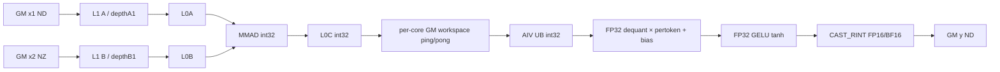

# FusedQuantMatmulWeightNz A2/A3 ACLNN 算子知识

## 算子速览

| 项目 | 内容 |
|---|---|
| 实际入口 | `aclnnFusedQuantMatmulWeightNzGetWorkspaceSize` + `aclnnFusedQuantMatmulWeightNz`；固定仓仅有这一版公开 WeightNz 入口 |
| 计算语义 | int8/int4 矩阵乘的 int32 累加，经 `x2Scale` 与逐 token `x1Scale` 反量化，按 bias dtype 在 MM 或 Vector 侧加 bias，再执行 `gelu_tanh` 或 `gelu_erf` |
| 输入输出 | `x1` 为 ND，`x2` 必须是物理 FRACTAL_NZ 亲和排布，输出 ND；公开接口覆盖 A8W8/A4W4，输出 FP16/BF16 |
| 执行类型 | 单 Kernel `MIX_CV`：AIC Cube Matmul producer + AIV Vector 反量化/bias/GELU/cast consumer，AIC:AIV 模板比例 1:1 |
| Kernel 路线 | R-001 `gelu_tanh`；R-002 `gelu_erf`；每条路线含 `transA/transB` 四个编译期 specialization |
| 核心资源 | GM 输入/输出；框架 system workspace + 每 AIC 两块 `baseM*baseN` int32 交接区；Matmul 管理 L1/L0A/L0B/L0C；AIV 使用 UB TQue/TBuf 与寄存器/Vector API |
| 来源闭包 | `source_closed`：公开两段式 API→WeightNz 元数据校验/前处理→`FusedQuantMatMul` launcher→Unary Tiling/共享 Basic Tiling→`fused_quant_mat_mul`→`BmmDequantPertokenBasic` 与两种 GELU epilogue 均在固定源码闭合 |
| 验证状态 | 已完成源码闭包检查；本次知识提取未执行编译、真机、数值或性能测试。 |

## 接口与语义

### 计算语义

令逻辑矩阵维度为 `x1[..., M, K]`（转置时交换末两维语义）和 `x2[..., K, N]`，其中 `x2` 的物理存储是 FRACTAL_NZ。Cube 先做 int32 累加 `acc=x1@x2`。若 bias 是 INT32，bias 由 Matmul `SetBias` 在 int32 累加域加入；否则 AIV 先反量化再以 FP32 加 bias。AIV 随后执行 `acc*x2Scale*x1Scale`，其中 `x2Scale` 是 `(N,)` per-channel 或 `(1,)` per-tensor，`x1Scale` 是 `(M,)` per-token。最终依 `fusedOpType` 执行源码实现的 tanh 近似 GELU 或 erf 近似 GELU，再以 `CAST_RINT` 转为 FP16/BF16。

### 输入、输出与属性

| 参数 | shape/layout | dtype | 约束、默认值与语义 |
|---|---|---|---|
| `x1` | ND，rank 2–6 | INT8；INT4 或打包 INT32 表示 A4 | 必选；末维不超过 65535；A4 仅 ND、不转置，逻辑 K 为偶数；INT32 每元素装 8 个 INT4 |
| `x2` | 逻辑 rank 2–6；物理 NZ rank 4–8 | 与 `x1` 同为 INT8 或同为 INT4/打包 INT32 | WeightNz 专属校验要求物理 storage 元素数等于推导的 NZ shape；转置布局 `(batch,k1,n1,n0,k0)`，非转置布局 `(batch,n1,k1,k0,n0)` |
| `x1Scale` | `(M,)` ND | FLOAT32 | 必选，逐 token scale |
| `x2Scale` | `(N,)` 或 `(1,)` ND | FLOAT32；BF16 仅 BF16 输出 | 必选，per-channel/per-tensor scale |
| `biasOptional` | `(N,)` 或 `(batch,1,N)` ND | INT32/FP16/FP32；BF16 输出另支持 BF16 | 可空；A4 只支持一维；INT32 在 Cube 累加域加入，其余在 AIV FP32 路径加入 |
| `yScaleOptional/x1OffsetOptional/x2OffsetOptional/yOffsetOptional/x3Optional` | 空 Tensor 或空指针 | N/A | 当前公开入口不支持非空值 |
| `fusedOpType` | 标量字符串 | STRING | 仅 `gelu_tanh`、`gelu_erf` |
| `groupSizeOptional` | 标量 | INT64 | 当前必须为 0 |
| `out` | `[...,M,N]` ND，rank 2–6 | FP16/BF16 | 必选；可为非连续 view，末尾由 `ViewCopy` 提交 |

### 入口与版本

固定 Commit 中只声明公开两段式 `aclnnFusedQuantMatmulWeightNz`，没有 `V2/V3` WeightNz 入口，因此它是 A2/A3 的最新公开版本。它与非 WeightNz 入口共享 common process 和底层 `FusedQuantMatMul`，但入口额外验证并建立 `x2` 的 FRACTAL_NZ view；本卡不把非 WeightNz 语义并入版本族。官方文档明确 A2/A3 支持、Ascend 950PR/950DT 不支持。

## Host/Launcher 执行流程

### 参数校验与前处理

第一段入口先拒绝空 `x2` 和 view rank 小于 2；若 `x2` view 表示末两维转置，先交换 view shape，再由 `GetWeightNzShape` 按 INT8/INT4 与转置状态推导 `(n1,k1,k0,n0)` 或 `(k1,n1,n0,k0)`，`CheckWeightNzStorageShape` 以物理元素乘积验证已是亲和格式。`SetTensorToNZFormat` 只创建元数据 view，不执行 ND→NZ 转换。

common process 依次检查必选/保留参数，处理 `x1/x1Scale/x2Scale/bias` 的 Contiguous 或末两维 view，保留已是 NZ 的 `x2`；打包 INT32 输入由 view 改成 INT4 并把末维乘 8。随后校验 A8W8/A4W4、scale shape、QuantMatmul 公共约束，调用 `l0op::FusedQuantMatMul`，最后必要时 reshape 并 `ViewCopy` 到用户 `out`。任一前处理或 launcher 节点创建失败立即返回，不继续提交后继。

### 参数、Workspace 与生命周期

`CREATE_EXECUTOR` 持有所有临时 view、Contiguous/ViewCopy 节点与单个 `FusedQuantMatMul` launcher。第一段返回 `uniqueExecutor->GetWorkspaceSize()` 并把 executor 转交调用方；第二段在同一 stream 上由 `CommonOpExecutorRun` 执行。

核心 Kernel 的 workspace 为：

```text
workspace_total = libApiWorkSpaceSize
                + 2 * usedCoreNum * baseM * baseN * sizeof(int32_t)
```

`GetUserWorkspace(workSpace)` 越过框架 system workspace；用户区按 AIC 核分片，每核 ping/pong 各 `baseM*baseN` 个 int32。其 owner 是 executor/workspace，生命周期覆盖整次 stream 执行；AIC 写完一片后以 event 交给同 launch 的 AIV，AIV 回告后该片才可覆盖。

### 启动图与失败传播

```text
aclnnFusedQuantMatmulWeightNzGetWorkspaceSize
  -> metadata views / optional Contiguous
  -> l0op::FusedQuantMatMul
     -> INFER_SHAPE(FusedQuantMatMul)
     -> ADD_TO_LAUNCHER_LIST_AICORE(FusedQuantMatMul)
        -> FusedQuantMatMulTilingFunc
           -> FusedQuantMatMulUnaryTiling(priority 2 on supportL0c2Out platform)
        -> fused_quant_mat_mul<MIX_AIC_1_1>(blockDim=usedCoreNum)
           -> AIC: Matmul -> per-core int32 workspace ping/pong
           -> AIV: dequant -> per-token scale -> optional bias -> GELU -> cast -> y
  -> optional Reshape -> ViewCopy(out)
aclnnFusedQuantMatmulWeightNz
  -> CommonOpExecutorRun(workspace, executor, stream)
```

Launcher list 中的前处理、核心节点和输出提交保持 executor 的 stream 顺序。核心节点内部显式 event 保证 AIC/AIV 可见性。第一段任一节点无法创建即不返回有效 executor；第二段直接传播 `CommonOpExecutorRun` 状态。

## Route 与参数设计

### 分核与资源计算

Tiling 从 origin shape 按 transpose 得到 M/K/N，广播 batch 得到 `batchA/batchB/batchC`。Unary 模板强制 `CheckUseBasicTiling()==true`，调用共享 Basic Tiling：候选 `baseM/baseN` 来自 64–512 的离散集合，`baseK` 来自 32–1024，依据 L0 容量、计算/搬运比与 core 分布选取；`singleCoreK=K`。`usedCoreNum=min(ceil(M/baseM)*ceil(N/baseN), aicNum)`，L2 tile 再决定行/列顺序。

L1 深度初值各取约半 L1：`depthA1=elements((L1/2)/(baseM*baseK),dtypeA)`，`depthB1=elements((L1/2)/(baseN*baseK),dtypeB)`；若两者加保留区超限，较大深度折半；`stepKa=depthA1/2`、`stepKb=depthB1/2` 后按 256 B 与 K 高/低轴修正，再恢复双缓冲深度。`dbL0C` 仅在 `baseM*baseN*sizeof(int32)*2` 和 bias/scale 保留区可容纳时取 2，否则取 1。

AIV 固定 `ubCalcN=baseN`，从平台 UB 扣除 broadcast、bias 常驻区后，按每 M 行的 int32 输入、FP16/BF16 输出、FP32 反量化/广播与双缓冲开销求 `ubCalcM=min(remaining/bytesPerM,baseM,M)`；求得 0 即 tiling 失败。

### Route 选择

| 顺序 | Route | Key/模板 | 精确选择条件与优先级 | 不适用去向 |
|---:|---|---|---|---|
| 1 | R-001 GELU_TANH | `(TRANS=0/1/2/3,BASIC=1,PERTOKEN=1,OPTION=0,FUSED=3)` | A2/A3、WeightNz 校验通过、A8W8/A4W4、`fusedOpType==gelu_tanh`；四个 TRANS 值依 `(transA<<1)\|transB` | 任一校验/tiling/launch 失败返回错误；不回退非 WeightNz |
| 2 | R-002 GELU_ERF | `(TRANS=0/1/2/3,BASIC=1,PERTOKEN=1,OPTION=0,FUSED=4)` | 同上且 `fusedOpType==gelu_erf` | 同上 |

```text
if x2 不是可验证的物理 NZ: ACLNN_ERR_PARAM_INVALID
else if fusedOpType == "gelu_tanh": R-001 / EpilogueDequantGeluTanh
else if fusedOpType == "gelu_erf": R-002 / EpilogueDequantGeluErf
else: ACLNN_ERR_PARAM_INVALID
TRANS = (transposeX1 << 1) | transposeX2
```

### 模板/实现执行矩阵

| Route | key/selector | dtype/shape/platform 完整命中条件 | 执行族与 kernel 节点 | 实际模板/body | 内存与同步特征 | tail/fallback |
|---|---|---|---|---|---|---|
| R-001 GELU_TANH | TRANS 0/1/2/3；FUSED=3 | A2/A3；A8W8 或 A4W4；x1Scale FP32；x2Scale/out/bias 合法；x2 NZ；GELU tanh | 单节点 MIX_CV：AIC Cube→AIV Vector | `BmmDequantPertokenBasic<x1Type,x2Type,scaleType,yType,ND,NZ,aTrans,bTrans,QuantBatchMatmulV3Update,EpilogueDequantGeluTanh>` | 每核双 int32 WS；实际 flag 6/7 为 AIC→AIV，4/5 为 AIV→AIC；UB FP32 GELU | M/N 由 `singleCoreM/N` 尾块，AIV M 再按 task ratio/UB 切；无语义 fallback |
| R-002 GELU_ERF | TRANS 0/1/2/3；FUSED=4 | 同上，GELU erf | 同一 MIX_CV 图 | 同上，epilogue 为 `EpilogueDequantGeluErf` | 同上，另复用 broadcast FP32 区作 `xSquared` | 同上 |

四个 TRANS specialization 的节点图、POD、同步、累加与 tail 相同；差异仅是 Matmul A/B transpose 模板实参、`SetOrgShape` 和 `QuantBatchMatmulV3Update::CalcGMOffset` 的 NZ 地址式，故在各 Route 行显式枚举全部 key 而不丢失 specialization。

### 隐藏性能 Guard

| Guard | Host/Tiling 条件 | Device/资源原因 | 影响 Route | 不满足时去向 | 源码符号 |
|---|---|---|---|---|---|
| 公开平台 | docs A2/A3=√，950=× | 公开支持优先于 dormant arch35 源码 | 全部 | 950 不发布 | `docs/aclnnFusedQuantMatmulWeightNz.md::产品支持情况` |
| WeightNz 物理形状 | `prod(storageShape)==prod(GetWeightNzShape(...))` | Kernel 按 NZ offset 解释 x2，无 TransData 节点 | 全部 | `ACLNN_ERR_PARAM_INVALID` | `CheckWeightNzStorageShape` |
| 量化模式 | x1Scale 必为 `(M,)`，x2Scale 为 `(N,)` 或 `(1,)` | AIV 按行 broadcast per-token、按列读 scale | 全部 | 参数错误 | `CheckQuantScaleShape` |
| UB 可容纳 | `needUbSize < ubSize` 且 `ubCalcM>0` | 每个 AIV 子块需同时容纳 int32、FP32 中间、scale/bias 与输出 | 全部 | tiling 失败 | `CalcUbTiling(baseN,baseM)` |
| L1 深度 | `depthABytes+depthBBytes < L1-reserve`，不足时较大 depth 折半 | A/B L1 双缓冲与 INT32 bias 保留区不能重叠 | 全部 | 无合法 stepK 则 tiling 失败 | `CalcL1Tiling` |
| L0C 双缓冲 | `baseM*baseN <= l0cSize/2/4` 且 bias/scale 可容纳 | 决定 `dbL0C=2` 或 1 | 全部 | 单缓冲，不是失败 | `CheckDbL0c` |
| workspace | user slice 为 `2*usedCoreNum*baseM*baseN*4` B | AIC/AIV ping-pong 交接 | 全部 | workspace 获取/执行失败 | `GetUbDequantExtreSpace` |
| INT4 transpose | A4W4 只允许不转置，K 满足 packing/alignment | int4 view 与 NZ k0 物理解释固定 | A4W4 子实例 | 参数错误 | `QuantMatmulChecker::CheckParams`、公开文档 |

### POD/ABI

`QuantBatchMatmulV3Params` 使用 `#pragma pack(8)`、`alignas(8)`；32 个 `uint32_t` 连续排列，`sizeof=128`、`alignof=8`。下表的 offset 为字节。未被 Basic route 显式赋值的字段由 value-initialized tiling object 保持 0，Device 当前 route 不读取。

| 结构 | 字段 | 类型/位宽 | ABI 布局 | 单位 | Host/launcher producer | Device consumer | 边界 |
|---|---|---|---|---|---|---|---|
| `QuantBatchMatmulV3Params` | `batchA` | uint32/32 | off 0 | batch | `SetMatmulTilingFromBasicTiling` | `InitTilingData` | `batchA>=1` |
| 同上 | `batchB` | uint32/32 | off 4 | batch | 同上 | 同上 | `batchB>=1` |
| 同上 | `batchC` | uint32/32 | off 8 | batch | 同上 | `Process` batch loop | 广播后的 batch |
| 同上 | `batchA1` | uint32/32 | off 12 | batch axis | inactive=0 | 当前 body 不读 | inactive |
| 同上 | `batchA2` | uint32/32 | off 16 | batch axis | inactive=0 | 当前 body 不读 | inactive |
| 同上 | `batchA3` | uint32/32 | off 20 | batch axis | inactive=0 | 当前 body 不读 | inactive |
| 同上 | `batchA4` | uint32/32 | off 24 | batch axis | inactive=0 | 当前 body 不读 | inactive |
| 同上 | `batchB1` | uint32/32 | off 28 | batch axis | inactive=0 | 当前 body 不读 | inactive |
| 同上 | `batchB2` | uint32/32 | off 32 | batch axis | inactive=0 | 当前 body 不读 | inactive |
| 同上 | `batchB3` | uint32/32 | off 36 | batch axis | inactive=0 | 当前 body 不读 | inactive |
| 同上 | `batchB4` | uint32/32 | off 40 | batch axis | inactive=0 | 当前 body 不读 | inactive |
| 同上 | `batchC1` | uint32/32 | off 44 | batch axis | inactive=0 | 当前 body 不读 | inactive |
| 同上 | `batchC2` | uint32/32 | off 48 | batch axis | inactive=0 | 当前 body 不读 | inactive |
| 同上 | `batchC3` | uint32/32 | off 52 | batch axis | inactive=0 | 当前 body 不读 | inactive |
| 同上 | `batchC4` | uint32/32 | off 56 | batch axis | inactive=0 | 当前 body 不读 | inactive |
| 同上 | `singleCoreBatch` | uint32/32 | off 60 | batch | inactive=0 | 当前 basic body 不读 | inactive |
| 同上 | `isPerTensor` | uint32/32 | off 64 | bool | `DoOpTiling` | scale scalar/GM 分支 | 0/1 |
| 同上 | `isPertoken` | uint32/32 | off 68 | bool | `DoOpTiling`，恒 1 | key/epilogue | 必须 1 |
| 同上 | `isDoubleScale` | uint32/32 | off 72 | bool | inactive=0 | 当前 body 不读 | inactive |
| 同上 | `biasThreeDim` | uint32/32 | off 76 | bool | `batchBias>1` | batch bias offset | 0/1；A4 仅 0 |
| 同上 | `ubCalcM` | uint32/32 | off 80 | element rows | `CalcUbTiling` | AIV M loop/UB alloc | `1..min(baseM,M)` |
| 同上 | `ubCalcN` | uint32/32 | off 84 | elements | `CalcUbTiling` | AIV UB alloc | `baseN` |
| 同上 | `needUbBuffer` | uint32/32 | off 88 | bytes | `ubCalcM*ubCalcN*8` | `vecQueTmp_` | UB 上界内 |
| 同上 | `realSingleCoreM` | uint32/32 | off 92 | elements | inactive basic=0 | 当前 body 不读 | inactive |
| 同上 | `realSingleCoreN` | uint32/32 | off 96 | elements | inactive basic=0 | 当前 body 不读 | inactive |
| 同上 | `biasDtype` | uint32/32 | off 100 | GE dtype enum | `DoOpTiling` | bias branch/size | 支持表内 |
| 同上 | `ubSize` | uint32/32 | off 104 | bytes | inactive=0 | 当前 body 不读 | inactive |
| 同上 | `isMClash` | uint32/32 | off 108 | bool | Basic scheduler | block scheduler | 0/1 |
| 同上 | `isNClash` | uint32/32 | off 112 | bool | Basic scheduler | block scheduler | 0/1 |
| 同上 | `groupSizeM` | uint32/32 | off 116 | elements | inactive=0 | 当前 body 不读 | groupSize=0 |
| 同上 | `groupSizeN` | uint32/32 | off 120 | elements | inactive=0 | 当前 body 不读 | groupSize=0 |
| 同上 | `groupSizeK` | uint32/32 | off 124 | elements | inactive=0 | 当前 body 不读 | groupSize=0 |
| `TCubeTiling` | `M/N/Ka/Kb` | 外部定义 | composite off 128；字段 offsetof/sizeof 固定仓不可见 | elements | `SetMatmulTilingFromBasicTiling` | Matmul/offset/body | M/N/K 合法且可窄化 |
| 同上 | `usedCoreNum` | 外部定义 | 固定仓不可见 | AIC cores | Basic Tiling | block guard、WS slice | `<=aicNum` |
| 同上 | `singleCoreM/N/K` | 外部定义 | 固定仓不可见 | elements | Basic Tiling | block/tail | M/N 尾块可小于 base |
| 同上 | `baseM/baseN/baseK` | 外部定义 | 固定仓不可见 | elements | Basic Tiling | Matmul/UB/workspace | 资源约束内 |
| 同上 | `depthA1/depthB1` | 外部定义 | 固定仓不可见 | baseK stages | `CalcL1Tiling` | Matmul library | 与 stepK/DB 一致 |
| 同上 | `stepM/stepN/stepKa/stepKb` | 外部定义 | 固定仓不可见 | tiles/stages | Basic Tiling | Matmul library | 非 0 |
| 同上 | `iterateOrder/dbL0C/isBias` | 外部定义 | 固定仓不可见 | enum/count/bool | Basic Tiling/Matmul tiling | Matmul library | dbL0C 1/2 |
| `L2cacheTileParam` | `mTileCntL2` | uint32/32 | off 0，struct size 24 align 8 | tiles | `DoL2CacheTiling` | `QuantBatchMatmulV3BaseBlock` | >=1 |
| 同上 | `nTileCntL2` | uint32/32 | off 4 | tiles | 同上 | 同上 | >=1 |
| 同上 | `mTileBlock` | uint32/32 | off 8 | base blocks | 同上 | 同上 | >=1 |
| 同上 | `nTileBlock` | uint32/32 | off 12 | base blocks | 同上 | 同上 | >=1 |
| 同上 | `calOrder` | uint32/32 | off 16 | enum | `DetermineCalcOrder` | block scheduler | row/col |
| 同上 | `isBasicTiling` | uint32/32 | off 20 | bool | 固定 1 | block scheduler | 1 |
| `SlidingWindowParam` | `mTailTile/nTailTile/mBaseTailSplitCnt/nBaseTailSplitCnt/mTailMain/nTailMain` | 各 uint32/32 | offsets 0/4/8/12/16/20；size 24 align 8 | tiles | inactive=0 | 当前 basic body 不读 | inactive |
| `QuantBatchMatmulV3TilingData` | `params/matmulTiling/tileL2cacheTiling/adaptiveSlidingWin` | composite align 8 | `params` off 0；其余因外部 `TCubeTiling` 大小在固定仓不可见 | bytes | `PostTiling` 8 B 对齐 memcpy | kernel `GET_TILING_DATA` | Host/Device 共用头 |

### Route 源码闭包

| Route | Key/selector | Host/Tiling producer | POD/参数 | Kernel entry/router | Kernel body/直接依赖 | 构建接线 |
|---|---|---|---|---|---|---|
| R-001 GELU_TANH | TRANS 0–3/BASIC/PERTOKEN/FUSED=3 | `fused_quant_matmul_unary_tiling.cpp::GetTilingKey` + QBMM Basic Tiling | `QuantBatchMatmulV3TilingData` | `fused_quant_mat_mul` + `EpilogueTypeTraits<GELU_TANH>` | `BmmDequantPertokenBasic`、`EpilogueDequantGeluTanh`、`QuantBatchMatmulV3Update` | `FusedQuantMatMul` OpDef 添加 ascend910b/ascend910_93 dynamic config |
| R-002 GELU_ERF | TRANS 0–3/BASIC/PERTOKEN/FUSED=4 | 同上 | 同上 | `fused_quant_mat_mul` + `EpilogueTypeTraits<GELU_ERF>` | 同上，epilogue 为 `EpilogueDequantGeluErf` | 同上 |

## Kernel 实现

### 公共执行流程

entry 拒绝空 workspace/user workspace，解析 `QuantBatchMatmulV3TilingData`，按 key 实例化 `BmmDequantPertokenBasic`。`blockIdx=GetBlockIdx()/GetTaskRation()`，`subBlockIdx=GetSubBlockIdx()`；MIX 模板为 `MIX_AIC_1_1`。每个 AIC 依据 L2 tile 蛇形遍历 M/N 基本块，以 `MatmulImpl<GM ND,GM NZ,VECIN int32,GM int32 bias,MM_DEFAULT_MDL_CFG>` 完成 Cube 计算并把 L0C 结果写入本核 ping/pong workspace。对应 AIV 等待实际 AIC→AIV event（6/7），按 sub-block 切 M，GM→UB 读取 int32，完成 epilogue，再发实际 AIV→AIC 复用 event（4/5）；AIC 从第三块开始等待复用回告，结尾补等最初跳过的 ping/pong。

### Route R-001：GELU_TANH

#### 适用条件

##### 选择证据

| 层级 | 文件 | 符号 | 源码谓词/参数 | 结果/下一跳 |
|---|---|---|---|---|
| API | `op_host/op_api/aclnn_fused_quant_matmul.cpp` | `CheckFusedOpType` | 字符串等于 `gelu_tanh` | 继续；否则检查 erf 或失败 |
| Tiling | `op_host/op_tiling/fused_quant_matmul_unary_tiling.cpp` | `AnalyzeAttrs/GetTilingKey` | map 到 enum 3；`TRANS=(transA<<1)\|transB`，BASIC=1，PERTOKEN=1，OPTION=0 | R-001 key |
| Router | `op_kernel/fused_quant_mat_mul.cpp` | `fused_quant_mat_mul` | `FUSED_OPTYPE=3`，TRANS 四分支 | `EpilogueDequantGeluTanh` |

#### Device 数据流

##### 函数级调用链

```text
fused_quant_mat_mul<TRANS,BASIC,PERTOKEN,0,GELU_TANH>
  -> BmmDequantPertokenBasic::Init
  -> BmmDequantPertokenBasic::Process
    -> QuantBatchMatmulV3Update::UpdateBlockParamsAndCalcGmOffset
    -> BasicMMCVFusionCompute
      -> AIC BasicMMCompute -> MatmulImpl::Iterate/GetTensorC(workspace)
      -> AIV EpilogueDequantGeluTanh::Process
        -> EpilogueDequantCommon::DequantCompute
        -> ComputeGeluTanh
        -> CopyOutToGM
  -> End
```

##### 源码等价伪码

```text
for batch, L2_M_tile, snake(L2_N_tile), each block round:
  update M/N tail and x1/x2(NZ)/scale/bias/out offsets
  ws = 2*blockIdx*baseM*baseN + pong*baseM*baseN
  AIC:
    if produced_tiles > 2: wait reuse flag (4|pong)
    int32 C = Matmul(x1, NZ_weight, optional_int32_bias)
    write C to ws
    notify PIPE_FIX data-ready flag (6|pong)
  AIV:
    wait data-ready flag (6|pong)
    split current M by task ratio and ubCalcM
    copy int32 ws tile to UB
    dequant FP32 by x2 scale; broadcast/multiply FP32 x1Scale
    if bias dtype != INT32: cast/load bias to FP32 and add
    x = x / (1 + exp(-1.5957691*(x + 0.044715*x^3)))
    CAST_RINT x to FP16/BF16; copy valid M*N to ND y
    notify PIPE_MTE2 reuse flag (4|pong)
  pong = !pong
AIC waits outstanding ping/pong; Matmul End
```

#### 内存与数据搬运

##### 资源与搬运表

| 层级/缓冲区 | offset/地址公式 | extent/容量公式 | dtype/layout | producer | consumer | owner/lifetime | 对齐/复用 |
|---|---|---|---|---|---|---|---|
| GM x1 | batch offset + M tile offset；非转置 `mOffset*K` | 逻辑 batch*M*K | int8/int4 ND | caller | Matmul A | caller/launch | Matmul 按 base/tail 搬入 L1/L0A |
| GM x2 | trans: `nOffset*C0`；non-trans: `nOffset*align(K,16)` | NZ 物理 storage | int8/int4 FRACTAL_NZ | caller | Matmul B | caller/launch | k0/n0 依 dtype/transpose |
| L1 A/B | Matmul specialization 内部 | `depthA1*baseM*baseK*bytesA` + `depthB1*baseN*baseK*bytesB`，另 INT32 bias `baseN*dbL0C*4` | Cube tiles | MTE2 | L0A/L0B | Matmul/当前 tile | depth 为 stepK×2 |
| L0A/L0B | N/A：地址由外部 Matmul primitive 管理 | 当前 `baseM*baseK`、`baseN*baseK` tile，准确内部 offset 固定仓不可见 | Cube native | Matmul load | MMAD | Matmul iterate | base/tail |
| L0C | Matmul 内部 | `baseM*baseN*4*dbL0C` B 容量约束 | int32 | MMAD | Fixpipe/GetTensorC | 当前 tile | dbL0C=1/2 |
| user workspace | `(2*blockIdx+pong)*baseM*baseN*4` B | `2*usedCoreNum*baseM*baseN*4` B | int32 ND tile | AIC `GetTensorC` | paired AIV | executor/launch | ping-pong；event 防覆盖 |
| UB src/out | per AIV sub-block | `2*ubM*ubN*4` + `2*ubM*ubN*2` B | int32 + yType | MTE2/Vector | Vector/MTE3 | AIV tile | TQue depth 2 |
| UB FP32/Tmp | local offset由 TPipe | `needUbBuffer + 2*ubM*ubN*4` B，加 broadcast `ubM*ubN*4` B | FP32/byte | dequant/broadcast | bias/GELU | AIV tile | GELU 复用 `outFp32Tmp` |
| UB scale/bias | scale/bias GM offset | pertoken `2*align(ubM,8)*4`；perchannel `2*ubN*scaleBytes`；非 INT32 bias `2*ubN*biasBytes+ubN*4` | FP32/BF16/FP16 | GM copy/cast | dequant/add | AIV tile | 条件分配 |
| GM y | `offsetC + mLoop*ubM*N + subBlock*N` | 有效 `curAivM*curAivN*yBytes` | FP16/BF16 ND | AIV MTE3 | caller | caller | 行 stride N，尾块不写 padding |

##### 分层内存布局



##### 字节账、交接边与复用顺序

```text
workspace_user = 2 * usedCoreNum * baseM * baseN * 4
workspace_total = libApiWorkSpaceSize + workspace_user
L1 = depthA1*baseM*baseK*bytesA + depthB1*baseN*baseK*bytesB
     + (biasDtype==INT32 ? baseN*dbL0C*4 : 0)
L0C_capacity = baseM*baseN*4*dbL0C
UB = 2*ubM*ubN*4 + needUbBuffer + 2*ubM*ubN*2
     + ubM*ubN*4(outFp32) + ubM*ubN*4(broadcast)
     + 2*align(ubM,8)*4
     + (!perTensor ? 2*ubN*scaleBytes : 0)
     + (biasDtype!=INT32 ? 2*ubN*biasBytes + ubN*4 : 0)
```

| 边/复用子区 | producer | offset/extent | dtype/layout | consumer | ordering/sync | owner/lifetime | 安全条件 |
|---|---|---|---|---|---|---|---|
| AIC→AIV ping | `BasicMMCompute` | `(2*core)*baseM*baseN`，有效 tail M*N | int32 ND tile | epilogue | `NotifyEvent<PIPE_FIX>(6)` / `WaitEvent(6)` | user WS/到 AIV 完成 | 同核配对；调用的第二实参是 `V2C_PING_FLAG`，虽常量名相反 |
| AIC→AIV pong | 同上 | `(2*core+1)*baseM*baseN` | 同上 | 同上 | flag 7 | 同上 | 同上 |
| AIV→AIC ping reuse | epilogue 完成 WS 读取 | ping slice | N/A | 下一轮 AIC | `NotifyEvent<PIPE_MTE2>(4)`；AIC 第三轮前 `WaitEvent(4)` | 同上 | 最初 ping 无需预等；调用第一实参是 `C2V_PING_FLAG` |
| AIV→AIC pong reuse | 同上 | pong slice | N/A | 下一轮 AIC | flag 5（`4\|1`） | 同上 | 最初 pong 无需预等；End 补等待 |

#### 同步、精度与尾块

##### 同步与数值边界表

| 阶段 | primitive/机制 | producer | consumer/等待点 | 保护对象 | 精度/尾块 |
|---|---|---|---|---|---|
| Cube→WS→Vector | `NotifyEvent<PIPE_FIX>` / `WaitEvent` | AIC Fixpipe | paired AIV | ping/pong int32 slice | MM int32 累加；M/N `SetTail` |
| Vector→Cube reuse | `NotifyEvent<PIPE_MTE2>` / `WaitEvent` | AIV 完成读取/计算 | AIC 第三次及后续覆盖 | 同 slice | 双缓冲轮次由 `pongSwitch` |
| UB vector | TQue + `PipeBarrier<PIPE_V>` | GM copy/dequant/broadcast | 后续 mul/bias/GELU | UB local tensors | x2Scale 与 x1Scale 结果为 FP32；非 INT32 bias cast 到 FP32 |
| GELU tanh | 逐 Vector API barrier | FP32 input | output cast | FP32 tmp | 源码 sigmoid 形式 tanh 近似；处理 `curM*align(curN,16)` |
| 输出 | `SetFlag/WaitFlag<V_MTE3>` + `DataCopy` | FP32 GELU/cast | GM y | output UB | `CAST_RINT`；仅复制有效 N，行 stride 保持全局 N |

#### 关键实现

##### 符号证据表

| 阶段 | 文件 | 符号/模板实例 | 实现事实 |
|---|---|---|---|
| Host/Tiling producer | `fused_quant_matmul_unary_tiling.cpp` | `AnalyzeInputs/AnalyzeDtype/GetTilingKey` | M/N/K、dtype、TRANS 与 GELU enum 生产 |
| Kernel entry/router | `fused_quant_mat_mul.cpp` | `INVOKE_FUSED_QUANT_MATMUL_DEQUANT_PERTOKEN_BASIC_IMPL` | key 映射到完整 Basic+epilogue 实例 |
| Device body/helper | `quant_batch_matmul_v3_pertoken_basic.h` | `BasicMMCVFusionCompute/BasicMMCompute` | MIX_CV 任务图、Matmul 与 event ping-pong |
| Device body/helper | `quant_batch_matmul_v3_basic_epilogue.h` | `EpilogueDequantGeluTanh` | FP32 scale/bias/GELU、RINT cast 与 tail copy |

### Route R-002：GELU_ERF

#### 适用条件

##### 选择证据

| 层级 | 文件 | 符号 | 源码谓词/参数 | 结果/下一跳 |
|---|---|---|---|---|
| API | `op_host/op_api/aclnn_fused_quant_matmul.cpp` | `CheckFusedOpType` | 字符串等于 `gelu_erf` | 继续，否则失败 |
| Tiling | `op_host/op_tiling/fused_quant_matmul_unary_tiling.cpp` | `AnalyzeAttrs/GetTilingKey` | map 到 enum 4，TRANS 0–3 | R-002 key |
| Router | `op_kernel/fused_quant_mat_mul.cpp` | `EpilogueTypeTraits` | `FUSED_OPTYPE=4` | `EpilogueDequantGeluErf` |

#### Device 数据流

##### 函数级调用链

```text
fused_quant_mat_mul<TRANS,BASIC,PERTOKEN,0,GELU_ERF>
  -> BmmDequantPertokenBasic::Process
  -> AIC BasicMMCompute
  -> AIV EpilogueDequantGeluErf::Process
    -> EpilogueDequantCommon::DequantCompute
    -> ComputeGeluErf
    -> CopyOutToGM
```

##### 源码等价伪码

```text
执行与 R-001 相同的 tile、Cube、workspace、双 scale 和 bias 流程；
AIV 对 FP32 x 先 clamp 到源码边界，令 z 为受限值：
  x2 = z*z
  p = ((((((a1*x2+a2)*x2+a3)*x2+a4)*x2+a5)*x2+a6)*x2+a7)*z
  y = x / (1 + exp(p))
随后 CAST_RINT 到 FP16/BF16 并按有效 M/N 写出。
```

#### 内存与数据搬运

##### 资源与搬运表

| 层级/缓冲区 | offset/地址公式 | extent/容量公式 | dtype/layout | producer | consumer | owner/lifetime | 对齐/复用 |
|---|---|---|---|---|---|---|---|
| GM/L1/L0/WS | 与 R-001 完全相同 | 与 R-001 相同 | int8/int4→int32 | Cube | AIV | 当前 tile | ping-pong |
| UB `tmpdstLocal` | 当前 UB M 子块 | `ubM*align(N,16)*4` B | FP32 | dequant/scale/bias | erf epilogue | AIV tile | 原位最终结果 |
| UB `tmpResLocal` | `outFp32Tmp` | `ubM*ubN*4` B | FP32 | erf polynomial | erf divide | AIV tile | 复用 dequant FP32 临时区 |
| UB `xSquaredTensor` | `broadcastFp32Tmp` | `ubM*ubN*4` B | FP32 | square/clamp | polynomial | AIV tile | 复用 pertoken broadcast 区，broadcast 已消费 |
| GM y | 与 R-001 相同 | 有效 M*N*yBytes | FP16/BF16 ND | AIV | caller | caller | `CAST_RINT` |

##### 分层内存布局


##### 字节账、交接边与复用顺序

```text
workspace/L1/L0/UB 总容量公式与 R-001 相同；
ERF 不新增 UB 分配：xSquared 复用 broadcastFp32Tmp，polynomial temp 复用 outFp32Tmp。
```

| 边/复用子区 | producer | offset/extent | dtype/layout | consumer | ordering/sync | owner/lifetime | 安全条件 |
|---|---|---|---|---|---|---|---|
| AIC→AIV / AIV→AIC | 同 R-001 | 同 R-001 | int32 tile | erf epilogue/AIC | flags 4/5/6/7 | user WS | 同 R-001 |
| broadcast→xSquared 复用 | `PertokenCalculate` | `ubM*ubN*4` B | FP32 | `ComputeGeluErf` | `PIPE_V` barriers | AIV tile | pertoken multiply 已完成后复用 |

#### 同步、精度与尾块

##### 同步与数值边界表

| 阶段 | primitive/机制 | producer | consumer/等待点 | 保护对象 | 精度/尾块 |
|---|---|---|---|---|---|
| MIX_CV | 实际 AIC→AIV 6/7，AIV→AIC 4/5 | AIC/AIV | paired side | WS ping/pong | 与 R-001 相同 |
| ERF polynomial | 每步 `PipeBarrier<PIPE_V>` | 前一 FP32 op | 下一 FP32 op | tmp/xSquared | 源码先 `Maxs(...,-13.15)`、再 `Mins(...,5.751)`；系数均 FP32 |
| 输出 | V_MTE3 flag + copy | cast | GM | y tile | `CAST_RINT`，M/N 尾块同 R-001 |

#### 关键实现

##### 符号证据表

| 阶段 | 文件 | 符号/模板实例 | 实现事实 |
|---|---|---|---|
| Host/Tiling producer | `fused_quant_matmul_unary_tiling.cpp` | `FUSED_UNARY_OP_TYPE_STR_TO_ENUM_MAP/GetTilingKey` | `gelu_erf`→4 |
| Kernel entry/router | `fused_quant_mat_mul.cpp` | `EpilogueTypeTraits<GELU_ERF>` | 选择 erf epilogue |
| Device body/helper | `quant_batch_matmul_v3_basic_epilogue.h` | `EpilogueDequantGeluErf::ComputeGeluErf` | clamp、FP32 多项式/exp/div 与 buffer 复用 |

## 算子特定优化

### Trick T-001：AIC/AIV 单 Kernel int32 ping-pong 交接

#### 触发与源码依据

- 适用 Route：R-001、R-002
- 触发条件：Unary Basic key，`MIX_AIC_1_1`，每个有效 basic tile
- Golden 来源：[`quant_batch_matmul_v3_pertoken_basic.h:266-282`](../../../../../../../cann-ops-raw/ascendc/ops-nn/955f8b33985b6d72989ebff341bb9c2c564a51bc/matmul/quant_batch_matmul_v3/op_kernel/quant_batch_matmul_v3_pertoken_basic.h#L266-L282)

**官方源码（固定 Commit 连续逐字摘录）**：

```cpp
if ASCEND_IS_AIC {
    if (++loop_ > 2) {
        WaitEvent(v2cSyncFlag);
    }
    BasicMMCompute(CurAicM, CurAicN);
    NotifyEvent<PIPE_FIX>(c2vSyncFlag);
}

if ASCEND_IS_AIV {
    WaitEvent(c2vSyncFlag);
    auto epilogueParams = InitEpilogueParams(CurAicM, CurAicN);
    epilogue_.Process(epilogueParams);
    NotifyEvent<PIPE_MTE2>(v2cSyncFlag);
}
```

#### 机制与设计原因

AIC 直接把 int32 L0C 结果写入每核双缓冲 GM workspace，AIV 在同一 launch 消费。按调用实参而不是常量名追踪：AIC 以 flags 6/7 通知两片数据可供 AIV 消费，AIV 以 flags 4/5 回告对应片可复用。前两次生产无需等待，第三次起 AIC 等待回告，使 Cube 与 Vector 能在不同 ping/pong 上流水，同时防止覆盖尚未读完的结果。

#### 迁移边界

- 适用：需要 Cube int32 累加后接 Vector 反量化/激活，且平台支持 MIX_CV event 的单 Kernel。
- 前提：AIC:AIV 配对、每核两片 workspace、flag ID/pipe 语义与当前 task ratio 一致。
- 失效：若改为多 Kernel、改变 AIC:AIV 比例或让 AIV 异步延长生命周期，必须重做 offset、轮次与同步，不能沿用本协议。
- 未验证：本次知识提取未执行编译、真机、数值或性能测试。

#### 错误做法

省略第三轮的复用 wait（实际 flag 4/5）会允许 AIC 覆盖 AIV 尚未消费的 ping/pong；省略 `End` 的补等待会让 Matmul 生命周期在最后 AIV 完成前结束。

### Trick T-002：WeightNz 只做元数据 view，不在入口物化转置

#### 触发与源码依据

- 适用 Route：R-001、R-002
- 触发条件：公开 WeightNz 入口，用户已提供与推导 NZ shape 元素数一致的 storage
- Golden 来源：[`aclnn_fused_quant_matmul.cpp:334-343`](../../../../../../../cann-ops-raw/ascendc/ops-nn/955f8b33985b6d72989ebff341bb9c2c564a51bc/matmul/fused_quant_mat_mul/op_host/op_api/aclnn_fused_quant_matmul.cpp#L334-L343)

**官方源码（固定 Commit 连续逐字摘录）**：

```cpp
op::Shape weightNzShape = GetWeightNzShape(x2, transposeX2);
if (!CheckWeightNzStorageShape(weightNzShape, x2->GetStorageShape())) {
  OP_LOGE(ACLNN_ERR_PARAM_INVALID,
          "x2'format only support NZ, but now x2's format is not NZ(Ascend affinity format). \
aclnnCalculateMatmulWeightSizeV2 and aclnnTransMatmulWeight can be used to convert the input format from ND to Ascend \
affinity format.");
  return ACLNN_ERR_PARAM_INVALID;
}
auto uniqueExecutor = CREATE_EXECUTOR();
x2 = SetTensorToNZFormat(x2, weightNzShape, uniqueExecutor.get());
```

#### 机制与设计原因

接口把格式转换成本留给显式权重预处理 API；运行时仅验证物理容量并创建 FRACTAL_NZ metadata view。Kernel 因而可直接按 NZ k0/n0 地址式读取持久化权重，不在每次 Matmul 前添加 TransData 节点。

#### 迁移边界

- 适用：权重已由官方 size/transform API 预排布且 storage 生命周期覆盖执行。
- 前提：dtype、transpose、逻辑 shape 与实际 NZ 物理布局完全匹配。
- 失效：普通 ND 权重即使逻辑 shape 相同也不得伪装；应先调用公开转换 API。
- 未验证：本次知识提取未执行编译、真机、数值或性能测试。

#### 错误做法

只令 tensor format 字段为 NZ 而未提供真实 NZ storage，会让 Kernel 的 `offsetB` 解释错误；源码通过 storage 元素数拦截一部分不匹配，但元素数相同不能替代调用方对真实布局的保证。

### Trick T-003：GELU 在 FP32 epilogue 中完成后一次性 RINT cast

#### 触发与源码依据

- 适用 Route：R-001、R-002
- 触发条件：AIV 已完成 int32→FP32 反量化、per-token scale 和可选非 INT32 bias
- Golden 来源：[`quant_batch_matmul_v3_basic_epilogue.h:313-323`](../../../../../../../cann-ops-raw/ascendc/ops-nn/955f8b33985b6d72989ebff341bb9c2c564a51bc/matmul/quant_batch_matmul_v3/op_kernel/quant_batch_matmul_v3_basic_epilogue.h#L313-L323)

**官方源码（固定 Commit 连续逐字摘录）**：

```cpp
for (uint32_t mUbLoopIdx = 0; mUbLoopIdx < mUbLoops; ++mUbLoopIdx) {
    if (mUbLoopIdx == mUbLoops - 1) {
        curAivM = params.curAicM - params.ubCalcM * (mUbLoops - 1);
        DequantBmm::CalcDequantParams(curAivM, params.curAicN, dequantParams, mUbLoops != 1 && curAivM != params.ubCalcM);
    }
    uint32_t dequantComputeInfo[4] = {curAivM, curAivN, mUbLoopIdx, subBlockoffset};
    commonDequant.DequantCompute(params, dequantComputeInfo, padParams, dequantParams, tmpdstLocal);

    CalGeluTanh(params, tmpdstLocal, curAivM, curAivN);

    commonDequant.CopyOutToGM(params, tmpdstLocal, curAivM, curAivN, mUbLoopIdx, subBlockoffset);
}
```

#### 机制与设计原因

反量化、两级 scale、非 INT32 bias 与 GELU 保持 FP32；`CopyOutToGM` 才 `Cast(..., RoundMode::CAST_RINT)`。这避免在激活前落到 FP16/BF16，也让 M 尾块通过重新计算 dequant 参数后复用同一 epilogue。

#### 迁移边界

- 适用：输出 FP16/BF16、前序 int32 累加且允许当前 GELU 近似式。
- 前提：保留 FP32 UB 容量、Barrier 顺序和 `CAST_RINT`。
- 失效：更改 GELU 定义、round mode 或提前 cast 会改变数值语义，必须作为新 specialization 验证。
- 未验证：本次知识提取未执行编译、真机、数值或性能测试。

#### 错误做法

固定源码提供的反例边界是 `CopyOutToGM` 才 cast；把 cast 提到 `CalGelu*` 前会降低激活输入精度并偏离当前实现。

## 模板与实现对比

| 对比维度 | R-001 GELU_TANH | R-002 GELU_ERF | 设计选择依据 |
|---|---|---|---|
| 命中条件/优先级 | `fusedOpType=gelu_tanh`，FUSED=3 | `fusedOpType=gelu_erf`，FUSED=4 | API 字符串 map 与 key 最后一维 |
| 执行族/节点图 | 单 Kernel MIX_CV | 单 Kernel MIX_CV | 共享 Basic Matmul producer，只换 epilogue class |
| M/N/K、tile 与 scheduler | Basic Tiling，TRANS 0–3 | 相同 | 激活不参与 tile 选择 |
| workspace/L1/L0/UB | 双 int32 WS；FP32 tmp/broadcast | 容量相同；erf 复用两块 FP32 buffer | 不额外分配 erf 缓冲 |
| AIC/AIV 或 kernel 交接 | AIC→AIV flags 6/7；AIV→AIC flags 4/5 | 相同 | `BasicMMCVFusionCompute` 公共实现；方向由调用实参决定 |
| 同步、精度与 tail | FP32 sigmoid 形式 tanh 近似，RINT cast | FP32 clamp+多项式+exp/div，RINT cast | `EpilogueTypeTraits` |
| fallback/失败边界 | 无其它 fused op fallback | 无其它 fused op fallback | 非法字符串直接失败 |

## 平台差异

| 项目 | A2 | A3 | 950 |
|---|---|---|---|
| 支持状态 | 官方公开支持 | 官方公开支持 | 官方文档明确不支持 |
| Host/Launcher | 同一 WeightNz API、OpDef `ascend910b` config | 同一 API、OpDef `ascend910_93` config | 不生成正式卡 |
| Kernel/资源 | `__CCE_AICORE__==220` Unary Basic MIX_CV 路线 | 同一源码路线；资源数值由 platform info 产生 | arch35/mc62 文件存在不构成公开支持，且不覆盖官方“×” |

## 限制与失败边界

- 空必选指针、空 Tensor、非法 rank/dtype/shape/format、非法 fusedOpType 或非空保留参数均失败；源码 common process 对 `CheckInputExistence` 的失败返回 `ACLNN_ERR_PARAM_NULLPTR`，而公开文档把部分保留参数错误列为 `ACLNN_ERR_PARAM_INVALID`，复用时应以真实 API 返回链为准并保留该差异。
- WeightNz 路线不把 ND 权重在线转换为 NZ；需先用公开 weight size/transform API。storage 元素数相等只是入口检查，调用方仍必须保证真实物理排布。
- `TCubeTiling` 定义来自固定仓外的 `kernel_tiling/kernel_tiling.h`；当前仓能闭合字段 producer/consumer，但不能给出其逐字段 `offsetof/sizeof`，不得猜测。
- Matmul primitive 内部 L1/L0 实际地址分配属于 AscendC 库边界；本卡保留了当前实例 type/layout/base/depth/step/db 与容量约束，没有外推库内部实现。
- 本次知识提取未执行编译、真机、数值或性能测试。

## 源码索引

### 链路索引

| 链路阶段 | 文件 | 关键符号 | 支撑内容 |
|---|---|---|---|
| 入口声明/约束 | `matmul/fused_quant_mat_mul/docs/aclnnFusedQuantMatmulWeightNz.md` | 产品表/约束说明 | A2/A3 支持、950 不支持、公开语义与 dtype/layout |
| 入口声明/约束 | `matmul/fused_quant_mat_mul/op_host/op_api/aclnn_fused_quant_matmul_weight_nz.h` | 两段式 API | 精确签名 |
| 入口实现 | `matmul/fused_quant_mat_mul/op_host/op_api/aclnn_fused_quant_matmul.cpp` | `aclnnFusedQuantMatmulWeightNzGetWorkspaceSize/CommonProcess` | WeightNz 校验、executor 图、错误传播 |
| 入口实现 | `matmul/quant_batch_matmul_v4/op_host/op_api/quant_matmul_common_check.cpp` | `GetWeightNzShape/SetTensorToNZFormat/PostMatmulCalcProcess` | NZ view、Contiguous 与 ViewCopy |
| 入口实现 | `matmul/fused_quant_mat_mul/op_host/op_api/fused_quant_matmul.cpp` | `l0op::FusedQuantMatMul` | infer 与 launcher 添加 |
| Host/Tiling/Launcher | `matmul/fused_quant_mat_mul/op_host/op_tiling/fused_quant_matmul_tiling.cpp` | `FusedQuantMatMulTilingFunc` | 平台能力到 Unary 模板分发 |
| Host/Tiling/Launcher | `matmul/fused_quant_mat_mul/op_host/op_tiling/fused_quant_matmul_unary_tiling.cpp` | `FusedQuantMatMulUnaryTiling` | M/N/K、dtype、GELU 与 key |
| Host/Tiling/Launcher | `matmul/quant_batch_matmul_v3/op_host/op_tiling/quant_batch_matmul_v3_basic_tiling.cpp` | `DoBasicTiling/SetMatmulTilingFromBasicTiling` | base、L1、L2、POD |
| Host/Tiling/Launcher | `matmul/quant_batch_matmul_v3/op_host/op_tiling/quant_batch_matmul_v3_tiling.cpp` | `CalcUbTiling/GetWorkspaceSize/PostTiling` | UB、workspace、blockDim |
| Kernel entry/body | `matmul/fused_quant_mat_mul/op_kernel/fused_quant_mat_mul.cpp` | `fused_quant_mat_mul` | entry 与模板 router |
| Kernel entry/body | `matmul/quant_batch_matmul_v3/op_kernel/quant_batch_matmul_v3_kernel_tiling_data.h` | `QuantBatchMatmulV3TilingData` | POD ABI |
| Kernel entry/body | `matmul/quant_batch_matmul_v3/op_kernel/quant_batch_matmul_v3_pertoken_basic.h` | `BmmDequantPertokenBasic` | Cube/AIV 图、内存、同步 |
| Kernel entry/body | `matmul/quant_batch_matmul_v3/op_kernel/quant_batch_matmul_v3_basic_epilogue.h` | 两个 GELU epilogue | FP32 反量化/激活/tail |
| Kernel entry/body | `matmul/quant_batch_matmul_v3/op_kernel/quant_batch_matmul_v3_update.h` | `CalcGMOffset` | ND/NZ/trans 地址式 |
| 构建接线 | `matmul/fused_quant_mat_mul/op_host/fused_quant_mat_mul_def.cpp` | `FusedQuantMatMul/OP_ADD` | ascend910b/ascend910_93 注册、dynamic format/shape |

### 实现复用检查

| 检查项 | 可复用事实 | 不得改变的约束 | 源码符号 |
|---|---|---|---|
| ABI/POD | 128 B params + TCube/L2/sliding composite | 字段顺序、32 位宽、8 B pack；外部 TCube layout 不可猜 | `QuantBatchMatmulV3TilingData` |
| 调用顺序 | WeightNz view→launcher→MIX_CV→ViewCopy | 不可把 ND 权重直接标 NZ或越过错误返回 | `aclnnFusedQuantMatmulGetWorkspaceSizeCommonProcess` |
| workspace/内存 | 每核两个 `baseM*baseN` int32 slice | system prefix、2 倍深度、core offset 和 owner/lifetime | `GetUbDequantExtreSpace/InitGlobalBuffers` |
| 同步 | 实际 AIC→AIV flags 6/7、AIV→AIC flags 4/5 | 第三轮 wait、End 补等待、PIPE_FIX/PIPE_MTE2；勿按常量名猜方向 | `BasicMMCVFusionCompute/End` |
| 精度与尾块 | int32 MM；FP32 dequant/scale/bias/GELU；RINT 输出 | bias INT32 与非 INT32 的加入位置、M/N/UB tail | `DequantCompute/CopyOutToGM` |
| 失败边界 | 无非 WeightNz 或其它 fused op fallback | 950 官方不支持；非法 NZ/资源/key 必须失败 | API checks/Tiling/router |