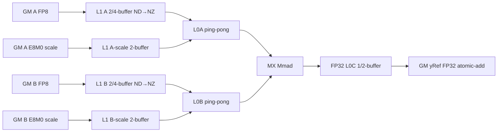
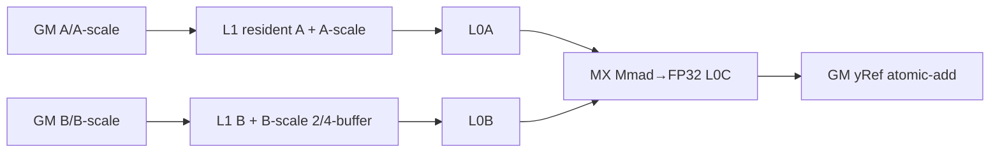
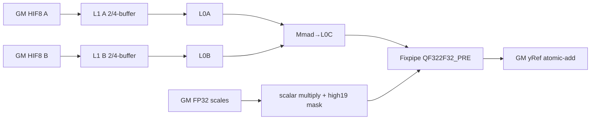
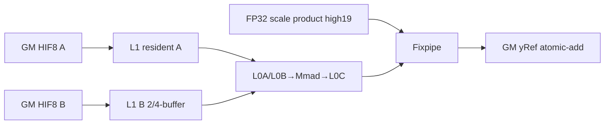

# QuantBatchMatmulInplaceAdd 950 ACLNN 算子知识

## 算子速览

| 项目 | 内容 |
|---|---|
| 实际入口 | `aclnnQuantBatchMatmulInplaceAddGetWorkspaceSize` + `aclnnQuantBatchMatmulInplaceAdd`，公开 ACLNN 两段式接口；固定仓只存在这一公开版本 |
| 计算语义 | 将 MX FP8 或 HIFLOAT8 T-T 矩阵乘结果量化/反量化为 FP32，并以 FP32 atomic-add 原地累加到 `yRef` |
| 输入输出 | `x1:[K,M]`、`x2:[K,N]`、`yRef:[M,N]`，均 ND；仅 `transposeX1=true, transposeX2=false`；MX scale 为 `[ceil(K/64),M,2]` 与 `[ceil(K/64),N,2]`，HIF8 scale 均为 `[1]` |
| 执行类型 | 四条 Route 均为单节点 `AIC_CUBE`；tiling key 明确声明 `ASCENDC_TPL_AIC_ONLY`，无 AIV、SIMT、NDDMA、通信或 MIX_CV 节点 |
| Kernel 路线 | R-001 MX 默认装载；R-002 MX A-L1 全载；R-003 HIF8 Fixpipe 默认装载；R-004 HIF8 Fixpipe A-L1 全载 |
| 核心资源 | GM、executor/system workspace、L1、L0A/L0B/L0C、BT、Fixpipe；无 UB 路线；`workspace` 参数未被目标 Kernel body 读取 |
| 来源闭包 | source_closed：公开 ACLNN→校验/连续化→L0 AICore launcher→两级 priority/`IsCapable` selector→152-byte POD→四个 key→scheduler→MX/HIF8 Cube body→CMake/binary config 均在固定 Commit 内闭合；Contiguous/ViewCopy 与 executor 为标注的框架边界 |
| 验证状态 | 已完成源码闭包检查；本次知识提取未执行编译、真机、数值或性能测试。 |

## 接口与语义

### 计算语义

MX 路线按 K 轴每 32 元素分组。公开公式等价为：

```text
yRef[m,n] += Σ_j (Σ_(k in group j) x1[k,m] * x2[k,n])
                         * x1Scale[j,m] * x2Scale[j,n]
j = 0 .. ceil(K/32)-1
```

公开 scale 的物理 shape 以 64 个 K 元素为第一维、末维 2 个 E8M0 值，因此一个 `ceil(K/64)×2` 物理组覆盖两个 32 元素量化组。K 尾部不足 32 时，Device 在 L1 将 K 补到 64 对齐，MMAD 只提交有效语义。

HIFLOAT8 T-T 路线为：

```text
deqScale = x1Scale[0] * x2Scale[0]
yRef[m,n] += (Σ_(k=0..K-1) x1[k,m] * x2[k,n]) * deqScale
```

`QuantMmBatchMX<..., true>` 与 `QuantMmBatchCube<..., true>` 在计算前执行 `SetAtomicAdd<float>()`，最终 `DataCopy`/`Fixpipe` 写入 `yRef` 时完成原地 FP32 累加。HIF8 的 `deqScale` 在 Device 标量读取后仅保留 FP32 编码高 19 位（`bits & 0xFFFFE000`）供 Fixpipe 使用；这一步位于乘法之后、atomic-add 之前。

### 输入、输出与属性

| 参数 | shape/layout | dtype | 约束、默认值与语义 |
|---|---|---|---|
| `x1` | `[K,M]`，ND | MX：FLOAT8_E4M3FN/E5M2；HIF8：HIFLOAT8 | rank=2，K/M>0；逻辑上按转置后的 `[M,K]` 参与乘法 |
| `x2` | `[K,N]`，ND | 与路线匹配的 FP8 或 HIFLOAT8 | rank=2，K/N>0，K 与 `x1` 相等；不转置 |
| `x1ScaleOptional` | MX `[ceil(K/64),M,2]`；HIF8 `[1]` | MX FLOAT8_E8M0；HIF8 FLOAT32 | API 名称虽为 optional，`CheckNotNull` 与 Host helper 都要求非空 |
| `x2Scale` | MX `[ceil(K/64),N,2]`；HIF8 `[1]` | MX FLOAT8_E8M0；HIF8 FLOAT32 | 必选；MX 最后一维必须为 2 |
| `yRef` | `[M,N]`，ND | FLOAT32 | 输入输出同一逻辑 tensor；M/N 必须匹配；Device 以 atomic-add 累加 |
| `transposeX1` | 标量 | bool | 必须为 `true`；非连续的“末两维转置视图”可由 Host 翻转属性而不插入转置 Kernel |
| `transposeX2` | 标量 | bool | 必须为 `false` |
| `groupSize` | 标量 | int64 | 低 48 位编码 `groupSizeK \| groupSizeN<<16 \| groupSizeM<<32`；MX 最终必须 `[1,1,32]`（编码 4295032864），HIF8 必须 0 |

### 入口与版本

公开 API 文档只支持 Ascend 950PR/Ascend 950DT，并明确 A2、A3 不支持。`OpDef` 仅把同一配置注册给 `ascend950/ascend350`，tiling template 只注册 `NpuArch::DAV_3510`，binary config 只列 `ascend950`。本卡因此只覆盖 950，且固定仓没有同平台更高版本入口或旧版 body 分支。

## Host/Launcher 执行流程

### 参数校验与前处理

第一段接口的真实顺序是：

```text
CREATE_EXECUTOR
  -> x2Scale/x1Scale: SetTensorToNDFormat
  -> x1/x2: TensorContiguousProcess
       已是末两维转置 view -> CreateView + 翻转 transpose attr
       其它非连续 -> Contiguous framework node
  -> MX scale: 检测最后三维交换 stride；可 CreateView，否则 Contiguous
  -> InferGroupSize（仅 rank>=2 scale）
  -> CheckGroupSize
  -> CheckNotNull -> CheckFormat -> CheckDtype -> CheckShape
  -> QBMMIAGetTransposeAttrValue（二次解析 view stride）
  -> l0op::QuantBatchMatmulInplaceAdd
       INFER_SHAPE(output=yRef shape)
       ADD_TO_LAUNCHER_LIST_AICORE
  -> ViewCopy(result,yRef)
  -> executor.GetWorkspaceSize + ReleaseTo
```

ACLNN 校验拒绝：空指针；非 ND storage format；非法 dtype 组合；rank 非 2；`transposeX1!=true` 或 `transposeX2!=false`；M/N/K 非正；K 或输出 shape 不匹配；MX scale shape/末维/groupSize 不匹配；HIF8 scale 非 `[1]` 或 groupSize 非 0。代码只在 `DAV_3510` 分支检查空 M/N，但此前 `CheckMKN` 已拒绝非正维度，所以公开路径不会提交空域 Kernel。

### 参数、Workspace 与生命周期

L0 调用把输入按 OpDef 顺序重排为 `x1,x2,x2Scale,yRef,x1Scale`，并把 `yRef` 同时作为输入与输出加入单个 AICore launcher。Tiling 的 `GetWorkspaceSize()` 设置：

```text
target_core_workspace = inputParams.libApiWorkSpaceSize
executor_workspace = target_core_workspace
                   + Contiguous/ViewCopy 等框架节点的实际需求
```

目标 entry 接收 `workspace` 但不读取它，也没有用户 workspace slice 或跨 Kernel 中间结果；`libApiWorkSpaceSize` 是平台提供的 system workspace。调用方必须按第一段返回值分配 workspace，并保持 executor、输入、scale、`yRef` 与 workspace 到给定 stream 完成。第二段只调用 `CommonOpExecutorRun`，任一 launcher 失败返回 `ACLNN_ERR_INNER`。

### 启动图与失败传播

```text
aclnnQuantBatchMatmulInplaceAddGetWorkspaceSize
  -> framework Contiguous/View（按实际 stride，可无 Device 节点）
  -> QuantBatchMatmulInplaceAddTilingFunc
       supportL12BtBf16 && DAV_3510
       priority 0 MX -> priority 1 HIF8 Cube -> fail
  -> quant_batch_matmul_inplace_add<Atrans=1,Btrans=0,kernelType>
       [单个 AIC_CUBE 节点，blockDim=usedCoreNum]
       -> atomic FP32 accumulate into yRef
  -> framework ViewCopy（结果已别名 yRef 时为框架边界）
```

同一 executor 内节点按同一 stream 提交；前处理、InferShape、Tiling、launcher 添加、Kernel launch 或 ViewCopy 任一步失败都会阻止成功返回。目标 launch graph 没有跨 Kernel、跨 AIC/AIV 或 workspace 交接边。

## Route 与参数设计

### 分核与资源计算

Host 由 `[K,M]×[K,N]` 和固定属性得到 `M=x1.dim1, K=x1.dim0, N=x2.dim1, batchC=1`。公共推导顺序如下：

```text
baseM = align(min(M,256), transA ? 32B/sizeof(A) : 16)
baseN = align(min(N,256), transB ? 16 : 32B/sizeof(B))
baseK = align(min(128B/sizeof(A),K), MX ? 64 : 32B/sizeof(A))
if initial tiles < AIC count:
  rebalance M/N by 128B alignment and L0A half-capacity
mBlockCnt = ceil(M/baseM); nBlockCnt = ceil(N/baseN)
totalBlockCnt = mBlockCnt*nBlockCnt
tailWinBlockCnt = totalBlockCnt % aicNum
usedCoreNum = (totalWinCnt>1 || tailWinBlockCnt==0)
                ? aicNum
                : tailWinBlockCnt*mTailTile*nTailTile
```

`dbL0C=2` 当 `baseM*baseN*4*2<=L0C_size` 且 `CheckBiasAndScale` 成立，否则为 1。L1 calculator 先扣除 bias/per-channel scale（本算子 bias 永远关闭；HIF8 为 per-tensor），再求 `depthA1/depthB1` 和 `stepKa/stepKb`；MX 的 stepK 上限为 4。POD 不直接保存 depth，而保存实际消费的 `stepKa/stepKb`。`nBufferNum` 根据 4-buffer 的逻辑占用是否严格小于 L1 决定 4 或 2。

A-L1 全载的完整谓词为：

```text
sizeof(A)*realBaseM*K <= L1_size/2
&& mBlockCnt < 4
&& aicNum % mBlockCnt == 0
&& totalBlockCnt > aicNum
&& batchC == 1
```

其中 `realBaseM = (mBaseTailSplitCnt==1 ? baseM : mTailMain)`；命中后强制 `baseM=realBaseM`、`mBaseTailSplitCnt=1`。其余已通过同量化模式 `IsCapable` 的输入进入默认装载 Route。

### Route 选择

| 顺序 | Route | Key/模板 | 精确选择条件与优先级 | 不适用去向 |
|---:|---|---|---|---|
| 1 | R-001 MX 默认装载 | `(ATRANS=1,BTRANS=0,KERNELTYPE=0)`；`BlockMmadMx<MatmulWithScale<...,0>>` | priority 0；x1/x2 均为 E4M3FN/E5M2，scale 均 E8M0，MX group `[1,1,32]`，且 A-full-load 谓词为 false | A-full-load true→R-002；MX 不成立→priority 1 |
| 2 | R-002 MX A-L1 全载 | `(1,0,1)`；`BlockMmadMx<MatmulWithScale<...,A_FULL_LOAD_MODE>>` | R-001 的 MX 条件且完整 A-full-load 谓词为 true | 谓词 false→R-001 |
| 3 | R-003 HIF8 Fixpipe 默认装载 | `(1,0,2)`；`BlockMmadA8W8FixpipeQuant<...,0>` | priority 1；x1/x2 HIFLOAT8，两个 scale FP32 `[1]`，double-scale+per-tensor，且 A-full-load 谓词 false | A-full-load true→R-004；不满足则 Tiling 失败 |
| 4 | R-004 HIF8 Fixpipe A-L1 全载 | `(1,0,3)`；`BlockMmadA8W8FixpipeQuant<...,A_FULL_LOAD_MODE>` | R-003 的 HIF8 条件且完整 A-full-load 谓词为 true | 谓词 false→R-003 |

```text
if !supportL12BtBf16 or arch!=DAV_3510: fail
try priority 0:
  if IsMxQuant && IsMxBasicApiCapable:
    if A-full-load: R-002 else R-001
try priority 1:
  if IsHiFloat8TTQuant && IsCubeBasicApiCapable:
    if A-full-load: R-004 else R-003
fail: no valid template
```

### 模板/实现执行矩阵

| Route | key/selector | dtype/shape/platform 完整命中条件 | 执行族与 kernel 节点 | 实际模板/body | 内存与同步特征 | tail/fallback |
|---|---|---|---|---|---|---|
| R-001 MX 默认 | `(1,0,0)` | 950；2D TT；FP8+E8M0；group `[1,1,32]`；非全载 | 单 `AIC_CUBE` | `QuantMmBatchMX<...,BlockMmadMx<...,0>,...,true>` | A/B 及两侧 scale 分块进 L1；2/4-buffer；L0A/B ping-pong；L0C 1/2-buffer；MTE/FIX/MM flags；atomic FP32 GM 写回 | K 补 64；M/N scheduler tail；无 Device fallback |
| R-002 MX A-full | `(1,0,1)` | R-001 + 全载谓词 | 单 `AIC_CUBE` | 同上，dispatch policy `A_FULL_LOAD_MODE` | A 与 A-scale 只装一次并跨 N tile 复用；B/B-scale 仍轮换 | 全载失效即 R-001 |
| R-003 HIF8 默认 | `(1,0,2)` | 950；2D TT；HIF8+FP32 scalar scales；非全载 | 单 `AIC_CUBE` | `QuantMmBatchCube<...,BlockMmadA8W8FixpipeQuant<...,0>,...,true>` | A/B 分块进 L1；L0 MMAD；FP32 scale 相乘后截高 19 位；Fixpipe→atomic GM | K 尾按 `curKL0`；M/N tail；无 fallback |
| R-004 HIF8 A-full | `(1,0,3)` | R-003 + 全载谓词 | 单 `AIC_CUBE` | 同上，dispatch policy `A_FULL_LOAD_MODE` | A 全载 L1，B 2/4-buffer；其余同 R-003 | 全载失效即 R-003 |

### 隐藏性能 Guard

| Guard | Host/Tiling 条件 | Device/资源原因 | 影响 Route | 不满足时去向 | 源码符号 |
|---|---|---|---|---|---|
| 公开平台 | `supportL12BtBf16 && npuArch==DAV_3510` | 当前 basic-api 依赖 950 L1→BT BF16 能力与 arch35 specialization | 全部 | Tiling 失败 | `QuantBatchMatmulInplaceAddTilingFunc` |
| A-full-load | 上述五项完整谓词 | A 与 MX A-scale 必须驻留 L1 一半容量，且 M tile/core 排布可复用 | R-002/R-004 | R-001/R-003 | `UpdateAFullLoadStatus` |
| Base 对齐 | MX `baseK` 64；TT 下 `baseM` 32B/sizeof(A)、`baseN` 32B/sizeof(B)；初值上限 256 | ND→NZ、MX scale group 和 L0 load 对齐 | 全部 | base calculator 调整；仍为 0 则失败 | `BaseBlockCalculator` |
| L0C DB | `baseM*baseN*4*2<=l0cSize` 且 scale/bias guard | 两份 FP32 L0C tile 必须同时容纳 | 全部 | `dbL0C=1` | `CalL1Tiling` |
| L1 2/4-buffer | 4-buffer 逻辑占用 `<l1Size` | L1 地址表固定按 2/4-buffer 分区 | 全部 | `nBufferNum=2` | `CalculateNBufferNum4MX/Cube` |
| MX scale factor | `1<=scaleFactorA/B<=127` | POD 为 uint16，但实现只接受 7-bit有效范围；控制一次 scale L1 覆盖的 K 段 | R-001/R-002 | 写默认 1 | `DoLibApiTiling` |
| tail 分核 | tail split 总核数 `<=aicNum`，分片满足 32B/NZ 对齐 | 防越界并维持 MTE 对齐 | 全部 | 保留较小合法 split，最小 1 | `CalcTailBasicBlockSplit` |
| K/M/N 窄化 | API 检查正数和 `M*N` int64 溢出，但固定仓未见写入 uint32 POD 前的 `UINT32_MAX` 检查 | POD 中 M/N/K/base 均为 uint32 | 全部 | 无源码 fallback；属于失败/复用边界 | `DoLibApiTiling` + POD |

### POD/ABI

`#pragma pack(push,8)` 下所有成员最大自然对齐为 4；三个子结构大小分别 88、40、24 bytes，顶层 `sizeof=152, alignof=4`。下表 offset 均相对顶层 `QuantBatchMatmulInplaceAddTilingData`；Host 先零初始化，再由 `SetCommonTilingData`、Route `SetTilingData/DoLibApiTiling` 写入，Device 在 wrapper、scheduler 和 block MMAD 中消费。

| 结构 | 字段 | 类型/位宽 | ABI 布局 | 单位 | Host/launcher producer | Device consumer | 边界 |
|---|---|---|---|---|---|---|---|
| `params` | `batchA` | uint32/32 | size 88；off 0 | batch 数 | `SetCommonTilingData` | `ProblemShape/QBMM` | 本接口 2D，实际为 1 |
| `params` | `batchB` | uint32/32 | off 4 | batch 数 | 同上 | 同上 | 实际为 1 |
| `params` | `batchC` | uint32/32 | off 8 | batch 数 | 同上 | `problemShape.b` | 实际为 1 |
| `params` | `batchA1` | uint32/32 | off 12 | batch 轴 | 同上 | `ProcessWithBatch` | 2D 默认 1 |
| `params` | `batchA2` | uint32/32 | off 16 | batch 轴 | 同上 | `ProcessWithBatch` | 2D 默认 1 |
| `params` | `batchA3` | uint32/32 | off 20 | batch 轴 | 同上 | `ProcessWithBatch` | 2D 默认 1 |
| `params` | `batchA4` | uint32/32 | off 24 | batch 轴 | 同上 | `ProcessWithBatch` | 2D 默认 1 |
| `params` | `batchB1` | uint32/32 | off 28 | batch 轴 | 同上 | `ProcessWithBatch` | 2D 默认 1 |
| `params` | `batchB2` | uint32/32 | off 32 | batch 轴 | 同上 | `ProcessWithBatch` | 2D 默认 1 |
| `params` | `batchB3` | uint32/32 | off 36 | batch 轴 | 同上 | `ProcessWithBatch` | 2D 默认 1 |
| `params` | `batchB4` | uint32/32 | off 40 | batch 轴 | 同上 | `ProcessWithBatch` | 2D 默认 1 |
| `params` | `batchC1` | uint32/32 | off 44 | batch 轴 | 同上 | `ProcessWithBatch` | 2D 默认 1 |
| `params` | `batchC2` | uint32/32 | off 48 | batch 轴 | 同上 | `ProcessWithBatch` | 2D 默认 1 |
| `params` | `batchC3` | uint32/32 | off 52 | batch 轴 | 同上 | `ProcessWithBatch` | 2D 默认 1 |
| `params` | `batchC4` | uint32/32 | off 56 | batch 轴 | 同上 | `ProcessWithBatch` | 2D 默认 1 |
| `params` | `x1QuantMode` | uint32/32 | off 60 | enum | MX 写 `MX_PERGROUP_MODE`；HIF8 写 `PERTENSOR_MODE` | Cube wrapper/Kernel | Route 必须匹配 |
| `params` | `x2QuantMode` | uint32/32 | off 64 | enum | 同上 | Cube wrapper/Kernel | Route 必须匹配 |
| `params` | `biasThreeDim` | uint32/32 | off 68 | bool | `batchBias>1` | batch bias offset | 本算子 `hasBias=0`，为 0 |
| `params` | `biasDtype` | uint32/32 | off 72 | ge dtype enum | `SetCommonTilingData` | 仅 bias specialization | inactive，body 不读 bias GM |
| `params` | `groupSizeM` | uint32/32 | off 76 | elements/group | group parser | MX offset helper | MX=1；HIF8=0 |
| `params` | `groupSizeN` | uint32/32 | off 80 | elements/group | group parser | MX offset helper | MX=1；HIF8=0 |
| `params` | `groupSizeK` | uint32/32 | off 84 | elements/group | group parser | MX offset helper | MX=32；HIF8=0 |
| `matmulTiling` | `m` | uint32/32 | size 40；off 88 | elements | Route `DoLibApiTiling` | `ProblemShape` | 来自 uint64 M，注意窄化 |
| `matmulTiling` | `n` | uint32/32 | off 92 | elements | 同上 | `ProblemShape` | 来自 uint64 N |
| `matmulTiling` | `k` | uint32/32 | off 96 | elements | 同上 | `ProblemShape` | 来自 uint64 K |
| `matmulTiling` | `baseM` | uint32/32 | off 100 | elements/tile | base calculator | scheduler/MMAD | >0，按路线对齐 |
| `matmulTiling` | `baseN` | uint32/32 | off 104 | elements/tile | base calculator | scheduler/MMAD | >0，按路线对齐 |
| `matmulTiling` | `baseK` | uint32/32 | off 108 | elements/tile | base calculator | MMAD K loop | MX 64 对齐 |
| `matmulTiling` | `scaleKL1` | uint32/32 | off 112 | K elements | MX `min(scaleFactorA*stepKa*baseK, scaleFactorB*stepKb*baseK)` | MX scale L1 loop | HIF8 inactive=0 |
| `matmulTiling` | `stepKa` | uint16/16 | off 116 | baseK blocks | L1 calculator；MX 最终取 min(A,B) | A L1 K span | >0；MX<=4 |
| `matmulTiling` | `stepKb` | uint16/16 | off 118 | baseK blocks | L1 calculator | B L1 K span | >0；MX 与 A 相同 |
| `matmulTiling` | `scaleFactorA` | uint16/16 | off 120 | stepKa groups | MX L1 calculator | MX A-scale copy | MX 1..127；HIF8 inactive=0 |
| `matmulTiling` | `scaleFactorB` | uint16/16 | off 122 | stepKb groups | MX L1 calculator | MX B-scale copy | MX 1..127；HIF8 inactive=0 |
| `matmulTiling` | `nBufferNum` | uint8/8 | off 124 | L1 buffers | `CalculateNBufferNum4*` | MMAD address table | 2 或 4 |
| `matmulTiling` | `isBias` | uint8/8 | off 125 | bool | `hasBias?1:0` | Kernel/MMAD | 本算子恒 0 |
| `matmulTiling` | `dbL0C` | uint8/8 | off 126 | buffer depth | L0C guard | L0C ping-pong | 1 或 2 |
| `matmulTiling` | `reserved` | uint8/8 | off 127 | N/A | zero-init | 不读取 | 必须保持 0 |
| `adaptiveSlidingWin` | `mTailTile` | uint32/32 | size 24；off 128 | split 数 | tail calculator | scheduler | >=1 |
| `adaptiveSlidingWin` | `nTailTile` | uint32/32 | off 132 | split 数 | tail calculator | scheduler | >=1 |
| `adaptiveSlidingWin` | `mBaseTailSplitCnt` | uint32/32 | off 136 | merged tiles | edge balancer | scheduler | >=1；TT 属性使常规优化早退 |
| `adaptiveSlidingWin` | `nBaseTailSplitCnt` | uint32/32 | off 140 | merged tiles | edge balancer | scheduler | >=1 |
| `adaptiveSlidingWin` | `mTailMain` | uint32/32 | off 144 | elements | edge balancer | scheduler | inactive 时 0 |
| `adaptiveSlidingWin` | `nTailMain` | uint32/32 | off 148 | elements | edge balancer | scheduler | inactive 时 0 |

### Route 源码闭包

| Route | Key/selector | Host/Tiling producer | POD/参数 | Kernel entry/router | Kernel body/直接依赖 | 构建接线 |
|---|---|---|---|---|---|---|
| R-001 MX 默认 | priority 0；`(1,0,0)` | `QuantBatchMatmulInplaceAddMXBasicAPITiling` + adaptive/base/L1 calculators | `QuantBatchMatmulInplaceAddTilingData` | `quant_batch_matmul_inplace_add`→`QbmmiaMxBasicApiKernel<...,0>` | `QuantMmBatchMX`→scheduler→`BlockMmadMx` | op Kernel CMake + `ascendc_config.json` |
| R-002 MX A-full | priority 0；`(1,0,1)` | 同 R-001 + `UpdateAFullLoadStatus` | 同上 | entry→`QbmmiaMxBasicApiKernel<...,1>` | `BlockMmadMx<...,A_FULL_LOAD_MODE>` | 同上 |
| R-003 HIF8 默认 | priority 1；`(1,0,2)` | `QuantBatchMatmulInplaceAddCubeBasicAPITiling` + shared calculators | 同上 | entry→`QbmmiaCubeBasicApiKernel<...,0>` | `QuantMmBatchCube`→scheduler→`BlockMmadA8W8FixpipeQuant` | 同上 |
| R-004 HIF8 A-full | priority 1；`(1,0,3)` | 同 R-003 + `UpdateAFullLoadStatus` | 同上 | entry→`QbmmiaCubeBasicApiKernel<...,A_FULL_LOAD_MODE>` | `BlockMmadA8W8FixpipeQuant<...,A_FULL_LOAD_MODE>` | 同上 |

## Kernel 实现

### 公共执行流程

四条 Route 共用单个 AIC-only entry。entry 解析 152-byte POD，按编译期 dtype 和 `TPL_KERNEL_TYPE` 选择 MX/HIF8 wrapper；公开 Host 只产生 `(ATRANS,BTRANS)=(1,0)`。wrapper 固定：A 为 `ColumnMajor`、B 为 `RowMajor`、C 为 `RowMajorAlign`，scheduler 为 `QuantBatchMatmulV3Scheduler<FULL_LOAD_MODE>`，epilogue 类型为 `BlockEpilogueEmpty`，`isAtomicAdd=true`。

scheduler 用 `blockIdx=GetBlockIdx()/GetTaskRation()`；默认路线把 M 以最大 4 行窗口蛇形遍历 N，A-full 路线固定 `M=blockIdx%mCnt` 并沿 N 轮次推进。每个 tile 经 `Coordinate::GetQuantOffset` 得到 A/B/scale/C 元素 offset，M/N tail 再由 `GetBlockShape` 截断。没有合法 key 的 specialization 不调用任何 body；Host selector 的职责是只发出四个已注册 key。

### Route R-001：MX 默认装载

#### 适用条件

##### 选择证据

| 层级 | 文件 | 符号 | 源码谓词/参数 | 结果/下一跳 |
|---|---|---|---|---|
| ACLNN | `op_api/aclnn_quant_batch_matmul_inplace_add.cpp` | `CheckDtype/CheckShape/CheckGroupSize` | FP8×FP8、E8M0 scales、TT、`[1,1,32]` | 进入 L0；失败返回参数错误 |
| Tiling | `..._mx_basic_api_tiling.cpp` | `IsCapable` | `IsMxQuant() && AdaptiveSlidingWindowMXBasicAPITiling::IsCapable()` | priority 0 命中 |
| Tiling | shared adaptive MX file | `UpdateAFullLoadStatus` | A-full-load 谓词=false | kernelType 0 |
| Router | `op_kernel/arch35/quant_batch_matmul_inplace_add.cpp` | MX dispatch | `QBMMIA_IS_MX && TPL_KERNEL_TYPE==0` | `QbmmiaMxBasicApiKernel<...,0>` |

#### Device 数据流

##### 函数级调用链

```text
quant_batch_matmul_inplace_add<1,0,0>
  -> QbmmiaMxBasicApiKernel<FP8,FP8,FP32,ColumnMajor,RowMajor,RowMajorAlign,0>
    -> QuantMmBatchMX<...,BlockMmadMx<MatmulWithScale<...,0>>,...,true>::Run
      -> BlockSchedulerQuantBatchMatmulV3::GetTileIdx/GetBlockShape
      -> BlockMmadMx::operator()
        -> CopyScalesInL1 + CopyAInL1 + CopyBInL1
        -> CopyInL0A/CopyInL0B(scale-aware LoadData)
        -> Mmad -> CopyOut(DataCopy L0C->GM)
```

##### 源码等价伪码

```text
SetAtomicAdd<float>()
for each scheduler tile (mTile,nTile):
  choose 2/4-way L1 A/B buffer and 2-way scale buffer
  for kL1 segment:
    pad valid K to 64; copy A/B ND->NZ into L1
    copy A/B E8M0 scales for scaleKL1 into L1
    for kL0 tile:
      wait M_MTE1; LoadData(A,AScale)->L0A; LoadData(B,BScale)->L0B
      signal/wait MTE1_M; Mmad into FP32 L0C
      first K tile initializes C; last K tile sets unitFlag=3
  DataCopy L0C tile to GM with FP32 atomic-add
SetAtomicNone()
```

#### 内存与数据搬运

##### 资源与搬运表

| 层级/缓冲区 | offset/地址公式 | extent/容量公式 | dtype/layout | producer | consumer | owner/lifetime | 对齐/复用 |
|---|---|---|---|---|---|---|---|
| GM A/B | A `mOff + kOff*M`（ColumnMajor view）；B `kOff*N+nOff` | `M*K`、`K*N` bytes | FP8 ND | ACLNN inputs | ND→NZ copy | caller/stream | K tail padded to 64 in L1 |
| GM scales | coordinate-derived x1/x2 scale offsets | each `2*ceil(K/64)*M/N` bytes | E8M0 packed last-dim 2 | caller | scale copy + MX LoadData | caller/stream | 64-K physical group |
| GM C | `mOff*N+nOff` | `M*N*4` bytes | FP32 ND | prior `yRef` + atomic Kernel writes | caller | caller/stream | no overlap among logical tiles；atomic mode implements in-place add |
| workspace | N/A target slice | `libApiWorkSpaceSize` system area | bytes | executor | runtime/lib API | executor/stream | target body does not dereference |
| L1 A/B | `l1BufferA/BOffset[bufId]` | logical A `nBuf*baseM*kL1`；B `nBuf*baseN*kL1` bytes | FP8 NZ | MTE2 | MTE1 LoadData | AIC launch | 2/4-buffer；two L1 halves |
| L1 scales | `l1BufferScaleA/BOffset[bufId]` | 2-way A `2*baseM*ceil(scaleKL1/64)*2`；B analogous | E8M0 (reinterpreted half for paired values) | MTE2 | scale-aware LoadData | AIC launch | flags 4/5 |
| L0A/L0B | half offset `(pingpong&1)*HALF_L0_SIZE` | physical `L0A_SIZE`,`L0B_SIZE`；active tile约 `baseM*baseK`,`baseN*baseK` | MX L0 types | LoadData | Mmad | per core | two halves, K tail padded |
| L0C | `(l0cPingPong&1)*TOTAL_L0C_SIZE/2` | physical `TOTAL_L0C_SIZE` bytes；tile `baseM*baseN*4` | FP32 NZ/CO1 | Mmad | DataCopy/Fixpipe pipe | per core | depth=`dbL0C` |
| UB/寄存器 | N/A | N/A | N/A | N/A | N/A | N/A | AIC-only；scale由 MX LoadData消费 |

##### 分层内存布局



##### 字节账、交接边与复用顺序

```text
workspace_total(target) = libApiWorkSpaceSize; target user slice = 0
L1_logical = nBuf*(baseM*kL1 + baseN*kL1)
           + 2*(baseM+baseN)*ceil(scaleKL1/64)*2 bytes
L0A/L0B physical = L0A_SIZE + L0B_SIZE
L0C physical = TOTAL_L0C_SIZE; active tile bytes = dbL0C*baseM*baseN*4
UB_total = 0
```

| 边/复用子区 | producer | offset/extent | dtype/layout | consumer | ordering/sync | owner/lifetime | 安全条件 |
|---|---|---|---|---|---|---|---|
| L1 A/B slot | MTE2 ND→NZ | address table；one tile span | FP8 NZ | MTE1 | `MTE1_MTE2` wait→`MTE2_MTE1` set/wait→after Mmad set free | per-core L1 | `bufId=loop&(nBuf-1)`；nBuf 2/4 |
| L1 scale slot | MTE2 scale copy | two ping-pong scale offsets | paired E8M0 | MX LoadData | flags 4/5 `MTE1_MTE2` | per-core L1 | only released after all covered `scaleKL1` K segments |
| L0 ping-pong | MTE1 | half L0A/B | MX L0 tile | Mmad | `M_MTE1`→`MTE1_M` | per-core | alternate bit; tail K padded |
| L0C→GM | Mmad | tile `m*n*4` | FP32 | GM atomic add | unitFlag final + Fix/DataCopy pipeline | `yRef` caller-owned | scheduler tiles non-overlap；atomic mode remains required for read-modify-write |

#### 同步、精度与尾块

##### 同步与数值边界表

| 阶段 | primitive/机制 | producer | consumer/等待点 | 保护对象 | 精度/尾块 |
|---|---|---|---|---|---|
| L1 slot reuse | HardEvent `MTE1_MTE2` / `MTE2_MTE1` | MTE2/MTE1 | next copy/load | A/B L1 slot | prevents overwrite across 2/4 buffers |
| L0 load/MMAD | HardEvent `M_MTE1` / `MTE1_M` + `PipeBarrier<PIPE_MTE1>` | LoadData/MMAD | alternate half | L0A/L0B | K padded to 64；valid M/N retained |
| L0C submit | `unitFlag=2/3` | Mmad | final DataCopy | accumulated FP32 tile | first tile initializes；last K sets final |
| 原地加 | `SetAtomicAdd<float>` | DataCopy | GM | `yRef[m,n]` | accumulation/output FP32；未使用额外 round |

#### 关键实现

##### 符号证据表

| 阶段 | 文件 | 符号/模板实例 | 实现事实 |
|---|---|---|---|
| Host/Tiling producer | `..._mx_basic_api_tiling.cpp` | `IsCapable/GetKernelType/DoLibApiTiling` | MX selector、key 与 scale/L1 参数 |
| Kernel entry/router | `op_kernel/arch35/quant_batch_matmul_inplace_add.cpp` | `QBMMIA_MX_DISPATCH` | key 0→default MX body |
| Device body/helper | `common/cmct/kernel/kernel_qbmm_mx.h` | `QuantMmBatchMX<...,true>` | scheduler、offset、atomic 生命周期 |
| Device body/helper | `common/cmct/block/block_mmad_mx.h` | `BlockMmadMx<...,0>` | scale-aware L1/L0 load、MMAD、FP32 CopyOut |

### Route R-002：MX A-L1 全载

#### 适用条件

##### 选择证据

| 层级 | 文件 | 符号 | 源码谓词/参数 | 结果/下一跳 |
|---|---|---|---|---|
| Tiling | shared adaptive MX file | `UpdateAFullLoadStatus` | 完整五项谓词=true | `isAFullLoad_=true` |
| Tiling | inplace MX tiling | `GetKernelType` | shared kernel type 1 | key `(1,0,1)` |
| Router | entry | MX dispatch | `TPL_KERNEL_TYPE==1` | fullLoadMode=1 |

#### Device 数据流

##### 函数级调用链

```text
entry<1,0,1> -> QbmmiaMxBasicApiKernel<...,A_FULL_LOAD_MODE>
  -> QuantMmBatchMX -> BlockMmadMx<MatmulWithScale<...,A_FULL_LOAD_MODE>>
    -> first covered tile: Copy A and A-scale full K into L1
    -> each N/K round: rotate B/B-scale -> L0 -> Mmad -> atomic CopyOut
```

##### 源码等价伪码

```text
reserve A_full = baseM*align(K,64) and AScale_full = baseM*ceil(K/64)*2 in L1
if first A-use: copy all A/A-scale once
for N tile and B K-segment:
  rotate B/B-scale L1 slots
  load resident A slice + current B slice to L0
  Mmad accumulate; atomic FP32 CopyOut
```

#### 内存与数据搬运

##### 资源与搬运表

| 层级/缓冲区 | offset/地址公式 | extent/容量公式 | dtype/layout | producer | consumer | owner/lifetime | 对齐/复用 |
|---|---|---|---|---|---|---|---|
| GM | 同 R-001 | 同 R-001 | 同 R-001 | caller | Kernel | stream | 同 R-001 |
| L1 resident A | `l1BufferAOffset[0]` | `baseM*align(K,64)` bytes | FP8 NZ | first MTE2 copy | every K/N MTE1 load | AIC core | 跨 N tile 生命周期 |
| L1 resident A-scale | following A | `baseM*ceil(K/64)*2` bytes | E8M0 | first scale copy | every K/N MX LoadData | AIC core | 与 A 同寿命 |
| L1 B/B-scale | two/four rotating slots | `nBuf*baseN*kL1 + 2*baseN*ceil(scaleKL1/64)*2` | FP8/E8M0 | MTE2 | MTE1 | per K segment | 2/4-buffer |
| L0A/B/C | 同 R-001 | 同 R-001 | 同 R-001 | LoadData/Mmad | Mmad/CopyOut | per tile | ping-pong |
| UB | N/A | N/A | N/A | N/A | N/A | N/A | AIC-only |

##### 分层内存布局



##### 字节账、交接边与复用顺序

```text
L1_logical = baseM*align(K,64) + baseM*ceil(K/64)*2
           + nBuf*baseN*kL1 + 2*baseN*ceil(scaleKL1/64)*2 bytes
其它层级同 R-001
```

| 边/复用子区 | producer | offset/extent | dtype/layout | consumer | ordering/sync | owner/lifetime | 安全条件 |
|---|---|---|---|---|---|---|---|
| resident A/A-scale | first MTE2 | fixed full-load offsets | FP8/E8M0 | all subsequent L0 loads | first-use guard + MTE flags | per core until Kernel end | Host 全载容量谓词必须成立 |
| rotating B | MTE2 | B slot | FP8/E8M0 | MTE1 | 同 R-001 | per segment | nBuf=2/4 |

#### 同步、精度与尾块

##### 同步与数值边界表

| 阶段 | primitive/机制 | producer | consumer/等待点 | 保护对象 | 精度/尾块 |
|---|---|---|---|---|---|
| A 全载 | first-use check `abL1LoopCnt_<kL1Iter` | MTE2 | later MTE1 | resident A | K 全域按 64 对齐 |
| B/L0/L0C/GM | 同 R-001 | 同 R-001 | 同 R-001 | rotating buffers | FP32 atomic output |

#### 关键实现

##### 符号证据表

| 阶段 | 文件 | 符号/模板实例 | 实现事实 |
|---|---|---|---|
| Host/Tiling producer | shared adaptive MX file | `UpdateAFullLoadStatus/CalculateNBufferNum4MX` | 全载谓词与 L1 字节公式 |
| Kernel entry/router | target entry | key 1 dispatch | fullLoadMode 1 |
| Device body/helper | `block_mmad_mx.h` | `BlockMmadMx<...,A_FULL_LOAD_MODE>` | 固定 A/A-scale offsets 与跨 N 复用 |

### Route R-003：HIFLOAT8 Fixpipe 默认装载

#### 适用条件

##### 选择证据

| 层级 | 文件 | 符号 | 源码谓词/参数 | 结果/下一跳 |
|---|---|---|---|---|
| ACLNN | API source | `CheckHif8DtypeValid/CheckShape` | HIF8×HIF8、FP32 `[1]` scales、TT、groupSize=0 | 进入 L0 |
| Tiling | target Cube tiling | `IsCapable` | `IsHiFloat8TTQuant() && CubeBasicApi::IsCapable()` | priority 1 命中 |
| Tiling | shared Cube file | `UpdateAFullLoadStatus` | 全载谓词=false | kernelType 2 |
| Router | target entry | HIF8 dispatch | key 2 且 TT | Fixpipe default body |

#### Device 数据流

##### 函数级调用链

```text
entry<1,0,2>
  -> QbmmiaCubeBasicApiKernel<HIF8,HIF8,float,float,float,ColumnMajor,RowMajor,...,0>
    -> QuantMmBatchCube<...,BlockMmadA8W8FixpipeQuant<...,0>,...,true>::Run
      -> Init: scaleScalar=(x1Scale[0]*x2Scale[0]) bits & 0xFFFFE000
      -> scheduler -> BlockMmadA8W8FixpipeQuant::operator()
        -> CopyA/BInL1 -> CopyInL0A/B -> Mmad
        -> CopyFixpipeScalar(QF322F32_PRE) -> atomic GM
```

##### 源码等价伪码

```text
SetAtomicAdd<float>()
scale = truncate_high19(x1Scale[0] * x2Scale[0])
for scheduler tile:
  for K-L1 segment:
    ND->NZ A/B into rotating L1 slots
    for K-L0 segment:
      L1->L0A/L0B; Mmad accumulate in L0C
  Fixpipe(L0C, deqScalar=scale, quantPre=QF322F32_PRE) -> yRef atomic-add
SetAtomicNone()
```

#### 内存与数据搬运

##### 资源与搬运表

| 层级/缓冲区 | offset/地址公式 | extent/容量公式 | dtype/layout | producer | consumer | owner/lifetime | 对齐/复用 |
|---|---|---|---|---|---|---|---|
| GM A/B | 同 MX 的 TT offset | `M*K`、`K*N` bytes | HIF8 ND | caller | ND→NZ copy | stream | K tail按 `curKL0` |
| GM scales | offset 0 | each 4 bytes | FP32 scalar | caller | `QuantMmBatchCube::Init` | launch | exactly one value each |
| GM C | tile offset | `M*N*4` | FP32 ND | Fixpipe atomic | caller | stream | `dstStride=N` |
| L1 A/B | address table | default `nBuf*(baseM*kAL1 + baseN*kBL1)` bytes | HIF8 NZ | MTE2 | MTE1 | AIC core | kAL1/kBL1 可不同；2/4 buffers |
| L0A/B | half offsets | physical L0A/B；active base tile | HIF8 L0 | LoadData | Mmad | per core | ping-pong |
| L0C | half/full CO1 | `dbL0C*baseM*baseN*sizeof(L0CType)` | MM dst（当前 FP32 Fixpipe path） | Mmad | Fixpipe | per core | 1/2-buffer |
| BT/bias | N/A semantic | physical `BT_SIZE` view exists | float | no producer | guarded false | inactive | `isBias=0`，不得读取 |
| scalar register | local scalar | 8 bytes container | high-19-bit deq encoding | two GM scalar loads | Fixpipe | Kernel invocation | FP32 multiply then mask |
| UB | N/A | N/A | N/A | N/A | N/A | N/A | AIC-only |

##### 分层内存布局



##### 字节账、交接边与复用顺序

```text
workspace_total(target) = libApiWorkSpaceSize
L1_logical(default) = nBuf*(baseM*kAL1 + baseN*kBL1) bytes
L0A/L0B physical = L0A_SIZE + L0B_SIZE
L0C active = dbL0C*baseM*baseN*sizeof(L0CType)
UB_total = 0
```

| 边/复用子区 | producer | offset/extent | dtype/layout | consumer | ordering/sync | owner/lifetime | 安全条件 |
|---|---|---|---|---|---|---|---|
| L1 A/B | MTE2 | per-buffer offset | HIF8 NZ | MTE1 | input flags 0..3 | per core | buffer not reused before MTE1 release |
| L0C→Fixpipe | Mmad | one tile | FP32/CO1 | Fixpipe | unitFlag final, MM/FIX pipe | per tile | all K loops complete |
| scale scalar→Fixpipe | Init | scalar | truncated FP32 encoding | `CopyFixpipeScalar` | program order | Kernel-local | both scale pointers valid |

#### 同步、精度与尾块

##### 同步与数值边界表

| 阶段 | primitive/机制 | producer | consumer/等待点 | 保护对象 | 精度/尾块 |
|---|---|---|---|---|---|
| L1/L0 | HardEvent flags + MTE pipe barriers | copies | Mmad | A/B buffers | K tail uses `curKL0`, no fabricated elements in MMAD count |
| scale | scalar program order | GM loads/multiply | Fixpipe | `scaleScalar_` | low 13 FP32 encoding bits cleared |
| output | Fixpipe + atomic mode | L0C | GM | yRef tile | `QF322F32_PRE` to FP32；M/N exact sizes |

#### 关键实现

##### 符号证据表

| 阶段 | 文件 | 符号/模板实例 | 实现事实 |
|---|---|---|---|
| Host/Tiling producer | target Cube tiling | `IsCapable/GetKernelType` | HIF8 selector与 key 2 |
| Kernel entry/router | target entry | `QBMMIA_CUBE_DISPATCH` | TT-only dispatch |
| Device body/helper | `kernel_qbmm_cube.h` | `QuantMmBatchCube<...,true>` | scale multiply/mask、atomic 生命周期、scheduler |
| Device body/helper | `block_mmad_a8w8_fixpipe_quant.h` | default specialization | L1/L0/MMAD/Fixpipe/tail |

### Route R-004：HIFLOAT8 Fixpipe A-L1 全载

#### 适用条件

##### 选择证据

| 层级 | 文件 | 符号 | 源码谓词/参数 | 结果/下一跳 |
|---|---|---|---|---|
| Tiling | shared adaptive Cube file | `UpdateAFullLoadStatus` | 完整五项谓词=true | `isAFullLoad_=true` |
| Tiling | target Cube tiling | `GetKernelType` | true→type 3 | key `(1,0,3)` |
| Router | target entry | HIF8 dispatch | key 3 且 TT | `A_FULL_LOAD_MODE` |

#### Device 数据流

##### 函数级调用链

```text
entry<1,0,3> -> QbmmiaCubeBasicApiKernel<...,A_FULL_LOAD_MODE>
  -> QuantMmBatchCube -> BlockMmadA8W8FixpipeQuant<...,A_FULL_LOAD_MODE>
    -> resident A full-K + rotating B -> L0/MMAD -> scalar Fixpipe -> atomic GM
```

##### 源码等价伪码

```text
load A[baseM,K] once into aligned resident L1 region
for each N tile:
  rotate B K segments in L1
  reuse resident A slices for L0/MMAD
  Fixpipe with truncated product scale; atomic-add to yRef
```

#### 内存与数据搬运

##### 资源与搬运表

| 层级/缓冲区 | offset/地址公式 | extent/容量公式 | dtype/layout | producer | consumer | owner/lifetime | 对齐/复用 |
|---|---|---|---|---|---|---|---|
| L1 A resident | fixed offset after B region | `baseM*align(K,16)` bytes（TT/HIF8） | HIF8 NZ | first MTE2 copy | all N/K L0 loads | per core | must fit full-load guard |
| L1 B rotating | two/four slots | `nBuf*baseN*(stepKb*baseK)` bytes | HIF8 NZ | MTE2 | MTE1 | per segment | 2/4-buffer |
| scales/L0/GM | 同 R-003 | 同 R-003 | 同 R-003 | 同 R-003 | 同 R-003 | 同 R-003 | scalar scale不占 L1 |
| UB | N/A | N/A | N/A | N/A | N/A | N/A | AIC-only |

##### 分层内存布局



##### 字节账、交接边与复用顺序

```text
L1_logical(full) = baseM*align(K,16) + nBuf*baseN*(stepKb*baseK) bytes
其它层级同 R-003
```

| 边/复用子区 | producer | offset/extent | dtype/layout | consumer | ordering/sync | owner/lifetime | 安全条件 |
|---|---|---|---|---|---|---|---|
| resident A | first MTE2 copy | full A tile | HIF8 NZ | all subsequent MTE1 | first-use guard + input flags | Kernel/core | A-full-load Host predicate |
| rotating B/L0C | 同 R-003 | 同 R-003 | 同 R-003 | 同 R-003 | 同 R-003 | per segment/tile | no overwrite before wait |

#### 同步、精度与尾块

##### 同步与数值边界表

| 阶段 | primitive/机制 | producer | consumer/等待点 | 保护对象 | 精度/尾块 |
|---|---|---|---|---|---|
| A resident reuse | `abL1LoopCnt_ < kL1Iter_` first-copy guard | MTE2 | repeated MTE1 | full A | K aligned 16 for TT path |
| B/L0/Fixpipe/atomic | 同 R-003 | 同 R-003 | 同 R-003 | rotating B and output | same high19 scale and FP32 result |

#### 关键实现

##### 符号证据表

| 阶段 | 文件 | 符号/模板实例 | 实现事实 |
|---|---|---|---|
| Host/Tiling producer | shared adaptive Cube file | `UpdateAFullLoadStatus/CalculateNBufferNum4Cube` | full-load 与 2/4-buffer 决策 |
| Kernel entry/router | target entry | key 3 dispatch | TT A-full specialization |
| Device body/helper | `block_mmad_a8w8_fixpipe_quant.h` | `A_FULL_LOAD_MODE` | resident A、B 轮换、Fixpipe |

## 算子特定优化

### Trick T-001：容量与波次共同门控的 A-L1 全载

#### 触发与源码依据

- 适用 Route：R-002、R-004
- 触发条件：A tile bytes 不超过 L1 一半、M block 数小于 4 且整除 AIC 数、总 block 多于 AIC 数、batchC=1
- Golden 来源：[`adaptive_sliding_window_mx_basic_api_tiling.cpp:201-212`](../../../../../../../cann-ops-raw/ascendc/ops-nn/955f8b33985b6d72989ebff341bb9c2c564a51bc/matmul/quant_batch_matmul_v3/op_host/op_tiling/arch35/adaptive_sliding_window_mx_basic_api_tiling.cpp#L201-L212)

**官方源码（固定 Commit 连续逐字摘录）**：

```cpp
uint64_t singleCoreASize = GetSizeWithDataType(realBaseMSize * inputParams_.kSize, inputParams_.aDtype);
isAFullLoad_ = singleCoreASize <= aicoreParams_.l1Size / AFULLLOAD_SINGLE_CORE_A_SCALER &&
               adaptiveWin_.mBlockCnt < WINDOW_LEN && aicoreParams_.aicNum % adaptiveWin_.mBlockCnt == 0 &&
               adaptiveWin_.totalBlockCnt > aicoreParams_.aicNum && inputParams_.batchC == 1;
```

#### 机制与设计原因

命中时，Device 把一个 M tile 的 A（MX 还包括 A-scale）完整驻留 L1，只轮换 B 侧，避免每个 N tile 重复装载 A。门控同时检查容量和 block 波次，确保驻留区域可容纳，且每个 M tile 能稳定映射到整数个 AIC 组；它改变了 dispatch policy、L1 地址表与 scheduler，而不只是调大 tile。

#### 迁移边界

- 适用：单 batch、M tile 少、N 方向有多轮、A 全 K 可装入半个 L1 的 TT matmul
- 前提：950、AIC-only、相同 `baseM/K` 对齐、相同 scheduler 与 scale 生命周期
- 失效：任一谓词不满足必须使用 R-001/R-003 默认分块装载
- 未验证：本次知识提取未执行编译、真机、数值或性能测试。

#### 错误做法

只按 A 字节数开启全载而忽略 `mBlockCnt`、AIC 整除和总波次，会破坏当前 scheduler 的跨 N 复用假设；源码的 fallback 是默认装载 Route。

### Trick T-002：MX scale 与 A/B 同步分层装载

#### 触发与源码依据

- 适用 Route：R-001、R-002
- 触发条件：MX FP8 + 双 E8M0 scale，`scaleKL1=min(scaleFactorA*stepKa*baseK, scaleFactorB*stepKb*baseK)`，scaleFactor 在 1..127
- Golden 来源：[`adaptive_sliding_window_mx_basic_api_tiling.cpp:144-167`](../../../../../../../cann-ops-raw/ascendc/ops-nn/955f8b33985b6d72989ebff341bb9c2c564a51bc/matmul/quant_batch_matmul_v3/op_host/op_tiling/arch35/adaptive_sliding_window_mx_basic_api_tiling.cpp#L144-L167)

**官方源码（固定 Commit 连续逐字摘录）**：

```cpp
tilingData_.matmulTiling.scaleKL1 = std::min(
    basicTiling_.scaleFactorA * basicTiling_.stepKa * basicTiling_.baseK,
    basicTiling_.scaleFactorB * basicTiling_.stepKb * basicTiling_.baseK);
CalculateNBufferNum4MX();
```

#### 机制与设计原因

Scale 的 K 覆盖范围可以大于单次 A/B `kL1`，因此 Device 只在跨过 `scaleKL1/kL1` 边界时刷新 2-way scale buffer；A/B 则按 2/4-way buffer 轮换。L0 `LoadData(data,scale,...)` 同时消费数值与 E8M0 scale，避免独立 AIV 反量化 epilogue，保持整个 launch 为 AIC-only。

#### 迁移边界

- 适用：E8M0 最后一维 2、每 32 K 元素一组的 MX FP8 Cube 路线
- 前提：K 以 64 为 POD/baseK 对齐，scale address/layout 与 `Coordinate::GetQuantOffset` 一致，flags 4/5 的复用协议保留
- 失效：HIF8 scalar-scale 必须使用 R-003/R-004 Fixpipe 路线
- 未验证：本次知识提取未执行编译、真机、数值或性能测试。

#### 错误做法

把 scale buffer 与 A/B buffer 使用相同轮换周期会过早覆盖仍被多个 `kL1` 段消费的 scale；固定源码用独立 `scaleLoopCnt_` 和 flags 4/5 防止该错误。

### Trick T-003：HIF8 双标量在 Cube 内合并为 Fixpipe deqScalar

#### 触发与源码依据

- 适用 Route：R-003、R-004
- 触发条件：x1/x2 HIFLOAT8，x1Scale/x2Scale 均 FP32 `[1]`，x1/x2 quant mode 均 `PERTENSOR_MODE`
- Golden 来源：[`kernel_qbmm_cube.h:191-199`](../../../../../../../cann-ops-raw/ascendc/ops-nn/955f8b33985b6d72989ebff341bb9c2c564a51bc/matmul/common/cmct/kernel/kernel_qbmm_cube.h#L191-L199)

**官方源码（固定 Commit 连续逐字摘录）**：

```cpp
auto x1Scale = AscendC::GlobalTensor<float>();
auto x2Scale = AscendC::GlobalTensor<float>();
x1Scale.SetGlobalBuffer((__gm__ float*)params.mmadParams.x1ScaleGmAddr);
x2Scale.SetGlobalBuffer((__gm__ float*)params.mmadParams.x2ScaleGmAddr);
float deqScale = x1Scale.GetValue(0) * x2Scale.GetValue(0);
uint32_t uint32Scale = *(reinterpret_cast<uint32_t*>(&deqScale));
scaleScalar_ = reinterpret_cast<uint64_t>(uint32Scale & DEQ_SCALE_MUL);
```

#### 机制与设计原因

两个公开 scale 在 Kernel 开始时相乘并编码成 Fixpipe 标量，Cube MMAD 保持原始累加，最终 `QF322F32_PRE` 一次完成缩放和 FP32 输出。这样不需要 GM 中间结果或 AIV epilogue；高 19 位掩码是 Fixpipe scalar 的明确数值边界，迁移时不能改成完整 FP32 乘法后普通 store。

#### 迁移边界

- 适用：双 per-tensor FP32 scale、FP32 输出、Fixpipe 支持的 HIF8 Cube 路线
- 前提：保持先 `x1Scale*x2Scale`、再掩码、再 Fixpipe、最后 atomic-add 的顺序
- 失效：MX per-group scale 使用 R-001/R-002；per-channel tensor scale需要不同 Fixpipe overload
- 未验证：本次知识提取未执行编译、真机、数值或性能测试。

#### 错误做法

固定源码明确屏蔽低 13 位；直接把未屏蔽 FP32 bit pattern 传给 Fixpipe 会改变本实现的数值语义。

## 模板与实现对比

| 对比维度 | R-001 MX 默认 | R-002 MX A-full | R-003 HIF8 默认 | R-004 HIF8 A-full | 设计选择依据 |
|---|---|---|---|---|---|
| 命中条件/优先级 | MX，priority 0，非全载 | MX，priority 0，全载 | HIF8，priority 1，非全载 | HIF8，priority 1，全载 | dtype/scale 模式先分族，再按容量与波次分装载策略 |
| 执行族/节点图 | 单 AIC | 单 AIC | 单 AIC | 单 AIC | key 固定 `AIC_ONLY` |
| M/N/K、tile 与 scheduler | ASW default | ASW A-full | ASW default | ASW A-full | base calculator + tail window |
| workspace/L1/L0/UB | system WS；A/B/scale轮换；无 UB | A/A-scale驻留；B轮换 | system WS；A/B轮换；无 UB | A驻留；B轮换 | L1 容量与 nBufferNum guard |
| AIC/AIV 或 kernel 交接 | N/A | N/A | N/A | N/A | 没有 AIV 或多 Kernel 节点 |
| 同步、精度与 tail | MX LoadData scale；FP32 atomic；K补64 | 同左+A复用 | high19 scalar Fixpipe；FP32 atomic | 同左+A复用 | 量化模式决定 scale 消费点 |
| fallback/失败边界 | 全载→R-002；否则无 fallback | 失效→R-001 | 全载→R-004；否则失败 | 失效→R-003 | selector 只允许四个 key |

## 平台差异

| 项目 | A2 | A3 | 950 |
|---|---|---|---|
| 支持状态 | 官方 API 文档明确不支持 | 官方 API 文档明确不支持 | Ascend 950PR/950DT 支持 |
| Host/Launcher | 不发布 Route | 不发布 Route | `DAV_3510` 两级 tiling selector，单 AIC launcher |
| Kernel/资源 | 无正式链路 | 无正式链路 | arch35 AIC-only，依赖 L1/L0/Fixpipe 与 `supportL12BtBf16` |

## 限制与失败边界

- 只支持 TT：公开参数必须 `transposeX1=true, transposeX2=false`；其它模板组合虽在 key 声明中可表达，但 Host 不可达。
- 只支持 rank-2、ND、M/N/K>0；不支持 bias、offset、激活或非 FP32 `yRef`。
- MX 只支持 FP8 E4M3FN/E5M2 任意成对组合、双 E8M0 scale、`[groupM,groupN,groupK]=[1,1,32]`；HIF8 只支持双 FP32 `[1]` scale 与 groupSize 0。
- `x1ScaleOptional` 在公开签名中命名为 optional，但当前实现要求非空；不得按可空语义复用。
- HIF8 scale 乘积的低 13 bit 被清除；这是源码明确的 Fixpipe 精度边界。
- 目标 Kernel 无用户 workspace 中间数据，也无 AIV/UB 路线；不得为其补造 workspace epilogue 或跨核 flag。
- M/N/K 和部分 tiling 值从 uint64 写入 uint32/uint16 POD；固定仓未提供所有字段窄化前的显式上界检查，超大 shape 不应仅凭 API 正数校验视为可复用。
- 未知 key、编译期 dtype 与 key 不一致时 entry 不调用 body；Host selector 应保证不可发生，Device 没有补救 fallback。
- 本次知识提取未执行编译、真机、数值或性能测试。

## 源码索引

### 链路索引

| 链路阶段 | 文件 | 关键符号 | 支撑内容 |
|---|---|---|---|
| 入口声明/约束 | `matmul/quant_batch_matmul_inplace_add/docs/aclnnQuantBatchMatmulInplaceAdd.md` | 产品表/接口约束 | 950 支持、A2/A3 不支持、公式与公开 shape/dtype |
| 入口声明/约束 | `matmul/quant_batch_matmul_inplace_add/op_api/aclnn_quant_batch_matmul_inplace_add.h` | 两段式原型 | 公开 ABI |
| 入口实现 | `matmul/quant_batch_matmul_inplace_add/op_api/aclnn_quant_batch_matmul_inplace_add.cpp` | `GetWorkspaceSizeCommon/Check*` | 校验、连续化、group 推断、L0 调用 |
| 共享 API helper | `matmul/quant_batch_matmul_v4/op_host/op_api/quant_matmul_common_check.cpp` | `TensorContiguousProcess` | 转置 view 识别与 Contiguous 边界 |
| 入口实现 | `matmul/quant_batch_matmul_inplace_add/op_api/quant_batch_matmul_inplace_add.cpp` | `l0op::QuantBatchMatmulInplaceAdd` | InferShape 与 AICore launcher |
| Host/平台 | `matmul/quant_batch_matmul_inplace_add/op_host/quant_batch_matmul_inplace_add_def.cpp` | `OpDef/AICore.AddConfig` | 输入顺序与 ascend950 配置 |
| Host/Tiling | `matmul/quant_batch_matmul_inplace_add/op_host/op_tiling/quant_batch_matmul_inplace_add_tiling.cpp` | Tiling func/prepare | 平台 guard、priority selector、workspace/AIC 参数 |
| Host/Tiling | `matmul/quant_batch_matmul_inplace_add/op_host/op_tiling/quant_batch_matmul_inplace_add_helper.h` | `Analyze*/CopyV3BasicApiTilingData` | 参数闭合与 POD 复制 |
| Host/Tiling | `matmul/quant_batch_matmul_inplace_add/op_host/op_tiling/quant_batch_matmul_inplace_add_mx_basic_api_tiling.cpp` | MX tiling class | MX selector/key |
| Host/Tiling | `matmul/quant_batch_matmul_inplace_add/op_host/op_tiling/quant_batch_matmul_inplace_add_cube_basic_api_tiling.cpp` | Cube tiling class | HIF8 selector/key |
| Host/Tiling | `matmul/quant_batch_matmul_v3/op_host/op_tiling/arch35/base_block_calculator.cpp` | `BaseBlockCalculator` | baseM/N/K 公式与 guard |
| Host/Tiling | `matmul/quant_batch_matmul_v3/op_host/op_tiling/arch35/l1_tiling_data_calculator.cpp` | `L1TilingDataCalculator` | depth/step/scaleFactor 与 L1 容量 |
| Host/Tiling | `matmul/quant_batch_matmul_v3/op_host/op_tiling/arch35/adaptive_sliding_window_tiling.cpp` | ASW methods | blockDim、tail、workspace、PostTiling |
| POD | `matmul/quant_batch_matmul_inplace_add/op_kernel/arch35/quant_batch_matmul_inplace_add_tiling_data.h` | three POD structs | 152-byte ABI |
| Router | `matmul/quant_batch_matmul_inplace_add/op_kernel/arch35/quant_batch_matmul_inplace_add_tiling_key.h` | tiling key declaration | AIC-only 与四种 kernelType |
| Kernel entry | `matmul/quant_batch_matmul_inplace_add/op_kernel/arch35/quant_batch_matmul_inplace_add.cpp` | `quant_batch_matmul_inplace_add` | dtype/layout/key dispatch |
| Kernel wrapper | `matmul/quant_batch_matmul_inplace_add/op_kernel/arch35/qbmmia_mx_basic_api_cmct.h` | `QbmmiaMxBasicApiKernel` | MX specialization 参数 |
| Kernel wrapper | `matmul/quant_batch_matmul_inplace_add/op_kernel/arch35/qbmmia_cube_basic_api_cmct.h` | `QbmmiaCubeBasicApiKernel` | HIF8 specialization 参数 |
| Kernel body | `matmul/common/cmct/kernel/kernel_qbmm_mx.h` | `QuantMmBatchMX` | MX scheduler、offset、atomic |
| Kernel body | `matmul/common/cmct/kernel/kernel_qbmm_cube.h` | `QuantMmBatchCube` | HIF8 scale、scheduler、atomic |
| Kernel body | `matmul/common/cmct/block/block_scheduler_qbmm.h` | `BlockSchedulerQuantBatchMatmulV3` | block→tile、tail split |
| Kernel body | `matmul/common/cmct/block/block_mmad_mx.h` | `BlockMmadMx` | MX L1/L0/MMAD/CopyOut |
| Kernel body | `matmul/common/cmct/block/block_mmad_a8w8_fixpipe_quant.h` | `BlockMmadA8W8FixpipeQuant` | HIF8 L1/L0/MMAD/Fixpipe |
| 构建接线 | `matmul/quant_batch_matmul_inplace_add/op_kernel/CMakeLists.txt` | `add_kernel_sources` | ascend950/350、auto_sync=false |
| 构建接线 | `scripts/kernel/binary_config/ascendc_config.json` | `QuantBatchMatmulInplaceAdd` | binary 仅 ascend950 |

### 实现复用检查

| 检查项 | 可复用事实 | 不得改变的约束 | 源码符号 |
|---|---|---|---|
| ABI/POD | 三段 POD 与 V3 basic-api POD layout-compatible | 152 bytes、字段顺序/位宽/offset、inactive 字段零初始化 | `static_assert` + target tiling data |
| 调用顺序 | 校验/连续化→tiling→单 AIC Kernel→ViewCopy | 输入重排 `x1,x2,x2Scale,yRef,x1Scale`；`yRef` 同时输入输出 | API + L0 wrapper |
| workspace/内存 | 仅 system workspace；L1/L0 分层公式可复用 | nBufferNum、full-load 地址表、GM offset、owner/lifetime | adaptive tiling + block MMAD |
| 同步 | L1 2/4-buffer、scale 2-buffer、L0 ping-pong | HardEvent ID/方向、wait/set 顺序、atomic enable/disable | two block MMAD bodies + kernels |
| 精度与尾块 | MX K 补 64；HIF8 high19 Fixpipe；FP32 atomic output | scale 顺序、unitFlag、M/N scheduler tail、有效 K count | MX/HIF8 bodies |
| 失败边界 | selector 只有四条 Host 可达 key | A2/A3 不支持、非法 dtype/shape/group/transpose 必须失败，不能猜测 fallback | docs/API/tiling/router |
