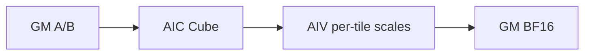
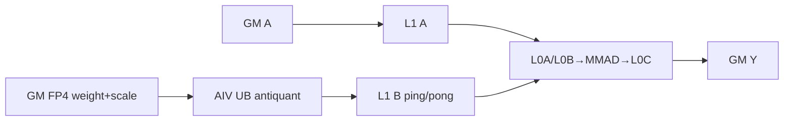
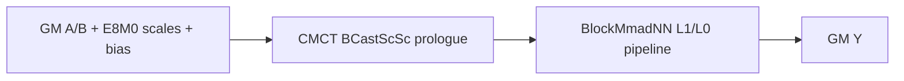

# QuantMatmul 950 ACLNN 算子知识

## 算子速览

| 项目 | 内容 |
|---|---|
| 实际入口 | `aclnnQuantMatmulV5GetWorkspaceSize` + `aclnnQuantMatmulV5`，公开 ACLNN 最新版本 |
| 计算语义 | 950 上的整数/FP8/HIF8/FP4 量化矩阵乘，覆盖 T-C/T-T、K-C/K-T、G-B、K-G、T-CG 与 MX |
| 输入输出 | `x1/x2` 2～6D ND；V5 在 950 明确拒绝 x2 NZ；输入含 INT8/INT4/HIF8/FP8/FP4，输出 FP16/BF16/FP32/INT8/INT32（按模式/binary） |
| 执行类型 | R-001/R-003 为 AIC_CUBE；R-002/R-004/R-005/R-006/R-007/R-008 为 MIX_CV；所有核心节点均为单 Kernel，普通转换为框架节点 |
| Kernel 路线 | R-001 V3普通Cube；R-002 V3 Vector epilogue；R-003 V3 MX Cube；R-004 V3 A4W4预处理；R-005 V4 G-B；R-006 V4 A4W4 K-G；R-007 V4 A8W4 T-CG；R-008 V4 A8W4 MX |
| 核心资源 | GM、system/user workspace、L1、L0A/L0B/L0C、UB/寄存器；MIX 通过 VECIN 或 GM workspace、CrossCore flag/SyncAll 交接 |
| 来源闭包 | source_closed：V5公开入口→DAV_3510预处理与V3/V4分流→arch35优先级Tiling/POD→所有可达Cube/MIX body→ascend950 binary/CMake闭合；通用 executor、ViewCopy 和 Matmul/CMCT/Blaze 原语为明确库边界 |
| 验证状态 | 已完成源码闭包检查；本次知识提取未执行编译、真机、数值或性能测试。 |

## 接口与语义

### 计算语义

`acc=op(x1)@op(x2)`；整数模式使用 INT32 累加，FP8/HIF8/FP4 使用所选 Matmul type traits 的 float 累加。T-C/T-T 施加 x2 scale；K-C/K-T 再施加按 M 的 x1Scale；G-B/K-G 按 groupSize 三轴块参数施加 scale；T-CG 按 K-group 权重量化；MX 使用 E8M0 双侧 scale。可选 bias 在 Cube 或 AIV epilogue 添加；AIV 路线按源码顺序执行 `acc→FP32→x2Scale→x1Scale→bias/offset→CAST_RINT→out`。

### 输入、输出与属性

| 参数 | shape/layout | dtype | 约束、默认值与语义 |
|---|---|---|---|
| x1 | 2～6D ND | INT8/INT4/HIF8/FP8/FP4 | 950 非伪量化允许 M=0 空结果；其余模式文档不支持空 Tensor；末两轴为 M/K |
| x2 | 2～6D ND | 与模式匹配 | V5 入口在 DAV_3510 显式拒绝 FRACTAL_NZ；末两轴为 K/N |
| x1Scale | 可空，标量/行/块/MX shape | FP32/FLOAT8_E8M0 | null 可标记 T-CG；MX 两侧均 E8M0 |
| x2Scale | 必选，标量/列/块/MX shape | UINT64/INT64/FP16/BF16/FP32/FLOAT8_E8M0 | INT64 view 转 UINT64；shape决定量化方式 |
| yScale/x1Offset/x2Offset/yOffset | 可选 | 模式相关 | x1Offset预留；A8W4 INT 可使用 yScale/yOffset；A4W4非对称使用 x2Offset |
| bias | 可选 ND | INT32/FP16/BF16/FP32 | Cube bias或AIV bias epilogue |
| groupSize | packed int64 | int64 | 低16位K、中16位N、高16位M；A8W4浮点入口先还原K值 |
| out | broadcast batch + `[M,N]` ND | FP16/BF16/FP32/INT8/INT32 | 必须命中文档与对应 ascend950 binary |

### 入口与版本

V1～V4 文档均标记迁移到 V5；V5 产品表支持 Ascend 950PR/950DT，并新增 G-B、B-B、T-CG、MX 与低精度类型。本卡只记录 V5。WeightNz 入口属于另一语义变体；虽然内部 key 保留 `WEIGHTNZ` 位，V5 950 对 x2 NZ 的公开入口检查直接报错，本卡正式 Route 均为 ND。

## Host/Launcher 执行流程

### 参数校验与前处理

V5 先在 DAV_3510 检查 `x2` 不是 NZ，随后创建 executor。检查必选输入、dtype/format/rank、batch broadcast、M/N/K、scale/offset/bias shape、transpose 与 groupSize；识别 A8W4 float/int、A8W8 per-block、A4W4 非对称、MX、TCG。末两轴转置 view 通过 shape 交换消解，其它非连续加入 Contiguous；INT32-pack 视为 INT4；scale/bias reformat 为 ND。非伪量化且 M/N=0 时直接返回空执行图；否则创建 V3 或 V4 核心节点，再 `Reshape/ViewCopy` 写用户输出。

### 参数、Workspace 与生命周期

V3 arch35 的普通/CMCT/Blaze路线从平台 library workspace 起算；A4W4 int4→int8 预处理再分配 `align(batch*M*K,128)+align(batch*K*N,128)`。V3 MIX 根据具体 basic/ASW POD使用 VECIN 或 workspace。V4 G-B使用 library workspace；A4W4 K-G增加两份转换输入及 `2*usedCoreNum*baseM*baseN*sizeof(int32)`；A8W4 RegBase使用固定 `WORKSPACE_SIZE + cubeNumBlocksM*cubeNumBlocksN*sizeof(uintptr_t)`。workspace、输入输出和 executor 保持至 stream 完成。

### 启动图与失败传播

```text
V5 ACLNN
  -> validate/Contiguous/view
  -> V3:
       R-001/R-003 AIC Cube
       R-002 MIX: AIC Mmad -> VECIN/UB AIV epilogue
       R-004 MIX: AIV int4->int8 workspace -> SyncAll -> AIC/MIX compute
     or V4:
       R-005 G-B MIX
       R-006 AIV int4 preprocess -> SyncAll -> pergroup MIX
       R-007 T-CG: AIV weight antiquant->L1 -> AIC Matmul MIX
       R-008 MX: CMCT BCastScSc prologue -> MIX Matmul
  -> ViewCopy
```

所有节点由同一 executor/stream提交；参数、InferShape、Tiling、key、workspace 或 launcher失败均停止。单 Kernel内依赖 CrossCore flag、pipe event 或 `SyncAll`，Host顺序不能替代这些同步。

## Route 与参数设计

### 分核与资源计算

V3 DAV_3510 优先级固定为 `MX_BASIC_API_ASW(1)→CUBE_BASIC_API_ASW(2)→CUBE_ASW(4)→MIX_ASW(5)→PERBLOCK_BASIC_API_ASW(6)`。共同产生 M/N/K、batch展开、adaptive-window base/tail、stepKa/Kb、L1 depth、nBuffer/dbL0C 与 `usedCoreNum`。V4 DAV_3510 registry为 `BASIC_PERBLOCK(0)→PERGROUP_ARCH35(6)→RegBase BASIC(1)`；RegBase另产生 A/B L1 ping-pong、B-UB `nBubSize/kBubSize` 与 M/N core grid。

### Route 选择

| 顺序 | Route | Key/模板 | 精确选择条件与优先级 | 不适用去向 |
|---:|---|---|---|---|
| 1 | R-005 V4 G-B | `(TRANS,PER_TILE,0,0,LUT_ASW)` | V5识别 INT8×INT8、双FP32块scale；V4 priority 0检查 group M/N/K=1/128/128 | R-006/R-007/R-008或失败 |
| 2 | R-006 V4 A4W4 K-G | `(B_TRANS,INT4_ASYMMETRICAL,0,0,LUT_ASW)` | INT4×INT4、2D、transA=false/transB=true、K%1024=0、N%256=0、groupK=256、双FP32 scale+FP16 offset、无bias | R-007/R-008或失败 |
| 3 | R-007 V4 A8W4 T-CG | `(B_TRANS,PER_GROUP,0,0,BASIS)` | 公开组合为FLOAT8_E4M3FN×FLOAT4_E2M1、groupK=32、ND且transB=true，AIC:AIV=1:2 | 失败 |
| 4 | R-008 V4 A8W4 MX | `(B_TRANS,MX,0,0,BASIS)` | 公开组合为FLOAT8_E4M3FN×FLOAT4_E2M1、双侧E8M0、groupK=32、K%8=0、ND且transB=true，AIC:AIV=1:2 | 失败 |
| 5 | R-003 V3 MX Cube | V3 API level BASIC/BLAZE、no-vector key | 非V4 A8W4；双侧 E8M0 MX且 `IsMxBasicApiCapable` | R-001/R-002 |
| 6 | R-001 V3普通Cube | V3 no-vector MMAPI/CMCT/Blaze key | integer scale/INT32 output等无需Vector epilogue；ND可由Cube basic，NZ条件不进入公开950 | R-002 |
| 7 | R-002 V3 MIX epilogue | V3 vector-epilogue key | FP32/BF16 scale、per-token/per-block或float bias需要AIV；MIX core ratio 1:2 | 失败 |
| 8 | R-004 V3 A4W4预处理 | V3 key + `IS_A4W4I` | 对称INT4×INT4走V3且平台不直接用s4s4 MMAD时 | 失败 |

```text
if V4 semantic predicate:
  G-B -> A4W4 asymmetric -> A8W4 RegBase
else V3 priorities:
  MX Cube -> Cube basic -> Cube ASW -> MIX ASW -> perblock basic
```

### 模板/实现执行矩阵

| Route | key/selector | dtype/shape/platform 完整命中条件 | 执行族与 kernel 节点 | 实际模板/body | 内存与同步特征 | tail/fallback |
|---|---|---|---|---|---|---|
| R-001 | V3 no-vector | ascend950 V3 binary；integer scale/INT32等 | AIC_CUBE | `QbmmCubeBasicApiKernel`/Cube ASW | CMCT/Blaze Cube，Fixpipe output | adaptive M/N tail；key miss失败 |
| R-002 | V3 vector epilogue | float scale/per-token/perblock | MIX_CV | `QuantBmmPertokenRegbaseKernel`/AL1 full-load/perblock | L0C→VECIN，two AIV split M；flags+UB ping/pong | M/N mask；末轮补wait |
| R-003 | V3 MX | FP4/FP8 + E8M0 scale | AIC_CUBE | `QbmmMxBasicApiKernel`/TensorApi | scale prologue + Cube，A/B full-load可选 | adaptive tail |
| R-004 | V3 A4W4 symmetric | INT4×INT4、非V4非对称 | MIX_CV preprocessing + Cube/MIX | `QbmmInt4ToInt8Preprocess` + selected V3 body | aligned A/B userWS；`SyncAll` | packed K tail受checker约束 |
| R-005 | V4 G-B | INT8×INT8 BF16、block scale | MIX_CV | `QbmmCmctPertileKernel` | Cube + Vector per-tile scale | group/tile tail |
| R-006 | V4 A4W4 K-G | exact checker predicates | MIX_CV | preprocess + `QuantBatchMatmulV4Pergroup` | int4→int8 userWS，int32 result DB，offset correction | aligned K/N；无fallback |
| R-007 | V4 A8W4 T-CG | FLOAT8_E4M3FN×FLOAT4_E2M1、BF16/FP16、PER_GROUP | MIX_CV | `QuantBatchMatmulV4PerChannelKernel` | AIV antiquant weight UB→L1；AIC Cube；1/2/4 L1 buffers | K/N/M tails；无fallback |
| R-008 | V4 A8W4 MX | FLOAT8_E4M3FN×FLOAT4_E2M1、BF16/FP16、MX | MIX_CV | `KernelMatmulMixWeightPrologueNN` | CMCT `BCastScsc` prologue + scaled MMAD | K按64补齐构造scale layout；无fallback |

### 隐藏性能 Guard

| Guard | Host/Tiling 条件 | Device/资源原因 | 影响 Route | 不满足时去向 | 源码符号 |
|---|---|---|---|---|---|
| 950 ND-only | DAV_3510 && x2为NZ时报错 | 950 V5公开路径固定ND | 全部 | ACLNN参数错误 | `aclnnQuantMatmulV5GetWorkspaceSize` |
| V3 priority | 固定 `{1,2,4,5,6}` | 先专用MX/Cube，再MIX/perblock | R-001～004 | 下一template或失败 | `GetQuantBatchMatmulV3Priorities` |
| A full load | `A_tile<=L1/scale`且M窗口/core整除/batch=1 | A驻留L1减少重复GM搬运 | R-001～003 | 非full-load key | `UpdateAFullLoadStatus` |
| MIX core ratio | `aivNum==2*aicNum` | 每个AIC由两个AIV按M拆分或执行weight prologue | R-002/R-005～008 | Tiling失败 | `CheckCoreNum` |
| A4W4 K-G | K%1024=0,N%256=0,groupK=256 | 预处理、group tile和MMAD布局 | R-006 | RegBase不接受该dtype；失败 | `CheckPergroupBasicShapeConstraints` |
| A8W4 | TCG K%32；MX K%8；group%32=0；NZ N%8（公开V5 NZ已禁） | UB antiquant/prologue和L1布局 | R-007/R-008 | Tiling失败 | `QuantBatchMatmulV4RegBase::CustomCheck` |
| L1 buffers | solver选择AL1 1/2/4、BL1 1/2/4 | 共享512KB L1并避免覆盖 | R-007 | 更少buffer配置 | `QuantBatchMatmulV4PerChannelKernel::Init` |

### POD/ABI

arch35 POD使用 `#pragma pack(8)`；`TCubeTiling` 内部布局由CANN头提供，固定仓不可见。下表逐字段记录声明顺序、位宽和producer/consumer；两个 namespace 中声明完全相同的字段合并标明，含外部 `TCubeTiling` 时不推测后继字段的绝对 offset。

| 结构 | 字段 | 类型/位宽 | ABI 布局 | 单位 | Host/launcher producer | Device consumer | 边界 |
|---|---|---|---|---|---|---|---|
| `V3DataParams`（arch35/generic同布局） | `batchA` | uint32 | offset 0 | batch | common tiling | A offset | >=1 |
| 同上 | `batchB` | uint32 | offset 4 | batch | common tiling | B offset | >=1 |
| 同上 | `batchC` | uint32 | offset 8 | batch | common tiling | output/core | >=1 |
| 同上 | `batchA1` | uint32 | offset 12 | batch axis | broadcast analysis | A offset | 缺省0 |
| 同上 | `batchA2` | uint32 | offset 16 | batch axis | broadcast analysis | A offset | 缺省0 |
| 同上 | `batchA3` | uint32 | offset 20 | batch axis | broadcast analysis | A offset | 缺省0 |
| 同上 | `batchA4` | uint32 | offset 24 | batch axis | broadcast analysis | A offset | 缺省0 |
| 同上 | `batchB1` | uint32 | offset 28 | batch axis | broadcast analysis | B offset | 缺省0 |
| 同上 | `batchB2` | uint32 | offset 32 | batch axis | broadcast analysis | B offset | 缺省0 |
| 同上 | `batchB3` | uint32 | offset 36 | batch axis | broadcast analysis | B offset | 缺省0 |
| 同上 | `batchB4` | uint32 | offset 40 | batch axis | broadcast analysis | B offset | 缺省0 |
| 同上 | `batchC1` | uint32 | offset 44 | batch axis | broadcast analysis | output offset | 缺省0 |
| 同上 | `batchC2` | uint32 | offset 48 | batch axis | broadcast analysis | output offset | 缺省0 |
| 同上 | `batchC3` | uint32 | offset 52 | batch axis | broadcast analysis | output offset | 缺省0 |
| 同上 | `batchC4` | uint32 | offset 56 | batch axis | broadcast analysis | output offset | 缺省0 |
| 同上 | `singleCoreBatch` | uint32 | offset 60 | batch/core | core split | scheduler | >=1 |
| 同上 | `isPerTensor` | uint32 | offset 64 | bool | scale analysis | epilogue | 0/1 |
| 同上 | `isPertoken` | uint32 | offset 68 | bool | scale analysis | AIV epilogue | 0/1 |
| 同上 | `isDoubleScale` | uint32 | offset 72 | bool | scale analysis | epilogue | 0/1 |
| 同上 | `biasThreeDim` | uint32 | offset 76 | bool | bias analysis | bias offset | 0/1 |
| 同上 | `ubCalcM` | uint32 | offset 80 | element | UB tiling | AIV M tile | MIX有效 |
| 同上 | `ubCalcN` | uint32 | offset 84 | element | UB tiling | AIV N tile | MIX有效 |
| 同上 | `needUbBuffer` | uint32 | offset 88 | bool | route analysis | output path | 0/1 |
| 同上 | `realSingleCoreM` | uint32 | offset 92 | element | core split | M tail | >0 |
| 同上 | `realSingleCoreN` | uint32 | offset 96 | element | core split | N tail | >0 |
| 同上 | `biasDtype` | uint32 | offset 100 | dtype enum | bias analysis | epilogue | route-dependent |
| 同上 | `ubSize` | uint32 | offset 104 | byte | UB analysis | UB allocation | <=平台UB |
| 同上 | `isMClash` | uint32 | offset 108 | bool | L2 analysis | scheduler | 0/1 |
| 同上 | `isNClash` | uint32 | offset 112 | bool | L2 analysis | scheduler | 0/1 |
| 同上 | `groupSizeM` | uint32 | offset 116 | element | group decode | group indexing | mode-dependent |
| 同上 | `groupSizeN` | uint32 | offset 120 | element | group decode | group indexing | mode-dependent |
| 同上 | `groupSizeK` | uint32 | offset 124 | element | group decode | K-group loop | mode-dependent |
| `L2cacheTileParams` | `mTileCntL2` | uint32 | offset 0 | tile | L2 tiling | scheduler | >=1或inactive |
| 同上 | `nTileCntL2` | uint32 | offset 4 | tile | L2 tiling | scheduler | >=1或inactive |
| 同上 | `mTileBlock` | uint32 | offset 8 | block | L2 tiling | scheduler | route-dependent |
| 同上 | `nTileBlock` | uint32 | offset 12 | block | L2 tiling | scheduler | route-dependent |
| 同上 | `calOrder` | uint32 | offset 16 | enum | L2 tiling | traversal | supported enum |
| 同上 | `isBasicTiling` | uint32 | offset 20 | bool | selector | traversal | 0/1 |
| `SlidingWindowParams` | `mTailTile` | uint32 | offset 0 | tile | ASW tiling | M tail | >=0 |
| 同上 | `nTailTile` | uint32 | offset 4 | tile | ASW tiling | N tail | >=0 |
| 同上 | `mBaseTailSplitCnt` | uint32 | offset 8 | count | ASW tiling | M schedule | >=1，缺省1 |
| 同上 | `nBaseTailSplitCnt` | uint32 | offset 12 | count | ASW tiling | N schedule | >=1，缺省1 |
| 同上 | `mTailMain` | uint32 | offset 16 | element | ASW tiling | M tail | >=0 |
| 同上 | `nTailMain` | uint32 | offset 20 | element | ASW tiling | N tail | >=0 |
| `V3TilingDataParams`（arch35/generic同序） | `params` | nested/128B | offset 0 | mixed | V3/pergroup tiling | V3/R-006 body | 必选 |
| 同上 | `matmulTiling` | `TCubeTiling` | 紧随params；内部offset缺失 | mixed | Matmul tiler | MMAD | 外部CANN ABI |
| 同上 | `tileL2cacheTiling` | nested/24B | `TCubeTiling`之后 | mixed | L2 tiling | scheduler | route-dependent |
| 同上 | `adaptiveSlidingWin` | nested/24B | 结构尾 | mixed | ASW tiling | tail scheduler | route-dependent |
| `BasicAPIDataParams`（V3/V4同布局） | `batchA` | uint32 | offset 0 | batch | basic tiling | A offset | >=1 |
| 同上 | `batchB` | uint32 | offset 4 | batch | basic tiling | B offset | >=1 |
| 同上 | `batchC` | uint32 | offset 8 | batch | basic tiling | output/core | >=1 |
| 同上 | `batchA1` | uint32 | offset 12 | batch axis | broadcast analysis | A offset | 缺省0 |
| 同上 | `batchA2` | uint32 | offset 16 | batch axis | broadcast analysis | A offset | 缺省0 |
| 同上 | `batchA3` | uint32 | offset 20 | batch axis | broadcast analysis | A offset | 缺省0 |
| 同上 | `batchA4` | uint32 | offset 24 | batch axis | broadcast analysis | A offset | 缺省0 |
| 同上 | `batchB1` | uint32 | offset 28 | batch axis | broadcast analysis | B offset | 缺省0 |
| 同上 | `batchB2` | uint32 | offset 32 | batch axis | broadcast analysis | B offset | 缺省0 |
| 同上 | `batchB3` | uint32 | offset 36 | batch axis | broadcast analysis | B offset | 缺省0 |
| 同上 | `batchB4` | uint32 | offset 40 | batch axis | broadcast analysis | B offset | 缺省0 |
| 同上 | `batchC1` | uint32 | offset 44 | batch axis | broadcast analysis | output offset | 缺省0 |
| 同上 | `batchC2` | uint32 | offset 48 | batch axis | broadcast analysis | output offset | 缺省0 |
| 同上 | `batchC3` | uint32 | offset 52 | batch axis | broadcast analysis | output offset | 缺省0 |
| 同上 | `batchC4` | uint32 | offset 56 | batch axis | broadcast analysis | output offset | 缺省0 |
| 同上 | `x1QuantMode` | uint32 | offset 60 | enum | quant analysis | A prologue | supported enum |
| 同上 | `x2QuantMode` | uint32 | offset 64 | enum | quant analysis | B/scale prologue | supported enum |
| 同上 | `biasThreeDim` | uint32 | offset 68 | bool | bias analysis | bias offset | 0/1 |
| 同上 | `biasDtype` | uint32 | offset 72 | dtype enum | bias analysis | epilogue | route-dependent |
| 同上 | `groupSizeM` | uint32 | offset 76 | element | group decode | group indexing | mode-dependent |
| 同上 | `groupSizeN` | uint32 | offset 80 | element | group decode | group indexing | mode-dependent |
| 同上 | `groupSizeK` | uint32 | offset 84 | element | group decode | K-group loop | mode-dependent |
| `DequantBmm::BasicAPICubeTiling` | `m` | uint32 | offset 0 | element | V3 ASW | scheduler | >0 |
| 同上 | `n` | uint32 | offset 4 | element | V3 ASW | scheduler | >0 |
| 同上 | `k` | uint32 | offset 8 | element | V3 ASW | K loop | >0 |
| 同上 | `baseM` | uint32 | offset 12 | element | tile solver | Cube | >0 |
| 同上 | `baseN` | uint32 | offset 16 | element | tile solver | Cube | >0 |
| 同上 | `baseK` | uint32 | offset 20 | element | tile solver | Cube | >0 |
| 同上 | `scaleKL1` | uint32 | offset 24 | element | scale tiling | MX/scale load | route-dependent |
| 同上 | `stepKa` | uint16 | offset 28 | step | L1 analysis | A K loop | >0 |
| 同上 | `stepKb` | uint16 | offset 30 | step | L1 analysis | B K loop | >0 |
| 同上 | `scaleFactorA` | uint16 | offset 32 | factor | scale tiling | A prologue | route-dependent |
| 同上 | `scaleFactorB` | uint16 | offset 34 | factor | scale tiling | B prologue | route-dependent |
| 同上 | `nBufferNum` | uint8 | offset 36 | buffer count | resource analysis | N buffer | supported count |
| 同上 | `isBias` | uint8 | offset 37 | bool | bias analysis | epilogue | 0/1 |
| 同上 | `dbL0C` | uint8 | offset 38 | buffer count | resource analysis | L0C reuse | 1/2 |
| 同上 | `reserved` | uint8 | offset 39 | reserved | zero-init | 不读取语义 | 必须保留 |
| `qbmmv4_tiling::BasicAPICubeTiling` | `m` | uint32 | offset 0 | element | V4 basic tiling | scheduler | >0 |
| 同上 | `n` | uint32 | offset 4 | element | V4 basic tiling | scheduler | >0 |
| 同上 | `k` | uint32 | offset 8 | element | V4 basic tiling | K loop | >0 |
| 同上 | `baseM` | uint32 | offset 12 | element | tile solver | Cube | >0 |
| 同上 | `baseN` | uint32 | offset 16 | element | tile solver | Cube | >0 |
| 同上 | `baseK` | uint32 | offset 20 | element | tile solver | Cube | >0 |
| 同上 | `scaleKL1` | uint32 | offset 24 | element | scale tiling | pertile scale | route-dependent |
| 同上 | `kL1` | uint32 | offset 28 | element | L1 analysis | K stage | >0 |
| 同上 | `usedCoreNum` | uint16 | offset 32 | core | core split | block guard | >0 |
| 同上 | `scaleFactorA` | uint8 | offset 34 | factor | scale tiling | A prologue | route-dependent |
| 同上 | `scaleFactorB` | uint8 | offset 35 | factor | scale tiling | B prologue | route-dependent |
| 同上 | `isBias` | uint8 | offset 36 | bool | bias analysis | epilogue | 0/1 |
| 同上 | `nBufferNum` | uint8 | offset 37 | buffer count | resource analysis | N buffer | supported count |
| 同上 | `dbL0C` | uint8 | offset 38 | buffer count | resource analysis | L0C reuse | 1/2 |
| 同上 | `reserved` | uint8 | offset 39 | reserved | zero-init | 不读取语义 | 必须保留 |
| `BasicAPITilingData`（V3/V4各自类型） | `params` | nested/88B | offset 0 | mixed | basic tiling | entry/body | 必选 |
| 同上 | `matmulTiling` | nested/40B | offset 88 | mixed | tile solver | Cube/CMCT | namespace类型必须匹配 |
| 同上 | `adaptiveSlidingWin` | nested/24B | offset 128 | mixed | ASW tiling | scheduler/tail | route-dependent |
| `QuantBatchMatmulV4TilingDataParams` | `cubeNumBlocksN` | uint8 | offset 0 | block | RegBase tiling | N core mapping | >0 |
| 同上 | `cubeNumBlocksM` | uint8 | offset 1 | block | RegBase tiling | M core mapping | >0 |
| 同上 | `vecCoreParallel` | uint8 | offset 2 | count | RegBase tiling | AIV split | 2 |
| 同上 | `reserve1` | uint8 | offset 3 | reserved | zero-init | 不读取语义 | 保留 |
| 同上 | `AL1Pingpong` | uint16 | offset 4 | buffer count | solver | A L1 layout | 1/2/4 |
| 同上 | `BL1Pingpong` | uint16 | offset 6 | buffer count | solver | B L1 layout/sync | 1/2/4 |
| 同上 | `kAlign` | uint64 | offset 8 | element | align analysis | address/prologue | dtype alignment |
| 同上 | `nAlign` | uint64 | offset 16 | element | align analysis | address/prologue | dtype alignment |
| 同上 | `kSize` | uint64 | offset 24 | element | shape analysis | K tail | >0 |
| 同上 | `nSize` | uint64 | offset 32 | element | shape analysis | N tail | >0 |
| 同上 | `groupSize` | uint64 | offset 40 | packed attr | group decode | antiquant/prologue | mode-dependent |
| 同上 | `mSize` | uint64 | offset 48 | element | shape analysis | M tail | >0 |
| 同上 | `nBubSize` | uint64 | offset 56 | element | UB solver | B UB tile | >0 |
| 同上 | `kBubSize` | uint64 | offset 64 | element | UB solver | B UB tile | >0 |
| 同上 | `mAL1Size` | uint64 | offset 72 | element | L1 solver | A L1 tile | >0 |
| 同上 | `kAL1Size` | uint64 | offset 80 | element | L1 solver | A L1 tile | >0 |
| 同上 | `nBL1Size` | uint64 | offset 88 | element | L1 solver | B L1 tile | >0 |
| 同上 | `kBL1Size` | uint64 | offset 96 | element | L1 solver | B L1 tile | >0 |
| 同上 | `hasX1Scale` | uint64 | offset 104 | bool | scale analysis | prologue | 0/1 |
| 同上 | `hasX2Scale` | uint64 | offset 112 | bool | scale analysis | prologue | 0/1 |
| 同上 | `matmulTiling` | `TCubeTiling` | offset 120；内部大小缺失 | mixed | `SetMatmulTiling` | `mmObj_`/CMCT | 外部CANN ABI |

### Route 源码闭包

| Route | Key/selector | Host/Tiling producer | POD/参数 | Kernel entry/router | Kernel body/直接依赖 | 构建接线 |
|---|---|---|---|---|---|---|
| R-001 | Cube Basic/ASW | Cube basic/ASW tiling | BasicAPI/V3 Params | arch35 V3 entry | cube CMCT/TensorAPI/ASW | V3 ascend950 binary+CMake |
| R-002 | Vector epilogue | Mix/perblock ASW | V3 Params | arch35 V3 entry | `qbmm_mix_online_dynamic*` | 同上 |
| R-003 | MX Basic | MX basic ASW | BasicAPI Params | arch35 V3 entry | MX CMCT/Blaze | 同上 |
| R-004 | `IS_A4W4I` | Cube/MIX tiling + extra WS | corresponding V3 POD | arch35 V3 entry | int4 preprocess + V3 body | 同上 |
| R-005 | PER_TILE LUT_ASW | V4 basic-perblock ASW | BasicAPI-compatible POD | arch35 V4 entry | CMCT pertile | V4 ascend950 binary+CMake |
| R-006 | INT4_ASYMMETRICAL | pergroup arch35 | V3-compatible POD | arch35 V4 entry | preprocess + pergroup | 同上 |
| R-007 | PER_GROUP BASIS | RegBase tiling | V4 RegBase POD | arch35 V4 entry | perchannel + RegBase common | 同上 |
| R-008 | MX BASIS | RegBase tiling | V4 RegBase POD | arch35 V4 entry | `cmct_convertor.h` + CMCT库原语 | 同上 |

## Kernel 实现

### 公共执行流程

entry拒绝空workspace/user workspace并解析与key匹配的POD。AIC路径从GM将A/B送入L1与L0A/B，经Mmad到L0C；AIC-only由Fixpipe/Matmul epilogue直接写GM。MIX路径中AIV承担scale/offset/bias、INT4 unpack或weight antiquant；AIC/AIV的物理block以`GetTaskRation`映射到同一逻辑tile，使用CrossCore flag、PIPE_FIX/MTE/Vector事件或`SyncAll`保护共享VECIN/L1/workspace。

### Route R-001：V3 普通 Cube

#### 适用条件

##### 选择证据

| 层级 | 文件 | 符号 | 源码谓词/参数 | 结果/下一跳 |
|---|---|---|---|---|
| Tiling | cube basic/ASW | `IsCapable` | integer scale/per-channel/per-tensor且不需Vector | Cube key |
| Router | arch35 V3 entry | no-vector branch | API level/layout/transpose | CMCT/Blaze/Cube ASW |

#### Device 数据流

##### 函数级调用链

```text
quant_batch_matmul_v3 -> QbmmCubeBasicApiKernel/CubeASW -> QuantMmBatchCube -> BlockMmadA8W8FixpipeQuant
```

##### 源码等价伪码

```text
decode adaptive M/N tile; load GM A/B->L1->L0; MMAD K loops; Fixpipe(scale,bias,tail)->GM
```

#### 内存与数据搬运

##### 资源与搬运表

| 层级/缓冲区 | offset/地址公式 | extent/容量公式 | dtype/layout | producer | consumer | owner/lifetime | 对齐/复用 |
|---|---|---|---|---|---|---|---|
| L1/L0 | scheduler tile | depth/step and base sizes | selected layout | MTE/LoadData | MMAD/Fixpipe | AIC tile | full-load/DB key |
| UB | N/A | N/A | N/A | N/A | N/A | N/A | AIC-only |

##### 分层内存布局


##### 字节账、交接边与复用顺序

```text
L1 = depthA1*A_tile_bytes + depthB1*B_tile_bytes
L0C = dbL0C*baseM*baseN*sizeof(acc); workspace=library_workspace
```

| 边/复用子区 | producer | offset/extent | dtype/layout | consumer | ordering/sync | owner/lifetime | 安全条件 |
|---|---|---|---|---|---|---|---|
| L0C→GM | MMAD | base tile | acc→out | Fixpipe | Cube pipe | tile | M/N tail |

#### 同步、精度与尾块

##### 同步与数值边界表

| 阶段 | primitive/机制 | producer | consumer/等待点 | 保护对象 | 精度/尾块 |
|---|---|---|---|---|---|
| Cube | Matmul events | load/MMAD | Fixpipe | L1/L0 | int32/float accum；adaptive tail |

#### 关键实现

##### 符号证据表

| 阶段 | 文件 | 符号/模板实例 | 实现事实 |
|---|---|---|---|
| Host/Tiling producer | `adaptive_sliding_window_cube_basic_api_tiling.cpp` | `SetTilingData` | quant mode/tile |
| Kernel entry/router | `arch35/quant_batch_matmul_v3.cpp` | no-vector branch | API/layout实例 |
| Device body/helper | `qbmm_cube_basic_api_cmct.h` | `QbmmCubeBasicApiKernel` | CMCT Cube链路 |

### Route R-002：V3 MIX_CV Vector epilogue

#### 适用条件

##### 选择证据

| 层级 | 文件 | 符号 | 源码谓词/参数 | 结果/下一跳 |
|---|---|---|---|---|
| Tiling | mix/perblock ASW | `IsCapable` | float scale/per-token/perblock/float bias且out!=INT32 | MIX key |
| Router | V3 entry | vector epilogue | high-level MMAPI | RegBase MIX |

#### Device 数据流

##### 函数级调用链

```text
entry -> QuantBmmPertokenRegbaseKernel::Init -> Process -> MMCompute(AIC) / DequantCompute(AIV)
```

##### 源码等价伪码

```text
AIC MMAD -> GetTensorC(VECIN); set AIC_SYNC_AIV_FLAG
two AIV split M, wait flag, copy scale/bias, FP32 mul/add, CAST_RINT, UB->GM, return flag
```

#### 内存与数据搬运

##### 资源与搬运表

| 层级/缓冲区 | offset/地址公式 | extent/容量公式 | dtype/layout | producer | consumer | owner/lifetime | 对齐/复用 |
|---|---|---|---|---|---|---|---|
| VECIN L0C view | offset 0 | `ceil(baseM/2)*baseN*sizeof(acc)` per AIV | int32/float ND-align | AIC | AIV | tile | flags |
| UB params/output | sequential offsets | scale N + row scale M + bias N + output ping/pong | FP32/out | MTE2/V | V/MTE3 | AIV tile | 32B aligned |

##### 分层内存布局


##### 字节账、交接边与复用顺序

```text
UB = ceil(baseM/2)*baseN*sizeof(acc) + baseN*sizeof(scale) + align(ceil(baseM/2)*sizeof(rowScale),32)
   + optional baseN*sizeof(bias) + 2*ceil(ceil(baseM/2)/4)*baseN*sizeof(out)
```

| 边/复用子区 | producer | offset/extent | dtype/layout | consumer | ordering/sync | owner/lifetime | 安全条件 |
|---|---|---|---|---|---|---|---|
| AIC→AIV | `GetTensorC(l0cOutUb_)` | VECIN tile | acc ND-align | `DequantCompute` | flag IDs and +FLAG_ID_MAX | launch | AIC waits before overwrite |

#### 同步、精度与尾块

##### 同步与数值边界表

| 阶段 | primitive/机制 | producer | consumer/等待点 | 保护对象 | 精度/尾块 |
|---|---|---|---|---|---|
| CV | CrossCore PIPE_FIX/PIPE_V | AIC/AIV | peer | shared tile | two AIV M split；末轮额外wait |
| UB | V_MTE2/MTE3_V events | vector/DMA | peer pipe | param/output buffer | FP32 mul/add；CAST_RINT；mask N tail |

#### 关键实现

##### 符号证据表

| 阶段 | 文件 | 符号/模板实例 | 实现事实 |
|---|---|---|---|
| Host/Tiling producer | `adaptive_sliding_window_mix_tiling.cpp` | `IsCapable/CalL1Tiling` | MIX谓词与资源 |
| Kernel entry/router | `arch35/quant_batch_matmul_v3.cpp` | `QUANT_BMMV3_IMPL_CLASS` | RegBase实例 |
| Device body/helper | `qbmm_mix_online_dynamic.h` | `QuantBmmPertokenRegbaseKernel` | 同步/UB/精度 |

### Route R-003：V3 MX Cube

#### 适用条件

##### 选择证据

| 层级 | 文件 | 符号 | 源码谓词/参数 | 结果/下一跳 |
|---|---|---|---|---|
| Tiling | MX basic ASW | `IsMxBasicApiCapable` | 双侧E8M0 scale且非V4 A8W4 | priority 1 |
| Router | V3 entry | `IsMxType` | BASIC/BLAZE API | MX Cube kernel |

#### Device 数据流

##### 函数级调用链

```text
entry -> QbmmMxBasicApiKernel/QbmmMxTensorApiKernel -> MX prologue -> Cube mainloop -> epilogue
```

##### 源码等价伪码

```text
load A/B及E8M0 scale;按groupK形成scaled Cube operands;MMAD;cast/epilogue有效M/N tail到GM
```

#### 内存与数据搬运

##### 资源与搬运表

| 层级/缓冲区 | offset/地址公式 | extent/容量公式 | dtype/layout | producer | consumer | owner/lifetime | 对齐/复用 |
|---|---|---|---|---|---|---|---|
| scale L1/prologue | group offsets | `scaleKL1`/factor fields | E8M0 | GM load | MX MMAD | AIC tile | groupK alignment |
| A/B/L0 | selected tile | base/depth formulas | FP4/FP8 | prologue | MMAD | AIC | A full-load key optional |

##### 分层内存布局


##### 字节账、交接边与复用顺序

```text
workspace=library_workspace; L1/L0由BasicAPICubeTiling的base/scaleKL1/nBuffer/dbL0C界定
```

| 边/复用子区 | producer | offset/extent | dtype/layout | consumer | ordering/sync | owner/lifetime | 安全条件 |
|---|---|---|---|---|---|---|---|
| prologue→MMAD | MX scale load | group tile | scaled Cube layout | MMAD | AIC pipe | tile | group/tail guards |

#### 同步、精度与尾块

##### 同步与数值边界表

| 阶段 | primitive/机制 | producer | consumer/等待点 | 保护对象 | 精度/尾块 |
|---|---|---|---|---|---|
| MX Cube | CMCT/Blaze internal | prologue | mainloop | L1/L0 | E8M0缩放；adaptive tail |

#### 关键实现

##### 符号证据表

| 阶段 | 文件 | 符号/模板实例 | 实现事实 |
|---|---|---|---|
| Host/Tiling producer | `adaptive_sliding_window_mx_basic_api_tiling.cpp` | `SetTilingData` | MX quant mode |
| Kernel entry/router | `arch35/quant_batch_matmul_v3.cpp` | MX branches | layout/full-load/API level |
| Device body/helper | MX basic/tensor API headers | `QbmmMx*Kernel` | MX prologue+Cube |

### Route R-004：V3 A4W4 对称预处理

#### 适用条件

##### 选择证据

| 层级 | 文件 | 符号 | 源码谓词/参数 | 结果/下一跳 |
|---|---|---|---|---|
| API | V5 | A4W4且非nonsymmetric | 不走V4谓词 | V3 |
| Router | V3 entry | `IS_A4W4I` | INT4输入 | preprocess+selected body |

#### Device 数据流

##### 函数级调用链

```text
entry -> AIV QbmmInt4ToInt8Preprocess::Process -> SyncAll -> V3 Cube/MIX body
```

##### 源码等价伪码

```text
AIV unpack A/B into aligned int8 workspace; global barrier; redirect x1/x2 pointers; execute int8 Matmul route
```

#### 内存与数据搬运

##### 资源与搬运表

| 层级/缓冲区 | offset/地址公式 | extent/容量公式 | dtype/layout | producer | consumer | owner/lifetime | 对齐/复用 |
|---|---|---|---|---|---|---|---|
| A int8 WS | 0 | `align(batch*M*K,128)` | int8 ND | AIV | AIC | launch | 128B |
| B int8 WS | after A | `align(batch*K*N,128)` | int8 ND | AIV | AIC | launch | 128B |

##### 分层内存布局


##### 字节账、交接边与复用顺序

```text
workspace_extra = align(batch*M*K,128)+align(batch*K*N,128)
```

| 边/复用子区 | producer | offset/extent | dtype/layout | consumer | ordering/sync | owner/lifetime | 安全条件 |
|---|---|---|---|---|---|---|---|
| preprocess→Matmul | AIV | two aligned slices | int8 ND | V3 body | `SyncAll<false>` | launch | schedule/exclusive cores |

#### 同步、精度与尾块

##### 同步与数值边界表

| 阶段 | primitive/机制 | producer | consumer/等待点 | 保护对象 | 精度/尾块 |
|---|---|---|---|---|---|
| unpack | SyncAll | all AIV | AIC | full staged inputs | INT4 exact unpack；packed-K constraints |

#### 关键实现

##### 符号证据表

| 阶段 | 文件 | 符号/模板实例 | 实现事实 |
|---|---|---|---|
| Host/Tiling producer | V3 Cube/MIX tiling | `isSupportS4S4_` | extra workspace |
| Kernel entry/router | `arch35/quant_batch_matmul_v3.cpp` | `IS_A4W4I` block | pointer redirect/barrier |
| Device body/helper | `qbmm_int4_to_int8_preprocess.h` | preprocess | unpack |

### Route R-005：V4 G-B per-tile

#### 适用条件

##### 选择证据

| 层级 | 文件 | 符号 | 源码谓词/参数 | 结果/下一跳 |
|---|---|---|---|---|
| API | V5 | `IsA8W8Perblock` | INT8×INT8双FP32 scale | V4 |
| Tiling | basic API V4 | `CheckPertileDtype/CheckGroupValid` | G-B 1/128/128 | PER_TILE |

#### Device 数据流

##### 函数级调用链

```text
entry -> QBMM_QUANT_GB_IMPL_CLASS -> QbmmCmctPertileKernel -> Cube mainloop + Vector scale epilogue
```

##### 源码等价伪码

```text
tile M/N/K; Cube int8 MMAD; Vector按x1/x2 128-block scale做FP32后处理并输出BF16
```

#### 内存与数据搬运

##### 资源与搬运表

| 层级/缓冲区 | offset/地址公式 | extent/容量公式 | dtype/layout | producer | consumer | owner/lifetime | 对齐/复用 |
|---|---|---|---|---|---|---|---|
| L1/L0 | adaptive tile | base/depth formulas | int8/int32 | AIC | AIC/AIV | tile | ASW |
| UB | per-tile accum/scale | current CMCT instance | int32/FP32/BF16 | Cube handoff | Vector | tile | 1:2 MIX |

##### 分层内存布局



##### 字节账、交接边与复用顺序

```text
workspace=library_workspace; L1/L0/UB由BasicAPITiling与CMCT current instance界定
```

| 边/复用子区 | producer | offset/extent | dtype/layout | consumer | ordering/sync | owner/lifetime | 安全条件 |
|---|---|---|---|---|---|---|---|
| Cube→Vector | CMCT block | base tile | int32 | per-tile epilogue | CMCT MIX protocol | tile | group tail |

#### 同步、精度与尾块

##### 同步与数值边界表

| 阶段 | primitive/机制 | producer | consumer/等待点 | 保护对象 | 精度/尾块 |
|---|---|---|---|---|---|
| MIX | CMCT flags | Cube | Vector | tile | FP32 block-scale；adaptive M/N tail |

#### 关键实现

##### 符号证据表

| 阶段 | 文件 | 符号/模板实例 | 实现事实 |
|---|---|---|---|
| Host/Tiling producer | `adaptive_sliding_window_basic_api_v4_tiling.cpp` | `GetTilingKey` | PER_TILE LUT_ASW |
| Kernel entry/router | `arch35/quant_batch_matmul_v4.cpp` | G-B macro | layout instances |
| Device body/helper | `qbmm_mix_pertile_cmct.h` | `QbmmCmctPertileKernel` | Cube/Vector融合 |

### Route R-006：V4 A4W4 非对称 K-G

#### 适用条件

##### 选择证据

| 层级 | 文件 | 符号 | 源码谓词/参数 | 结果/下一跳 |
|---|---|---|---|---|
| API | V5 checker | nonsymmetric predicate | INT4/FP32 scale/FP16 offset | V4 |
| Tiling | pergroup arch35 | `IsCapable` | exact 2D/transpose/alignment predicates | INT4_ASYM |

#### Device 数据流

##### 函数级调用链

```text
entry -> AIV Int4ToInt8Preprocess -> SyncAll -> QuantBatchMatmulV4Pergroup::Process
```

##### 源码等价伪码

```text
unpack both INT4 inputs to int8 workspace; Cube group MMAD to int32 DB; AIV apply x1/x2 scale and x2Offset row-sum correction; cast/store
```

#### 内存与数据搬运

##### 资源与搬运表

| 层级/缓冲区 | offset/地址公式 | extent/容量公式 | dtype/layout | producer | consumer | owner/lifetime | 对齐/复用 |
|---|---|---|---|---|---|---|---|
| converted A/B | offset 0 / after aligned A | `align(M*K,128)+align(K*N,128)` | int8 | AIV pre | AIC | launch | 128B |
| MM output DB | after converted B | `2*usedCore*baseM*baseN*sizeof(int32)` | int32 | AIC | AIV | launch | flags |
| UB | fixed arena | <=192KB | int32/FP32/half/out | AIV | AIV | tile | includes row sum/offset |

##### 分层内存布局


##### 字节账、交接边与复用顺序

```text
workspace = library + align(M*K,128)+align(K*N,128)+2*usedCore*baseM*baseN*sizeof(int32)
```

| 边/复用子区 | producer | offset/extent | dtype/layout | consumer | ordering/sync | owner/lifetime | 安全条件 |
|---|---|---|---|---|---|---|---|
| pre→Cube | AIV | converted slices | int8 | AIC | SyncAll | launch | all slices complete |
| Cube→AIV | AIC | int32 C/Pong | ND | AIV | C2V/V2C flags | launch | DB轮次 |

#### 同步、精度与尾块

##### 同步与数值边界表

| 阶段 | primitive/机制 | producer | consumer/等待点 | 保护对象 | 精度/尾块 |
|---|---|---|---|---|---|
| preprocessing | SyncAll | AIV | AIC | A/B | K/N严格对齐 |
| main | CrossCore DB | AIC/AIV | peer | int32 partial | FP32 scale/offset accumulate |

#### 关键实现

##### 符号证据表

| 阶段 | 文件 | 符号/模板实例 | 实现事实 |
|---|---|---|---|
| Host/Tiling producer | `quant_batch_matmul_v4_pergroup_arch35_tiling.cpp` | capability/workspace/key | exact guards |
| Kernel entry/router | `arch35/quant_batch_matmul_v4.cpp` | INT4_ASYM branch | preprocess+pergroup |
| Device body/helper | `arch35/quant_batch_matmul_v4_pertoken_pergroup.h` | `QuantBatchMatmulV4Pergroup` | offset/scale protocol |

### Route R-007：V4 A8W4 T-CG RegBase

#### 适用条件

##### 选择证据

| 层级 | 文件 | 符号 | 源码谓词/参数 | 结果/下一跳 |
|---|---|---|---|---|
| API | V5 | `isA8W4FloatTCG` | FLOAT8_E4M3FN×FLOAT4_E2M1且x1Scale为空 | V4 |
| Tiling | RegBase | `CustomCheck/GetTilingKey` | ND、transA=false/transB=true、groupK=32 | PER_GROUP BASIS |

#### Device 数据流

##### 函数级调用链

```text
entry -> InvokeWeightQuantBmmOpImpl -> QuantBatchMatmulV4PerChannelKernel/MX custom -> VectorProcess + AIC IterateMatmul
```

##### 源码等价伪码

```text
AIV: GM FP4 weight+scale -> UB antiquant -> L1 B, notify AIC
AIC: GM A -> L1 A; wait B; L1->L0A/B; MMAD/scale/bias; GetTensorC GM; notify AIV buffer reusable
```

#### 内存与数据搬运

##### 资源与搬运表

| 层级/缓冲区 | offset/地址公式 | extent/容量公式 | dtype/layout | producer | consumer | owner/lifetime | 对齐/复用 |
|---|---|---|---|---|---|---|---|
| A L1 | configured partitions | `AL1Pingpong*aL1DataSize*sizeof(xType)` | NZ | AIC MTE2 | L0A | AIC K-loop | 1/2/4 buffer |
| B L1 | configured partitions | `BL1Pingpong*bL1DataSize*sizeof(xType)` | NZ antiquantized | AIV UB | L0B | shared K-loop | 1/2/4 buffer |
| AIV UB | weight/scale/out/mask offsets | `vecWeightInLen+vecScaleOffsetLen+vecWeightOutLen+mask(+offset)` | FP4/scale/FP8 | MTE2/V | MTE3 | AIV B-tile | ping/pong |
| workspace | pointer table | `WORKSPACE_SIZE + grid*sizeof(uintptr_t)` | pointer/control | kernel | kernel | launch | grid aligned |

##### 分层内存布局



##### 字节账、交接边与复用顺序

```text
L1 = AL1Pingpong*aL1DataSize*sizeof(xType)+BL1Pingpong*bL1DataSize*sizeof(xType) <= platform L1
UB = vecWeightInLen+vecScaleOffsetLen+vecWeightOutLen+mask(+offset)
workspace = WORKSPACE_SIZE + cubeNumBlocksM*cubeNumBlocksN*sizeof(uintptr_t)
```

| 边/复用子区 | producer | offset/extent | dtype/layout | consumer | ordering/sync | owner/lifetime | 安全条件 |
|---|---|---|---|---|---|---|---|
| AIV→AIC B-L1 | `CopyUb2L1` | selected B L1 buffer | antiquantized xType/NZ | `SetTensorB` | mode4 MTE3→MTE1 flags 1/+MAX | launch | AIC waits exact buffer |
| AIC→AIV reuse | PostProcess | buffer id | control | next VectorProcess | mode4 return flags | launch | no overwrite before MMAD |

#### 同步、精度与尾块

##### 同步与数值边界表

| 阶段 | primitive/机制 | producer | consumer/等待点 | 保护对象 | 精度/尾块 |
|---|---|---|---|---|---|
| B handoff | `CrossCoreSet/WaitFlag<SYNC_MODE4>` | AIV/AIC | peer | L1 B buffer | T-CG antiquant；buffer-count-specific flag sequence |
| Cube | MTE2_MTE1 events + Matmul | AIC load | MMAD | A L1 | `SetTail(baseUseM,baseUseN,min(kAL1,kBL1))` |

#### 关键实现

##### 符号证据表

| 阶段 | 文件 | 符号/模板实例 | 实现事实 |
|---|---|---|---|
| Host/Tiling producer | `quant_batch_matmul_v4_reg_base_tiling.cpp` | `DoOpTiling/GetTilingKey` | grid/L1/UB/key |
| Kernel entry/router | `arch35/quant_batch_matmul_v4.cpp` | PER_GROUP branch | MIX_AIC_1_2 instance |
| Device body/helper | `quant_batch_matmul_v4_perchannel.h` | PerChannelKernel | L1 layouts/MMAD/tail |
| Device body/helper | `quant_batch_matmul_v4_reg_base_common.h` | common kernel | AIV antiquant/sync |

### Route R-008：V4 A8W4 MX CMCT

#### 适用条件

##### 选择证据

| 层级 | 文件 | 符号 | 源码谓词/参数 | 结果/下一跳 |
|---|---|---|---|---|
| API | V5 | `isA8W4FloatMx` | FLOAT8_E4M3FN×FLOAT4_E2M1且x1Scale/x2Scale为E8M0 MX shape | V4 |
| Tiling | RegBase | `CustomCheck/GetTilingKey` | MX groupK=32、K%8=0、ND、transA=false/transB=true | MX BASIS |
| Router | arch35 V4 entry | `QUANT_TYPE == QBMMV4_MX` | MX key | `InvokeKernel<false>` |

#### Device 数据流

##### 函数级调用链

```text
quant_batch_matmul_v4 -> InvokeKernel<false> -> KernelMatmulMixWeightPrologueNN::ToUnderlyingArguments -> operator()
```

##### 源码等价伪码

```text
read RegBase POD; build A/C/Bias/E8M0-scale layouts; BCastScSc prologue consumes FP4 B and scales;
BlockMmadNN performs scaled MX MMAD; scheduler maps M/N blocks; valid result writes GM Y
```

#### 内存与数据搬运

##### 资源与搬运表

| 层级/缓冲区 | offset/地址公式 | extent/容量公式 | dtype/layout | producer | consumer | owner/lifetime | 对齐/复用 |
|---|---|---|---|---|---|---|---|
| A/B GM view | A stride `(K,1)`；B ND stride `(K,1)` | M×K / N×K | FP8/HIF8 / FP4 | Host inputs | CMCT kernel | launch | K由Tiling约束 |
| scale GM view | stride `(ceil(align(K,64)/32),1)` | `N*ceil(align(K,64)/32)` | E8M0 | Host input | `BlockMmadNN` | launch | groupK=32 |
| prologue/internal tiles | 由 `TileShapeL1/TileShapeL0` 与POD确定 | CMCT内部 | BCastScSc/Cube layout | `BlockPrologueNN` | `BlockMmadNN` | tile | 库内部复用 |

##### 分层内存布局



##### 字节账、交接边与复用顺序

```text
scale elements = N*ceil(align(K,64)/32); tile storage and stage reuse are owned by the selected CMCT policy
```

| 边/复用子区 | producer | offset/extent | dtype/layout | consumer | ordering/sync | owner/lifetime | 安全条件 |
|---|---|---|---|---|---|---|---|
| prologue→MMAD | `BlockPrologueNN<BCastScsc>` | current B/scale tile | CMCT internal layout | `BlockMmadNN` | `KernelMatmulMixWeightPrologueNN` policy | kernel tile | POD/key与policy一致 |

#### 同步、精度与尾块

##### 同步与数值边界表

| 阶段 | primitive/机制 | producer | consumer/等待点 | 保护对象 | 精度/尾块 |
|---|---|---|---|---|---|
| MX prologue/MMAD | CMCT dispatch policy | BCastScSc | BlockMmad | internal tile | E8M0 group=32；scale K范围按64补齐 |
| scheduler | `BlockSchedulerSwizzleInMnCoreNN` | POD grid | kernel | M/N block | 边界由problem shape与scheduler控制 |

#### 关键实现

##### 符号证据表

| 阶段 | 文件 | 符号/模板实例 | 实现事实 |
|---|---|---|---|
| Host/Tiling producer | `quant_batch_matmul_v4_reg_base_tiling.cpp` | `CustomCheck/SetQuantType/GetTilingKey` | MX对齐、tile/POD/key |
| Kernel entry/router | `arch35/quant_batch_matmul_v4.cpp` | `QBMMV4_MX` branch | 调用MX转换器 |
| Device body/helper | `arch35/cmct_convertor.h` | `InvokeKernel` | layout与CMCT参数组装 |
| Library boundary | CMCT headers | `KernelMatmulMixWeightPrologueNN`/`BlockMmadNN` | prologue、调度与MMAD原语 |

## 算子特定优化

### Trick T-001：AIC/AIV 直接以 VECIN 交接累加块，避免 GM 中间物化

#### 触发与源码依据

- 适用 Route：R-002。
- 触发条件：V3 high-level Vector epilogue key、AIC:AIV=1:2。
- Golden 来源：[`qbmm_mix_online_dynamic.h:370-412`](../../../../../../../cann-ops-raw/ascendc/ops-nn/955f8b33985b6d72989ebff341bb9c2c564a51bc/matmul/quant_batch_matmul_v3/op_kernel/arch35/qbmm_mix_online_dynamic.h#L370-L412)

**官方源码（固定 Commit 连续逐字摘录）**：

```cpp
mm.Iterate();
mm.GetTensorC(l0cOutUb_, 0, true);
```

#### 机制与设计原因

AIC把当前L0C tile直接导入共享VECIN地址，两个AIV各处理一半M；CrossCore协议控制覆盖。相比GM workspace交接，数据无需离开片上层级。

#### 迁移边界

- 适用：相同M拆分、VECIN布局、AIC:AIV核比和flag协议。
- 前提：`baseM/baseN`与UB地址公式一致。
- 失效：核比或输出epilogue改变时重新设计交接。
- 反例/失效证据：固定仓未提供把该共享 tile 改为无 flag 交接后仍可正确运行的可验证反例。
- 未验证：本次知识提取未执行编译、真机、数值或性能测试。

#### 错误做法

让AIC在AIV返回flag前复用该tile会覆盖未消费数据。

### Trick T-002：A8W4由AIV在线反量化权重并按1/2/4缓冲送入AIC L1

#### 触发与源码依据

- 适用 Route：R-007。
- 触发条件：V4 PER_GROUP BASIS；solver给出AL1/BL1 ping-pong数量。
- Golden 来源：[`quant_batch_matmul_v4_perchannel.h:93-139`](../../../../../../../cann-ops-raw/ascendc/ops-nn/955f8b33985b6d72989ebff341bb9c2c564a51bc/matmul/quant_batch_matmul_v4/op_kernel/arch35/quant_batch_matmul_v4_perchannel.h#L93-L139)

**官方源码（固定 Commit 连续逐字摘录）**：

```cpp
if (this->tiling_->BL1Pingpong == this->QUADRUPLE_BUFFER) {
    // L1 布局如下：
    // 1) AL1 使能 4 buffer 时
    //    L1 (0~256KB):   BL1_P0 | BL1_P2 | AL1_P1 | AL1_P3
    //    L1 (257~512KB): BL1_P1 | BL1_P3 | AL1_P0 | AL1_P2
```

#### 机制与设计原因

AIV从GM读取FP4与scale，在UB中反量化并写选定BL1；AIC同时搬A并计算上一块。交错的半L1布局容纳四缓冲并降低bank/覆盖冲突，flag按buffer编号交接。

#### 迁移边界

- 适用：950 A8W4、512KB L1布局、MIX_AIC_1_2。
- 前提：solver输出的buffer数、L1 offset和flag ID一致。
- 失效：L1容量、核比、dtype位宽或weight layout变化。
- 反例/失效证据：固定仓未提供忽略 solver buffer 数或改写 L1 offset 后仍可正确运行的可验证反例。
- 未验证：本次知识提取未执行编译、真机、数值或性能测试。

#### 错误做法

只复制模板类型而忽略L1 offset与flag轮次会造成buffer重叠或AIC读到未完成权重。

## 模板与实现对比

| 对比维度 | R-001/R-003 Cube | R-002 V3 MIX | R-004/R-006 preprocess | R-005 G-B | R-007 T-CG | R-008 MX | 设计选择依据 |
|---|---|---|---|---|---|---|---|
| 命中条件/优先级 | integer/MX no-vector | float/per-token/perblock | INT4输入 | INT8 block scale | E4M3FN×FP4 PER_GROUP | E4M3FN×FP4 MX | semantic predicate+registry |
| 执行族/节点图 | AIC-only | MIX_CV | MIX pre+Cube/MIX | MIX_CV | MIX_CV | MIX_CV | 是否需Vector阶段 |
| M/N/K、tile 与 scheduler | adaptive window | adaptive+M split | staged full inputs | 128-group ASW | solver M/N grid+K factors | CMCT M/N swizzle | quant shape/resource |
| workspace/L1/L0/UB | library | VECIN/UB | aligned A/B + result DB | library/CMCT | L1 1/2/4 + pointer WS | CMCT policy-owned tiles | handoff位置 |
| AIC/AIV 或 kernel 交接 | N/A | VECIN flags | SyncAll/DB flags | CMCT flags | L1 flags | CMCT prologue policy | visibility |
| 同步、精度与 tail | Fixpipe | FP32 regs | exact unpack+FP32 | FP32 block scale | online antiquant+Cube | E8M0 BCastScSc+MMAD | numerical mode |
| fallback/失败边界 | next V3 template | next template/fail | fail | next V4/fail | fail | fail | no device fallback |

## 平台差异

| 项目 | A2 | A3 | 950 |
|---|---|---|---|
| 支持状态 | V5支持，见无后缀卡 | 同左 | V5公开支持 |
| Host/Launcher | generic V3/V4 | generic V3/V4 | DAV_3510显式ND检查、arch35优先级 |
| Kernel/资源 | 910B/910_93 generic body | 同族 | CMCT/Blaze/RegBase；FP8/HIF8/FP4；VECIN与L1跨族交接 |

## 限制与失败边界

- 950 V5入口显式拒绝x2 FRACTAL_NZ；binary中存在的NZ内部组合不能越过公开检查宣称为V5支持。
- 非伪量化允许M/N零维提前成功且不启动核心kernel；其它模式按文档不支持空Tensor。
- R-006只支持2D、无bias、K/N严格对齐；R-007/R-008要求transA=false、ND权重transB=true与各自group/alignment约束。
- arch35 key中的`IS_BLAZE`、API level或binary存在不能单独证明公开模式；本卡只记录V5 checker可达且ascend950 binary接线的组合。
- `TCubeTiling`和CMCT/Blaze内部ABI常数属于CANN库边界；复用必须匹配CANN 9.1头。
- 本次知识提取未执行编译、真机、数值或性能测试。

## 源码索引

### 链路索引

| 链路阶段 | 文件 | 关键符号 | 支撑内容 |
|---|---|---|---|
| 入口声明/约束 | `matmul/quant_batch_matmul_v4/docs/aclnnQuantMatmulV5.md`、`op_host/op_api/aclnn_quant_matmul_v5.h` | 产品/模式表、V5声明 | 950最新接口 |
| 入口实现 | `matmul/quant_batch_matmul_v4/op_host/op_api/aclnn_quant_matmul_v5.cpp` | V5 functions/common process | ND检查、预处理、V3/V4分流 |
| 入口公共校验 | `matmul/quant_batch_matmul_v4/op_host/op_api/quant_matmul_common_check.cpp` | common checks | dtype/shape/broadcast约束 |
| Host/Launcher | `matmul/common/op_host/op_api/quant_matmul_v4.cpp` | `QuantBatchMatmulV4` | V4 core node |
| Host/Tiling | `matmul/quant_batch_matmul_v3/op_host/op_tiling/arch35/quant_batch_matmul_v3_tiling_strategy.h` | priorities | V3 selector顺序 |
| Host/Tiling | `matmul/quant_batch_matmul_v3/op_host/op_tiling/arch35/adaptive_sliding_window_mix_tiling.cpp` | MIX tiling | V3 MIX谓词/资源 |
| Host/Tiling | `matmul/quant_batch_matmul_v4/op_host/op_tiling/arch35/quant_batch_matmul_v4_reg_base_tiling.cpp` | RegBase | A8W4 tile/POD/workspace |
| Kernel entry/body | `matmul/quant_batch_matmul_v3/op_kernel/arch35/quant_batch_matmul_v3.cpp` | V3 entry | Cube/MIX/MX/preprocess router |
| Kernel entry/body | `matmul/quant_batch_matmul_v3/op_kernel/arch35/qbmm_mix_online_dynamic.h` | RegBase MIX | VECIN/UB/sync |
| Kernel entry/body | `matmul/quant_batch_matmul_v4/op_kernel/arch35/quant_batch_matmul_v4.cpp` | V4 entry | G-B/A4W4/A8W4 router |
| Kernel entry/body | `matmul/quant_batch_matmul_v4/op_kernel/arch35/quant_batch_matmul_v4_pertoken_pergroup.h` | A4W4 pergroup | offset/scale与DB交接 |
| Kernel entry/body | `matmul/quant_batch_matmul_v4/op_kernel/arch35/quant_batch_matmul_v4_perchannel.h` | A8W4 body | L1/MMAD/tail |
| Kernel entry/body | `matmul/quant_batch_matmul_v4/op_kernel/arch35/quant_batch_matmul_v4_reg_base_common.h` | common body | AIV antiquant/flags |
| Kernel entry/body | `matmul/quant_batch_matmul_v4/op_kernel/arch35/cmct_convertor.h` | `InvokeKernel` | A8W4 MX CMCT layout/prologue/MMAD |
| 构建接线 | `matmul/quant_batch_matmul_v3/op_host/config/ascend950/quant_batch_matmul_v3_binary.json` | op_list | V3 950 combinations |
| 构建接线 | `matmul/quant_batch_matmul_v4/op_host/config/ascend950/quant_batch_matmul_v4_binary.json` | op_list | V4 950 combinations |
| 构建接线 | `matmul/quant_batch_matmul_v3/op_kernel/CMakeLists.txt`、`matmul/quant_batch_matmul_v4/op_kernel/CMakeLists.txt` | ascend950 source | V3/V4 arch35 kernel接线 |

### 实现复用检查

| 检查项 | 可复用事实 | 不得改变的约束 | 源码符号 |
|---|---|---|---|
| ABI/POD | BasicAPI/V3/V4 POD字段与key映射 | 8B pack、字段顺序、API level | tiling data headers |
| 调用顺序 | V5 checker→V3/V4→ViewCopy | ND检查与semantic predicates | V5 common process |
| workspace/内存 | int4 staging、result DB、RegBase L1/UB公式 | 128B align、slice offset、owner | Tiling/body Init |
| 同步 | VECIN flags、SyncAll、workspace/L1 flags | AIC:AIV=1:2、flag ID/轮次、schedule | MIX bodies |
| 精度与尾块 | int32/float accum、FP32 scale/bias、CAST_RINT | 运算顺序、mask、SetTail | epilogue/body |
| 失败边界 | template next-hop与最终failure | binary存在不得越过公开ND/checker | API/registry/key |