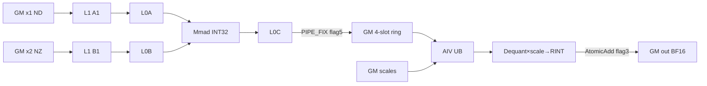

# QuantMatmulReduceSumWeightNz A2/A3 ACLNN 算子知识

## 算子速览

| 项目 | 内容 |
|---|---|
| 实际入口 | `aclnnQuantMatmulReduceSumWeightNzGetWorkspaceSize` + `aclnnQuantMatmulReduceSumWeightNz`，公开两段式 ACLNN；固定仓未出现 V2/V3 入口，本卡取该平台唯一且最新的公开版本。 |
| 计算语义 | 对每个 batch 计算 INT8 `x1[b] @ x2[b]`，乘行尺度 `x1Scale[b,m]` 和列尺度 `x2Scale[n]`，转 BF16 后以 AtomicAdd 累加到 `out[m,n]`。 |
| 输入输出 | `x1`：逻辑 `(B,M,K)` INT8/ND；`x2`：逻辑 `(B,K,N)` INT8、物理 FRACTAL_NZ；`x1Scale`：`(B,M)` FP32；`x2Scale`：`(N)` BF16；`out`：`(M,N)` BF16/ND。 |
| 执行类型 | 单 Kernel `MIX_CV`：AIC_CUBE 用 `MatmulImpl<ND int8, NZ int8, ND int32>`，AIV_VECTOR 完成双尺度反量化、BF16 cast 与 AtomicAdd；同一 Kernel 开头还有并行清零阶段。 |
| Kernel 路线 | R-001：`K<2048`，key 0，`KERNEL_TYPE_MIX_AIC_1_2`；R-002：`K>=2048`，key 1，`KERNEL_TYPE_MIX_AIC_1_1`。 |
| 核心资源 | GM；`16 MiB + 4*baseM*baseN*usedCoreNum*4` 字节 workspace；Matmul L1/L0A/L0B/L0C；AIV 双缓冲 scale/INT32 输入队列、单缓冲 BF16 输出队列和 `16*ubCalSize` 字节临时 UB。 |
| 来源闭包 | `source_closed`：公开 ACLNN→L0 launcher→Tiling/POD→单个 MIX_CV entry→AIC/AIV body、清零、同步和 A2/A3 config 均在固定 Commit 闭合；`TCubeTiling` 与 AscendC `MatmulImpl` 通用内部为框架库边界。 |
| 验证状态 | 已完成源码闭包检查；本次知识提取未执行编译、真机、数值或性能测试。 |

## 接口与语义

### 计算语义

令 `x1_b∈INT8^{M×K}`，`x2_b∈INT8^{K×N}`，`s1_b∈FP32^M`，`s2∈BF16^N`。公开公式为 `out = Σ_b (x1_b @ x2_b) * s1_b[:,None] * s2[None,:]`。实际 Device 顺序更精确：AIC 以 INT32 累加矩阵乘；AIV 的 `AscendDequant` 先把 INT32 结果与 BF16 `x2Scale` 结合成 FP32，再乘广播后的 FP32 `x1Scale`，以 `RoundMode::CAST_RINT` 转 BF16，最后对预清零的 BF16 `out` 做 AtomicAdd。因此每个 batch/tile 在跨 batch 求和前已经发生 BF16 舍入。

`dims` 在公开约束中只能为 `[0]`，表示消去 batch 维；Kernel 不读取 `dims`，语义固定为 batch reduce。`bias/yScale/x1Offset/x2Offset/yOffset` 均为保留输入。

### 输入、输出与属性

| 参数 | shape/layout | dtype | 约束、默认值与语义 |
|---|---|---|---|
| `x1` | `(B,M,K)`，ND | INT8 | 必需；禁止 NZ；保存 original shape 后做 `Contiguous`。 |
| `x2` | original `(B,K,N)`；物理 `(B,ceil(N/32),ceil(K/16),16,32)` | INT8/NZ | 必需；不做 Contiguous；batch 物理跨度 `align16(K)*align32(N)`。 |
| `x1Scale` | `(B,M)`，ND | FP32 | 必需；做 Contiguous；按行广播。 |
| `x2Scale` | `(N)`，ND | BF16 | 必需；做 Contiguous；按列广播且跨 batch 共用。 |
| `yScale/x1Offset/x2Offset/yOffset/bias` | N/A | N/A | 保留；实现允许 `nullptr` 或 empty tensor，公开文档要求 `nullptr`。 |
| `transposeX1/transposeX2` | scalar | bool | 仅 `false`。 |
| `groupSize` | scalar | int64 | 文档要求 `0`；实现只拒绝 `>0`，Kernel 不读取。 |
| `dims` | 一维 `aclIntArray` | INT64 | 必需；文档只支持 `[0]`；ACLNN 实现只校验非空。 |
| `keepDims` | scalar | bool | 仅 `false`。 |
| `out` | `(M,N)`，ND | BF16 | 可非连续；L0 先写连续临时输出，再 `ViewCopy`。 |

### 入口与版本

第一段创建 executor、校验并加入 Contiguous、`QuantMatmulReduceSum` AICore 与 ViewCopy 节点；第二段以调用者的 workspace 和 stream 执行。固定仓没有 V2/V3 或架构专用新版。A2 `ascend910b` 与 A3 `ascend910_93` 连接到同一源码和同名 binary 描述。产品表明确 A2/A3 支持、Ascend 950PR/950DT 不支持，故本卡不覆盖 950。

## Host/Launcher 执行流程

### 参数校验与前处理

`GetWorkspaceSize` 依次创建 executor；绑定输入、属性和输出；检查必需指针与保留输入；拒绝 transpose、`groupSize>0`、`keepDims=true`；固定 INT8/INT8/FP32/BF16/BF16；要求仅 `x2` 为 NZ；要求 `x1/x2` original view 均为 3D、B/K 相等，scale 为 `(B,M)` 与 `(N)`。

`PreProcess` 保存四个有效输入的 original shape。`ProcessL0` 对 `x1/x1Scale/x2Scale` 调 `Contiguous`，保留 NZ `x2`，把 `dims` 转为 INT64 tensor，分配 BF16/ND 连续输出，经 `INFER_SHAPE` 得到 `(M,N)`，用 `ADD_TO_LAUNCHER_LIST_AICORE` 加入核心节点，最后 `ViewCopy`。

### 参数、Workspace 与生命周期

Tiling 从 original shape 得 `B,M,K,N`，由 `MultiCoreMatmulTiling` 生成 `TCubeTiling`：

```text
system_workspace = 16,777,216 bytes
ring_slot_bytes = baseM * baseN * sizeof(int32_t)
ring_bytes = PIPELINE_NUM(4) * usedCoreNum * ring_slot_bytes
workspace_total = system_workspace + ring_bytes
```

Device 直接用 `workspace` 建 INT32 `mmOutGm`；entry 另以 `GetUserWorkspace(workspace)` 得 `user1` 并传入清零类，但清零类不读取该参数。固定源码未给出 runtime 对 system/user workspace 的重定位细节，不能外推环形区基址。executor、临时张量与 launcher 参数由框架持有到 stream 完成。

### 启动图与失败传播

```text
公开两段 ACLNN
  -> Contiguous(x1,x1Scale,x2Scale)
  -> QuantMatmulReduceSum L0 / infer(M,N)
  -> Tiling priority 0 -> key 0(K<2048) 或 key 1(K>=2048)
  -> blockDim=usedCoreNum, scheduleMode=1
  -> quant_matmul_reduce_sum [单 MIX_CV]
       -> clear out -> all-core sync
       -> AIC Matmul INT32 -> workspace ring -> flag 5
       -> AIV dequant/scale/RINT/AtomicAdd -> flag 3
  -> ViewCopy -> user out
```

Tiling context、dtype/shape、Matmul tiling、UB/L1 容量或 POD copy 失败均返回 `GRAPH_FAILED`。Kernel entry 对非空 `bias`、空 workspace 或空 user workspace 静默 `return`，没有 Device 错误码。

## Route 与参数设计

### 分核与资源计算

顺序为 original shapes→`M/N/K/B`→`MultiCoreMatmulTiling.SetShape/SetDim(aicNum)`→`usedCoreNum/baseM/baseN/baseK`→UB/workspace→key/blockDim/POD。`blockDimM=ceil(M/baseM)`、`blockDimN=ceil(N/baseN)`；每逻辑 Cube core 以 `curBlock+=coreNum` 领取 tile。`blockDimM<=5` 用行主序，否则在最多 8×8 局部分组做对角映射。非确定模式跨 batch 令 `count=curCount%coreNum` 轮转，确定模式不更新 `count`。

UB 预留 scale 双缓冲 `8*baseM+4*baseN` 字节；余量除 26 并向下 32 字节对齐，`ubCalSize=min(baseM*baseN,maxUbCalSize)`。Vector 行块为 `min(ubCalSize/align16(baseN),curCubeSingleM)`，16 对应 INT32 的 64 字节对齐元素数。

### Route 选择

| 顺序 | Route | Key/模板 | 精确选择条件与优先级 | 不适用去向 |
|---:|---|---|---|---|
| 1 | R-001 K<2048 MIX 1:2 | priority 0；key 0；`RunQuantMatmulReduceSum<false,false,false>` | A2/A3，固定 dtype/layout/shape 合法，Matmul/UB/L1 tiling 成功，`K<2048` | K 达阈值转 R-002；其它失败。 |
| 2 | R-002 K>=2048 MIX 1:1 | priority 0；key 1；同一 body | 同上且 `K>=2048` | 无 device fallback；失败。 |

```text
if platform not in {A2,A3}: unsupported
if ACLNN checks fail: ACLNN error
if Matmul/UB/L1 tiling fails: GRAPH_FAILED
if K < 2048: key=0, MIX_AIC_1_2 -> R-001
else:        key=1, MIX_AIC_1_1 -> R-002
```

### 模板/实现执行矩阵

| Route | key/selector | dtype/shape/platform 完整命中条件 | 执行族与 kernel 节点 | 实际模板/body | 内存与同步特征 | tail/fallback |
|---|---|---|---|---|---|---|
| R-001 | key 0；`MIX_AIC_1_2` | A2/A3；INT8 ND×NZ；FP32/BF16 scale；BF16 ND out；shape 合法；`K<2048` | 单 MIX_CV，1 AIC:2 AIV | `MMImplType<aType<false>,bType<false>,cType,biasType,NZ_CFG_MDL>` + `QbmmRSProcess<Quant...<...,false>>` | 四槽 INT32 ring；flag 5/3；两个 AIV 按 `vecCount%taskRation` 分行 | M/N tail 显式；K 由 Matmul；无 fallback。 |
| R-002 | key 1；`MIX_AIC_1_1` | 同上但 `K>=2048` | 单 MIX_CV，1 AIC:1 AIV | 同一模板/body | 同 ring/flags；单 AIV | 同上。 |

### 隐藏性能 Guard

| Guard | Host/Tiling 条件 | Device/资源原因 | 影响 Route | 不满足时去向 | 源码符号 |
|---|---|---|---|---|---|
| UB 正容量 | `min(baseM*baseN,floor32((UB-8*baseM-4*baseN)/26))>0` | 队列/临时区合计 `8*baseM+4*baseN+26*U` B | 两条 | Tiling 失败 | `CalUbSize` |
| L1 特化 | `baseM=128&&baseN=256&&baseK=128&&K>=1024&&sizeof(A)=sizeof(B)=1` | `depthA1=depthB1=8,stepKa=stepKb=4`；L1=393216 B | 两条 | 超 L1 失败；未命中保留通用 tiling | `SetMatmulTiling` |
| AIC:AIV 比率 | `K<2048` / `K>=2048` | 大 K 时 Cube 相对更慢 | R-001/R-002 | 切换 Route | `DoLibApiTiling` |
| 四槽防覆盖 | `cubeNum>=4` 前 wait flag 3，结尾 drain `min(cubeNum,4)` | `cubeNum%4` 复用 slot | 两条 | 无异步 fallback | `MMCompute/PostCompute` |
| 确定性 | `isDetermine==1` 不更新 `count` | 固定 batch 间 tile/core 起点 | 两条子模式 | context 选择 | `QbmmRSProcess::Process` |
| 对角映射 | `blockDimM>5` | 8×8 局部分配改变 tile 顺序 | 两条 | 否则行主序 | `MNBlockIdxCompute` |
| B cache hint | `blockDimM==1` 且非 OOM 编译 | B 无跨 M tile 复用 | 两条 | 默认 hint | `SetGlobalBufferW` |

### POD/ABI

| 结构 | 字段 | 类型/位宽 | ABI 布局 | 单位 | Host/launcher producer | Device consumer | 边界 |
|---|---|---|---|---|---|---|---|
| `QuantMatmulReduceSumParams` | `batchNum` | uint32/32 | struct size 40, align 8；offset 0 | batch | `SetQbmmTiling` | `QbmmRSProcess` | int64→uint32 无显式 guard。 |
| 同上 | `coreNum` | uint32/32 | offset 4 | core | `usedCoreNum` | tile/ring | 必须非零。 |
| 同上 | `ubBaseK` | uint32/32 | offset 8 | elements | `baseK` | 固定 body 未读取 | inactive。 |
| 同上 | `ubBaseN` | uint32/32 | offset 12 | elements | `baseN` | 固定 body 未读取 | inactive。 |
| 同上 | `ubRestBytes` | uint32/32 | offset 16 | bytes | `16*U` | `InitBuffer(tmpBuff)` | 临时区容量。 |
| 同上 | `ubCalSize` | uint32/32 | offset 20 | element slots | `CalUbSize` | queues/Vector tile | >0。 |
| 同上 | `isPertoken` | uint32/32 | offset 24 | bool | 固定 true | 固定 body 未分支 | 当前恒 1。 |
| 同上 | `isDetermine` | uint32/32 | offset 28 | bool | context | batch scheduler | 仅值 1 为确定。 |
| 同上 | `workspaceSize` | uint64/64 | offset 32 | bytes | 零初始化；Host 未赋值 | 固定 body 未读取 | 实际大小走 context slot。 |
| `QuantMatmulReduceSumTilingData` | `qbmmReduceSumParams` | 40 B | offset 0, align 8 | POD | `PostTiling memcpy_s` | `GET_TILING_DATA` | 完整可见。 |
| 同上 | `matmulTiling` | `TCubeTiling` | offset 40；总 size/align 固定仓不可见 | mixed | `GetTiling` | `mm.Init`/显式字段读取 | 外部 `kernel_tiling` ABI，不得重排。 |
| `TCubeTiling` | `M` | 外部定义 | offset 不可见 | elements | `SetShape(M,N,K)` | `SetMKN`/clear | 由外部 tiling 库窄化。 |
| 同上 | `N` | 外部定义 | offset 不可见 | elements | `SetShape(M,N,K)` | `SetMKN`/clear | 同上。 |
| 同上 | `Ka` | 外部定义 | offset 不可见 | elements | `SetShape(M,N,K)` | `SetMKN` | 同上。 |
| 同上 | `usedCoreNum` | 外部定义 | 不可见 | core | `GetTiling` | blockDim/coreNum | 非零。 |
| 同上 | `baseM` | 外部定义 | 不可见 | elements | `GetTiling` | M tile/UB/ring/Matmul | M tail 用 min。 |
| 同上 | `baseN` | 外部定义 | 不可见 | elements | `GetTiling` | N tile/UB/ring/Matmul | N tail 用 min。 |
| 同上 | `baseK` | 外部定义 | 不可见 | elements | `GetTiling` | L1 特化/Matmul | K tail 由 Matmul。 |
| 同上 | `depthA1` | 外部定义 | 不可见 | stages | `GetTiling` 或赋 8 | `MatmulImpl` | 特化为 4 K blocks×DB。 |
| 同上 | `depthB1` | 外部定义 | 不可见 | stages | `GetTiling` 或赋 8 | `MatmulImpl` | 同上。 |
| 同上 | `stepKa` | 外部定义 | 不可见 | baseK blocks | `GetTiling` 或赋 4 | `MatmulImpl` | 非特化由库给出。 |
| 同上 | `stepKb` | 外部定义 | 不可见 | baseK blocks | `GetTiling` 或赋 4 | `MatmulImpl` | 同上。 |
| 同上 | `shareL1Size` | 外部定义 | 不可见 | bytes | 特化写入 | `MatmulImpl` | 特化才覆盖。 |

### Route 源码闭包

| Route | Key/selector | Host/Tiling producer | POD/参数 | Kernel entry/router | Kernel body/直接依赖 | 构建接线 |
|---|---|---|---|---|---|---|
| R-001 | `DoLibApiTiling` key 0 | `QuantMatmulReduceSumTiling` | `QuantMatmulReduceSumTilingData` | entry→key0→`Run...<false,false,false>` | `QbmmRSProcess`、MixCore、InitOutput、SafeDataCopy | OpDef A2/A3 + 两 binary JSON + CMake |
| R-002 | key 1 | 同上 | 同上 | entry→key1→同模板 | 同 body，task ratio 不同 | 同上 |

## Kernel 实现

### 公共执行流程

entry 拒绝非空 bias、空 workspace/user workspace。两 key 均解析同一 POD；所有 task 先用 TSCM/L1 临时区清零 BF16 `out[M*N]` 并全核同步；AIC 初始化 `MatmulImpl`，AIV 初始化 scale/INT32/BF16 队列和临时 UB。AIC 把 INT32 tile 写入四槽 GM ring 后发 flag 5，AIV 等待、取数、反量化、cast、AtomicAdd，再发 flag 3。AIC 覆盖前和退出前等待消费完成。

### Route R-001：K<2048 MIX 1:2

#### 适用条件

##### 选择证据

| 层级 | 文件 | 符号 | 源码谓词/参数 | 结果/下一跳 |
|---|---|---|---|---|
| API | `op_host/op_api/aclnn_quant_matmul_reduce_sum.cpp` | `CheckInputs/ProcessL0` | 固定约束通过 | 添加算子；否则 ACLNN error。 |
| Tiling | `op_host/op_tiling/quant_matmul_reduce_sum_tiling.cpp` | `DoLibApiTiling` | 初始 key 0 且 `K<2048` | key 0。 |
| Router | `op_kernel/quant_matmul_reduce_sum.cpp` | entry | key0 + `MIX_AIC_1_2` | R-001。 |
| Device | 同上 | `Run...<false,false,false>` | transA/B=false,sync=false | ND×NZ Matmul + AIV epilogue。 |

#### Device 数据流

##### 函数级调用链

```text
entry -> RunQuantMatmulReduceSum<false,false,false>
  -> InitOutput::Process -> SyncAllCores
  -> MatmulImpl<ND int8,NZ int8,ND int32,NZ_CFG_MDL>::Init
  -> QuantMixCoreCompute::Init -> QbmmRSProcess::Process
     -> MNBlockIdxCompute
     -> MMCompute [AIC: SetTensorA/B->Iterate->GetTensorC->flag5]
     -> VectorCompute [AIV0/1: wait5->Dequant->Mul->Cast->AtomicAdd->flag3]
  -> PostCompute [AIC drain flag3]
```

##### 源码等价伪码

```text
parallel_clear(out); all_core_barrier
for b in B:
  update x1/x2_NZ/x1Scale batch offsets
  for assigned MN tile:
    AIC: C32=Matmul(x1_tile,x2_tile); wait3 before fifth-slot reuse;
         write ring[core+(cubeNum%4)*coreNum]; set flag5
    AIV s in {0,1}: for row chunk where vecCount%2==s:
         wait5; load C32/x2Scale/x1Scale; fp32=Dequant(C32,x2Scale)*x1Scale;
         bf16=Cast_RINT(fp32); AtomicAdd(out,bf16); set flag3
AIC drain outstanding flag3
```

#### 内存与数据搬运

##### 资源与搬运表

| 层级/缓冲区 | offset/地址公式 | extent/容量公式 | dtype/layout | producer | consumer | owner/lifetime | 对齐/复用 |
|---|---|---|---|---|---|---|---|
| GM x1/x2 | `b*M*K+m0*K`；`b*align16(K)*align32(N)+n0*align16(K)` | `mt*K`；NZ batch stride | INT8 ND/NZ | caller | Matmul | launch | NZ K0=16,N0=32。 |
| L1 A1/B1 | Matmul internal | `baseM*baseK*depthA1` + `baseN*baseK*depthB1` B；特化 393216 B | INT8 | GM | L0A/B | tile | depth/step 来自 POD。 |
| L0A/L0B | library internal | nominal `baseM*baseK` / `baseN*baseK` B | Cube fractal | L1 | Mmad | tile | exact padding library boundary。 |
| L0C | library internal | nominal `baseM*baseN*4*dbL0C` B | INT32 | Mmad | GetTensorC | tile | `dbL0C` external ABI。 |
| workspace ring | `(core+(cubeNum%4)*coreNum)*baseM*baseN` elems | `4*coreNum*baseM*baseN*4` B | INT32 tile | AIC | AIV | launch | four slots，flag3 防覆盖。 |
| UB x1/x2 scale | queue | `2*baseM*4 + 2*baseN*2` B | FP32/BF16 | GM | Brcb/Dequant | AIV | depth2。 |
| UB vecIn/vecOut | queue | `2*U*4 + U*2` B | INT32/BF16 | WS/Vector | Vector/GM | AIV | input depth2, output depth1。 |
| UB tmp | offsets 0,4U,8U | `16U` B | FP32/u8 aliases | Vector | Vector | chunk | shared tmp 与 mul 区 barrier 后复用。 |
| GM out | row-major offset | `M*N*2` B | BF16 | clear+AtomicAdd | ViewCopy | executor | M/N tail 2-D copy。 |
| registers | API internal | fixed repo不可见 | N/A | Vector | Vector | instruction | High-Level API boundary。 |

##### 分层内存布局



##### 字节账、交接边与复用顺序

```text
U=ubCalSize
workspace_total=16,777,216 + 16*usedCoreNum*baseM*baseN bytes
L1_special=128*128*8 + 256*128*8 = 393,216 bytes
L0_nominal=baseM*baseK + baseN*baseK + baseM*baseN*4 bytes (depth/padding取TCubeTiling)
UB_total=8*baseM + 4*baseN + 26*U <= platform UB
```

| 边/复用子区 | producer | offset/extent | dtype/layout | consumer | ordering/sync | owner/lifetime | 安全条件 |
|---|---|---|---|---|---|---|---|
| AIC→AIV | `GetTensorC` | slot；capacity `baseM*baseN`, actual `mt*nt` | INT32/ND tile | `DataCopyPad2D` | set/wait flag5, mode2, PIPE_FIX | workspace until MTE2 | fifth tile waits flag3。 |
| AIV→AIC release | MTE2 completion | same slot | token | AIC overwrite | set flag3 from PIPE_MTE2；AIC wait | per-slot token | exit drains ≤4。 |
| tmp aliases | Dequant/broadcast/shared/mul | 0..16U B | FP32/u8 | Vector | PIPE_V barriers | chunk | barrier before alias reuse。 |

#### 同步、精度与尾块

##### 同步与数值边界表

| 阶段 | primitive/机制 | producer | consumer/等待点 | 保护对象 | 精度/尾块 |
|---|---|---|---|---|---|
| clear | MTE3 + all-core flag | each task | later atomic | out | ≥512 B split；不足32 B用 SafeDataCopy。 |
| AIC→AIV | flag5 | PIPE_FIX | AIV wait | ring slot | INT32 exact。 |
| AIV→AIC | flag3 | PIPE_MTE2 | AIC wait | slot lifetime | read-in 后释放。 |
| Vector | Dequant→barrier→Mul→barrier→RINT | INT32/scales | BF16 queue | chunk | N align16；M/N tail shorten。 |
| reduce | BF16 AtomicAdd | batches | GM out | same `(m,n)` | cast before accumulation；default nondeterministic。 |

#### 关键实现

##### 符号证据表

| 阶段 | 文件 | 符号/模板实例 | 实现事实 |
|---|---|---|---|
| Host/Tiling producer | `op_host/op_tiling/quant_matmul_reduce_sum_tiling.cpp` | `SetMatmulTiling/CalUbSize/DoLibApiTiling/GetWorkspaceSize` | tile、资源、key。 |
| Kernel entry/router | `op_kernel/quant_matmul_reduce_sum.cpp` | key0/MIX 1:2 | template mapping。 |
| Device body/helper | `op_kernel/quant_matmul_reduce_sum.h` | `QbmmRSProcess` | batch/core/MN mapping。 |
| Device body/helper | `op_kernel/quant_matmul_reduce_sum_mixcore.h` | `MMCompute/VectorCompute/Dequant` | ring/flags/precision/tail。 |
| Device body/helper | `op_kernel/quant_matmul_reduce_sum_init_output.h` | `InitOutput::Process` | clear/barrier。 |

### Route R-002：K>=2048 MIX 1:1

#### 适用条件

##### 选择证据

| 层级 | 文件 | 符号 | 源码谓词/参数 | 结果/下一跳 |
|---|---|---|---|---|
| API | `op_host/op_api/aclnn_quant_matmul_reduce_sum.cpp` | `CheckInputs/ProcessL0` | 同公开约束 | 添加同一 op。 |
| Tiling | `op_host/op_tiling/quant_matmul_reduce_sum_tiling.cpp` | `DoLibApiTiling` | `K>=2048` | key1。 |
| Router | `op_kernel/quant_matmul_reduce_sum.cpp` | entry | key1 + `MIX_AIC_1_1` | R-002。 |
| Device | 同上 | `Run...<false,false,false>` | 同一实例 | 仅 task ratio 不同。 |

#### Device 数据流

##### 函数级调用链

```text
entry key1 -> Run... -> clear+sync -> QbmmRSProcess
  -> MMCompute [AIC Matmul->ring->flag5]
  -> VectorCompute [single AIV->wait5->Dequant/Mul/Cast/AtomicAdd->flag3]
  -> PostCompute [drain]
```

##### 源码等价伪码

```text
执行与 R-001 相同的 batch/MN tile、ring、双尺度和 BF16 AtomicAdd；
taskRation=1，唯一 AIV 对所有 vecCount 满足 vecCount%1==subBlockIdx(0)。
K>=2048 只改变 MIX task type，不改变 Matmul/epilogue/POD。
```

#### 内存与数据搬运

##### 资源与搬运表

| 层级/缓冲区 | offset/地址公式 | extent/容量公式 | dtype/layout | producer | consumer | owner/lifetime | 对齐/复用 |
|---|---|---|---|---|---|---|---|
| GM→L1→L0→L0C | 同 R-001 | 同 TCubeTiling；特化 L1 393216 B | INT8→INT32 | AIC | PIPE_FIX | tile | K>=2048 仍需 base=128/256/128 才特化。 |
| workspace ring | 同 R-001 | `4*coreNum*baseM*baseN*4` B | INT32 | AIC | single AIV | launch | same flags。 |
| AIV UB | queue | `8*baseM+4*baseN+26*U` B | mixed | GM/Vector | Vector/GM | AIV | 每 AIV容量相同。 |
| GM out | row-major | `M*N*2` B | BF16 | clear+atomic | ViewCopy | executor | same tails。 |
| registers | API internal | 不可见 | N/A | Vector | Vector | instruction | external boundary。 |

##### 分层内存布局


##### 字节账、交接边与复用顺序

```text
workspace_total=16,777,216 + 16*usedCoreNum*baseM*baseN bytes
UB_total_per_AIV=8*baseM + 4*baseN + 26*U bytes
L1/L0=同 R-001；特化 L1=393,216 bytes
```

| 边/复用子区 | producer | offset/extent | dtype/layout | consumer | ordering/sync | owner/lifetime | 安全条件 |
|---|---|---|---|---|---|---|---|
| AIC→single AIV | GetTensorC | four-slot tile | INT32 | DataCopyPad2D | flag5 | workspace | no overwrite before flag3。 |
| single AIV→AIC | MTE2 | same slot | token | AIC | flag3 | slot | fifth-slot wait。 |
| UB aliases | Vector | 0..16U B | FP32/u8 | Vector | PIPE_V | chunk | same as R-001。 |

#### 同步、精度与尾块

##### 同步与数值边界表

| 阶段 | primitive/机制 | producer | consumer/等待点 | 保护对象 | 精度/尾块 |
|---|---|---|---|---|---|
| clear | all-core barrier | tasks | atomic | out | same clear tail。 |
| handoff | flags5/3 | AIC/AIV | AIV/AIC | ring | INT32。 |
| epilogue | Dequant/Mul/RINT/AtomicAdd | single AIV | out | tile | single AIV handles all row chunks。 |
| K tail | MatmulImpl/TCubeTiling | GM/L1 | L0C | tile | external Matmul specialization；无 operator fallback。 |

#### 关键实现

##### 符号证据表

| 阶段 | 文件 | 符号/模板实例 | 实现事实 |
|---|---|---|---|
| Host/Tiling producer | `op_host/op_tiling/quant_matmul_reduce_sum_tiling.cpp` | `DoLibApiTiling` | K threshold key1。 |
| Kernel entry/router | `op_kernel/quant_matmul_reduce_sum.cpp` | key1/MIX 1:1 | same body。 |
| Device body/helper | `op_kernel/quant_matmul_reduce_sum.h` | `QbmmRSProcess` | task ratio mapping。 |
| Device body/helper | `op_kernel/quant_matmul_reduce_sum_mixcore.h` | `Dequant` | `vecCount%taskRation` selects single AIV。 |

## 算子特定优化

### Trick T-001：K 阈值改变 AIC:AIV 配比

#### 触发与源码依据

- 适用 Route：R-001、R-002
- 触发条件：其它 guard 通过；`K<2048` 取 1:2，`K>=2048` 取 1:1。
- Golden 来源：[`quant_matmul_reduce_sum_tiling.cpp:308-315`](../../../../../../../cann-ops-raw/ascendc/ops-nn/955f8b33985b6d72989ebff341bb9c2c564a51bc/matmul/quant_matmul_reduce_sum/op_host/op_tiling/quant_matmul_reduce_sum_tiling.cpp#L308-L315)

**官方源码（固定 Commit 连续逐字摘录）**：

```cpp
ge::graphStatus QuantMatmulReduceSumTiling::DoLibApiTiling()
{
    tilingKey_ = 0; // aic:aiv=1:2
    // 当K比较大时，比如2048，cube的计算耗时相对较大，只需要启动一个vector核
    if (inputParams_.kSize >= 2048) {
        tilingKey_ = 1; // aic:aiv=1:1
    }
    return ge::GRAPH_SUCCESS;
}
```

#### 机制与设计原因

两 key 只改变 MIX task type。小 K 时两个 AIV 以 `vecCount%GetTaskRation()` 分担 Vector 行块；大 K 时源码说明 Cube 相对耗时更长，只配置一个 AIV。

#### 迁移边界

- 适用：Cube→Vector epilogue 且 Vector 子块可独立分割。
- 前提：相同 MIX task 编码、workspace/flag 协议和 dtype/layout。
- 失效：平台不支持该比率或 epilogue 跨 subblock 依赖时重做 Route。
- 未验证：本次知识提取未执行编译、真机、数值或性能测试。

#### 错误做法

大 K 仍强行使用 key0 会使 `GetTaskRation`/subblock 分工偏离 Host selector。

### Trick T-002：四槽 workspace 环形流水与跨核握手

#### 触发与源码依据

- 适用 Route：R-001、R-002
- 触发条件：有效 tile；`PIPELINE_NUM=4`、`sequentialWrite=true`。
- Golden 来源：[`quant_matmul_reduce_sum_mixcore.h:149-160`](../../../../../../../cann-ops-raw/ascendc/ops-nn/955f8b33985b6d72989ebff341bb9c2c564a51bc/matmul/quant_matmul_reduce_sum/op_kernel/quant_matmul_reduce_sum_mixcore.h#L149-L160)

**官方源码（固定 Commit 连续逐字摘录）**：

```cpp
            if (sequentialWrite) {
                mnConfig.workSpaceOffset =
                    mnConfig.baseN * mnConfig.baseM * (coreIdx + (cubeNum % PIPELINE_NUM) * this->coreNum);
            } else {
                mnConfig.workSpaceOffset = outOffset + mnConfig.yBaseOffset;
            }
            if (this->cubeNum >= PIPELINE_NUM) {
                CrossCoreWaitFlag(SYNC_AIV_AIC_FLAG);
            }
            this->mm.GetTensorC(mmOutGm[mnConfig.workSpaceOffset], 0, sequentialWrite);
            CrossCoreSetFlag<SYNC_MODE2, PIPE_FIX>(SYNC_AIC_AIV_FLAG);
            cubeNum++;
```

#### 机制与设计原因

每逻辑 core 四个 INT32 槽；第五个 tile 前等待 AIV flag3。PIPE_FIX flag5 宣告完整 tile；AIV 在 MTE2 取入 UB 后发 flag3，让 AIC 与后续 Vector 算术重叠。

#### 迁移边界

- 适用：producer 紧凑 tile，consumer 读入本地后可释放 GM 槽。
- 前提：slot 公式、core 映射、flags 5/3 和 drain 次数一致。
- 失效：非顺序写或 consumer 后续仍直接引用 GM 槽。
- 未验证：本次知识提取未执行编译、真机、数值或性能测试。

#### 错误做法

省略 `cubeNum>=4` wait 或 `PostCompute` drain 会覆盖未消费槽或提前退出。

### Trick T-003：以 26 份临时容量反推 Vector 子块

#### 触发与源码依据

- 适用 Route：R-001、R-002
- 触发条件：UB 扣除 scale 双缓冲后得到正的、32 字节对齐 `ubCalSize`。
- Golden 来源：[`quant_matmul_reduce_sum_tiling.cpp:230-237`](../../../../../../../cann-ops-raw/ascendc/ops-nn/955f8b33985b6d72989ebff341bb9c2c564a51bc/matmul/quant_matmul_reduce_sum/op_host/op_tiling/quant_matmul_reduce_sum_tiling.cpp#L230-L237)

**官方源码（固定 Commit 连续逐字摘录）**：

```cpp
    // 计算ubCalSize
    constexpr int64_t ubCalCount = 26;  // 总共需要需要26份ubCalcSize
    constexpr int64_t ubRestCount = 16; // ubRestBytes需要16份ubCalcSize
    int64_t x1ScaleInSize = 2 * inputParams_.baseM * ge::GetSizeByDataType(inputParams_.x1scaleDtype);
    int64_t x2ScaleInSize = 2 * inputParams_.baseN * ge::GetSizeByDataType(inputParams_.x2scaleDtype);
    int64_t resUbSize = static_cast<int64_t>(compileInfo_.ubSize) - x2ScaleInSize - x1ScaleInSize;
    int64_t maxUbCalSize = resUbSize / ubCalCount;
    maxUbCalSize = maxUbCalSize / 32 * 32; // 32字节对齐
```

#### 机制与设计原因

Host 字节账与 Device `InitBuffer` 一致；Device 再用 `U/align16(baseN)` 沿 M 切 Vector 行块，保持 Cube tile、workspace slot 和跨核 token 粒度不变。

#### 迁移边界

- 适用：epilogue 可沿 M 独立切分。
- 前提：queue depth、dtype bytes 和 tmp alias 顺序不变。
- 失效：增加阶段、改变 dtype/depth 时重算 26 份。
- 未验证：本次知识提取未执行编译、真机、数值或性能测试。

#### 错误做法

固定仓未提供可验证反例；不能用逻辑 `baseM*baseN` 替代含双缓冲和临时区的 UB 物理容量。

## 模板与实现对比

| 对比维度 | R-001 K<2048 | R-002 K>=2048 | 设计选择依据 |
|---|---|---|---|
| 命中条件/优先级 | priority0,key0 | priority0,key1 | K 阈值。 |
| 执行族/节点图 | 单 MIX_CV 1:2 | 单 MIX_CV 1:1 | 大 K Cube 占比提高。 |
| M/N/K、tile 与 scheduler | 同 Matmul tiling；2 AIV 分行 | 同 tile；1 AIV 全取 | key 不改 POD/Matmul。 |
| workspace/L1/L0/UB | four-slot/core | same | 仅 task 数不同。 |
| AIC/AIV 交接 | flags5/3；`vecCount%2` | flags5/3；`vecCount%1` | `GetTaskRation`。 |
| 同步、精度与 tail | INT32→FP32 scales→RINT BF16→AtomicAdd | same | same body。 |
| fallback/失败边界 | threshold→R-002 | none | unknown key 无 body。 |

## 平台差异

| 项目 | A2 | A3 | 950 |
|---|---|---|---|
| 支持状态 | 公开支持 | 公开支持 | 950PR/950DT 明确不支持；不生成 `_950`。 |
| Host/Launcher | OpDef `ascend910b`，共用 API/Tiling | OpDef `ascend910_93`，共用 API/Tiling | N/A |
| Kernel/资源 | 同 binary 描述/MIX 源码；资源运行时获取 | 同源码；L2 报 96 MiB 时修正为 168 MiB | N/A |

## 限制与失败边界

- 仅 A2/A3、INT8 ND×INT8 NZ、FP32 行尺度、BF16 列尺度与 BF16 ND 输出；transpose/keepDims 必须 false。
- 文档要求保留 tensor `nullptr`、`groupSize=0`、`dims=[0]`；实现允许 empty 保留 tensor和任意 `groupSize<=0`，且未检查 dims 内容。复用应遵守公开契约。
- `README.md` 把 out 写为 FLOAT32，但 ACLNN 文档/头、Host check、OpDef、infer、binary 和 Kernel 一致为 BF16；本卡采用 BF16并记录冲突。
- ACLNN 源码无显式 `IsEmpty` 检查；公开文档称空 tensor 报错。零维由哪一层拒绝固定仓不可见。
- int64 shape 写入 uint32 POD/Device 字段，无独立窄化/乘法溢出 guard。
- entry 的三个 silent return 无错误回传；Host 校验与 executor 生命周期不可省略。
- `TCubeTiling` 完整 ABI、MatmulImpl 内部 L1/L0 padding/dbL0C/K-tail和 runtime workspace 重定位是固定仓外部边界；不得据本卡重写通用 ABI。
- 默认非确定；源码中确定模式只固定跨 batch tile 起点，系统级保证以公开 runtime 开关为准。
- 本次知识提取未执行编译、真机、数值或性能测试。

## 源码索引

### 链路索引

| 链路阶段 | 文件 | 关键符号 | 支撑内容 |
|---|---|---|---|
| 入口声明/约束 | `matmul/quant_matmul_reduce_sum/docs/aclnnQuantMatmulReduceSumWeightNz.md` | 产品表/原型 | 平台与公开语义。 |
| 入口声明/约束 | `matmul/quant_matmul_reduce_sum/op_host/op_api/aclnn_quant_matmul_reduce_sum.h` | API | C ABI。 |
| 入口实现 | `matmul/quant_matmul_reduce_sum/op_host/op_api/aclnn_quant_matmul_reduce_sum.cpp` | ACLNN class/entries | checks/preprocess/executor。 |
| 入口实现 | `matmul/quant_matmul_reduce_sum/op_host/op_api/quant_matmul_reduce_sum.cpp` | L0 op | infer/launcher。 |
| Host/Tiling/Launcher | `matmul/quant_matmul_reduce_sum/op_host/op_tiling/quant_matmul_reduce_sum_tiling.cpp` | tiling class | shape/resources/key/blockDim。 |
| Host/Tiling/Launcher | `matmul/quant_matmul_reduce_sum/op_kernel/quant_matmul_reduce_sum_tiling_data.h` | POD | ABI。 |
| Kernel entry/body | `matmul/quant_matmul_reduce_sum/op_kernel/quant_matmul_reduce_sum.cpp` | entry/Run | router/MIX/template。 |
| Kernel entry/body | `matmul/quant_matmul_reduce_sum/op_kernel/quant_matmul_reduce_sum.h` | process/base | scheduling/NZ offset。 |
| Kernel entry/body | `matmul/quant_matmul_reduce_sum/op_kernel/quant_matmul_reduce_sum_mixcore.h` | MixCore | handoff/UB/precision/atomic。 |
| Kernel entry/body | `matmul/quant_matmul_reduce_sum/op_kernel/quant_matmul_reduce_sum_init_output.h` | InitOutput | clear/sync。 |
| Kernel entry/body | `matmul/quant_matmul_reduce_sum/op_kernel/quant_matmul_reduce_sum_utils.h` | config/flags | Matmul config/IDs。 |
| Kernel entry/body | `common/inc/op_kernel/kernel_safe_data_copy.h` | SafeDataCopy | clear tail。 |
| 构建接线 | `matmul/quant_matmul_reduce_sum/op_host/quant_matmul_reduce_sum_def.cpp` | OpAICoreConfig | A2/A3。 |
| 构建接线 | `matmul/quant_matmul_reduce_sum/op_host/config/ascend910b/quant_matmul_reduce_sum_binary.json` | binary | A2 dtype/layout。 |
| 构建接线 | `matmul/quant_matmul_reduce_sum/op_host/config/ascend910_93/quant_matmul_reduce_sum_binary.json` | binary | A3 dtype/layout。 |
| 构建接线 | `matmul/quant_matmul_reduce_sum/op_host/CMakeLists.txt` | add_modules_sources | Host wiring。 |

### 实现复用检查

| 检查项 | 可复用事实 | 不得改变的约束 | 源码符号 |
|---|---|---|---|
| ABI/POD | 40 B own params at POD head | field order/width/offset；external TCube ABI | tiling data structs |
| 调用顺序 | clear→barrier→AIC→AIV→ViewCopy | clear before AtomicAdd；executor order | `Run.../ProcessL0` |
| workspace/内存 | four INT32 slots/core | offset/extent/sequential layout/lifetime | `GetWorkspaceSize/MMCompute` |
| 同步 | flag5 ready，flag3 release | IDs/mode/pipes/wait/drain | `MMCompute/VectorCompute/PostCompute` |
| 精度与尾块 | INT32→x2 dequant→x1 Mul→RINT BF16→AtomicAdd | order/cast location/N align16/strides | `ComputeDequantAndActivate/Dequant/DataCopyOut` |
| 失败边界 | Host/Tiling errors，entry silent returns | no 950/unknown-key fallback | checks/entry |
