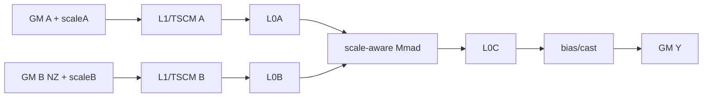
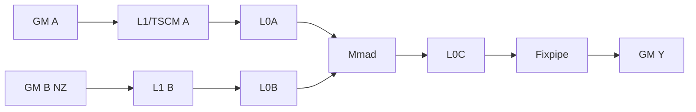
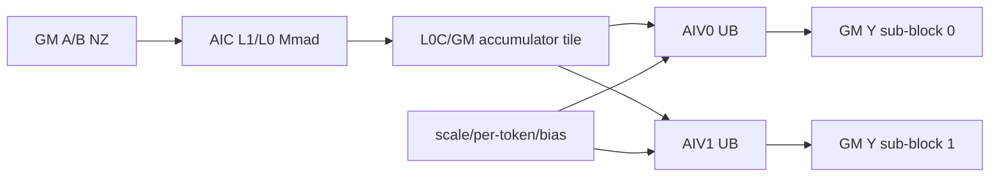
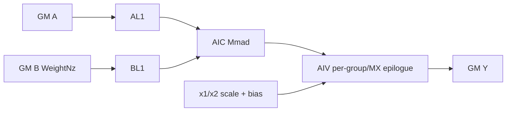

# QuantMatmulWeightNz 950 ACLNN 算子知识

## 算子速览

| 项目 | 内容 |
|---|---|
| 实际入口 | `aclnnQuantMatmulWeightNzGetWorkspaceSize` + `aclnnQuantMatmulWeightNz`，公开 ACLNN 两段式接口。 |
| 计算语义 | ND 激活与 NZ 权重的量化批矩阵乘；T-C/T-T、K-C/K-T 和 MX mode 均先在 Cube 累加，再按 mode 融合 scale/bias/cast。 |
| 输入输出 | `x1` ND，`x2` NZ，广播 batch；950 额外支持 HIFLOAT8/FLOAT8/FLOAT4、FLOAT8_E8M0 MX scale 和编码 groupSize。 |
| 执行类型 | AIC_CUBE、MIX_CV；浮点 A8W4 V4 route 的 AIV 与 Cube 位于同一 launch graph。 |
| Kernel 路线 | R-001 MX Basic/Tensor API；R-002 non-MX Cube ASW；R-003 non-MX MIX/PerBlock；R-004 浮点 A8W4 V4 per-group/MX。 |
| 核心资源 | GM、system/user workspace、L1/TSCM、L0A/L0B/L0C、UB/TQue/TBuf；MIX 核比要求 AIC:AIV=1:2。 |
| 来源闭包 | `source_closed`：公开 API→NZ/preprocess→V3/V4 launcher→arch35 priority/key/POD→CMCT/Blaze/Matmul/MIX body→构建接线闭合。 |
| 验证状态 | 已完成源码闭包检查；本次知识提取未执行编译、真机、数值或性能测试。 |

## 接口与语义

### 计算语义

逻辑矩阵为 `A[...,M,K]` 与 `B[...,K,N]`，B 以 NZ/ZN 亲和布局保存。普通 K-C/K-T 为 `Y=(A@B+bias_int32)*x2Scale*x1Scale`（可省略 per-token 或 bias）；浮点 bias 在 FP32 Vector epilogue 加入。MX mode 把 K 分为 `ceil(K/groupSizeK)` 段，对每段结果乘 `x1Scale[m/groupSizeM,j]*x2Scale[j,n/groupSizeN]` 后累加，并在最后加 bias。量化/cast 的顺序由 route 固定，不能把 scale 移到 Mmad 之前。

### 输入、输出与属性

| 参数 | shape/layout | dtype | 约束、默认值与语义 |
|---|---|---|---|
| `x1` | ND，2~6D | INT8/HIFLOAT8/FLOAT8_E4M3FN/FLOAT4_E2M1 | 逻辑 `[...,M,K]`；最后两轴转置视图可由 Host 识别。 |
| `x2` | NZ，4~8D | INT8/FLOAT32 packed-FP4/HIFLOAT8/FLOAT8/FLOAT4 | `transposeX2` 决定 NZ/ZN 解释；storage shape 必须等于 `GetWeightNzShape`。 |
| `x1Scale` | `(M,)` 或 MX 3D | FLOAT32/FLOAT8_E8M0 | per-token 或 MX A scale；MX storage shape 在 Host 修正。 |
| `x2Scale` | `(1,)`/`(N,)` 或 MX 3D | UINT64/INT64/FP32/BF16/FP16/FLOAT8_E8M0 | per-tensor/per-channel/MX B scale。 |
| `x2Offset/yScale` | mode 相关，可空 | FP32/UINT64 | 950 A8W4 route 根据 mode 使用；普通不支持项必须空。 |
| `bias` | `(N,)` 或 batch 广播 | INT32/BF16/FP16/FP32 | Cube bias 或 Vector 后 bias。 |
| `groupSize` | 低 48 位分别编码 K/N/M 16 位值 | int64 | 普通 mode 为 0；MX 公开示例 `[1,1,32]`，A8W4 K group 固定 32。 |
| `out` | ND `[...,M,N]` | FP16/BF16/INT8/INT32/FP32（组合受公开表约束） | 非连续输出由 `ViewCopy` 提交。 |

### 入口与版本

固定提交公开支持 Ascend 950PR/950DT，且本入口是 WeightNz 最新版本；`aclnnQuantMatmulV5` 是另一公开接口，不替代 WeightNz。`arch35` 只是实现目录，本卡的平台结论来自公开产品表与 `ascend950` OpDef/CMake 接线共同证明。

## Host/Launcher 执行流程

### 参数校验与前处理

Host 按源码顺序检查保留参数、空指针、rank/dtype/shape/transpose/groupSize；A8W4 packed FP4 会执行 `UnpackB32ToB4` 元信息转换，MX scale 必要时创建 swap-view 或 Contiguous。`GetWeightNzShape` 依据 dtype、transpose 和 A8W4 flag 得出逻辑 NZ 形状，`CheckWeightNzStorageShape` 对物理 storage 作逐维验证，再由 `SetTensorToNZFormat` 创建 executor view。普通组合添加 `QuantBatchMatmulV3` launcher，A8W4 添加 `QuantBatchMatmulV4` launcher，末端统一 `ViewCopy`。

### 参数、Workspace 与生命周期

V3 arch35 的公开 WeightNz ASW route 请求平台 `libApiWorkSpaceSize`。MX/Cube Basic POD 把 tile 写入 `QuantBatchMatmulV3BasicAPITilingData`；high-level ASW 使用 `QuantBatchMatmulV3TilingDataParams`。V4 arch35 per-group/MX 使用自己的 POD 与 user workspace。所有中间 Tensor、POD 与 launcher 归 executor；第二段 `CommonOpExecutorRun` 在传入 stream 上依序执行。源码中的整数 S4S4 转 INT8 分支不属于 950 公开 WeightNz dtype 组合，未纳入正式 Route。

### 启动图与失败传播

```text
WeightNz GetWorkspaceSize
  -> validate/Contiguous/NZ view
  -> ordinary or MX: QuantBatchMatmulV3 launcher
       -> arch35 priority selector -> one quant_batch_matmul_v3 MIX/AIC launch
  -> A8W4: QuantBatchMatmulV4 launcher
       -> V4 priority selector -> one quant_batch_matmul_v4 MIX launch
  -> ViewCopy(out)
WeightNz(workspace,executor,stream) -> CommonOpExecutorRun
```

单 launch 内 `ASCEND_IS_AIC/AIV` 分支与 `SyncAll`/CrossCore flags 是 Device 可见性的来源；Host 节点顺序只保证 V3/V4 与末端 ViewCopy 的 stream 顺序。任何校验、Tiling、InferShape、launcher 添加或 ViewCopy 失败直接返回错误。

## Route 与参数设计

### 分核与资源计算

arch35 priority selector 先形成 `QuantBatchMatmulInfo`，BaseBlockCalculator 计算 `baseM/baseN/baseK` 与 tail-window；`singleCoreM=min(M,baseM)`、`singleCoreN=min(N,baseN)`、`singleCoreK=K`，`usedCoreNum` 由 batch×M/N tile 数与 AIC 数上限决定。L1 calculator 给出 `depthA1/depthB1/stepKa/stepKb`，L0A/L0B 双缓冲，L0C 仅在 `baseM*baseN*4*2 <= l0cSize` 且 bias/scale 可容纳时开启双缓冲。MIX route 要求 `aivNum=2*aicNum`，blockDim 编码同一 launch 的 AIC 与两组 AIV。

### Route 选择

| 顺序 | Route | Key/模板 | 精确选择条件与优先级 | 不适用去向 |
|---:|---|---|---|---|
| 1 | R-001 MX Basic/Tensor | priority `MX_BASIC_API_ASW=1` | V3，A/B 为 FP8/FP4，scale 为 E8M0，MX basic capable；Tensor API capability 决定 BLAZE，否则 CMCT Basic | R-002/3 |
| 2 | R-002 Cube Basic/ASW | priority 2 后 4 | WeightNz non-MX Basic capable，或 per-tensor/per-channel 由 Fixpipe/Cube 完成；kernelType 0/1（normal/A-full） | R-003 |
| 3 | R-003 MIX/PerBlock | priority 5 后 6 | 浮点 per-channel、per-token、BF16 mix、FP8 TT float bias 或 per-block；`out!=INT32`；kernelType 2/3/4 | Tiling 失败 |
| 4 | R-004 V4 浮点 A8W4 | API 先分到 V4；950 registry `{BASIC_PERBLOCK,PERGROUP_ARCH35,BASIC}` | `isA8W4Float`，即 FP8 激活与 FP4/packed-FP4 WeightNz；按 T-CG/MX/per-group capability 命中 V4 Basic/per-group | 参数或 Tiling 失败 |

```text
if public A5 floating A8W4: R-004
else V3 priorities on DAV_3510:
  MX Basic capable -> R-001
  Cube Basic capable -> R-002
  Cube ASW capable -> R-002
  Mix ASW capable -> R-003
  PerBlock Basic capable -> R-003
  otherwise fail
```

### 模板/实现执行矩阵

| Route | key/selector | dtype/shape/platform 完整命中条件 | 执行族与 kernel 节点 | 实际模板/body | 内存与同步特征 | tail/fallback |
|---|---|---|---|---|---|---|
| R-001 MX | ATRANS/BTRANS, kernel 0/1, API Basic/Blaze | 950 + MX dtype + WeightNz NZ | AIC_CUBE；部分 packed preprocess 为 MIX_CV | `QbmmMXBasicAPIKernel`/`QbmmMXTensorAPIKernel`, A-full specialization | scale 与 A/B 由 `MatmulTypeWithScale` 进入 TSCM/L0；无独立 GM INT32 epilogue | adaptive sliding-window M/N tail |
| R-002 Cube | kernel 0/1，API High/Basic/Blaze | non-MX WeightNz，Cube capability，Fixpipe-compatible mode | AIC_CUBE | `MatMulASWKernel`, `MatmulAswKernelAL1FullLoad`, CMCT/Blaze Cube | GM→L1/TSCM→L0→Mmad→L0C→Fixpipe/GM | A-full 按 L1 capacity；否则 normal |
| R-003 MIX | kernel 2/3/4 | pertoken/float scale/bias/perblock，950，AIV=2*AIC | 单 MIX_CV AIC:2AIV | `MatMulASWKernelMix`, AL1 full-load mix, `QbmmCmctPertileKernel` | AIC L0C/GM tile→AIV UB FP32 epilogue；CrossCore flags | UB mask M/N tail；core ratio 不符失败 |
| R-004 V4 | V4 QUANT_TYPE/WEIGHTNZ | FP8×FP4/packed-FP4 A8W4，TCG/MX/per-group | MIX_CV | `QuantBatchMatmulV4PerChannelKernel`, `InvokeKernel<WEIGHTNZ>` | V4 POD；AIC/AIV 共享 userWS/flags | V4 capability 无跨算子 fallback |

### 隐藏性能 Guard

| Guard | Host/Tiling 条件 | Device/资源原因 | 影响 Route | 不满足时去向 | 源码符号 |
|---|---|---|---|---|---|
| priority 次序 | `{MX_BASIC,CUBE_BASIC,CUBE_ASW,MIX_ASW,PERBLOCK}` | 先选更专门实例 | R-001~3 | 下一 priority | `GetQuantBatchMatmulV3Priorities` |
| MIX 核比 | `aivNum==2*aicNum` | 一个 Cube tile 由两个 Vector sub-block 消费 | R-003/4 | Tiling 失败 | `CheckCoreNum` |
| A/AB full load | L1 calculator 证明 A 或 A+B 全载 | specialization 把 GM operand 固定到 TSCM 复用 | R-002/3 | normal MMAPI | `GetKernelType` |
| L0C DB | `baseM*baseN*4*2<=l0cSize` 且 bias/scale 合法 | 双缓冲不能挤占量化资源 | 全部 V3 | `dbL0C=1` | `CalL1Tiling` |
| MX mode | A/B low-precision + both scale E8M0 | Basic/Tensor scale-aware Matmul specialization | R-001 | non-MX routes 不可接管错误 dtype | `IsMxBasicApiCapable` |
| NZ shape/padding | storage 与推导 shape 完全一致；padding 需填 0 | NZ tail 会被 Cube 按块读取 | 全部 | ACLNN 参数错误 | `CheckWeightNzStorageShape` |

### POD/ABI

所有本地 POD 使用 `#pragma pack(8)`；源码未写死完整 `TCubeTiling` 的 `sizeof/offsetof` 数字，下表保留声明顺序、字段位宽与单位，不推测编译结果。

| 结构 | 字段 | 类型/位宽 | ABI 布局 | 单位 | Host/launcher producer | Device consumer | 边界 |
|---|---|---|---|---|---|---|---|
| `QuantBatchMatmulV3DataParams` | `batchA` | uint32/32 | 源码序号 0；pack 8，数值 offsetof 未显式 | batch 数 | common input analysis | scheduler/offset | uint32 范围 |
| `QuantBatchMatmulV3DataParams` | `batchB` | uint32/32 | 源码序号 1；pack 8，数值 offsetof 未显式 | batch 数 | common input analysis | scheduler/offset | uint32 范围 |
| `QuantBatchMatmulV3DataParams` | `batchC` | uint32/32 | 源码序号 2；pack 8，数值 offsetof 未显式 | batch 数 | common input analysis | scheduler/offset | uint32 范围 |
| `QuantBatchMatmulV3DataParams` | `batchA1` | uint32/32 | 源码序号 3；pack 8，数值 offsetof 未显式 | batch 数 | common input analysis | scheduler/offset | uint32 范围 |
| `QuantBatchMatmulV3DataParams` | `batchA2` | uint32/32 | 源码序号 4；pack 8，数值 offsetof 未显式 | batch 数 | common input analysis | scheduler/offset | uint32 范围 |
| `QuantBatchMatmulV3DataParams` | `batchA3` | uint32/32 | 源码序号 5；pack 8，数值 offsetof 未显式 | batch 数 | common input analysis | scheduler/offset | uint32 范围 |
| `QuantBatchMatmulV3DataParams` | `batchA4` | uint32/32 | 源码序号 6；pack 8，数值 offsetof 未显式 | batch 数 | common input analysis | scheduler/offset | uint32 范围 |
| `QuantBatchMatmulV3DataParams` | `batchB1` | uint32/32 | 源码序号 7；pack 8，数值 offsetof 未显式 | batch 数 | common input analysis | scheduler/offset | uint32 范围 |
| `QuantBatchMatmulV3DataParams` | `batchB2` | uint32/32 | 源码序号 8；pack 8，数值 offsetof 未显式 | batch 数 | common input analysis | scheduler/offset | uint32 范围 |
| `QuantBatchMatmulV3DataParams` | `batchB3` | uint32/32 | 源码序号 9；pack 8，数值 offsetof 未显式 | batch 数 | common input analysis | scheduler/offset | uint32 范围 |
| `QuantBatchMatmulV3DataParams` | `batchB4` | uint32/32 | 源码序号 10；pack 8，数值 offsetof 未显式 | batch 数 | common input analysis | scheduler/offset | uint32 范围 |
| `QuantBatchMatmulV3DataParams` | `batchC1` | uint32/32 | 源码序号 11；pack 8，数值 offsetof 未显式 | batch 数 | common input analysis | scheduler/offset | uint32 范围 |
| `QuantBatchMatmulV3DataParams` | `batchC2` | uint32/32 | 源码序号 12；pack 8，数值 offsetof 未显式 | batch 数 | common input analysis | scheduler/offset | uint32 范围 |
| `QuantBatchMatmulV3DataParams` | `batchC3` | uint32/32 | 源码序号 13；pack 8，数值 offsetof 未显式 | batch 数 | common input analysis | scheduler/offset | uint32 范围 |
| `QuantBatchMatmulV3DataParams` | `batchC4` | uint32/32 | 源码序号 14；pack 8，数值 offsetof 未显式 | batch 数 | common input analysis | scheduler/offset | uint32 范围 |
| `QuantBatchMatmulV3DataParams` | `singleCoreBatch` | uint32/32 | 源码序号 15；pack 8 | batch/core | ASW/common tiling | Cube/MIX body | inactive Route 为 0 |
| `QuantBatchMatmulV3DataParams` | `isPerTensor` | uint32/32 | 源码序号 16；pack 8 | bool 标志 | ASW/common tiling | Cube/MIX body | inactive Route 为 0 |
| `QuantBatchMatmulV3DataParams` | `isPertoken` | uint32/32 | 源码序号 17；pack 8 | bool 标志 | ASW/common tiling | Cube/MIX body | inactive Route 为 0 |
| `QuantBatchMatmulV3DataParams` | `isDoubleScale` | uint32/32 | 源码序号 18；pack 8 | bool 标志 | ASW/common tiling | Cube/MIX body | inactive Route 为 0 |
| `QuantBatchMatmulV3DataParams` | `biasThreeDim` | uint32/32 | 源码序号 19；pack 8 | 元素 | ASW/common tiling | Cube/MIX body | inactive Route 为 0 |
| `QuantBatchMatmulV3DataParams` | `ubCalcM` | uint32/32 | 源码序号 20；pack 8 | 元素 | ASW/common tiling | Cube/MIX body | inactive Route 为 0 |
| `QuantBatchMatmulV3DataParams` | `ubCalcN` | uint32/32 | 源码序号 21；pack 8 | 元素 | ASW/common tiling | Cube/MIX body | inactive Route 为 0 |
| `QuantBatchMatmulV3DataParams` | `needUbBuffer` | uint32/32 | 源码序号 22；pack 8 | 字节 | ASW/common tiling | Cube/MIX body | inactive Route 为 0 |
| `QuantBatchMatmulV3DataParams` | `realSingleCoreM` | uint32/32 | 源码序号 23；pack 8 | 元素 | ASW/common tiling | Cube/MIX body | inactive Route 为 0 |
| `QuantBatchMatmulV3DataParams` | `realSingleCoreN` | uint32/32 | 源码序号 24；pack 8 | 元素 | ASW/common tiling | Cube/MIX body | inactive Route 为 0 |
| `QuantBatchMatmulV3DataParams` | `biasDtype` | uint32/32 | 源码序号 25；pack 8 | dtype 枚举 | ASW/common tiling | Cube/MIX body | inactive Route 为 0 |
| `QuantBatchMatmulV3DataParams` | `ubSize` | uint32/32 | 源码序号 26；pack 8 | 字节 | ASW/common tiling | Cube/MIX body | inactive Route 为 0 |
| `QuantBatchMatmulV3DataParams` | `isMClash` | uint32/32 | 源码序号 27；pack 8 | bool 标志 | ASW/common tiling | Cube/MIX body | inactive Route 为 0 |
| `QuantBatchMatmulV3DataParams` | `isNClash` | uint32/32 | 源码序号 28；pack 8 | bool 标志 | ASW/common tiling | Cube/MIX body | inactive Route 为 0 |
| `QuantBatchMatmulV3DataParams` | `groupSizeM` | uint32/32 | 源码序号 29；pack 8 | 元素 | ASW/common tiling | Cube/MIX body | inactive Route 为 0 |
| `QuantBatchMatmulV3DataParams` | `groupSizeN` | uint32/32 | 源码序号 30；pack 8 | 元素 | ASW/common tiling | Cube/MIX body | inactive Route 为 0 |
| `QuantBatchMatmulV3DataParams` | `groupSizeK` | uint32/32 | 源码序号 31；pack 8 | 元素 | ASW/common tiling | Cube/MIX body | inactive Route 为 0 |
| `QuantBatchMatmulV3BasicAPIDataParams` | `batchA` | uint32/32 | 源码序号 0；pack 8 | batch 数 | MX/Cube Basic Tiling | CMCT/Blaze body | mode/shape 校验 |
| `QuantBatchMatmulV3BasicAPIDataParams` | `batchB` | uint32/32 | 源码序号 1；pack 8 | batch 数 | MX/Cube Basic Tiling | CMCT/Blaze body | mode/shape 校验 |
| `QuantBatchMatmulV3BasicAPIDataParams` | `batchC` | uint32/32 | 源码序号 2；pack 8 | batch 数 | MX/Cube Basic Tiling | CMCT/Blaze body | mode/shape 校验 |
| `QuantBatchMatmulV3BasicAPIDataParams` | `batchA1` | uint32/32 | 源码序号 3；pack 8 | batch 数 | MX/Cube Basic Tiling | CMCT/Blaze body | mode/shape 校验 |
| `QuantBatchMatmulV3BasicAPIDataParams` | `batchA2` | uint32/32 | 源码序号 4；pack 8 | batch 数 | MX/Cube Basic Tiling | CMCT/Blaze body | mode/shape 校验 |
| `QuantBatchMatmulV3BasicAPIDataParams` | `batchA3` | uint32/32 | 源码序号 5；pack 8 | batch 数 | MX/Cube Basic Tiling | CMCT/Blaze body | mode/shape 校验 |
| `QuantBatchMatmulV3BasicAPIDataParams` | `batchA4` | uint32/32 | 源码序号 6；pack 8 | batch 数 | MX/Cube Basic Tiling | CMCT/Blaze body | mode/shape 校验 |
| `QuantBatchMatmulV3BasicAPIDataParams` | `batchB1` | uint32/32 | 源码序号 7；pack 8 | batch 数 | MX/Cube Basic Tiling | CMCT/Blaze body | mode/shape 校验 |
| `QuantBatchMatmulV3BasicAPIDataParams` | `batchB2` | uint32/32 | 源码序号 8；pack 8 | batch 数 | MX/Cube Basic Tiling | CMCT/Blaze body | mode/shape 校验 |
| `QuantBatchMatmulV3BasicAPIDataParams` | `batchB3` | uint32/32 | 源码序号 9；pack 8 | batch 数 | MX/Cube Basic Tiling | CMCT/Blaze body | mode/shape 校验 |
| `QuantBatchMatmulV3BasicAPIDataParams` | `batchB4` | uint32/32 | 源码序号 10；pack 8 | batch 数 | MX/Cube Basic Tiling | CMCT/Blaze body | mode/shape 校验 |
| `QuantBatchMatmulV3BasicAPIDataParams` | `batchC1` | uint32/32 | 源码序号 11；pack 8 | batch 数 | MX/Cube Basic Tiling | CMCT/Blaze body | mode/shape 校验 |
| `QuantBatchMatmulV3BasicAPIDataParams` | `batchC2` | uint32/32 | 源码序号 12；pack 8 | batch 数 | MX/Cube Basic Tiling | CMCT/Blaze body | mode/shape 校验 |
| `QuantBatchMatmulV3BasicAPIDataParams` | `batchC3` | uint32/32 | 源码序号 13；pack 8 | batch 数 | MX/Cube Basic Tiling | CMCT/Blaze body | mode/shape 校验 |
| `QuantBatchMatmulV3BasicAPIDataParams` | `batchC4` | uint32/32 | 源码序号 14；pack 8 | batch 数 | MX/Cube Basic Tiling | CMCT/Blaze body | mode/shape 校验 |
| `QuantBatchMatmulV3BasicAPIDataParams` | `x1QuantMode` | uint32/32 | 源码序号 15；pack 8 | 枚举 | MX/Cube Basic Tiling | CMCT/Blaze body | mode/shape 校验 |
| `QuantBatchMatmulV3BasicAPIDataParams` | `x2QuantMode` | uint32/32 | 源码序号 16；pack 8 | 枚举 | MX/Cube Basic Tiling | CMCT/Blaze body | mode/shape 校验 |
| `QuantBatchMatmulV3BasicAPIDataParams` | `biasThreeDim` | uint32/32 | 源码序号 17；pack 8 | bool 标志 | MX/Cube Basic Tiling | CMCT/Blaze body | mode/shape 校验 |
| `QuantBatchMatmulV3BasicAPIDataParams` | `biasDtype` | uint32/32 | 源码序号 18；pack 8 | 枚举 | MX/Cube Basic Tiling | CMCT/Blaze body | mode/shape 校验 |
| `QuantBatchMatmulV3BasicAPIDataParams` | `groupSizeM` | uint32/32 | 源码序号 19；pack 8 | 元素 | MX/Cube Basic Tiling | CMCT/Blaze body | mode/shape 校验 |
| `QuantBatchMatmulV3BasicAPIDataParams` | `groupSizeN` | uint32/32 | 源码序号 20；pack 8 | 元素 | MX/Cube Basic Tiling | CMCT/Blaze body | mode/shape 校验 |
| `QuantBatchMatmulV3BasicAPIDataParams` | `groupSizeK` | uint32/32 | 源码序号 21；pack 8 | 元素 | MX/Cube Basic Tiling | CMCT/Blaze body | mode/shape 校验 |
| `BasicAPICubeTiling` | `m` | uint32/32 | 源码序号 0；pack 8 | 元素 | Basic/L1 calculator | CMCT/Blaze mainloop | 窄化/容量校验 |
| `BasicAPICubeTiling` | `n` | uint32/32 | 源码序号 1；pack 8 | 元素 | Basic/L1 calculator | CMCT/Blaze mainloop | 窄化/容量校验 |
| `BasicAPICubeTiling` | `k` | uint32/32 | 源码序号 2；pack 8 | 元素 | Basic/L1 calculator | CMCT/Blaze mainloop | 窄化/容量校验 |
| `BasicAPICubeTiling` | `baseM` | uint32/32 | 源码序号 3；pack 8 | 元素 | Basic/L1 calculator | CMCT/Blaze mainloop | 窄化/容量校验 |
| `BasicAPICubeTiling` | `baseN` | uint32/32 | 源码序号 4；pack 8 | 元素 | Basic/L1 calculator | CMCT/Blaze mainloop | 窄化/容量校验 |
| `BasicAPICubeTiling` | `baseK` | uint32/32 | 源码序号 5；pack 8 | 元素 | Basic/L1 calculator | CMCT/Blaze mainloop | 窄化/容量校验 |
| `BasicAPICubeTiling` | `scaleKL1` | uint32/32 | 源码序号 6；pack 8 | 元素 | Basic/L1 calculator | CMCT/Blaze mainloop | 窄化/容量校验 |
| `BasicAPICubeTiling` | `stepKa` | uint16/16 | 源码序号 7；pack 8 | stage | Basic/L1 calculator | CMCT/Blaze mainloop | 窄化/容量校验 |
| `BasicAPICubeTiling` | `stepKb` | uint16/16 | 源码序号 8；pack 8 | stage | Basic/L1 calculator | CMCT/Blaze mainloop | 窄化/容量校验 |
| `BasicAPICubeTiling` | `scaleFactorA` | uint16/16 | 源码序号 9；pack 8 | 因子 | Basic/L1 calculator | CMCT/Blaze mainloop | 窄化/容量校验 |
| `BasicAPICubeTiling` | `scaleFactorB` | uint16/16 | 源码序号 10；pack 8 | 因子 | Basic/L1 calculator | CMCT/Blaze mainloop | 窄化/容量校验 |
| `BasicAPICubeTiling` | `nBufferNum` | uint8/8 | 源码序号 11；pack 8 | buffer 数 | Basic/L1 calculator | CMCT/Blaze mainloop | 窄化/容量校验 |
| `BasicAPICubeTiling` | `isBias` | uint8/8 | 源码序号 12；pack 8 | bool 标志 | Basic/L1 calculator | CMCT/Blaze mainloop | 窄化/容量校验 |
| `BasicAPICubeTiling` | `dbL0C` | uint8/8 | 源码序号 13；pack 8 | depth | Basic/L1 calculator | CMCT/Blaze mainloop | 窄化/容量校验 |
| `BasicAPICubeTiling` | `reserved` | uint8/8 | 源码序号 14；pack 8 | 保留 | Basic/L1 calculator | CMCT/Blaze mainloop | 固定 0 |
| `SlidingWindowParams` | `mTailTile` | uint32/32 | 源码序号 0；pack 8 | tile/元素 | adaptive window calculator | scheduler | main/tail window 有效 |
| `SlidingWindowParams` | `nTailTile` | uint32/32 | 源码序号 1；pack 8 | tile/元素 | adaptive window calculator | scheduler | main/tail window 有效 |
| `SlidingWindowParams` | `mBaseTailSplitCnt` | uint32/32 | 源码序号 2；pack 8 | tile/元素 | adaptive window calculator | scheduler | main/tail window 有效 |
| `SlidingWindowParams` | `nBaseTailSplitCnt` | uint32/32 | 源码序号 3；pack 8 | tile/元素 | adaptive window calculator | scheduler | main/tail window 有效 |
| `SlidingWindowParams` | `mTailMain` | uint32/32 | 源码序号 4；pack 8 | tile/元素 | adaptive window calculator | scheduler | main/tail window 有效 |
| `SlidingWindowParams` | `nTailMain` | uint32/32 | 源码序号 5；pack 8 | tile/元素 | adaptive window calculator | scheduler | main/tail window 有效 |
| `L2cacheTileParams` | `mTileCntL2` | uint32/32 | 源码序号 0；pack 8 | tile/枚举 | ASW Tiling | scheduler | Route 相关 |
| `L2cacheTileParams` | `nTileCntL2` | uint32/32 | 源码序号 1；pack 8 | tile/枚举 | ASW Tiling | scheduler | Route 相关 |
| `L2cacheTileParams` | `mTileBlock` | uint32/32 | 源码序号 2；pack 8 | tile/枚举 | ASW Tiling | scheduler | Route 相关 |
| `L2cacheTileParams` | `nTileBlock` | uint32/32 | 源码序号 3；pack 8 | tile/枚举 | ASW Tiling | scheduler | Route 相关 |
| `L2cacheTileParams` | `calOrder` | uint32/32 | 源码序号 4；pack 8 | tile/枚举 | ASW Tiling | scheduler | Route 相关 |
| `L2cacheTileParams` | `isBasicTiling` | uint32/32 | 源码序号 5；pack 8 | tile/枚举 | ASW Tiling | scheduler | Route 相关 |
| `QuantBatchMatmulV3BasicAPITilingData` | `params` | nested POD | 嵌套序号 0；整体 8 对齐 | 混合 | `PostTiling` | MX/Basic kernel | 不可与 high-level POD 混用 |
| `QuantBatchMatmulV3BasicAPITilingData` | `matmulTiling` | nested POD | 嵌套序号 1；整体 8 对齐 | 混合 | `PostTiling` | MX/Basic kernel | 不可与 high-level POD 混用 |
| `QuantBatchMatmulV3BasicAPITilingData` | `adaptiveSlidingWin` | nested POD | 嵌套序号 2；整体 8 对齐 | 混合 | `PostTiling` | MX/Basic kernel | 不可与 high-level POD 混用 |
| `QuantBatchMatmulV3TilingDataParams` | `params` | nested POD | 嵌套序号 0；整体 8 对齐 | 混合 | ASW Tiling | high-level kernel | key 决定 consumer |
| `QuantBatchMatmulV3TilingDataParams` | `matmulTiling` | nested POD | 嵌套序号 1；整体 8 对齐 | 混合 | ASW Tiling | high-level kernel | key 决定 consumer |
| `QuantBatchMatmulV3TilingDataParams` | `tileL2cacheTiling` | nested POD | 嵌套序号 2；整体 8 对齐 | 混合 | ASW Tiling | high-level kernel | key 决定 consumer |
| `QuantBatchMatmulV3TilingDataParams` | `adaptiveSlidingWin` | nested POD | 嵌套序号 3；整体 8 对齐 | 混合 | ASW Tiling | high-level kernel | key 决定 consumer |
| `qbmmv4_tiling::QuantBatchMatmulV4TilingDataParams` | `cubeNumBlocksN` | uint8/8 | 源码序号 0；pack 8 | block 数 | V4 arch35 Tiling | V4 per-group/MX body | Tiling 校验 |
| `qbmmv4_tiling::QuantBatchMatmulV4TilingDataParams` | `cubeNumBlocksM` | uint8/8 | 源码序号 1；pack 8 | block 数 | V4 arch35 Tiling | V4 per-group/MX body | Tiling 校验 |
| `qbmmv4_tiling::QuantBatchMatmulV4TilingDataParams` | `vecCoreParallel` | uint8/8 | 源码序号 2；pack 8 | 并行数 | V4 arch35 Tiling | V4 per-group/MX body | Tiling 校验 |
| `qbmmv4_tiling::QuantBatchMatmulV4TilingDataParams` | `reserve1` | uint8/8 | 源码序号 3；pack 8 | 保留 | V4 arch35 Tiling | V4 per-group/MX body | 固定 0 |
| `qbmmv4_tiling::QuantBatchMatmulV4TilingDataParams` | `AL1Pingpong` | uint16/16 | 源码序号 4；pack 8 | depth | V4 arch35 Tiling | V4 per-group/MX body | Tiling 校验 |
| `qbmmv4_tiling::QuantBatchMatmulV4TilingDataParams` | `BL1Pingpong` | uint16/16 | 源码序号 5；pack 8 | depth | V4 arch35 Tiling | V4 per-group/MX body | Tiling 校验 |
| `qbmmv4_tiling::QuantBatchMatmulV4TilingDataParams` | `kAlign` | uint64/64 | 源码序号 6；pack 8 | 元素 | V4 arch35 Tiling | V4 per-group/MX body | Tiling 校验 |
| `qbmmv4_tiling::QuantBatchMatmulV4TilingDataParams` | `nAlign` | uint64/64 | 源码序号 7；pack 8 | 元素 | V4 arch35 Tiling | V4 per-group/MX body | Tiling 校验 |
| `qbmmv4_tiling::QuantBatchMatmulV4TilingDataParams` | `kSize` | uint64/64 | 源码序号 8；pack 8 | 元素 | V4 arch35 Tiling | V4 per-group/MX body | Tiling 校验 |
| `qbmmv4_tiling::QuantBatchMatmulV4TilingDataParams` | `nSize` | uint64/64 | 源码序号 9；pack 8 | 元素 | V4 arch35 Tiling | V4 per-group/MX body | Tiling 校验 |
| `qbmmv4_tiling::QuantBatchMatmulV4TilingDataParams` | `groupSize` | uint64/64 | 源码序号 10；pack 8 | 元素 | V4 arch35 Tiling | V4 per-group/MX body | Tiling 校验 |
| `qbmmv4_tiling::QuantBatchMatmulV4TilingDataParams` | `mSize` | uint64/64 | 源码序号 11；pack 8 | 元素 | V4 arch35 Tiling | V4 per-group/MX body | Tiling 校验 |
| `qbmmv4_tiling::QuantBatchMatmulV4TilingDataParams` | `nBubSize` | uint64/64 | 源码序号 12；pack 8 | 元素 | V4 arch35 Tiling | V4 per-group/MX body | Tiling 校验 |
| `qbmmv4_tiling::QuantBatchMatmulV4TilingDataParams` | `kBubSize` | uint64/64 | 源码序号 13；pack 8 | 元素 | V4 arch35 Tiling | V4 per-group/MX body | Tiling 校验 |
| `qbmmv4_tiling::QuantBatchMatmulV4TilingDataParams` | `mAL1Size` | uint64/64 | 源码序号 14；pack 8 | 元素 | V4 arch35 Tiling | V4 per-group/MX body | Tiling 校验 |
| `qbmmv4_tiling::QuantBatchMatmulV4TilingDataParams` | `kAL1Size` | uint64/64 | 源码序号 15；pack 8 | 元素 | V4 arch35 Tiling | V4 per-group/MX body | Tiling 校验 |
| `qbmmv4_tiling::QuantBatchMatmulV4TilingDataParams` | `nBL1Size` | uint64/64 | 源码序号 16；pack 8 | 元素 | V4 arch35 Tiling | V4 per-group/MX body | Tiling 校验 |
| `qbmmv4_tiling::QuantBatchMatmulV4TilingDataParams` | `kBL1Size` | uint64/64 | 源码序号 17；pack 8 | 元素 | V4 arch35 Tiling | V4 per-group/MX body | Tiling 校验 |
| `qbmmv4_tiling::QuantBatchMatmulV4TilingDataParams` | `hasX1Scale` | uint64/64 | 源码序号 18；pack 8 | bool 标志 | V4 arch35 Tiling | V4 per-group/MX body | Tiling 校验 |
| `qbmmv4_tiling::QuantBatchMatmulV4TilingDataParams` | `hasX2Scale` | uint64/64 | 源码序号 19；pack 8 | bool 标志 | V4 arch35 Tiling | V4 per-group/MX body | Tiling 校验 |
| `qbmmv4_tiling::QuantBatchMatmulV4TilingDataParams` | `matmulTiling` | TCubeTiling | 源码序号 20；pack 8 | 层级参数 | V4 arch35 Tiling | V4 per-group/MX body | Tiling 校验 |

### Route 源码闭包

| Route | Key/selector | Host/Tiling producer | POD/参数 | Kernel entry/router | Kernel body/直接依赖 | 构建接线 |
|---|---|---|---|---|---|---|
| R-001 | MX priority/key | `adaptive_sliding_window_mx_basic_api_tiling.cpp` | V3 Basic API POD | arch35 `quant_batch_matmul_v3` | `qbmm_mx_basic_api_cmct.h`/tensor API | V3 CMake ascend950 |
| R-002 | Cube Basic/ASW | Cube Basic + Cube ASW tiling | Basic/high-level POD | 同上 | `qbmm_cube_*`, on-the-fly/full-load | 同上 |
| R-003 | MIX/PerBlock | Mix + PerBlock tiling | high-level/Basic POD | 同上 | `qbmm_mix_*`, `qbmm_mix_pertile_cmct.h` | 同上 |
| R-004 | V4 浮点 A8W4 | V4 registry + arch35 tilings | V4 POD | arch35 `quant_batch_matmul_v4` | perchannel/pertoken-pergroup/CMCT | V4 CMake ascend950 |

## Kernel 实现

### 公共执行流程

V3 entry 通过模板 key 的 ATRANS、BTRANS、BIASMODE、KERNELTYPE、APILEVEL 唯一实例化 body。A/B WeightNz 地址由选中的 NZ/ZN layout specialization 解释；scheduler 生成 M/N window 与 tail window。AIC 完成 `GM→L1/TSCM→L0A/L0B→Mmad→L0C`；AIC-only 由 Fixpipe 写出，MIX 则把 L0C/GM tile 交给两组 AIV 做 UB epilogue。V4 entry 使用独立 QUANT_TYPE/WEIGHTNZ key；所有分支均在同一 executor launch 内。

### Route R-001：MX Basic/Tensor API

#### 适用条件

##### 选择证据

| 层级 | 文件 | 符号 | 源码谓词/参数 | 结果/下一跳 |
|---|---|---|---|---|
| API | `aclnn_quant_matmul_v4.cpp` | `preProcessTensor/MxScaleContiguousProcess` | E8M0 scale + FP8/FP4 A/B | V3 MX input |
| Tiling | `adaptive_sliding_window_mx_basic_api_tiling.cpp` | `IsCapable` | `IsMxBasicApiCapable` | priority 1 |
| Router | `op_kernel/arch35/quant_batch_matmul_v3.cpp` | `IS_MX` + kernel 0/1 | Basic/Blaze + TRANS | MX CMCT/Blaze body |

#### Device 数据流

##### 函数级调用链

```text
quant_batch_matmul_v3
  -> QbmmMXBasicAPIKernel / QbmmMXTensorAPIKernel
  -> scheduler window
  -> load A/B and E8M0 scale blocks
  -> scale-aware Matmul mainloop (K groups)
  -> accumulate/output tile -> bias/cast -> GM y
```

##### 源码等价伪码

```text
for tile in adaptive M/N windows:
  for j in ceil(K/groupSizeK):
    load A_slice,B_slice and their E8M0 scale blocks;
    acc += Mmad(A_slice,B_slice) * scaleA[mGroup,j] * scaleB[j,nGroup];
  add bias if present; cast/store only valid tail M/N.
```

#### 内存与数据搬运

##### 资源与搬运表

| 层级/缓冲区 | offset/地址公式 | extent/容量公式 | dtype/layout | producer | consumer | owner/lifetime | 对齐/复用 |
|---|---|---|---|---|---|---|---|
| GM A/B | batch + M/N/K tile，B 由 NZ/ZN layout class | logical tile + padded tail | FP8/FP4 ND/NZ | 用户 | prologue | 用户 | group K=32/64，物理 padding 0 |
| GM scale | group-indexed offsets | A:`ceil(M/gsM)*ceil(K/gsK)`；B 类似 | E8M0 | 用户 | scale prologue | 用户 | 末维 packing=2 |
| L1/TSCM | tile-local | A/B `base*baseK*depth*packed_size`，scaleKL1 | low precision + scale | MTE | mainloop | current window | A-full 可跨 N window 复用 |
| L0A/B/C | internal | A/B DB；`baseM*baseN*accSize*dbL0C` | Cube/FP32 acc | Load/Mmad | epilogue | tile | tail window |
| UB | bias/cast helper（存在时） | Basic API tiling决定 | FP32/target | epilogue | store | kernel | 32B |
| workspace | system workspace | `libApiWorkSpaceSize` | bytes | framework | Matmul API | executor | no extra normal slice |

##### 分层内存布局



##### 字节账、交接边与复用顺序

```text
workspace_total = libApiWorkSpaceSize
L1 = packed(A tile)*depthA1 + packed(B tile)*depthB1 + scaleKL1 bytes
L0 = dbA*packed(baseM*baseK) + dbB*packed(baseN*baseK) + dbC*baseM*baseN*accSize
UB <= platform ubSize（由 Basic API calculator 验证）
```

| 边/复用子区 | producer | offset/extent | dtype/layout | consumer | ordering/sync | owner/lifetime | 安全条件 |
|---|---|---|---|---|---|---|---|
| A full-load reuse | prologue | A tile + scale tile | low precision/TSCM | successive N windows | Matmul pipe | current M/K window | L1 capability true |

#### 同步、精度与尾块

##### 同步与数值边界表

| 阶段 | primitive/机制 | producer | consumer/等待点 | 保护对象 | 精度/尾块 |
|---|---|---|---|---|---|
| mainloop | Matmul pipe | MTE/LoadData | Mmad | ping-pong L1/L0 | group K tail + zero padding |
| output | Fixpipe/epilogue | L0C | GM | tile | segment scale before sum; M/N tail window |

#### 关键实现

##### 符号证据表

| 阶段 | 文件 | 符号/模板实例 | 实现事实 |
|---|---|---|---|
| Host/Tiling producer | `adaptive_sliding_window_mx_basic_api_tiling.cpp` | `CalcBasicBlock/CalL1Tiling/SetTilingData` | MX base/L1/POD |
| Kernel entry/router | `op_kernel/arch35/quant_batch_matmul_v3.cpp` | `IS_MX` branches | CMCT/Blaze layouts |
| Device body/helper | `qbmm_mx_basic_api_cmct.h` | MX kernel | K-group scale-aware Cube dataflow |

### Route R-002：Non-MX Cube ASW

#### 适用条件

##### 选择证据

| 层级 | 文件 | 符号 | 源码谓词/参数 | 结果/下一跳 |
|---|---|---|---|---|
| Tiling | `adaptive_sliding_window_cube_basic_api_tiling.cpp` | `IsCapable` | WeightNz non-MX Cube Basic capable | Basic/Blaze/High |
| Tiling | `adaptive_sliding_window_cube_tiling.cpp` | `IsCapable` | per-tensor/per-channel Fixpipe-capable + B=NZ | high-level Cube |
| Router | arch35 entry | kernel type 0/1 | normal/A-full | on-the-fly body |

#### Device 数据流

##### 函数级调用链

```text
quant_batch_matmul_v3
  -> MatMulASWKernel / MatmulAswKernelAL1FullLoad
  -> block scheduler + CalcOffset
  -> MatmulImpl::Init/SetTensorA/B/Bias
  -> Iterate -> L0C -> Fixpipe quant scalar/vector -> GM y
```

##### 源码等价伪码

```text
选择 main/tail sliding window；计算 batch,M,N,K offsets；
若 A-full，先把本 M/K A tile 与可能的 bias 装入 TSCM；
对 N windows 复用 A，B 从 NZ GM 分块进入 L1/L0B；
Mmad 累加，设置 per-tensor scalar 或 integer encoded per-channel scale；
Fixpipe 仅写有效 M/N tail。
```

#### 内存与数据搬运

##### 资源与搬运表

| 层级/缓冲区 | offset/地址公式 | extent/容量公式 | dtype/layout | producer | consumer | owner/lifetime | 对齐/复用 |
|---|---|---|---|---|---|---|---|
| GM B | scheduler N/K + NZ layout | aligned(N)*aligned(K)*packed size | NZ/ZN | 用户 | GM→BL1 | 用户 | C0/N0 blocks |
| L1 A/B | tile | `baseM*baseK*depthA1*sizeof(A)` + B analog | TSCM | MTE | L0 load | tile/window | A-full reuses across N |
| L0A/B | tile | double-buffered packed tile | Cube | LoadData | Mmad | K stage | db=2 |
| L0C | M×N tile | `baseM*baseN*4*dbL0C` | INT32/FP32 | Mmad | Fixpipe | tile | db conditional |
| UB | N/A for pure Fixpipe | 0 | N/A | N/A | N/A | N/A | actual replacement Fixpipe |
| workspace | system workspace | `libApiWorkSpaceSize` | bytes | framework | Matmul API | executor | 平台边界 |

##### 分层内存布局



##### 字节账、交接边与复用顺序

```text
workspace_total = libApiWorkSpaceSize
L1 = A_tile*depthA1 + B_tile*depthB1 (+ bias/scale stage)
L0 = 2*A_L0 + 2*B_L0 + dbL0C*baseM*baseN*4
UB = N/A（pure Cube）
```

| 边/复用子区 | producer | offset/extent | dtype/layout | consumer | ordering/sync | owner/lifetime | 安全条件 |
|---|---|---|---|---|---|---|---|
| A-full L1 复用 | GM→TSCM prologue | A tile extent | input dtype/ND | successive N windows | Matmul pipe | current M/K tile | Host 已证明 A full-load |

#### 同步、精度与尾块

##### 同步与数值边界表

| 阶段 | primitive/机制 | producer | consumer/等待点 | 保护对象 | 精度/尾块 |
|---|---|---|---|---|---|
| Cube pipeline | Matmul events | MTE/LoadData | Mmad/Fixpipe | L1/L0 DB | INT32 accumulate；K tail padded |
| output | adaptive window | Fixpipe | GM | last M/N window | scale/cast, only valid extent |

#### 关键实现

##### 符号证据表

| 阶段 | 文件 | 符号/模板实例 | 实现事实 |
|---|---|---|---|
| Host/Tiling producer | `adaptive_sliding_window_cube_tiling.cpp` | `IsCapable/CalL1Tiling` | Cube guard/resources |
| Kernel entry/router | `op_kernel/arch35/quant_batch_matmul_v3.cpp` | kernel type 0/1 | normal/full-load dispatch |
| Device body/helper | `qbmm_cube_on_the_fly*.h` | `MatMulASWKernel*::Process` | TSCM/Matmul/Fixpipe |

### Route R-003：Non-MX MIX/PerBlock

#### 适用条件

##### 选择证据

| 层级 | 文件 | 符号 | 源码谓词/参数 | 结果/下一跳 |
|---|---|---|---|---|
| Tiling | `adaptive_sliding_window_mix_tiling.cpp` | `IsCapable` | float per-channel/per-token/BF16/float bias 且 out!=INT32 | MIX high-level |
| Tiling | `adaptive_sliding_window_perblock_basic_api_tiling.cpp` | `IsCapable` | perblock capable | MIX custom MM |
| Router | arch35 tiling key | kernel 2/3/4 | MMAPI normal/A-full/custom | MIX body |

#### Device 数据流

##### 函数级调用链

```text
quant_batch_matmul_v3
  -> AIC Matmul mainloop -> L0C/GM intermediate -> signal
  -> two AIV sub-blocks wait -> UB load/cast
  -> FP32 x2Scale [* x1Scale] [+ bias] -> cast/store
  -> completion signal permits next tile
```

##### 源码等价伪码

```text
AIC produces baseM×baseN accumulator tile;
split N/M extent between two AIV sub-blocks;
wait AIC flag; load only assigned rows/cols to UB;
cast acc to FP32; apply per-channel/per-token/perblock scale; add float bias;
cast/store masked tail; signal tile reusable.
```

#### 内存与数据搬运

##### 资源与搬运表

| 层级/缓冲区 | offset/地址公式 | extent/容量公式 | dtype/layout | producer | consumer | owner/lifetime | 对齐/复用 |
|---|---|---|---|---|---|---|---|
| L1/L0 | same tile formula as R-002 | base/depth/db | Cube | AIC | Mmad | AIC | A-full optional |
| AIC→AIV tile | per scheduler/core/subblock | baseM×baseN accumulator | INT32/FP32 | AIC | two AIV | kernel/workspace | signal-protected |
| UB queues | half/sub-block extent | double-buffered source/out + FP32 temp/scale/bias | typed TQue/TBuf | MTE2 | Vector/MTE3 | AIV | 32B, tail mask |
| GM scale/bias | N/M group offset | current tile vector | FP32/BF16/FP16 | user | AIV | user | aligned copies |
| GM y | batch/M/N offset | valid sub-block | target | AIV | user | user | no overlap between AIVs |

##### 分层内存布局



##### 字节账、交接边与复用顺序

```text
workspace_total = libApiWorkSpaceSize
L1/L0 = current ASW tile formula
UB_each_AIV = 2*(accumulator input + output) + FP32 temp + scale/per-token/bias queues <= ubSize
```

| 边/复用子区 | producer | offset/extent | dtype/layout | consumer | ordering/sync | owner/lifetime | 安全条件 |
|---|---|---|---|---|---|---|---|
| AIC→AIV0/1 | Cube epilogue | disjoint sub-block extents of same tile | INT32/FP32 ND | AIV0/1 | CrossCore flag + pipe | current tile | both AIV complete before reuse |
| UB ping/pong | MTE2 | subblock extent | source dtype | Vector | TQue events | AIV | depth=2, masked tail |

#### 同步、精度与尾块

##### 同步与数值边界表

| 阶段 | primitive/机制 | producer | consumer/等待点 | 保护对象 | 精度/尾块 |
|---|---|---|---|---|---|
| core handoff | cross-core flags (`AIV_SYNC_AIC_FLAG=6`,`AIC_SYNC_AIV_FLAG=8`) | AIC/AIV | reciprocal waits | accumulator tile | full producer visibility |
| UB pipeline | TQue/TBuf events | MTE2/Vector | MTE3/free | ping/pong | FP32 intermediate; masked M/N tail |
| numeric | cast/mul/add/cast | accumulator | output | sub-block | perblock scale indexed by group, bias after scale |

#### 关键实现

##### 符号证据表

| 阶段 | 文件 | 符号/模板实例 | 实现事实 |
|---|---|---|---|
| Host/Tiling producer | `adaptive_sliding_window_mix_tiling.cpp` | `IsCapable/CheckCoreNum` | mode 与 1:2 core guard |
| Kernel entry/router | `quant_batch_matmul_v3_apt_tiling_key.h` | MIX key 2/3/4 | actual template family |
| Device body/helper | `qbmm_mix_online_dynamic*.h`, `qbmm_mix_pertile_cmct.h` | `Process` | AIC/AIV graph, FP32 epilogue |

### Route R-004：V4 浮点 A8W4 WeightNz

#### 适用条件

##### 选择证据

| 层级 | 文件 | 符号 | 源码谓词/参数 | 结果/下一跳 |
|---|---|---|---|---|
| API | `aclnn_quant_matmul_v4.cpp` | `isA8W4Float` | FP8×FP4/packed-FP4 pseudo-quant组合 | `l0op::QuantBatchMatmulV4` |
| Tiling | V4 registry | `QuantBatchMatmulV4TilingFunc` | 950 non-s8s4 priorities BasicPerblock→PergroupArch35→Basic | V4 key |
| Router | V4 arch35 entry | QUANT_TYPE + WEIGHTNZ | PER_GROUP/MX | perchannel/MX body |

#### Device 数据流

##### 函数级调用链

```text
quant_batch_matmul_v4
  -> InvokeWeightQuantBmmOpImpl<PerChannelKernel> or InvokeKernel<WEIGHTNZ>
  -> AIC packed WeightNz Matmul
  -> AIV per-group/MX scale and bias epilogue
  -> GM y
```

##### 源码等价伪码

```text
解包 V4 POD 的 aligned K/N、groupSize 和 A/B L1 tile；
按 WEIGHTNZ layout 取 B packed block；Cube 按 baseM/N/K 累加；
AIV 读取 x1Scale/x2Scale（TCG 或 MX/per-group），以 FP32 应用 scale/bias；
cast 到 y，保护 M/N/K tail。
```

#### 内存与数据搬运

##### 资源与搬运表

| 层级/缓冲区 | offset/地址公式 | extent/容量公式 | dtype/layout | producer | consumer | owner/lifetime | 对齐/复用 |
|---|---|---|---|---|---|---|---|
| GM packed B | V4 `nAlign/kAlign` | packed K×N | FP4/INT4 WeightNz | user | AIC prologue | user | zero-filled padding |
| L1 A/B | `mAL1Size*kAL1Size`, `nBL1Size*kBL1Size` | POD | low precision | MTE | Mmad | tile | AL1/BL1 pingpong fields |
| L0 | TCubeTiling | base tile | Cube/acc | LoadData/Mmad | epilogue | tile | DB |
| UB | `nBubSize*kBubSize` + scale/bias temps | POD/route formula | packed/FP32 | AIV | vector | AIV | 32B |
| workspace | userWS after system | V4 Tiling formula | intermediate | AIC/AIV | reciprocal | executor | flags/lifetime route-specific |

##### 分层内存布局



##### 字节账、交接边与复用顺序

```text
workspace_total = V4 tiling GetWorkspaceSize result
L1 = mAL1Size*kAL1Size*packedA + nBL1Size*kBL1Size*packedB, multiplied by pingpong fields
L0 = TCubeTiling base/db capacity
UB = nBubSize*kBubSize packed stage + FP32 scale/bias/output temps <= ubSize
```

| 边/复用子区 | producer | offset/extent | dtype/layout | consumer | ordering/sync | owner/lifetime | 安全条件 |
|---|---|---|---|---|---|---|---|
| Cube→Vector | V4 AIC | current accumulator tile | INT32/FP32 ND | V4 AIV | MIX kernel flags/pipe | current tile | 1:2 core mapping and tail extent |

#### 同步、精度与尾块

##### 同步与数值边界表

| 阶段 | primitive/机制 | producer | consumer/等待点 | 保护对象 | 精度/尾块 |
|---|---|---|---|---|---|
| AIC/AIV | V4 MIX flags | Cube | Vector wait | acc tile | scale after accumulate |
| output | UB pipeline | vector | MTE3 | sub-block | FP32 scale/bias，target cast，M/N/K tail |

#### 关键实现

##### 符号证据表

| 阶段 | 文件 | 符号/模板实例 | 实现事实 |
|---|---|---|---|
| Host/Tiling producer | `quant_batch_matmul_v4_tiling_registry.cpp` + arch35 tilings | registry/IsCapable | 950 V4 selection |
| Kernel entry/router | `op_kernel/arch35/quant_batch_matmul_v4.cpp` | `quant_batch_matmul_v4` | QUANT_TYPE/WEIGHTNZ mapping |
| Device body/helper | `quant_batch_matmul_v4_perchannel.h`, `quant_batch_matmul_v4_pertoken_pergroup.h` | `Process` | packed Matmul + vector epilogue |

## 算子特定优化

### Trick T-001：priority 将 MX/WeightNz 专用 Basic API 放在通用 ASW 前

#### 触发与源码依据

- 适用 Route：R-001~R-003
- 触发条件：DAV_3510/950 V3。
- Golden 来源：[`quant_batch_matmul_v3_tiling_strategy.h:28-32`](../../../../../../../cann-ops-raw/ascendc/ops-nn/955f8b33985b6d72989ebff341bb9c2c564a51bc/matmul/quant_batch_matmul_v3/op_host/op_tiling/arch35/quant_batch_matmul_v3_tiling_strategy.h)

**官方源码（固定 Commit 连续逐字摘录）**：

```cpp
static const std::vector<int32_t> dav3510Priorities = {
    strategy::MX_BASIC_API_ASW, strategy::CUBE_BASIC_API_ASW, strategy::CUBE_ASW, strategy::MIX_ASW,
    strategy::PERBLOCK_BASIC_API_ASW};
```

#### 机制与设计原因

priority 把能直接表达 MX scale 或 WeightNz layout 的专用 Basic/Tensor API 置前，避免先命中通用 MIX 后再物化不必要的中间数据；每个 `IsCapable` 失败才进入下一项。

#### 迁移边界

- 适用：950 V3 WeightNz。
- 前提：保持全部 capability 谓词、POD 类型和 key 同步。
- 失效：A8W4 已在 API 层分到 V4，不受此列表控制。
- 未验证：本次知识提取未执行编译、真机、数值或性能测试。

#### 错误做法

交换 MIX 与 MX/Cube Basic priority 可能改变同一 shape 的 POD 和 kernel specialization，不能只改 Host 顺序。

### Trick T-002：A-full-load 用 TSCM 跨 N window 复用 A

#### 触发与源码依据

- 适用 Route：R-001~R-003
- 触发条件：L1 calculator 判定 `isAFullLoad_`，kernel type 1 或 3。
- Golden 来源：[`qbmm_cube_on_the_fly_al1_full_load.h:70-83`](../../../../../../../cann-ops-raw/ascendc/ops-nn/955f8b33985b6d72989ebff341bb9c2c564a51bc/matmul/quant_batch_matmul_v3/op_kernel/arch35/qbmm_cube_on_the_fly_al1_full_load.h)

**官方源码（固定 Commit 连续逐字摘录）**：

```cpp
using aType = typename std::conditional<
    enableScale,
    matmul::MatmulTypeWithScale<AscendC::TPosition::TSCM, AscendC::TPosition::TSCM, formatX1, x1Type, aTrans>,
    matmul::MatmulType<AscendC::TPosition::TSCM, formatX1, x1Type, aTrans>>::type;
```

#### 机制与设计原因

A tile 和需要时的 A scale 驻留 TSCM，N window 迭代只更新 B，减少重复 GM→L1 搬运；模板参数同时改变 operand position，不能靠运行时 flag 模拟。

#### 迁移边界

- 适用：A tile（及 scale）完整装入 L1/TSCM的 shape。
- 前提：L1 bytes、depth、layout、transpose 和 scale specialization 全部闭合。
- 失效：容量不足回到 kernel type 0/2 normal MMAPI。
- 未验证：本次知识提取未执行编译、真机、数值或性能测试。

#### 错误做法

在 L1 capability 不成立时强制 type 1/3 会让实际 TSCM 分配超过 Tiling 给出的容量。

### Trick T-003：MIX 固定 1:2 核映射分摊 Vector epilogue

#### 触发与源码依据

- 适用 Route：R-003/R-004
- 触发条件：Vector epilogue/perblock route，`aivNum==2*aicNum`。
- Golden 来源：[`adaptive_sliding_window_mix_tiling.cpp:79-88`](../../../../../../../cann-ops-raw/ascendc/ops-nn/955f8b33985b6d72989ebff341bb9c2c564a51bc/matmul/quant_batch_matmul_v3/op_host/op_tiling/arch35/adaptive_sliding_window_mix_tiling.cpp)

**官方源码（固定 Commit 连续逐字摘录）**：

```cpp
if (compileInfo_.aivNum != CORE_RATIO * compileInfo_.aicNum) {
    OP_LOGE(inputParams_.opName, "For mix template, aicNum:aivNum should be 1:2");
    return false;
}
```

#### 机制与设计原因

同一个 Cube tile 的后处理域被两个 AIV sub-block 分割，降低单 AIV 的 UB extent，并与模板 key `MIX_AIC_1_2` 一致。该比例同时决定 blockDim 编码、flag ID 和输出无重叠范围。

#### 迁移边界

- 适用：950 MIX_CV。
- 前提：平台核比、subBlockIdx 映射、flag 与 UB 切片一致。
- 失效：AIC-only route 或核比不满足时 Tiling 失败/选 Cube。
- 未验证：本次知识提取未执行编译、真机、数值或性能测试。

#### 错误做法

只改变 blockDim 而不改 sub-block offset/flag 会造成重复写或 workspace 提前复用。

## 模板与实现对比

| 对比维度 | R-001 MX | R-002 Cube | R-003 MIX | R-004 V4 浮点 A8W4 | 设计选择依据 |
|---|---|---|---|---|---|
| 命中条件/优先级 | MX priority 1 | Cube priority 2/4 | MIX 5/PerBlock 6 | API V4 | quant mode/dtype |
| 执行族/节点图 | AIC，packed case可 MIX | AIC-only | AIC:2AIV | MIX_CV | epilogue/packing需求 |
| M/N/K、tile 与 scheduler | Basic/Tensor ASW | high/Basic ASW | ASW + AIV subblock | V4 scheduler | capability/resources |
| workspace/L1/L0/UB | system，scale-aware L1 | system | UB epilogue | V4 userWS | 中间交接不同 |
| AIC/AIV 或 kernel 交接 | 通常 N/A | N/A | flags/pipe | V4 flags | Device visibility |
| 同步、精度与 tail | K-group scale | Fixpipe | FP32 vector | per-group/MX vector | scale/bias顺序 |
| fallback/失败边界 | Cube/MIX next | MIX next | fail | V4 fail | priority only within same L0 op |

## 平台差异

| 项目 | A2 | A3 | 950 |
|---|---|---|---|
| 支持状态 | 支持，见无后缀卡 | 支持，见无后缀卡 | 支持 |
| Host/Launcher | V3 cache tiling + V4 910B routes | 同族 910_93 | arch35 priority、MX/groupSize 与 V4 arch35 |
| Kernel/资源 | legacy Matmul TBE/Basic/OPT | 同源但平台资源不同 | CMCT/Blaze/Tensor API、1:2 MIX、adaptive window |

## 限制与失败边界

- 950 公开文档中带角标 3 的 dtype 不支持；OpDef/Kernel 中模板存在不能推翻公开产品约束。
- MX 不支持动态 T-C/T-T；`groupSizeM/N/K`、scale 3D shape 与 transpose 组合必须匹配公开表。
- NZ padding 必须由调用者填 0；WeightNz storage shape 或最后两维为 1 的原 ND weight 不满足要求时 Host 拒绝。
- `x2` packed FLOAT32 只是 A8W4 FP4 的 storage 表示，Host 会修改 dtype/storage 元信息；不能把它当普通 FP32 Matmul。
- 固定仓完整声明了 POD 但本次未编译输出数值 `sizeof/alignof/offsetof`；不得在跨编译器环境猜测 ABI 数字。

## 源码索引

### 链路索引

| 链路阶段 | 文件 | 关键符号 | 支撑内容 |
|---|---|---|---|
| 入口声明/约束 | `matmul/quant_batch_matmul_v3/docs/aclnnQuantMatmulWeightNz.md` | 产品表/MX约束 | 950公开支持 |
| 入口实现 | `matmul/quant_batch_matmul_v3/op_api/aclnn_quant_matmul_v4.cpp` | WeightNz GetWorkspaceSize/common process | NZ/A8W4/V3-V4分流 |
| Host/Tiling/Launcher | `matmul/quant_batch_matmul_v3/op_host/op_tiling/arch35/quant_batch_matmul_v3_tiling_strategy.h` | priorities | V3 route order |
| Host/Tiling/Launcher | `matmul/quant_batch_matmul_v3/op_host/op_tiling/arch35/adaptive_sliding_window_mx_basic_api_tiling.cpp` | `AdaptiveSlidingWindowMXBasicAPITiling` | MX Basic route |
| Host/Tiling/Launcher | `matmul/quant_batch_matmul_v3/op_host/op_tiling/arch35/adaptive_sliding_window_cube_tiling.cpp` | `AdaptiveSlidingWindowCubeTiling` | Cube ASW route |
| Host/Tiling/Launcher | `matmul/quant_batch_matmul_v3/op_host/op_tiling/arch35/adaptive_sliding_window_mix_tiling.cpp` | `AdaptiveSlidingWindowMixTiling` | MIX ASW 与核比 |
| Host/Tiling/Launcher | `matmul/quant_batch_matmul_v3/op_host/op_tiling/arch35/adaptive_sliding_window_perblock_basic_api_tiling.cpp` | `AdaptiveSlidingWindowPerblockBasicAPITiling` | PerBlock route |
| Host/Tiling/Launcher | `matmul/quant_batch_matmul_v4/op_host/op_tiling/quant_batch_matmul_v4_tiling_registry.cpp` | V4 registry | A8W4 route order |
| Host/Tiling/Launcher | `matmul/quant_batch_matmul_v4/op_host/op_tiling/arch35/quant_batch_matmul_v4_pergroup_arch35_tiling.cpp` | `QuantBatchMatmulV4PergroupArch35Tiling` | V4 per-group 参数 |
| Host/Tiling/Launcher | `matmul/quant_batch_matmul_v4/op_host/op_tiling/arch35/adaptive_sliding_window_basic_api_v4_tiling.cpp` | `AdaptiveSlidingWindowBasicTilingV4` | V4 Basic/MX 参数 |
| Kernel entry/body | `matmul/quant_batch_matmul_v3/op_kernel/arch35/quant_batch_matmul_v3.cpp` | V3 entry | CMCT/Blaze/MIX router |
| Kernel entry/body | `matmul/quant_batch_matmul_v3/op_kernel/arch35/quant_batch_matmul_v3_tiling_data.h` | V3 POD | Basic/high-level ABI |
| Kernel entry/body | `matmul/quant_batch_matmul_v3/op_kernel/arch35/qbmm_mx_basic_api_cmct.h` | MX Basic body | MX Cube data流 |
| Kernel entry/body | `matmul/quant_batch_matmul_v3/op_kernel/arch35/qbmm_cube_on_the_fly.h` | `MatMulASWKernel` | Cube normal ASW |
| Kernel entry/body | `matmul/quant_batch_matmul_v3/op_kernel/arch35/qbmm_mix_online_dynamic.h` | MIX body | AIC/AIV epilogue |
| Kernel entry/body | `matmul/quant_batch_matmul_v4/op_kernel/arch35/quant_batch_matmul_v4.cpp` | V4 entry | WeightNz per-group/MX |
| Kernel entry/body | `matmul/quant_batch_matmul_v4/op_kernel/arch35/quant_batch_matmul_v4_tiling_data_apt.h` | V4 POD | V4 arch35 ABI |
| Kernel entry/body | `matmul/quant_batch_matmul_v4/op_kernel/arch35/quant_batch_matmul_v4_perchannel.h` | V4 body | 浮点 A8W4 per-group epilogue |
| Kernel entry/body | `matmul/quant_batch_matmul_v4/op_kernel/arch35/cmct_convertor.h` | `InvokeKernel<WEIGHTNZ>` | 浮点 A8W4 MX CMCT 分发 |
| 构建接线 | `matmul/quant_batch_matmul_v3/op_kernel/CMakeLists.txt` | ascend950 source | 950 binary connection |
| 构建接线 | `matmul/quant_batch_matmul_v4/op_kernel/CMakeLists.txt` | ascend950 source | A8W4 V4 binary connection |

### 实现复用检查

| 检查项 | 可复用事实 | 不得改变的约束 | 源码符号 |
|---|---|---|---|
| ABI/POD | V3 Basic/high 与 V4 POD | key 与 POD 必须一一对应，字段位宽/单位不变 | tiling data headers |
| 调用顺序 | API先分 V3/V4，再 priority | 不得让 A8W4 落 V3 或改 priority 无同步更新 | common process/strategy |
| workspace/内存 | system 后 user slices | offset、extent、owner/lifetime | `GetWorkspaceSize` |
| 同步 | MIX 1:2 flags/pipe | Host stream order不能替代跨核同步 | mix bodies |
| 精度与尾块 | segment scale→sum→bias→cast | MX group index、float bias顺序、tail zero/mask | MX/MIX epilogue |
| 失败边界 | capability false去下一priority；全部失败返回 | 不补造 V3/V4 跨路 fallback | TilingRegistry/IsCapable |
