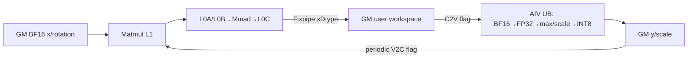

# RotateQuant A2/A3 ACLNN 算子知识

## 算子速览

| 项目 | 内容 |
|---|---|
| 实际入口 | `aclnnRotateQuantGetWorkspaceSize` + `aclnnRotateQuant`，公开 ACLNN 两段式入口，固定仓未见更高版本符号。 |
| 计算语义 | 把 `x[M,N]` 按 `K` 切成 `N/K` 个块，逐块计算 `x_block @ rotation[K,K]`，再逐行按最大绝对值做对称动态 INT8 或 INT4 量化。 |
| 输入输出 | `x/rotation`：同 dtype FP16 或 BF16、ND；`y`：INT8，或 ACLNN 以 INT32 容器承载的 packed INT4；`scale`：FP32 `[M]`。 |
| 执行类型 | 单个 `MIX_AIC_1_2` Kernel；AIC_CUBE 旋转，AIV_VECTOR 归约与量化；每个 AIC 对应两个 AIV。 |
| Kernel 路线 | R-001 BF16→INT8；R-002 FP16→INT8；R-003 BF16→INT4；R-004 FP16→INT4。 |
| 核心资源 | GM 输入/输出；`16 MiB + 4*M*N` workspace；AIC Matmul L1/L0A/L0B/L0C；AIV 单 `TBuf` UB 与寄存器。 |
| 来源闭包 | `source_closed`：公开 ACLNN→Level-0 launcher→arch22 Tiling/POD→key 0 MIX entry→AIC Matmul 与 AIV 量化 body→A2/A3 build/config 完整可追溯。 |
| 验证状态 | 已完成源码闭包检查；本次知识提取未执行编译、真机、数值或性能测试。 |

## 接口与语义

### 计算语义

令 `B=N/K`。AIC 把 `x` 视作 `[M*B,K]`，以共享 `rotation[K,K]` 计算 `z=x_block@rotation` 并恢复 `[M,N]`。AIV 对每行求 `amax=max(abs(z))`，写 `scale=amax/Cmax`，其中 INT8 的 `Cmax=127`、INT4 的 `Cmax=7`；量化值按源码执行 `z*(Cmax/amax)`、`CAST_RINT` 到 `int16`、`CAST_ROUND` 到 FP16、再 `CAST_TRUNC` 到目标整数。A2/A3 的 `alpha` 必须为空，不执行 clamp；`roundMode` 虽经 ACLNN 校验，但此 Kernel 的量化取整序列固定。

### 输入、输出与属性

| 参数 | shape/layout | dtype | 约束、默认值与语义 |
|---|---|---|---|
| `x` | `[M,N]`/ND | FP16、BF16 | 非空；`N∈[128,16000]` 且 8 对齐。 |
| `rotation` | `[K,K]`/ND | 与 `x` 相同 | `K∈[16,1024]`，`N%K==0`。 |
| `alpha` | 可选 | BF16 | A2/A3 ACLNN 强制 `nullptr`。 |
| `axis` | 标量属性 | int64 | `-1` 或 1；默认 `-1`。 |
| `roundMode` | 标量属性 | string | `rint/round/floor`；空指针改为 `rint`，Device 不读取该属性。 |
| `scaleAlg/dstTypeMax/trans` | 标量属性 | int64/float/bool | 必须分别为 `0/0.0/false`。 |
| `yOut` | INT8 `[M,N]`；INT4 对外 `[M,N/8]` INT32 | INT8 或 INT32 容器 | INT32 路径在 executor 内建 INT4 `[M,N]`，再建 INT32 view。 |
| `scaleOut` | `[M]`/ND | FP32 | 每行量化 scale。 |

### 入口与版本

公开 README 与 API 文档明确支持 Atlas A2/A3。`aclnn_rotate_quant.cpp` 的 `DAV_2201` dtype 表选择 INT 路线；`CMakeLists.txt` 将 `ascend910b`、`ascend910_93` 都映射到 `arch22`，OpDef 为两者注册同一实现。固定 Commit `955f8b33985b6d72989ebff341bb9c2c564a51bc` 只有无版本后缀的公开入口，故本卡取该架构最新公开实现。

## Host/Launcher 执行流程

### 参数校验与前处理

`aclnnRotateQuantGetWorkspaceSize` 依次创建 executor，执行非空、平台 dtype、shape、非 NZ format、A2/A3 `alpha==nullptr`、axis、roundMode、scaleAlg、dstTypeMax、trans 校验。任一输入或输出为空时返回 workspace 0 且不加入 RotateQuant 节点。非空时对 `x/rotation` 做 `Contiguous`；INT32 输出改成内部 INT4 dtype，Level-0 为 INT 路线新分配 `[M,N]` 的 INT4 `y` 与 `[M]` FP32 `scale`，加入一个 AICore launcher 节点，最后以 `ViewCopy` 写用户输出。INT4 结果先通过 `CreateView` 把末维除 8 并把 view dtype 改为 INT32。

### 参数、Workspace 与生命周期

Tiling 的 workspace 为 `16,777,216 + M*N*4` 字节。前 16 MiB 是 system workspace；`GetUserWorkspace` 返回用户段。AIC 实际把前 `M*N*sizeof(xDtype)` 字节当作旋转结果，AIV 原地读取；余下用户段没有本算子 Device consumer。workspace、内部 INT4/FP32 tensor 与 ViewCopy 节点归 executor 所有，`aclnnRotateQuant` 将同一 workspace 和 stream 交给 `CommonOpExecutorRun`，运行后 executor 失效。

### 启动图与失败传播

```text
aclnnRotateQuantGetWorkspaceSize
  -> Contiguous(x), Contiguous(rotation)
  -> l0op::RotateQuant -> ADD_TO_LAUNCHER_LIST_AICORE(RotateQuant)
  -> [单 launch, blockDim=usedAicCoreNum, scheduleMode=1]
       rotate_quant MIX_AIC_1_2
       AIC: x/rot -> Matmul -> user workspace
         -- CrossCoreSetFlag<0x2,PIPE_FIX>(0x1) -->
       AIV0/AIV1: workspace -> row max -> INT quant -> y/scale
         -- 周期性 CrossCoreSetFlag<0x2,PIPE_MTE3>(0x3) --> AIC 防覆盖
  -> ViewCopy(y), ViewCopy(scale)
  -> CommonOpExecutorRun(stream)
```

Level-0 加节点失败立即返回空 tuple，ACLNN 后续空指针检查失败；executor 中 Contiguous、RotateQuant、ViewCopy 按同一 stream 提交，前节点失败由公共 executor 返回并阻止成功完成语义。

## Route 与参数设计

### 分核与资源计算

`maxRows=min(M, floor(min(floor((UB-1024-(256+64+12*64*4))/11/64)*64,255*64)/N))`。随后 `loopM=ceil(M/maxRows)`，`loopPerAIV=ceil(loopM/aivNum)`，`usedAIC=ceil(ceil(loopM/loopPerAIV)/2)`，`usedAIV=2*usedAIC`。每个普通 AIC 处理 `2*loopPerAIV*maxRows` 行；尾 AIC/AIV 由 `rowPerCubeTailCore/rowPerVectorTailCore/rowPerVectorLastCore` 修正。`stepLoop` 在 `K<=384` 时按每 AIC 循环数以 15 或 60 分组，否则由 `128/(B*maxRows*2)` 与每核循环数选择。Matmul 固定 `baseM/N/K=128/256/64`、`stepKa/Kb=8/4`、`depthA1/B1=16/8`、`dbL0A/B/C=2/2/1`。

### Route 选择

| 顺序 | Route | Key/模板 | 精确选择条件与优先级 | 不适用去向 |
|---:|---|---|---|---|
| 1 | R-001 BF16→INT8 | key 0；`RotateQuant_bf16_int8` | DAV_2201，x/rot BF16，y INT8，scale FP32 | dtype 校验失败 |
| 2 | R-002 FP16→INT8 | key 0；`RotateQuant_fp16_int8` | DAV_2201，x/rot FP16，y INT8，scale FP32 | dtype 校验失败 |
| 3 | R-003 BF16→INT4 | key 0；`RotateQuant_bf16_int4` | DAV_2201，x/rot BF16，ACLNN y INT32→内部 INT4 | dtype/shape 校验失败 |
| 4 | R-004 FP16→INT4 | key 0；`RotateQuant_fp16_int4` | DAV_2201，x/rot FP16，ACLNN y INT32→内部 INT4 | dtype/shape 校验失败 |

```text
DAV_2201 && valid INT contract
  -> yOut INT8 ? (x BF16 -> R-001 : x FP16 -> R-002)
  -> yOut INT32 packed-INT4 ? (x BF16 -> R-003 : x FP16 -> R-004)
  -> otherwise ACLNN failure
all non-empty routes -> arch22 template priority 0 -> tiling key 0
```

### 模板/实现执行矩阵

| Route | key/selector | dtype/shape/platform 完整命中条件 | 执行族与 kernel 节点 | 实际模板/body | 内存与同步特征 | tail/fallback |
|---|---|---|---|---|---|---|
| R-001 | key 0/binary dtype | A2/A3、BF16、INT8、公共 shape 约束 | 单 MIX：AIC Matmul→AIV Vector | `RotateQuant<bfloat16_t,int8_t,MatmulImpl<GM-ND...CFG_MDL>>` | workspace 交接；C2V/V2C flag | POD 尾行；无 fallback |
| R-002 | key 0/binary dtype | A2/A3、FP16、INT8、公共 shape 约束 | 同上 | `RotateQuant<half,int8_t,...>` | 同上 | 同上 |
| R-003 | key 0/binary dtype | A2/A3、BF16、内部 INT4 | 同上 | `RotateQuant<bfloat16_t,int4b_t,...>` | y 地址/长度按半字节折半 | 同上 |
| R-004 | key 0/binary dtype | A2/A3、FP16、内部 INT4 | 同上 | `RotateQuant<half,int4b_t,...>` | 同上 | 同上 |

### 隐藏性能 Guard

| Guard | Host/Tiling 条件 | Device/资源原因 | 影响 Route | 不满足时去向 | 源码符号 |
|---|---|---|---|---|---|
| UB 行数 | `maxRows>0` 隐含于后续除法；由上述公式产生 | AIV 的 11 倍行缓冲及固定区必须装入 UB | 全部 | 固定仓未显式安全 fallback；公开 N 上限使目标平台通常可算，但边界仍依平台 UB | `CalcMaxHandleRowsPerUb` |
| Matmul tile | 固定 `128/256/64` 与 depth/db | 当前 `MatmulImpl` specialization 的 L1/L0 调度 | 全部 | `GetTiling` 失败即 tiling 失败 | `SetMatmulTiling` |
| flag 复用 | 每 `15*stepLoop` 轮回收一次 | flag ID 数有限，AIC 不得覆盖未消费 workspace | 全部 | 无 fallback | `AicProcess/AivProcess` |
| INT4 packing | `N%8==0` 且 ACLNN y `[M,N/8]` INT32 | 8 个 INT4 放入一个 INT32 view | R-003/004 | 参数失败 | `CheckIntOutputShape/Int42Int32PackedTensor` |

### POD/ABI

`RotateQuantTilingData` 使用 `#pragma pack(8)`、`alignas(8)`。固定仓可确定 `matmulTiling` 前缀偏移；`TCubeTiling` 的定义属于外部 AscendC 头，故总 `sizeof` 只能写成 `align_up(80+sizeof(TCubeTiling),8)`。

| 结构 | 字段 | 类型/位宽 | ABI 布局 | 单位 | Host/launcher producer | Device consumer | 边界 |
|---|---|---|---|---|---|---|---|
| `RotateQuantTilingData` | `M/N/K/loopM` | int32×4 | offset 0/4/8/12 | 元素/轮数 | `CaclVecTilingData` | `ParseTilingData` | M/N/K 由 int64 窄化；API shape 限制适用 |
| 同上 | `dstType/stepLoop` | int64×2 | offset 16/24 | enum/轮数 | 同上 | 常量实例/循环 | `stepLoop>=1` |
| 同上 | `numBlocks/aicCoreNum/aivCoreNum` | int32×3 | offset 32/36/40 | 块/核 | 同上 | AIC/AIV guard 与映射 | `numBlocks=N/K`，AIV=2*AIC |
| 同上 | `multiRowNumHeadCore` | uint32 | offset 44 | 行 | 同上 | `singleLoopRows` | AIC 再乘 2 |
| 同上 | `headCoreNum/rowPerHeadCore` | uint32×2 | offset 48/52 | 核/行 | 同上 | AIV 分核 | `headCoreNum` 仅打印，Device 不读 |
| 同上 | `rowPerCubeHeadCore/rowPerCubeTailCore` | uint32×2 | offset 56/60 | 行 | 同上 | AIC 分核 | 尾核有效 |
| 同上 | `rowPerVectorTailCore/rowPerVectorLastCore` | uint32×2 | offset 64/68 | 行 | 同上 | AIV 尾核 | 两个尾 AIV 可不等长 |
| 同上 | `lastUbRows/ubSize` | uint32×2 | offset 72/76 | 行/字节 | 同上 | 尾 offset/UB InitBuffer | `ubSize` 为平台 UB 总字节 |
| 同上 | `matmulTiling` | `TCubeTiling` | offset 80；总大小依外部类型 | 复合 POD | `SetMatmulTiling` | `MatmulImpl::Init` | 外部头定义 `sizeof/内部 offsetof` 固定仓不可见 |

### Route 源码闭包

| Route | Key/selector | Host/Tiling producer | POD/参数 | Kernel entry/router | Kernel body/直接依赖 | 构建接线 |
|---|---|---|---|---|---|---|
| R-001..004 | `GetTilingKey()==0` + binary dtype | `arch22/rotate_quant_tiling.cpp::RotateQuantTiling` | `RotateQuantTilingData` | `op_kernel/rotate_quant.cpp::rotate_quant` | `op_kernel/rotate_quant.h::RotateQuant` + 外部 AscendC `MatmulImpl` | root/kernel CMake + 910b/910_93 binary JSON |

## Kernel 实现

### 公共执行流程

Entry 解析同一 POD，取得 user workspace，声明 `KERNEL_TYPE_MIX_AIC_1_2`，以 GM-ND、非转置的 A/B/C `MatmulType` 实例化 `MatmulImpl<...,CFG_MDL>`。AIC 每批把 `[rows*B,K]@[K,K]` 写为 xDtype workspace；`PIPE_FIX` C2V flag 使两个 AIV 可见。AIV 各消费相邻半批，GM→UB 后 cast FP32、abs、逐行 max、生成逆 scale、量化并写 y/scale；每 15 个 step 由 `PIPE_MTE3` V2C flag 允许 AIC 复用后续轮次。

### Route R-001：BF16→INT8

#### 适用条件

##### 选择证据

| 层级 | 文件 | 符号 | 源码谓词/参数 | 结果/下一跳 |
|---|---|---|---|---|
| ACLNN | `op_api/aclnn_rotate_quant.cpp` | `CheckDtypeValid` | DAV_2201，x/rot BF16，y INT8，scale FP32 | R-001 |
| Tiling | `op_host/arch22/rotate_quant_tiling.cpp` | `GetTilingKey` | 固定返回 0 | key 0 |
| Router | `op_kernel/rotate_quant.cpp` | `RotateQuant<DTYPE_X,DTYPE_Y,MT>` | binary `bf16_int8` | BF16/INT8 body |

#### Device 数据流

##### 函数级调用链

```text
rotate_quant -> MatmulImpl::Init -> RotateQuant::Init -> Process
  -> AicProcess -> CubeProcessRows -> MatmulImpl::IterateAll/End
  -> AivProcess -> CopyInVector -> ComputeReduceMax/ComputeVector -> CopyOutVector
```

##### 源码等价伪码

```text
AIC: for i += stepLoop: wait recycled flag when required; Matmul BF16 tiles to workspace; set C2V
AIV: for idx += stepLoop: wait C2V; load assigned BF16 rows; cast FP32; rowwise abs-max;
     inv=127/max; q=trunc(round(rint(z*inv))); scale=max/127; store INT8 and FP32; periodically set V2C
```

#### 内存与数据搬运

##### 资源与搬运表

| 层级/缓冲区 | offset/地址公式 | extent/容量公式 | dtype/layout | producer | consumer | owner/lifetime | 对齐/复用 |
|---|---|---|---|---|---|---|---|
| GM x/rot | AIC `startRow*N`; rot 0 | M*N、K*K elements | BF16/ND | caller | Matmul | caller/launch | Matmul 内部 ND→Cube |
| user workspace | `startRow*N + offsetLoop` | allocation `4MN` bytes；有效 `2MN` bytes | BF16/ND | AIC | AIV | executor/launch | 分行，不重叠 |
| L1/L0 | MatmulImpl 内部 | base 128/256/64；db A/B/C 2/2/1 | Cube layouts；累加类型固定仓不可见 | Matmul copy | Mmad/Fixpipe | AIC tile | 精确物理映射在外部头 |
| AIV UB | 单 `TBuf(UB-1024)` | `11*align(rows*N,32)+2368` 实际切片 | BF16/FP32/INT8 | MTE2/V | V/MTE3 | AIV loop | 无双缓冲；事件防覆盖 |
| GM y/scale | 行偏移 | MN bytes；4M bytes | INT8/FP32 | AIV | caller | caller | 尾行按 `ubRows` |

##### 分层内存布局



##### 字节账、交接边与复用顺序

```text
workspace_total = 16,777,216 + 4*M*N
workspace_payload_written = 2*M*N
UB_slices = 2E + 4E + 4E + 1E + 3*192*4 + 2*8*4 = 11E + 2368, E=align(rows*N,32)
L0 A/B nominal input bytes = 2*128*64*2 与 2*256*64*2；L0C 元素类型和实际物理预留依固定仓外部 MatmulImpl/TCubeTiling，不能由本仓补齐
```

| 边/复用子区 | producer | offset/extent | dtype/layout | consumer | ordering/sync | owner/lifetime | 安全条件 |
|---|---|---|---|---|---|---|---|
| AIC→AIV | `IterateAll` | `row*N`, 当前 batch rows*N | BF16/ND | `CopyInVector` | C2V flag 0x1，mode 0x2，PIPE_FIX→wait | executor workspace/launch | 两 AIV 以 `coreIdx%2` 分半 |
| AIV→AIC reuse | `CopyOutVector` | 已消费 batch | BF16 workspace | 下一 AIC batch | 每 15 step，V2C 0x3，PIPE_MTE3→wait | 同上 | 防有限 flag 轮转覆盖 |

#### 同步、精度与尾块

##### 同步与数值边界表

| 阶段 | primitive/机制 | producer | consumer/等待点 | 保护对象 | 精度/尾块 |
|---|---|---|---|---|---|
| Cube→workspace | Matmul `IterateAll/End` + PIPE_FIX flag | AIC | AIV loop | 当前 batch | 累加类型固定仓不可见；GM 输出为 BF16 |
| GM→UB | MTE2_V event | DataCopyPad | Cast | inLocal | 最后一轮按 `ubRows*N` |
| Vector | PIPE_V barriers | cast/abs/max/div/mul/cast | 下一 V op | UB slices | 固定 RINT→ROUND→TRUNC 序列 |
| UB→GM | V_MTE3/MTE3_V events | Vector | DataCopy/下一轮 | y/scale UB | 精确 blockLen，尾行缩短 |

#### 关键实现

##### 符号证据表

| 阶段 | 文件 | 符号/模板实例 | 实现事实 |
|---|---|---|---|
| Host/Tiling producer | `op_host/arch22/rotate_quant_tiling.cpp` | `CaclVecTilingData/SetMatmulTiling` | 分核、tile、workspace 与 POD |
| Kernel entry/router | `op_kernel/rotate_quant.cpp` | `rotate_quant` | MIX 1:2 与 BF16/INT8 实例 |
| Device body/helper | `op_kernel/rotate_quant.h` | `AicProcess/AivProcess` | workspace 交接、归约、量化与同步 |

### Route R-002：FP16→INT8

#### 适用条件

##### 选择证据

| 层级 | 文件 | 符号 | 源码谓词/参数 | 结果/下一跳 |
|---|---|---|---|---|
| ACLNN/Router | `op_api/aclnn_rotate_quant.cpp`、`op_kernel/rotate_quant.cpp` | dtype map/模板入口 | DAV_2201，x/rot FP16，y INT8 | `RotateQuant<half,int8_t,MT>` |

#### Device 数据流

##### 函数级调用链

```text
同 R-001；AIC/Workspace 输入输出类型替换为 half。
```

##### 源码等价伪码

```text
同 R-001，workspace payload 为 FP16，AIV 首次 Cast FP16→FP32。
```

#### 内存与数据搬运

##### 资源与搬运表

| 层级/缓冲区 | offset/地址公式 | extent/容量公式 | dtype/layout | producer | consumer | owner/lifetime | 对齐/复用 |
|---|---|---|---|---|---|---|---|
| workspace/UB | 同 R-001 | `2MN` 有效；UB `11E+2368` | FP16/FP32/INT8 | AIC/AIV | AIV/GM | executor/loop | 同 R-001 |

##### 分层内存布局


##### 字节账、交接边与复用顺序

```text
与 R-001 相同；xDtype 仍为 2 字节。
```

| 边/复用子区 | producer | offset/extent | dtype/layout | consumer | ordering/sync | owner/lifetime | 安全条件 |
|---|---|---|---|---|---|---|---|
| AIC→AIV | Matmul | rows*N*2 bytes | FP16/ND | AIV Cast | C2V/V2C 同 R-001 | workspace/launch | 同 R-001 |

#### 同步、精度与尾块

##### 同步与数值边界表

| 阶段 | primitive/机制 | producer | consumer/等待点 | 保护对象 | 精度/尾块 |
|---|---|---|---|---|---|
| 全链 | 同 R-001 | AIC/AIV | 同 R-001 | workspace/UB | FP16 输入与 workspace；FP32 归约；同尾块 |

#### 关键实现

##### 符号证据表

| 阶段 | 文件 | 符号/模板实例 | 实现事实 |
|---|---|---|---|
| Router/body | `op_kernel/rotate_quant.cpp`、`rotate_quant.h` | `RotateQuant<half,int8_t,MT>` | FP16 specialization，算法/同步同 R-001 |

### Route R-003：BF16→INT4

#### 适用条件

##### 选择证据

| 层级 | 文件 | 符号 | 源码谓词/参数 | 结果/下一跳 |
|---|---|---|---|---|
| ACLNN | `op_api/aclnn_rotate_quant.cpp` | `Int42Int32PackedTensor` | yOut INT32 且 `[M,N/8]` | 内部 INT4 view |
| Router | `op_kernel/rotate_quant.cpp` | dtype template | BF16 + INT4 binary | `RotateQuant<bfloat16_t,int4b_t,MT>` |

#### Device 数据流

##### 函数级调用链

```text
同 R-001 -> INT4 constScale=7 -> packed CopyOut -> INT32 view -> ViewCopy。
```

##### 源码等价伪码

```text
scale=max/7; q=INT4(z*7/max); y GM element offset and blockLen both按半字节折半。
```

#### 内存与数据搬运

##### 资源与搬运表

| 层级/缓冲区 | offset/地址公式 | extent/容量公式 | dtype/layout | producer | consumer | owner/lifetime | 对齐/复用 |
|---|---|---|---|---|---|---|---|
| y GM | `(startRow*N)>>1` | `M*N/2` bytes | packed INT4 | AIV | INT32 view/ViewCopy | executor→caller | `N%8==0` |
| 其余 | 同 R-001 | 同 R-001 | BF16/FP32 | AIC/AIV | AIV/caller | 同上 | 同上 |

##### 分层内存布局


##### 字节账、交接边与复用顺序

```text
workspace 同 R-001；y payload=M*N/2 bytes；UB 为 11E+2368 的保守实例分区。
```

| 边/复用子区 | producer | offset/extent | dtype/layout | consumer | ordering/sync | owner/lifetime | 安全条件 |
|---|---|---|---|---|---|---|---|
| AIV→ACLNN output | `CopyOutVector` | `MN/2` bytes | packed INT4 | INT32 view/ViewCopy | executor stream | executor | N 8 对齐 |

#### 同步、精度与尾块

##### 同步与数值边界表

| 阶段 | primitive/机制 | producer | consumer/等待点 | 保护对象 | 精度/尾块 |
|---|---|---|---|---|---|
| Quant | 同 R-001 | Vector | MTE3 | UB/y | Cmax=7；半字节 blockLen；尾行同 POD |

#### 关键实现

##### 符号证据表

| 阶段 | 文件 | 符号/模板实例 | 实现事实 |
|---|---|---|---|
| ACLNN/Device | `op_api/aclnn_rotate_quant.cpp`、`op_kernel/rotate_quant.h` | `Int42Int32PackedTensor`/`int4b_t` branch | INT4 packing 与 INT32 ABI 适配 |

### Route R-004：FP16→INT4

#### 适用条件

##### 选择证据

| 层级 | 文件 | 符号 | 源码谓词/参数 | 结果/下一跳 |
|---|---|---|---|---|
| ACLNN/Router | `op_api/aclnn_rotate_quant.cpp`、`op_kernel/rotate_quant.cpp` | packed view/dtype template | FP16 + INT32 external/INT4 internal | `RotateQuant<half,int4b_t,MT>` |

#### Device 数据流

##### 函数级调用链

```text
R-002 的 FP16 Cube/Workspace + R-003 的 INT4 量化与 packing。
```

##### 源码等价伪码

```text
FP16 rotation -> FP32 max -> scale=max/7 -> packed INT4 -> INT32 view。
```

#### 内存与数据搬运

##### 资源与搬运表

| 层级/缓冲区 | offset/地址公式 | extent/容量公式 | dtype/layout | producer | consumer | owner/lifetime | 对齐/复用 |
|---|---|---|---|---|---|---|---|
| 全链 | 同 R-002/R-003 | workspace `2MN` 有效；y `MN/2` | FP16/FP32/INT4 | AIC/AIV | AIV/caller | executor | 同公共 guard |

##### 分层内存布局


##### 字节账、交接边与复用顺序

```text
workspace/UB 同 R-002；输出字节账同 R-003。
```

| 边/复用子区 | producer | offset/extent | dtype/layout | consumer | ordering/sync | owner/lifetime | 安全条件 |
|---|---|---|---|---|---|---|---|
| AIC→AIV→output | Matmul/AIV | rows*N*2 → rows*N/2 | FP16→INT4 | AIV/ViewCopy | C2V/V2C + stream | executor | 同公共 guard |

#### 同步、精度与尾块

##### 同步与数值边界表

| 阶段 | primitive/机制 | producer | consumer/等待点 | 保护对象 | 精度/尾块 |
|---|---|---|---|---|---|
| 全链 | 同 R-001 | AIC/AIV | 同 R-001 | workspace/UB/y | FP16 输入，Cmax=7，INT4 packing |

#### 关键实现

##### 符号证据表

| 阶段 | 文件 | 符号/模板实例 | 实现事实 |
|---|---|---|---|
| Router/body | `op_kernel/rotate_quant.cpp`、`rotate_quant.h` | `RotateQuant<half,int4b_t,MT>` | FP16→INT4 specialization |

## 算子特定优化

### Trick T-001：单 Kernel 1C2V workspace 流水交接

#### 触发与源码依据

- 适用 Route：R-001..R-004
- 触发条件：所有非空 A2/A3 key 0 路线。
- Golden 来源：[`op_kernel/rotate_quant.h:244`](../../../../../../../cann-ops-raw/ascendc/ops-nn/955f8b33985b6d72989ebff341bb9c2c564a51bc/matmul/rotate_quant/op_kernel/rotate_quant.h#L244)

**官方源码（固定 Commit 连续逐字摘录）**：

```cpp
for (int32_t i = 0; i < loopM_; i += stepLoop_) {
    if ((i % (MAX_REG_COUNT * stepLoop_) == stepLoop_) && (i != stepLoop_)) {
        CrossCoreWaitFlag(SYNC_V2C_0);
    }
    int32_t blockStart = i * singleLoopRows;
    int32_t remainingRows = totalRows - blockStart;
    if (remainingRows < 0) {
        return;
    }
    int32_t cubeRows = singleLoopRows * stepLoop_;
    int32_t currentBlockSize = (cubeRows < remainingRows) ? cubeRows : remainingRows;
    if (currentBlockSize > 0) {
        CubeProcessRows(blockStart, currentBlockSize);
    }
    CrossCoreSetFlag<SYNC_MODE, PIPE_FIX>(SYNC_C2V_0);
}
```

#### 机制与设计原因

一个 AIC 一次产生两个 AIV 的相邻行区间，C2V flag 在 Fixpipe 完成后发布；AIV 直接从 user workspace 读旋转结果，避免第二个 Kernel launch。`stepLoop` 控制生产批次，周期性 V2C 回执约束有限 flag 轮转和 workspace 覆盖。

#### 迁移边界

- 适用：Cube 结果必须由两个 Vector 子核做逐行后处理的单 launch。
- 前提：MIX 1:2、同一 POD、workspace 按行无重叠、保留 flag ID/PIPE 与 `stepLoop` 协议。
- 失效：执行比例、batch 地址或 flag 轮转改变时必须重新推导。
- 未验证：本次知识提取未执行编译、真机、数值或性能测试。

#### 错误做法

删除 V2C 回执或改变 `MAX_REG_COUNT*stepLoop` 周期会失去源码证明的防覆盖条件。

### Trick T-002：多行 UB 合并归约与量化

#### 触发与源码依据

- 适用 Route：R-001..R-004
- 触发条件：`maxHandleRowsPerUb>=1`；尾轮由 `ubRows` 缩短。
- Golden 来源：[`op_kernel/rotate_quant.h:304`](../../../../../../../cann-ops-raw/ascendc/ops-nn/955f8b33985b6d72989ebff341bb9c2c564a51bc/matmul/rotate_quant/op_kernel/rotate_quant.h#L304)

**官方源码（固定 Commit 连续逐字摘录）**：

```cpp
Abs(absTmp, castTmp, ubNums);
PipeBarrier<PIPE_V>();
ComputeReduceMax(ubRows);
PipeBarrier<PIPE_V>();
Div(quantScaleTmp, constScale, scaleTmp, BLOCK_SIZE_64, CeilDiv(ubRows, BLOCK_SIZE_64),
    {1, 0, 1, STRIDE_8, 0, STRIDE_8});
PipeBarrier<PIPE_V>();
BroadCast<float, DIMENSION_2, 1>(absTmp, quantScaleTmp, dstShape1, srcShape1);
PipeBarrier<PIPE_V>();
Mul(absTmp, castTmp, absTmp, ubNums);
```

#### 机制与设计原因

Tiling 以 UB 容量选择一次处理的行数；每行最大值先落在 `scaleTmp`，逆 scale 广播回整行后一次量化。该路线复用同一 `absTmp` 先保存绝对值、后覆盖为广播 scale 和量化值。

#### 迁移边界

- 适用：行长 N 已知且 UB 能容纳至少一行。
- 前提：保留 64 元素 repeat、尾 mask/`ubRows`、11E 固定切片关系。
- 失效：N 超过可容纳边界时固定仓无 fallback。
- 未验证：本次知识提取未执行编译、真机、数值或性能测试。

#### 错误做法

固定仓未提供可验证反例。

## 模板与实现对比

| 对比维度 | R-001/R-002 INT8 | R-003/R-004 INT4 | 设计选择依据 |
|---|---|---|---|
| 命中条件/优先级 | y INT8；BF16/FP16 binary | 外部 y INT32、内部 INT4；BF16/FP16 binary | ACLNN dtype map + binary config |
| 执行族/节点图 | 单 MIX AIC→workspace→AIV | 相同 | key 0 固定拓扑 |
| M/N/K、tile 与 scheduler | 固定 base 128/256/64、同分核 | 相同 | arch22 Tiling |
| workspace/L1/L0/UB | workspace 有效 2MN；UB INT8 slice | workspace 相同；INT4 UB 类型与输出折半 | Device dtype branch |
| AIC/AIV 或 kernel 交接 | C2V 0x1、V2C 0x3 | 相同 | MIX flag 协议 |
| 同步、精度与 tail | Cmax 127，INT8 | Cmax 7，packed INT4 | `IsSameType<int4b_t>` |
| fallback/失败边界 | 不满足 ACLNN/Tiling 即失败 | 另需 N%8 和 INT32 view shape | 无 Device fallback |

## 平台差异

| 项目 | A2 | A3 | 950 |
|---|---|---|---|
| 支持状态 | 支持 | 支持 | 支持，但见独立 `_950` 卡 |
| Host/Launcher | `ascend910b`→arch22 | `ascend910_93`→arch22 | arch35，MX 语义 |
| Kernel/资源 | 与 A3 共用 MIX 1:2 + workspace | 与 A2 共用 | CMCT + UB 直交接，不复用本卡 body |

## 限制与失败边界

- A2/A3 仅 INT8 或 ACLNN INT32 容器承载的 INT4；`alpha` 必须为空，`scaleAlg=0`、`dstTypeMax=0`、`trans=false`。
- 空 tensor 返回 workspace 0 且不启动核心算子。
- `maxHandleRowsPerUb==0` 的路径在后续分核公式中没有显式 fallback；不得外推为支持。
- `TCubeTiling` 与 `MatmulImpl` 位于固定仓引用的外部 AscendC 库，内部 ABI 大小和逐层物理预留不可从本仓补造；本卡只保留当前实例实参及可见数据流。
- 本次知识提取未执行编译、真机、数值或性能测试。

## 源码索引

### 链路索引

| 链路阶段 | 文件 | 关键符号 | 支撑内容 |
|---|---|---|---|
| 入口声明/约束 | `docs/aclnnRotateQuant.md` | `aclnnRotateQuant` | 公开产品表、公式与约束 |
| 入口实现 | `op_api/aclnn_rotate_quant.cpp` | `aclnnRotateQuantGetWorkspaceSize/aclnnRotateQuant` | 校验、Contiguous、packed view、executor |
| Level-0 | `op_api/rotate_quant.cpp` | `RotateQuantAICore` | 单 AICore launcher 节点 |
| Host/Tiling/Launcher | `op_host/arch22/rotate_quant_tiling.cpp` | `RotateQuantTiling` | 分核、Matmul tiling、workspace、key 0 |
| POD | `op_kernel/rotate_quant_tiling_data.h` | `RotateQuantTilingData` | Host/Device ABI |
| Kernel entry/body | `op_kernel/rotate_quant.cpp` | `rotate_quant` | MIX entry 与模板实例 |
| Kernel entry/body | `op_kernel/rotate_quant.h` | `RotateQuant` | AIC/AIV body、内存、同步、量化 |
| 构建接线 | `op_host/rotate_quant_def.cpp` | `OpDef RotateQuant` | 910b/910_93 dtype/config |
| 构建接线 | `CMakeLists.txt` | `SUPPORT_COMPUTE_UNIT` | A2/A3→arch22 |
| 构建接线 | `op_kernel/CMakeLists.txt` | `add_kernel_sources` | A2/A3 kernel、softsync 编译 |

每行只写一个文件，并确保该文件存在于 Frontmatter `sources`。

### 实现复用检查

| 检查项 | 可复用事实 | 不得改变的约束 | 源码符号 |
|---|---|---|---|
| ABI/POD | key 0 共享 `RotateQuantTilingData` | offset、位宽及 TCube 尾字段 | POD/`ParseTilingData` |
| 调用顺序 | Contiguous→RotateQuant→ViewCopy | INT4 view 必须在 ViewCopy 前建立 | ACLNN GetWorkspaceSize |
| workspace/内存 | AIC 写、AIV 按行消费 | user offset、有效 2MN、executor lifetime | `CubeProcessRows/AivProcess` |
| 同步 | MIX C2V/V2C 协议 | flag 0x1/0x3、mode 0x2、PIPE 和轮转周期 | `AicProcess/AivProcess` |
| 精度与尾块 | FP32 max/scale、固定 cast 序列 | Cmax、INT4 半字节、`lastUbRows` | `ComputeVector/CopyOutVector` |
| 失败边界 | 参数/Tiling/launcher 失败向上传播 | 不得为 UB 不足虚构 fallback | ACLNN checks/`CalcMaxHandleRowsPerUb` |