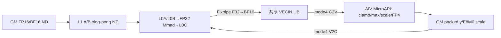
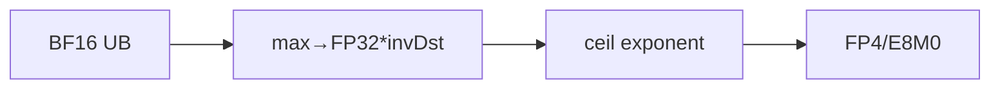
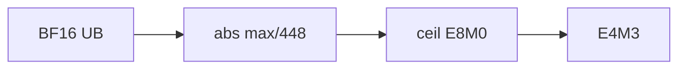
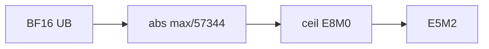

# RotateQuant 950 ACLNN 算子知识

## 算子速览

| 项目 | 内容 |
|---|---|
| 实际入口 | `aclnnRotateQuantGetWorkspaceSize` + `aclnnRotateQuant`，公开 ACLNN 两段式入口。 |
| 计算语义 | 按 K=32/64/128 做块旋转，可选每 32 元素 group clamp，再输出 MXFP4/MXFP8 与 E8M0 group scale。 |
| 输入输出 | `x/rotation` 同 dtype FP16/BF16、ND；`y` 为 FLOAT4_E2M1/FLOAT8_E4M3FN/FLOAT8_E5M2；`scale` 为 FLOAT8_E8M0。 |
| 执行类型 | 单个 `MIX_AIC_1_2` Kernel；AIC_CUBE/CMCT 旋转，AIV_VECTOR MicroAPI clamp、MX scale 和量化；AIC:AIV=1:2。 |
| Kernel 路线 | R-001 FP4 alg0；R-002 FP4 alg2(6/7)；R-003 FP4 alg2(other)；R-004/005 E4M3 alg0/1；R-006/007 E5M2 alg0/1；每条均有 FP16/BF16 binary 子实例。 |
| 核心资源 | GM；Host 仍分配 `16 MiB+4MN` workspace、Device 不读用户 payload；L1/L0 ping-pong；AIC Fixpipe→共享 VECIN UB→AIV 寄存器量化。 |
| 来源闭包 | `source_closed`：公开 ACLNN→Level-0→DAV_3510 Tiling/POD→key 0 MIX entry→CMCT scheduler/BlockMmad/epilogue→ascend950 构建完整闭合。 |
| 验证状态 | 已完成源码闭包检查；本次知识提取未执行编译、真机、数值或性能测试。 |

## 接口与语义

### 计算语义

把 `x[...,N]` 折叠成 `[M,N]`，`B=N/K`。二维 rotation `[K,K]` 在所有块共享；三维 `[B,K,K]` 逐块选择。AIC 对每个 K 块计算 BF16 中间 `z=x_block@rotation`。若 alpha 的 BF16 bit pattern 表示严格 `0<alpha<1`，AIV 对每 32 个 z 求绝对值最大值并以 `limit=alpha*max` clamp。

`scaleAlg=0` 从 BF16 group 最大指数生成 E8M0 scale；`scaleAlg=1`（仅 FP8）以 `max/Amax(dtype)` 取向上指数；`scaleAlg=2`（仅 FP4）在 `dstTypeMax=6/7` 使用动态指数规则，其余 `[6,12]` 使用 `max/dstTypeMax` 的 cuBLAS 风格向上指数。最终先乘反量化 scale，再按 FP4 指定 round mode或 FP8 固定 RINT 饱和 cast。`scale` 的最后两维等价于每行 `2*ceil(N/64)` 个 E8M0 字节。

### 输入、输出与属性

| 参数 | shape/layout | dtype | 约束、默认值与语义 |
|---|---|---|---|
| `x` | `[...,N]`，rank 1..7，ND | FP16/BF16 | 非空；前导维乘积为 M。 |
| `rotation` | `[K,K]` 或 `[N/K,K,K]`，ND | 与 x 相同 | `K∈{32,64,128}`，`N%K==0`。 |
| `alpha` | 可选 `[1]` | BF16 | 仅 bit-level 严格 `(0,1)` 启用 clamp；空、0、负数、>=1、NaN 均不 clamp。 |
| `axis` | 属性 | int64 | `-1` 或 x 最后一维索引。 |
| `roundMode` | 属性 | string | FP4 支持 rint/round/floor；FP8 只允许 rint。Host 编码 rint=4、round=0、floor=1。 |
| `scaleAlg` | 属性 | int64 | FP4：0/2；FP8：0/1。 |
| `dstTypeMax` | 属性 | double→float | FP4 alg2 为 `[6,12]`；其它路线必须 0。 |
| `trans` | 属性 | bool | 仅 false。 |
| `yOut` | 与 x 同逻辑 shape | FP4 E2M1、FP8 E4M3FN/E5M2 | FP4 物理 payload 为半字节/元素。 |
| `scaleOut` | `[...,ceil(N/64),2]` | E8M0 | 每 32 元素一个 scale，行末补到偶数。 |

### 入口与版本

公开文档明确支持 Ascend 950PR/950DT。ACLNN 的 DAV_3510 dtype map 选择 MX 输出，OpDef 的 `ascend950` config 标记 `support_aclnn`；根 CMake 将 ascend950 映射到 arch35 Tiling，Kernel CMake 单独选择 `arch35/rotate_quant.cpp` 并定义 `ENABLE_CV_COMM_VIA_SSBUF=true`。固定仓只有无版本后缀公开入口，故本卡为 950 最新公开实现。

## Host/Launcher 执行流程

### 参数校验与前处理

ACLNN 按非空、DAV_3510 dtype、MX shape、非 NZ format、alpha dtype/shape、axis、roundMode、scaleAlg、dstTypeMax、trans 的顺序校验。空 tensor 返回 workspace 0。非空时对 x、rotation 及存在的 alpha 做 `Contiguous`，直接复用调用者提供的 MX y/scale tensor，Level-0 添加一个 `RotateQuant` AICore 节点，随后两个 `ViewCopy` 提交输出。

### 参数、Workspace 与生命周期

Tiling 报告 `workspace_total=16,777,216+4*M*N`；entry 只调用 `GetUserWorkspace(workSpace)` 做非空检查，并把地址传入 `RotateQuantCmctKernel`，CMCT Params 与 body 均不消费 `workspaceGM`。因此固定仓可见的用户 `4MN` payload 没有 producer/consumer；不得把它当作 AIC/AIV 交接。真正交接是 Fixpipe 写共享 VECIN UB。workspace 和 launch 节点由 executor 持有至同 stream 完成。

### 启动图与失败传播

```text
ACLNN GetWorkspaceSize -> Contiguous -> Level-0 ADD_TO_LAUNCHER_LIST_AICORE
  -> [单 launch, blockDim=realCoreNum, scheduleMode=1, MIX_AIC_1_2]
     AIC: GM x/rot -> L1 -> L0A/L0B -> FP32 Mmad -> L0C
          -> Fixpipe(F32→BF16, ROW_MAJOR) -> shared VECIN UB
          -> CrossCoreSetFlag<MODE_4,PIPE_FIX>
     AIV subblock selected by round parity:
          wait C2V -> UB BF16 clamp/max/scale/FP4|FP8 -> GM y/scale
          -> CrossCoreSetFlag<MODE_4,PIPE_MTE3> before buffer reuse
  -> ViewCopy(y/scale) -> CommonOpExecutorRun(stream)
```

Level-0 launcher 添加失败返回空 tuple；ACLNN 立即返回内部错误。Kernel 的 workspace 空指针或 `blockNum<=0` 直接 return；无另一个 Device fallback。

## Route 与参数设计

### 分核与资源计算

`kL1=nL1=baseK=baseN=K`。`baseM=max(min(L0A/(K*2*2),L0C/(K*2*4)),1)`，分别保证双缓冲输入与双缓冲 FP32 L0C 半区。共享 rotation（B=1）时，`mL1=min((L1-K*K*2)/(K*2), align16(ceil(M*nKRatio/totalAIC)), baseM)`，`realCore=min(ceil(M*nKRatio/mL1),totalAIC)`；逐块 rotation（B>1）先取 `mL1=baseM`，若 `ceil(M/mL1)*B` 未用满核则按 `totalAIC/B` 重算并 16 对齐，`realCore=min(ceil(M/mL1)*B,totalAIC)`。tail 由 `tailML1` 记录。Scheduler 对 B=1 把 `M*nKRatio` 个 K 段展平；B>1 以 `(mIdx,bIdx)` 排列 tile。

### Route 选择

| 顺序 | Route | Key/模板 | 精确选择条件与优先级 | 不适用去向 |
|---:|---|---|---|---|
| 1 | R-001 FP4 alg0 | key0，FP4 binary | y FP4，scaleAlg=0，dstTypeMax=0，round 任一合法值 | ACLNN 参数失败 |
| 2 | R-002 FP4 alg2-native | key0，FP4 binary | y FP4，scaleAlg=2，dstTypeMax 精确等于 6 或 7 | R-003 |
| 3 | R-003 FP4 alg2-cublas | key0，FP4 binary | y FP4，scaleAlg=2，dstTypeMax∈[6,12] 且不等于 6/7 | 参数失败 |
| 4 | R-004 E4M3 alg0 | key0，E4M3 binary | y E4M3FN，scaleAlg=0，rint，dstTypeMax=0 | 参数失败 |
| 5 | R-005 E4M3 alg1 | key0，E4M3 binary | y E4M3FN，scaleAlg=1，rint，dstTypeMax=0 | 参数失败 |
| 6 | R-006 E5M2 alg0 | key0，E5M2 binary | y E5M2，scaleAlg=0，rint，dstTypeMax=0 | 参数失败 |
| 7 | R-007 E5M2 alg1 | key0，E5M2 binary | y E5M2，scaleAlg=1，rint，dstTypeMax=0 | 参数失败 |

```text
DAV_3510 + valid MX contract -> output binary(FP4/E4M3/E5M2, each FP16/BF16)
  FP4: scaleAlg 0 -> R-001; scaleAlg 2 && dst==6|7 -> R-002; otherwise valid [6,12] -> R-003
  E4M3: scaleAlg 0 -> R-004; scaleAlg 1 -> R-005
  E5M2: scaleAlg 0 -> R-006; scaleAlg 1 -> R-007
all -> arch35 template priority 0 -> tiling key 0
within every route: hasAlpha && device BF16 bits satisfy 0<alpha<1 -> clamp subpath; else no-clamp subpath
```

### 模板/实现执行矩阵

| Route | key/selector | dtype/shape/platform 完整命中条件 | 执行族与 kernel 节点 | 实际模板/body | 内存与同步特征 | tail/fallback |
|---|---|---|---|---|---|---|
| R-001 | key0；FP16/BF16→FP4 binaries | 950、K集合、FP4 alg0 | 单 MIX AIC→AIV | `KernelRotateQuant<BlockMmad<MatmulRotateQuant>,BlockEpilogueRotateQuant<BF16,FP4,E8M0>>` + `ScaleVf<false>` | SSBUF/VECIN UB；mode4 flags | scheduler blkM；无 fallback |
| R-002 | 同上 | FP4 alg2、dst=6/7 | 同上 | `ScaleVf<true>`，addValue bits 0x3f/0x1f | 同上 | 同上 |
| R-003 | 同上 | FP4 alg2、dst∈[6,12]\{6,7} | 同上 | `ScaleVfcuBLAS<false>` | 同上 | 同上 |
| R-004 | E4M3 binary | E4M3 alg0/rint | 同上 | `ScaleVf<false>` + `QuantVfFP8<e4m3>` | 同上 | 同上 |
| R-005 | E4M3 binary | E4M3 alg1/rint | 同上 | `ScaleVfcuBLAS<true>` + E4M3 reciprocal max | 同上 | 同上 |
| R-006 | E5M2 binary | E5M2 alg0/rint | 同上 | `ScaleVf<false>` + `QuantVfFP8<e5m2>` | 同上 | 同上 |
| R-007 | E5M2 binary | E5M2 alg1/rint | 同上 | `ScaleVfcuBLAS<true>` + E5M2 reciprocal max | 同上 | 同上 |

每行的 FP16 与 BF16 是 binary config 明列的两个编译实例；AType 不同，但 Fixpipe 交给 AIV 的中间统一为 BF16，后续 Route body 相同。

### 隐藏性能 Guard

| Guard | Host/Tiling 条件 | Device/资源原因 | 影响 Route | 不满足时去向 | 源码符号 |
|---|---|---|---|---|---|
| K specialization | `K∈{32,64,128}`，`N%K=0` | baseN/baseK=K，group 与 L0 tile 固定 | 全部 | 参数失败 | `ValidateRotShape` |
| L0 baseM | min(L0A双缓冲上界,L0C双缓冲上界) | A/B 与 FP32 C ping-pong | 全部 | 固定仓无 runtime fallback | `SetMatmulTiling` |
| rotation mode | rank2→B=1；rank3 且 N/K>1→B=N/K | B 是否在 L1 每轮重载、scheduler offset 不同 | 全部 | shape 失败 | `ValidateRotShape/GetRotOffset` |
| AIC/AIV ping-pong | round parity 与 subBlockId 匹配 | 两个 AIV 子块交替消费共享 UB | 全部 | 无 fallback | `KernelRotateQuant::Run` |
| UB tile | `blkM*K<=MN_SIZE(16384)` 由 baseM 资源计算约束 | x/y 固定 UB 分区 | 全部 | 无 Device fallback | `InitLocalBuffer/SetMatmulTiling` |
| clamp | `hasAlpha==1` 且 BF16 raw 非 0、正、指数 `<1` | clamp limit 进入 max/quant 两阶段 | 全部 | no-clamp subpath | `KernelRotateQuant::Init` |

### POD/ABI

`RotateQuantAptTilingData` 为 `#pragma pack(8)`、`alignas(8)`；所有 offset 和总大小 72 字节可由固定结构确定。

| 结构 | 字段 | 类型/位宽 | ABI 布局 | 单位 | Host/launcher producer | Device consumer | 边界 |
|---|---|---|---|---|---|---|---|
| `RotateQuantAptTilingData` | `M/N/K/B` | uint32×4 | sizeof=72 align=8；offset 0/4/8/12 | 元素/批 | `CalcTilingData` | scheduler/Kernel | int64 shape 窄化，API 未单列溢出 guard |
| 同上 | `mL1/nL1/kL1` | uint32×3 | offset 16/20/24 | 元素 | `SetMatmulTiling` | scheduler/BlockMmad | nL1=kL1=K |
| 同上 | `baseM/baseN/baseK` | uint32×3 | offset 28/32/36 | 元素 | 同上 | BlockMmad | baseN=baseK=K |
| 同上 | `nKRatio/tailML1` | uint32×2 | offset 40/44 | 块/行 | `CalcTilingData/SetMatmulTiling` | scheduler/scale layout | nKRatio=N/K |
| 同上 | `dstTypeMax/invDstTypeMax` | float32×2 | offset 48/52 | 数值 | `CalcTilingData` | epilogue Scale | 仅 R-002/003 非零 |
| 同上 | `axis/roundMode/scaleAlg` | int32×3 | offset 56/60/64 | enum | `ParseAttrValues` | epilogue | round 实际编码 4/0/1 |
| 同上 | `trans/hasAlpha` | uint8×2 | offset 68/69；70..71 padding | bool | `CalcTilingData` | scheduler/Kernel Init | trans 固定0；hasAlpha不等价 needClamp |

### Route 源码闭包

| Route | Key/selector | Host/Tiling producer | POD/参数 | Kernel entry/router | Kernel body/直接依赖 | 构建接线 |
|---|---|---|---|---|---|---|
| R-001..007 | key0 + binary dtype + runtime attrs | `arch35/rotate_quant_tiling.cpp::RotateQuantAptTiling` | `RotateQuantAptTilingData` | `arch35/rotate_quant.cpp::rotate_quant`→`RotateQuantCmctKernel` | `KernelRotateQuant`→`BlockSchedulerRotateQuantBuiltIn`→`BlockMmad<MatmulRotateQuant>`→`BlockEpilogueRotateQuant` | ascend950 CMake/OpDef/binary config |

## Kernel 实现

### 公共执行流程

CMCT 实例固定 A/B 为 X_TYPE RowMajor、C 为 BF16 RowMajor、A/B 非转置；`MatmulRotateQuant<>` 选择专用 `BlockMmad`，`DefaultFusion<OutType,BF16>` 不增加融合运算，专用 epilogue 输出 FP4/FP8 和 E8M0。AIC 用 ND2NZ 搬 A/B 到 L1，LoadData 到 L0A/L0B，FP32 Mmad 到 L0C，Fixpipe F32→BF16 写 VECIN UB。AIV 按 round parity 选择一个 subblock，等待 C2V flag，对 BF16 tile 做 MicroAPI 量化并写 GM；非末轮发 V2C flag。以下 Route 共用 scheduler、内存与同步，仅 scale/quant specialization 不同。

### Route R-001：FP4 scaleAlg=0

#### 适用条件

##### 选择证据

| 层级 | 文件 | 符号 | 源码谓词/参数 | 结果/下一跳 |
|---|---|---|---|---|
| ACLNN/Tiling | `op_api/aclnn_rotate_quant.cpp`、`op_host/arch35/rotate_quant_tiling.cpp` | `CheckScaleAlgValid/AnalyzeDtype` | FP4 && alg0 && dst0 | R-001 |
| Device | `block_epilogue_rotate_quant.h` | `ComputeScale/ComputeQuantData` | alg0；OutType FP4 | `ScaleVf<false>` + FP4 round dispatch |

#### Device 数据流

##### 函数级调用链

```text
rotate_quant -> RotateQuantCmctKernel -> KernelRotateQuant::Run
  -> BlockMmad::CopyInA1/B1 -> CopyInA2/B2 -> Mmad -> Fixpipe BF16 UB
  -> BlockEpilogueRotateQuant::Quant -> ExpMaxVf<true> -> ScaleVf<false>
  -> QuantVfFP4<round,clamp> -> scale layout/pad -> GM
```

##### 源码等价伪码

```text
for assigned tile: Cube(x_block,rotation)->BF16 UB; wait C2V;
group each 32: exponent=max(exp(abs(z))); scale=E8M0(exponent-emax);
optional clamp; q=FP4(z/dequantScale, selected round); write packed y and padded-even scale
```

#### 内存与数据搬运

##### 资源与搬运表

| 层级/缓冲区 | offset/地址公式 | extent/容量公式 | dtype/layout | producer | consumer | owner/lifetime | 对齐/复用 |
|---|---|---|---|---|---|---|---|
| GM A/B | A `offset*K`; B `bIdx*K*K` 或0 | tile blkM*K；K*K | FP16/BF16 RowMajor | caller | AIC | caller | A stride N via `orgKa=B*K` |
| L1 | A ping/pong；B after `2*A` | B=1: `2*align(mL1,16)*align(K,16)*2 + align(K,16)^2*2`；B>1 B也双缓冲 | X/NZ | MTE2 | MTE1 | AIC tile | flag 0/1 |
| L0A/L0B/L0C | half-buffer offset by parity | logical A `align(blkM,16)*K*2`、B `K*K*2`、C `align(blkM,16)*K*4` | Cube/FP32 C | LoadData/Mmad | Mmad/Fixpipe | AIC round | 双缓冲半区 |
| shared VECIN UB | base 0 | `TOTAL_UB_SIZE`; BF16 x tile≤16384 elems | BF16 RowMajor | Fixpipe | AIV | launch round | subBlock/round parity |
| AIV UB slices | x[16384]→y[16384B]→max[512]→eMax[512]→deScale[512]→scale[512]→scaleBlock | 前缀 52,736 bytes，剩余为 scaleBlock | BF16/int8/u16 | V | V/MTE3 | AIV round | 单总 TBuf |
| GM y/scale | y `offset*K/2`; scale按 B/odd pad公式 | y MN/2；scale `M*2ceil(N/64)` bytes | FP4/E8M0 | AIV | caller | caller | unaligned copy helpers |
| workspace | user offset | allocated 4MN | N/A | N/A | N/A | executor | Device 仅判非空 |

##### 分层内存布局



##### 字节账、交接边与复用顺序

```text
workspace_total = 16,777,216 + 4*M*N; user payload consumed = 0
UB allocation = TOTAL_UB_SIZE; named prefix = 32768+16384+1024+1024+1024+512 = 52736 bytes
y_bytes = M*N/2; scale_bytes = M*2*ceil(N/64)
L0 logical bytes = A(align(blkM,16)*K*2) + B(K*K*2) + C(align(blkM,16)*K*4), each placed in ping-pong half
```

| 边/复用子区 | producer | offset/extent | dtype/layout | consumer | ordering/sync | owner/lifetime | 安全条件 |
|---|---|---|---|---|---|---|---|
| AIC→AIV | Fixpipe | VECIN UB offset0，blkM*K*2 bytes | BF16 RowMajor | epilogue xTensor | `CrossCoreSetFlag<MODE_4,PIPE_FIX>`；AIV `WaitFlag<MODE_4,PIPE_V>` | shared UB/round | parity=subblock |
| AIV→AIC reuse | GM stores | whole current UB tile | | next AIC round | `SetFlag<MODE_4,PIPE_MTE3>`；next-round AIC wait | shared UB/next round | only if future tile exists |

#### 同步、精度与尾块

##### 同步与数值边界表

| 阶段 | primitive/机制 | producer | consumer/等待点 | 保护对象 | 精度/尾块 |
|---|---|---|---|---|---|
| L1/L0 | MTE1/MTE2、M/FIX flags | copy/Mmad/Fixpipe | next pipe | ping-pong half | blkM tail from scheduler |
| AIC/AIV | mode4 cross-core flags | Fixpipe/AIV MTE3 | AIV/AIC | shared VECIN UB | BF16 handoff |
| MX scale | MicroAPI register reduce | ExpMax | ScaleVf | 32-element groups | exponent algorithm，NaN/zero bit handling |
| output | V_MTE3/MTE3_V | Vector | GM/next V | y/scale UB | FP4 half-byte，scale odd padding |

#### 关键实现

##### 符号证据表

| 阶段 | 文件 | 符号/模板实例 | 实现事实 |
|---|---|---|---|
| Host/Tiling producer | `op_host/arch35/rotate_quant_tiling.cpp` | `SetMatmulTiling/CalcTilingData` | tile/core/attrs/POD |
| Kernel entry/router | `op_kernel/arch35/rotate_quant_basic_cmct.h` | `RotateQuantCmctKernel` | CMCT 类型与 policy 实例 |
| Device body/helper | `matmul/common/cmct/kernel/kernel_rotate_quant.h` | `KernelRotateQuant::Run` | scheduler 与跨核 ping-pong |
| Device body/helper | `matmul/common/cmct/block/block_rotate_quant.h` | `BlockMmad<MatmulRotateQuant>` | GM→L1→L0→Mmad→Fixpipe |
| Device body/helper | `matmul/common/cmct/epilogue/block_epilogue_rotate_quant.h` | `BlockEpilogueRotateQuant` | MXFP4 scale/quant/layout |

### Route R-002：FP4 scaleAlg=2、dstTypeMax=6/7

#### 适用条件

##### 选择证据

| 层级 | 文件 | 符号 | 源码谓词/参数 | 结果/下一跳 |
|---|---|---|---|---|
| Tiling/Device | `arch35/rotate_quant_tiling.cpp`、`block_epilogue_rotate_quant.h` | dtype checks/`ComputeScale` | FP4 alg2 && dst==6或7 | `ScaleVf<true>` |

#### Device 数据流

##### 函数级调用链

```text
同 R-001；ExpMaxVf<false> 或 ClampExpMaxVf<false> -> ScaleVf<true> -> QuantVfFP4。
```

##### 源码等价伪码

```text
group max absolute BF16 bits -> 乘 dst 规则对应 addValue(6:0x3f,7:0x1f) 后取共享指数 -> FP4 quant。
```

#### 内存与数据搬运

##### 资源与搬运表

| 层级/缓冲区 | offset/地址公式 | extent/容量公式 | dtype/layout | producer | consumer | owner/lifetime | 对齐/复用 |
|---|---|---|---|---|---|---|---|
| 全链 | 同 R-001 | 同 R-001 | BF16→FP4/E8M0 | AIC/AIV | caller | launch | 同步同 R-001 |

##### 分层内存布局


##### 字节账、交接边与复用顺序

```text
同 R-001；scale specialization 不改变缓冲容量。
```

| 边/复用子区 | producer | offset/extent | dtype/layout | consumer | ordering/sync | owner/lifetime | 安全条件 |
|---|---|---|---|---|---|---|---|
| 共享 UB | AIC Fixpipe | blkM*K*2 | BF16 | AIV alg2 | mode4 flags | round | dst 精确6/7 |

#### 同步、精度与尾块

##### 同步与数值边界表

| 阶段 | primitive/机制 | producer | consumer/等待点 | 保护对象 | 精度/尾块 |
|---|---|---|---|---|---|
| scale | `ScaleVf<true>` | max bits | deScale/quant | scale UB | 6/7 对应不同 mantissa add bit；其余同步/tail同 R-001 |

#### 关键实现

##### 符号证据表

| 阶段 | 文件 | 符号/模板实例 | 实现事实 |
|---|---|---|---|
| Device body | `matmul/common/cmct/epilogue/block_epilogue_rotate_quant.h` | `InitQuantParams/ComputeScale` | 6/7 native dynamic scale 分支 |

### Route R-003：FP4 scaleAlg=2、通用 dstTypeMax

#### 适用条件

##### 选择证据

| 层级 | 文件 | 符号 | 源码谓词/参数 | 结果/下一跳 |
|---|---|---|---|---|
| ACLNN/Device | `op_api/aclnn_rotate_quant.cpp`、`block_epilogue_rotate_quant.h` | dst range/`ComputeScale` | alg2，dst∈[6,12] 且非6/7 | `ScaleVfcuBLAS<false>` |

#### Device 数据流

##### 函数级调用链

```text
公共 Cube -> abs max -> ScaleVfcuBLAS<false>(invDstTypeMax) -> FP4 quant -> GM。
```

##### 源码等价伪码

```text
s=max*invDstTypeMax; exponent=ceil_exponent(s); deScale=2^-exponent; q=FP4(z*deScale)。
```

#### 内存与数据搬运

##### 资源与搬运表

| 层级/缓冲区 | offset/地址公式 | extent/容量公式 | dtype/layout | producer | consumer | owner/lifetime | 对齐/复用 |
|---|---|---|---|---|---|---|---|
| 全链 | 同 R-001 | 同 R-001 | BF16→FP4/E8M0 | AIC/AIV | caller | launch | 同 R-001 |

##### 分层内存布局



##### 字节账、交接边与复用顺序

```text
同 R-001。
```

| 边/复用子区 | producer | offset/extent | dtype/layout | consumer | ordering/sync | owner/lifetime | 安全条件 |
|---|---|---|---|---|---|---|---|
| scale temp | maxTensor | ceil(blkM*K/32) | BF16/FP32 registers | cuBLAS scale path | PIPE_V/MicroAPI | AIV round | dst in range |

#### 同步、精度与尾块

##### 同步与数值边界表

| 阶段 | primitive/机制 | producer | consumer/等待点 | 保护对象 | 精度/尾块 |
|---|---|---|---|---|---|
| scale | BF16→FP32 cast + exponent ceil | max | FP4 quant | scale/deScale | dstTypeMax float32 reciprocal；同公共 tail |

#### 关键实现

##### 符号证据表

| 阶段 | 文件 | 符号/模板实例 | 实现事实 |
|---|---|---|---|
| Device body | `matmul/common/cmct/epilogue/block_epilogue_rotate_quant.h` | `ScaleVfcuBLAS<false>` | 通用 FP4 dst 上界路线 |

### Route R-004：E4M3 scaleAlg=0

#### 适用条件

##### 选择证据

| 层级 | 文件 | 符号 | 源码谓词/参数 | 结果/下一跳 |
|---|---|---|---|---|
| Binary/Device | `op_host/config/ascend950/rotate_quant_binary.json`、`block_epilogue_rotate_quant.h` | E4M3 binary/alg0 | E4M3、rint、alg0 | `ScaleVf<false>`+`QuantVfFP8<e4m3>` |

#### Device 数据流

##### 函数级调用链

```text
公共 Cube -> ExpMaxVf<true> -> ScaleVf<false> -> QuantVfFP8<e4m3> -> GM。
```

##### 源码等价伪码

```text
E8M0 exponent scale；BF16*deScale→四路 FP32 registers→RINT saturated E4M3→pack/add→GM。
```

#### 内存与数据搬运

##### 资源与搬运表

| 层级/缓冲区 | offset/地址公式 | extent/容量公式 | dtype/layout | producer | consumer | owner/lifetime | 对齐/复用 |
|---|---|---|---|---|---|---|---|
| y GM | `offset*K` | MN bytes | E4M3 | AIV | caller | caller | tail blkM |
| 其余 | 同 R-001 | 同 R-001 | BF16/E8M0 | AIC/AIV | caller | launch | 同 R-001 |

##### 分层内存布局


##### 字节账、交接边与复用顺序

```text
y_bytes=M*N；scale_bytes=M*2*ceil(N/64)；其它同 R-001。
```

| 边/复用子区 | producer | offset/extent | dtype/layout | consumer | ordering/sync | owner/lifetime | 安全条件 |
|---|---|---|---|---|---|---|---|
| AIC→AIV | Fixpipe | blkM*K*2 | BF16 | FP8 epilogue | mode4 | round | RINT only |

#### 同步、精度与尾块

##### 同步与数值边界表

| 阶段 | primitive/机制 | producer | consumer/等待点 | 保护对象 | 精度/尾块 |
|---|---|---|---|---|---|
| FP8 cast | BF16→FP32→E4M3 RINT SAT | deScale mul | GM pack | registers/y | 固定四 RegLayout，tail mask |

#### 关键实现

##### 符号证据表

| 阶段 | 文件 | 符号/模板实例 | 实现事实 |
|---|---|---|---|
| Device body | `matmul/common/cmct/epilogue/block_epilogue_rotate_quant.h` | `QuantVfFP8<fp8_e4m3fn_t>` | E4M3 packing 与精度 |

### Route R-005：E4M3 scaleAlg=1

#### 适用条件

##### 选择证据

| 层级 | 文件 | 符号 | 源码谓词/参数 | 结果/下一跳 |
|---|---|---|---|---|
| Device | `block_epilogue_rotate_quant.h` | `ComputeScale` | E4M3 && alg1 | `ScaleVfcuBLAS<true>`，dtypeMax bits 1/448 |

#### Device 数据流

##### 函数级调用链

```text
公共 Cube -> ExpMaxVf<false> -> ScaleVfcuBLAS<true,E4M3> -> QuantVfFP8<E4M3>。
```

##### 源码等价伪码

```text
s=max/448; exponent向上取整为E8M0；q=RINT_SAT_E4M3(z/2^exponent)。
```

#### 内存与数据搬运

##### 资源与搬运表

| 层级/缓冲区 | offset/地址公式 | extent/容量公式 | dtype/layout | producer | consumer | owner/lifetime | 对齐/复用 |
|---|---|---|---|---|---|---|---|
| 全链 | 同 R-004 | 同 R-004 | E4M3/E8M0 | AIC/AIV | caller | launch | 同步同公共路线 |

##### 分层内存布局



##### 字节账、交接边与复用顺序

```text
同 R-004。
```

| 边/复用子区 | producer | offset/extent | dtype/layout | consumer | ordering/sync | owner/lifetime | 安全条件 |
|---|---|---|---|---|---|---|---|
| max→scale | maxTensor | ceil(tileElems/32) | BF16→FP32 | ScaleVfcuBLAS | MicroAPI | AIV round | E4M3 dtypeMax constant |

#### 同步、精度与尾块

##### 同步与数值边界表

| 阶段 | primitive/机制 | producer | consumer/等待点 | 保护对象 | 精度/尾块 |
|---|---|---|---|---|---|
| scale/quant | FP32 ceil exponent + RINT SAT | group max | y/scale | UB/registers | E4M3 max448，tail同 R-004 |

#### 关键实现

##### 符号证据表

| 阶段 | 文件 | 符号/模板实例 | 实现事实 |
|---|---|---|---|
| Device body | `matmul/common/cmct/epilogue/block_epilogue_rotate_quant.h` | `ScaleVfcuBLAS<true>` | E4M3 alg1 scale |

### Route R-006：E5M2 scaleAlg=0

#### 适用条件

##### 选择证据

| 层级 | 文件 | 符号 | 源码谓词/参数 | 结果/下一跳 |
|---|---|---|---|---|
| Binary/Device | ascend950 binary config/epilogue | E5M2 OutType、alg0 | E5M2/rint/alg0 | `ScaleVf<false>`+`QuantVfFP8<e5m2>` |

#### Device 数据流

##### 函数级调用链

```text
同 R-004，FP8 模板类型替换为 fp8_e5m2_t，maxExpValue=0x0780。
```

##### 源码等价伪码

```text
指数式 E8M0 scale -> RINT saturated E5M2 -> GM。
```

#### 内存与数据搬运

##### 资源与搬运表

| 层级/缓冲区 | offset/地址公式 | extent/容量公式 | dtype/layout | producer | consumer | owner/lifetime | 对齐/复用 |
|---|---|---|---|---|---|---|---|
| 全链 | 同 R-004 | y MN bytes，其余同公共路线 | E5M2/E8M0 | AIC/AIV | caller | launch | 同 R-004 |

##### 分层内存布局


##### 字节账、交接边与复用顺序

```text
同 R-004。
```

| 边/复用子区 | producer | offset/extent | dtype/layout | consumer | ordering/sync | owner/lifetime | 安全条件 |
|---|---|---|---|---|---|---|---|
| AIC→AIV | Fixpipe | blkM*K*2 | BF16 | E5M2 epilogue | mode4 | round | rint only |

#### 同步、精度与尾块

##### 同步与数值边界表

| 阶段 | primitive/机制 | producer | consumer/等待点 | 保护对象 | 精度/尾块 |
|---|---|---|---|---|---|
| FP8 cast | BF16→FP32→E5M2 RINT SAT | deScale mul | GM | registers | E5M2 exponent range；tail mask |

#### 关键实现

##### 符号证据表

| 阶段 | 文件 | 符号/模板实例 | 实现事实 |
|---|---|---|---|
| Device body | `matmul/common/cmct/epilogue/block_epilogue_rotate_quant.h` | `QuantVfFP8<fp8_e5m2_t>` | E5M2 specialization |

### Route R-007：E5M2 scaleAlg=1

#### 适用条件

##### 选择证据

| 层级 | 文件 | 符号 | 源码谓词/参数 | 结果/下一跳 |
|---|---|---|---|---|
| Device | `block_epilogue_rotate_quant.h` | `ComputeScale` | E5M2 && alg1 | `ScaleVfcuBLAS<true>`，dtypeMax bits 1/57344 |

#### Device 数据流

##### 函数级调用链

```text
公共 Cube -> abs max -> ScaleVfcuBLAS<true,E5M2> -> QuantVfFP8<E5M2>。
```

##### 源码等价伪码

```text
s=max/57344; exponent向上取整；q=RINT_SAT_E5M2(z/2^exponent)。
```

#### 内存与数据搬运

##### 资源与搬运表

| 层级/缓冲区 | offset/地址公式 | extent/容量公式 | dtype/layout | producer | consumer | owner/lifetime | 对齐/复用 |
|---|---|---|---|---|---|---|---|
| 全链 | 同 R-006 | 同 R-006 | E5M2/E8M0 | AIC/AIV | caller | launch | 同公共同步 |

##### 分层内存布局



##### 字节账、交接边与复用顺序

```text
同 R-006。
```

| 边/复用子区 | producer | offset/extent | dtype/layout | consumer | ordering/sync | owner/lifetime | 安全条件 |
|---|---|---|---|---|---|---|---|
| max→scale | maxTensor | ceil(tileElems/32) | BF16→FP32 | ScaleVfcuBLAS | MicroAPI | AIV round | E5M2 reciprocal max |

#### 同步、精度与尾块

##### 同步与数值边界表

| 阶段 | primitive/机制 | producer | consumer/等待点 | 保护对象 | 精度/尾块 |
|---|---|---|---|---|---|
| scale/quant | FP32 ceil exponent + RINT SAT | max | y/scale | UB/registers | E5M2 max57344；tail同公共路线 |

#### 关键实现

##### 符号证据表

| 阶段 | 文件 | 符号/模板实例 | 实现事实 |
|---|---|---|---|
| Device body | `matmul/common/cmct/epilogue/block_epilogue_rotate_quant.h` | `ScaleVfcuBLAS<true>` | E5M2 alg1 scale |

## 算子特定优化

### Trick T-001：AIC Fixpipe 直达共享 VECIN UB

#### 触发与源码依据

- 适用 Route：R-001..R-007
- 触发条件：950 arch35 单 MIX launch，Kernel 构建启用 `ENABLE_CV_COMM_VIA_SSBUF=true`。
- Golden 来源：[`matmul/common/cmct/kernel/kernel_rotate_quant.h:168`](../../../../../../../cann-ops-raw/ascendc/ops-nn/955f8b33985b6d72989ebff341bb9c2c564a51bc/matmul/common/cmct/kernel/kernel_rotate_quant.h#L168)

**官方源码（固定 Commit 连续逐字摘录）**：

```cpp
auto ubLocal = epilogueOp.GetTensor();
for (int64_t tileIdx = curBlockIdx, roundIdx = 0; tileIdx < tileNum; tileIdx += blockNum, roundIdx++) {
    TupleL1L0Shape blockShape = bs.GetBlockShape(tileIdx);
    int64_t offset = bs.GetOffset(tileIdx);
    int64_t rotOffset = bs.GetRotOffset(tileIdx);
    int64_t blkM = Get<MNK_M>(blockShape);
    if ASCEND_IS_AIC {
        if (roundIdx > 0) {
            CrossCoreWaitFlag<AIC_SYNC_AIV_MODE_4, PIPE_FIX>(
                (roundIdx & 1) == 1 ? SYNC_AIV_AIC_FLAG : SYNC_AIV_AIC_FLAG + FLAG_ID_MAX);
        }
        blockMmadOp.template operator()<AscendC::LocalTensor<CType>>(
            ubLocal, aGlobal_[offset * k_], rotGlobal_[rotOffset], blockShape, tileIdx < blockNum);
        CrossCoreSetFlag<AIC_SYNC_AIV_MODE_4, PIPE_FIX>(
            (roundIdx & 1) == 0 ? SYNC_AIC_AIV_FLAG : SYNC_AIC_AIV_FLAG + FLAG_ID_MAX);
    }
```

#### 机制与设计原因

AIC 的 `Fixpipe<...,CFG_ROW_MAJOR_UB>` 把 FP32 L0C 转 BF16 后直接写 epilogue 的 VECIN tensor；AIV 无需经 GM workspace 回读。round parity、Fixpipe `subBlockId` 与两个 AIV subblock 形成 ping-pong，反向 flag 在 AIV GM store 后才允许覆盖。

#### 迁移边界

- 适用：AIC:AIV=1:2 且支持当前 mode4/SSBUF 交接的 950 架构。
- 前提：共享 UB 地址、subblock 映射、C2V/V2C flag bank 与 PIPE 顺序完整保留。
- 失效：迁往 A2/A3 时应使用其 workspace 协议，不能照搬。
- 未验证：本次知识提取未执行编译、真机、数值或性能测试。

#### 错误做法

把 Host 分配的 `4MN` user workspace 描述为 950 交接区是错误的；固定 Device body没有读写该地址。

### Trick T-002：rotation 共享/逐块两种 scheduler 共用同一 Cube body

#### 触发与源码依据

- 适用 Route：R-001..R-007
- 触发条件：rotation 分别为 `[K,K]` 或 `[N/K,K,K]`。
- Golden 来源：[`op_kernel/arch35/block_scheduler_rotate_quant.h:148`](../../../../../../../cann-ops-raw/ascendc/ops-nn/955f8b33985b6d72989ebff341bb9c2c564a51bc/matmul/rotate_quant/op_kernel/arch35/block_scheduler_rotate_quant.h#L148)

**官方源码（固定 Commit 连续逐字摘录）**：

```cpp
__aicore__ inline int64_t GetOffset(int64_t tileIdx)
{
    if (b_ > 1) {
        int64_t mIdx = tileIdx / b_;
        int64_t bIdx = tileIdx % b_;
        return mIdx * mL1_ * b_ + bIdx;
    }
    return tileIdx * mL1_;
}

__aicore__ inline int64_t GetRotOffset(int64_t tileIdx)
{
    if (b_ == 1) {
        return 0;
    }
    int64_t bIdx = tileIdx % b_;
    return bIdx * k_ * k_;
}
```

#### 机制与设计原因

共享 rotation 时把所有 K 段展平为 M 轴并只在首轮载入 B；逐块 rotation 时 tileIdx 同时编码 mIdx/bIdx，每轮选择对应 K×K 矩阵，A 的 ND stride 保持 N。相同 BlockMmad body由 scheduler offset 完成两种语义。

#### 迁移边界

- 适用：N 可整除 K，三维 rotation 首维严格 N/K。
- 前提：`orgKa=B*K=N`、A offset 以 K 元素计、B offset 以 K² 元素计。
- 失效：非整除或任意 batch broadcast 形态由 ACLNN 拒绝。
- 未验证：本次知识提取未执行编译、真机、数值或性能测试。

#### 错误做法

固定仓未提供可验证反例。

### Trick T-003：按 scaleAlg 与目标格式在寄存器内选择指数算法

#### 触发与源码依据

- 适用 Route：R-001..R-007
- 触发条件：由 output dtype、scaleAlg、dstTypeMax 共同决定。
- Golden 来源：[`matmul/common/cmct/epilogue/block_epilogue_rotate_quant.h:387`](../../../../../../../cann-ops-raw/ascendc/ops-nn/955f8b33985b6d72989ebff341bb9c2c564a51bc/matmul/common/cmct/epilogue/block_epilogue_rotate_quant.h#L387)

**官方源码（固定 Commit 连续逐字摘录）**：

```cpp
if (scaleAlg_ == 1) {
    VF_CALL<ScaleVfcuBLAS<true>>(
        scaleAddr, deScaleAddr, maxExpAddr, scaleNum, repeatScaleHalfCount, invDstTypeMax_, dtypeMax_);
} else if (scaleAlg_ == 0) {
    VF_CALL<ScaleVf<false>>(
        scaleAddr, deScaleAddr, maxExpAddr, scaleNum, repeatScaleCount, addValueBit_, maxExpValue_);
} else if (dstTypeMax_ == SIX_FLOAT || dstTypeMax_ == SEVEN_FLOAT) {
    VF_CALL<ScaleVf<true>>(
        scaleAddr, deScaleAddr, maxExpAddr, scaleNum, repeatScaleCount, addValueBit_, maxExpValue_);
} else {
    VF_CALL<ScaleVfcuBLAS<false>>(
        scaleAddr, deScaleAddr, maxExpAddr, scaleNum, repeatScaleHalfCount, invDstTypeMax_, dtypeMax_);
}
```

#### 机制与设计原因

相同 BF16 tile 不物化 FP32 中间到 GM：AIV 直接在寄存器中取 group max，按路线生成 E8M0 与用于乘法的反 scale，再完成 FP4/FP8 cast。输出格式与 scaleAlg 只改变寄存器 specialization，不改变 launch graph。

#### 迁移边界

- 适用：每 32 元素分组的 MX 格式。
- 前提：Host 保证合法 dtype/scaleAlg/dstTypeMax 组合；保留 NaN、零、非正规数位级处理。
- 失效：不同 group size 或非 E8M0 scale 需重写 layout、mask 与 store。
- 未验证：本次知识提取未执行编译、真机、数值或性能测试。

#### 错误做法

仅以 `scaleAlg` 判断实现而忽略 FP4 的 6/7 精确分支，会选择错误的指数舍入规则。

## 模板与实现对比

| 对比维度 | R-001 FP4 alg0 | R-002/003 FP4 alg2 | R-004..007 FP8 | 设计选择依据 |
|---|---|---|---|---|
| 命中条件/优先级 | FP4/alg0 | FP4/alg2，6/7 与其它再分 | E4M3/E5M2、alg0/1 | ACLNN+Device branch |
| 执行族/节点图 | 单 MIX AIC→UB→AIV | 相同 | 相同 | key0 CMCT |
| M/N/K、tile 与 scheduler | 动态 baseM，K全载 | 相同 | 相同 | arch35 Tiling |
| workspace/L1/L0/UB | user workspace未用；SSBUF UB | 相同 | 相同，y payload翻倍 | shared body |
| AIC/AIV 或 kernel 交接 | mode4 ping-pong | 相同 | 相同 | KernelRotateQuant |
| 同步、精度与 tail | exponent scale，FP4 round属性 | native/cublas指数，FP4 round属性 | alg0 exponent或alg1 max/dtype，固定RINT | epilogue specialization |
| fallback/失败边界 | 参数失败 | dst range/精确值分流 | 非rint/非法alg失败 | 无 Device fallback |

## 平台差异

| 项目 | A2 | A3 | 950 |
|---|---|---|---|
| 支持状态 | 支持，见无后缀卡 | 支持，见无后缀卡 | 支持 |
| Host/Launcher | INT per-row contract | 同 A2 | MX contract、arch35 Tiling |
| Kernel/资源 | AIC→GM workspace→AIV | 同 A2 | AIC Fixpipe→共享 UB→AIV，CMCT/MicroAPI |

## 限制与失败边界

- 950 只支持 K=32/64/128、最后轴量化、trans=false；rotation 只接受公开的二维共享或三维逐块形态。
- FP4/FP8 的 scaleAlg、roundMode、dstTypeMax 组合由 ACLNN 与 Tiling 双重约束，无 fallback。
- `M/N/K` 从 int64 shape 乘法/维度窄化到 uint32 POD；固定仓没有独立溢出检查，不能外推超大 shape 支持。
- Host 分配 `4MN` user workspace，但固定 950 Device body没有 consumer；这是可见实现事实，不代表 ABI 可删除该 workspace。
- POD 注释中的 round 编号与 Host 枚举文字不一致；实际 producer/consumer 使用 rint=4、round=0、floor=1，本卡以代码为准。
- 本次知识提取未执行编译、真机、数值或性能测试。

## 源码索引

### 链路索引

| 链路阶段 | 文件 | 关键符号 | 支撑内容 |
|---|---|---|---|
| 入口声明/约束 | `docs/aclnnRotateQuant.md` | `aclnnRotateQuant` | 950 产品表、MX 公式与约束 |
| 入口实现 | `op_api/aclnn_rotate_quant.cpp` | ACLNN 两段入口 | DAV_3510 校验、Contiguous、executor |
| Level-0 | `op_api/rotate_quant.cpp` | `RotateQuantAICore` | 单 AICore launch |
| Host/Tiling/Launcher | `op_host/arch35/rotate_quant_tiling.cpp` | `RotateQuantAptTiling` | selector、tile/core/workspace、POD |
| POD | `op_kernel/arch35/rotate_quant_tiling_data.h` | `RotateQuantAptTilingData` | 72-byte ABI |
| Kernel entry/body | `op_kernel/arch35/rotate_quant.cpp` | `rotate_quant` | MIX entry |
| Kernel entry/body | `op_kernel/arch35/rotate_quant_basic_cmct.h` | `RotateQuantCmctKernel` | CMCT 模板实例 |
| Kernel entry/body | `op_kernel/arch35/block_scheduler_rotate_quant.h` | `BlockSchedulerRotateQuantBuiltIn` | tile、offset、tail |
| Kernel entry/body | `matmul/common/cmct/kernel/kernel_rotate_quant.h` | `KernelRotateQuant` | AIC/AIV launch graph与同步 |
| Kernel entry/body | `matmul/common/cmct/block/block_rotate_quant.h` | `BlockMmad<MatmulRotateQuant>` | L1/L0/Mmad/Fixpipe |
| Kernel entry/body | `matmul/common/cmct/epilogue/block_epilogue_rotate_quant.h` | `BlockEpilogueRotateQuant` | clamp/MX quant/layout |
| 构建接线 | `op_host/rotate_quant_def.cpp` | `aicore950Config` | 950 ACLNN dtype 与支持声明 |
| 构建接线 | `CMakeLists.txt` | `SUPPORT_COMPUTE_UNIT` | ascend950→arch35 |
| 构建接线 | `op_kernel/CMakeLists.txt` | `add_kernel_sources` | arch35 source、SSBUF 与 softsync |

每行只写一个文件，并确保该文件存在于 Frontmatter `sources`。

### 实现复用检查

| 检查项 | 可复用事实 | 不得改变的约束 | 源码符号 |
|---|---|---|---|
| ABI/POD | 72-byte arch35 POD | offsets、round实际编码、hasAlpha与needClamp区别 | POD/`ParseAttrValues` |
| 调用顺序 | Contiguous→单 MIX→ViewCopy | 同 stream 与失败传播 | ACLNN/Level-0 |
| workspace/内存 | Host workspace公式；AIC→UB实际交接 | 不得把4MN workspace虚构为payload；L1/L0/UB offset与ping-pong | Tiling/BlockMmad |
| 同步 | mode4 C2V/V2C 双 bank | round parity、subBlockId、PIPE_FIX/PIPE_V/PIPE_MTE3 | `KernelRotateQuant::Run` |
| 精度与尾块 | BF16 handoff、七条 scale/quant路线 | dtype max、6/7精确分支、clamp bit guard、scale padding | epilogue |
| 失败边界 | 参数/Tiling/launcher失败 | 无 Device fallback；空域不 launch | ACLNN/Tiling/entry |