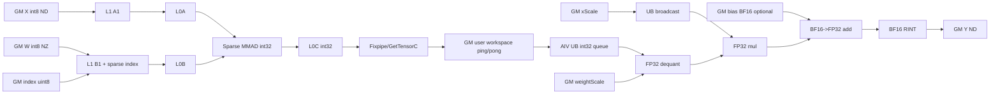

# Sparse4to2QuantMatmulWeightNz A2/A3 ACLNN 算子知识

## 算子速览

| 项目 | 内容 |
|---|---|
| 实际入口 | `aclnnSparse4to2QuantMatmulWeightNzGetWorkspaceSize` + `aclnnSparse4to2QuantMatmulWeightNz`，公开 ACLNN 两段式接口；固定仓只有这一版公开实现。 |
| 计算语义 | `Y = CastBF16((SparseMM_int32(X, W, index) * weightScale) * xScale[:, None] + bias[None, :])`；`bias` 可省略。 |
| 输入输出 | `X:int8 ND[M,K]`；`W:int8 FRACTAL_NZ[N,Kb]`，`2*Kb=AlignUp(K,8)`；`index:uint8`；`xScale:fp32[M]`；`weightScale:fp32[N]`；可选 `bias:bf16[N]`；`Y:bf16 ND[M,N]`。 |
| 执行类型 | 单 Kernel `MIX_CV`：每组 1 个 AIC_CUBE 节点执行稀疏 int8→int32 Matmul，2 个 AIV_VECTOR 子块消费 workspace 并执行反量化、逐 token scale、bias 和 BF16 cast。 |
| Kernel 路线 | R-001：tiling key 0、模板 priority 0、`Sparse4to2QuantMatmul<int8_t,int8_t,DTYPE_Y,ND,NZ,false,true>`；bias 和 per-channel/per-tensor weight scale 是该 Route 内 POD/runtime guard。 |
| 核心资源 | 输入/输出 GM；16 MiB system workspace + 每 AIC 两块 `baseM*baseN*int32` user workspace；Matmul API 管理 L1/L0A/L0B/L0C；AIV 使用条件化 TQue/TBuf、FP32 临时结果。 |
| 来源闭包 | `source_closed`：公开 API、平台检查、L0 launcher、shape/tiling/POD、key 0 MIX_CV entry、AIC/AIV body、同步、tail、binary config 与构建接线闭合；通用 AscendC Matmul/Fixpipe 内部是固定仓外 primitive 边界，当前实例参数已闭合。 |
| 验证状态 | 已完成源码闭包检查；本次知识提取未执行编译、真机、数值或性能测试。 |

## 接口与语义

### 计算语义

令 `M=X.shape[0]`、`K=X.shape[1]`、`N=sparseWeight.shape[0]`、`Kb=sparseWeight.shape[1]`。接口要求 `2*Kb=AlignUp(K,8)`；`sparseWeight` 和 `index` 已是 4:2 压缩表示，本卡不包含其生成算子。AIC 通过 `SetSparseIndex` 执行 `int8×int8→int32` 稀疏矩阵乘，将每个 `[curM,curN]` 基本块写到 workspace。AIV 先用标量或按 N 的 `sparseWeightScale` 做 `AscendDequant` 得到 FP32，再广播并乘逐 M 行 `xScale`，可选将 BF16 bias 转 FP32 后逐行相加，最后以 `RoundMode::CAST_RINT` 转 BF16 写 `Y`。

### 输入、输出与属性

| 参数 | shape/layout | dtype | 约束、默认值与语义 |
|---|---|---|---|
| `x` | view `[M,K]`，storage ND | INT8 | 必选、非空；仅当前顺序，不支持最后两维转置；`K<=65535`。 |
| `sparseWeight` | view `[N,Kb]`，storage `[ceil(Kb/32),ceil(N/16),16,32]`，FRACTAL_NZ | INT8 | 必选、非空；`2*Kb=AlignUp(K,8)`；Host 验证并重建带 NZ format 的 view。 |
| `index` | 文档 view/storage `[ceil(Kb/32),ceil(N/16),16,8]`，ND | UINT8 | 必选；AIC `SetSparseIndex` 的压缩索引，N tile 起址为 `nOffset*8` 元素。 |
| `xScale` | `[M]`，ND | FLOAT32 | 虽底层 OpDef 标成 optional，公开 API 的 `CheckNotNull` 要求非空；每 M 行缩放。 |
| `sparseWeightScale` | `[N]`，ND | FLOAT32 | 公开 API 要求非空；`N==1` 走 scalar，否则逐 N 通道。 |
| `biasOptional` | `[N]`，ND | BFLOAT16 | 可空；存在时在 FP32 域、两种 scale 之后相加。 |
| `out` | `[M,N]`，ND | BFLOAT16 | 必选；Host 要求 shape 精确匹配。 |
| `dtype` | scalar attr | INT64 Host / binary value 27 | API 取 `out->GetDataType()`；binary config 固定 27（BF16）。 |

### 入口与版本

固定 Commit `955f8b33985b6d72989ebff341bb9c2c564a51bc` 中只有无版本后缀的公开入口。公开文档同时列 Atlas A2、A3，第一段 API 只接受 `SocVersion::ASCEND910B` 或 `ASCEND910_93`；OpDef 与两个 binary config 对应同一 Host/Tiling/Kernel body。因此 A2/A3 共享当前最新公开版本。`aclnnTransSparse4to2Para` 是不同逻辑算子，只作为输入来源说明，不进入本卡链路。

## Host/Launcher 执行流程

### 参数校验与前处理

第一段先做 SoC 白名单；验证 `sparseWeight` 非空、view 至少满足接口维数检查，并用 view `[N,Kb]` 推出预期 NZ storage shape。随后创建 executor、禁用 cache，把 `sparseWeight` 包成 FRACTAL_NZ view。`PreMatmulCalcProcess` 对 `x` 调用框架 `Contiguous` 或无物化 view 调整，但若检测到最后两维转置立即报错；它也保存 weight original shape。`CheckParams` 再按 dtype→format→shape→空 tensor 的顺序验证；`xScale`、`sparseWeightScale` 被 `CheckNotNull` 强制非空。L0 `Sparse4to2QuantMatmul` 分配 BF16 ND 临时输出，做 infer shape，并通过 `ADD_TO_LAUNCHER_LIST_AICORE` 添加核心节点。最后标准 `ViewCopy` 把临时输出交给用户 `out`；当前 `CheckOutShape` 已限定 2D，因此源码中的 3D reshape 条件不是本入口可达分支。

### 参数、Workspace 与生命周期

Tiling 申请一个 workspace：`16*1048576 + 2*4*baseM*baseN*usedCoreNum` 字节。前 16 MiB 是 system workspace；Device entry 用 `GetUserWorkspace` 取得其后的 user slice。每个 AIC 拥有两个连续 int32 基本块：元素起点 `2*blockIdx*baseM*baseN + pong*baseM*baseN`。两个 AIV 子块只读所属 AIC 当前块的互斥 M 子区；AIV 写最终 `Y`，不把 UB 临时量暴露给其它核。executor 在第一段收集 workspace 和节点，`ReleaseTo(executor)` 转移 owner；第二段 `CommonOpExecutorRun` 在调用者 stream 上执行。workspace 与 executor 必须保持到 stream 中节点完成。

### 启动图与失败传播

```text
aclnn...GetWorkspaceSize
  -> Contiguous(x)（框架节点/identity，视输入而定）
  -> l0op::Sparse4to2QuantMatmul
     -> InferShapeForSparse4to2QuantMatmul
     -> Sparse4to2QuantMatmulTilingFunc(priority 0, key 0)
     -> sparse4to2quant_matmul [MIX_CV, blockDim=usedCoreNum, task ratio AIC:AIV=1:2]
        -> AIC: sparse Matmul -> per-core ping/pong int32 workspace
        -> flag 6/7
        -> AIV subblocks: workspace -> UB -> dequant/xScale/(bias)/cast -> Y
        -> flag 4/5，允许 AIC 复用对应 workspace
  -> ViewCopy(temp Y, out)（框架节点）
aclnn... -> CommonOpExecutorRun(workspace, executor, stream)
```

任一平台、参数、infer、launcher-list、tiling memcpy/workspace 或 framework 节点失败都在当层返回，不产生后续核心节点。Device entry 对空 workspace 或 `GetUserWorkspace` 为空直接无输出返回；Host 正常路径已要求非零 workspace。核心语义只有一个 MIX_CV kernel，不存在跨 kernel 临时边。

## Route 与参数设计

### 分核与资源计算

Tiling 先取 `M,N,Ka=K,Kb` 和硬件 `aicNum/UB/L1/L0A/L0B/L0C/L2`。候选 `baseM` 来自 `{64,80,96,128,192,256,320,384,512}`，`baseN` 来自 `{64,96,128,160,192,256,320,384,512}`；小 shape 会缩到 16 对齐。候选须满足 `baseM*baseN<=256*128`，再比较用核数、轮数、L1 加载估计、计算访存比、L2 首次加载冲突和 MTE1 方向。`baseK` 从 `{1024,512,256,128,64}` 取能满足双缓冲 L0 估算的最大值；`singleCoreK=K`，即不做跨核 split-K。

`usedCoreNum=min(ceil(M/baseM)*ceil(N/baseN),aicNum)`。L1 从 `depthA1=depthB1=16` 起缩减，要求 `depthA1*baseM*baseK + depthB1*baseN*baseK/2 + depthBSize/4 < L1 bytes`（本接口 dtype 均为 int8）；随后 `stepKa/stepKb` 按 256B K 粒度和小 K pipeline guard 修正，最终 `depth=2*stepK`。L0C 若 `2*baseM*baseN*sizeof(int32)<=l0cSize` 则 `dbL0C=2`，否则 1。L2 tile 取 `mTileBlock<=4`，`nTileBlock<=aicNum/mTileBlock`，Device 在 M tile 间以 N 蛇形顺序访问。

UB 令 `ubCalcN=baseN`；Host 先计算固定开销 `needUbSize` 与每 M 行系数 `ubCalc`，再取 `ubCalcM=min(floor((ubSize-needUbSize)/ubCalc),baseM,M)`，必须大于 0。`needUbBuffer=8*ubCalcM*ubCalcN`。weight scale 是否逐通道、`M>1` 的 xScale broadcast 以及 BF16 bias dtype 会进入容量公式；`hasBias` 的实际队列分配仍由 Device runtime guard 控制。

### Route 选择

| 顺序 | Route | Key/模板 | 精确选择条件与优先级 | 不适用去向 |
|---:|---|---|---|---|
| 1 | R-001 单 Kernel MIX 稀疏量化 Matmul | template priority 0；tiling key `0`；`Sparse4to2QuantMatmul<int8_t,int8_t,DTYPE_Y,ND,NZ,false,true>` | SoC 为 910B/910_93；公开 API dtype/layout/shape/非空检查通过；`xScale`、`weightScale` 非空；tiling 资源计算成功。bias 可空；`N==1` 为 scalar weight scale，否则 per-channel。 | 无下一模板；参数/资源失败返回错误，Device 空 workspace 直接返回。 |

```text
if SoC not in {ASCEND910B, ASCEND910_93}: ACLNN_ERR_PARAM_INVALID
else if API validation fails: ACLNN error
else REGISTER_TILING_TEMPLATE(priority=0)
     -> GetTilingKey() = 0
     -> key 0 MIX_CV kernel
        -> weightScaleDim==1 ? scalar : per-channel
        -> hasBias ? BF16->FP32 add : skip
```

### 模板/实现执行矩阵

| Route | key/selector | dtype/shape/platform 完整命中条件 | 执行族与 kernel 节点 | 实际模板/body | 内存与同步特征 | tail/fallback |
|---|---|---|---|---|---|---|
| R-001 MIX 稀疏量化 Matmul | key 0 / priority 0 | A2/A3；X/W int8、index uint8、scales fp32、Y/bias bf16；2D M/K/N 合法且非空；NZ storage 精确；资源公式成功 | 单节点 MIX_CV：1 AIC_CUBE : 2 AIV_VECTOR | `MatmulImpl<GM ND int8, Sparse GM NZ int8, VECIN ND int32, GM ND int32, MM_DEFAULT_MDL_CFG>`；`Sparse4to2QuantMatmulUpdate`；AIV dequant body | 每核两块 int32 workspace；flags 6/7 AIC→AIV、4/5 AIV→AIC；AIV 条件队列 | M/N tile、两 AIV M 分片、UB M-loop 与 32B copy/cast tail；无 fallback 模板。 |

### 隐藏性能 Guard

| Guard | Host/Tiling 条件 | Device/资源原因 | 影响 Route | 不满足时去向 | 源码符号 |
|---|---|---|---|---|---|
| SoC 白名单 | `soc==ASCEND910B \|\| soc==ASCEND910_93` | 公开产品与 binary 接线只覆盖 A2/A3 | R-001 | API 报不支持 | `aclnn...GetWorkspaceSize` |
| L0C tile | `baseM*baseN<=32768`；DB 另需 `2*baseM*baseN*4<=l0cSize` | int32 L0C 容量 | R-001 | 剪枝候选或关闭 DB | `SetBase`、`CheckDbL0c` |
| L1 depth | `depthASize+depthBSize+indexSize<l1Size` | A、压缩 B 与 index 的 L1 stage | R-001 | 交替把 depth 减半；再失败则 tiling 失败 | `CalcL1Tiling` |
| K step | `stepKa,stepKb>0`；K≤512 时限制 `kL1<=256` | 避免小 K 全载令 MTE2 与 MTE1/MMAD 串行 | R-001 | 修正 step；零值失败 | `GetStepK` |
| UB | `needUbSize<ubSize && ubCalcM>0` | FP32 dequant、broadcast、bias、BF16 out 队列 | R-001 | tiling 失败 | `CalcUbTiling` |
| scale 分支 | `weightScaleDim==1` | 标量可直接从 GM 读入寄存器，省 per-channel queue | R-001 | `>1` 分配并逐 tile 搬 scale | `InitGlobalBuffers`、`InitLocalBuffers` |
| bias 分支 | `matmulTiling.isBias!=0` | BF16 bias 需 GM→UB、cast FP32 与 add buffer | R-001 | 空 bias 跳过队列和计算 | `InitLocalBuffers`、`BasicDequantCompute` |
| L2 hint | `M<=baseM` | A 不跨 M tile 复用时关闭 weight GM L2 cache hint | R-001 | 保持默认 cache hint | `InitGlobalBuffers` |
| 排布 | `N>5*M` 倾向 COL_FIRST；冲突数和可整除性再修正 | 减少多核同地址/L2 首次加载冲突 | R-001 | ROW_FIRST 默认 | `DetermineCalcOrder` |

### POD/ABI

`#pragma pack(push,8)` 只设最大 packing；两个纯 `uint32_t` 子结构的固定仓可确定布局如下。复合 POD 中 `TCubeTiling` 来自外部 `kernel_tiling/kernel_tiling.h`，其完整 `sizeof/alignof/offsetof` 不在本固定仓，故不推测；Host 与 Device 均包含同一外部定义。

| 结构 | 字段 | 类型/位宽 | ABI 布局 | 单位 | Host/launcher producer | Device consumer | 边界 |
|---|---|---|---|---|---|---|---|
| `Sparse4to2QuantMatmulParams` | `xScaleDim` | `uint32_t`/32 | sizeof=32, align=4, offset=0 | 元素 | `AnalyzeInputs`/`SetMatmulTilingFromBasicTiling` | `CalcUbTiling`；POD 内 Device 未直接分支 | 等于 M；0 仅来自缺失输入，而公开 API 不允许 |
| 同上 | `weightScaleDim` | `uint32_t`/32 | offset=4 | 元素 | 同上 | `InitTilingData` 判 `==1` | 公开 API 等于 N |
| 同上 | `ubCalcM` | `uint32_t`/32 | offset=8 | 行/UB loop | `CalcUbTiling` | `BasicDequantCompute` | `1..min(baseM,M)` |
| 同上 | `ubCalcN` | `uint32_t`/32 | offset=12 | 列 | `CalcUbTiling` | UB 队列与 AIV N tile | 等于 baseN；实际尾列由 `curAicN` 限制 |
| 同上 | `needUbBuffer` | `uint32_t`/32 | offset=16 | 字节 | `8*ubCalcM*ubCalcN` | `vecQueTmp_` | 32 位窄化前由整体 tiling 合法性约束；固定仓无独立 overflow check |
| 同上 | `biasDtype` | `uint32_t`/32 | offset=20 | GE dtype enum | `DoOpTiling` | 当前 Device 不读取 | API 有 bias 时 BF16；无 bias 保持默认 BF16 |
| 同上 | `isMClash` | `uint32_t`/32 | offset=24 | bool flag | `DetermineCalcOrder` | 当前 Device 不读取 | 0/1 |
| 同上 | `isNClash` | `uint32_t`/32 | offset=28 | bool flag | 同上 | 当前 Device 不读取 | 0/1 |
| `TCubeTiling` | `M,N,Ka,Kb` | 外部定义，固定仓不可见 | composite offset=32；字段 offset/总 size 不可见 | 元素 | `SetMatmulTilingFromBasicTiling` | block/update/mm body | M/N/K 非零；Kb 为压缩 K |
| 同上 | `usedCoreNum` | 外部定义，固定仓不可见 | 不可见 | AIC 核 | 同上 | entry/block/workspace | `1..aicNum` |
| 同上 | `singleCoreM/N/K` | 外部定义，固定仓不可见 | 不可见 | 元素 | 同上 | block tail、`mm_.SetSingleShape` | M/N 为 base；K=Ka |
| 同上 | `baseM/baseN/baseK` | 外部定义，固定仓不可见 | 不可见 | 元素 | 同上 | MM、workspace、UB、offset | 由候选与 L0 约束生成 |
| 同上 | `depthA1/depthB1` | 外部定义，固定仓不可见 | 不可见 | stage depth | 同上 | `mm_.Init` | 偶数，等于 `2*stepK` |
| 同上 | `stepM/stepN` | 外部定义，固定仓不可见 | 不可见 | tile step | 默认 BasicTiling=1 后写入 | `mm_.Init` | 当前固定为 1 |
| 同上 | `stepKa/stepKb` | 外部定义，固定仓不可见 | 不可见 | K step | `CalcL1Tiling` | `mm_.Init` | 非零，满足 L1/256B guard |
| 同上 | `isBias` | 外部定义，固定仓不可见 | 不可见 | bool | `hasBias?1:0` | `InitTilingData` | 0/1 |
| 同上 | `iterateOrder` | 外部定义，固定仓不可见 | 不可见 | enum | BasicTiling 默认 0 | `mm_.Init` | 当前为 0 |
| 同上 | `dbL0C` | 外部定义，固定仓不可见 | 不可见 | buffer depth | `CheckDbL0c` | `mm_.Init` | 1 或 2 |
| `L2cacheTileParams` | `mTileCntL2` | `uint32_t`/32 | sizeof=24, align=4, offset=0 | L2 M tile 数 | `DoL2CacheTiling` | `Sparse4to2QuantMatmulBlock` | ≥1 |
| 同上 | `nTileCntL2` | `uint32_t`/32 | offset=4 | L2 N tile 数 | 同上 | 同上 | ≥1 |
| 同上 | `mTileBlock` | `uint32_t`/32 | offset=8 | 每 M tile 的 base 块数 | 同上 | 同上 | `<=4` 且不超过 M base 数 |
| 同上 | `nTileBlock` | `uint32_t`/32 | offset=12 | 每 N tile 的 base 块数 | 同上 | 同上 | `<=aicNum/mTileBlock` |
| 同上 | `calOrder` | `uint32_t`/32 | offset=16 | 1=row, 2=col | `DetermineCalcOrder` | block index 映射 | 0 时 Device 兜底 row；正常 1/2 |
| 同上 | `reserve` | `uint32_t`/32 | offset=20 | N/A | 默认 0 | 未读取 | inactive，必须保持 0 |

### Route 源码闭包

| Route | Key/selector | Host/Tiling producer | POD/参数 | Kernel entry/router | Kernel body/直接依赖 | 构建接线 |
|---|---|---|---|---|---|---|
| R-001 MIX 稀疏量化 Matmul | priority 0 / key 0 | `op_host/op_tiling/sparse4to2quant_matmul_tiling.cpp`：`Sparse4to2QuantMatmulTiling::*` | `Sparse4to2QuantMatmulTilingData` + 外部 `TCubeTiling` | `op_kernel/sparse4to2quant_matmul.cpp`：`sparse4to2quant_matmul` | `sparse4to2quant_matmul.h`、`_block.h`、`_update.h`、`_base.h` | OpDef 配置 910B/910_93；两份 binary JSON；Host CMake dependency `mat_mul_v3` |

## Kernel 实现

### 公共执行流程

唯一 Route 的 entry 检查 workspace，解析 `Sparse4to2QuantMatmulTilingData`，声明 `KERNEL_TYPE_MIX_AIC_1_2`，实例化 ND A、NZ sparse B、BF16 Y 的模板。AIV 把逻辑 block id 除以 task ratio，使两个 AIV subblock 与同一 AIC block 配对；AIC/AIV 共享 POD、workspace 基址与 tile scheduler。每个 tile 先由 `Sparse4to2QuantMatmulUpdate` 得到 M/N tail 和 GM offsets，再在 ping/pong workspace 上执行 AIC→AIV 流水。全部 L2 tiles 完成后 AIC 补 wait 并 `mm_.End()`；TPipe 在 entry 末销毁。

### Route R-001：单 Kernel MIX 稀疏量化 Matmul

#### 适用条件

##### 选择证据

| 层级 | 文件 | 符号 | 源码谓词/参数 | 结果/下一跳 |
|---|---|---|---|---|
| API | `op_host/op_api/aclnn_sparse4to2quant_matmul_weight_nz.cpp` | `aclnn...GetWorkspaceSize` | SoC 910B/910_93；NZ storage、dtype/format/shape/非空检查 | 失败返回 ACLNN error；成功加入 L0 op |
| L0 launcher | `op_host/op_api/sparse4to2quant_matmul.cpp` | `l0op::Sparse4to2QuantMatmul` | infer 成功且 `ADD_TO_LAUNCHER_LIST_AICORE` 成功 | 加入一个 AICore 节点 |
| Tiling | `op_host/op_tiling/sparse4to2quant_matmul_tiling.cpp` | registry / `GetTilingKey` | register list `{0}`、template priority 0、key 0 | 无其它模板/key fallback |
| Router | `op_kernel/sparse4to2quant_matmul.cpp` | `sparse4to2quant_matmul` | workspace/user workspace 非空 | 实例化唯一 MIX_CV body，否则直接 return |

#### Device 数据流

##### 函数级调用链

```text
sparse4to2quant_matmul(args, workspace, tiling)
  -> Sparse4to2QuantMatmul<...>::Init
     -> mm_.Init(TCubeTiling)
     -> block_.Init + update_.Init
  -> Process
     -> L2 tile serpentine loop
     -> OneTileCompute
        -> UpdateBlockParamsAndCalcGmOffset
        -> BasicMMDequantCompute
           -> AIC BasicMMCompute: SetTensorA/B/SparseIndex -> Iterate -> GetTensorC(workspace)
           -> Notify flag 6/7
           -> AIV BasicDequantCompute: workspace->UB -> AscendDequant -> xScale Mul -> bias Add -> Cast -> Y
           -> Notify flag 4/5
  -> End -> mm_.End
```

##### 源码等价伪码

```text
for each L2_M_tile:
  visit L2_N_tiles in alternating forward/reverse order
  distribute base tiles across usedCoreNum in row/column order with rotating tail cores
  for each base tile owned by this logical block:
    curM, curN = exact M/N tail-aware sizes
    offsets = {A:m0*K, B:n0*32, index:n0*8, scale/bias:n0, xScale:m0, Y:m0*N+n0}
    ws = 2*block*baseM*baseN + pong*baseM*baseN
    AIC: if this ping/pong has been used twice, wait AIV reuse flag
         sparse_mm_int8_to_int32(A, B_NZ, index, curM, curN, K) -> ws
         notify AIV completion flag
    AIV[sub=0,1]: wait completion flag; split curM without overlap
         for each ubCalcM row chunk:
           ws int32 -> UB
           fp = AscendDequant(ws, scalar_or_channel_weightScale)
           fp = fp * Broadcast(xScale[row])
           if bias: fp += CastFP32(bias)
           Y = CastBF16_RINT(fp), write only curM*curN with output stride N
         notify AIC reuse flag
toggle pong
```

#### 内存与数据搬运

##### 资源与搬运表

| 层级/缓冲区 | offset/地址公式 | extent/容量公式 | dtype/layout | producer | consumer | owner/lifetime | 对齐/复用 |
|---|---|---|---|---|---|---|---|
| GM X | `mOffset*K` | `M*K` elements | int8 ND | caller | AIC Matmul A | caller / launch | K tail 由 Matmul tiling；A offset不补齐 |
| GM sparseWeight | `nOffset*32` | NZ storage shape | int8 FRACTAL_NZ, bTrans=true | caller | AIC sparse B | caller / launch | N 起址按 K0=32 |
| GM index | `nOffset*8` | `[ceil(Kb/32),ceil(N/16),16,8]` | uint8 ND physical sparse index | caller | `SetSparseIndex` | caller / launch | N 起址按 index K0=8 |
| user workspace ping/pong | `4*(2*blockIdx*baseM*baseN+pong*baseM*baseN)` bytes | `2*usedCoreNum*baseM*baseN*4` bytes | int32 ND tile | AIC `GetTensorC` | 两个 AIV subblocks | executor workspace / kernel | 每核独占，flags 防覆盖 |
| L1 A stage | Matmul API 内部 | tiling 估算 `depthA1*baseM*baseK` bytes | int8，ND→A1 | MTE2 | MTE1/L0A | MatmulImpl / tile | `depthA1=2*stepKa` |
| L1 sparse B+index stage | Matmul API 内部 | `depthB1*baseN*baseK/2 + depthB1*baseN*baseK/8` bytes | int8 NZ + uint8 index | MTE2 | sparse MTE1/L0B | MatmulImpl / tile | `depthB1=2*stepKb` |
| L0A/L0B | Matmul API 内部，固定仓不可见 | Host 用双缓冲 L0 资源选择 baseK；实际 allocation extent 在外部 MatmulImpl | int8 Cube fragments | L1 load | sparse MMAD | MatmulImpl / K step | N/A 于固定仓源码细节；不是绕过路径 |
| L0C | Matmul API 内部 | `dbL0C*baseM*baseN*4` bytes 的 Host 容量上界 | int32 | MMAD | `GetTensorC`/Fixpipe→workspace | MatmulImpl / tile | depth 1/2 |
| UB `vecQueSrc_` | AIV local | `2*ubCalcM*ubCalcN*4` bytes | int32 | workspace DataCopyPad | AscendDequant | AIV TPipe / UB loop | double buffer |
| UB `vecQueTmp_` | AIV local | `8*ubCalcM*ubCalcN` bytes | uint8/float alias view | dequant/broadcast ops | Mul/cast helper | AIV TPipe / tile | single TBuf，按阶段复用 |
| UB `vecQueOut_` | AIV local | `2*ubCalcM*ubCalcN*2` bytes | BF16 | Cast RINT | GM Y | AIV TPipe / UB loop | double buffer |
| UB scale/bias | AIV local | per-channel scale `2*ubCalcN*4`；bias 时 `ubCalcN*4 + 2*ubCalcN*2` | FP32/BF16 | GM copies/cast | dequant/add | 条件分配 / base tile | scalar weight scale不用 queue |
| UB FP32 compute | AIV local | `outFp32Tmp=ubCalcM*ubCalcN*4`；broadcast 同量 | FP32 | dequant/Broadcast | Mul/Add/Cast | AIV TPipe / UB loop | PIPE_V barriers |
| UB xScale | AIV local | `2*Align(ubCalcM,8)*4` bytes | FP32 vector | GM DataCopyPad | Broadcast | AIV TPipe / UB loop | 32B 对齐，double buffer |
| GM Y | `mOffset*N+nOffset` 加 AIV sub/UB row offset | `M*N` | BF16 ND | AIV MTE3 | caller | caller / stream | `blockLen=curN*2`，`dstStride=(N-curN)*2` |

##### 分层内存布局



##### 字节账、交接边与复用顺序

```text
workspace_total = 16*1048576 + 2*usedCoreNum*baseM*baseN*sizeof(int32)
L1_planned = depthA1*baseM*baseK + depthB1*baseN*baseK/2 + depthB1*baseN*baseK/8 < l1Size
L0C_planned = dbL0C*baseM*baseN*sizeof(int32) <= l0cSize
UB_device = 2*uM*uN*4 + 8*uM*uN + 2*uM*uN*2
          + uM*uN*4 + uM*uN*4 + 2*Align(uM,8)*4
          + (!perTensor ? 2*uN*4 : 0)
          + (hasBias ? uN*4 + 2*uN*2 : 0)
Host CalcUbTiling 用 needUbSize + ubCalc*uM <= ubSize 的保守公式选择 uM；无 bias 时 biasDtype 默认 BF16，Host 仍保留部分 bias-dtype 容量，但 Device 不分配 bias 队列。
```

| 边/复用子区 | producer | offset/extent | dtype/layout | consumer | ordering/sync | owner/lifetime | 安全条件 |
|---|---|---|---|---|---|---|---|
| AIC→AIV ping | AIC `GetTensorC` | per-core ping，`curM*curN` 有效、`baseM*baseN` 容量 | int32 ND | 两个 AIV M 子区 | AIC `NotifyEvent<PIPE_FIX>(6)`；AIV `WaitEvent(6)` | workspace / kernel | subblock M 区间不重叠 |
| AIC→AIV pong | 同上 | per-core pong | int32 ND | 同上 | flag 7 | 同上 | 同上 |
| AIV→AIC ping reuse | 两个 AIV 完成消费 | ping capacity | N/A control | AIC 下一轮 ping producer | AIV `NotifyEvent<PIPE_MTE2>(4)`；AIC 从第三次迭代起 `WaitEvent(4)` | flag / kernel | 前两次分别使用不同 buffer，可跳 wait |
| AIV→AIC pong reuse | 同上 | pong capacity | N/A control | AIC 下一轮 pong producer | flag 5 | 同上 | 同上 |
| UB tmp reuse | dequant/Broadcast/Mul | `8*uM*uN` bytes | uint8/float view | 后续 vector stage | `PipeBarrier<PIPE_V>` 与 API 内 event | AIV TPipe / loop | 同一阶段结束后才覆盖 |

#### 同步、精度与尾块

##### 同步与数值边界表

| 阶段 | primitive/机制 | producer | consumer/等待点 | 保护对象 | 精度/尾块 |
|---|---|---|---|---|---|
| workspace 发布 | `NotifyEvent<PIPE_FIX>(6/7)` / `WaitEvent(6/7)` | AIC Fixpipe/GetTensorC | AIV | ping/pong int32 tile | AIC 仅写 curM×curN 有效域 |
| workspace 复用 | `NotifyEvent<PIPE_MTE2>(4/5)` / 第三轮起 `WaitEvent(4/5)` | AIV | AIC | 对应 ping/pong | 首 ping/pong 不等待；`End` 对 4/5 补 wait 后 `mm_.End()` |
| GM→UB | `DataCopyPad` + `MTE2_V` flag 0/1 | MTE2 | Vector | int32 tile/per-channel scale | `curM/curN` 与 32B pad；不读 workspace padding |
| dequant | `AscendDequant` | int32 + FP32 weight scale | FP32 tmp | numeric result | `N==1` scalar，否则 per-channel；累加输入 int32 |
| xScale | `BroadCast`、`PipeBarrier<PIPE_V>`、`Mul` | FP32 xScale | FP32 result | per-row scale | N 对齐至 8 floats；当 BF16 alignment 16 不同，逐行 mul 避免错 stride |
| bias | BF16→FP32 `CAST_NONE`、barriers、`Add` | bias queue | FP32 result | optional bias | N 对齐至 16 BF16；逐 M 行加 |
| 输出 | FP32→BF16 `CAST_RINT`；`V_MTE3` event 2 | Vector | MTE3/GM Y | BF16 output | UB M tail、N blockLen 和 GM dstStride 精确保护 |
| base tile tail | `UpdateBlockParams` | scheduler | MM/AIV | M/N last tile | `mBaseTail`/`nBaseTail` 替换 baseM/baseN |
| AIV split tail | `subBlockoffset=sub*curM/2`；`curM=curM/2+sub*(curM%2)` | logical AIC tile | AIV0/AIV1 | M rows | 奇数 M 的余行给 subblock 1，无重叠 |

#### 关键实现

##### 符号证据表

| 阶段 | 文件 | 符号/模板实例 | 实现事实 |
|---|---|---|---|
| Host/Tiling producer | `op_host/op_tiling/sparse4to2quant_matmul_tiling.cpp` | `DoBasicTiling`、`CalcUbTiling`、`GetWorkspaceSize`、`PostTiling` | 选择 base/depth/order，生成 UB、workspace、blockDim 与 POD |
| Kernel entry/router | `op_kernel/sparse4to2quant_matmul.cpp` | `sparse4to2quant_matmul` / `KERNEL_TYPE_MIX_AIC_1_2` | key 0 binary 的唯一 MIX_CV entry 与具体模板 |
| Device body/helper | `op_kernel/sparse4to2quant_matmul.h` | `BasicMMCompute`、`BasicDequantCompute` | AIC sparse Matmul、AIV精确 scale/bias/cast 顺序与同步 |
| Device scheduler | `op_kernel/sparse4to2quant_matmul_block.h` | `InitBlockIndex`、`UpdateBlockIndex` | row/col tile 映射、轮数与旋转尾核 |
| Device offsets/tail | `op_kernel/sparse4to2quant_matmul_update.h` | `UpdateBlockParams`、`CalcGMOffset` | M/N tail 与所有 GM 元素 offset |
| Device DMA helper | `op_kernel/sparse4to2quant_matmul_base.h` | `CopyMmOutToLocal`、`CopyUbToGm` | DataCopyPad 参数、MTE2/V/MTE3 ordering |

## 算子特定优化

### Trick T-001：AIC/AIV 单 Kernel ping-pong 流水

#### 触发与源码依据

- 适用 Route：R-001
- 触发条件：唯一 key 0 MIX_CV entry；每逻辑 block 1 个 AIC 配 2 个 AIV；至少一个 base tile。
- Golden 来源：[`op_kernel/sparse4to2quant_matmul.h:141-172`](../../../../../../../cann-ops-raw/ascendc/ops-nn/955f8b33985b6d72989ebff341bb9c2c564a51bc/matmul/sparse4to2quant_matmul/op_kernel/sparse4to2quant_matmul.h#L141-L172)

**官方源码（固定 Commit 连续逐字摘录）**：

```cpp
offsetWorkspaceC_ = pingOffsetC + pongSwitch * baseM_ * baseN_;
BasicMMDequantCompute(
    block_.params_.singleCoreM, block_.params_.singleCoreN, C2V_PING_FLAG | pongSwitch,
    V2C_PING_FLAG | pongSwitch);
pongSwitch = !pongSwitch;
```

#### 机制与设计原因

每个 AIC 预留两个 int32 C tile。调用点把 4/5 作为 `v2cSyncFlag`、6/7 作为 `c2vSyncFlag` 传入；AIC 用 6/7 发布 Fixpipe 写完的 tile，两个 AIV 切 M 消费，AIV 再用 4/5 回告可复用。前两轮分别落到 ping、pong，所以 AIC 从第三轮才等待。这使下一块 Cube 计算可与上一块 Vector 反量化重叠，同时避免让 int32 中间结果成为算子正式输出。

#### 迁移边界

- 适用：同一 MIX launch 内 AIC 产生固定上界 tile、AIV 后处理且能按行无冲突切分的场景。
- 前提：task ratio、workspace 容量、6/7 的 AIC→AIV 发布、4/5 的 AIV→AIC 复用回告、PIPE_FIX/PIPE_MTE2 可见性和每核 owner 全部保持一致。
- 失效：改为单 AIC、不同 AIV 比例、跨 kernel epilogue 或 workspace 少于双缓冲时，须重做 block 映射与同步。
- 未验证：本次知识提取未执行编译、真机、数值或性能测试。

#### 错误做法

不能在 AIV 以 4/5 回告前覆盖同一 ping/pong；否则会把下一 AIC tile 与正在反量化的 int32 tile 混合。参数变量名与常量前缀容易造成误读，迁移时必须从调用点实参继续追到 `WaitEvent/NotifyEvent`，不能仅按变量名判断方向。

### Trick T-002：把量化后处理固定在 FP32 域并处理两种 N 对齐

#### 触发与源码依据

- 适用 Route：R-001
- 触发条件：公开 dtype 组合；weight scale 与 xScale 非空；bias 分支可选。
- Golden 来源：[`op_kernel/sparse4to2quant_matmul.h:265-289`](../../../../../../../cann-ops-raw/ascendc/ops-nn/955f8b33985b6d72989ebff341bb9c2c564a51bc/matmul/sparse4to2quant_matmul/op_kernel/sparse4to2quant_matmul.h#L265-L289)

**官方源码（固定 Commit 连续逐字摘录）**：

```cpp
AscendDequant(dstLocalFp32, srcLocal, scaleLocal, tmpLocal, dequantParams);
uint32_t ubResAlignedN = SparseQmm::Align(curAivN);
PertokenCalculate(basicBlockComputeInfo, mUbLoopIdx, padParams, dstLocalFp32, tmpdstLocal);
if (hasBias_ != 0) {
    CalBiasAdd(tmpdstLocal, biasFp32, oriBiasBf16, oriBiasFp16, oriBiasFp32, curAivN, curAivM);
}
Cast(dstLocal, tmpdstLocal, RoundMode::CAST_RINT, curAivM * ubResAlignedN);
```

#### 机制与设计原因

稀疏 Matmul 保持 int32 累加；weight scale、逐 M 的 xScale 和 bias 均在 FP32 临时区完成，只有最终一次转 BF16。`computedAivN=Align(curN,8)` 服务 FP32 32B 对齐，`ubResAlignedN=Align(curN,16)` 服务 BF16 输出；两者不等时按行 Mul，避免把一种 stride 错用于另一种 dtype。

#### 迁移边界

- 适用：int32 accumulator、FP32 scale、BF16 output 的 quantized epilogue。
- 前提：必须保持 dequant→xScale→bias→RINT cast 顺序、两种 N alignment 与输出 `dstStride`。
- 失效：输出/scale/bias dtype 或舍入模式变化时必须重算 UB、mask 和 cast。
- 未验证：本次知识提取未执行编译、真机、数值或性能测试。

#### 错误做法

把 bias 提前到 int32 或在乘 `xScale` 前转 BF16 会改变数值顺序；把 `Align(N,8)` 与 `Align(N,16)` 合并会在部分 N tail 上破坏行 stride。

### Trick T-003：容量、冲突和 L2 蛇形共同选择基本块

#### 触发与源码依据

- 适用 Route：R-001
- 触发条件：所有合法非空 M/N/K；从候选 base 集合动态选择。
- Golden 来源：[`op_host/op_tiling/sparse4to2quant_matmul_tiling.cpp:689-730`](../../../../../../../cann-ops-raw/ascendc/ops-nn/955f8b33985b6d72989ebff341bb9c2c564a51bc/matmul/sparse4to2quant_matmul/op_host/op_tiling/sparse4to2quant_matmul_tiling.cpp#L689-L730)

**官方源码（固定 Commit 连续逐字摘录）**：

```cpp
if (inputParams_.nSize > SELECT_COL_PARAM * inputParams_.mSize) {
    basicTiling_.calOrder = COL_FIRST;
    SetCalcOrderinMNClashCase(mTotalCnt, nTotalCnt);
    return;
}
```

#### 机制与设计原因

Tiling 不是固定 128×256：它先在 L0C/L0A/L0B 上界内遍历 base，再用轮数、L1 重载估计、计算访存比与多核地址冲突选择方向；最终把 base 网格再切成 L2 window，Device 对 N window 蛇形遍历。目标是减少相邻 L2 tile 之间的地址跳变和同地址争用，源码只给出选择机制，没有提供可量化性能收益。

#### 迁移边界

- 适用：M/N 变化大、相同 sparse weight 可能跨多个 M tile 复用的 A2/A3 稀疏 Matmul。
- 前提：候选集、L0/L1/L2 容量、AIC 数和 `SPARSE_WEIGHT_RATIO=5/8` 估计与目标平台一致。
- 失效：不同 L0/L1/L2 容量、非 4:2 表示或不同核数需要重新标定候选和冲突阈值。
- 未验证：本次知识提取未执行编译、真机、数值或性能测试。

#### 错误做法

固定仓的失败/剪枝路径会拒绝 L0C、L1 或 UB 放不下的候选；不能只复制最终 base 字段而省略资源检查。

## 模板与实现对比

| 对比维度 | R-001 单 Kernel MIX 稀疏量化 Matmul | R-002 | 设计选择依据 |
|---|---|---|---|
| 命中条件/优先级 | priority 0、key 0；A2/A3 唯一合法公开组合 | N/A：无第二 Route | registry 只注册模板 0，`GetTilingKey()` 固定 0 |
| 执行族/节点图 | 1 AIC_CUBE : 2 AIV_VECTOR，同一 Kernel | N/A | entry 固定 `KERNEL_TYPE_MIX_AIC_1_2` |
| M/N/K、tile 与 scheduler | 动态 baseM/baseN/baseK；K 不跨核切分；L2 M-window + N 蛇形 | N/A | 容量、轮数、L1/L2 冲突联合选择 |
| workspace/L1/L0/UB | per-core int32 ping/pong；Matmul L1/L0；条件 scale/bias UB | N/A | Cube accumulator 与 FP32 epilogue 解耦 |
| AIC/AIV 或 kernel 交接 | flags 6/7 发布、4/5 复用，workspace 分 M 子区 | N/A | 双缓冲流水与 owner 隔离 |
| 同步、精度与 tail | int32→FP32 scales→FP32 bias→BF16 RINT；M/N/AIV/UB 多层 tail | N/A | 公开数值语义和 32B DMA 对齐 |
| fallback/失败边界 | 无 device fallback；资源/参数失败终止 | N/A | 单模板注册 |

## 平台差异

| 项目 | A2 | A3 | 950 |
|---|---|---|---|
| 支持状态 | 支持；公开文档与 `ASCEND910B` config/Host 白名单闭合 | 支持；公开文档与 `ASCEND910_93` config/Host 白名单闭合 | 不支持生成正式卡：公开文档未列，Host 白名单拒绝其它 SoC |
| Host/Launcher | 与 A3 共用代码、priority 0/key 0 | 与 A2 共用代码、priority 0/key 0 | 无公开 Host Route |
| Kernel/资源 | 共用 MIX_CV body；具体 core/memory 容量由 platform parse 注入 | 共用 MIX_CV body；具体 core/memory 容量由 platform parse 注入 | 固定仓无可达公开 kernel Route |

## 限制与失败边界

- 公开 API 只支持 A2/A3；950 不能由仓库顶层 950 说明或其它算子 arch35 文件外推。
- 不支持空 `x`/`sparseWeight`，不支持 x 转置；文档标注输入均不支持非连续，源码仅对 x 经过标准 Contiguous 边界。
- `K<=65535`，且 `AlignUp(K,8)=2*Kb`；M/N/K 为零在 API/Tiling 失败。Host 对相乘/窄化字段没有逐项独立 overflow guard，复用时不得扩大有效域。
- `xScale` 与 `sparseWeightScale` 在公开 API 必须非空，即使底层 OpDef 声明 optional；不能依据 OpDef 放宽 ACLNN 合约。
- `TCubeTiling` 完整 ABI 和 MatmulImpl 内部 L0 fragment/LoadData/MMAD/Fixpipe 细节来自固定仓外 CANN AscendC 库；本卡只声明固定仓可证的当前 type traits、tiling 字段、接口调用和边界，不推测其私有布局。
- Device entry 遇空 workspace/user workspace 静默 return；正常 ACLNN 必须使用第一段返回的 workspace size。
- AIC 主循环从第三轮起等待 AIV 的 4/5 复用回告，`End` 也对 4/5 补 wait；AIC 发布给 AIV 的完成 flag 是 6/7。参数变量名与常量前缀相反时，以调用点实参和 primitive consumer 为准。
- 本次知识提取未执行编译、真机、数值或性能测试。

## 源码索引

### 链路索引

| 链路阶段 | 文件 | 关键符号 | 支撑内容 |
|---|---|---|---|
| 入口声明/约束 | `docs/aclnnSparse4to2QuantMatmulWeightNz.md` | 产品表、函数原型、参数表 | A2/A3 公开支持、语义与 ACLNN 合约 |
| 入口声明/约束 | `op_host/op_api/aclnn_sparse4to2quant_matmul_weight_nz.h` | 两段式 ACLNN declarations | C ABI 参数顺序 |
| 入口实现 | `op_host/op_api/aclnn_sparse4to2quant_matmul_weight_nz.cpp` | validation/pre/post/workspace functions | SoC、NZ、参数、executor 与框架节点顺序 |
| 入口实现 | `op_host/op_api/sparse4to2quant_matmul.cpp` | `l0op::Sparse4to2QuantMatmul` | infer 与 AICore launcher list |
| Host/Tiling/Launcher | `op_host/sparse4to2quant_matmul_infershape.cpp` | `InferShapeForSparse4to2QuantMatmul` | `[M,K]×[N,Kb]→[M,N]` 与 K 关系 |
| Host/Tiling/Launcher | `op_host/op_tiling/sparse4to2quant_matmul_tiling.cpp` | `Sparse4to2QuantMatmulTiling` | selector、tile、POD、UB/workspace、blockDim |
| POD | `op_kernel/sparse4to2quant_matmul_tiling_data.h` | 三个 POD structs | sparse-specific ABI |
| Kernel entry/body | `op_kernel/sparse4to2quant_matmul.cpp` | `sparse4to2quant_matmul` | entry、MIX task type、模板实例 |
| Kernel entry/body | `op_kernel/sparse4to2quant_matmul.h` | `Sparse4to2QuantMatmul` | AIC/AIV body、workspace、同步、精度 |
| Kernel entry/body | `op_kernel/sparse4to2quant_matmul_block.h` | `Sparse4to2QuantMatmulBlock` | 多核/L2 tile scheduler |
| Kernel entry/body | `op_kernel/sparse4to2quant_matmul_update.h` | `Sparse4to2QuantMatmulUpdate` | tail 与 GM offsets |
| Kernel entry/body | `op_kernel/sparse4to2quant_matmul_base.h` | constants/DMA helpers | flags、buffer depth、DataCopy tail |
| 构建接线 | `op_host/sparse4to2quant_matmul_def.cpp` | `Sparse4to2QuantMatmul` OpDef | 910B/910_93 与 ACLNN support config |
| 构建接线 | `op_host/config/ascend910b/sparse4to2quant_matmul_binary.json` | op/binary record | A2 dtype/layout binary |
| 构建接线 | `op_host/config/ascend910_93/sparse4to2quant_matmul_binary.json` | op/binary record | A3 dtype/layout binary |
| 构建接线 | `op_host/CMakeLists.txt` | `add_modules_sources` | Host module 与 `mat_mul_v3` dependency |

每行只写一个文件，并确保该文件存在于 Frontmatter `sources`。

### 实现复用检查

| 检查项 | 可复用事实 | 不得改变的约束 | 源码符号 |
|---|---|---|---|
| ABI/POD | sparse params 32B、L2 params 24B；复合顺序 params→TCube→L2 | `TCubeTiling` 必须使用匹配 CANN 外部定义；字段位宽/offset 不能猜 | `Sparse4to2QuantMatmulTilingData` |
| 调用顺序 | API validate→L0 launcher→tiling→单 MIX kernel→ViewCopy | scales 非空；kernel body中 dequant→xScale→bias→cast | ACLNN implementation、`BasicDequantCompute` |
| workspace/内存 | system 16MiB 后跟每核双 int32 tile | `2*core*baseM*baseN*4`、per-core offset、owner/lifetime | `GetWorkspaceSize`、`InitGlobalBuffers` |
| 同步 | AIC/AIV ping-pong flag protocol | flags 4–7、PIPE_FIX/PIPE_MTE2、跳过前两 wait 与 End 顺序 | `BasicMMDequantCompute`、`End` |
| 精度与尾块 | int32 accumulator、FP32 epilogue、BF16 RINT；M/N/AIV/UB tail | 两种 N alignment、subblock offset、GM dstStride | `PertokenCalculate`、`BasicDequantCompute`、`UpdateBlockParams` |
| 失败边界 | Host 参数/资源失败终止，无 device fallback | 不能把空 workspace silent return 当成功输出 | API checks、entry guards、tiling checks |
