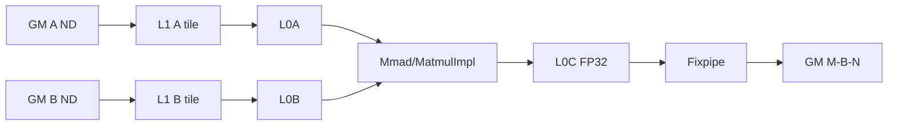
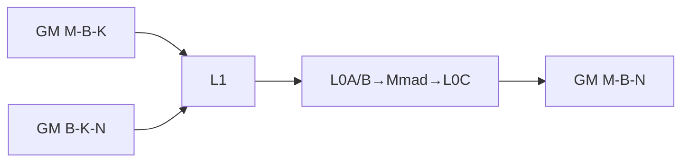
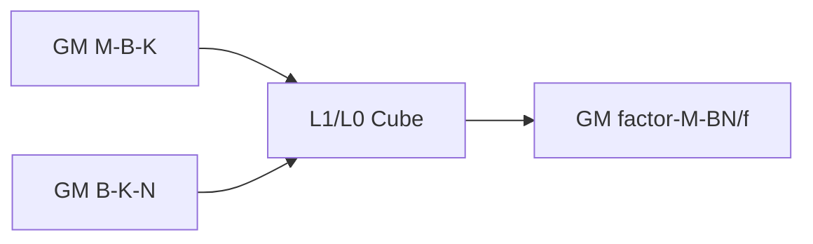
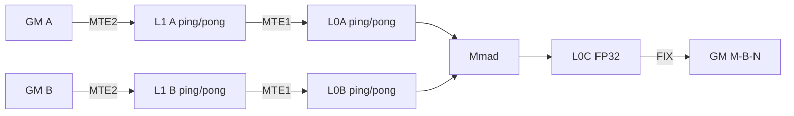
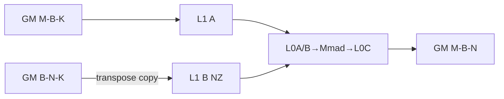

# TransposeBatchMatMul A2/A3 ACLNN 算子知识

## 算子速览

| 项目 | 内容 |
|---|---|
| 实际入口 | `aclnnTransposeBatchMatMulGetWorkspaceSize` + `aclnnTransposeBatchMatMul`，公开两段式 ACLNN；固定源码中没有更高版本入口。 |
| 计算语义 | 将 `permX1`、`permX2` 解释后的三维张量视为 `A[B,M,K]`、`B[B,K,N]`，计算 `C[b,m,n]=Σ_k A[b,m,k]B[b,k,n]`，再按 `permY=[1,0,2]` 物理写成 M-B-N；`batchSplitFactor>1` 时写成 `factor × M × (B*N/factor)`。 |
| 输入输出 | `x1/x2`: ND、rank 3、同 dtype，FP16/BF16/FP32；`bias` 必须为空；可选 `scale`: INT64/UINT64、长度 `B*N`，仅 FP16×FP16→INT8；`out`: ND、rank 3。 |
| 执行类型 | 所有可达算子主节点均为 `AIC_CUBE`；单 Kernel，无 AIV/SIMT/NDDMA/通信节点。普通 `Contiguous/Cast/ViewCopy` 是 ACLNN 框架节点。 |
| Kernel 路线 | R-001～R-004：`TransposeBatchMatMulKernel` + AscendC `MatmulImpl`；R-005～R-006：`PpMatMulNS::PpMatmulEinSum` 直写 GM→L1→L0A/B→Mmad→L0C→GM。 |
| 核心资源 | GM 输入/输出；Base workspace 以 20 MiB RPC 预留为基础并可追加，PP workspace 固定 24 MiB；L1/L0A/L0B/L0C；PP 路线无 UB。 |
| 来源闭包 | `source_closed`：公开 ACLNN→L0 launcher→A2/A3 selector→两种 POD→单个 AIC entry→实际 body/helper→构建接线闭合；通用 `MatmulImpl` 的库内微实现是明确的 AscendC 库边界。 |
| 验证状态 | 已完成源码闭包检查；本次知识提取未执行编译、真机、数值或性能测试。 |

## 接口与语义

### 计算语义

设转置属性解析后的形状为 `A[B,M,K]` 与 `B[B,K,N]`。每个 batch 独立做矩阵乘，逻辑结果为 `C[B,M,N]`；接口固定 `permY=[1,0,2]`，故常规物理输出是 `[M,B,N]`。`scale!=nullptr` 时每个 `(b,n)` 使用一个由 `aclnnTransQuantParamV2` 编码成 UINT64/INT64 的量化参数，Kernel 通过 `SetQuantVector(scalesGlobal_[b*N+n0])` 交给 Matmul epilogue，输出 INT8；固定仓未展开该通用 primitive 内部的 round 位语义。`batchSplitFactor=f>1` 时只重排输出地址，不改变每个 batch 的乘法，输出 `[f,M,B*N/f]`。

### 输入、输出与属性

| 参数 | shape/layout | dtype | 约束、默认值与语义 |
|---|---|---|---|
| `x1` | rank 3, ND | FP16/BF16/FP32 | `permX1` 为 `[0,1,2]` 或 `[1,0,2]`；转置后给出 B/M/K。非连续输入先 `Contiguous`。 |
| `x2` | rank 3, ND | 与 `x1` 相同 | 本卡只含 ND，不含 WeightNZ；`permX2` 为 `[0,1,2]` 或 `[0,2,1]`，K 必须等于 x1 的 K。 |
| `bias` | N/A | N/A | 预留参数；ACLNN 明确拒绝非空 bias。 |
| `scale` | `[B*N]`, ND | INT64/UINT64 | 可选；存在时仅 FP16 输入、INT8 输出且 `batchSplitFactor=1`、`B*N<65536`。 |
| `permX1` | 3 个 Host int64 | INT64 | 只接受 012/102。 |
| `permX2` | 3 个 Host int64 | INT64 | 只接受 012/021；A2/A3 上 021 强制 `permX1=102`、无 scale、factor=1。 |
| `permY` | 3 个 Host int64 | INT64 | 只接受 102。 |
| `cubeMathType` | Host scalar | INT8 | 先把 DAV_2201 的值 4 路由到 0；L0 op 只把 `USE_HF32` 映射为 `enable_hf32=true`。 |
| `batchSplitFactor` | Host scalar | INT32 | `[1,B]`、整除 B；scale 存在时必须为 1。 |
| `out` | `[M,B,N]` 或 `[f,M,B*N/f]`, ND | FP16/BF16/FP32/INT8 | 第一段最后执行通用 `Cast` 与 `ViewCopy`；公开约束要求 dtype 与推导结果一致。 |

### 入口与版本

固定 Commit `955f8b33985b6d72989ebff341bb9c2c564a51bc` 的公开文档同时声明 Atlas A2、A3 支持。第一段创建 executor、校验、添加 `Contiguous`、`TransposeBatchMatMul`、`Cast`、`ViewCopy`；第二段以调用者 stream 执行 executor。独立 `aclnnTransposeBatchMatMulWeightNz` 及其 NZ Host/Kernel 组合不属于本卡。

## Host/Launcher 执行流程

### 参数校验与前处理

`CheckParams` 顺序检查非空、x1/x2 rank=3、三个 perm 长度、cubeMathType、scale/factor、x1/out 非 NZ、dtype、K/batch/perm、factor 整除；空 x1/x2 与非空 bias 均报错。A2/A3 额外要求 B、N<65536；x1=012 时 K<65536；x1=102 且 K 或 B*K 越界时只允许无 scale、factor=1；x2=021 时还要求 x1=102。随后 x1/x2 各 `Contiguous` 并 `ReFormat(ND)`，scale 如存在只做 `Contiguous`。

### 参数、Workspace 与生命周期

`l0op::TransposeBatchMatMul` 分配中间 out、推形状并用 `ADD_TO_LAUNCHER_LIST_AICORE` 添加一个主 Kernel。普通路线继承 MatmulV3 workspace：基础为 `20*1024*1024` 字节 RPC 区；单核 split-K 追加 `M*ceilAlign(N,256/sizeof(A))*4`，确定性 split-K 为 `usedCoreNum*singleCoreM*singleCoreN*2*4+20MiB`，对齐输出或 ND2NZ 还按共享 tiler 公式追加。PP 路线固定 24 MiB system workspace，Kernel 本体不读用户 slice。executor 拥有中间 tensor 与任务描述，第二段在 stream 完成前保持有效。

### 启动图与失败传播

```text
aclnnTransposeBatchMatMulGetWorkspaceSize
  -> Contiguous/ReFormat(x1,x2), Contiguous(scale?)
  -> l0op::TransposeBatchMatMul
    -> InferShape
    -> ADD_TO_LAUNCHER_LIST_AICORE(TransposeBatchMatMul)
      -> Tiling selector
      -> transpose_batch_mat_mul<<<blockDim, stream>>>
  -> Cast(internalOut, requested dtype)
  -> ViewCopy(out)
aclnnTransposeBatchMatMul
  -> CommonOpExecutorRun(workspace, executor, same stream)
```

每个添加/推形/前后处理失败立即返回，不再添加后继；主 Kernel、Cast、ViewCopy 在同一 executor/stream 中有序。空 tensor 在 ACLNN 层直接失败，不存在 device 空域路线。

## Route 与参数设计

### 分核与资源计算

普通路线先由共享 MatmulV3 tiler生成 `M/N/K`、`baseM/baseN/baseK`、L2 tile 与 `usedCoreNum`，TBMM 再做负载均衡：若 `ceil(M/baseM)*ceil(N/baseN)*B<aicNum`，按转置轴 16 元素或 256B 对齐重算 baseM/baseN/baseK。L1 深度为 `depthA1=floor((L1+256-reserve)/(2*sizeof(A)*baseM*baseK)/4)*4`、B 同理，均至少 2；`stepKa=depthA1/2`、`stepKb=depthB1/2` 后令大者成为小者整数倍。PP 路线枚举 16 对齐的 m0/n0，要求 `m0*n0*4<=L0C`，以 L2/GM 成本选块，`blockDim=min(B*ceil(M/m0)*ceil(N/n0),aicNum)`，`k0` 由双缓冲 L1 余量计算并截到 512。

### Route 选择

| 顺序 | Route | Key/模板 | 精确选择条件与优先级 | 不适用去向 |
|---:|---|---|---|---|
| 1 | R-005 PP 102/012 | `(split=0,pp=1,x1=2,x2=0)` | 无 bias/scale、HF32=false、factor=1、x1=102，且 `K>=65536 \|\| B*K>=65536 \|\| (x1/x2/out全FP32)`；x2=012。 | R-001～R-004 registry base 或失败。 |
| 2 | R-006 PP 102/021 | `(0,1,2,1)` | 无 bias/scale、HF32=false、factor=1、x1=102、x2=021。 | 失败（ACLNN 已禁止其它组合）。 |
| 3 | R-001 Base 012 | `(0,0,0,0)` | x2=012、factor=1、x1=012；PP 前置谓词不命中。 | tiling/参数失败。 |
| 4 | R-002 Base 102 | `(0,0,2,0)` | x2=012、factor=1、x1=102，且 PP 前置谓词不命中；scale 存在时落此路线。 | tiling/参数失败。 |
| 5 | R-003 Base split 012 | `(1,0,0,0)` | x2=012、factor>1、x1=012。 | tiling/参数失败。 |
| 6 | R-004 Base split 102 | `(1,0,2,0)` | x2=012、factor>1、x1=102；ACLNN 已保证 B*K<65536。 | tiling/参数失败。 |

```text
if IsAdvancedSocVersion: 不适用于 A2/A3
else if IsPpMatmulEinsumMode:
  x1必须102 && no bias/scale && !hf32 && factor==1
  && (K或B*K越界 || x2=021 || 全FP32) -> R-005/R-006
else:
  TransposeBatchMatMulBaseTiling(IsCapable=true)
  factor × x1 -> R-001..R-004
```

### 模板/实现执行矩阵

| Route | key/selector | dtype/shape/platform 完整命中条件 | 执行族与 kernel 节点 | 实际模板/body | 内存与同步特征 | tail/fallback |
|---|---|---|---|---|---|---|
| R-001 Base 012 | 0/0/0/0 | A2/A3；ND；x1/x2=012；factor=1；非 PP | 单 AIC | `TransposeBatchMatMulKernel<...,BMM_TRANS,...,MM_CFG_NO_PRELOAD>` | Matmul high-level GM→L1/L0→L0C→GM | M/N/K tail 由 TCubeTiling；失败无 fallback。 |
| R-002 Base 102 | 0/0/2/0 | A2/A3；ND；x1=102,x2=012；factor=1；非 PP | 单 AIC | `...,TRANS_BMM_TRANS,...` | A 地址按 M-B-K 跨 batch stride | M/N/K tail 由 TCubeTiling；失败无 fallback。 |
| R-003 Base split 012 | 1/0/0/0 | A2/A3；ND；x1/x2=012；factor>1 | 单 AIC | `...,BMM_TRANS_TRANS,...` | 输出地址按 factor 分组 | M/N/K tail 由 TCubeTiling；失败无 fallback。 |
| R-004 Base split 102 | 1/0/2/0 | A2/A3；ND；x1=102,x2=012；factor>1 | 单 AIC | `...,TRANS_BMM_TRANS_TRANS,...` | 地址变换叠加 factor 分组 | M/N/K tail 由 TCubeTiling；失败无 fallback。 |
| R-005 PP 102/012 | 0/1/2/0 | PP 谓词、x2=012 | 单 AIC | `PpMatmulEinSum<swizzle,false,false,dtype,dtype,ND>` | 显式 L1/L0 ping-pong、MTE/Mmad/FIX event | 16 对齐 M/N、8或16对齐 K；无 fallback。 |
| R-006 PP 102/021 | 0/1/2/1 | PP 谓词、x2=021 | 单 AIC | `PpMatmulEinSum<swizzle,false,true,dtype,dtype,ND>` | B 以转置 stride 搬入 L1 | M/N round16、K round8/16；无 fallback。 |

### 隐藏性能 Guard

| Guard | Host/Tiling 条件 | Device/资源原因 | 影响 Route | 不满足时去向 | 源码符号 |
|---|---|---|---|---|---|
| PP 准入 | x1=102、no bias/scale、!HF32、factor=1，且大内轴/021/全FP32 | 绕开随路 ND2NZ 的 65536 内轴限制并提供显式转置搬运 | R-005/006 | Base 或失败 | `IsPpMatmulEinsumMode` |
| L0C | `m0*n0*4<=l0cSize` | L0C 累加为 FP32 | PP | 枚举其它 m0/n0；无候选失败 | `TilingFunc` |
| PP L1 | `k0=floor((262144-scale)/(m0+n0)/dtype)` 并按 16/256/512 截断 | 两组 A/B L1 ping-pong不能越 512KiB | PP | 更小 k0 | `PpMatmulDefaultTilingData::End` |
| Base L0AB | `baseK<=32768/sizeof(A)/max(baseM,baseN)` | 单侧 L0 A/B 32KiB 预算 | R-001..004 | 减小 baseK | `TuneBaseMKN` |
| Base L1 量化 | `L1 -= B*N*8` | scale table 占用 L1 预算 | R-001/002 INT8 | 资源不足则 tiling 失败 | `DoCommonTiling` |
| 尾块 | `singleCoreM/N` 在最后 m/n block 改为 remainder | 禁止对未定义 GM 元素做有效输出 | Base | N/A | `UpdateBlockParams` |

### POD/ABI

`TCubeTiling` 来自固定仓外的 `kernel_tiling/kernel_tiling.h`，因此其绝对 `sizeof/offsetof` 不在固定源码中；下表保留仓内可证明的 8 字节对齐、相对布局及所有本算子直接读写字段。

| 结构 | 字段 | 类型/位宽 | ABI 布局 | 单位 | Host/launcher producer | Device consumer | 边界 |
|---|---|---|---|---|---|---|---|
| `TBMMTilingData` | `matmulTiling` | `MatmulTilingData` | `alignof=8, offset=0`；sizeof 固定仓不可见 | POD | `MatmulV3BaseTiling` + `DoCommonTiling` | `MatmulImpl`、block | 含 TCube、L2、HF32。 |
| `TBMMTilingData` | `multiBatchInfo` | `MultiBatchInfo` | `offset=sizeof(MatmulTilingData)` | POD | `DoLibApiTiling` | `InitBatchCount` | 20 个 uint32，8 对齐。 |
| `MultiBatchInfo` | `batchUsedCoreNum` | uint32 | 子结构 +0 | core | `matmulTiling.usedCoreNum` | active-core guard | 0 导致无有效核。 |
| `MultiBatchInfo` | `a/b/cBatchDimAll` | 各 uint32 | 子结构 +4/+8/+12 | batch | `DoLibApiTiling` | GM extent/offset | 本算子三者均 B。 |
| `MultiBatchInfo` | `a/b/cBatchDim0..3` | 12×uint32 | 子结构 +16..+63 | batch axis | `DoLibApiTiling` | batch index 解码 | 未用高维填 1。 |
| `MultiBatchInfo` | `iterBatch` | uint32 | 子结构 +64 | batch | 共享 tiler | block helper | 当前直接路径未主动读取。 |
| `MultiBatchInfo` | `biasWithBatch` | uint32 | 子结构 +68 | bool | false | bias offset | ACLNN bias 禁用。 |
| `MultiBatchInfo` | `mOri` | uint32 | 子结构 +72 | element | `mOriValue` | block helper | M<=INT32_MAX。 |
| `MultiBatchInfo` | `batchTileBlock` | uint32 | 子结构 +76 | batch | B | block helper | B。 |
| `MultiBatchInfo` | `aBatch`,`bBatch` | 各 uint32 | 子结构 +80/+84 | batch | 共享 tiler | 共享 helper | 当前 TBMM 直接字段读取不可见。 |
| `TBMMTilingData` | `batchSplitFactor` | int32 | `offsetof=sizeof(MatmulTilingData)+sizeof(MultiBatchInfo)`；总 size 向 8 对齐 | factor | `DoLibApiTiling` | C offset / SetOrgShape | <=0 device 防御为 1。 |
| `PpMatmulTilingData` | `batch,m,k,n` | 4×uint32 | offsets 0/4/8/12 | element | `PostTiling` | `Init` | 正整数。 |
| `PpMatmulTilingData` | `m0,k0,n0` | 3×uint32 | offsets 16/20/24 | element | PP tiler | tile/copy/Mmad | m/n 16 对齐；k 按 dtype 对齐。 |
| `PpMatmulTilingData` | `mLoop,kLoop,nLoop` | 3×uint32 | offsets 28/32/36 | loop | ceil-div | `Process` | 乘积进入 coreLoop。 |
| `PpMatmulTilingData` | `coreLoop,swizzleCount` | 2×uint32 | offsets 40/44 | tile/core | tiler | scheduler | swizzle>=1。 |
| `PpMatmulTilingData` | `tilingKey,blockDim` | 2×uint32 | offsets 48/52 | key/core | tiler | router/GetBlockNum | blockDim=min(coreLoop,aicNum)。 |
| `PpMatmulTilingData` | `swizzleDirect,splitk,enShuffleK` | 3×uint32 | offsets 56/60/64；`sizeof=72,alignof=8` | enum/bool | tiler | scheduler/K order | splitk 字段当前 body 不读；shuffle 受确定性/env 控制。 |

### Route 源码闭包

| Route | Key/selector | Host/Tiling producer | POD/参数 | Kernel entry/router | Kernel body/直接依赖 | 构建接线 |
|---|---|---|---|---|---|---|
| R-001..004 | `TransposeBatchMatMulBaseTiling` | `transpose_batch_mat_mul_base_tiling.cpp` | `TBMMTilingData` | `op_kernel/transpose_batch_mat_mul.cpp` | `TransposeBatchMatMulKernel`, `TransposeBatchMatMulBlock`, AscendC `MatmulImpl` | `op_kernel/CMakeLists.txt` 默认 source |
| R-005..006 | `IsPpMatmulEinsumMode` | `transpose_batch_mat_mul_einsum_tiling.cpp`, `pp_matmul_default.cpp` | `PpMatmulTilingData` | 同一 entry 的 PP constexpr 分支 | `PpMatmulEinSum` + `utils/iterators/*` | `op_kernel/CMakeLists.txt` 默认 source |

## Kernel 实现

### 公共执行流程

六条路线均由单个 `transpose_batch_mat_mul(a,b,bias,scale,c,workspace,tiling)` entry 启动且模板声明为 `AIC_ONLY`。Router 依据 tiling key 在编译期选 POD 与 body；未知/未实例化 key 没有运行时 else body，Host tiling 失败是唯一安全终点。普通路线只让 AIC 工作，active core 超过 `batchUsedCoreNum` 立即返回；PP 以 `for(loop_idx=core_idx; loop_idx<coreLoop; loop_idx+=num_core)` 分配 tile。

### Route R-001：Base x1=012、factor=1

#### 适用条件

##### 选择证据

| 层级 | 文件 | 符号 | 源码谓词/参数 | 结果/下一跳 |
|---|---|---|---|---|
| Host | `transpose_batch_mat_mul_tiling.cpp` | `TransposeBatchMatMulTilingFunc` | 非 advanced 且 PP=false | registry base |
| Tiling | `transpose_batch_mat_mul_base_tiling.cpp` | `DoCommonTiling` | `transA=123,factor=1` | key 0/0/0/0 |
| Router | `op_kernel/transpose_batch_mat_mul.cpp` | constexpr branch | `BATCH_SPLIT=0,PP=0,PERM_X1=0,PERM_X2=0` | `BMM_TRANS` |

#### Device 数据流

##### 函数级调用链

```text
transpose_batch_mat_mul -> TransposeBatchMatMulKernel::Init
 -> block.Init -> MatmulImpl::Init/SetOrgShape
 -> Process -> InnerProcess -> CalcGMOffset
 -> SetTensorA/B -> IterateAll(cGM)
```

##### 源码等价伪码

```text
for L2 mTile in snake order, for nTile, for assigned base tile:
  batch,m0,n0 = decode(index)
  Aoff=batch*M*K + m0*K; Boff=batch*K*N + n0; Coff=m0*B*N + batch*N + n0
  mm.SetSingleShape(mTail,nTail,K); mm.SetTensorA/B; mm.IterateAll(C+Coff)
```

#### 内存与数据搬运

##### 资源与搬运表

| 层级/缓冲区 | offset/地址公式 | extent/容量公式 | dtype/layout | producer | consumer | owner/lifetime | 对齐/复用 |
|---|---|---|---|---|---|---|---|
| GM A/B/C | 上述 Aoff/Boff/Coff | A=`B*M*K`, B=`B*K*N`, C=`B*M*N` elements | ND | ACLNN | MatmulImpl | caller/out | tail 由 single shape |
| workspace | user base | tiler 公式，基础 20MiB | bytes | executor | 通用 Matmul/RPC | executor | route 依赖追加 |
| L1 | primitive 内部 | A=`baseM*baseK*depthA1*sizeof(A)`；B 类似 | Matmul tile | MatmulImpl | L0 load | core | depth/step 双缓冲 |
| L0A/L0B | N/A 地址由 primitive 管理 | 绝对 allocation 与 stage offset 固定仓不可见 | Cube fractal | MatmulImpl | Mmad | core | Host 只提供 base/depth/step，不反推 primitive allocation |
| L0C | primitive 内部 | `baseM*baseN*4*dbL0C` | FP32 accumulate | Mmad | Fixpipe | core | 容量由 tiler约束 |
| UB/寄存器 | N/A | 通用 Matmul primitive 内部；固定仓未公开 | N/A | N/A | N/A | primitive | 非独立 AIV 路线 |

##### 分层内存布局



##### 字节账、交接边与复用顺序

```text
workspace_total = 20MiB + splitK/alignment/ND2NZ conditional slices
L1_total = baseM*baseK*depthA1*sizeof(A) + baseN*baseK*depthB1*sizeof(B) + optional scale table
L0C_budget = baseM*baseN*4*dbL0C; L0A/L0B total = fixed repository not exposed by Matmul primitive
UB_total = fixed repository not exposed by Matmul primitive
```

| 边/复用子区 | producer | offset/extent | dtype/layout | consumer | ordering/sync | owner/lifetime | 安全条件 |
|---|---|---|---|---|---|---|---|
| L1 stage reuse | Matmul copy-in | depthA1/depthB1 stages | input/fractal | Mmad | primitive pipe contract | core | stepKa/stepKb and depth agree |
| L0C→GM | Mmad | current M×N tail | FP32→C dtype ND | Fixpipe | Matmul IterateAll completion | core | singleCoreM/N valid |

#### 同步、精度与尾块

##### 同步与数值边界表

| 阶段 | primitive/机制 | producer | consumer/等待点 | 保护对象 | 精度/尾块 |
|---|---|---|---|---|---|
| Matmul mainloop | `MatmulImpl` pipe | GM/L1/L0 copy | Mmad/Fixpipe | staged tile | HF32 only when attr true；M/N tail via `SetSingleShape`，K tail由 TCubeTiling。 |
| Kernel end | `PipeBarrier<PIPE_ALL>` | all stages | return | core-local pipelines | restores HF32 false and AtomicNone。 |

#### 关键实现

##### 符号证据表

| 阶段 | 文件 | 符号/模板实例 | 实现事实 |
|---|---|---|---|
| Host/Tiling producer | `op_host/op_tiling/transpose_batch_mat_mul_base_tiling.cpp` | `DoCommonTiling` | base/depth/step/key。 |
| Kernel entry/router | `op_kernel/transpose_batch_mat_mul.cpp` | key 0/0/0/0 | `BMM_TRANS,MM_CFG_NO_PRELOAD`。 |
| Device body/helper | `op_kernel/transpose_batch_mat_mul.h`, `..._block.h` | `Process/CalcGMOffset` | tile分核、GM地址、Matmul调用与尾块。 |

### Route R-002：Base x1=102、factor=1

#### 适用条件

##### 选择证据

| 层级 | 文件 | 符号 | 源码谓词/参数 | 结果/下一跳 |
|---|---|---|---|---|
| Tiling | `transpose_batch_mat_mul_base_tiling.cpp` | `GetShape/DoCommonTiling` | `transA=213,factor=1` 且 PP=false | key 0/0/2/0 |
| Router | `transpose_batch_mat_mul.cpp` | constexpr | key 0/0/2/0 | `TRANS_BMM_TRANS` |

#### Device 数据流

##### 函数级调用链

```text
entry -> TransposeBatchMatMulKernel<TRANS_BMM_TRANS>::Init -> Process -> CalcAOffset/CalcCOffset -> MatmulImpl
```

##### 源码等价伪码

```text
Aoff = m0*B*K + batch*K; Boff=batch*K*N+n0; Coff=m0*B*N+batch*N+n0
SetOrgShape(M,N,B*K,B*K,N*B); IterateAll(C+Coff)
```

#### 内存与数据搬运

##### 资源与搬运表

| 层级/缓冲区 | offset/地址公式 | extent/容量公式 | dtype/layout | producer | consumer | owner/lifetime | 对齐/复用 |
|---|---|---|---|---|---|---|---|
| GM A | `m0*B*K+b*K` | B*M*K | physical M-B-K | ACLNN | Matmul | caller | batch is inner stride |
| GM B/C | `b*K*N+n0` / `m0*B*N+b*N+n0` | B*K*N / B*M*N elements | B-K-N / M-B-N ND | caller/Matmul | Matmul/out | caller | M/N tail |
| L1 | primitive internal | A=`baseM*baseK*depthA1*sizeof(A)`；B=`baseN*baseK*depthB1*sizeof(B)` | Cube staging | Matmul | L0/Mmad | core | depth/step 双缓冲 |
| L0A/L0B/L0C | primitive internal | L0C=`baseM*baseN*4*dbL0C`；L0A/B 绝对 allocation 固定仓不可见 | Cube / FP32 C | Matmul/Mmad | Mmad/Fixpipe | core | Host base/depth guard |
| workspace/UB | user base / primitive internal | `20MiB+` 条件 slice；UB 容量固定仓不可见 | bytes | executor/primitive | runtime/primitive | executor/core | A stride 不改变 workspace 公式 |

##### 分层内存布局



##### 字节账、交接边与复用顺序

```text
workspace_total = 20MiB + splitK/alignment/ND2NZ conditional slices
L1_total = baseM*baseK*depthA1*sizeof(A) + baseN*baseK*depthB1*sizeof(B) + optional scale table
L0C_total = baseM*baseN*4*dbL0C; L0A/L0B/UB absolute allocation = fixed repository not exposed
```

| 边/复用子区 | producer | offset/extent | dtype/layout | consumer | ordering/sync | owner/lifetime | 安全条件 |
|---|---|---|---|---|---|---|---|
| A interleaved batch | GM | each row stride B*K | input dtype/M-B-K | Matmul | primitive pipe | caller | PP未命中时 B*K<65536 或 scale场景受 API guard |

#### 同步、精度与尾块

##### 同步与数值边界表

| 阶段 | primitive/机制 | producer | consumer/等待点 | 保护对象 | 精度/尾块 |
|---|---|---|---|---|---|
| 全流程 | `MatmulImpl` pipe | GM/L1/L0 copy | Mmad/Fixpipe | staged tile | HF32 按 attr；M/N 由 `SetSingleShape` 处理，K tail 由 TCubeTiling；末尾复位 HF32/AtomicNone 并全 pipe barrier。 |

#### 关键实现

##### 符号证据表

| 阶段 | 文件 | 符号/模板实例 | 实现事实 |
|---|---|---|---|
| Tiling | `transpose_batch_mat_mul_base_tiling.cpp` | `GetShape` | 213 编码、B*K guard。 |
| Router/body | `transpose_batch_mat_mul.cpp`, `transpose_batch_mat_mul_block.h` | `TRANS_BMM_TRANS` | A/C offset 与 org shape。 |

### Route R-003：Base x1=012、batch split

#### 适用条件

##### 选择证据

| 层级 | 文件 | 符号 | 源码谓词/参数 | 结果/下一跳 |
|---|---|---|---|---|
| Tiling/Router | `transpose_batch_mat_mul_base_tiling.cpp`, `transpose_batch_mat_mul.cpp` | `batchSplitFactor>1`, key | x1=012,x2=012 | `BMM_TRANS_TRANS` |

#### Device 数据流

##### 函数级调用链

```text
entry -> TransposeBatchMatMulKernel<BMM_TRANS_TRANS> -> CalcCOffset -> MatmulImpl
```

##### 源码等价伪码

```text
innerBatch=B/f; group=b/innerBatch; inner=b%innerBatch
Coff=(group*M+m0)*innerBatch*N + inner*N+n0
```

#### 内存与数据搬运

##### 资源与搬运表

| 层级/缓冲区 | offset/地址公式 | extent/容量公式 | dtype/layout | producer | consumer | owner/lifetime | 对齐/复用 |
|---|---|---|---|---|---|---|---|
| GM A/B | `b*M*K+m0*K` / `b*K*N+n0` | B*M*K/B*K*N elements | B-M-K/B-K-N ND | caller | Matmul | caller | factor整除B |
| GM C | 上述 Coff | B*M*N | factor-M-innerBatch*N | Matmul | out | caller | 不重叠 |
| L1/L0C | primitive internal | L1=`baseM*baseK*depthA1*sizeof(A)+baseN*baseK*depthB1*sizeof(B)`；L0C=`baseM*baseN*4*dbL0C` | Cube/FP32 | Matmul/Mmad | Mmad/Fixpipe | core | factor>1 已由 ACLNN 排除 scale |
| L0A/L0B/UB/workspace | primitive internal / user base | L0A/L0B/UB 绝对 allocation 固定仓不可见；workspace=`20MiB+`条件 slice | Cube/bytes | primitive/executor | primitive/runtime | core/executor | 与 factor 无资源别名 |

##### 分层内存布局


##### 字节账、交接边与复用顺序

```text
workspace_total = 20MiB + splitK/alignment/ND2NZ conditional slices
L1_total = baseM*baseK*depthA1*sizeof(A) + baseN*baseK*depthB1*sizeof(B)
C_total = B*M*N*sizeof(C); factor 只改变物理索引
```

| 边/复用子区 | producer | offset/extent | dtype/layout | consumer | ordering/sync | owner/lifetime | 安全条件 |
|---|---|---|---|---|---|---|---|
| output groups | each tile | disjoint Coff | C dtype | ViewCopy | same stream | out | B%factor==0 |

#### 同步、精度与尾块

##### 同步与数值边界表

| 阶段 | primitive/机制 | producer | consumer/等待点 | 保护对象 | 精度/尾块 |
|---|---|---|---|---|---|
| 输出 | `MatmulImpl` + disjoint GM writes | AIC copy/Mmad/Fixpipe | ViewCopy | C groups | HF32 按 attr；M/N 用 actual single shape，K tail 由 TCubeTiling；末尾全 pipe barrier。 |

#### 关键实现

##### 符号证据表

| 阶段 | 文件 | 符号/模板实例 | 实现事实 |
|---|---|---|---|
| Router/body | `transpose_batch_mat_mul.cpp`, `transpose_batch_mat_mul_block.h` | `BMM_TRANS_TRANS`, `CalcCOffset` | factor 重排公式。 |

### Route R-004：Base x1=102、batch split

#### 适用条件

##### 选择证据

| 层级 | 文件 | 符号 | 源码谓词/参数 | 结果/下一跳 |
|---|---|---|---|---|
| Tiling/Router | `transpose_batch_mat_mul_base_tiling.cpp`, `transpose_batch_mat_mul.cpp` | x1=102,factor>1 | PP因 factor 不命中 | `TRANS_BMM_TRANS_TRANS` |

#### Device 数据流

##### 函数级调用链

```text
entry -> TransposeBatchMatMulKernel<TRANS_BMM_TRANS_TRANS> -> transposed A offset + split C offset -> MatmulImpl
```

##### 源码等价伪码

```text
Aoff=m0*B*K+b*K; Boff=b*K*N+n0
Coff=(group*M+m0)*(B/f)*N + inner*N+n0
```

#### 内存与数据搬运

##### 资源与搬运表

| 层级/缓冲区 | offset/地址公式 | extent/容量公式 | dtype/layout | producer | consumer | owner/lifetime | 对齐/复用 |
|---|---|---|---|---|---|---|---|
| GM A/B/C | A=`m0*B*K+b*K`，B=`b*K*N+n0`，C=`(group*M+m0)*(B/f)*N+inner*N+n0` | A/B/C 各 B*M*K、B*K*N、B*M*N elements | M-B-K / B-K-N / factor-M-BN/f | caller/Matmul | Matmul/out | caller | API 保证 B*K<65536、B%f=0 |
| L1/L0C | primitive internal | L1=`baseM*baseK*depthA1*sizeof(A)+baseN*baseK*depthB1*sizeof(B)`；L0C=`baseM*baseN*4*dbL0C` | Cube/FP32 | Matmul/Mmad | Mmad/Fixpipe | core | stride/factor 不改变容量公式 |
| L0A/L0B/UB/workspace | primitive internal / user base | L0A/L0B/UB 绝对 allocation 固定仓不可见；workspace=`20MiB+`条件 slice | Cube/bytes | primitive/executor | primitive/runtime | core/executor | 无跨核归约 |

##### 分层内存布局



##### 字节账、交接边与复用顺序

```text
workspace_total = 20MiB + splitK/alignment/ND2NZ conditional slices
L1_total = baseM*baseK*depthA1*sizeof(A) + baseN*baseK*depthB1*sizeof(B)
C_total = B*M*N*sizeof(C); A 为 M-B-K stride，C 为 factor-M-BN/f stride
```

| 边/复用子区 | producer | offset/extent | dtype/layout | consumer | ordering/sync | owner/lifetime | 安全条件 |
|---|---|---|---|---|---|---|---|
| A→C mapping | per batch tile | A interleaved / C grouped | input/C dtype | Matmul/ViewCopy | same stream | caller | factor divides B |

#### 同步、精度与尾块

##### 同步与数值边界表

| 阶段 | primitive/机制 | producer | consumer/等待点 | 保护对象 | 精度/尾块 |
|---|---|---|---|---|---|
| 全流程 | `MatmulImpl` pipe | GM/L1/L0 copy与Mmad | Fixpipe | tile | HF32 按 attr；M/N actual tail、K TCube tail；末尾复位 HF32/AtomicNone 并全 pipe barrier。 |

#### 关键实现

##### 符号证据表

| 阶段 | 文件 | 符号/模板实例 | 实现事实 |
|---|---|---|---|
| Router/body | `transpose_batch_mat_mul.cpp`, `transpose_batch_mat_mul_block.h` | `TRANS_BMM_TRANS_TRANS` | 两种地址变换组合。 |

### Route R-005：PP-Einsum x2=012

#### 适用条件

##### 选择证据

| 层级 | 文件 | 符号 | 源码谓词/参数 | 结果/下一跳 |
|---|---|---|---|---|
| Tiling | `transpose_batch_mat_mul_einsum_tiling.cpp` | `IsPpMatmulEinsumMode` | x1=102,no scale/bias,!hf32,f=1，且大K/BK或全FP32 | pp key x2=0 |
| Router | `transpose_batch_mat_mul.cpp` | PP branch | key 0/1/2/0 | `PpMatmulEinSum<swizzle,false,false>` |

#### Device 数据流

##### 函数级调用链

```text
entry -> PpMatmulEinSum::Init -> GetBlockIdx
 -> CopyTileA/B(GM→L1) -> l1_to_l0_a/b
 -> Mmad(K parts accumulate in L0C) -> l0c_to_gm
```

##### 源码等价伪码

```text
for tile=coreIdx; tile<coreLoop; tile+=blockNum:
  swizzle tile to (b,mTile,nTile); derive actual/round M,N
  for K tile (optionally core-rotated): prefetch next A/B into alternate L1 stage
    for K part fitting L0: L1→alternate L0A/B; Mmad(init only first part)
  Fixpipe L0C FP32 -> GM at mTile*m0*B*N+b*N+nTile*n0
```

#### 内存与数据搬运

##### 资源与搬运表

| 层级/缓冲区 | offset/地址公式 | extent/容量公式 | dtype/layout | producer | consumer | owner/lifetime | 对齐/复用 |
|---|---|---|---|---|---|---|---|
| GM A | `mTile*m0*B*K+b*K+kTile*k0` | B*M*K | M-B-K ND | caller | `CopyTileA` | caller | M/K actual+round |
| GM B | `b*K*N+kTile*k0*N+nTile*n0` | B*K*N | B-K-N ND | caller | `CopyTileB` | caller | N/K tail |
| L1 A/B | A at 0，B at `round256(m0*k0*sizeof(T))` per stage | 2 stages × `(mRound*kRound+nRound*kRound)*sizeof(T)`，每 stage<=262144B | NZ-like CBUF | MTE2 | MTE1 | core | stage 0/1 separated by 262144B |
| L0A/L0B | stage offset `0/32768B` | 2×32768B each | ZZ/NZ | MTE1 | Mmad | core | event 0/1 |
| L0C | offset 0 | `mRound*nRound*4<=128KiB` | FP32 | Mmad | Fixpipe | core | retained across all K tiles |
| workspace/UB | workspace不读；UB N/A | 24MiB system reserve；UB 0 | bytes | Host | runtime | executor | N/A |

##### 分层内存布局



##### 字节账、交接边与复用顺序

```text
workspace_total = 24*1024*1024 (runtime/system reserve, body不读)
L1_total = 2*(mRound*kRound+nRound*kRound)*sizeof(T) <= 512KiB
L0A_total = 2*32768B; L0B_total = 2*32768B
L0C_total = mRound*nRound*4 <= 128KiB
UB_total = 0
```

| 边/复用子区 | producer | offset/extent | dtype/layout | consumer | ordering/sync | owner/lifetime | 安全条件 |
|---|---|---|---|---|---|---|---|
| GM→L1 stage | MTE2 | ping 0 / pong +262144B | input/NZ | MTE1 | `MTE1_MTE2` event 0..3 | core/K tile | wait before overwrite |
| L1→L0 stage | MTE1 | ping 0 / pong +32768B | Cube | Mmad | `M_MTE1` event 0/1 | core/K part | Mmad set before reuse |
| L0C→GM | Mmad | mActual×nActual | FP32→Out ND | FIX | `M_FIX`/`FIX_M` event0 | tile | after all K parts |

#### 同步、精度与尾块

##### 同步与数值边界表

| 阶段 | primitive/机制 | producer | consumer/等待点 | 保护对象 | 精度/尾块 |
|---|---|---|---|---|---|
| prefetch | MTE1↔MTE2 flags 0..3 | GM→L1 | L1→L0 | L1 stage | M/N round16；FP32 K round8，其它 round16。 |
| compute | MTE1↔M flags 0/1 | L1→L0 | Mmad | L0A/B stage | `init_c` 只在首 K part；L0C 为 float。 |
| output | M↔FIX event0 | Mmad | Fixpipe | L0C/C | 只写 mActual×nActual；无量化路线。 |

#### 关键实现

##### 符号证据表

| 阶段 | 文件 | 符号/模板实例 | 实现事实 |
|---|---|---|---|
| Host/Tiling producer | `transpose_batch_mat_mul_einsum_tiling.cpp`, `pp_matmul_default.cpp` | `DoTiling/GetMatMulTilingData` | 选择、m0/n0/k0、24MiB。 |
| Kernel entry/router | `transpose_batch_mat_mul.cpp` | PP key 0 | transB=false。 |
| Device body/helper | `pp_matmul_ein_sum_kernel.h` | `Process/CopyTileA/B` | 完整搬运、Mmad、event、tail。 |

### Route R-006：PP-Einsum x2=021

#### 适用条件

##### 选择证据

| 层级 | 文件 | 符号 | 源码谓词/参数 | 结果/下一跳 |
|---|---|---|---|---|
| Tiling/Router | `transpose_batch_mat_mul_einsum_tiling.cpp`, `transpose_batch_mat_mul.cpp` | x2 perm decode 132 | x1=102,x2=021,no scale/bias,!hf32,f=1 | `PpMatmulEinSum<swizzle,false,true>` |

#### Device 数据流

##### 函数级调用链

```text
entry -> PpMatmulEinSum::Init -> GetBlockIdx
 -> CopyTileA/CopyTileB<TB=true>(GM→L1) -> l1_to_l0_a/b
 -> Mmad(K parts accumulate in L0C) -> l0c_to_gm
```

##### 源码等价伪码

```text
Boff=b*K*N+nTile*n0*K+kTile*k0
CopyTileB interprets physical B-N-K and transposes into L1 NZ;
alternate two 262144B L1 stages and two 32768B L0A/B stages, accumulate all K parts in FP32 L0C, then Fixpipe actual M*N to GM.
```

#### 内存与数据搬运

##### 资源与搬运表

| 层级/缓冲区 | offset/地址公式 | extent/容量公式 | dtype/layout | producer | consumer | owner/lifetime | 对齐/复用 |
|---|---|---|---|---|---|---|---|
| GM B | 上述 Boff | B*N*K | physical B-N-K ND | caller | CopyTileB(TB) | caller | nActual/kActual |
| GM A/C | `mTile*m0*B*K+b*K+kTile*k0` / `mTile*m0*B*N+b*N+nTile*n0` | B*M*K / B*M*N | M-B-K / M-B-N ND | caller/Mmad | CopyTileA/out | caller | M/N/K actual+round |
| L1 A/B | A at 0、B at aligned A extent per stage | 2 stages × `(mRound*kRound+nRound*kRound)*sizeof(T)`，每 stage<=262144B | NZ-like CBUF | MTE2 | MTE1 | core | ping/pong stages separated 262144B |
| L0A/L0B/L0C | stage 0/32768B；C offset 0 | A/B each `2*32768B`；C=`mRound*nRound*4<=128KiB` | Cube/FP32 | MTE1/Mmad | Mmad/FIX | core | event-protected reuse |
| workspace/UB | workspace不读 / N/A | 24MiB system reserve；UB 0 | bytes | Host | runtime | executor | no user slice |

##### 分层内存布局



##### 字节账、交接边与复用顺序

```text
workspace_total = 24*1024*1024 (runtime/system reserve, body不读)
L1_total = 2*(mRound*kRound+nRound*kRound)*sizeof(T) <= 512KiB
L0A_total = 2*32768B; L0B_total = 2*32768B; L0C_total = mRound*nRound*4 <= 128KiB; UB_total = 0
```

| 边/复用子区 | producer | offset/extent | dtype/layout | consumer | ordering/sync | owner/lifetime | 安全条件 |
|---|---|---|---|---|---|---|---|
| B transpose | MTE2 | nActual×kActual, strides N/K | ND→NZ | MTE1/Mmad | `MTE1_MTE2` flags 0..3；覆盖前 wait | core | ACLNN要求 x1=102、factor=1、无scale |

#### 同步、精度与尾块

##### 同步与数值边界表

| 阶段 | primitive/机制 | producer | consumer/等待点 | 保护对象 | 精度/尾块 |
|---|---|---|---|---|---|
| prefetch/compute/output | MTE1↔MTE2 flags 0..3、MTE1↔M flags 0/1、M↔FIX event0 | copy/Mmad | FIX | L1/L0A/B/L0C | M/N round16；K FP32 round8否则round16；仅首 K part init C，只写 actual M×N。 |

#### 关键实现

##### 符号证据表

| 阶段 | 文件 | 符号/模板实例 | 实现事实 |
|---|---|---|---|
| Tiling | `transpose_batch_mat_mul_einsum_tiling.cpp` | `transB=1` | key x2=1。 |
| Device | `pp_matmul_ein_sum_kernel.h` | `GetOffsetB/CopyTileB<TB=true>` | B-N-K→Cube。 |

## 算子特定优化

### Trick T-001：大内轴与转置 B 切换到 PP-Einsum

#### 触发与源码依据

- 适用 Route：R-005、R-006
- 触发条件：x1=102，且 no bias/scale、HF32=false、factor=1；再满足 `K>=65536 || B*K>=65536 || x2=021 || 全FP32`。
- Golden 来源：[`transpose_batch_mat_mul_einsum_tiling.cpp:91-114`](../../../../../../../cann-ops-raw/ascendc/ops-nn/955f8b33985b6d72989ebff341bb9c2c564a51bc/matmul/transpose_batch_mat_mul/op_host/op_tiling/transpose_batch_mat_mul_einsum_tiling.cpp#L91-L114)

**官方源码（固定 Commit 连续逐字摘录）**：

```cpp
OP_TILING_CHECK((PermDecode(perm_x1, x1PermList->GetSize()) != 213L),
    OP_LOGI(context->GetNodeName(), "PpMatmulEinsum only support permA={1,0,2}."),
    return ge::GRAPH_FAILED);
if (K >= SUPPORTED_INNER_AXIS || Batch * K >= SUPPORTED_INNER_AXIS) {
    return ge::GRAPH_SUCCESS;
}
if (PermDecode(perm_x2, x2PermList->GetSize()) == 132L) {
    return ge::GRAPH_SUCCESS;
}
```

#### 机制与设计原因

普通路线依赖通用 Matmul 的随路格式转换，其 inner-axis guard 为 65536；PP 路线用显式 GM→L1 ND/NZ copy、L1→L0、Mmad，因而能按 uint64 地址遍历 M-B-K 与 B-N-K。该机制也给 transB 提供独立 compile-time body。

#### 迁移边界

- 适用：A2/A3、无量化/无 bias/factor=1 的 x1=102。
- 前提：ND 输入、支持的 dtype，PP tiler识别为 `ASCEND910B` family。
- 失效：scale、HF32、factor>1 或 x1=012，改走 Base/失败。
- 未验证：本次知识提取未执行编译、真机、数值或性能测试。

#### 错误做法

把 x2=021 塞入普通 key：普通 selector 的 `permX2` 固定为 0，Kernel 没有对应 Base 实例，会落入无 body 的 key。

### Trick T-002：L1/L0 双缓冲与 K 顺序旋转

#### 触发与源码依据

- 适用 Route：R-005、R-006
- 触发条件：PP 路线；`enShuffleK=!GetCloseKShiftFlag(context)`。
- Golden 来源：[`pp_matmul_ein_sum_kernel.h:267-296`](../../../../../../../cann-ops-raw/ascendc/ops-nn/955f8b33985b6d72989ebff341bb9c2c564a51bc/matmul/transpose_batch_mat_mul/op_kernel/pp_matmul_ein_sum_kernel.h#L267-L296)

**官方源码（固定 Commit 连续逐字摘录）**：

```cpp
for (tidx.k = 0; tidx.k < tdim.k; ++tidx.k) {
    shuffle_k = en_shuffle_k ? (tidx.k + core_idx) % tdim.k : tidx.k;
    if (tidx.k < tdim.k - 1) {
        LocalTensor l1_buf_a_next = (1 - ping_flag) ? l1_base_a : l1_base_a[L1_PINGPONG_BUFFER_SIZE];
        WAIT_FLAG(MTE1, MTE2, event_id_next);
        CopyTileA(l1_buf_a_next, gm_a[offset_a_next], m_actual, m_round, k_actual_next, k_round_next);
        SET_FLAG(MTE2, MTE1, event_id_next);
    }
```

#### 机制与设计原因

下一 K tile 在当前 tile 的 L0/Mmad 执行期间进入另一 L1 stage；L0A/B 也以两个 32768B stage 交替。非强确定性时不同 core 从不同 K tile 开始但仍在本核 L0C 中完整累加，改变访问相位而不拆分输出归约。

#### 迁移边界

- 适用：完整单核 tile 累加、可用四组 MTE1/MTE2 event 的 AIC body。
- 前提：stage 容量和 event ID 协议原样保留。
- 失效：确定性等级>1 或 `CLOSE_MATMUL_K_SHIFT=1` 时关闭 K 旋转，但保留 ping-pong。
- 未验证：本次知识提取未执行编译、真机、数值或性能测试。

#### 错误做法

省略 `WAIT_FLAG` 后覆盖 alternate stage，会让 MTE2 写入仍被 MTE1/Mmad 使用的 L1 数据。

## 模板与实现对比

| 对比维度 | R-001～R-004 Base | R-005～R-006 PP | 设计选择依据 |
|---|---|---|---|
| 命中条件/优先级 | PP 不命中后的兜底；支持量化/factor | x1=102 的大内轴、transB 或 FP32 特例 | selector 顺序固定。 |
| 执行族/节点图 | 单 AIC + Matmul high-level | 单 AIC 显式 copy/Mmad | 都无 AIV。 |
| M/N/K、tile 与 scheduler | 通用 base/L2 tiler + TBMM load balance | 成本枚举 m0/n0、swizzle、k0 | 对不同 stride/inner-axis。 |
| workspace/L1/L0/UB | 20MiB 起、可追加；TCube层级 | 24MiB reserve；显式 512KiB L1、64KiB L0A/B、128KiB L0C | PP body不读 workspace。 |
| AIC/AIV 或 kernel 交接 | N/A，单 AIC | N/A，单 AIC | 无跨族/跨 kernel 边。 |
| 同步、精度与 tail | Matmul primitive pipe；可 HF32/量化 | 显式 event；FP32 L0C；无量化/HF32 | PP guard决定能力。 |
| fallback/失败边界 | tiling失败即 ACLNN执行失败 | 无内部 fallback | unknown key不启动有效 body。 |

## 平台差异

| 项目 | A2 | A3 | 950 |
|---|---|---|---|
| 支持状态 | 公开支持 | 公开支持 | 公开支持，见独立 `_950` 卡 |
| Host/Launcher | 共享 non-advanced selector | 与 A2 共用同一源码与 6 路 key | advanced selector，8 路 key |
| Kernel/资源 | 默认 kernel source；PP 编译为 V220 family | 同一默认 source/config | `arch35` source、DAV_3510、20MiB fixed workspace |

## 限制与失败边界

- 本卡只覆盖 ND `aclnnTransposeBatchMatMul`；不把 WeightNZ 的独立 API、NZ binary 或 K-shift 模板混入。
- x1/x2 必须非空、rank3、同 dtype；bias 必须空；M/N/K/B 必须为正且 K/batch匹配。
- A2/A3 的 B/N/随路 inner axis 受 65536 guard；x2=021 仅 PP 组合有效。
- 通用 `MatmulImpl`、`Contiguous/Cast/ViewCopy` 与 `kernel_tiling.h` 是固定仓外库边界；固定仓未提供其内部 UB offset、量化 round bit 解释及 `TCubeTiling` 绝对 ABI offset，本文没有推测补齐。
- 两段式第二段依赖第一段返回的 workspaceSize/executor；workspace 不足或任一 launcher 失败均返回错误。

## 源码索引

### 链路索引

| 链路阶段 | 文件 | 关键符号 | 支撑内容 |
|---|---|---|---|
| 入口声明/约束 | `matmul/transpose_batch_mat_mul/docs/aclnnTransposeBatchMatMul.md` | 产品表/原型/约束 | A2/A3支持、API语义。 |
| 入口实现 | `matmul/transpose_batch_mat_mul/op_api/aclnn_transpose_batch_mat_mul.cpp` | `CheckParams/BuildTransposeBatchMatMulGraph` | 校验、前后处理、executor。 |
| L0 launcher | `matmul/transpose_batch_mat_mul/op_api/transpose_batch_mat_mul.cpp` | `l0op::TransposeBatchMatMul` | InferShape 与 AIC launcher。 |
| Host selector | `matmul/transpose_batch_mat_mul/op_host/op_tiling/transpose_batch_mat_mul_tiling.cpp` | `TransposeBatchMatMulTilingFunc` | advanced/PP/base 顺序。 |
| Base tiling | `matmul/transpose_batch_mat_mul/op_host/op_tiling/transpose_batch_mat_mul_base_tiling.cpp` | `DoCommonTiling/GetShape` | 4 路 key、资源。 |
| PP tiling | `matmul/transpose_batch_mat_mul/op_host/op_tiling/transpose_batch_mat_mul_einsum_tiling.cpp` | `IsPpMatmulEinsumMode/PostTiling` | 2 路 key、24MiB。 |
| POD | `matmul/transpose_batch_mat_mul/op_kernel/transpose_batch_mat_mul_tiling_data.h` | `TBMMTilingData/PpMatmulTilingData` | ABI。 |
| Key | `matmul/transpose_batch_mat_mul/op_kernel/transpose_batch_mat_mul_tiling_key.h` | `ASCENDC_TPL_SEL` | AIC-only实例集合。 |
| Kernel entry | `matmul/transpose_batch_mat_mul/op_kernel/transpose_batch_mat_mul.cpp` | `transpose_batch_mat_mul` | key→body。 |
| Base body | `matmul/transpose_batch_mat_mul/op_kernel/transpose_batch_mat_mul.h` | `TransposeBatchMatMulKernel` | Matmul调用、HF32、tail。 |
| Base helper | `matmul/transpose_batch_mat_mul/op_kernel/transpose_batch_mat_mul_block.h` | `CalcGMOffset` | B/M/N/factor地址。 |
| PP body | `matmul/transpose_batch_mat_mul/op_kernel/pp_matmul_ein_sum_kernel.h` | `PpMatmulEinSum::Process` | 显式内存和同步。 |
| 共享 workspace | `matmul/mat_mul_v3/op_host/op_tiling/matmul_v3_base_tiling.cpp` | `GetWorkspaceSize` | 20MiB与条件 slice。 |
| 平台注册 | `matmul/transpose_batch_mat_mul/op_host/transpose_batch_mat_mul_def.cpp` | `AddConfig(ascend910b/ascend910_93)` | A2/A3 AIC配置。 |
| 构建接线 | `matmul/transpose_batch_mat_mul/op_kernel/CMakeLists.txt` | default `add_kernel_sources` | A2/A3默认 kernel source。 |

### 实现复用检查

| 检查项 | 可复用事实 | 不得改变的约束 | 源码符号 |
|---|---|---|---|
| ABI/POD | 两类 POD 和 key 一一对应 | PP 不能用 TBMM POD；8B对齐/字段顺序 | `REGISTER_TILING_DEFAULT/GET_TILING_DATA_WITH_STRUCT` |
| 调用顺序 | ACLNN→L0→tiling→单 Kernel→Cast/ViewCopy | 任一步失败不得继续 | `BuildTransposeBatchMatMulGraph` |
| workspace/内存 | Base/PP 各自公式 | PP 24MiB 与 Base 20MiB+slice 不可混用 | `PostTiling/GetWorkspaceSize` |
| 同步 | Base primitive pipe；PP flags 0..3 | ping-pong覆盖前必须 wait | `PpMatmulEinSum::Process` |
| 精度与尾块 | HF32、scale向量、FP32 L0C、actual/round | 量化仅 FP16→INT8；只写 actual tail | `SetHF32/SetQuantVector/Mmad` |
| 失败边界 | selector无 device fallback | 未实例化 key、unsupported perm/shape 必须失败 | `ASCENDC_TPL_SEL`, `CheckParams` |