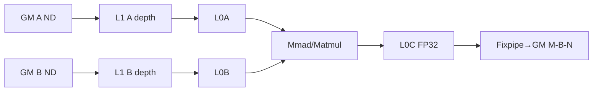
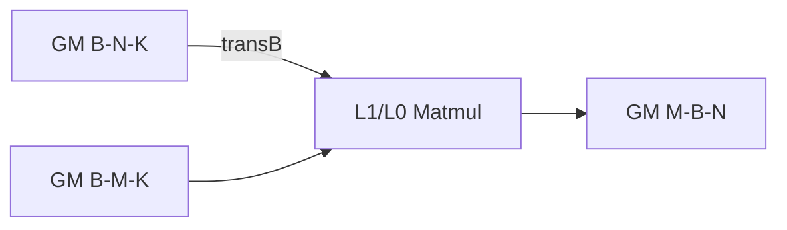
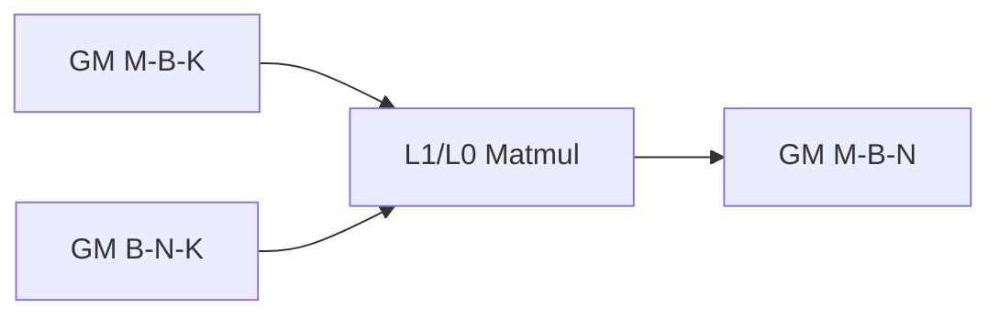
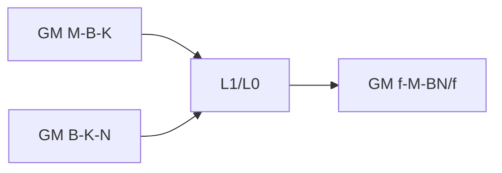
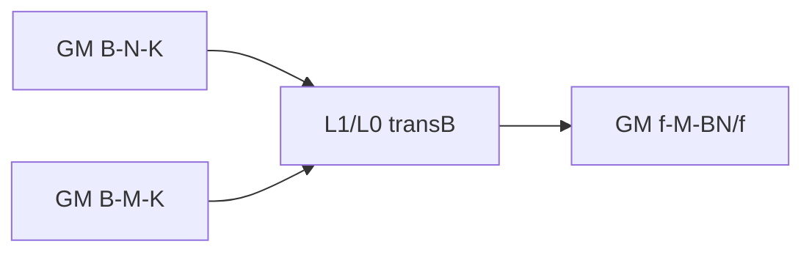
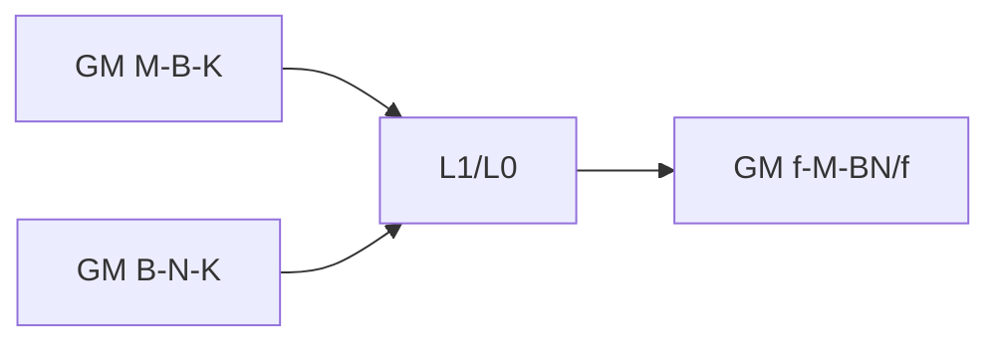

# TransposeBatchMatMul 950 ACLNN 算子知识

## 算子速览

| 项目 | 内容 |
|---|---|
| 实际入口 | `aclnnTransposeBatchMatMulGetWorkspaceSize` + `aclnnTransposeBatchMatMul`，公开两段式 ACLNN；固定源码中没有更高版本入口。 |
| 计算语义 | 解析 `A[B,M,K]`、`B[B,K,N]` 后做逐 batch 矩阵乘，常规输出 M-B-N；factor>1 时输出 factor-M-(B*N/factor)；scale 路线为 FP16×FP16→INT8。 |
| 输入输出 | x1/x2/out 均 ND、rank3；输入同 dtype FP16/BF16/FP32；bias 禁用；scale 为长度 B*N 的 INT64/UINT64。 |
| 执行类型 | 单个 `AIC_CUBE` Kernel；entry 显式 `KERNEL_TYPE_AIC_ONLY`，AIV 分支立即返回，无 SIMT/NDDMA/通信节点。 |
| Kernel 路线 | R-001～R-008：`permX1(012/102) × permX2(012/021) × batchSplit(false/true)` 的 8 个 `TransposeBatchMatMulAswKernel` specialization。 |
| 核心资源 | GM、20 MiB RPC workspace（Kernel 本体不读）、L1、L0A/L0B/L0C；UB/寄存器仅在通用 Matmul primitive 内部，固定仓未公开独立容量。 |
| 来源闭包 | `source_closed`：ACLNN→L0 launcher→DAV_3510 advanced selector→唯一 BASE(999) tiling→BatchMatMulV3 POD→8-key AIC router→ASW block/body→arch35 build 闭合；通用 `MatmulImpl` 微实现为明确库边界。 |
| 验证状态 | 已完成源码闭包检查；本次知识提取未执行编译、真机、数值或性能测试。 |

## 接口与语义

### 计算语义

设 `permX1/permX2` 解析后为 `A[B,M,K]`、`B[B,K,N]`：`C[b,m,n]=Σ_k A[b,m,k]B[b,k,n]`。`permY` 固定 102，因此 factor=1 的物理输出是 M-B-N；factor=f>1 时按 batch 拆为 `[f,M,B*N/f]`。scale 存在时输出 INT8，Device 以 `offsetScales=b*N+nTile*baseN` 传 `SetQuantVector`；量化参数的 bit 编码由公开接口要求使用 `aclnnTransQuantParamV2` 产生，通用 Matmul primitive 的 round 位解释在固定仓外。

### 输入、输出与属性

| 参数 | shape/layout | dtype | 约束、默认值与语义 |
|---|---|---|---|
| `x1` | rank3 ND | FP16/BF16/FP32 | `permX1` 012 或 102；非连续输入先 Contiguous/ReFormat ND。 |
| `x2` | rank3 ND | 同 x1 | `permX2` 012 或 021；K 与 batch 匹配；本卡不含 WeightNZ。 |
| `bias` | N/A | N/A | 必须为空。 |
| `scale` | `[B*N]` ND | INT64/UINT64 | 可选；存在时仅 FP16 输入、INT8 输出、factor=1。950 不施加 A2/A3 的 B*N<65536 guard。 |
| `permY` | 3 个 Host int64 | INT64 | 仅 102。 |
| `cubeMathType` | scalar | INT8 | 950 拒绝 -1；L0 仅以 `cubeMathType==USE_HF32` 生成 bool attr。 |
| `batchSplitFactor` | scalar | INT32 | 正数且整除 B；scale 时为1。 |
| `out` | `[M,B,N]` 或 `[f,M,B*N/f]` ND | FP16/BF16/FP32/INT8 | 内部输出后接通用 Cast/ViewCopy。 |

### 入口与版本

公开产品表明确支持 Ascend 950PR/950DT。950 对应 `NpuArch::DAV_3510`，Host 的 `IsAdvancedSocVersion` 在进入 PP/base 旧路线前直接选择 advanced tiling；Kernel CMake 为 ascend950 单独编译 `arch35/transpose_batch_mat_mul.cpp`。独立 WeightNZ API 和 NZ binary 不属于本卡。

## Host/Launcher 执行流程

### 参数校验与前处理

ACLNN 检查非空、rank3、perm、K/batch、dtype、scale、factor、bias/空 tensor；950 的 `IsNpuArch3510Series` 分支不施加 A2/A3 的 65536 inner-axis 约束。x1/x2 执行 `Contiguous` 与 `ReFormat(ND)`，scale 如存在执行 `Contiguous`；随后只添加一个 `TransposeBatchMatMul` AIC launcher，最后添加 Cast/ViewCopy。

### 参数、Workspace 与生命周期

advanced base 的 `GetWorkspaceSize()` 固定返回 `20*1024*1024` 字节 RPC reserve；当前 `TransposeBatchMatMulAswKernel` 接收 user workspace 但不读取。POD by value 放入 launch tiling buffer；executor 拥有内部 out、任务和通用前后处理，需保持到第二段 stream 执行完成。

### 启动图与失败传播

```text
ACLNN phase 1
 -> Contiguous/ReFormat x1,x2; Contiguous scale?
 -> l0op::TransposeBatchMatMul -> InferShape -> ADD_TO_LAUNCHER_LIST_AICORE
 -> IsAdvancedSocVersion(DAV_3510)
 -> TransposeBatchMatMulTiling::DoTiling
 -> MMTilingRegistry priority [999] -> TransposeBatchMatMulAswTiling
 -> transpose_batch_mat_mul<<<aicNum, stream>>>
 -> Cast -> ViewCopy
ACLNN phase 2 -> CommonOpExecutorRun(same stream)
```

任一校验、推形、tiling、launcher 添加失败立即返回；priority 999 唯一实例失败后 registry 报 `no general op tiling`，没有 device fallback。主 Kernel 与 Cast/ViewCopy 由 executor 在同一 stream 中有序提交。

## Route 与参数设计

### 分核与资源计算

`ResetBaseDav3510` 初始 `usedCoreNum=aicNum, baseM=256, baseN=256, baseK=128B/sizeof(A), stepM=stepN=1, dbL0C=1`。仅 `M<=16 && N==1024 && K==4096` 且总 tile 少于 aicNum 时，`BaseLoadBalance` 按 M/N tile 比例重算 baseM/baseN/baseK。随后 `CalL1TilingDefault` 枚举 `stepK=1..min(ceil(K/baseK),8)`，要求 `(A_L1+B_L1)*2<=availableL1` 且单侧四倍预算不越 L1；最终 `stepKa=stepKb=stepK, depthA1=depthB1=2*stepK`。blockDim 固定为 aicNum；每核通过 `index=blockIdx+round*usedCoreNum` 遍历 `B*ceil(M/baseM)*ceil(N/baseN)` tiles。

### Route 选择

| 顺序 | Route | Key/模板 | 精确选择条件与优先级 | 不适用去向 |
|---:|---|---|---|---|
| 1 | R-001 012/012/no-split | 0/0/0 | 950、两 perm=012、factor=1 | 失败 |
| 2 | R-002 102/012/no-split | 1/0/0 | permX1=102、permX2=012、factor=1 | 失败 |
| 3 | R-003 012/021/no-split | 0/1/0 | permX1=012、permX2=021、factor=1 | 失败 |
| 4 | R-004 102/021/no-split | 1/1/0 | permX1=102、permX2=021、factor=1 | 失败 |
| 5 | R-005 012/012/split | 0/0/1 | permX1=012、permX2=012、factor>1 | 失败 |
| 6 | R-006 102/012/split | 1/0/1 | permX1=102、permX2=012、factor>1 | 失败 |
| 7 | R-007 012/021/split | 0/1/1 | permX1=012、permX2=021、factor>1 | 失败 |
| 8 | R-008 102/021/split | 1/1/1 | permX1=102、permX2=021、factor>1 | 失败 |

```text
advanced(DAV_3510) -> validate ND/dtype/perm/shape/scale
 -> registry priority 999, IsCapable=true
 -> key = (permX1==102, permX2==021, factor>1)
 -> one of R-001..R-008
```

### 模板/实现执行矩阵

| Route | key/selector | dtype/shape/platform 完整命中条件 | 执行族与 kernel 节点 | 实际模板/body | 内存与同步特征 | tail/fallback |
|---|---|---|---|---|---|---|
| R-001 | 0/0/0 | 950、ND、012/012、f=1 | 单 AIC | `AswKernel<aTran=false,bTran=false,BMM_TRANS,...,NO_PRELOAD>` | Matmul GM→L1/L0→L0C→GM；ASW window | M/N tail；失败无 fallback |
| R-002 | 1/0/0 | 950、ND、102/012、f=1 | 单 AIC | `...,TRANS_BMM_TRANS,...` | A M-B-K 地址 | M/N actual tail；失败无 fallback |
| R-003 | 0/1/0 | 950、ND、012/021、f=1 | 单 AIC | `bTran=true,BMM_TRANS` | B B-N-K transpose load | M/N actual tail；失败无 fallback |
| R-004 | 1/1/0 | 950、ND、102/021、f=1 | 单 AIC | `bTran=true,TRANS_BMM_TRANS` | A/B 均特殊 stride | M/N actual tail；失败无 fallback |
| R-005 | 0/0/1 | 950、ND、012/012、f>1 | 单 AIC | `BMM_TRANS_TRANS` | split C address | M/N actual tail；失败无 fallback |
| R-006 | 1/0/1 | 950、ND、102/012、f>1 | 单 AIC | `TRANS_BMM_TRANS_TRANS` | A stride + split C | M/N actual tail；失败无 fallback |
| R-007 | 0/1/1 | 950、ND、012/021、f>1 | 单 AIC | `bTran=true,BMM_TRANS_TRANS` | transB + split C | M/N actual tail；失败无 fallback |
| R-008 | 1/1/1 | 950、ND、102/021、f>1 | 单 AIC | `bTran=true,TRANS_BMM_TRANS_TRANS` | all address transforms | M/N actual tail；失败无 fallback |

### 隐藏性能 Guard

| Guard | Host/Tiling 条件 | Device/资源原因 | 影响 Route | 不满足时去向 | 源码符号 |
|---|---|---|---|---|---|
| advanced 平台 | `npuArch==DAV_3510` | arch35 kernel/POD 专用 | 全部 | 旧平台路线 | `IsAdvancedSocVersion` |
| 唯一 tiler | priority `[999]`, `IsCapable=true` | 只发布 ASW high-level 模板 | 全部 | 失败 | `TransposeBatchMatMulPrioritiesMap`, `TransposeBatchMatMulAswTiling` |
| 特形负载均衡 | `M<=16 && N==1024 && K==4096 && tiles<aicNum` | 小 M 固定 base 会欠占核 | 全部 | 保留初始 base | `DoOpTiling` |
| L1 stepK | `(aL1+bL1)*2<=L1Available` 且 `max(a,b)*4<=L1`，stepK<=8 | A/B 双缓冲与 issue queue | 全部 | 取上一个 stepK；无合法值 tiling失败 | `CalL1TilingDefault` |
| quant L1 reserve | scale 时 `totalL1Size-=baseN*8` | 每 N tile scale table | INT8 | 更小 stepK | `CalL1TilingDefault` |
| ASW window | `aswWindowLen` 为不大于 sqrt(aicNum) 的最大整除因子 | M 窗内 snake N 遍历 | 全部 | 最小 1 | `GetAswWindowLen/UpdateBasicIndex` |
| tail | `singleCoreM/N` 取 base 或 `M/N-(cnt-1)*base` | 只写有效矩形 | 全部 | N/A | `UpdateBlockParams` |

### POD/ABI

`BatchMatMulV3TilingData` 按 8 字节 pack；首成员含外部 `TCubeTiling`，其定义来自固定仓外 `kernel_tiling.h`，故绝对 sizeof/offset 不可见。以下给出仓内可追溯字段及相对位置。

| 结构 | 字段 | 类型/位宽 | ABI 布局 | 单位 | Host/launcher producer | Device consumer | 边界 |
|---|---|---|---|---|---|---|---|
| `BatchMatMulV3TilingData` | `matMulTilingData` | `MatMulV3TilingData` | offset 0, align 8 | POD | shared advanced base | AswKernel/MatmulImpl | 含 TCube。 |
| `MatMulV3TilingData` | `tCubeTiling` | `TCubeTiling` | offset 0；sizeof外部不可见 | POD | `GetTilingDataProcess` | MatmulImpl/block | M/N/K/base/depth/step/core。 |
| `MatMulV3TilingData` | `mTailCnt,nTailCnt,kTailCnt` | 3×uint32 | 紧随 TCube | count | runInfo tail | shared primitive | TBMM block自行算M/N cnt。 |
| `MatMulV3TilingData` | `mBaseTailSplitCnt,nBaseTailSplitCnt,mTailMain,nTailMain` | 4×uint32 | 顺序连续 | count/element | runInfo | shared primitive | 默认1/0。 |
| `MatMulV3TilingData` | `isHf32,aswWindowLen,l2CacheDisable` | 2×uint32 + enum32 | 顺序连续，结构8对齐 | bool/count/enum | Host | kernel/block | HF32、ASW、cache policy。 |
| `BatchMatMulV3TilingData` | `a/b/cBatchDimAll,biasBatchDimAll` | 4×uint32 | `offsetof=sizeof(MatMulV3TilingData)+0..12` | batch | `GetBatchInfo` | Init/offset | A/B/C=B；bias禁用。 |
| `BatchMatMulV3TilingData` | `a/b/cBatchDim0..3` | 12×uint32 | parent +16..63 | batch axis | shared base | block/shared helper | 仅 Dim3=B，其余1。 |
| `BatchMatMulV3TilingData` | `iterBatch,batchOutNum,batchSplitFactor` | 3×uint32 | parent +64/+68/+72 | count/factor | shared/TBMM override | block | factor<=0 device防御为1。 |
| `BatchMatMulV3TilingData` | `mL1,nL1,kL1` | 3×uint32 | parent +76/+80/+84 | element | shared base | Matmul primitive | min(aligned shape, base*step)。 |
| `BatchMatMulV3TilingData` | `l1BufferNum,ubDB` | 2×uint8 | parent +88/+89，后续padding由ABI决定 | count | runInfo | primitive | UB不是独立AIV路线。 |
| `BatchMatMulV3TilingData` | `sliceM,srcNdStride,innerBatch` | 3×uint32 | 位于 uint8 后，具体padding依 C++ ABI | element/stride | shared base | primitive | 数值由 shared advanced tiler 写入；固定仓未在本算子 body 中逐字段读取。 |
| `TCubeTiling` | `M,N,Ka,Kb,singleCoreM/N/K,baseM/N/K,depthA1/B1,stepM/N/Ka/Kb,usedCoreNum,dbL0C,isBias` | 固定宽度字段，定义外部 | absolute offset固定仓不可见 | element/count/bool | advanced base + helper | MatmulImpl/block | 所有当前直接读取字段；不得猜 offset。 |

### Route 源码闭包

| Route | Key/selector | Host/Tiling producer | POD/参数 | Kernel entry/router | Kernel body/直接依赖 | 构建接线 |
|---|---|---|---|---|---|---|
| R-001..008 | `(permX1,permX2,split)` | `TransposeBatchMatMulTiling`→`TransposeBatchMatMulAswTiling` | `BatchMatMulV3TilingData` | `arch35/transpose_batch_mat_mul.cpp` | `TransposeBatchMatMulAswKernel/Block` + AscendC Matmul | arch35 source for ascend950 |

## Kernel 实现

### 公共执行流程

entry 先 `InitSocState`、取 user workspace、读 `BatchMatMulV3TilingData` 并声明 `KERNEL_TYPE_AIC_ONLY`。8 个 constexpr 分支仅改变 `bTran` 与 MODE；`aTran` 恒为 false，permX1=102 由 GM offset/`SetOrgShape` 实现。Kernel 初始化 GM tensor 与 Matmul，设置 HF32；每核按 round 更新 ASW index，计算有效 M/N tail、A/B/C/scale offset，执行 `SetSingleShape`、`SetTensorA/B`、可选 `SetQuantVector`、`Iterate`、`GetTensorC`，最后清 HF32 并 `PipeBarrier<PIPE_ALL>`。

### Route R-001：012/012、无 batch split

#### 适用条件

##### 选择证据

| 层级 | 文件 | 符号 | 源码谓词/参数 | 结果/下一跳 |
|---|---|---|---|---|
| Host | `transpose_batch_mat_mul_tiling.cpp` | `IsAdvancedSocVersion` | DAV_3510 | advanced |
| Tiling | `transpose_batch_mat_mul_asw_tiling.cpp` | `GetTransposeBatchMatMulInfo` | x1=012,x2=012,f=1 | key 0/0/0 |
| Router | `arch35/transpose_batch_mat_mul.cpp` | constexpr | key 0/0/0 | `BMM_TRANS` |

#### Device 数据流

##### 函数级调用链

```text
entry -> AswKernel::Init -> AswBlock::Init -> MatmulImpl::Init
 -> Process -> UpdateBasicIndex/UpdateBlockParams/CalcGMOffset
 -> SetTensorA/B -> Iterate -> GetTensorC
```

##### 源码等价伪码

```text
for j in [0,round): idx=blockIdx+j*usedCoreNum; ASW-snake decode (b,mTile,nTile)
 if idx<total: Aoff=b*M*K+m0*K; Boff=b*K*N+n0; Coff=m0*B*N+b*N+n0
 mm(singleM,singleN,K); Iterate; GetTensorC(C+Coff)
```

#### 内存与数据搬运

##### 资源与搬运表

| 层级/缓冲区 | offset/地址公式 | extent/容量公式 | dtype/layout | producer | consumer | owner/lifetime | 对齐/复用 |
|---|---|---|---|---|---|---|---|
| GM A/B/C | 上述 offsets | B*M*K、B*K*N、B*M*N elements | ND | caller | Matmul/out | caller | M/N tail |
| workspace | base pointer unused | 20MiB | bytes | executor | RPC/runtime | executor | Kernel无slice |
| L1 A/B | primitive internal | `baseM*baseK*stepK*sizeof(A)*2` + `baseN*baseK*stepK*sizeof(B)*2`；scale另 `baseN*8` | Cube staging | Matmul | L0 | core | depth=2*stepK |
| L0A/L0B | primitive internal | 绝对 stage 字节数由固定仓外 Matmul primitive 决定 | Cube | Matmul | Mmad | core | Host 只提供 base/step/depth；不得反推内部 allocation |
| L0C | primitive internal | `baseM*baseN*4*dbL0C` | FP32 accumulate | Mmad | Fixpipe/GetTensorC | core | 初始dbL0C=1 |
| UB/寄存器 | N/A（primitive boundary） | 固定仓未公开 | N/A | primitive | primitive | core | 无独立AIV |

##### 分层内存布局



##### 字节账、交接边与复用顺序

```text
workspace_total = 20*1024*1024
L1_total = 2*stepK*baseK*(baseM*sizeof(A)+baseN*sizeof(B)) + (scale?baseN*8:0)
L0_total = fixed repository not exposed by Matmul primitive
UB_total = fixed repository not exposed by Matmul primitive
```

| 边/复用子区 | producer | offset/extent | dtype/layout | consumer | ordering/sync | owner/lifetime | 安全条件 |
|---|---|---|---|---|---|---|---|
| L1 stages | GM copy | depthA1/B1 | input/Cube | L0/Mmad | Matmul pipe contract | core | CalL1 capacity guard |
| L0C→GM | Mmad | singleM×singleN | FP32→C ND | Fixpipe | Iterate/GetTensorC order | core | actual tail only |

#### 同步、精度与尾块

##### 同步与数值边界表

| 阶段 | primitive/机制 | producer | consumer/等待点 | 保护对象 | 精度/尾块 |
|---|---|---|---|---|---|
| mainloop | `MatmulImpl` | L1/L0 copy | Mmad/Fixpipe | tile stages | HF32 flag from attr；scale route SetQuantVector；M/N remainder通过 single shape。 |
| end | `PipeBarrier<PIPE_ALL>` | all pipelines | return | core local | HF32复位 false。 |

#### 关键实现

##### 符号证据表

| 阶段 | 文件 | 符号/模板实例 | 实现事实 |
|---|---|---|---|
| Host/Tiling producer | `arch35/transpose_batch_mat_mul_asw_tiling.cpp` | `DoOpTiling/GetTilingKey` | base、L1、key。 |
| Kernel entry/router | `op_kernel/arch35/transpose_batch_mat_mul.cpp` | key 0/0/0 | AIC-only BMM_TRANS。 |
| Device body/helper | `...asw_kernel_advanced.h`, `...asw_block_advanced.h` | `Process/CalcGMOffset` | ASW、GM地址、Matmul、tail。 |

### Route R-002：102/012、无 batch split

#### 适用条件

##### 选择证据

| 层级 | 文件 | 符号 | 源码谓词/参数 | 结果/下一跳 |
|---|---|---|---|---|
| Tiling/Router | `...asw_tiling.cpp`, `arch35/transpose_batch_mat_mul.cpp` | permX1=102 | x2=012,f=1 | key 1/0/0, `TRANS_BMM_TRANS` |

#### Device 数据流

##### 函数级调用链

```text
entry -> AswKernel<TRANS_BMM_TRANS>::Init -> AswBlock::Init -> MatmulImpl::Init
 -> Process -> UpdateBasicIndex/UpdateBlockParams/CalcGMOffset
 -> SetTensorA/B -> Iterate -> GetTensorC
```

##### 源码等价伪码

```text
Aoff=m0*B*K+b*K; Boff=b*K*N+n0; Coff=m0*B*N+b*N+n0
SetOrgShape(M,N,B*K,K,N*B)
```

#### 内存与数据搬运

##### 资源与搬运表

| 层级/缓冲区 | offset/地址公式 | extent/容量公式 | dtype/layout | producer | consumer | owner/lifetime | 对齐/复用 |
|---|---|---|---|---|---|---|---|
| GM A | `m0*B*K+b*K` | B*M*K | M-B-K ND | caller | Matmul | caller | batch inner stride |
| GM B/C | `b*K*N+n0` / `m0*B*N+b*N+n0` | B*K*N / B*M*N elements | B-K-N / M-B-N ND | caller/Matmul | Matmul/out | caller | M/N tail |
| L1 A/B | primitive internal | `2*stepK*baseK*(baseM*sizeof(A)+baseN*sizeof(B))+(scale?baseN*8:0)` | Cube staging | Matmul | L0/Mmad | core | depthA1/B1=2*stepK |
| L0C / L0A/B/UB | primitive internal | L0C budget=`baseM*baseN*4*dbL0C`；其余绝对 allocation 固定仓不可见 | FP32/Cube | Mmad/primitive | Fixpipe/Mmad | core | external Matmul boundary |
| workspace | user base, body不读 | 20*1024*1024 bytes | bytes | executor | RPC/runtime | executor | no route slice |

##### 分层内存布局


##### 字节账、交接边与复用顺序

```text
workspace_total = 20*1024*1024
L1_total = 2*stepK*baseK*(baseM*sizeof(A)+baseN*sizeof(B)) + (scale?baseN*8:0)
L0C_budget = baseM*baseN*4*dbL0C; L0A/L0B/UB absolute allocation = fixed repository not exposed
```

| 边/复用子区 | producer | offset/extent | dtype/layout | consumer | ordering/sync | owner/lifetime | 安全条件 |
|---|---|---|---|---|---|---|---|
| A interleave | GM | row stride B*K | M-B-K | Matmul | primitive pipe | caller | B、K正数 |

#### 同步、精度与尾块

##### 同步与数值边界表

| 阶段 | primitive/机制 | producer | consumer/等待点 | 保护对象 | 精度/尾块 |
|---|---|---|---|---|---|
| 全流程 | `MatmulImpl` pipe | GM/L1/L0 copy与Mmad | Fixpipe/GetTensorC | tile | HF32 按 attr；scale 时 SetQuantVector；M/N actual tail；末尾复位 HF32 并全 pipe barrier。 |

#### 关键实现

##### 符号证据表

| 阶段 | 文件 | 符号/模板实例 | 实现事实 |
|---|---|---|---|
| Router/body | `arch35/transpose_batch_mat_mul.cpp`, `...asw_block_advanced.h` | `TRANS_BMM_TRANS` | M-B-K 地址。 |

### Route R-003：012/021、无 batch split

#### 适用条件

##### 选择证据

| 层级 | 文件 | 符号 | 源码谓词/参数 | 结果/下一跳 |
|---|---|---|---|---|
| Tiling/Router | `...asw_tiling.cpp`, `arch35/transpose_batch_mat_mul.cpp` | permX2=021 | x1=012,f=1 | key 0/1/0, `bTran=true,BMM_TRANS` |

#### Device 数据流

##### 函数级调用链

```text
entry -> AswKernel<bTran=true,BMM_TRANS>::Init -> AswBlock::Init -> MatmulImpl::Init
 -> Process -> UpdateBasicIndex/UpdateBlockParams/CalcGMOffset
 -> SetTensorA/B(transpose=true) -> Iterate -> GetTensorC
```

##### 源码等价伪码

```text
Aoff=b*M*K+m0*K; Boff=b*N*K+n0*K; Coff=m0*B*N+b*N+n0
Matmul reads B with transpose=true.
```

#### 内存与数据搬运

##### 资源与搬运表

| 层级/缓冲区 | offset/地址公式 | extent/容量公式 | dtype/layout | producer | consumer | owner/lifetime | 对齐/复用 |
|---|---|---|---|---|---|---|---|
| GM B | `b*N*K+n0*K` | B*N*K | B-N-K ND | caller | Matmul(transB) | caller | N tail |
| GM A/C | `b*M*K+m0*K` / `m0*B*N+b*N+n0` | B*M*K / B*M*N elements | B-M-K / M-B-N ND | caller/Matmul | Matmul/out | caller | M/N tail |
| L1 A/B | primitive internal | `2*stepK*baseK*(baseM*sizeof(A)+baseN*sizeof(B))+(scale?baseN*8:0)` | Cube staging | Matmul | L0/Mmad | core | B 搬入转置由 primitive 完成 |
| L0C / L0A/B/UB | primitive internal | L0C budget=`baseM*baseN*4*dbL0C`；其余绝对 allocation 固定仓不可见 | FP32/Cube | Mmad/primitive | Fixpipe/Mmad | core | external Matmul boundary |
| workspace | user base, body不读 | 20*1024*1024 bytes | bytes | executor | RPC/runtime | executor | no route slice |

##### 分层内存布局



##### 字节账、交接边与复用顺序

```text
workspace_total = 20*1024*1024
L1_total = 2*stepK*baseK*(baseM*sizeof(A)+baseN*sizeof(B)) + (scale?baseN*8:0)
B GM tile extent = singleN*K elements; L0C_budget = baseM*baseN*4*dbL0C
```

| 边/复用子区 | producer | offset/extent | dtype/layout | consumer | ordering/sync | owner/lifetime | 安全条件 |
|---|---|---|---|---|---|---|---|
| B transpose | GM copy | singleN×K | ND B-N-K→Cube | Mmad | primitive pipe | core | permX2=021 key |

#### 同步、精度与尾块

##### 同步与数值边界表

| 阶段 | primitive/机制 | producer | consumer/等待点 | 保护对象 | 精度/尾块 |
|---|---|---|---|---|---|
| 全流程 | `MatmulImpl` transB pipe | GM/L1/L0 copy与Mmad | Fixpipe/GetTensorC | tile | HF32 按 attr；scale 时 SetQuantVector；B 的 N/K tail 由 TCube/single shape；末尾全 pipe barrier。 |

#### 关键实现

##### 符号证据表

| 阶段 | 文件 | 符号/模板实例 | 实现事实 |
|---|---|---|---|
| Router/body | `arch35/transpose_batch_mat_mul.cpp`, `...asw_block_advanced.h` | `bTran=true` | B-N-K offset。 |

### Route R-004：102/021、无 batch split

#### 适用条件

##### 选择证据

| 层级 | 文件 | 符号 | 源码谓词/参数 | 结果/下一跳 |
|---|---|---|---|---|
| Router | `arch35/transpose_batch_mat_mul.cpp` | key 1/1/0 | x1=102,x2=021,f=1 | `bTran=true,TRANS_BMM_TRANS` |

#### Device 数据流

##### 函数级调用链

```text
entry -> AswKernel<bTran=true,TRANS_BMM_TRANS>::Init -> AswBlock::Init -> MatmulImpl::Init
 -> Process -> UpdateBasicIndex/UpdateBlockParams/CalcGMOffset
 -> SetTensorA/B(transpose=true) -> Iterate -> GetTensorC
```

##### 源码等价伪码

```text
Aoff=m0*B*K+b*K; Boff=b*N*K+n0*K; Coff=m0*B*N+b*N+n0
```

#### 内存与数据搬运

##### 资源与搬运表

| 层级/缓冲区 | offset/地址公式 | extent/容量公式 | dtype/layout | producer | consumer | owner/lifetime | 对齐/复用 |
|---|---|---|---|---|---|---|---|
| GM A/B/C | `m0*B*K+b*K` / `b*N*K+n0*K` / `m0*B*N+b*N+n0` | B*M*K / B*N*K / B*M*N elements | M-B-K / B-N-K / M-B-N ND | caller/Matmul | Matmul/out | caller | 两个输入 stride 独立 |
| L1 A/B | primitive internal | `2*stepK*baseK*(baseM*sizeof(A)+baseN*sizeof(B))+(scale?baseN*8:0)` | Cube staging | Matmul | L0/Mmad | core | depthA1/B1=2*stepK |
| L0C / L0A/B/UB | primitive internal | L0C budget=`baseM*baseN*4*dbL0C`；其余绝对 allocation 固定仓不可见 | FP32/Cube | Mmad/primitive | Fixpipe/Mmad | core | external Matmul boundary |
| workspace | user base, body不读 | 20*1024*1024 bytes | bytes | executor | RPC/runtime | executor | no route slice |

##### 分层内存布局



##### 字节账、交接边与复用顺序

```text
workspace_total = 20*1024*1024
L1_total = 2*stepK*baseK*(baseM*sizeof(A)+baseN*sizeof(B)) + (scale?baseN*8:0)
L0C_budget = baseM*baseN*4*dbL0C; L0A/L0B/UB absolute allocation = fixed repository not exposed
```

| 边/复用子区 | producer | offset/extent | dtype/layout | consumer | ordering/sync | owner/lifetime | 安全条件 |
|---|---|---|---|---|---|---|---|
| A/B→Matmul | GM | current tiles | M-B-K/B-N-K | Matmul | primitive pipe | caller/core | key 1/1/0 |

#### 同步、精度与尾块

##### 同步与数值边界表

| 阶段 | primitive/机制 | producer | consumer/等待点 | 保护对象 | 精度/尾块 |
|---|---|---|---|---|---|
| 全流程 | `MatmulImpl` transB pipe | GM/L1/L0 copy与Mmad | Fixpipe/GetTensorC | tile | HF32 按 attr；scale 时 SetQuantVector；M/N actual tail；末尾复位 HF32 并全 pipe barrier。 |

#### 关键实现

##### 符号证据表

| 阶段 | 文件 | 符号/模板实例 | 实现事实 |
|---|---|---|---|
| Router/body | `arch35/transpose_batch_mat_mul.cpp`, `...asw_block_advanced.h` | key 1/1/0 | 双 stride 组合。 |

### Route R-005：012/012、batch split

#### 适用条件

##### 选择证据

| 层级 | 文件 | 符号 | 源码谓词/参数 | 结果/下一跳 |
|---|---|---|---|---|
| Tiling/Router | `...asw_tiling.cpp`, `arch35/transpose_batch_mat_mul.cpp` | factor>1 | 012/012 | key 0/0/1, `BMM_TRANS_TRANS` |

#### Device 数据流

##### 函数级调用链

```text
entry -> AswKernel<BMM_TRANS_TRANS>::Init -> AswBlock::Init -> MatmulImpl::Init
 -> Process -> UpdateBasicIndex/UpdateBlockParams/CalcGMOffset(split C)
 -> SetTensorA/B -> Iterate -> GetTensorC
```

##### 源码等价伪码

```text
inner=B/f; group=b/inner; in=b%inner
Coff=(group*M+m0)*inner*N + in*N+n0
```

#### 内存与数据搬运

##### 资源与搬运表

| 层级/缓冲区 | offset/地址公式 | extent/容量公式 | dtype/layout | producer | consumer | owner/lifetime | 对齐/复用 |
|---|---|---|---|---|---|---|---|
| GM C | 上述 Coff | B*M*N | f-M-BN/f | Matmul | out | caller | B%f=0 |
| GM A/B | `b*M*K+m0*K` / `b*K*N+n0` | B*M*K / B*K*N elements | B-M-K / B-K-N ND | caller | Matmul | caller | factor 只改变 C 地址 |
| L1 A/B | primitive internal | `2*stepK*baseK*(baseM*sizeof(A)+baseN*sizeof(B))` | Cube staging | Matmul | L0/Mmad | core | factor>1 已由 ACLNN 排除 scale |
| L0C / L0A/B/UB | primitive internal | L0C budget=`baseM*baseN*4*dbL0C`；其余绝对 allocation 固定仓不可见 | FP32/Cube | Mmad/primitive | Fixpipe/Mmad | core | external Matmul boundary |
| workspace | user base, body不读 | 20*1024*1024 bytes | bytes | executor | RPC/runtime | executor | no route slice |

##### 分层内存布局


##### 字节账、交接边与复用顺序

```text
workspace_total = 20*1024*1024
L1_total = 2*stepK*baseK*(baseM*sizeof(A)+baseN*sizeof(B))
C_total = B*M*N*sizeof(C); factor only changes physical C indexing
```

| 边/复用子区 | producer | offset/extent | dtype/layout | consumer | ordering/sync | owner/lifetime | 安全条件 |
|---|---|---|---|---|---|---|---|
| split C groups | each tile | disjoint Coff | C ND | ViewCopy | same stream | out | factor整除B |

#### 同步、精度与尾块

##### 同步与数值边界表

| 阶段 | primitive/机制 | producer | consumer/等待点 | 保护对象 | 精度/尾块 |
|---|---|---|---|---|---|
| output | `MatmulImpl` + disjoint writes | AIC copy/Mmad/Fixpipe | ViewCopy | C | HF32 按 attr；M/N actual tail；factor 分组不产生跨核归约；末尾全 pipe barrier。 |

#### 关键实现

##### 符号证据表

| 阶段 | 文件 | 符号/模板实例 | 实现事实 |
|---|---|---|---|
| Body | `...asw_block_advanced.h` | `CalcGMOffset<BMM_TRANS_TRANS>` | factor output formula。 |

### Route R-006：102/012、batch split

#### 适用条件

##### 选择证据

| 层级 | 文件 | 符号 | 源码谓词/参数 | 结果/下一跳 |
|---|---|---|---|---|
| Router | `arch35/transpose_batch_mat_mul.cpp` | key 1/0/1 | 102/012,f>1 | `TRANS_BMM_TRANS_TRANS` |

#### Device 数据流

##### 函数级调用链

```text
entry -> AswKernel<TRANS_BMM_TRANS_TRANS>::Init -> AswBlock::Init -> MatmulImpl::Init
 -> Process -> UpdateBasicIndex/UpdateBlockParams/CalcGMOffset
 -> SetTensorA/B -> Iterate -> GetTensorC(split layout)
```

##### 源码等价伪码

```text
Aoff=m0*B*K+b*K; Boff=b*K*N+n0; Coff=splitFormula(b,m0,n0)
```

#### 内存与数据搬运

##### 资源与搬运表

| 层级/缓冲区 | offset/地址公式 | extent/容量公式 | dtype/layout | producer | consumer | owner/lifetime | 对齐/复用 |
|---|---|---|---|---|---|---|---|
| GM A/B/C | A=`m0*B*K+b*K`，B=`b*K*N+n0`，C=`(group*M+m0)*(B/f)*N+inner*N+n0` | B*M*K / B*K*N / B*M*N elements | M-B-K / B-K-N / f-M-BN/f ND | caller/Matmul | Matmul/out | caller | factor整除B |
| L1 A/B | primitive internal | `2*stepK*baseK*(baseM*sizeof(A)+baseN*sizeof(B))` | Cube staging | Matmul | L0/Mmad | core | split route 禁止 scale |
| L0C / L0A/B/UB | primitive internal | L0C budget=`baseM*baseN*4*dbL0C`；其余绝对 allocation 固定仓不可见 | FP32/Cube | Mmad/primitive | Fixpipe/Mmad | core | external Matmul boundary |
| workspace | user base, body不读 | 20*1024*1024 bytes | bytes | executor | RPC/runtime | executor | no route slice |

##### 分层内存布局



##### 字节账、交接边与复用顺序

```text
workspace_total = 20*1024*1024
L1_total = 2*stepK*baseK*(baseM*sizeof(A)+baseN*sizeof(B))
C_total = B*M*N*sizeof(C); A uses M-B-K stride and C uses f-M-BN/f stride
```

| 边/复用子区 | producer | offset/extent | dtype/layout | consumer | ordering/sync | owner/lifetime | 安全条件 |
|---|---|---|---|---|---|---|---|
| A/C mapping | GM/Matmul | interleaved/grouped | input/C | Matmul/ViewCopy | same stream | caller | key 1/0/1 |

#### 同步、精度与尾块

##### 同步与数值边界表

| 阶段 | primitive/机制 | producer | consumer/等待点 | 保护对象 | 精度/尾块 |
|---|---|---|---|---|---|
| 全流程 | `MatmulImpl` pipe | GM/L1/L0 copy与Mmad | Fixpipe/GetTensorC | tile | M/N actual tail；factor 分组无跨核归约；末尾复位 HF32 并全 pipe barrier。 |

#### 关键实现

##### 符号证据表

| 阶段 | 文件 | 符号/模板实例 | 实现事实 |
|---|---|---|---|
| Router/body | `arch35/transpose_batch_mat_mul.cpp`, `...asw_block_advanced.h` | key 1/0/1 | A/C 组合。 |

### Route R-007：012/021、batch split

#### 适用条件

##### 选择证据

| 层级 | 文件 | 符号 | 源码谓词/参数 | 结果/下一跳 |
|---|---|---|---|---|
| Router | `arch35/transpose_batch_mat_mul.cpp` | key 0/1/1 | 012/021,f>1 | `bTran=true,BMM_TRANS_TRANS` |

#### Device 数据流

##### 函数级调用链

```text
entry -> AswKernel<bTran=true,BMM_TRANS_TRANS>::Init -> AswBlock::Init -> MatmulImpl::Init
 -> Process -> UpdateBasicIndex/UpdateBlockParams/CalcGMOffset
 -> SetTensorA/B(transpose=true) -> Iterate -> GetTensorC(split layout)
```

##### 源码等价伪码

```text
Aoff=b*M*K+m0*K; Boff=b*N*K+n0*K; Coff=splitFormula(b,m0,n0)
```

#### 内存与数据搬运

##### 资源与搬运表

| 层级/缓冲区 | offset/地址公式 | extent/容量公式 | dtype/layout | producer | consumer | owner/lifetime | 对齐/复用 |
|---|---|---|---|---|---|---|---|
| GM A/B/C | A=`b*M*K+m0*K`，B=`b*N*K+n0*K`，C=`(group*M+m0)*(B/f)*N+inner*N+n0` | B*M*K / B*N*K / B*M*N elements | B-M-K / B-N-K / f-M-BN/f ND | caller/Matmul | Matmul/out | caller | key 0/1/1 |
| L1 A/B | primitive internal | `2*stepK*baseK*(baseM*sizeof(A)+baseN*sizeof(B))` | Cube staging | Matmul | L0/Mmad | core | transB; split route 禁止 scale |
| L0C / L0A/B/UB | primitive internal | L0C budget=`baseM*baseN*4*dbL0C`；其余绝对 allocation 固定仓不可见 | FP32/Cube | Mmad/primitive | Fixpipe/Mmad | core | external Matmul boundary |
| workspace | user base, body不读 | 20*1024*1024 bytes | bytes | executor | RPC/runtime | executor | no route slice |

##### 分层内存布局



##### 字节账、交接边与复用顺序

```text
workspace_total = 20*1024*1024
L1_total = 2*stepK*baseK*(baseM*sizeof(A)+baseN*sizeof(B))
C_total = B*M*N*sizeof(C); B uses B-N-K stride and C uses f-M-BN/f stride
```

| 边/复用子区 | producer | offset/extent | dtype/layout | consumer | ordering/sync | owner/lifetime | 安全条件 |
|---|---|---|---|---|---|---|---|
| B/C mapping | GM/Matmul | transposed/grouped | input/C | Matmul/ViewCopy | same stream | caller | factor整除B |

#### 同步、精度与尾块

##### 同步与数值边界表

| 阶段 | primitive/机制 | producer | consumer/等待点 | 保护对象 | 精度/尾块 |
|---|---|---|---|---|---|
| 全流程 | `MatmulImpl` transB pipe | GM/L1/L0 copy与Mmad | Fixpipe/GetTensorC | tile | B 的 N/K tail 与输出 M/N actual tail 均受 TCube/single shape 约束；末尾全 pipe barrier。 |

#### 关键实现

##### 符号证据表

| 阶段 | 文件 | 符号/模板实例 | 实现事实 |
|---|---|---|---|
| Router/body | `arch35/transpose_batch_mat_mul.cpp`, `...asw_block_advanced.h` | key 0/1/1 | B/C 组合。 |

### Route R-008：102/021、batch split

#### 适用条件

##### 选择证据

| 层级 | 文件 | 符号 | 源码谓词/参数 | 结果/下一跳 |
|---|---|---|---|---|
| Router | `arch35/transpose_batch_mat_mul.cpp` | key 1/1/1 | 102/021,f>1 | `bTran=true,TRANS_BMM_TRANS_TRANS` |

#### Device 数据流

##### 函数级调用链

```text
组合 transposed A、transposed B 与 split C，随后同一 Matmul mainloop。
```

##### 源码等价伪码

```text
Aoff=m0*B*K+b*K; Boff=b*N*K+n0*K; Coff=splitFormula(b,m0,n0)
```

#### 内存与数据搬运

##### 资源与搬运表

| 层级/缓冲区 | offset/地址公式 | extent/容量公式 | dtype/layout | producer | consumer | owner/lifetime | 对齐/复用 |
|---|---|---|---|---|---|---|---|
| GM A/B/C | A=`m0*B*K+b*K`，B=`b*N*K+n0*K`，C=`(group*M+m0)*(B/f)*N+inner*N+n0` | B*M*K / B*N*K / B*M*N elements | M-B-K / B-N-K / f-M-BN/f ND | caller/Matmul | Matmul/out | caller | key 1/1/1 and factor整除B |
| L1 A/B | primitive internal | `2*stepK*baseK*(baseM*sizeof(A)+baseN*sizeof(B))` | Cube staging | Matmul | L0/Mmad | core | transB; split route 禁止 scale |
| L0C / L0A/B/UB | primitive internal | L0C budget=`baseM*baseN*4*dbL0C`；其余绝对 allocation 固定仓不可见 | FP32/Cube | Mmad/primitive | Fixpipe/Mmad | core | external Matmul boundary |
| workspace | user base, body不读 | 20*1024*1024 bytes | bytes | executor | RPC/runtime | executor | no route slice |

##### 分层内存布局



##### 字节账、交接边与复用顺序

```text
workspace_total = 20*1024*1024
L1_total = 2*stepK*baseK*(baseM*sizeof(A)+baseN*sizeof(B))
C_total = B*M*N*sizeof(C); A/B/C use M-B-K, B-N-K and f-M-BN/f indexing respectively
```

| 边/复用子区 | producer | offset/extent | dtype/layout | consumer | ordering/sync | owner/lifetime | 安全条件 |
|---|---|---|---|---|---|---|---|
| all transformed mapping | GM/Matmul | current tiles | ND | Matmul/ViewCopy | same stream/primitive pipe | caller/core | key 1/1/1 |

#### 同步、精度与尾块

##### 同步与数值边界表

| 阶段 | primitive/机制 | producer | consumer/等待点 | 保护对象 | 精度/尾块 |
|---|---|---|---|---|---|
| 全流程 | `MatmulImpl` transB pipe | GM/L1/L0 copy与Mmad | Fixpipe/GetTensorC | tile | M/N actual tail，K tail由TCube；factor分组无跨核归约；末尾复位 HF32 并全 pipe barrier。 |

#### 关键实现

##### 符号证据表

| 阶段 | 文件 | 符号/模板实例 | 实现事实 |
|---|---|---|---|
| Router/body | `arch35/transpose_batch_mat_mul.cpp`, `...asw_block_advanced.h` | key 1/1/1 | 三种地址变换组合。 |

## 算子特定优化

### Trick T-001：DAV_3510 单一优先级 ASW tiling

#### 触发与源码依据

- 适用 Route：R-001～R-008
- 触发条件：`IsAdvancedSocVersion` 得到 DAV_3510；registry priority list 为 `[999]`。
- Golden 来源：[`transpose_batch_mat_mul_tiling_advanced.cpp:373-379`](../../../../../../../cann-ops-raw/ascendc/ops-nn/955f8b33985b6d72989ebff341bb9c2c564a51bc/matmul/transpose_batch_mat_mul/op_host/op_tiling/arch35/transpose_batch_mat_mul_tiling_advanced.cpp#L373-L379)

**官方源码（固定 Commit 连续逐字摘录）**：

```cpp
MatMulTilingCfg tilingCfg(false, context_->GetCompileInfo(), static_cast<void*>(&args_));
NpuArch npuArch =
    static_cast<const MatmulV3CompileInfo*>(tilingCfg.compileInfo)->npuArch;
MMRegisterCfg registerCfg{"TransposeBatchMatMul", npuArch,
                          strategy::GetTransposeBatchMatMulPriorities(npuArch)};
return MMTilingRegistry::GetInstance().DoTilingImpl(context_, tilingCfg, registerCfg);
```

#### 机制与设计原因

950 不继承 A2/A3 的 PP/base 决策；平台一旦命中 advanced，即只尝试 TBMM 注册的 BASE(999)。因此 021、量化和 batch split 都共享同一 POD/ASW body，只由三位 key 改变编译期 stride/输出模式，避免 runtime 分支。

#### 迁移边界

- 适用：DAV_3510、公开 TBMM ND 语义。
- 前提：8 个 key 与 Host enum编码完全一致。
- 失效：非 advanced 平台必须回旧 selector；priority 999 未注册即 tiling失败。
- 未验证：本次知识提取未执行编译、真机、数值或性能测试。

#### 错误做法

把 `arch35` 文件存在当成任意平台支持：真正平台边界同时由公开产品表、DAV_3510 selector、OpDef/config 与 CMake compute units 确定。

### Trick T-002：ASW 窗口蛇形遍历与特形负载均衡

#### 触发与源码依据

- 适用 Route：R-001～R-008
- 触发条件：全部路线使用 ASW；`M<=16,N=1024,K=4096` 且 tile不足时额外重算 base。
- Golden 来源：[`transpose_batch_mat_mul_asw_block_advanced.h:134-151`](../../../../../../../cann-ops-raw/ascendc/ops-nn/955f8b33985b6d72989ebff341bb9c2c564a51bc/matmul/transpose_batch_mat_mul/op_kernel/arch35/transpose_batch_mat_mul_asw_block_advanced.h#L134-L151)

**官方源码（固定 Commit 连续逐字摘录）**：

```cpp
uint64_t matIndex = params_.index % (params_.mCnt * params_.nCnt);
uint64_t rowIdx = matIndex / params_.nCnt / params_.mainWindow;
if (rowIdx < params_.mainRow) {
    params_.mCntIndex = rowIdx * params_.mainWindow + matIndex % params_.mainWindow;
    params_.nCntIndex = (matIndex / params_.mainWindow) % params_.nCnt;
}
if (rowIdx % 2 != 0) {
    params_.nCntIndex = params_.nCnt - 1 - params_.nCntIndex;
}
```

#### 机制与设计原因

`aswWindowLen` 取 aicNum 的接近平方根因子，M 方向按窗口切段，相邻窗口反转 N 扫描，保持连续窗口交界处靠近上一 N tile。特定 16×1024×4096 形状在占核不足时再调 baseM/N/K，提升可分配 tile 数；源码只证明调度变化，不量化性能收益。

#### 迁移边界

- 适用：单 AIC 输出 tile、B/M/N 可独立寻址的 batch matmul。
- 前提：`usedCoreNum`、`mainWindow/tailWindow` 与 totalCnt 一致，M/N tail仍由 base remainder计算。
- 失效：没有 AIC window scheduler 或输出 tile存在跨核归约时不能直接照用。
- 未验证：本次知识提取未执行编译、真机、数值或性能测试。

#### 错误做法

去掉奇数窗口的 N 反转不会改变正确性，但不再是该固定 Commit 的 ASW 调度，不能仍声称复用了同一 specialization。

## 模板与实现对比

| 对比维度 | R-001/002/005/006 x2=012 | R-003/004/007/008 x2=021 | 设计选择依据 |
|---|---|---|---|
| 命中条件/优先级 | key permX2=0 | key permX2=1 | 同一 priority 999。 |
| 执行族/节点图 | 单 AIC | 单 AIC | bTran仅改变模板。 |
| M/N/K、tile 与 scheduler | 相同 base/L1/ASW | 相同 base/L1/ASW | shape语义相同。 |
| workspace/L1/L0/UB | 20MiB；Matmul层级 | 20MiB；Matmul层级 | 无独立workspace边。 |
| AIC/AIV 或 kernel 交接 | N/A | N/A | AIV立即返回。 |
| 同步、精度与 tail | Matmul primitive，factor MODE决定C | Matmul primitive加 B transpose load | scale/HF32均通过POD/API。 |
| fallback/失败边界 | tiling/unknown key失败 | tiling/unknown key失败 | 无内部fallback。 |

## 平台差异

| 项目 | A2 | A3 | 950 |
|---|---|---|---|
| 支持状态 | 公开支持，见无后缀卡 | 公开支持，见无后缀卡 | 公开支持 |
| Host/Launcher | 旧 selector，Base+PP | 同 A2 | DAV_3510 advanced，唯一 BASE(999) |
| Kernel/资源 | 默认 source，6 路 | 默认 source，6 路 | arch35 source，8 路；固定20MiB workspace |

## 限制与失败边界

- 只覆盖 ND `aclnnTransposeBatchMatMul`，不含 `aclnnTransposeBatchMatMulWeightNz`、NZ binary 或其模板。
- bias、空 tensor、不合法 perm/rank/dtype/K/batch/factor 均在 ACLNN/tiling 层失败；scale 只允许 FP16→INT8、factor=1。
- blockDim 使用 aicNum，而有效 tile 使用 `usedCoreNum/totalCnt` 防护；不得删除 `idx<totalCnt`。
- `MatmulImpl`、`kernel_tiling.h` 与 Contiguous/Cast/ViewCopy 为固定仓外库边界；固定仓未给出 TCubeTiling absolute ABI、primitive 内部 UB offset、量化 round bit 细节，本文明确保留缺失而未推测。
- 本次知识提取未执行编译、真机、数值或性能测试。

## 源码索引

### 链路索引

| 链路阶段 | 文件 | 关键符号 | 支撑内容 |
|---|---|---|---|
| 入口声明/约束 | `matmul/transpose_batch_mat_mul/docs/aclnnTransposeBatchMatMul.md` | 产品表/原型/约束 | 950支持与接口域。 |
| 入口实现 | `matmul/transpose_batch_mat_mul/op_api/aclnn_transpose_batch_mat_mul.cpp` | `CheckParams/BuildTransposeBatchMatMulGraph` | 校验、前后处理。 |
| L0 launcher | `matmul/transpose_batch_mat_mul/op_api/transpose_batch_mat_mul.cpp` | `l0op::TransposeBatchMatMul` | AIC launcher。 |
| 平台 selector | `matmul/transpose_batch_mat_mul/op_host/op_tiling/transpose_batch_mat_mul_tiling.cpp` | `IsAdvancedSocVersion` | advanced优先。 |
| advanced 参数 | `matmul/transpose_batch_mat_mul/op_host/op_tiling/arch35/transpose_batch_mat_mul_tiling_advanced.cpp` | `GetArgs/DoTiling` | M/N/K、batch、registry。 |
| TBMM tiler | `matmul/transpose_batch_mat_mul/op_host/op_tiling/arch35/transpose_batch_mat_mul_asw_tiling.cpp` | `DoOpTiling/GetTilingKey` | base/load balance/L1/key。 |
| priority | `matmul/transpose_batch_mat_mul/op_host/op_tiling/arch35/transpose_batch_mat_mul_tiling_strategy.h` | `TransposeBatchMatMulPrioritiesMap` | DAV_3510→999。 |
| shared tiling | `matmul/mat_mul_v3/op_host/op_tiling/arch35/matmul_v3_tiling_helper.cpp` | `ResetBase/CalL1Tiling` | base/L1公式。 |
| workspace/POD producer | `matmul/mat_mul_v3/op_host/op_tiling/arch35/matmul_v3_base_tiling_advanced.h` | `GetWorkspaceSize/GetTilingDataProcess` | 20MiB、TCube fields。 |
| POD | `matmul/mat_mul_v3/op_kernel/arch35/mat_mul_tiling_data.h` | `BatchMatMulV3TilingData` | ABI字段。 |
| key | `matmul/transpose_batch_mat_mul/op_kernel/arch35/transpose_batch_mat_mul_tiling_key.h` | `ASCENDC_TPL_SEL` | 8个AIC-only组合。 |
| Kernel entry | `matmul/transpose_batch_mat_mul/op_kernel/arch35/transpose_batch_mat_mul.cpp` | `transpose_batch_mat_mul` | key→MODE/bTran。 |
| Kernel body | `matmul/transpose_batch_mat_mul/op_kernel/arch35/transpose_batch_mat_mul_asw_kernel_advanced.h` | `Process` | Matmul调用/HF32/quant/tail。 |
| Block helper | `matmul/transpose_batch_mat_mul/op_kernel/arch35/transpose_batch_mat_mul_asw_block_advanced.h` | `UpdateBasicIndex/CalcGMOffset` | ASW与地址。 |
| 平台注册 | `matmul/transpose_batch_mat_mul/op_host/transpose_batch_mat_mul_def.cpp` | `AddConfig(ascend950)` | 950 AIC config。 |
| 构建接线 | `matmul/transpose_batch_mat_mul/op_kernel/CMakeLists.txt` | `KERNEL_SRC arch35/... COMPUTE_UNITS ascend950` | arch35 source。 |

### 实现复用检查

| 检查项 | 可复用事实 | 不得改变的约束 | 源码符号 |
|---|---|---|---|
| ABI/POD | BatchMatMulV3 POD + 3位key | 8B pack、字段顺序、key enum | `GetTilingDataProcess/ASCENDC_TPL_SEL` |
| 调用顺序 | ACLNN→advanced tiling→单 AIC→Cast/ViewCopy | priority999失败不得伪造fallback | `TransposeBatchMatMulTilingFunc/DoTilingImpl` |
| workspace/内存 | 20MiB reserve，Kernel不读；L1双缓冲公式 | step/depth与capacity guard一致 | `GetWorkspaceSize/CalL1TilingDefault` |
| 同步 | Matmul primitive pipe + Kernel末尾全 barrier | HF32必须复位，输出前完成Mmad | `AswKernel::Process` |
| 精度与尾块 | HF32 attr、scale向量、M/N actual | scale offset=b*N+nTile*baseN；factor只改C布局 | `SetQuantVector/UpdateBlockParams` |
| 失败边界 | 参数/tiling/unknown key失败 | 不把WeightNZ或未实例化组合并入 | `CheckParams/ASCENDC_TPL_SEL` |