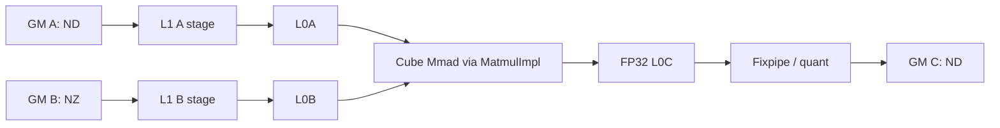

# TransposeBatchMatMulWeightNZ 950 ACLNN 算子知识

## 算子速览

| 项目 | 内容 |
|---|---|
| 实际入口 | `aclnnTransposeBatchMatMulWeightNzGetWorkspaceSize` / `aclnnTransposeBatchMatMulWeightNz`，公开 ACLNN 两段式接口；源码符号中的后缀是大小写敏感的 `WeightNz`。 |
| 计算语义 | 先按 `permX1/permX2` 把逻辑视图变为 `[B,M,K]` 与 `[B,K,N]`，逐 batch 计算 `C_b=A_b×B_b`，再物理写成 `[M,B,N]`；`batchSplitFactor>1` 时重排为 `[factor,M,B×N/factor]`，有 `scale` 时输出 INT8 `[M,1,B×N]`。 |
| 输入输出 | `x1`：3D ND FP16/BF16；`x2`：3D view、5D FRACTAL_NZ storage、同 dtype；`out`：3D ND FP16/BF16，或 FP16 输入配合 INT64/UINT64 scale 输出 INT8。 |
| 执行类型 | 单 Kernel `AIC_CUBE`；模板声明 `AIC_ONLY`，AIV 分支直接返回，无 AIC↔AIV 交接。 |
| Kernel 路线 | R-001～R-008：`permX1` 两值 × `permX2` 两值 × batch split 两值的 8 个 arch35 ASW key。 |
| 核心资源 | GM 输入/输出；20 MiB RPC system workspace；Matmul 高阶 API 管理 L1、L0A/L0B、FP32 L0C；本算子 body 不建立 UB 队列。 |
| 来源闭包 | `source_closed`：公开 ACLNN→L0 launcher→950 selector→ASW tiling/POD→8 个 key→AIC-only entry/body→ascend950 构建与 binary config 闭合。 |
| 验证状态 | 已完成源码闭包检查；本次知识提取未执行编译、真机、数值或性能测试。 |

## 接口与语义

### 计算语义

令 `A'=permute(x1, permX1)=[B,M,K]`，`B'=permute(view(x2), permX2)=[B,K,N]`，则 `C[b,m,n]=Σ_k A'[b,m,k]×B'[b,k,n]`。WeightNZ 的差异不是数学公式，而是 `x2` 物理存储：未转置时按 `(b,n1,k1,k0,n0)`，转置时按 `(b,k1,n1,n0,k0)` 解释；FP16/BF16 的 `k0/n0` 为 Cube 对齐粒度。无 scale 时结果按 `[M,B,N]` 地址公式提交；`batchSplitFactor=f>1` 时把 batch 拆为 `innerBatch=B/f` 并写成 `[f,M,innerBatch×N]`。scale 存在时内部输出类型为 INT8，AIC 在每个 `(batch,n-tile)` 取 `uint64_t` scale 并传给 `MatmulImpl::SetQuantVector`，随后 `GetTensorC` 完成量化输出；scale 位模式的解码与舍入由固定仓外的 AscendC Matmul API 实现。

### 输入、输出与属性

| 参数 | shape/layout | dtype | 约束、默认值与语义 |
|---|---|---|---|
| `x1` | 3D view，ND storage | FP16/BF16 | 与 `x2` dtype 相同；`permX1` 仅 `[0,1,2]` 或 `[1,0,2]`；非空。 |
| `x2` | 3D view，5D FRACTAL_NZ storage | FP16/BF16 | `K` 与 `x1` 相等；storage rank 必须为 5；逻辑 K/N 不能为 1；`permX2` 为 `[0,1,2]` 或 `[0,2,1]`。 |
| `bias` | N/A | N/A | 预留参数；必须为 `nullptr`。 |
| `scale` | `[B×N]`，ND | INT64/UINT64 | 可选；仅 FP16×FP16→INT8；存在时 `batchSplitFactor=1`。 |
| `permX1` | 长度 3 | INT64 list | `[0,1,2]` 表示输入已为 `[B,M,K]`；`[1,0,2]` 表示输入为 `[M,B,K]`。 |
| `permX2` | 长度 3 | INT64 list | `[0,1,2]` 或 `[0,2,1]`；后者令 `B_TYPE::isTrans=true`。 |
| `permY` | 长度 3 | INT64 list | 仅 `[1,0,2]`。 |
| `cubeMathType` | 标量 | INT8 | 950 不允许 `-1`；API 将 `USE_HF32` 转为 `enable_hf32=true`，WeightNZ 数据类型本身不含 FP32，故正常 WeightNZ route 不启用 HF32。 |
| `batchSplitFactor` | 标量 | INT32 | `1..B` 且整除 B；scale 存在时只能为 1。 |
| `out` | 3D，ND | FP16/BF16/INT8 | 无 scale 时通常同输入；有 scale 时 INT8；外层在核心节点后追加 `Cast` 与 `ViewCopy`。 |

### 入口与版本

公开声明、文档和实现的实际符号均为 `aclnnTransposeBatchMatMulWeightNz*`，不是 `WeightNZ*`。固定 Commit 只存在这一公开版本；950 由 `IsAdvancedSocVersion(context)` 直接选择 arch35 `TransposeBatchMatMulTiling`，其优先级表在 `DAV_3510` 上只有最新 `BASE=999` 的 `TransposeBatchMatMulAswTiling`，没有旧版与新版并存选择。

## Host/Launcher 执行流程

### 参数校验与前处理

第一段创建 executor 后先要求 `x2` primary storage format 为 FRACTAL_NZ，再依次检查非空指针、两个 view rank=3、三个 perm 长度=3、950 `cubeMathType!=-1`、K/batch 匹配、dtype/scale、factor 正数且整除 batch、x1/out 非 NZ、x2 storage rank=5 与逻辑 K/N≠1；空 tensor 与非空 bias 均直接报错。图构造阶段对 x1 做 `Contiguous→ReFormat(ND)`，对 x2 只做 `Contiguous` 并恢复原 `StorageShape`，对可选 scale 做 `Contiguous`，随后调用 L0 `TransposeBatchMatMul`。普通 Contiguous/Cast/ViewCopy 是生成框架边界；核心语义节点的格式、POD、key 与 kernel 均在固定仓闭合。

### 参数、Workspace 与生命周期

L0 根据 scale 是否为空分配 FP16/BF16 或 INT8 临时输出，执行 infer-shape，再用 `ADD_TO_LAUNCHER_LIST_AICORE` 把核心节点加入 executor。950 ASW `GetWorkspaceSize()` 固定返回 `20×1024×1024` 字节 RPC system workspace；当前 `TransposeBatchMatMulAswKernel` 接收 `user=GetUserWorkspace(workspaceGM)`，但其 `Init/Process` 不读写该指针，因此没有算子自有中间 slice。第一段返回 executor 持有的完整图与总 workspace；第二段 `CommonOpExecutorRun` 在调用者给定 stream 上按 executor 顺序执行，executor、临时 tensor 与 workspace 至 stream 完成前有效。

### 启动图与失败传播

```text
aclnnTransposeBatchMatMulWeightNzGetWorkspaceSize
  -> Contiguous(x1) -> ReFormat(ND)
  -> Contiguous(x2) + restore FRACTAL_NZ storage shape
  -> [Contiguous(scale)]
  -> l0op::TransposeBatchMatMul
       -> InferShape
       -> A5 TransposeBatchMatMulTiling::DoTiling
       -> one transpose_batch_mat_mul<PERM_X1,PERM_X2,BATCH_SPLIT>
          blockDim = aicNum, task type AIC_ONLY
  -> Cast(coreOut, out.dtype)
  -> ViewCopy(out)
aclnnTransposeBatchMatMulWeightNz
  -> CommonOpExecutorRun(same stream)
```

任一步返回空指针或非 `ACLNN_SUCCESS/GRAPH_SUCCESS` 都阻止后续节点加入或执行；核心 kernel 只有一个 AIC 节点，无跨 kernel 中间结果。外层 Cast/ViewCopy 与核心节点在同一 executor/stream 上有序。

## Route 与参数设计

### 分核与资源计算

原始 view 经 perm 得 `B/M/K/N`，并由 `GetBatchInfo` 写入三个 batch 总数。唯一 ASW tiling 先用 `MatMulV3TilingHelper::ResetBase` 计算 `baseM/baseN/baseK`、`singleCore*`、`depthA1/depthB1`、step 与尾块；仅当 `M<=16 && N==1024 && K==4096` 且 `mCnt×nCnt×B<aicNum` 时调用 `BaseLoadBalance`。该平衡以 x1/x2 transpose 决定 M/N 的 16 或 `256B/sizeof(dtype)` 对齐，并以 `l0ASize/2/max(baseM,baseN)` 限制 baseK。随后 `CalL1Tiling` 闭合 L1 depth/step。`blockDim` 固定为物理 `aicNum`，POD 中 `usedCoreNum` 决定有效分核；Device 计算 `mCnt=ceil(M/baseM)`、`nCnt=ceil(N/baseN)`、`totalCnt=B×mCnt×nCnt`、`round=ceil(totalCnt/usedCoreNum)`，尾块为 `M-(mCnt-1)baseM` 与 `N-(nCnt-1)baseN`。

### Route 选择

| 顺序 | Route | Key/模板 | 精确选择条件与优先级 | 不适用去向 |
|---:|---|---|---|---|
| 1 | R-001 BMM/NZ | `(P1=012,P2=012,S=0)` | 950；`permX1=012, permX2=012, factor=1` | 参数改变则匹配 R-002～R-008；非法则 tiling 失败。 |
| 2 | R-002 TRANS_BMM/NZ | `(102,012,0)` | 950；`permX1=102, permX2=012, factor=1` | 同上。 |
| 3 | R-003 BMM/NZ-trans | `(012,021,0)` | 950；`permX1=012, permX2=021, factor=1` | 同上。 |
| 4 | R-004 TRANS_BMM/NZ-trans | `(102,021,0)` | 950；`permX1=102, permX2=021, factor=1` | 同上。 |
| 5 | R-005 BMM/split | `(012,012,1)` | 950；`permX1=012, permX2=012, factor>1`；scale 必须空 | 同上。 |
| 6 | R-006 TRANS_BMM/split | `(102,012,1)` | 950；`permX1=102, permX2=012, factor>1`；scale 必须空 | 同上。 |
| 7 | R-007 BMM/NZ-trans/split | `(012,021,1)` | 950；`permX1=012, permX2=021, factor>1`；scale 必须空 | 同上。 |
| 8 | R-008 TRANS_BMM/NZ-trans/split | `(102,021,1)` | 950；`permX1=102, permX2=021, factor>1`；scale 必须空 | 非法属性、shape、dtype 或资源条件使唯一模板失败。 |

```text
IsAdvancedSocVersion == true
  -> validate perm/shape/dtype/scale
  -> priorities(DAV_3510) = [BASE=999]
  -> TransposeBatchMatMulAswTiling::IsCapable() == true
  -> P1 = (permX1 == 102), P2 = (permX2 == 021), S = (factor > 1)
  -> exact one of eight GET_TPL_TILING_KEY combinations
```

### 模板/实现执行矩阵

| Route | key/selector | dtype/shape/platform 完整命中条件 | 执行族与 kernel 节点 | 实际模板/body | 内存与同步特征 | tail/fallback |
|---|---|---|---|---|---|---|
| R-001 | 012/012/0 | 950，合法 WeightNZ，factor=1 | one AIC | `BMM_TRANS`, `bTran=false`, `MM_CFG_NO_PRELOAD` | B offset 按 `alignedKbSize`；C `[M,B,N]` | M/N tail；失败无 fallback |
| R-002 | 102/012/0 | 同上，x1 view `[M,B,K]` | one AIC | `TRANS_BMM_TRANS` | A offset 合并 M/B；B NZ | 同上 |
| R-003 | 012/021/0 | x2 逻辑转置 | one AIC | `BMM_TRANS`, `bTran=true` | B offset 步长 `c0Size` | 同上 |
| R-004 | 102/021/0 | x1/x2 组合转置 | one AIC | `TRANS_BMM_TRANS`, `bTran=true` | A 合轴、B 转置 NZ | 同上 |
| R-005 | 012/012/1 | factor>1，scale=null | one AIC | `BMM_TRANS_TRANS` | C 按 split factor 重排 | M/N tail；失败无 fallback |
| R-006 | 102/012/1 | 同上，x1 view `[M,B,K]` | one AIC | `TRANS_BMM_TRANS_TRANS` | A 合轴、C split | 同上 |
| R-007 | 012/021/1 | 同上，x2 转置 | one AIC | `BMM_TRANS_TRANS`, `bTran=true` | B 转置 NZ、C split | 同上 |
| R-008 | 102/021/1 | 同上，双转置 | one AIC | `TRANS_BMM_TRANS_TRANS`, `bTran=true` | A 合轴、B 转置 NZ、C split | 同上 |

### 隐藏性能 Guard

| Guard | Host/Tiling 条件 | Device/资源原因 | 影响 Route | 不满足时去向 | 源码符号 |
|---|---|---|---|---|---|
| 唯一模板 | `DAV_3510` priority `[999]` 且 `IsCapable()==true` | 不存在第二个 950 specialization | 全部 | `DoTilingImpl` 失败 | `GetTransposeBatchMatMulPriorities`, `IsCapable` |
| 特形负载均衡 | `M<=16 && N==1024 && K==4096 && mCnt*nCnt*B<aicNum` | 增加可用 M/N tile 数 | 全部 | 保持 `ResetBase` 结果 | `DoOpTiling`, `BaseLoadBalance` |
| baseK 容量 | `maxBaseK=(l0ASize/2/sizeof(A))/max(tempBaseM,tempBaseN)` 且不小于对齐粒度 | L0A 双缓冲容量 | 全部 | 不重置 basic block | `ResetBasicBlock` |
| NZ 对齐 | 非转置 B：`alignedN=ceil(N/c0)c0`, `alignedK=ceil(K/16)16`；转置 B 两者交换对齐方式 | 匹配 5D FRACTAL_NZ 物理块 | 全部 | 无 fallback；storage 非法由 API/tiling 失败 | `TransposeBatchMatMulAswBlock::Init` |
| scale/factor | `scale!=null => factor==1 && A/B=FP16 && len=B*N` | 单个量化向量按 batch/N 地址读取 | R-001～R-004 | 参数错误 | `CheckScale` |
| 尾块 | `singleCoreM/N` 取 base 或 `mBaseTail/nBaseTail` | 防止 Fixpipe 写越界 | 全部 | N/A | `UpdateBlockParams` |
| AIC-only | `KERNEL_TYPE_AIC_ONLY`; `ASCEND_IS_AIV` return | body 只依赖 Cube Matmul | 全部 | AIV 不产生输出 | kernel entry、`Process` |

### POD/ABI

`BatchMatMulV3TilingData` 与嵌套结构均 `#pragma pack(8)`；其首成员 `TCubeTiling` 来自固定仓外 `kernel_tiling/kernel_tiling.h`，所以完整 `sizeof/offsetof` 在本仓不可见。下表每行一个当前 POD 字段；未被本 body 直接读取的字段仍由共享 producer 初始化，并标为 inactive/shared-library consumer。

| 结构 | 字段 | 类型/位宽 | ABI 布局 | 单位 | Host/launcher producer | Device consumer | 边界 |
|---|---|---|---|---|---|---|---|
| `TCubeTiling` | `M` | uint32/32 | 外部定义，offset 不可见 | 元素 | `InitTCubeTilingData/SetShape` | block/kernel 地址与 tile | `1..INT32_MAX` |
| `TCubeTiling` | `N` | uint32/32 | 同上 | 元素 | 同上 | block/kernel/B/C/scale | 正数 |
| `TCubeTiling` | `Ka` | uint32/32 | 同上 | 元素 | 同上 | A size/offset | 与 K 相等 |
| `TCubeTiling` | `Kb` | uint32/32 | 同上 | 元素 | 同上 | B size/offset、NZ 对齐 | 与 K 相等 |
| `TCubeTiling` | `usedCoreNum` | uint32/32 | 同上 | AIC 核 | `GetTilingDataProcess` | round/index | `1..aicNum` |
| `TCubeTiling` | `singleCoreM` | uint32/32 | 同上 | 元素 | 同上 | Matmul 单核 M | 尾块覆盖 |
| `TCubeTiling` | `singleCoreN` | uint32/32 | 同上 | 元素 | 同上 | Matmul 单核 N | 尾块覆盖 |
| `TCubeTiling` | `singleCoreK` | uint32/32 | 同上 | 元素 | 同上 | `SetSingleShape` | 当前 K |
| `TCubeTiling` | `baseM` | uint32/32 | 同上 | 元素 | `ResetBase/BaseLoadBalance` | block `blockBaseM`、Matmul | 资源约束 |
| `TCubeTiling` | `baseN` | uint32/32 | 同上 | 元素 | 同上 | block `blockBaseN`、Matmul | 资源约束 |
| `TCubeTiling` | `baseK` | uint32/32 | 同上 | 元素 | `ResetBase/ResetBasicBlock` | Matmul mainloop | 16/256B 对齐 |
| `TCubeTiling` | `depthA1` | uint32/32 | 同上 | baseK stage | `CalL1Tiling` | Matmul L1 A | L1 容量 |
| `TCubeTiling` | `depthB1` | uint32/32 | 同上 | baseK stage | `CalL1Tiling` | Matmul L1 B | L1 容量 |
| `TCubeTiling` | `stepM` | uint32/32 | 同上 | base tile | `CalL1Tiling` | Matmul scheduler | 正数 |
| `TCubeTiling` | `stepN` | uint32/32 | 同上 | base tile | 同上 | Matmul scheduler | 正数 |
| `TCubeTiling` | `stepKa` | uint32/32 | 同上 | baseK stage | 同上 | Matmul mainloop | 正数 |
| `TCubeTiling` | `stepKb` | uint32/32 | 同上 | baseK stage | 同上 | Matmul mainloop | 正数 |
| `TCubeTiling` | `iterateOrder` | uint32/32 | 同上 | enum | shared tiling | Matmul scheduler | shared-library field |
| `TCubeTiling` | `dbL0C` | uint32/32 | 同上 | buffer depth | shared tiling | Matmul L0C | resource bound |
| `TCubeTiling` | `BatchNum` | uint32/32 | 同上 | batch | `runInfo.bmmRunInfo.iterBatch` | Matmul | 当前 ASW 间接消费 |
| `TCubeTiling` | `isBias` | uint32/32 | 同上 | bool | `SetBias`，WeightNZ API 为 false | kernel bias guard | 固定 false |
| `MatMulV3TilingData` | `mTailCnt` | uint32/32 | 紧随 TCube，精确 offset 不可见 | tile 数 | shared tiling | shared Matmul | 本 block 不直接读 |
| `MatMulV3TilingData` | `nTailCnt` | uint32/32 | 同上 | tile 数 | shared tiling | shared Matmul | 本 block 不直接读 |
| `MatMulV3TilingData` | `kTailCnt` | uint32/32 | 同上 | tile 数 | shared tiling | shared Matmul | 本 block 不直接读 |
| `MatMulV3TilingData` | `mBaseTailSplitCnt` | uint32/32 | 同上 | 份 | shared tiling | shared Matmul | 默认/共享 |
| `MatMulV3TilingData` | `nBaseTailSplitCnt` | uint32/32 | 同上 | 份 | shared tiling | shared Matmul | 默认/共享 |
| `MatMulV3TilingData` | `mTailMain` | uint32/32 | 同上 | 元素 | shared tiling | shared Matmul | 默认/共享 |
| `MatMulV3TilingData` | `nTailMain` | uint32/32 | 同上 | 元素 | shared tiling | shared Matmul | 默认/共享 |
| `MatMulV3TilingData` | `isHf32` | uint32/32 | 同上 | bool | `args.isHf32` | kernel `SetHF32` | WeightNZ 正常为 0 |
| `MatMulV3TilingData` | `aswWindowLen` | uint32/32 | 同上 | M tile | 最大的不超过 sqrt(aicNum) 的核数因子 | block 蛇形窗口 | ≥1 |
| `MatMulV3TilingData` | `l2CacheDisable` | enum/32 | 同上 | bit mask | `SetDisableL2cache` | Matmul library | default/A/B/all disable |
| `BatchMatMulV3TilingData` | `aBatchDimAll` | uint32/32 | 8B packing | batch | `GetBatchInfo` | kernel/block | B |
| `BatchMatMulV3TilingData` | `bBatchDimAll` | uint32/32 | 同上 | batch | 同上 | kernel/block | B |
| `BatchMatMulV3TilingData` | `cBatchDimAll` | uint32/32 | 同上 | batch | 同上 | kernel/block | B |
| `BatchMatMulV3TilingData` | `biasBatchDimAll` | uint32/32 | 同上 | batch | shared producer | inactive | bias null |
| `BatchMatMulV3TilingData` | `aBatchDim0` | uint32/32 | 同上 | batch | shared producer | inactive in TBMM block | 1 |
| `BatchMatMulV3TilingData` | `bBatchDim0` | uint32/32 | 同上 | batch | shared producer | inactive | 1 |
| `BatchMatMulV3TilingData` | `cBatchDim0` | uint32/32 | 同上 | batch | shared producer | inactive | 1 |
| `BatchMatMulV3TilingData` | `aBatchDim1` | uint32/32 | 同上 | batch | shared producer | inactive | 1 |
| `BatchMatMulV3TilingData` | `bBatchDim1` | uint32/32 | 同上 | batch | shared producer | inactive | 1 |
| `BatchMatMulV3TilingData` | `cBatchDim1` | uint32/32 | 同上 | batch | shared producer | inactive | 1 |
| `BatchMatMulV3TilingData` | `aBatchDim2` | uint32/32 | 同上 | batch | shared producer | inactive | 1 |
| `BatchMatMulV3TilingData` | `bBatchDim2` | uint32/32 | 同上 | batch | shared producer | inactive | 1 |
| `BatchMatMulV3TilingData` | `cBatchDim2` | uint32/32 | 同上 | batch | shared producer | inactive | 1 |
| `BatchMatMulV3TilingData` | `aBatchDim3` | uint32/32 | 同上 | batch | `GetBatchInfo` | shared Matmul | B |
| `BatchMatMulV3TilingData` | `bBatchDim3` | uint32/32 | 同上 | batch | 同上 | shared Matmul | B |
| `BatchMatMulV3TilingData` | `cBatchDim3` | uint32/32 | 同上 | batch | 同上 | shared Matmul | B |
| `BatchMatMulV3TilingData` | `iterBatch` | uint32/32 | 同上 | batch/stage | shared tiling | shared Matmul | ≥1 |
| `BatchMatMulV3TilingData` | `batchOutNum` | uint32/32 | 同上 | batch | shared tiling | shared Matmul | ≥1 |
| `BatchMatMulV3TilingData` | `batchSplitFactor` | uint32/32 | 同上 | factor | TBMM ASW override | block C offset/SetOrgShape | `1..B` |
| `BatchMatMulV3TilingData` | `mL1` | uint32/32 | 同上 | 元素 | shared tiling | shared Matmul | `min(align16(M),baseM*stepM)` |
| `BatchMatMulV3TilingData` | `nL1` | uint32/32 | 同上 | 元素 | shared tiling | shared Matmul | 对应 N |
| `BatchMatMulV3TilingData` | `kL1` | uint32/32 | 同上 | 元素 | shared tiling | shared Matmul | `baseK*min(4,min(stepKa,stepKb))` |
| `BatchMatMulV3TilingData` | `l1BufferNum` | uint8/8 | 8B packed | 个 | shared tiling | shared Matmul | resource bound |
| `BatchMatMulV3TilingData` | `ubDB` | uint8/8 | 同上 | depth | shared tiling | inactive in AIC-only body | default 1 |
| `BatchMatMulV3TilingData` | `sliceM` | uint32/32 | 同上 | 元素 | shared producer | inactive；x1 已 Contiguous | baseM |
| `BatchMatMulV3TilingData` | `srcNdStride` | uint32/32 | 同上 | 元素 stride | shared producer | inactive | 1 |
| `BatchMatMulV3TilingData` | `innerBatch` | uint32/32 | 同上 | batch | shared producer | shared Matmul | route-specific/default |

### Route 源码闭包

| Route | Key/selector | Host/Tiling producer | POD/参数 | Kernel entry/router | Kernel body/直接依赖 | 构建接线 |
|---|---|---|---|---|---|---|
| R-001～R-008 | `TBMMTilingKey(P1,P2,S)` | `TransposeBatchMatMulTiling::DoTiling`→`TransposeBatchMatMulAswTiling` | `BatchMatMulV3TilingData` | arch35 `transpose_batch_mat_mul<P1,P2,S>` | `TransposeBatchMatMulAswKernel/Block` + `MatmulImpl<...,MM_CFG_NO_PRELOAD>` | `op_kernel/CMakeLists.txt` ascend950；ascend950 binary JSON 的 ND/NZ 实例 |

## Kernel 实现

### 公共执行流程

8 条 Route 共用一个 AIC-only entry。entry 解析 `BatchMatMulV3TilingData`，按 key 令 `bTran=(PERM_X2==1)`，选择四种 `TBMM_MODE`；模板类型固定为 `A=GM/ND/DTYPE_X1/non-trans`、`B=GM/NZ/DTYPE_X2/bTran`、`C=GM/ND/DTYPE_Y`、`MM_CFG_NO_PRELOAD`。`Init` 绑定 GM、初始化 `MatmulImpl` 与 original shape；`Process` 在 AIV 直接返回，在 AIC 上按 `round` 进行 ASW 蛇形 `(batch,mTile,nTile)` 调度，设置单核 shape、可选 quant vector、A/B 地址，执行 `Iterate()`，再 `GetTensorC()`。最后关闭 HF32 并 `PipeBarrier<PIPE_ALL>`。

### Route R-001：BMM/NZ，不拆 batch

#### 适用条件

##### 选择证据

| 层级 | 文件 | 符号 | 源码谓词/参数 | 结果/下一跳 |
|---|---|---|---|---|
| API | `op_api/aclnn_transpose_batch_mat_mul.cpp` | `CheckParams` | x2=NZ、合法 dtype/shape/perm、factor=1 | 添加核心节点 |
| Tiling | `op_host/op_tiling/arch35/transpose_batch_mat_mul_asw_tiling.cpp` | `GetTransposeBatchMatMulInfo` | permX1=012、permX2=012、factor=1 | key 0/0/0 |
| Router | `op_kernel/arch35/transpose_batch_mat_mul.cpp` | entry | `S=0 && P1=012`，`bTran=false` | `BMM_TRANS` |

#### Device 数据流

##### 函数级调用链

```text
transpose_batch_mat_mul<012,012,0>
  -> TransposeBatchMatMulAswKernel::Init
  -> TransposeBatchMatMulAswBlock::Init
  -> Process -> UpdateBasicIndex/UpdateBlockParams/CalcGMOffset
  -> MatmulImpl::Iterate -> GetTensorC
```

##### 源码等价伪码

```text
for j in [0, round):
  index = blockIdx + j*usedCoreNum; map index by ASW window to (b,mTile,nTile)
  if index < B*ceil(M/baseM)*ceil(N/baseN):
    sm = tail-or-baseM; sn = tail-or-baseN
    Aoff = b*M*K + mTile*baseM*K
    Boff = b*alignedN*alignedK + nTile*baseN*alignedK
    Coff = mTile*baseM*B*N + b*N + nTile*baseN
    SetSingleShape(sm,sn,K); [SetQuantVector(scale[b*N+nTile*baseN])]
    Iterate(A[Aoff], B[Boff]); GetTensorC(C[Coff])
```

#### 内存与数据搬运

##### 资源与搬运表

| 层级/缓冲区 | offset/地址公式 | extent/容量公式 | dtype/layout | producer | consumer | owner/lifetime | 对齐/复用 |
|---|---|---|---|---|---|---|---|
| GM A | 见 `Aoff` | `B*M*K*sizeof(A)` | FP16/BF16 ND | ACLNN x1 contiguous | Matmul A | caller/executor | tile M/K |
| GM B | `b*alignedN*alignedK+nTile*baseN*alignedK` | `B*alignedN*alignedK*sizeof(B)` | FRACTAL_NZ `(b,n1,k1,k0,n0)` | caller x2 | Matmul B | caller/executor | N 按 c0、K 按16 |
| GM C | `mTile*baseM*B*N+b*N+nTile*baseN` | `M*B*N*sizeof(C)` | ND `[M,B,N]` | Fixpipe/GetTensorC | Cast/ViewCopy | executor temp | tail mask |
| workspace | user base | 20 MiB | bytes | runtime | RPC reserve；body不访问 | executor | 无算子 slice |
| L1 A/B | Matmul 内部 | `depthA1*baseM*baseK*sizeof(A)` / `depthB1*baseN*baseK*sizeof(B)` 的 tiling 容量模型 | Cube tiles | Matmul MTE2 | L0A/L0B | 单 AIC/迭代 | depth/step |
| L0A/L0B | Matmul 内部 | 由 `baseM/baseN/baseK` 与 Matmul config 决定 | Cube fractal | LoadData | Cube | 单 tile | `MM_CFG_NO_PRELOAD` |
| L0C | Matmul 内部 | `dbL0C*baseM*baseN*sizeof(float)` 容量模型 | FP32 accum | Cube | Fixpipe | 单 tile | M/N tail |
| UB/寄存器 | N/A | N/A | N/A | N/A | N/A | AIC-only | 实际替代为 Fixpipe/Matmul pipeline |

##### 分层内存布局



##### 字节账、交接边与复用顺序

```text
workspace_total = 20 * 1024 * 1024 bytes (RPC reserve; operator slice = 0)
L1_model = depthA1*baseM*baseK*sizeof(A) + depthB1*baseN*baseK*sizeof(B)
L0C_model = dbL0C*baseM*baseN*4 bytes
L0A/L0B exact allocation = Matmul API implementation boundary, constrained by host l0A/l0B capacity
```

| 边/复用子区 | producer | offset/extent | dtype/layout | consumer | ordering/sync | owner/lifetime | 安全条件 |
|---|---|---|---|---|---|---|---|
| L0C→GM C | Cube/Matmul | current `(b,mTile,nTile)` | FP32 accum→C dtype ND | `GetTensorC` | Matmul pipeline；末尾 `PIPE_ALL` | current AIC/tile | `singleCoreM/N` 尾块 |
| scale→Fixpipe | GM scale | `b*N+nTile*baseN`，一个 uint64 起点 | uint64 vector | `SetQuantVector` | 同一 AIC 程序序 | caller | 仅 INT8 route |

#### 同步、精度与尾块

##### 同步与数值边界表

| 阶段 | primitive/机制 | producer | consumer/等待点 | 保护对象 | 精度/尾块 |
|---|---|---|---|---|---|
| Matmul pipeline | `Iterate/GetTensorC` | MTE/Cube | Matmul 内部 | L1/L0 | FP16/BF16 输入、FP32 L0C 累加模型 |
| kernel 结束 | `PipeBarrier<PIPE_ALL>` | Matmul/Fixpipe | kernel return | 全流水 | 在关闭 HF32 前完成 |
| M/N tail | `UpdateBlockParams` | block scheduler | `SetSingleShape` | GM 写范围 | 精确 sm/sn，不写 padding |

#### 关键实现

##### 符号证据表

| 阶段 | 文件 | 符号/模板实例 | 实现事实 |
|---|---|---|---|
| Host/Tiling producer | `op_host/op_tiling/arch35/transpose_batch_mat_mul_asw_tiling.cpp` | `DoOpTiling/GetTilingKey` | 唯一 BASE 模板和 3 维 key |
| Kernel entry/router | `op_kernel/arch35/transpose_batch_mat_mul.cpp` | `transpose_batch_mat_mul<012,012,0>` | AIC-only、B NZ non-trans、BMM_TRANS |
| Device body/helper | `op_kernel/arch35/transpose_batch_mat_mul_asw_kernel_advanced.h` | `Process` | SetSingleShape/Quant/A/B/Iterate/GetTensorC |
| Device body/helper | `op_kernel/arch35/transpose_batch_mat_mul_asw_block_advanced.h` | `CalcGMOffset` | NZ 与输出地址公式 |

### Route R-002：TRANS_BMM/NZ，不拆 batch

#### 适用条件

##### 选择证据

`permX1=102, permX2=012, factor=1` 生成 key `(1,0,0)`；entry 选择 `TBMM_MODE::TRANS_BMM_TRANS`。

#### Device 数据流

##### 函数级调用链

同 R-001；差异仅 `CalcGMOffset<TRANS_BMM_TRANS>` 与 `SetOrgShape`。

##### 源码等价伪码

```text
Aoff = mTile*baseM*B*K + b*K; Boff/Coff 与 R-001 相同；执行同一 Matmul pipeline。
```

#### 内存与数据搬运

##### 资源与搬运表

资源同 R-001；GM A 的逻辑/物理 view 为 `[M,B,K]`，tile 起点使用上式；B 仍为非转置 NZ。

##### 分层内存布局

同 R-001 的 GM→L1→L0A/L0B→Cube→L0C→GM 图。

##### 字节账、交接边与复用顺序

字节账与同步同 R-001；A 的 batch 与 M 在 GM 地址上合轴，防覆盖条件仍由唯一 `(b,mTile,nTile)` 分核保证。

#### 同步、精度与尾块

##### 同步与数值边界表

同 R-001；`SetSingleShape` 处理 M/N tail。

#### 关键实现

##### 符号证据表

证据为 arch35 entry 的 `PERM_X1_1_0_2` 分支及 block `TRANS_BMM_TRANS` A offset 公式。

### Route R-003：BMM/转置 NZ，不拆 batch

#### 适用条件

##### 选择证据

`permX1=012, permX2=021, factor=1` 生成 key `(0,1,0)`；`bTran=true`，mode 为 `BMM_TRANS`。

#### Device 数据流

##### 函数级调用链

同 R-001，B template 改为 `MatmulType<GM,NZ,T,true>`。

##### 源码等价伪码

```text
alignedN=ceil(N/16)*16; alignedK=ceil(K/c0)*c0
Boff=b*alignedN*alignedK+nTile*baseN*c0; Aoff/Coff 同 R-001。
```

#### 内存与数据搬运

##### 资源与搬运表

B 物理布局改为 `(b,k1,n1,n0,k0)`，其余层级与 R-001 相同。

##### 分层内存布局

同 R-001，但 GM B 边标记 NZ-trans。

##### 字节账、交接边与复用顺序

容量公式不变；B tile 起点步长从 `alignedK` 改为 `c0Size`。

#### 同步、精度与尾块

##### 同步与数值边界表

同 R-001。

#### 关键实现

##### 符号证据表

证据为 entry `bTran=(PERM_X2==1)` 与 block `B_TYPE::isTrans` 的对齐/offset 分支。

### Route R-004：TRANS_BMM/转置 NZ，不拆 batch

#### 适用条件

##### 选择证据

`permX1=102, permX2=021, factor=1` 生成 key `(1,1,0)`；mode=`TRANS_BMM_TRANS`，`bTran=true`。

#### Device 数据流

##### 函数级调用链

同 R-001，组合 R-002 的 A offset 与 R-003 的 B offset。

##### 源码等价伪码

```text
Aoff=mTile*baseM*B*K+b*K; Boff=b*alignedN*alignedK+nTile*baseN*c0; C=[M,B,N]。
```

#### 内存与数据搬运

##### 资源与搬运表

层级/容量同 R-001；A 为 `[M,B,K]` view，B 为 transposed NZ。

##### 分层内存布局

同公共 Cube 图。

##### 字节账、交接边与复用顺序

同 R-001，采用上述 GM offsets。

#### 同步、精度与尾块

##### 同步与数值边界表

同 R-001。

#### 关键实现

##### 符号证据表

证据为 arch35 key `(1,1,0)`、entry `TRANS_BMM_TRANS` 和 block 两个 compile-time 分支。

### Route R-005：BMM/NZ，拆 batch

#### 适用条件

##### 选择证据

`permX1=012, permX2=012, factor>1, scale=null` 生成 `(0,0,1)`，mode=`BMM_TRANS_TRANS`。

#### Device 数据流

##### 函数级调用链

同 R-001，输出 offset 使用 split 分支。

##### 源码等价伪码

```text
inner=B/f; group=b/inner; innerIdx=b%inner
Coff=(group*M+mTile*baseM)*inner*N + innerIdx*N + nTile*baseN
```

#### 内存与数据搬运

##### 资源与搬运表

A/B 层级同 R-001；GM C layout 为 `[f,M,inner*N]`。

##### 分层内存布局

同 R-001，Fixpipe 目标改为 split C 地址。

##### 字节账、交接边与复用顺序

总 C 元素仍为 `M*B*N`；仅物理索引重排，无额外 workspace。

#### 同步、精度与尾块

##### 同步与数值边界表

同 R-001；API/tiling 保证 `f` 整除 B。

#### 关键实现

##### 符号证据表

证据为 ASW tiling `batchSplitMode_` 和 block `BMM_TRANS_TRANS` 输出公式。

### Route R-006：TRANS_BMM/NZ，拆 batch

#### 适用条件

##### 选择证据

`permX1=102, permX2=012, factor>1, scale=null`，key `(1,0,1)`，mode=`TRANS_BMM_TRANS_TRANS`。

#### Device 数据流

##### 函数级调用链

同 R-001，组合 R-002 A offset 与 R-005 C offset。

##### 源码等价伪码

```text
Aoff=mTile*baseM*B*K+b*K; Boff=non-trans NZ; Coff=split formula。
```

#### 内存与数据搬运

##### 资源与搬运表

同 R-005；A view 为 `[M,B,K]`。

##### 分层内存布局

同公共 Cube 图。

##### 字节账、交接边与复用顺序

同 R-005，无中间物化。

#### 同步、精度与尾块

##### 同步与数值边界表

同 R-005。

#### 关键实现

##### 符号证据表

证据为 entry `(P1=102,S=1)` 与 block TRANS/split 两分支。

### Route R-007：BMM/转置 NZ，拆 batch

#### 适用条件

##### 选择证据

`permX1=012, permX2=021, factor>1, scale=null`，key `(0,1,1)`，mode=`BMM_TRANS_TRANS`、`bTran=true`。

#### Device 数据流

##### 函数级调用链

同 R-001，组合 R-003 B offset 与 R-005 C offset。

##### 源码等价伪码

```text
Boff=b*alignedN*alignedK+nTile*baseN*c0; Coff=split formula。
```

#### 内存与数据搬运

##### 资源与搬运表

B 为 transposed NZ，C 为 split layout；其余同 R-001。

##### 分层内存布局

同公共 Cube 图。

##### 字节账、交接边与复用顺序

同 R-005。

#### 同步、精度与尾块

##### 同步与数值边界表

同 R-005。

#### 关键实现

##### 符号证据表

证据为 key `(0,1,1)`、entry `bTran=true` 和 split C offset。

### Route R-008：TRANS_BMM/转置 NZ，拆 batch

#### 适用条件

##### 选择证据

`permX1=102, permX2=021, factor>1, scale=null`，key `(1,1,1)`，mode=`TRANS_BMM_TRANS_TRANS`、`bTran=true`。

#### Device 数据流

##### 函数级调用链

同公共调用链，三个地址分支全部启用。

##### 源码等价伪码

```text
Aoff=mTile*baseM*B*K+b*K
Boff=b*alignedN*alignedK+nTile*baseN*c0
Coff=(group*M+mTile*baseM)*inner*N+innerIdx*N+nTile*baseN
```

#### 内存与数据搬运

##### 资源与搬运表

资源层级与容量同 R-001；A/B/C layout 同时采用 TRANS、NZ-trans、split 变体。

##### 分层内存布局

同公共 Cube 图。

##### 字节账、交接边与复用顺序

同 R-005；每个 output tile 仅一个 AIC owner。

#### 同步、精度与尾块

##### 同步与数值边界表

同 R-005；没有跨核原子累加或 flag。

#### 关键实现

##### 符号证据表

证据为 key 合法组合表、entry 最后一个 TRANS/split 分支与 block 三类 offset 公式。

## 算子特定优化

### Trick T-001：ASW 蛇形窗口调度复用相邻输入 tile

#### 触发与源码依据

- 适用 Route：R-001～R-008
- 触发条件：950 唯一 BASE ASW 模板；`mainWindow=min(aswWindowLen,mCnt)`，奇数 row 反向扫描 N。
- Golden 来源：[`transpose_batch_mat_mul_asw_block_advanced.h:134-151`](https://gitcode.com/cann/ops-nn/blob/955f8b33985b6d72989ebff341bb9c2c564a51bc/matmul/transpose_batch_mat_mul/op_kernel/arch35/transpose_batch_mat_mul_asw_block_advanced.h#L134-151)

**官方源码（固定 Commit 连续逐字摘录）**：

```cpp
params_.index = newBlockIdx + roundIdx * batchMatmulTilingData_->matMulTilingData.tCubeTiling.usedCoreNum;
uint64_t matIndex = params_.index % (params_.mCnt * params_.nCnt);
uint64_t rowIdx = matIndex / params_.nCnt / params_.mainWindow;
if (rowIdx < params_.mainRow) {
    params_.mCntIndex = rowIdx * params_.mainWindow + matIndex % params_.mainWindow;
    params_.nCntIndex = (matIndex / params_.mainWindow) % params_.nCnt;
}
if (rowIdx % 2 != 0) {
    params_.nCntIndex = params_.nCnt - 1 - params_.nCntIndex;
}
```

#### 机制与设计原因

Host 把 `aswWindowLen` 设为 AIC 核数靠近平方根的因子，Device 在窗口内沿 M 分块、跨窗口沿 N 分块，并在奇数行反向 N。源码可证明它改变 block→tile 顺序并让相邻调度 tile 保持空间邻近；固定仓没有给出量化性能收益。

#### 迁移边界

- 适用：单 AIC Matmul、每个 output tile 独占、可由 `(b,m,n)` 直接寻址的任务。
- 前提：保留 `usedCoreNum/aswWindowLen/mCnt/nCnt` 及奇偶反向公式。
- 失效：多 kernel、split-K 原子归并或需要跨 tile barrier 的实现必须重建同步图。
- 未验证：本次知识提取未执行编译、真机、数值或性能测试。

#### 错误做法

固定仓未提供可验证反例。

### Trick T-002：WeightNZ 直接寻址避免 B 的 ND 中间物化

#### 触发与源码依据

- 适用 Route：R-001～R-008
- 触发条件：编译 binary 的 `FORMAT_X2=FRACTAL_NZ`；根据 `bTran` 选择两套对齐与 tile offset。
- Golden 来源：[`transpose_batch_mat_mul_asw_block_advanced.h:116-130`](https://gitcode.com/cann/ops-nn/blob/955f8b33985b6d72989ebff341bb9c2c564a51bc/matmul/transpose_batch_mat_mul/op_kernel/arch35/transpose_batch_mat_mul_asw_block_advanced.h#L116-130)

**官方源码（固定 Commit 连续逐字摘录）**：

```cpp
if constexpr (B_TYPE::format == CubeFormat::NZ) {
    GetSizeC0<typename B_TYPE::T>(params_.c0Size);
    if constexpr (B_TYPE::isTrans) {
        params_.alignedOriN =
            MMV3DivCeil(batchMatmulTilingData_->matMulTilingData.tCubeTiling.N, ALIGNED_H) * ALIGNED_H;
        params_.alignedKbSize =
            MMV3DivCeil(batchMatmulTilingData_->matMulTilingData.tCubeTiling.Kb, params_.c0Size) * params_.c0Size;
    }
}
```

#### 机制与设计原因

ACLNN 保留 x2 的 FRACTAL_NZ storage shape，kernel 的 B type 直接实例化为 GM/NZ；block 用物理对齐 K/N 计算 batch 与 N-tile 起点，Matmul 从 NZ 进入 L1/L0B。公开入口不插入 x2→ND 的 TransData，因此核心图没有 B 中间 workspace。

#### 迁移边界

- 适用：B 已由调用者准备为合法 5D FRACTAL_NZ storage。
- 前提：view `[B,K,N]`/`[B,N,K]`、storage 排列与 `bTran` 一致，K/N 对齐规则不变。
- 失效：ND B、rank 非 5、K/N=1 或 storage shape 不匹配时不能复用。
- 未验证：本次知识提取未执行编译、真机、数值或性能测试。

#### 错误做法

固定仓的 API 对非 FRACTAL_NZ x2 直接返回参数错误；不能仅修改 format 标记而不提供对应物理 storage。

### Trick T-003：batch split 只改输出地址，不申请重排 workspace

#### 触发与源码依据

- 适用 Route：R-005～R-008
- 触发条件：`batchSplitFactor>1`、能整除 B、scale 为空。
- Golden 来源：[`transpose_batch_mat_mul_asw_block_advanced.h:171-179`](https://gitcode.com/cann/ops-nn/blob/955f8b33985b6d72989ebff341bb9c2c564a51bc/matmul/transpose_batch_mat_mul/op_kernel/arch35/transpose_batch_mat_mul_asw_block_advanced.h#L171-179)

**官方源码（固定 Commit 连续逐字摘录）**：

```cpp
uint64_t innerBatch = params_.cBatchDimAll / batchSplitFactor_;
uint64_t batchIdx1 = totalBmTileIndex / innerBatch;
uint64_t batchIdx2 = totalBmTileIndex % innerBatch;
offset_.offsetC = (batchIdx1 * batchMatmulTilingData_->matMulTilingData.tCubeTiling.M +
                   params_.mCntIndex * params_.blockBaseM) *
                      innerBatch * batchMatmulTilingData_->matMulTilingData.tCubeTiling.N +
                  batchIdx2 * batchMatmulTilingData_->matMulTilingData.tCubeTiling.N +
                  params_.nCntIndex * params_.blockBaseN;
```

#### 机制与设计原因

每个 AIC 仍计算一个 `(b,mTile,nTile)`，但 Fixpipe 直接写到 `[factor,M,innerBatch*N]` 的最终位置；元素总数不变，没有先写 `[M,B,N]` 再转置的核心中间 buffer。

#### 迁移边界

- 适用：输出仅需 batch 分组重排且 tile 独占。
- 前提：factor 正数并整除 B；量化 scale route 不允许 factor>1。
- 失效：factor 不整除、输出存在重叠或需要跨 batch reduce 时必须使用其它实现。
- 未验证：本次知识提取未执行编译、真机、数值或性能测试。

#### 错误做法

API 与 tiling 均把 `scale!=nullptr && factor!=1` 判为错误，不能绕过该 guard。

## 模板与实现对比

| 对比维度 | R-001/002 | R-003/004 | R-005/006 | R-007/008 | 设计选择依据 |
|---|---|---|---|---|---|
| 命中条件/优先级 | P2=012,S=0 | P2=021,S=0 | P2=012,S=1 | P2=021,S=1 | 唯一 BASE=999；P1 再区分 A view |
| 执行族/节点图 | one AIC | one AIC | one AIC | one AIC | 8 key 全为 AIC_ONLY |
| M/N/K、tile 与 scheduler | ASW；P1 决定 A offset | 同左，B trans | 同左 | 同左 | shape/resources 共用 tiling |
| workspace/L1/L0/UB | 20 MiB RPC；无 UB | 同左 | 同左 | 同左 | body 不用 workspace slice |
| AIC/AIV 或 kernel 交接 | 无 | 无 | 无 | 无 | AIV return |
| 同步、精度与 tail | PIPE_ALL；可量化 | 同左 | scale 禁止；C split | 同左 | factor/scale guard |
| fallback/失败边界 | 参数错误 | 参数错误 | factor guard | factor guard | 无备用模板 |

## 平台差异

| 项目 | A2 | A3 | 950 |
|---|---|---|---|
| 支持状态 | 公开文档支持，但固定仓完整 API 路线不闭合，未生成 A2/A3 卡 | 同 A2 | 支持并 `source_closed` |
| Host/Launcher | 非 advanced base tiling 仅接受 WeightNZ `permX1=102,permX2=012,factor=1`，与公开参数域冲突 | 同 A2 | advanced selector + 8 个 key |
| Kernel/资源 | 旧 `TBMMTilingData` + `MM_CFG_K_SHIFT` WeightNZ 分支不覆盖公开 `permX1=012` | 同 A2 | `BatchMatMulV3TilingData` + ASW + `MM_CFG_NO_PRELOAD`，20 MiB RPC workspace |

## 限制与失败边界

- x2 必须已有真实 FRACTAL_NZ 物理数据；接口仅恢复 contiguous 后 tensor 的 storage shape，不执行 ND→NZ 转换。
- bias 必须为空；空 tensor、rank/perm/dtype/K/batch/factor/scale 约束失败均终止第一段。
- 固定仓只见 `MatmulImpl` 当前类型、tiling、调用顺序与输出提交；L1/L0 内部具体 intrinsic 序列、scale 位模式解码和舍入枚举位于外部 AscendC Matmul API，本文不推测。
- 950 唯一 tiling 模板 `IsCapable()==true`，没有资源失败后的第二 Route；失败终点为 `GRAPH_FAILED`/ACLNN 错误。
- 本次知识提取未执行编译、真机、数值或性能测试。

## 源码索引

### 链路索引

| 链路阶段 | 文件 | 关键符号 | 支撑内容 |
|---|---|---|---|
| 入口声明/约束 | `matmul/transpose_batch_mat_mul/op_api/aclnn_transpose_batch_mat_mul.h` | `aclnnTransposeBatchMatMulWeightNz*` | 两段式公开原型 |
| 入口声明/约束 | `matmul/transpose_batch_mat_mul/docs/aclnnTransposeBatchMatMulWeightNZ.md` | 产品支持/约束 | 950 公开支持、shape/dtype/layout |
| 入口实现 | `matmul/transpose_batch_mat_mul/op_api/aclnn_transpose_batch_mat_mul.cpp` | `CheckParams/BuildTransposeBatchMatMulWeightNzGraph` | 校验、前处理、executor |
| 入口实现 | `matmul/transpose_batch_mat_mul/op_api/transpose_batch_mat_mul.cpp` | `l0op::TransposeBatchMatMul` | infer 与 launcher 添加 |
| Host/Tiling/Launcher | `matmul/transpose_batch_mat_mul/op_host/op_tiling/transpose_batch_mat_mul_tiling.cpp` | `TransposeBatchMatMulTilingFunc` | 950 advanced selector |
| Host/Tiling/Launcher | `matmul/transpose_batch_mat_mul/op_host/op_tiling/arch35/transpose_batch_mat_mul_tiling_advanced.cpp` | `DoTiling/GetBatchInfo` | 参数、priority registry |
| Host/Tiling/Launcher | `matmul/transpose_batch_mat_mul/op_host/op_tiling/arch35/transpose_batch_mat_mul_asw_tiling.cpp` | `DoOpTiling/GetTilingKey/GetTilingDataProcess` | ASW、key、POD |
| Host/Tiling/Launcher | `matmul/mat_mul_v3/op_host/op_tiling/arch35/matmul_v3_base_tiling_advanced.h` | `GetWorkspaceSize/GetTilingDataProcess` | 20 MiB workspace、共享 TCube producer |
| Host/Tiling/Launcher | `matmul/mat_mul_v3/op_kernel/arch35/mat_mul_tiling_data.h` | `MatMulV3TilingData/BatchMatMulV3TilingData` | 950 POD 声明 |
| Kernel entry/body | `matmul/transpose_batch_mat_mul/op_kernel/arch35/transpose_batch_mat_mul.cpp` | `transpose_batch_mat_mul` | 8 key→4 mode |
| Kernel entry/body | `matmul/transpose_batch_mat_mul/op_kernel/arch35/transpose_batch_mat_mul_tiling_key.h` | `ASCENDC_TPL_SEL` | 8 个 AIC-only 合法 key |
| Kernel entry/body | `matmul/transpose_batch_mat_mul/op_kernel/arch35/transpose_batch_mat_mul_asw_kernel_advanced.h` | `Init/Process` | Matmul 调用与提交 |
| Kernel entry/body | `matmul/transpose_batch_mat_mul/op_kernel/arch35/transpose_batch_mat_mul_asw_block_advanced.h` | `Init/CalcGMOffset` | ASW、NZ、split、tail |
| 构建接线 | `matmul/transpose_batch_mat_mul/op_kernel/CMakeLists.txt` | `add_kernel_sources` | arch35→ascend950 |
| 构建接线 | `matmul/transpose_batch_mat_mul/op_host/config/ascend950/transpose_batch_mat_mul_binary.json` | ND/NZ binary entries | FP16/BF16/INT8 WeightNZ binary |

每行只写一个文件，并确保该文件存在于 Frontmatter `sources`。

### 实现复用检查

| 检查项 | 可复用事实 | 不得改变的约束 | 源码符号 |
|---|---|---|---|
| ABI/POD | `BatchMatMulV3TilingData` 及 3 维 key | 8B packing、字段位宽、factor 与 key 一致 | `GetTilingDataProcess`, tiling key headers |
| 调用顺序 | validate→Contiguous/ReFormat→L0→Cast→ViewCopy | x2 storage shape 必须在 L0 前恢复 | `BuildTransposeBatchMatMulWeightNzGraph` |
| workspace/内存 | 20 MiB RPC；B 直接 NZ；C 直接最终 layout | NZ 对齐/offset、workspace 生命周期 | `GetWorkspaceSize`, block `Init/CalcGMOffset` |
| 同步 | 单 AIC 节点、Matmul pipeline、末尾 PIPE_ALL | 不得引入无协议的跨核共享 | `Process` |
| 精度与尾块 | FP32 L0C 模型、可选 uint64 scale、sm/sn tail | scale/factor/dtype guard 与 Matmul API 顺序 | `SetQuantVector/SetSingleShape/GetTensorC` |
| 失败边界 | 唯一模板，无 fallback | 非法 format/perm/shape/dtype/resource 必须失败 | `CheckParams`, `CheckArgs`, `IsCapable` |