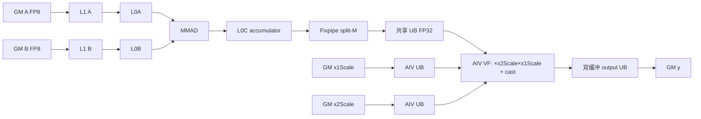
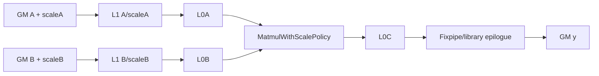
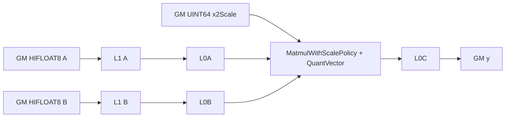

# TransposeQuantBatchMatMul 950 ACLNN 算子知识

## 算子速览

| 项目 | 内容 |
|---|---|
| 实际入口 | `aclnnTransposeQuantBatchMatMulGetWorkspaceSize` + `aclnnTransposeQuantBatchMatMul`，公开两段式 ACLNN，无版本后缀；本文不含 `WeightNz` 变体。 |
| 计算语义 | 将 `x1[M,B,K]` 按 `[1,0,2]` 视为 `A[B,M,K]`，将 `x2` 按 `permX2` 视为 `B[B,K,N]`，执行批量量化矩阵乘并按 `[1,0,2]` 输出 `y[M,B,N]`。 |
| 输入输出 | `x1/x2` 为三维 ND FP8 或 HIFLOAT8；K-C scale 为 FP32 一维，MX scale 为 FP8_E8M0 四维，T-C/HIFP8 scale 为 UINT64；输出为 ND FP16/BF16，HIFP8 路线还允许 HIFLOAT8。 |
| 执行类型 | R-001 为单 Kernel `MIX_CV`（`ASCENDC_TPL_MIX_AIC_1_2`）；R-002/R-003 为单 Kernel `AIC_CUBE`（`ASCENDC_TPL_AIC_ONLY`）。 |
| Kernel 路线 | R-001 K-C FP8：Cube 产生 FP32 对齐片到共享 UB，两个 AIV 完成双 scale 与 cast；R-002 MXFP8：`MatmulWithScalePolicy` AIC-only；R-003 HIFP8/T-C：AIC-only，`SetQuantVector` 后直接输出。 |
| 核心资源 | 核心算子 workspace 为 0；Matmul 实例使用 GM/L1/L0A/L0B/L0C，R-001 另使用共享 UB、AIV scale/output UB 和跨核 flag；ACLNN executor 的通用 `Contiguous/Cast/ViewCopy` workspace 由框架动态汇总。 |
| 来源闭包 | `source_closed`：公开 ACLNN→L0 launcher→Tiling registry/ASW→模板 key→单个 AscendC entry→三条实际 body→构建及 950 binary config 均可追溯；通用 ACLNN executor 与 AscendC Matmul primitive 明确作为框架/库边界。 |
| 验证状态 | 已完成源码闭包检查；本次知识提取未执行编译、真机、数值或性能测试。 |

## 接口与语义

### 计算语义

定义 `A[b,m,k] = x1[m,b,k]`。`permX2=[0,1,2]` 时 `B[b,k,n]=x2[b,k,n]`；MXFP8/HIFP8 还允许 `permX2=[0,2,1]`，此时 `B[b,k,n]=x2[b,n,k]`。输出物理 ND 地址遵循 `y[m,b,n]`，对应：

```text
acc[b,m,n] = sum_k A[b,m,k] * B[b,k,n]
K-C FP8: y[m,b,n] = cast_RINT(acc_fp32[b,m,n] * x2Scale[n] * x1Scale[m])
MXFP8:     group scale 由 MatmulWithScalePolicy 按 K/32 分组消费并直接产生 y
HIFP8/T-C: x2Scale 的 UINT64 quant vector 由 SetQuantVector 交给 Matmul 实例，直接产生 y
```

K-C 的源码顺序是 accumulator→FP32→乘 `x2Scale`→乘 `x1Scale`→`CAST_RINT` 到 FP16/BF16。MX/HIF 的 scale 编码与内部累加/舍入由仓外 `lib/matmul_intf.h` 实现；固定仓只证明所选 policy、scale 指针和调用顺序，不外推其内部位级语义。`bias` 为保留参数，公开入口强制为空。

### 输入、输出与属性

| 参数 | shape/layout | dtype | 约束、默认值与语义 |
|---|---|---|---|
| `x1` | 3D ND，公开例为 `[M,B,K]` | FP8_E5M2/FP8_E4M3FN；MX 仅 E4M3FN；T-C 为 HIFLOAT8 | `permX1` 仅 `[1,0,2]`；非空；M/B/K 均为正。 |
| `x2` | 3D ND，`[B,K,N]` 或 `[B,N,K]` | 与路线匹配的 FP8/HIFLOAT8 | 本卡只闭合 ND；`WeightNz`/FRACTAL_NZ 不在范围。B、K 必须与 `x1` 相等。 |
| `bias` | N/A | N/A | 必须为 `nullptr`。 |
| `x1Scale` | K-C `[M]`；MX `[M,B,ceil(ceil(K/32)/2),2]`；HIFP8/T-C 按公开契约为空或 `[1]` | FP32 / FP8_E8M0 / UINT64 | MX 的两个末级元素覆盖每 64 K 元素内的两个 32 元素组。HIFP8 Device 不读取该指针，Host 代码也跳过其 shape 校验，但调用者仍应遵守公开 `[1]` 契约。 |
| `x2Scale` | K-C/HIFP8 `[N]`；MX 经 `permX2` 后为 `[B,numGroup,N,2]` | FP32 / FP8_E8M0 / UINT64 | 不得为空。 |
| `dtype` | scalar | INT32 | 必须等于 `out` dtype 枚举：FP16=1、BF16=27；HIFP8 route 还允许 HIFLOAT8=34。 |
| `groupSize` | 低 48 bit 按 M/N/K 各 16 bit 编码 | INT64 | MX 要求 M/N 为 0 或 1，K=32；非 MX 未做等价约束检查。 |
| `permX1` | 长度 3 | INT64 array | 仅 `[1,0,2]`。 |
| `permX2` | 长度 3 | INT64 array | K-C 仅 `[0,1,2]`；MX/HIFP8 为 `[0,1,2]` 或 `[0,2,1]`。 |
| `permY` | 长度 3 | INT64 array | 仅 `[1,0,2]`。 |
| `batchSplitFactor` | scalar | INT32 | 仅 1。 |
| `out` | 3D ND `[M,B,N]` | FP16/BF16；HIFP8 route 可 HIFLOAT8 | 非空，dtype 必须与属性相同。 |

### 入口与版本

固定 Commit 仅有无后缀公开入口，未发现同一 950 平台的更新版本族。公开产品表明确仅支持 Ascend 950PR/950DT，A2/A3 均为不支持。`aclnnTransposeQuantBatchMatMulWeightNz*` 虽与本入口同文件实现，但属于单独公开语义变体，本卡不提取其 FRACTAL_NZ 路线。

## Host/Launcher 执行流程

### 参数校验与前处理

第一段接口创建 executor，依次执行平台 `IsNpuArch3510Series()`、空指针、perm、shape/scale、dtype/output、format、groupSize、`batchSplitFactor==1`、非空 tensor 和 `bias==nullptr` 检查。通过后：

1. `x1/x2` 进入 `l0op::Contiguous`；本卡路线将二者 `ReFormat` 为 ND。
2. 非空的 `x1Scale/x2Scale` 进入 `Contiguous`。
3. `l0op::TransposeQuantBatchMatMul` 分配 ND 输出，执行 infer shape，并用 `ADD_TO_LAUNCHER_LIST_AICORE` 添加核心节点。
4. 外层再添加通用 `Cast` 与 `ViewCopy`；`dtype` 已强制等于 `out` dtype，具体消除/执行由 executor 框架决定。
5. 任一步返回空或 launcher 添加失败即停止并返回错误，不提交后续输出节点。

### 参数、Workspace 与生命周期

核心 ASW tiling 的 `GetWorkspaceSize()` 明确返回 `{0}`，kernel 中取得的 `GetUserWorkspace(workspaceGM)` 未被实际 body 读写。ACLNN 第一段返回的是整个 executor 的 `GetWorkspaceSize()`，其中可能包含通用连续化、Cast/ViewCopy 的空间；其具体切片公式不在固定仓算子源码中。executor 由第一段 `ReleaseTo` 交给调用者，第二段在给定 stream 上通过 `CommonOpExecutorRun` 消费；输入、输出、workspace 与 executor 必须保持到 stream 工作完成。

### 启动图与失败传播

```text
aclnnTransposeQuantBatchMatMulGetWorkspaceSize
  -> CheckParams / empty / bias
  -> Contiguous + ReFormat(ND)              [框架边界]
  -> l0op::TransposeQuantBatchMatMul
     -> INFER_SHAPE
     -> ADD_TO_LAUNCHER_LIST_AICORE
        -> TransposeQuantBatchMatMulTilingFunc
        -> BASE(999) ASW template on DAV_3510
        -> transpose_quant_batch_mat_mul<PERM_X1,PERM_X2,BATCH_SPLIT,PRECISION_MODE>
  -> Cast + ViewCopy                         [框架边界]
aclnnTransposeQuantBatchMatMul
  -> CommonOpExecutorRun(workspace, executor, stream)
```

核心节点 `blockDim=compileInfo.aicNum`。模板 key 把 R-001 编译为 1 AIC:2 AIV 的 MIX_CV，R-002/R-003 编译为 AIC-only。构建显式 `AUTO_SYNC false`，因此 R-001 的可见性来自 body 中的 cross-core flag；外部 executor 节点按同一 stream 的框架顺序执行。核心节点失败会使 executor run 返回失败，后继 Cast/ViewCopy 不应产生有效提交。

## Route 与参数设计

### 分核与资源计算

Host 从 perm 后 shape 得到 `B/M/K/N`，DAV_3510 的 ASW 初始 `baseM=256`、`baseN=256`、`baseK=128/sizeof(x1)=128`，`usedCoreNum=aicNum`，`singleCoreK=K`。tile 数为 `mCnt=ceil(M/baseM)`、`nCnt=ceil(N/baseN)`、`totalCnt=mCnt*nCnt*B`，每 AIC 处理 `round=ceil(totalCnt/usedCoreNum)`；M 方向使用最多 4 核的滑窗行分配，奇数行反转 N 遍历。尾块为 `M-(mCnt-1)*baseM` 与 `N-(nCnt-1)*baseN`。

K-C 的 L1 计算枚举 `stepK<=min(ceil(K/baseK),8)`，要求双缓冲 A/B 总量不超过可用 L1，并优先满足 256/512B K 对齐；`depthA1=depthB1=2*stepK`。MX/HIF 使用算子自定义深度算法；MX 还把 `baseScaleA/baseScaleB` 纳入 L1 并把 scaleFactor 编码到 `mxTypePara`。所有路线核心 workspace 为 0。

### Route 选择

| 顺序 | Route | Key/模板 | 精确选择条件与优先级 | 不适用去向 |
|---:|---|---|---|---|
| 1 | R-001 K-C FP8 MIX_CV | `(permX1=1,permX2=0,batchSplit=0,precision=FP8)`；BASE 999 | scale 均 FP32；x1/x2 为支持的 E5M2/E4M3FN 组合；K=512、N=128；permX2 `[0,1,2]`；且 `aivNum==2*aicNum` | 条件失败不是下一模板，而是参数/能力失败。 |
| 2 | R-002 MXFP8 AIC-only | `(1,0\|1,0,MXFP8)`；BASE 999 | x1/x2 E4M3FN；scale 均 E8M0；K%64=0；group M/N∈{0,1}, K=32；permX2 两种 | 参数失败。 |
| 3 | R-003 HIFP8/T-C AIC-only | `(1,0\|1,0,HIFP8)`；BASE 999 | x1/x2 HIFLOAT8；x2Scale UINT64，x1Scale 空或 UINT64；permX2 两种；输出三种；因共用 `IsCapable`，仍要求 `aivNum==2*aicNum` | 参数/能力失败。 |

```text
if platform != DAV_3510: fail
validate public API and ND scope
if x1Scale.dtype == E8M0 && x2Scale.dtype == E8M0:
    precision=MXFP8 -> R-002
else if x1.dtype == HIFLOAT8 && x2.dtype == HIFLOAT8:
    precision=HIFP8 -> R-003
else:
    precision=FP8; require aivNum==2*aicNum -> R-001
BASE(999) IsCapable/DoTiling/PostTiling; any failure -> no general tiling
```

### 模板/实现执行矩阵

| Route | key/selector | dtype/shape/platform 完整命中条件 | 执行族与 kernel 节点 | 实际模板/body | 内存与同步特征 | tail/fallback |
|---|---|---|---|---|---|---|
| R-001 | FP8 tuple | 950、ND、K=512、N=128、FP32 scales、固定 perm | 单 `MIX_CV`，1 AIC:2 AIV | `MatmulImpl<...,TQBmmCustomMatmulPolicy>`；AIV `VFDoDequant` | L0C→Fixpipe→共享 UB；flag 8/24 AIC→AIV，6/22 AIV→AIC；AIV 双 scale/output UB | M/N tail 由 `singleCoreM/N`；AIV 按 M 对半且最多 4 段；无 fallback。 |
| R-002 | MXFP8 tuple | 950、ND、E4M3FN、E8M0 scale、K 对齐与 group 约束 | 单 `AIC_CUBE` | `MatmulWithScalePolicy` + `SetTensorScaleA/B` | scale 与 A/B 进入 Matmul 当前实例，C 直接 GM；无 AIV flag | M/N tail；permX2 决定 B transpose；无 fallback。 |
| R-003 | HIFP8 tuple | 950、ND、HIFLOAT8、UINT64 scale | 单 `AIC_CUBE` | `MatmulWithScalePolicy` + `SetQuantVector` | x2Scale quant vector 直接供 Matmul，C 直接 GM；无 AIV flag | M/N tail；无 fallback。 |

### 隐藏性能 Guard

| Guard | Host/Tiling 条件 | Device/资源原因 | 影响 Route | 不满足时去向 | 源码符号 |
|---|---|---|---|---|---|
| 平台 | `IsNpuArch3510Series()` 且 registry 有 DAV_3510 BASE | 只有 arch35 specialization | 全部 | ACLNN 参数失败/tiling 失败 | `CheckParams`；`GetTransposeQuantBatchMatMulPriorities` |
| CV 核比 | 非 MX 时 `aivNum==2*aicNum` | R-001 需要每 AIC 两个 AIV；同一能力谓词也约束 HIF key | R-001、R-003（虽然后者 Device 为 AIC-only） | `IsCapable=false`，无下一模板 | `TransposeQuantBatchMatMulAswTiling::IsCapable` |
| K-C shape | `K==512 && N==128` | 固定 K-C specialization | R-001 | 参数失败 | `TQBMMGetShapeMKN` |
| MX K/group | `K%64==0`；group K=32、M/N 0或1 | scale 每 32 K 分组，两组组成末维 2 | R-002 | 参数失败 | `CheckScale`；`IsValidGroupSize` |
| L1 | 双缓冲 A/B（MX 还含 scale）不超过 `compileInfo.l1Size` | 决定 step/depth 与 scaleFactor | 全部 | 缩小 step/factor；无其它 route | `CalL1TilingDefault`；`CalL1Tiling` |
| stepK | `stepKa/stepKb<=4`（MX/HIF 自定义） | 防 issue queue 阻塞 | R-002/R-003 | 截断为 4 | `CalStepKs` |
| UB | R-001 的四类队列容量按 base tile 分配 | 两 AIV 分 M、输出分段以适配 UB | R-001 | 固定仓无运行时 fallback | `TransposeQuantBatchMatMulAswKernel::Init` |
| 格式 | x1/y/scales 非 NZ；本卡 x2 也限 ND | 当前卡排除 WeightNz | 全部 | ACLNN 参数失败/不在本卡 | `CheckParams` |

### POD/ABI

`BatchMatMulV3TilingData` 与内层 `MatMulV3TilingData` 均 `#pragma pack(push,8)`。`TCubeTiling` 来自仓外 `kernel_tiling/kernel_tiling.h`，固定仓没有其完整声明，所以其 `sizeof/alignof/offsetof` 只能标为不可见；下表给出固定仓能证明的字段与相对布局。设 `S=sizeof(TCubeTiling)`，`P=align8(S+40)=sizeof(MatMulV3TilingData)`。

| 结构 | 字段 | 类型/位宽 | ABI 布局 | 单位 | Host/launcher producer | Device consumer | 边界 |
|---|---|---|---|---|---|---|---|
| `TCubeTiling` | `M` | 固定仓声明不可见 | `offsetof` 不可见 | element | `InitTCubeTilingData::SetShape` | block tile、`SetOrgShape` | `(0,INT32_MAX]` |
| `TCubeTiling` | `N` | 同上 | 不可见 | element | 同上 | block tile、GM offset/copy stride | 正数；K-C=128 |
| `TCubeTiling` | `Ka` | 同上 | 不可见 | element | `SetShape`/GetTiling | A/scale offset | 正数 |
| `TCubeTiling` | `Kb` | 同上 | 不可见 | element | 同上 | B offset/SetOrgShape | 等于 Ka |
| `TCubeTiling` | `usedCoreNum` | 同上 | 不可见 | AIC core | `runInfo.usedCoreNum` | round/index | `aicNum>0` |
| `TCubeTiling` | `singleCoreM` | 同上 | 不可见 | element | `runInfo.singleCoreM` | Matmul single shape | tail 前上界 |
| `TCubeTiling` | `singleCoreN` | 同上 | 不可见 | element | `runInfo.singleCoreN` | Matmul single shape | tail 前上界 |
| `TCubeTiling` | `singleCoreK` | 同上 | 不可见 | element | `runInfo.singleCoreK=K` | Matmul single shape | K |
| `TCubeTiling` | `baseM` | 同上 | 不可见 | element | `runInfo.baseM` | tile、UB 容量 | DAV_3510 初值 256 |
| `TCubeTiling` | `baseN` | 同上 | 不可见 | element | `runInfo.baseN` | tile、UB 容量 | 初值 256 |
| `TCubeTiling` | `baseK` | 同上 | 不可见 | element | `runInfo.baseK` | Matmul L1/L0 | 初值 128 |
| `TCubeTiling` | `depthA1` | 同上 | 不可见 | L1 stage | tiling depth | MatmulImpl | >=2 常规双缓冲 |
| `TCubeTiling` | `depthB1` | 同上 | 不可见 | L1 stage | tiling depth | MatmulImpl | 同上 |
| `TCubeTiling` | `stepM` | 同上 | 不可见 | tile | runInfo | MatmulImpl | 初值 1 |
| `TCubeTiling` | `stepN` | 同上 | 不可见 | tile | runInfo | MatmulImpl | 初值 1 |
| `TCubeTiling` | `stepKa` | 同上 | 不可见 | baseK tile | L1 tiling | MatmulImpl | 自定义路线 <=4 |
| `TCubeTiling` | `stepKb` | 同上 | 不可见 | baseK tile | L1 tiling | MatmulImpl | 自定义路线 <=4 |
| `TCubeTiling` | `iterateOrder` | 同上 | 不可见 | enum | runInfo | MatmulImpl | 初值 col-first |
| `TCubeTiling` | `dbL0C` | 同上 | 不可见 | buffer depth flag | runInfo | MatmulImpl | 初值关闭 |
| `TCubeTiling` | `BatchNum` | 同上 | 不可见 | batch | iterBatch | MatmulImpl | 当前 batch 信息 |
| `TCubeTiling` | `mxTypePara` | 同上 | 不可见 | packed bits | `GetTilingDataProcess` | `MatmulWithScalePolicy` | 仅 R-002 有效 |
| `MatMulV3TilingData` | `tCubeTiling` | `TCubeTiling` | offset 0，size `S` | POD | base tiling | `mm.Init`/block | 完整 ABI 在仓外头 |
| `MatMulV3TilingData` | `mTailCnt` | `uint32_t` | `S+0` | tile count | base tiling | 当前 custom block 不读 | inactive |
| `MatMulV3TilingData` | `nTailCnt` | `uint32_t` | `S+4` | tile count | base tiling | 不读 | inactive |
| `MatMulV3TilingData` | `kTailCnt` | `uint32_t` | `S+8` | tile count | base tiling | 不读 | inactive |
| `MatMulV3TilingData` | `mBaseTailSplitCnt` | `uint32_t` | `S+12` | split count | base tiling | 不读 | inactive |
| `MatMulV3TilingData` | `nBaseTailSplitCnt` | `uint32_t` | `S+16` | split count | base tiling | 不读 | inactive |
| `MatMulV3TilingData` | `mTailMain` | `uint32_t` | `S+20` | element | base tiling | 不读 | inactive |
| `MatMulV3TilingData` | `nTailMain` | `uint32_t` | `S+24` | element | base tiling | 不读 | inactive |
| `MatMulV3TilingData` | `isHf32` | `uint32_t` | `S+28` | bool | args | Matmul library | 路线相关 |
| `MatMulV3TilingData` | `aswWindowLen` | `uint32_t` | `S+32` | core factor | `GetAswWindowLen` | 当前 custom block 固定窗口 4，不读此字段 | inactive in body |
| `MatMulV3TilingData` | `l2CacheDisable` | `uint32_t enum` | `S+36`；结构 size `P` | mode | `SetDisableL2cache` | Matmul library | enum 0..3 |
| `BatchMatMulV3TilingData` | `matMulTilingData` | nested POD | offset 0，size `P` | POD | base tiling | kernel/mm/block | required |
| `BatchMatMulV3TilingData` | `aBatchDimAll` | `uint32_t` | `P+0` | batch | `batchInfo.batchA` | 当前 body 不读 | inactive |
| `BatchMatMulV3TilingData` | `bBatchDimAll` | `uint32_t` | `P+4` | batch | `batchInfo.batchB` | 当前 body 不读 | inactive |
| `BatchMatMulV3TilingData` | `cBatchDimAll` | `uint32_t` | `P+8` | batch | `batchInfo.batchC` | offsets、tile count、strides | >0 |
| `BatchMatMulV3TilingData` | `biasBatchDimAll` | `uint32_t` | `P+12` | batch | batchInfo | 不读 | bias 禁止 |
| `BatchMatMulV3TilingData` | `aBatchDim0` | `uint32_t` | `P+16` | batch | batchInfo | 不读 | inactive |
| `BatchMatMulV3TilingData` | `bBatchDim0` | `uint32_t` | `P+20` | batch | batchInfo | 不读 | inactive |
| `BatchMatMulV3TilingData` | `cBatchDim0` | `uint32_t` | `P+24` | batch | batchInfo | 不读 | inactive |
| `BatchMatMulV3TilingData` | `aBatchDim1` | `uint32_t` | `P+28` | batch | batchInfo | 不读 | inactive |
| `BatchMatMulV3TilingData` | `bBatchDim1` | `uint32_t` | `P+32` | batch | batchInfo | 不读 | inactive |
| `BatchMatMulV3TilingData` | `cBatchDim1` | `uint32_t` | `P+36` | batch | batchInfo | 不读 | inactive |
| `BatchMatMulV3TilingData` | `aBatchDim2` | `uint32_t` | `P+40` | batch | batchInfo | 不读 | inactive |
| `BatchMatMulV3TilingData` | `bBatchDim2` | `uint32_t` | `P+44` | batch | batchInfo | 不读 | inactive |
| `BatchMatMulV3TilingData` | `cBatchDim2` | `uint32_t` | `P+48` | batch | batchInfo | 不读 | inactive |
| `BatchMatMulV3TilingData` | `aBatchDim3` | `uint32_t` | `P+52` | batch | batchInfo | 不读 | 当前写 B |
| `BatchMatMulV3TilingData` | `bBatchDim3` | `uint32_t` | `P+56` | batch | batchInfo | 不读 | 当前写 B |
| `BatchMatMulV3TilingData` | `cBatchDim3` | `uint32_t` | `P+60` | batch | batchInfo | 不读 | 当前写 B |
| `BatchMatMulV3TilingData` | `iterBatch` | `uint32_t` | `P+64` | batch | runInfo | 不读 | inactive |
| `BatchMatMulV3TilingData` | `batchOutNum` | `uint32_t` | `P+68` | batch | runInfo | 不读 | inactive |
| `BatchMatMulV3TilingData` | `batchSplitFactor` | `uint32_t` | `P+72` | factor | ASW tiling | 当前 body 不读 | 固定 1 |
| `BatchMatMulV3TilingData` | `mL1` | `uint32_t` | `P+76` | element | base tiling | Matmul library | aligned/capped |
| `BatchMatMulV3TilingData` | `nL1` | `uint32_t` | `P+80` | element | base tiling | Matmul library | aligned/capped |
| `BatchMatMulV3TilingData` | `kL1` | `uint32_t` | `P+84` | element | base tiling | Matmul library | `baseK*min(stepK,4)` |
| `BatchMatMulV3TilingData` | `l1BufferNum` | `uint8_t` | `P+88` | depth | base tiling | Matmul library | 8-bit narrow |
| `BatchMatMulV3TilingData` | `ubDB` | `uint8_t` | `P+89` | depth | base tiling | Matmul library | 默认 1；后有 2B padding |
| `BatchMatMulV3TilingData` | `sliceM` | `uint32_t` | `P+92` | element | base tiling | Matmul library | 当前连续输入为 baseM |
| `BatchMatMulV3TilingData` | `srcNdStride` | `uint32_t` | `P+96` | element | base tiling | Matmul library | 当前为 1 |
| `BatchMatMulV3TilingData` | `innerBatch` | `uint32_t` | `P+100`；结构 size `P+104` | batch | base tiling | Matmul library | 当前 runInfo |

### Route 源码闭包

| Route | Key/selector | Host/Tiling producer | POD/参数 | Kernel entry/router | Kernel body/直接依赖 | 构建接线 |
|---|---|---|---|---|---|---|
| R-001 | FP8/MIX 1:2 | `CheckParams`；`DoTiling`；ASW BASE | `BatchMatMulV3TilingData` | `transpose_quant_batch_mat_mul<...,FP8>` | `AswKernel::Process/DequantCompute/VFDoDequant`；custom CopyCubeOut | 950 binary FP8 entries；arch35 kernel CMake |
| R-002 | MXFP8/AIC-only | 同上 + MX scale/group checks | 同上 + `mxTypePara` | `<...,MXFP8>` | `SetTensorScaleA/B`；`MatmulWithScalePolicy` | 950 E8M0 ND entries |
| R-003 | HIFP8/AIC-only | 同上 + HIF dtype checks | 同上 | `<...,HIFP8>` | `SetQuantVector`；`MatmulWithScalePolicy` | 950 HIFP8 ND entries |

## Kernel 实现

### 公共执行流程

三个 Route 共用单 entry。entry 解析 `BatchMatMulV3TilingData`，根据编译期 `DTYPE_X2_SCALE` 大小选择 precision specialization；`aTran=false`，`bTran=(PERM_X2==1)`。block scheduler 将 `(batch,mTile,nTile)` 映射到 AIC，奇数 M 行反向走 N 以形成蛇形访问；每轮计算有效 tile 的 GM offset、tail `singleCoreM/N`，再调用对应 Matmul 实例。没有跨 kernel workspace 边。

### Route R-001：K-C FP8 MIX_CV

#### 适用条件

##### 选择证据

| 层级 | 文件 | 符号 | 源码谓词/参数 | 结果/下一跳 |
|---|---|---|---|---|
| API | `op_api/aclnn_transpose_quant_batch_mat_mul.cpp` | `CheckDtypeValid/CheckShapeValid` | 非 MX/HIF；scale FP32；K=512,N=128 | K-C route，否则错误 |
| Tiling | `.../transpose_quant_batch_mat_mul_asw_tiling.cpp` | `IsCapable` | `aivNum==2*aicNum` | BASE template，否则 registry 失败 |
| Key | `op_kernel/arch35/transpose_quant_batch_mat_mul_tiling_key.h` | `ASCENDC_TPL_SEL` | FP8 + fixed perms | `ASCENDC_TPL_MIX_AIC_1_2` |
| Entry | `op_kernel/arch35/transpose_quant_batch_mat_mul.cpp` | `sizeof(DTYPE_X2_SCALE)==sizeof(float)` | FP32 x2Scale | FP8 specialization |

#### Device 数据流

##### 函数级调用链

```text
transpose_quant_batch_mat_mul<1,0,0,FP8>
  -> AswKernel::Init
  -> AswBlock::UpdateBasicIndex/UpdateBlockParams/CalcGMOffset
  -> AIC: WaitForVector(if reused) -> MMCompute -> MatmulImpl::Iterate/GetTensorC(shared UB) -> NotifyVector
  -> AIV0/AIV1: WaitForCube -> DequantCompute
       -> CopyDataFromGm2Ub -> VFDoDequant -> CopyDequantResFromUb2Gm -> NotifyCube
  -> AIC final WaitForVector
```

##### 源码等价伪码

```text
for round j assigned to paired AIC/AIVs:
  tile = snake_schedule(blockIdx + j*usedCoreNum)
  if tile valid:
    compute A/B/C/x1Scale/x2Scale offsets
    AIC:
      if j>0: wait flags 6 and 22
      floatShared = Matmul(A,B) via L1/L0 and L0C->UB split-M Fixpipe
      set flags 8 and 24
    each AIV subBlock s:
      wait flag 8 at its endpoint
      rows = split_even(singleCoreM, s)
      load x2Scale[nTile] and x1Scale[mTile+row]
      split rows into min(rows,4) pieces
      for every vector-register N chunk:
        out = cast_RINT(floatShared * x2Scale * broadcast(x1Scale))
      strided copy y[m,b,n]
      set completion flag 6 at paired endpoint
    AIC waits both completion endpoints before reuse/final exit
```

#### 内存与数据搬运

##### 资源与搬运表

| 层级/缓冲区 | offset/地址公式 | extent/容量公式 | dtype/layout | producer | consumer | owner/lifetime | 对齐/复用 |
|---|---|---|---|---|---|---|---|
| GM A | `mOff*B*K + b*K` | valid `singleM*K` strided by B | FP8 ND logical `[M,B,K]` | ACLNN input | Matmul A loader | caller, stream lifetime | Matmul handles K/tail |
| GM B | `b*N*K+nOff` or ND transpose equivalent | valid `K*singleN` | FP8 ND | caller | Matmul B loader | caller | K-C only non-transposed B |
| L1 A/B | Matmul internal | `depthA1*baseM*baseK*1B + depthB1*baseN*baseK*1B` | Matmul tile | MTE | L0A/L0B | per AIC/tile | true depth includes double buffer |
| L0A/L0B | Matmul internal | exact physical allocation fixed仓不可见；tile logical baseM×baseK / baseN×baseK | Cube native | Matmul loader | MMAD | Matmul instance | governed by TCubeTiling |
| L0C | Matmul internal | logical accumulator tile；exact dtype/capacity fixed仓不可见 | Cube accumulator | MMAD | custom Fixpipe | per tile | `dbL0C` from POD |
| shared UB result | subblock split-M address | `ceil(baseM/2)*baseN*4B` per destination | FP32 ND_ALIGN | AIC custom CopyCubeOut | paired AIV | `vecQueMMRes_`, depth1, until completion flags | M aligned even; N 32B aligned stride |
| AIV x2 scale UB | 0 | `baseN*4B` | FP32 | GM DataCopyPad | VF | depth1/tile | blockLen `singleN*4` |
| AIV x1 scale UB | 0 | `align32(ceil(baseM/2)*4B)` | FP32 | GM DataCopyPad | VF broadcast | depth1/tile | 32B capacity alignment |
| AIV output UB | ping/pong | `2*ceil(ceil(baseM/2)/4)*baseN*sizeof(cType)` | FP16/BF16 ND | VF | GM copy | `vecQueOut_`, depth2 | rows divided up to 4 |
| GM C | `mOff*B*N+b*N+nOff + rowOffset*B*N` | `singleM*singleN` valid elements | FP16/BF16 ND `[M,B,N]` | AIV | API output | caller | dst stride `(B*N-singleN)*sizeof(cType)` |
| workspace | N/A | 0 | N/A | N/A | N/A | N/A | core route does not use `user` |

##### 分层内存布局



##### 字节账、交接边与复用顺序

```text
workspace_total = 0
L1_total = depthA1*baseM*baseK + depthB1*baseN*baseK bytes
shared_result_UB = ceil(baseM/2)*baseN*4 bytes
AIV_private_UB = shared_result_UB + baseN*4
               + align32(ceil(baseM/2)*4)
               + 2*ceil(ceil(baseM/2)/4)*baseN*sizeof(cType)
L0 physical bytes = fixed仓外 Matmul primitive根据 TCubeTiling 分配，不能从逻辑 tile 反推
```

| 边/复用子区 | producer | offset/extent | dtype/layout | consumer | ordering/sync | owner/lifetime | 安全条件 |
|---|---|---|---|---|---|---|---|
| AIC→AIV0/1 | custom Fixpipe | each split-M half，`ceil(singleM/2)*alignN` | FP32 ND_ALIGN | `VFDoDequant` | AIC set 8/24；AIV wait 8 on endpoint | shared UB queue until both AIV complete | AIC waits 6/22 before next overwrite |
| output ping/pong | VF | one row-piece | cType ND | DataCopyPad | TQue en/dequeue | AIV tile lifetime | depth2 and immediate free |
| tile reuse | AIV0/1 | current scale/result slices | mixed | next AIC round | each AIV set 6；AIC wait 6/22 | paired core group | final extra wait consumes last notify |

#### 同步、精度与尾块

##### 同步与数值边界表

| 阶段 | primitive/机制 | producer | consumer/等待点 | 保护对象 | 精度/尾块 |
|---|---|---|---|---|---|
| Cube→Vector | `CrossCoreSetFlag<4,PIPE_FIX>(8,24)` / wait | AIC | 两 AIV | shared UB FP32 | Fixpipe M 向上对齐偶数并 split-M |
| Vector→Cube | `CrossCoreSetFlag<4,PIPE_V>(6)` / AIC wait 6,22 | 两 AIV | AIC next/final round | shared UB overwrite | 双端点完成后才复用 |
| dequant | MicroAPI mask + `CAST_RINT` | FP32 acc/scales | FP16/BF16 output | register/UB valid lanes | N mask；M tail 对半，0 行直接返回 |
| GM write | `DataCopyPad` with dstStride | AIV | output | valid M×N tile | `singleN` blockLen，跨 batch-M stride |

#### 关键实现

##### 符号证据表

| 阶段 | 文件 | 符号/模板实例 | 实现事实 |
|---|---|---|---|
| Host/Tiling producer | `.../transpose_quant_batch_mat_mul_asw_tiling.cpp` | `DoOpTiling/IsCapable/GetTilingDataProcess` | FP8 key、核比、0 workspace |
| Kernel entry/router | `op_kernel/arch35/transpose_quant_batch_mat_mul.cpp` | float scale specialization | MIX body 实例 |
| Device body/helper | `...asw_kernel_advanced.h` | `Process/DequantCompute/VFDoDequant` | flag、双 scale、mask/cast/tail |
| Device body/helper | `mm_extension_interface/tqbmm_copy_cube_out.h` | `TQBmmCustomCopyCubeOut` | L0C→UB dual-dst split-M Fixpipe |

### Route R-002：MXFP8 AIC-only

#### 适用条件

##### 选择证据

| 层级 | 文件 | 符号 | 源码谓词/参数 | 结果/下一跳 |
|---|---|---|---|---|
| API | API implementation | `IsMicroScaling/CheckScaleValid/InferGroupSize` | both scales E8M0，K%64=0，group K=32 | MX route |
| Tiling | advanced/asw tiling | `CheckScale/DoOpTiling` | MX shapes；`precisionMode_=MXFP8` | custom L1 + `mxTypePara` |
| Key | tiling key | `ASCENDC_TPL_SEL` | MXFP8, permX2 0/1 | AIC-only |
| Entry | kernel entry | `sizeof(DTYPE_X2_SCALE)==sizeof(uint8_t)` | E8M0 | MX specialization |

#### Device 数据流

##### 函数级调用链

```text
entry<...,MXFP8> -> Init(AIC only)
  -> mm.Init(MatmulWithScalePolicy) -> SetOrgShape
  -> block schedule/offset
  -> mm.SetSingleShape
  -> mm.SetTensorScaleA(x1Scale[offset], false)
  -> mm.SetTensorScaleB(x2Scale[offset], bTrans)
  -> MMCompute -> SetTensorA/B -> Iterate -> GetTensorC(GM)
```

##### 源码等价伪码

```text
for each valid (b,mTile,nTile):
  scaleAOff = mOff*B*(2*ceil(K/64)) + b*(2*ceil(K/64))
  scaleBOff = b*N*2*ceil(K/64) + nOff*(bTrans ? 2*ceil(K/64) : 2)
  configure MatmulWithScalePolicy with scaleA/scaleB and mxTypePara
  Matmul(A,B) -> direct GM y[m,b,n]
```

#### 内存与数据搬运

##### 资源与搬运表

| 层级/缓冲区 | offset/地址公式 | extent/容量公式 | dtype/layout | producer | consumer | owner/lifetime | 对齐/复用 |
|---|---|---|---|---|---|---|---|
| GM A/B | 与公共 block offset 相同 | valid M/K/N tile | E4M3FN ND | caller | MatmulWithScalePolicy | caller | bTrans specialization |
| GM scale A | 上述 `scaleAOff` | per tile groups | E8M0 `[M,B,g,2]` | caller | `SetTensorScaleA` | caller | g=`ceil(K/64)` |
| GM scale B | 上述 `scaleBOff` | per tile groups | E8M0 | caller | `SetTensorScaleB` | caller | perm-sensitive |
| L1 | Matmul internal | `depthA1*(baseA+baseScaleA)+depthB1*(baseB+baseScaleB)` | Cube native | MTE | L0/scale path | per AIC | factor encoded in mxTypePara |
| L0A/L0B/L0C | Matmul internal | exact physical bytes fixed仓不可见 | MatmulWithScalePolicy | library | library/Fixpipe | tile | TCubeTiling |
| UB/寄存器 | N/A in operator body | Matmul primitive internal不可见 | N/A | library | library | library | 无 operator-owned AIV UB |
| GM C | `mOff*B*N+b*N+nOff` | `singleM*singleN` | FP16/BF16 ND | Matmul GetTensorC | output | caller | tail by single shape |
| workspace | N/A | 0 | N/A | N/A | N/A | N/A | no user workspace |

##### 分层内存布局



##### 字节账、交接边与复用顺序

```text
baseScaleA = align2(ceil(baseK/32))*baseM*sizeof(E8M0)
baseScaleB = align2(ceil(baseK/32))*baseN*sizeof(E8M0)
L1_total = depthA1*(baseM*baseK + baseScaleA)
         + depthB1*(baseN*baseK + baseScaleB) bytes
workspace_total = 0
L0/primitive-private bytes = fixed仓不可见
```

| 边/复用子区 | producer | offset/extent | dtype/layout | consumer | ordering/sync | owner/lifetime | 安全条件 |
|---|---|---|---|---|---|---|---|
| scale→Cube policy | GM scale tensors | tile/group offsets | E8M0 grouped | MatmulWithScalePolicy | same AIC pipeline | input owner until completion | group/shape checks passed |
| L0C→GM | Matmul | tile | cType ND | output | Matmul internal pipe | AIC tile lifetime | `GetTensorC` completes before tile reuse |

#### 同步、精度与尾块

##### 同步与数值边界表

| 阶段 | primitive/机制 | producer | consumer/等待点 | 保护对象 | 精度/尾块 |
|---|---|---|---|---|---|
| AIC pipeline | Matmul `Iterate/GetTensorC` | MMAD | Fixpipe/GM | L1/L0 tile | internal policy consumes E8M0 groups |
| Cross-core | N/A | N/A | N/A | N/A | AIC-only，无 AIV flags |
| tail | `SetSingleShape(singleCoreM,N,K)` | block scheduler | Matmul | boundary tile | M/N tail；K 保持完整且 64 对齐 |

#### 关键实现

##### 符号证据表

| 阶段 | 文件 | 符号/模板实例 | 实现事实 |
|---|---|---|---|
| Host/Tiling producer | advanced/asw tiling | `CheckScale/CalL1Tiling/CalScaleFactors` | MX shape、L1 scale、packed factor |
| Kernel entry/router | kernel entry/key | E8M0 specialization / AIC-only | route closure |
| Device body/helper | asw kernel | `aT/bT` with scale；`Process/MMCompute` | scale pointer→MatmulWithScalePolicy→GM |

### Route R-003：HIFP8/T-C AIC-only

#### 适用条件

##### 选择证据

| 层级 | 文件 | 符号 | 源码谓词/参数 | 结果/下一跳 |
|---|---|---|---|---|
| API | API implementation | `IsHIFP8/CheckDtypeHIFP8` | x1/x2 HIFLOAT8；scale INT64 被改标 UINT64；x1Scale 可空 | HIF route |
| Tiling | advanced/asw tiling | `isHIFP8_/DoOpTiling` | HIF inputs | custom L1；HIF key |
| Key | tiling key | HIFP8 tuple | permX2 0/1 | AIC-only |
| Entry | kernel entry | `sizeof(DTYPE_X2_SCALE)==sizeof(uint64_t)` | UINT64 x2Scale | HIF specialization |

#### Device 数据流

##### 函数级调用链

```text
entry<...,HIFP8> -> Init(AIC only)
  -> mm.Init(MatmulWithScalePolicy) -> SetOrgShape
  -> block schedule/offset
  -> mm.SetSingleShape
  -> mm.SetQuantVector(x2Scale[nOffset])
  -> MMCompute -> SetTensorA/B -> Iterate -> GetTensorC(GM)
```

##### 源码等价伪码

```text
for each valid tile:
  quantVector = x2Scale[nOffset]
  configure MatmulWithScalePolicy(quantVector)
  Matmul(HIFLOAT8 A, HIFLOAT8 B) -> direct GM output
// x1Scale pointer is not read by this Device specialization
```

#### 内存与数据搬运

##### 资源与搬运表

| 层级/缓冲区 | offset/地址公式 | extent/容量公式 | dtype/layout | producer | consumer | owner/lifetime | 对齐/复用 |
|---|---|---|---|---|---|---|---|
| GM A/B | common offsets | tile | HIFLOAT8 ND | caller | Matmul | caller | perm-sensitive B |
| GM quant vector | `nOffset` | per output-N vector | UINT64 | x2Scale | `SetQuantVector` | caller | x1Scale unused on Device |
| L1 | internal | `depthA1*baseM*baseK + depthB1*baseN*baseK` bytes | Cube native | MTE | L0 | AIC | custom depth/step<=4 |
| L0A/L0B/L0C | internal | exact physical bytes fixed仓不可见 | Matmul policy | library | library | tile | TCubeTiling |
| UB/寄存器 | N/A in operator body | primitive internal不可见 | N/A | library | library | library | no AIV body |
| GM C | common C offset | singleM×singleN | FP16/BF16/HIFLOAT8 ND | Matmul | output | caller | tail single shape |
| workspace | N/A | 0 | N/A | N/A | N/A | N/A | no user workspace |

##### 分层内存布局



##### 字节账、交接边与复用顺序

```text
L1_total = depthA1*baseM*baseK + depthB1*baseN*baseK bytes
workspace_total = 0
L0/quant-vector primitive-private bytes = fixed仓不可见
```

| 边/复用子区 | producer | offset/extent | dtype/layout | consumer | ordering/sync | owner/lifetime | 安全条件 |
|---|---|---|---|---|---|---|---|
| quant vector→Matmul | x2Scale GM | nOffset onward | UINT64 | `SetQuantVector` | same AIC pipeline | input until completion | dtype/shape checks |
| L0C→GM | Matmul | tile | selected cType ND | output | internal pipeline | tile | single shape tail |

#### 同步、精度与尾块

##### 同步与数值边界表

| 阶段 | primitive/机制 | producer | consumer/等待点 | 保护对象 | 精度/尾块 |
|---|---|---|---|---|---|
| AIC pipeline | Matmul Iterate/GetTensorC | MMAD | GM epilogue | tile | quant-vector 位级行为在仓外 primitive |
| Cross-core | N/A | N/A | N/A | N/A | AIC-only |
| tail | single shape | scheduler | Matmul | boundary | M/N tail；无 K 固定值检查但 K>0 |

#### 关键实现

##### 符号证据表

| 阶段 | 文件 | 符号/模板实例 | 实现事实 |
|---|---|---|---|
| Host/Tiling producer | API + advanced/asw tiling | `CheckDtypeHIFP8/isHIFP8_/DoOpTiling` | UINT64 scale 与 HIF key |
| Kernel entry/router | kernel entry/key | uint64 specialization / AIC-only | route closure |
| Device body/helper | asw kernel | `SetQuantVector/MMCompute` | x2Scale quant vector→Matmul→GM |

## 算子特定优化

### Trick T-001：按 scale 类型把 K-C 后处理从 MX/HIF Cube 路线中分离

#### 触发与源码依据

- 适用 Route：R-001、R-002、R-003
- 触发条件：编译 binary 的 `DTYPE_X2_SCALE` 分别为 FP32、E8M0 或 UINT64。
- Golden 来源：[`op_kernel/arch35/transpose_quant_batch_mat_mul.cpp:71`](../../../../../../../cann-ops-raw/ascendc/ops-nn/955f8b33985b6d72989ebff341bb9c2c564a51bc/matmul/transpose_quant_batch_mat_mul/op_kernel/arch35/transpose_quant_batch_mat_mul.cpp#L71-L85)

**官方源码（固定 Commit 连续逐字摘录）**：

```cpp
if constexpr (sizeof(DTYPE_X2_SCALE) == sizeof(uint64_t)) {
    TQBMM_IMPL_CLASS_COMMON_TRNAS(aTran, bTran, static_cast<int8_t>(TQBMMPrecisionMode::PRECISION_MODE_HIFP8),
                                  TransposeQuantBatchMatMulAdvanced::TransposeQuantBatchMatMulAswKernel,
                                  TransposeQuantBatchMatMulAdvanced::TransposeQuantBatchMatMulAswBlock,
                                  MM_CFG_NO_PRELOAD_OPEN_UNIT_FLAG);
} else if constexpr (sizeof(DTYPE_X2_SCALE) == sizeof(float)) {
    TQBMM_IMPL_CLASS_COMMON_TRNAS(aTran, bTran, static_cast<int8_t>(TQBMMPrecisionMode::PRECISION_MODE_FP8),
                                  TransposeQuantBatchMatMulAdvanced::TransposeQuantBatchMatMulAswKernel,
```

#### 机制与设计原因

同一个 entry 保留统一 scheduler，但通过编译期 scale 类型选择完全不同的 epilogue：K-C 输出到共享 UB 交给 AIV，MX/HIF 由 `MatmulWithScalePolicy` 在 AIC 路线直接输出 GM。这样 selector、POD 与 tile 映射保持共用，同时避免 AIC-only route 分配 K-C 的 AIV queues/flags。

#### 迁移边界

- 适用：有互斥 scale dtype、但共享矩阵 tile 调度的量化 Matmul。
- 前提：binary config、tiling precision key 与 entry dtype 宏三者一致。
- 失效：加入同字节宽但不同语义的 scale dtype 时，不能继续用 `sizeof` 唯一区分。
- 未验证：本次知识提取未执行编译、真机、数值或性能测试。

#### 错误做法

固定仓未提供可验证反例。

### Trick T-002：L0C→共享 UB 的 dual-destination split-M 与显式双向硬同步

#### 触发与源码依据

- 适用 Route：R-001
- 触发条件：FP8 key 编译为 `MIX_AIC_1_2`，custom Matmul policy 选择 `DUAL_DST_SPLIT_M`。
- Golden 来源：[`op_kernel/arch35/transpose_quant_batch_mat_mul_asw_kernel_advanced.h:117`](../../../../../../../cann-ops-raw/ascendc/ops-nn/955f8b33985b6d72989ebff341bb9c2c564a51bc/matmul/transpose_quant_batch_mat_mul/op_kernel/arch35/transpose_quant_batch_mat_mul_asw_kernel_advanced.h#L117-L128)

**官方源码（固定 Commit 连续逐字摘录）**：

```cpp
__aicore__ inline void NotifyCube() { AscendC::CrossCoreSetFlag<AIC_SYNC_AIV_MODE, PIPE_V>(AIV_SYNC_AIC_FLAG); }
__aicore__ inline void WaitForVector()
{
    AscendC::CrossCoreWaitFlag<AIC_SYNC_AIV_MODE, PIPE_FIX>(AIV_SYNC_AIC_FLAG);
    AscendC::CrossCoreWaitFlag<AIC_SYNC_AIV_MODE, PIPE_FIX>(AIV_SYNC_AIC_FLAG + FLAG_ID_MAX);
}
__aicore__ inline void NotifyVector()
{
    AscendC::CrossCoreSetFlag<AIC_SYNC_AIV_MODE, PIPE_FIX>(AIC_SYNC_AIV_FLAG);
    AscendC::CrossCoreSetFlag<AIC_SYNC_AIV_MODE, PIPE_FIX>(AIC_SYNC_AIV_FLAG + FLAG_ID_MAX);
}
```

#### 机制与设计原因

custom CopyCubeOut 将 M 对齐到偶数并把 L0C 结果分给两条 AIV destination。AIC 发布两个完成端点，AIV 消费后各自回报；AIC 在下一轮覆盖共享 UB 前等待两端，最后一轮额外 wait 消费 AIV 的最后通知。构建关闭 `AUTO_SYNC`，所以这些 flag 是路线闭合所必需的可见性协议。

#### 迁移边界

- 适用：一个 AIC tile 能按 M 独立切给两个 AIV 的后处理。
- 前提：1:2 task ratio、SSBUF 通信、flag ID 6/22 与 8/24 不冲突、Fixpipe 支持 split-M。
- 失效：AIC:AIV 比例变化、M 分片有跨片 reduce、或 workspace/GM 替代共享 UB 时必须重做协议。
- 未验证：本次知识提取未执行编译、真机、数值或性能测试。

#### 错误做法

若 AIC 仅等待一个 AIV completion 就复用共享 UB，另一 AIV 仍可能读取被覆盖数据；源码明确等待两个相差 `FLAG_ID_MAX` 的端点。

### Trick T-003：MX scale 与 A/B 一起参与 L1 深度和 factor 选择

#### 触发与源码依据

- 适用 Route：R-002
- 触发条件：两份 scale dtype 均为 E8M0。
- Golden 来源：[`op_host/op_tiling/arch35/transpose_quant_batch_mat_mul_asw_tiling.cpp:93`](../../../../../../../cann-ops-raw/ascendc/ops-nn/955f8b33985b6d72989ebff341bb9c2c564a51bc/matmul/transpose_quant_batch_mat_mul/op_host/op_tiling/arch35/transpose_quant_batch_mat_mul_asw_tiling.cpp#L93-L118)

**官方源码（固定 Commit 连续逐字摘录）**：

```cpp
uint64_t baseASize = runInfo_.baseM * runInfo_.baseK * args_.aDtypeSize;
uint64_t baseBSize = runInfo_.baseN * runInfo_.baseK * args_.bDtypeSize;
bool isMXFP8 =
    IsMicroScaling(context_->GetOptionalInputDesc(SCALE_X1_IDX), context_->GetOptionalInputDesc(SCALE_X2_IDX));
uint64_t baseScaleASize = !isMXFP8 ?
    0 :
    ops::CeilAlign(ops::CeilDiv(static_cast<uint64_t>(runInfo_.baseK), MX_GROUP_SIZE), MXFP_MULTI_BASE_SIZE) *
    runInfo_.baseM * ge::GetSizeByDataType(context_->GetOptionalInputDesc(SCALE_X1_IDX)->GetDataType());
```

#### 机制与设计原因

L1 深度不是只按 A/B 计算：MX route 将每个 baseK 的分组 scale 对齐到 2，分别乘 baseM/baseN，并与对应 A/B stage 一起预算。随后 `scaleFactorA/B` 同时受 K 方向、32KB 最小 load 和剩余 L1 约束，再打包到 `mxTypePara`，使 Device Matmul 实例按 Host 已验证的 factor 消费 scale。

#### 迁移边界

- 适用：scale 与矩阵 tile 同步进入 L1 的 grouped Matmul。
- 前提：group K=32、末维 2、factor 位域与 Matmul primitive ABI 一致。
- 失效：group 大小、scale dtype、L1 stage owner 或位域改变时必须重推全部字节账。
- 未验证：本次知识提取未执行编译、真机、数值或性能测试。

#### 错误做法

只用 A/B 字节计算 depth 会高估可用 L1；源码把 `baseScaleASize/baseScaleBSize` 加入每层 stage。

## 模板与实现对比

| 对比维度 | R-001 K-C FP8 | R-002 MXFP8 | R-003 HIFP8/T-C | 设计选择依据 |
|---|---|---|---|---|
| 命中条件/优先级 | FP32 scale、K512/N128 | E8M0 scale、K%64/group32 | HIFLOAT8 + UINT64 scale | dtype/scale 互斥；均 BASE 999 |
| 执行族/节点图 | 单 MIX_CV，1 AIC→2 AIV | 单 AIC_CUBE | 单 AIC_CUBE | tiling key kernel type |
| M/N/K、tile 与 scheduler | ASW 256×256×128 初值，固定 K/N | 同 scheduler，MX L1 factor | 同 scheduler，自定义 L1 depth | DAV_3510 ResetBase + route tiling |
| workspace/L1/L0/UB | 0；Matmul L1/L0 + shared/AIV UB | 0；L1 含 scale，无 operator AIV UB | 0；A/B L1，无 operator AIV UB | epilogue placement |
| AIC/AIV 或 kernel 交接 | flags 8/24 与 6/22 | N/A | N/A | MIX vs AIC-only |
| 同步、精度与 tail | FP32双 scale、RINT、M/N mask | primitive grouped scale；M/N tail | quant vector primitive；M/N tail | actual body |
| fallback/失败边界 | 核比/shape失败即终止 | group/scale失败即终止 | dtype/scale失败即终止 | registry 仅一个模板，无 fallback |

## 平台差异

| 项目 | A2 | A3 | 950 |
|---|---|---|---|
| 支持状态 | 公开文档明确不支持 | 公开文档明确不支持 | Ascend 950PR/950DT 支持 |
| Host/Launcher | 不生成正式卡 | 不生成正式卡 | DAV_3510 检查、BASE ASW、单核心 launcher 节点 |
| Kernel/资源 | N/A | `ascend350` 构建/config 存在不能推翻公开不支持结论 | arch35 entry；MIX 1:2 或 AIC-only；核心 workspace 0 |

## 限制与失败边界

- 本卡只覆盖公开 `aclnnTransposeQuantBatchMatMul` 的 ND x2 路线；`WeightNz` 变体与 FRACTAL_NZ binary 明确排除。
- A2/A3 产品表明确为不支持；不能用 `ascend350` config、arch35 路径或构建接线单独发布 A2/A3 卡。
- `bias` 必须为空，batchSplitFactor 必须 1，输入/output 不允许空 tensor。
- K-C 仅 K=512、N=128；MX 要求 K 为 64 倍数与 group K=32；perm、scale shape/dtype 必须严格匹配路线。
- `TCubeTiling` 完整 ABI、Matmul primitive 内部 L0/寄存器物理分配、MX/HIF 位级 scale/round 行为位于固定仓外公共头/库，本文不推测。
- ACLNN executor 总 workspace 可能包含通用 Contiguous/Cast/ViewCopy；固定仓只证明核心算子 workspace 为 0。
- 本次知识提取未执行编译、真机、数值或性能测试。

## 源码索引

### 链路索引

| 链路阶段 | 文件 | 关键符号 | 支撑内容 |
|---|---|---|---|
| 入口声明/约束 | `matmul/transpose_quant_batch_mat_mul/docs/aclnnTransposeQuantBatchMatMul.md` | 产品表/函数原型 | 950 支持、A2/A3 不支持、公开语义 |
| 入口实现 | `matmul/transpose_quant_batch_mat_mul/op_api/aclnn_transpose_quant_batch_mat_mul.cpp` | `CheckParams/BuildTransposeQuantBatchMatMulGraph/aclnn*` | 校验、前后处理、executor |
| 入口实现 | `matmul/transpose_quant_batch_mat_mul/op_api/transpose_quant_batch_mat_mul.cpp` | `l0op::TransposeQuantBatchMatMul` | infer + launcher 添加 |
| Host 定义 | `matmul/transpose_quant_batch_mat_mul/op_host/transpose_quant_batch_mat_mul_def.cpp` | `OpDef` | dtype/format/950 config |
| Host/Tiling | `matmul/transpose_quant_batch_mat_mul/op_host/op_tiling/transpose_quant_batch_mat_mul_tiling.cpp` | `IMPL_OP_OPTILING` | compile info 与 tiling 注册 |
| Host/Tiling | `matmul/transpose_quant_batch_mat_mul/op_host/op_tiling/arch35/transpose_quant_batch_mat_mul_tiling_advanced.cpp` | `TransposeQuantBatchMatMulTiling` | shape/scale/perm/batch 与 registry |
| Host/Tiling | `matmul/transpose_quant_batch_mat_mul/op_host/op_tiling/arch35/transpose_quant_batch_mat_mul_asw_tiling.cpp` | `TransposeQuantBatchMatMulAswTiling` | BASE selector、资源、key/POD/workspace |
| Host/Tiling | `matmul/mat_mul_v3/op_host/op_tiling/arch35/matmul_v3_base_tiling_advanced.h` | `InitTCubeTilingData/GetTilingDataProcess/PostTiling` | TCube producer、blockDim/ABI |
| POD | `matmul/mat_mul_v3/op_kernel/arch35/mat_mul_tiling_data.h` | `BatchMatMulV3TilingData` | pack8 POD 字段 |
| Kernel entry/body | `matmul/transpose_quant_batch_mat_mul/op_kernel/arch35/transpose_quant_batch_mat_mul.cpp` | `transpose_quant_batch_mat_mul` | entry 与 scale dtype router |
| Kernel entry/body | `matmul/transpose_quant_batch_mat_mul/op_kernel/arch35/transpose_quant_batch_mat_mul_asw_kernel_advanced.h` | `AswKernel` | 三 route body、UB/flag/VF |
| Kernel helper | `matmul/transpose_quant_batch_mat_mul/op_kernel/arch35/transpose_quant_batch_mat_mul_asw_block_advanced.h` | `AswBlock` | scheduler、tail、GM offsets |
| Kernel helper | `matmul/transpose_quant_batch_mat_mul/op_kernel/arch35/mm_extension_interface/tqbmm_copy_cube_out.h` | `TQBmmCustomCopyCubeOut` | Fixpipe split-M |
| 构建接线 | `matmul/transpose_quant_batch_mat_mul/op_host/config/ascend950/transpose_quant_batch_mat_mul_binary.json` | 950 op_list | ND FP8/MX/HIF binaries |
| 构建接线 | `matmul/transpose_quant_batch_mat_mul/op_kernel/CMakeLists.txt` | `add_kernel_sources` | ascend950/arch35、AUTO_SYNC false、SSBUF |

### 实现复用检查

| 检查项 | 可复用事实 | 不得改变的约束 | 源码符号 |
|---|---|---|---|
| ABI/POD | 共用 `BatchMatMulV3TilingData` 与 TCube tiling producer | pack8、字段相对顺序、`mxTypePara` 位域；仓外 TCube ABI 必须来自同版本 SDK | `GetTilingDataProcess` |
| 调用顺序 | API校验→Contiguous/ReFormat→核心 launcher→Cast/ViewCopy；Device scheduler→Matmul→epilogue | 任一失败不得继续提交有效输出 | `BuildTransposeQuantBatchMatMulGraph`；`Process` |
| workspace/内存 | 核心 workspace=0；R-001 shared UB 替代 GM 中间 | UB extent、split-M、scale offset、owner/lifetime | `GetWorkspaceSize`；`Init/CalcGMOffset` |
| 同步 | R-001 双向双端点 flags | 8/24、6/22、PIPE_FIX/PIPE_V、final extra wait | `Notify*/Wait*` |
| 精度与尾块 | K-C 双 FP32 scale + RINT；MX/HIF policy；single shape tail | scale 顺序、mask、perm、M/N/K guard | `VFDoDequant`；`SetTensorScale*`；`SetQuantVector` |
| 失败边界 | 单 BASE template，无安全 fallback | 平台/shape/dtype/resource失败必须返回错误 | `DoTilingImpl`；`CheckParams` |