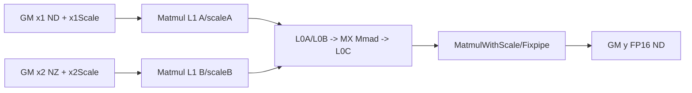
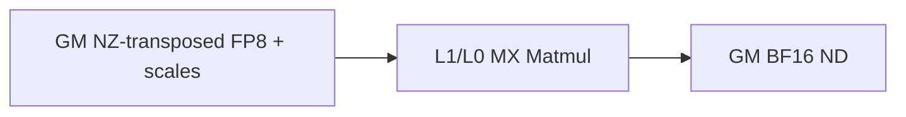

# TransposeQuantBatchMatMulWeightNz 950 ACLNN 算子知识

## 算子速览

| 项目 | 内容 |
|---|---|
| 实际入口 | `aclnnTransposeQuantBatchMatMulWeightNzGetWorkspaceSize` + `aclnnTransposeQuantBatchMatMulWeightNz`，公开两段式 ACLNN 接口；仓内无更高版本后缀。 |
| 计算语义 | 对 `x1:[M,B,K]` 与 FRACTAL_NZ 权重 `x2` 做 batch MXFP8 矩阵乘，`K` 方向每 32 元素一组、每 64 元素保存两个 E8M0 scale，输出 `y:[M,B,N]`。 |
| 输入输出 | `x1`/`x2` 为 `FLOAT8_E4M3FN`，`x1` ND 三维、`x2` 的 view 为三维而 storage 为 FRACTAL_NZ 五维；scale 为 `FLOAT8_E8M0` 四维；`y` 为 ND FP16/BF16。 |
| 执行类型 | 单 Kernel `AIC_CUBE`；MXFP8 Tiling key 明确选择 `ASCENDC_TPL_AIC_ONLY`，AIV 在 `Init`/`Process` 直接返回。 |
| Kernel 路线 | R-001：X2 不转置+FP16；R-002：X2 不转置+BF16；R-003：X2 转置+FP16；R-004：X2 转置+BF16。 |
| 核心资源 | GM 输入/scale/输出；Matmul 高阶 API 管理 L1/L0A/L0B/L0C；算子 Tiling 报告 workspace 0；MXFP8 路线不分配算子自有 UB 队列。 |
| 来源闭包 | `source_closed`：ACLNN 校验/连续化→L0 launcher→DAV_3510 Tiling/POD→AIC-only key→`transpose_quant_batch_mat_mul`→`TransposeQuantBatchMatMulAswKernel`→`MatmulWithScalePolicy`；AscendC Matmul primitive 内部是明确外部库边界。 |
| 验证状态 | 已完成源码闭包检查；本次知识提取未执行编译、真机、数值或性能测试。 |

## 接口与语义

### 计算语义

令 `B=x1.shape[1]`、`M=x1.shape[0]`、`K=x1.shape[2]`。`permX1=[1,0,2]` 把逻辑矩阵视为 `[B,M,K]`；`permX2=[0,1,2]` 时 x2 view 为 `[B,K,N]`，`permX2=[0,2,1]` 时为 `[B,N,K]`；`permY=[1,0,2]` 使输出物理 ND 顺序为 `[M,B,N]`。每个 batch 的数学主体是 `Y_b=A_b×B_b`。A/B 的 E8M0 scale 通过 `SetTensorScaleA/SetTensorScaleB` 交给 `MatmulWithScalePolicy`，量化乘法、累加、scale 和向 FP16/BF16 输出的转换在该 AscendC primitive 内融合；固定仓未展开 primitive 的逐指令舍入细节，因此不推测其内部指令序。

### 输入、输出与属性

| 参数 | shape/layout | dtype | 约束、默认值与语义 |
|---|---|---|---|
| `x1` | view/storage `[M,B,K]`，ND | FLOAT8_E4M3FN | 三维、非空、可非连续；`K>0` 且是 64 的倍数。 |
| `x2` | view `[B,K,N]` 或 `[B,N,K]`；storage 五维 FRACTAL_NZ | FLOAT8_E4M3FN | 必须为 NZ；batch 与 K 必须匹配 x1；接口不接受 ND 权重。 |
| `bias` | N/A | N/A | 预留，必须为 `nullptr`。 |
| `x1Scale` | `[M,B,K/64,2]`，ND | FLOAT8_E8M0 | 非空；可非连续，Host 转连续。 |
| `x2Scale` | `[B,K/64,N,2]` 或 `[B,N,K/64,2]`，ND | FLOAT8_E8M0 | shape 与 `permX2` 同步。 |
| `dtype` | 标量 | INT32 | `1`=FP16，`27`=BF16，且必须等于 `out` dtype 枚举。 |
| `groupSize` | 低 48 位打包 M/N/K | INT64 | `groupSizeK=32`；M/N 分组字段只能为 0 或 1；Tiling 只验证，Kernel 的 K 分组由 scale shape 与 MX 参数体现。 |
| `permX1` | 长度 3 | INT64 | 仅 `[1,0,2]`。 |
| `permX2` | 长度 3 | INT64 | `[0,1,2]` 或 `[0,2,1]`。 |
| `permY` | 长度 3 | INT64 | 仅 `[1,0,2]`。 |
| `batchSplitFactor` | 标量 | INT32 | 仅 1。 |
| `out` | `[M,B,N]`，ND | FP16/BF16 | 三维、非空；可非连续，最终由 `ViewCopy` 提交。 |

### 入口与版本

公开文档和头文件只声明无版本后缀的 WeightNz 两段式接口。它与 `aclnnTransposeQuantBatchMatMul` 共用内部 `TransposeQuantBatchMatMul` L0 op，但独有“x2 必须 FRACTAL_NZ”校验，不能把 ND 权重接口视为 WeightNz 版本。公开产品表仅支持 Ascend 950PR/950DT，明确不支持 A2/A3；因此本卡只覆盖 950。

## Host/Launcher 执行流程

### 参数校验与前处理

第一段先 `CREATE_EXECUTOR`，随后 `CheckParams` 要求 DAV_3510、非空指针、合法 perm/shape/dtype/groupSize、`batchSplitFactor==1`。WeightNz 分支再强制 x2 primary storage format 为 FRACTAL_NZ，拒绝空 x1/x2 与非空 bias。`BuildTransposeQuantBatchMatMulGraph` 顺序为：x1 `Contiguous`→`ReFormat(ND)`；x2 `Contiguous` 后保留 NZ storage shape；x1Scale/x2Scale 分别 `Contiguous`；再添加 L0 `TransposeQuantBatchMatMul` AICore 节点。L0 输出按请求 dtype 分配，之后追加通用 `Cast` 和 `ViewCopy`；这些普通框架节点属于允许的通用边界，不改变本卡的 WeightNz 核心 Route。

### 参数、Workspace 与生命周期

`ADD_TO_LAUNCHER_LIST_AICORE` 把五个输入、六个属性和 L0 输出绑定到 executor。算子 Tiling 的 `GetWorkspaceSize()` 返回 `{0}`；Device entry 虽调用 `GetUserWorkspace(workspaceGM)` 并把指针传给对象，MXFP8 的 `UpdateGlobalAddr` 不消费它。ACLNN 返回的总 `workspaceSize` 仍由 executor 汇总，若非连续输入触发通用 `Contiguous` 或最终 ViewCopy，它们的框架 workspace 不能由本算子的零 workspace 外推。executor 在第二段 `CommonOpExecutorRun` 中绑定调用者 workspace 与 stream，任一前处理/launch 失败即返回，不提交后续节点。

### 启动图与失败传播

```text
aclnnTransposeQuantBatchMatMulWeightNzGetWorkspaceSize
  -> Contiguous/ReFormat(x1)
  -> Contiguous(x2, preserve FRACTAL_NZ storage shape)
  -> Contiguous(x1Scale), Contiguous(x2Scale)
  -> l0op::TransposeQuantBatchMatMul
       -> Tiling: TransposeQuantBatchMatMulAswTiling(priority=999, DAV_3510)
       -> one AIC-only kernel: transpose_quant_batch_mat_mul
  -> generic Cast(same requested dtype)
  -> ViewCopy(out)
aclnnTransposeQuantBatchMatMulWeightNz
  -> CommonOpExecutorRun(same stream, fail-fast order)
```

Kernel blockDim 由 `GetNumBlocks()` 返回 `compileInfo_.aicNum`；Device 内以 `usedCoreNum` 为轮次步长，超过 `totalCnt` 的核/轮次不写输出。MXFP8 key 的 kernel type 是 `AIC_ONLY`，无跨 AIC/AIV 或跨 kernel 交接边。

## Route 与参数设计

### 分核与资源计算

Tiling 从 view shape 得到 `M/N/K` 与 batch，DAV_3510 的 `ResetBaseDav3510` 初始化 `baseM=256`、`baseN=256`、`baseK=128/sizeof(FP8)=128`、`stepM=stepN=1`、`singleCoreK=K`、`usedCoreNum=aicNum`。自定义 `CalL1Tiling` 以 A/B FP8 tile 和两组 E8M0 scale tile 的字节和选择 `depthA1/depthB1`，再把 `stepKa/stepKb` 限制到至多 4 并令 depth=`stepK×2`。scaleFactor 还受每次至少 32768B MTE2 搬运目标、127 上限与剩余 L1 容量共同限制。Kernel 计算 `mCnt=ceil(M/baseM)`、`nCnt=ceil(N/baseN)`、`totalCnt=mCnt*nCnt*B`、`round=ceil(totalCnt/usedCoreNum)`，M/N 末块分别用真实余数。

### Route 选择

| 顺序 | Route | Key/模板 | 精确选择条件与优先级 | 不适用去向 |
|---:|---|---|---|---|
| 1 | R-001 NZ-BN FP16 | simplified key `diy,2/29/2/2/2/2/36/36/0/37/37/1`；tpl `(1,0,0,1)` | 950、MXFP8、x2 NZ、`permX2=[0,1,2]`、out FP16；唯一 priority 999 | 任一校验失败则 GRAPH/ACLNN 失败，无 fallback。 |
| 2 | R-002 NZ-BN BF16 | simplified key `.../27`；tpl `(1,0,0,1)` | 同上但 out BF16 | 失败。 |
| 3 | R-003 NZ-NB FP16 | simplified key `.../1`；tpl `(1,1,0,1)` | 950、MXFP8、x2 NZ、`permX2=[0,2,1]`、out FP16 | 失败。 |
| 4 | R-004 NZ-NB BF16 | simplified key `.../27`；tpl `(1,1,0,1)` | 同上但 out BF16 | 失败。 |

```text
platform != DAV_3510 -> ACLNN_ERR_PARAM_INVALID
x2 format != FRACTAL_NZ -> ACLNN_ERR_PARAM_INVALID
scale dtype != E8M0/E8M0 -> 非 WeightNz MX 路线；本接口校验失败
permX2 == [0,1,2]
  -> out FP16: R-001
  -> out BF16: R-002
permX2 == [0,2,1]
  -> out FP16: R-003
  -> out BF16: R-004
otherwise -> ACLNN_ERR_PARAM_INVALID
```

### 模板/实现执行矩阵

| Route | key/selector | dtype/shape/platform 完整命中条件 | 执行族与 kernel 节点 | 实际模板/body | 内存与同步特征 | tail/fallback |
|---|---|---|---|---|---|---|
| R-001 | binary `/1` + tpl `(1,0,0,1)` | E4M3×E4M3，E8M0 scales，FP16，K%64=0，x2 NZ，DAV_3510 | 单 `AIC_CUBE` | `AswKernel<E4M3,E4M3,E8M0,float,E8M0,half,MXFP8,false,false,NZ,float,AswBlock,MM_CFG_NO_PRELOAD_OPEN_UNIT_FLAG>` | GM→Matmul L1/L0→GM；无 UB/CV sync | M/N/K 由 Matmul/tile tail；无 fallback。 |
| R-002 | binary `/27` + tpl `(1,0,0,1)` | 同 R-001，输出 BF16 | 单 `AIC_CUBE` | 同实例但 `cType=bfloat16_t` | 同上 | 同上。 |
| R-003 | binary `/1` + tpl `(1,1,0,1)` | 同 R-001，`permX2=[0,2,1]` | 单 `AIC_CUBE` | 同 R-001 但 `bTrans=true` | B NZ 地址/scale 地址按转置布局 | 同上。 |
| R-004 | binary `/27` + tpl `(1,1,0,1)` | 同 R-003，输出 BF16 | 单 `AIC_CUBE` | `bTrans=true,cType=bfloat16_t` | 同上 | 同上。 |

### 隐藏性能 Guard

| Guard | Host/Tiling 条件 | Device/资源原因 | 影响 Route | 不满足时去向 | 源码符号 |
|---|---|---|---|---|---|
| 平台 | `IsNpuArch3510Series()` 且 registry 仅 DAV_3510 | 只有 arch35 AIC-only MX specialization | 全部 | ACLNN/Tiling 失败 | `CheckParams`、`TransposeQuantBatchMatMulPrioritiesMap` |
| MX 与 NZ | x2 NZ 时 scale 必须 E8M0/E8M0 | NZ Weight 路线只注册 MXFP8 key | 全部 | 失败，无 ND fallback | `CheckWeightNz` |
| K 对齐 | `K % 64 == 0` | 每 64 K 保存两个 32-group scale | 全部 | 失败 | `TQBMMGetShapeMKN` |
| group | M/N 字段∈{0,1} 且 K 字段=32 | 固定 MX group | 全部 | 失败 | `IsValidGroupSize` |
| stepK | `stepKa,stepKb<=4` | 避免 issue queue 阻塞 | 全部 | Tiling 收缩 step，不切换 Route | `CalStepKs` |
| scale factor | 1..127；否则 POD 写默认 1 | `mxTypePara` 每 factor 8 bit 且资源受 L1/MTE2 限制 | 全部 | 同 Route 默认 factor=1 | `CalScaleFactors`、`GetTilingDataProcess` |
| NZ 对齐 | `c0=32`；非转置 N 向上对齐 32/K 向上对齐16，转置 N 对齐16/K 对齐32 | FRACTAL_NZ 物理寻址 | R-001..004 | 无 fallback，调用者 storage 必须匹配 | `AswBlock::Init` |

### POD/ABI

`BatchMatMulV3TilingData` 使用 `#pragma pack(push,8)`。其首字段 `matMulTilingData` 内含 SDK `TCubeTiling`；该类型定义来自仓外 `kernel_tiling/kernel_tiling.h`，所以固定仓无法给出 `sizeof/alignof/offsetof(TCubeTiling)`，复用时必须使用同 CANN SDK 头，不能手写 ABI。下表逐字段列当前 WeightNz route 的 producer/consumer；未列出的 BatchMatMulV3 广播字段由基类写默认/批次值，但本算子 Device body 不直接读取。

| 结构 | 字段 | 类型/位宽 | ABI 布局 | 单位 | Host/launcher producer | Device consumer | 边界 |
|---|---|---|---|---|---|---|---|
| `BatchMatMulV3TilingData` | `matMulTilingData` | `MatMulV3TilingData` | offset 0，pack 8；嵌套大小固定仓不可见 | POD | `GetTilingDataProcess` | `mm.Init`、AswBlock | 必须同 SDK ABI。 |
| `MatMulV3TilingData` | `tCubeTiling` | `TCubeTiling`（位宽固定仓不可见） | offset 0，具体布局仓外 | POD | `InitTCubeTilingData` 后覆盖 route 字段 | Matmul primitive/AswBlock | 不得重排。 |
| `TCubeTiling` | `M/N/Ka/Kb` | SDK 整数字段（位宽仓外） | offset 固定仓不可见 | 元素 | `SetShape`/`SetOrgShape` | block count、offset、Matmul | 均>0，K%64=0。 |
| `TCubeTiling` | `usedCoreNum` | SDK 整数字段 | 同上 | AIC 核数 | `runInfo_.usedCoreNum` | `round/index` | `<=aicNum`。 |
| `TCubeTiling` | `singleCoreM/N/K` | SDK 整数字段 | 同上 | 元素 | 基类；M/N=base，K=全 K | `mm.SetSingleShape` | 尾 M/N 在 block 对象覆写。 |
| `TCubeTiling` | `baseM/baseN/baseK` | SDK 整数字段 | 同上 | 元素 | DAV_3510 reset：256/256/128 | 分块、Matmul、L1/L0 | shape 小于 base 时用 tail。 |
| `TCubeTiling` | `depthA1/depthB1` | SDK 整数字段 | 同上 | L1 stage 数 | `CalL1Tiling/CalStepKs` | Matmul primitive | 分别=`stepK*2`。 |
| `TCubeTiling` | `stepM/stepN/stepKa/stepKb` | SDK 整数字段 | 同上 | tile 数 | reset + `CalStepKs` | Matmul primitive | stepK≤4。 |
| `TCubeTiling` | `dbL0C` | SDK 整数字段 | 同上 | buffer depth | reset 为 1 | Matmul primitive | route 不自行改写。 |
| `TCubeTiling` | `mxTypePara` | SDK 整数字段 | 同上 | bit field | `GetTilingDataProcess` | `MatmulWithScalePolicy` | bits 0/8/16/24=A/B/M/N factor。 |
| `BatchMatMulV3TilingData` | `cBatchDimAll` | `uint32_t` | 位于嵌套 matmul POD 后，具体 offset 依赖 SDK `TCubeTiling` 大小 | batch 数 | `GetBatchInfo`→基类 | AswBlock offset/totalCnt | x1/x2 batch 必须相等。 |
| `BatchMatMulV3TilingData` | `batchSplitFactor` | `uint32_t` | pack 8，具体 offset 依赖前述 SDK 大小 | 无量纲 | WeightNz 子类写 1 | 当前 Device body 不读取 | inactive，必须保持 1。 |

### Route 源码闭包

| Route | Key/selector | Host/Tiling producer | POD/参数 | Kernel entry/router | Kernel body/直接依赖 | 构建接线 |
|---|---|---|---|---|---|---|
| R-001 | simplified `/1`，tpl `(1,0,0,1)` | `TransposeQuantBatchMatMulTiling::DoTiling`→`AswTiling` | `BatchMatMulV3TilingData` | `transpose_quant_batch_mat_mul<1,0,0,1>` | `AswKernel::Process/MMCompute`、`AswBlock`、AscendC MatmulWithScale | ascend950 JSON + kernel CMake |
| R-002 | simplified `/27`，tpl `(1,0,0,1)` | 同上 | 同上 | 同 entry，BF16 binary | 同上，`cType=BF16` | 同上 |
| R-003 | simplified `/1`，tpl `(1,1,0,1)` | 同上 | 同上 | `transpose_quant_batch_mat_mul<1,1,0,1>` | 同上，`bTrans=true` | 同上 |
| R-004 | simplified `/27`，tpl `(1,1,0,1)` | 同上 | 同上 | 同 entry，BF16 binary | 同上，`bTrans=true,cType=BF16` | 同上 |

## Kernel 实现

### 公共执行流程

entry 从 `tilingGM` 解析 `BatchMatMulV3TilingData`，以 scale 元素大小 1 字节选择 MXFP8 实例。`Init` 在 AIV 上立即返回；AIC 初始化 `MatmulImpl<MatmulWithScalePolicy>`、绑定 GM、设置合并 batch 的原始 shape。每个 AIC 按 ASW 窗口顺序遍历 `(batch,mTile,nTile)`；奇数窗口反向 N 以改变访存遍历方向。每个有效 tile 设置 A/B scale 指针、A/B tensor 和真实尾块 shape，`mm.Iterate()` 完成 Cube 主循环，`mm.GetTensorC(GM)` 直接提交 ND 输出。没有 workspace 中间结果，也没有 AIC↔AIV flag。

### Route R-001：NZ-BN FP16

#### 适用条件

##### 选择证据

| 层级 | 文件 | 符号 | 源码谓词/参数 | 结果/下一跳 |
|---|---|---|---|---|
| API | `op_api/aclnn_transpose_quant_batch_mat_mul.cpp` | WeightNz GetWorkspace | x2=NZ、MX scales、out=FP16、permX2=012 | 添加 L0 op。 |
| Tiling | `...asw_tiling.cpp` | `GetTransposeBatchMatMulInfo/GetTilingKey` | permX1=1、permX2=0、split=0、precision=1 | AIC-only tpl key。 |
| Binary | `op_host/config/ascend950/...json` | NZ FP16 item | simplified key 2/29/.../1 | 编译 FP16 specialization。 |

#### Device 数据流

##### 函数级调用链

```text
transpose_quant_batch_mat_mul<1,0,0,1>
  -> AswKernel<E4M3,E4M3,E8M0,float,E8M0,half,MXFP8,false,false,NZ,float,AswBlock,MM_CFG>::Init
  -> AswBlock::Init<false,NZ>
  -> Process -> UpdateBasicIndex/UpdateBlockParams/CalcGMOffset<false,NZ,MXFP8>
  -> mm.SetTensorScaleA/B -> MMCompute
  -> mm.SetTensorA/B -> mm.Iterate -> mm.GetTensorC(FP16 GM)
```

##### 源码等价伪码

```text
for j in [0, ceil(B*ceil(M/256)*ceil(N/256)/usedCoreNum)):
  index = blockIdx + j*usedCoreNum
  if index >= totalCnt: continue
  (batch,mIndex,nIndex) = ASW_window_map(index); reverse nIndex on odd window rows
  mUse = min(256, M-mIndex*256); nUse = min(256, N-nIndex*256)
  A = x1[(mIndex*256)*B*K + batch*K]
  Bnz = x2[batch*align(N,32)*align(K,16) + (nIndex*256)*align(K,16)]
  scaleA = x1Scale[(mIndex*256)*B*(2*ceil(K/64)) + batch*(2*ceil(K/64))]
  scaleB = x2Scale[batch*N*(2*ceil(K/64)) + (nIndex*256)*2]
  C = y[(mIndex*256)*B*N + batch*N + nIndex*256]
  MatmulWithScale(A,Bnz,scaleA,scaleB,mUse,nUse,K) -> C(FP16)
```

#### 内存与数据搬运

##### 资源与搬运表

| 层级/缓冲区 | offset/地址公式 | extent/容量公式 | dtype/layout | producer | consumer | owner/lifetime | 对齐/复用 |
|---|---|---|---|---|---|---|---|
| GM x1 | `m0*B*K+b*K` | `M*B*K` | E4M3 ND | ACLNN | Matmul A | caller/executor | K%64=0 |
| GM x2 | `b*align(N,32)*align(K,16)+n0*align(K,16)` | `B*align(N,32)*align(K,16)` | E4M3 NZ | caller | Matmul B | caller | N/32、K/16 |
| GM scales | 见伪码 | A=`M*B*2ceil(K/64)`；B=`B*N*2ceil(K/64)` | E8M0 ND | caller | MatmulWithScale | caller | scaleK 成对 |
| L1 A/B | primitive 内部 | A=`depthA1*baseM*baseK`；B=`depthB1*baseN*baseK` bytes | FP8 tiles | Matmul MTE2 | L0A/L0B | per AIC/Process | depth ping-pong |
| L1 scale | primitive 内部 | `depthA1*fA*baseM*align(ceil(baseK/32),2)+depthB1*fB*baseN*align(ceil(baseK/32),2)` bytes | E8M0 | Matmul MTE2 | MX Cube | per AIC | fA/fB∈[1,127]或默认1 |
| L0A/L0B/L0C | N/A：由仓外 AscendC `MatmulWithScalePolicy` 分配 | 当前实例 base=256/256/128；精确物理 allocation 固定仓不可见 | Cube local | Matmul | Mmad/Fixpipe | per tile | 受 SDK TCubeTiling 控制 |
| UB/寄存器 | N/A：MX AIC-only 分支不初始化 `vecQue*` | 0 算子自有 UB | N/A | N/A | N/A | N/A | AIV 返回 |
| GM y | `m0*B*N+b*N+n0` | `M*B*N*2` bytes | FP16 ND | `GetTensorC` | ViewCopy/out | executor/out | M/N tail |

##### 分层内存布局



##### 字节账、交接边与复用顺序

```text
operator_workspace = 0
L1 = depthA1*256*128 + depthB1*256*128
   + depthA1*fA*256*align(ceil(128/32),2)
   + depthB1*fB*256*align(ceil(128/32),2) bytes
L0/primitive-private = 由同一 TCubeTiling(baseM=256,baseN=256,baseK=128,dbL0C=1)约束；物理 sizeof 固定仓外
UB_operator = 0
```

| 边/复用子区 | producer | offset/extent | dtype/layout | consumer | ordering/sync | owner/lifetime | 安全条件 |
|---|---|---|---|---|---|---|---|
| L0C→GM y | Matmul Iterate | tile C，`mUse*nUse` 有效域 | accumulator→FP16 ND | `GetTensorC` | 同 AIC Matmul pipe | output owner | tail shape 传入 `SetSingleShape`。 |

#### 同步、精度与尾块

##### 同步与数值边界表

| 阶段 | primitive/机制 | producer | consumer/等待点 | 保护对象 | 精度/尾块 |
|---|---|---|---|---|---|
| A/B/scale→Cube | Matmul 内部 pipe | MTE2 | Mmad | L1/L0 tile | K 由 primitive 处理；精确指令 tail 属仓外边界。 |
| Cube→GM | `mm.GetTensorC` | L0C | GM | 当前 C tile | 输出 FP16；M/N 使用真实 tail。 |
| 核间 | N/A | 各 AIC 独占 tile | N/A | GM 不重叠区 | index 映射唯一，无 atomic。 |

#### 关键实现

##### 符号证据表

| 阶段 | 文件 | 符号/模板实例 | 实现事实 |
|---|---|---|---|
| Host/Tiling producer | `...asw_tiling.cpp` | `DoOpTiling/GetTilingDataProcess` | MX mode、base/depth/factor、0 workspace。 |
| Kernel entry/router | `op_kernel/arch35/transpose_quant_batch_mat_mul.cpp` | scale sizeof(uint8_t) 分支 | 实例化 MXFP8 NZ FP16。 |
| Device body/helper | `...asw_kernel_advanced.h` + `...asw_block_advanced.h` | `Process/MMCompute/CalcGMOffset` | AIC-only direct GM output 与 NZ 地址。 |

### Route R-002：NZ-BN BF16

#### 适用条件

##### 选择证据

| 层级 | 文件 | 符号 | 源码谓词/参数 | 结果/下一跳 |
|---|---|---|---|---|
| Binary | `op_host/config/ascend950/...json` | NZ BF16 item | simplified key 2/29/.../27，permX2=012 | BF16 specialization。 |
| Tiling | `...asw_tiling.cpp` | `GetTilingKey` | tuple `(1,0,0,1)` | AIC-only。 |

#### Device 数据流

##### 函数级调用链

```text
transpose_quant_batch_mat_mul<1,0,0,1>
  -> AswKernel<E4M3,E4M3,E8M0,float,E8M0,bfloat16_t,MXFP8,false,false,NZ,float,AswBlock,MM_CFG>::Process
  -> MMCompute -> MatmulWithScale -> GetTensorC(BF16 GM)
```

##### 源码等价伪码

```text
与 R-001 相同的 batch/M/N tile、NZ B offset 与 scale offset；唯一实例差异是 cType=BF16，C extent 仍为2 bytes/element。
```

#### 内存与数据搬运

##### 资源与搬运表

| 层级/缓冲区 | offset/地址公式 | extent/容量公式 | dtype/layout | producer | consumer | owner/lifetime | 对齐/复用 |
|---|---|---|---|---|---|---|---|
| GM/L1/L0 | 同 R-001 | 同 R-001 | E4M3/E8M0，x2 NZ | Matmul | Cube | per tile | 同 R-001 |
| GM y | `m0*B*N+b*N+n0` | `M*B*N*2` bytes | BF16 ND | `GetTensorC` | out | executor | M/N tail |
| UB | N/A | 0 | N/A | N/A | N/A | N/A | AIC-only |

##### 分层内存布局


##### 字节账、交接边与复用顺序

```text
operator_workspace=0; UB_operator=0; L1/L0 与 R-001 相同；output=M*B*N*2 bytes。
```

| 边/复用子区 | producer | offset/extent | dtype/layout | consumer | ordering/sync | owner/lifetime | 安全条件 |
|---|---|---|---|---|---|---|---|
| L0C→GM y | Matmul | tile C | BF16 ND | out | 同 AIC pipe | out | `SetSingleShape` tail。 |

#### 同步、精度与尾块

##### 同步与数值边界表

| 阶段 | primitive/机制 | producer | consumer/等待点 | 保护对象 | 精度/尾块 |
|---|---|---|---|---|---|
| 输出 | `GetTensorC` | MX Matmul | GM | tile | BF16；舍入细节为仓外 primitive 边界。 |

#### 关键实现

##### 符号证据表

| 阶段 | 文件 | 符号/模板实例 | 实现事实 |
|---|---|---|---|
| Host/Tiling producer | `...asw_tiling.cpp` | MX route | 与 R-001 共用 Tiling。 |
| Kernel entry/router | ascend950 binary JSON | BF16 NZ item | 选择 DTYPE_Y=BF16 binary。 |
| Device body/helper | `...asw_kernel_advanced.h` | `MmType/MMCompute` | cT 为 GM BF16。 |

### Route R-003：NZ-NB FP16

#### 适用条件

##### 选择证据

| 层级 | 文件 | 符号 | 源码谓词/参数 | 结果/下一跳 |
|---|---|---|---|---|
| API/Tiling | API cpp + advanced Tiling | `CheckPerm/GetTransposeBatchMatMulInfo` | `permX2=[0,2,1]` | `bTrans=true`，tpl `(1,1,0,1)`。 |
| Binary | ascend950 JSON | NZ FP16 item | simplified `/1` | FP16 binary。 |

#### Device 数据流

##### 函数级调用链

```text
transpose_quant_batch_mat_mul<1,1,0,1>
  -> AswKernel<E4M3,E4M3,E8M0,float,E8M0,half,MXFP8,false,true,NZ,float,AswBlock,MM_CFG>::Process
  -> CalcGMOffset<true,NZ,MXFP8> -> MMCompute -> GetTensorC(FP16 GM)
```

##### 源码等价伪码

```text
tile mapping同R-001
Bnz = x2[batch*align(N,16)*align(K,32) + n0*32]
scaleB = x2Scale[batch*N*(2*ceil(K/64)) + n0*(2*ceil(K/64))]
其余A/scaleA/C公式同R-001；Matmul的B transpose实参为true。
```

#### 内存与数据搬运

##### 资源与搬运表

| 层级/缓冲区 | offset/地址公式 | extent/容量公式 | dtype/layout | producer | consumer | owner/lifetime | 对齐/复用 |
|---|---|---|---|---|---|---|---|
| GM x2 | `b*align(N,16)*align(K,32)+n0*32` | `B*align(N,16)*align(K,32)` | E4M3 NZ-transposed view | caller | Matmul B | caller | N/16、K/32 |
| GM x2Scale | `b*N*2ceil(K/64)+n0*2ceil(K/64)` | `B*N*2ceil(K/64)` | E8M0 | caller | SetTensorScaleB | caller | K-group contiguous per N |
| 其余 GM/L1/L0 | 同 R-001 | 同 R-001 | 同 R-001 | Matmul | Cube | per tile | bTrans=true |
| UB | N/A | 0 | N/A | N/A | N/A | N/A | AIC-only |

##### 分层内存布局


##### 字节账、交接边与复用顺序

```text
operator_workspace=0; UB_operator=0; L1公式同R-001；x2 physical=B*align(N,16)*align(K,32) bytes。
```

| 边/复用子区 | producer | offset/extent | dtype/layout | consumer | ordering/sync | owner/lifetime | 安全条件 |
|---|---|---|---|---|---|---|---|
| GM NZ B→L1 | caller | 物理 offset 如上 | E4M3 NZ | Matmul | MTE2/Matmul pipe | input | storage shape 与 view/perm 一致。 |

#### 同步、精度与尾块

##### 同步与数值边界表

| 阶段 | primitive/机制 | producer | consumer/等待点 | 保护对象 | 精度/尾块 |
|---|---|---|---|---|---|
| B load | `bTrans=true` Matmul | NZ GM | L0B | B tile | N tail 和 K 完整 64 对齐；无 fallback。 |
| 输出 | `GetTensorC` | Cube | GM | C tile | FP16 M/N tail。 |

#### 关键实现

##### 符号证据表

| 阶段 | 文件 | 符号/模板实例 | 实现事实 |
|---|---|---|---|
| Host/Tiling producer | `...asw_tiling.cpp` | `permX2_=PERM_X2_0_2_1` | 生成 tpl perm bit 1。 |
| Kernel entry/router | `transpose_quant_batch_mat_mul.cpp` | `bTran=(PERM_X2==1)` | 编译期转置。 |
| Device body/helper | `...asw_block_advanced.h` | `Init/CalcGMOffset<true,NZ>` | N/16、K/32 NZ 地址和 scaleK stride。 |

### Route R-004：NZ-NB BF16

#### 适用条件

##### 选择证据

| 层级 | 文件 | 符号 | 源码谓词/参数 | 结果/下一跳 |
|---|---|---|---|---|
| Tiling | `...asw_tiling.cpp` | `GetTilingKey` | perm bit 1、MX bit 1 | AIC-only。 |
| Binary | ascend950 JSON | NZ BF16 item | simplified `/27` | BF16 binary。 |

#### Device 数据流

##### 函数级调用链

```text
transpose_quant_batch_mat_mul<1,1,0,1>
  -> AswKernel<E4M3,E4M3,E8M0,float,E8M0,bfloat16_t,MXFP8,false,true,NZ,float,AswBlock,MM_CFG>::Process
  -> MMCompute -> GetTensorC(BF16 GM)
```

##### 源码等价伪码

```text
与R-003完全相同的bTrans NZ/scale寻址；C模板类型改为BF16。
```

#### 内存与数据搬运

##### 资源与搬运表

| 层级/缓冲区 | offset/地址公式 | extent/容量公式 | dtype/layout | producer | consumer | owner/lifetime | 对齐/复用 |
|---|---|---|---|---|---|---|---|
| GM x2/scale | 同 R-003 | 同 R-003 | NZ/E8M0 | caller | Matmul | caller | N/16、K/32 |
| GM y | `m0*B*N+b*N+n0` | `M*B*N*2` | BF16 ND | Matmul | out | executor | M/N tail |
| L1/L0/UB | 同 R-003；UB N/A | 同 R-001 | MX Cube | Matmul | Cube | per tile | AIC-only |

##### 分层内存布局



##### 字节账、交接边与复用顺序

```text
operator_workspace=0; UB_operator=0; L1同R-001；x2同R-003；output=M*B*N*2 bytes。
```

| 边/复用子区 | producer | offset/extent | dtype/layout | consumer | ordering/sync | owner/lifetime | 安全条件 |
|---|---|---|---|---|---|---|---|
| L0C→GM y | Matmul | tile C | BF16 ND | out | same-AIC pipe | out | tail shape。 |

#### 同步、精度与尾块

##### 同步与数值边界表

| 阶段 | primitive/机制 | producer | consumer/等待点 | 保护对象 | 精度/尾块 |
|---|---|---|---|---|---|
| B/scale load | Matmul pipe | NZ GM | MX Cube | tile | bTrans=true，K%64=0。 |
| output | `GetTensorC` | Cube | GM | C tile | BF16 M/N tail。 |

#### 关键实现

##### 符号证据表

| 阶段 | 文件 | 符号/模板实例 | 实现事实 |
|---|---|---|---|
| Host/Tiling producer | `...asw_tiling.cpp` | tuple `(1,1,0,1)` | BF16 不改变 Tiling。 |
| Kernel entry/router | ascend950 JSON + kernel cpp | BF16 binary/`bTran=true` | 完整实例。 |
| Device body/helper | kernel/block headers | `MMCompute/CalcGMOffset` | direct BF16 GM output。 |

## 算子特定优化

### Trick T-001：L1 余量驱动的 MX scale 批量搬运

#### 触发与源码依据

- 适用 Route：R-001～R-004
- 触发条件：DAV_3510、E8M0/E8M0 MXFP8，固定 `baseM/baseN/baseK` 后进入 `CalScaleFactors`。
- Golden 来源：[`transpose_quant_batch_mat_mul_asw_tiling.cpp:131-142`](../../../../../../../cann-ops-raw/ascendc/ops-nn/955f8b33985b6d72989ebff341bb9c2c564a51bc/matmul/transpose_quant_batch_mat_mul/op_host/op_tiling/arch35/transpose_quant_batch_mat_mul_asw_tiling.cpp#L131-L142)

**官方源码（固定 Commit 连续逐字摘录）**：

```cpp
uint32_t scaleFactorAMax =
    std::min(static_cast<uint32_t>(ops::FloorDiv(MTE2_MIN_LOAD_SIZE_V100, baseScaleASize)), SCALER_FACTOR_MAX);
uint32_t scaleFactorBMax =
    std::min(static_cast<uint32_t>(ops::FloorDiv(MTE2_MIN_LOAD_SIZE_V100, baseScaleBSize)), SCALER_FACTOR_MAX);
uint32_t scaleFactorA = static_cast<uint32_t>(args_.kValue) / (runInfo_.stepKa * runInfo_.baseK);
uint32_t scaleFactorB = static_cast<uint32_t>(args_.kValue) / (runInfo_.stepKb * runInfo_.baseK);
scaleFactorA_ = std::max(SCALER_FACTOR_MIN, scaleFactorA);
scaleFactorB_ = std::max(SCALER_FACTOR_MIN, scaleFactorB);
scaleFactorA_ = std::min(scaleFactorAMax, scaleFactorA);
scaleFactorB_ = std::min(scaleFactorBMax, scaleFactorB);
```

#### 机制与设计原因

Tiling 不把每个 K step 的 scale 固定为一次搬运，而是先由 K 循环数得到 A/B factor，再以 32768B MTE2 目标和 7-bit 上限裁剪，随后按剩余 L1 在 A/B 两侧重新分配。factor 写入 `mxTypePara`，让 Matmul primitive 在同一 L1 stage 中复用更多 scale，减少细碎的 scale 搬运；源码只证明调度机制，不量化性能收益。

#### 迁移边界

- 适用：同类 MXFP8 Cube Matmul、scale K 分组为 32 且 POD 支持 factor bit field。
- 前提：950/DAV_3510、E8M0 scale、L1 预算和 MatmulWithScalePolicy ABI 一致。
- 失效：非 MXFP8；WeightNz ACLNN 会在此前拒绝。
- 未验证：本次知识提取未执行编译、真机、数值或性能测试。

#### 错误做法

不要只按 K 循环数增大 factor 而忽略 L1 中 A/B data、depth 和两侧 scale 的共同占用；源码的第二阶段会按剩余 L1 再裁剪。

### Trick T-002：NZ 权重原位寻址，避免接口内 ND→NZ 转换

#### 触发与源码依据

- 适用 Route：R-001～R-004
- 触发条件：公开 WeightNz API 强制 x2 FRACTAL_NZ；Kernel `format_x2=NZ`。
- Golden 来源：[`transpose_quant_batch_mat_mul_asw_block_advanced.h:152-180`](../../../../../../../cann-ops-raw/ascendc/ops-nn/955f8b33985b6d72989ebff341bb9c2c564a51bc/matmul/transpose_quant_batch_mat_mul/op_kernel/arch35/transpose_quant_batch_mat_mul_asw_block_advanced.h#L152-L180)

**官方源码（固定 Commit 连续逐字摘录）**：

```cpp
if constexpr (bFormat == CubeFormat::NZ) {
    uint64_t offsetBBatch = offset_.batchOffset * alignedOriN_ * alignedKbSize_;
    offset_.offsetB = offsetBBatch + nOffset * (bTrans ? c0Size_ : alignedKbSize_);
} else {
    uint64_t offsetBBatch = offset_.batchOffset * tilingData_->matMulTilingData.tCubeTiling.N *
                            tilingData_->matMulTilingData.tCubeTiling.Kb;
    offset_.offsetB =
        bTrans ? offsetBBatch + nOffset * tilingData_->matMulTilingData.tCubeTiling.Kb : offsetBBatch + nOffset;
}
```

#### 机制与设计原因

Host 保留 x2 的 NZ storage shape，Device 依据 `bTrans` 选择 NZ batch stride 和 N tile stride：非转置沿对齐 K 行跳转，转置按 `c0=32` 分形跳转。权重无需在该接口内部物化为 ND 或再次转 NZ；scaleB 的 offset 同时切换为每 N 连续一整段 K-scale 的布局。

#### 迁移边界

- 适用：调用者已完成正确 FRACTAL_NZ 转换且 view shape/perm 与 storage 一致。
- 前提：FP8 `c0=32`；非转置物理 N/K 对齐为 32/16，转置为 16/32。
- 失效：x2 ND 或非 MXFP8；WeightNz API 直接失败，不回退到普通接口。
- 未验证：本次知识提取未执行编译、真机、数值或性能测试。

#### 错误做法

把 `nOffset` 按 ND stride 计算会在 NZ 分形中跳到错误 tile；必须同时保留 `alignedOriN_`、`alignedKbSize_` 与 `bTrans` 分支。

## 模板与实现对比

| 对比维度 | R-001 NZ-BN FP16 | R-002 NZ-BN BF16 | R-003 NZ-NB FP16 | R-004 NZ-NB BF16 | 设计选择依据 |
|---|---|---|---|---|---|
| 命中条件/优先级 | perm2=012,out=FP16 | perm2=012,out=BF16 | perm2=021,out=FP16 | perm2=021,out=BF16 | 唯一 priority 999；dtype 由 binary key，perm 由 tpl key。 |
| 执行族/节点图 | AIC-only single kernel | 同 | 同 | 同 | MX key 注册 `ASCENDC_TPL_AIC_ONLY`。 |
| M/N/K、tile 与 scheduler | 256/256/128 ASW | 同 | 同 | 同 | DAV_3510 reset。 |
| workspace/L1/L0/UB | ws0，MX L1/L0，UB0 | 同 | 同 | 同 | AIC-only direct output。 |
| AIC/AIV 或 kernel 交接 | N/A | N/A | N/A | N/A | AIV return。 |
| 同步、精度与 tail | direct FP16 | direct BF16 | bTrans direct FP16 | bTrans direct BF16 | cType 与 bTrans specialization。 |
| fallback/失败边界 | 无 | 无 | 无 | 无 | selector 只有一个模板。 |

## 平台差异

| 项目 | A2 | A3 | 950 |
|---|---|---|---|
| 支持状态 | 公开文档明确不支持 | 公开文档明确不支持 | Ascend 950PR/950DT 支持 |
| Host/Launcher | 不发布 | 不发布 | ACLNN `IsNpuArch3510Series`，DAV_3510 Tiling registry |
| Kernel/资源 | N/A | N/A | arch35 AIC-only MXFP8，kernel target ascend950（同时构建接线列 ascend350，但公开产品证据只落 950） |

## 限制与失败边界

- 仅 950；A2/A3 的公开产品表为“不支持”，不得用 `ascend350` binary/CMake 接线反推公开 ACLNN 支持。
- 只支持 WeightNz MXFP8：x1/x2 E4M3、scale E8M0、x2 五维 FRACTAL_NZ storage；不包含普通 ND 权重、FP8 float-scale 或 HIFP8 变体。
- `bias` 必须为空，`batchSplitFactor` 必须 1，K 必须为 64 的倍数，group K 必须 32。
- ACLNN 的 `CheckWeightNz` 正确检查 `GetStorageShape().GetDimNum()==5`；Tiling 同名函数却读取 `GetOriginShape()`，且以 `bDims==5` 作为报错条件。公开 ACLNN 路线的 origin 为三维，因此该冗余 Tiling 条件不会拒绝正常 WeightNz 输入，但不能把它表述成第二次“五维 storage”校验。
- 算子 core workspace 为 0，但 ACLNN executor 的通用 Contiguous/ViewCopy workspace 取决于实际 tensor 连续性，固定算子源码没有给出统一常数。
- `TCubeTiling` 精确 `sizeof/alignof/offsetof` 和 MatmulWithScale primitive 的 L0 物理 buffer/逐指令 round 属仓外 CANN SDK 边界；实现复用必须依赖同版本 SDK，不能据本卡手写替代 ABI。
- 本次知识提取未执行编译、真机、数值或性能测试。

## 源码索引

### 链路索引

| 链路阶段 | 文件 | 关键符号 | 支撑内容 |
|---|---|---|---|
| 入口声明/约束 | `docs/aclnnTransposeQuantBatchMatMulWeightNz.md` | 产品表/函数原型/约束 | 950-only、WeightNz 参数与公开性。 |
| 入口声明/约束 | `op_api/aclnn_transpose_quant_batch_mat_mul.h` | WeightNz 两段式声明 | ABI 参数。 |
| 入口实现 | `op_api/aclnn_transpose_quant_batch_mat_mul.cpp` | `CheckParams/Build.../WeightNzGetWorkspaceSize` | 校验、前处理、executor graph。 |
| Host/Tiling/Launcher | `op_api/transpose_quant_batch_mat_mul.cpp` | `ADD_TO_LAUNCHER_LIST_AICORE` | 核心节点添加。 |
| Host/Tiling/Launcher | `op_host/op_tiling/arch35/transpose_quant_batch_mat_mul_tiling_advanced.cpp` | `CheckArgs/GetArgs/DoTiling` | WeightNz shape/dtype/format 与 registry。 |
| Host/Tiling/Launcher | `op_host/op_tiling/arch35/transpose_quant_batch_mat_mul_asw_tiling.cpp` | `DoOpTiling/CalL1Tiling/GetTilingKey` | 唯一 route、资源、POD。 |
| Host/Tiling/Launcher | `matmul/mat_mul_v3/op_host/op_tiling/arch35/matmul_v3_base_tiling_advanced.h` | `PostTiling/GetTilingDataProcess` | blockDim、workspace、TCube 字段。 |
| POD | `matmul/mat_mul_v3/op_kernel/arch35/mat_mul_tiling_data.h` | `BatchMatMulV3TilingData` | pack 8 与 batch 字段。 |
| Kernel entry/body | `op_kernel/arch35/transpose_quant_batch_mat_mul.cpp` | `transpose_quant_batch_mat_mul` | router 与实例。 |
| Kernel entry/body | `op_kernel/arch35/transpose_quant_batch_mat_mul_asw_kernel_advanced.h` | `Init/Process/MMCompute` | AIC-only MX body。 |
| Kernel entry/body | `op_kernel/arch35/transpose_quant_batch_mat_mul_asw_block_advanced.h` | `Init/CalcGMOffset` | scheduler、NZ/scale/C 地址。 |
| Kernel entry/body | `op_kernel/arch35/transpose_quant_batch_mat_mul_tiling_key.h` | `ASCENDC_TPL_SEL` | MX key 为 AIC-only。 |
| 构建接线 | `op_host/config/ascend950/transpose_quant_batch_mat_mul_binary.json` | 两个 NZ binary item | FP16/BF16 simplified key。 |
| 构建接线 | `op_kernel/CMakeLists.txt` | `add_kernel_sources` | arch35 entry 和 ascend950 target。 |

### 实现复用检查

| 检查项 | 可复用事实 | 不得改变的约束 | 源码符号 |
|---|---|---|---|
| ABI/POD | `BatchMatMulV3TilingData` pack 8，MX factor 位域 | 必须用同 SDK `TCubeTiling`；factor bits 0/8/16/24 | `GetTilingDataProcess` |
| 调用顺序 | validate→contiguous→L0 op→Cast→ViewCopy | x2 NZ storage shape必须保留 | `BuildTransposeQuantBatchMatMulGraph` |
| workspace/内存 | core workspace 0；AIC direct GM output | 不把 executor workspace也写成恒 0 | `GetWorkspaceSize` |
| 同步 | AIC-only、tile GM 区域不重叠 | 不引入 AIV flag 协议；那只属于非 MX branch | `Init/Process` |
| 精度与尾块 | scale 交给 MatmulWithScale，M/N real tail | FP16/BF16 cType、bTrans、NZ offset 必须匹配 key | `MMCompute/CalcGMOffset` |
| 失败边界 | 无 template fallback | 平台/format/dtype/group/perm 任一不满足即失败 | `CheckParams/CheckArgs/MMTilingRegistry` |