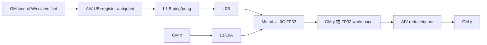

# WeightQuantBatchMatmul A2/A3 ACLNN 算子知识

## 算子速览

| 项目 | 内容 |
|---|---|
| 实际入口 | `aclnnWeightQuantBatchMatmulV3GetWorkspaceSize` + `aclnnWeightQuantBatchMatmulV3`；内部 OpType/Kernel entry 仍名为 `WeightQuantBatchMatmulV2`/`weight_quant_batch_matmul_v2` |
| 计算语义 | `y = x @ ((weight + antiquantOffset) * antiquantScale) + bias`；配置 `quantScale` 时再做输出量化 |
| 输入输出 | `x:[M,K]` FP16/BF16 ND；`weight:[K,N]` INT8/INT4 ND 或 FRACTAL_NZ；V3 在 A2/A3 不支持文档角标 2 的 F8/FP4/MX 类型；`y` 为 FP16/BF16 或量化 INT8 |
| 执行类型 | 单 Kernel；R-001 为 AIC_CUBE，R-002～R-006 为 MIX_CV（AIC:AIV=1:2），同一 POD 驱动 AIV 反量化/后处理与 AIC Matmul |
| Kernel 路线 | R-001 Fixpipe；R-002 MIX Split-K；R-003 MSD Group；R-004 MSD；R-005 NZ Split-K；R-006 Custom/Weight-NZ |
| 核心资源 | GM、按 Route 切片的 workspace、L1、L0A/L0B/L0C、AIV UB/寄存器；`TCubeTiling` 给出 Matmul 层级参数 |
| 来源闭包 | `source_closed`：公开 V3 → 公共参数检查/预处理 → `WeightQuantBatchMatmulV2` launcher → priority tiling/key → 单 Kernel router → 各 Route body 与构建接线闭合 |
| 验证状态 | 已完成源码闭包检查；本次知识提取未执行编译、真机、数值或性能测试。 |

## 接口与语义

### 计算语义

令 `A=x`、`Bq=weight`，反量化参数按 tensor/channel/group 广播：`B=(Bq+offset)*scale`，Cube 以 FP16/BF16（MSD 路线先分解低比特权重）执行 `A@B`，随后融合可选 bias；只有 `quantScaleOptional!=nullptr` 时输出为 INT8，并按接口公式执行 `(A@B+bias)*quantScale+quantOffset`。`innerPrecise` 仅 V3 暴露，合法值 0/1；A16W4 per-group、batchSize≤16 可选择 1，其余场景建议 0。

### 输入、输出与属性

| 参数 | shape/layout | dtype | 约束、默认值与语义 |
|---|---|---|---|
| `x` | `[M,K]`，ND | FP16/BF16 | 非连续仅接受末两维转置视图；A2/A3 为二维公开域 |
| `weight` | `[K,N]`，ND/FRACTAL_NZ | INT8/INT4 | A2/A3 不接受 V3 文档角标 2 类型；K 与 x 的 K 相等 |
| `antiquantScale` | `[1]`、`[N]` 或 `[ceil(K/group),N]` | 与 x 同型；特殊 Fixpipe 为 UINT64/INT64 | 决定 per-tensor/channel/group；特殊整型 scale 仅 FP16×INT8、M∈[1,96]、K/N 64 对齐、weight 转置 ND |
| `antiquantOffsetOptional` | 同 scale | FP16/BF16；Fixpipe INT32 | 可空；加法在乘 scale 之前 |
| `quantScaleOptional`,`quantOffsetOptional` | `[1]`/`[N]` | UINT64、FLOAT | scale 非空时 y 必须 INT8；offset 不能在 scale 为空时单独存在 |
| `biasOptional` | 1～2 维，末维 N 或 1 | FP16；BF16 x 可 BF16/FP32 | 可空；Matmul 后、输出量化前相加 |
| `antiquantGroupSize` | 标量 | int | 非 group 为 0；group 为 `[32,K-1]` 且 32 倍数 |
| `innerPrecise` | 标量 | int | 仅 0/1；写入 tiling key 的 MSD 高性能特化 |
| `y` | `[M,N]` ND | FP16/BF16/INT8 | 无输出量化时同 x；有输出量化时 INT8 |

### 入口与版本

固定仓旧入口 `aclnnWeightQuantBatchMatmul` 的公开文档明确要求迁移到最新 `aclnnWeightQuantBatchMatmulV3`。A2/A3 的 V3 文档均标为支持，因此本卡只提取 V3；V2、Nz 独立公开入口不作为版本路线。V3 与 V2 共享实现 TU 和内部 `WeightQuantBatchMatmulV2` OpType，但 V3 将用户 `innerPrecise` 原样传入，V2 固定传 0。

## Host/Launcher 执行流程

### 参数校验与前处理

`aclnnWeightQuantBatchMatmulV3GetWorkspaceSize` 依次创建 executor，校验 SoC、必选/可选空指针、weight 格式、`innerPrecise`；公共过程执行连续性检查、`TensorPreProcess`、识别末两维转置、dtype/shape/group/量化组合检查，并对不满足 launcher 布局的 tensor 做 `Contiguous`/`Transpose`/`TransData`。随后 L0 `WeightQuantBatchMatmulV2` 完成 infer-shape 并用 `ADD_TO_LAUNCHER_LIST_AICORE` 添加唯一核心语义节点，最后 `ViewCopy` 提交到用户 y。

### 参数、Workspace 与生命周期

第一段接口返回 executor 所需总 workspace，调用者持有其 Device 内存到第二段同 stream 执行完成。系统 workspace 为 `GetLibApiWorkSpaceSize()`；R-001 仅系统 workspace；R-002 为 `4*cubeBlockDimK*groupSize*ceil(N/256)*256*sizeof(A)+M*N*sizeof(float)+system`；R-004 固定 64 MiB；R-005 为 `max(4*cubeBlockDimK*singleK*N + M*N*sizeof(float)+system,64 MiB)`；R-006 为 `ceil(weightCacheSize/256)*256*min(3,cubeSingleNLoop)*sizeof(A)+system`。workspace 由 executor/框架拥有，Kernel 只按 tiling 公式借用；异常返回不提交后续 `ViewCopy`。

### 启动图与失败传播

```text
V3 GetWorkspaceSize
  -> 参数/连续性/转置与格式前处理（框架公共节点，按需）
  -> WeightQuantBatchMatmulV2 infer + tiling priority selector
  -> weight_quant_batch_matmul_v2<<<blockDim, stream>>>
       -> AIC-only Fixpipe 或 MIX_CV Route
  -> ViewCopy(result,y)
V3 execute -> CommonOpExecutorRun(workspace,executor,stream)
```

任一步返回空 tensor/非 `ACLNN_SUCCESS` 都立刻终止；第二段把 `CommonOpExecutorRun` 状态原样返回。核心语义只含一个 Device kernel，AIC/AIV 交接在同 launch 内由 CrossCore flag 与 pipeline event 保证。

## Route 与参数设计

### 分核与资源计算

公共 tiling 从物理 shape/transpose 得到 M/N/K、batch、per-* 模式、dtype/layout，再按 priority 调 `IsCapable`。Route 计算 `cubeBlockDim{M,N,K}` 与 `vecBlockDim{N,K}`、对齐 `kAlign/nAlign`、`vecSingleK/N`、Matmul `baseM/N/K,step*,depth*,dbL0C`，再计算 workspace、`blockDim=max(AIC数,CalcTschBlockDim(AIV数))`；DAV_2201 使用 `SetScheduleMode(1)` 的 Split-K/MSD-group 路线依赖 `SyncAll()`。

### Route 选择

| 顺序 | Route | Key/模板 | 精确选择条件与优先级 | 不适用去向 |
|---:|---|---|---|---|
| 1 | R-002 MIX Split-K | CUSTOM/MIX_SPLIT_K | 非确定性，BF16×INT8→BF16，per-group ND，带 offset，命中 4 个 `(M=24,K,N)` 白名单 | R-003 |
| 2 | R-003 MSD Group | CUSTOM/MSD_GROUP | 非确定性；per-group；scale 非 UINT64/INT64；W8 group=64 且白名单，或 W4 group=64/128 且 L1 足够；`M≤group/8,K≤13952,K%group=0,N%64=0,N≤aic*2048`；不转置且非 INT8 输出 | R-004 |
| 3 | R-004 MSD | CUSTOM/MSD_MULTI_CORE | 不转 A、非 INT8 输出、scale 非整型；per-channel：`M≤64,K%32=N%32=0`（W4 还需 transB、ND、`N≥2M`）；或 W4 per-group：不转 B、group 64/128、`M≤group/8,K%group=0,N%64=0` | R-005 |
| 4 | R-005 NZ Split-K | CUSTOM/SPLIT_K_CUSTOM | 非确定性、非 INT8 输出、scale 非整型、per-channel、`!transA&&transB`、`64<M≤256`、K/N≤65535、weight NZ，K/N 64 对齐或命中网络非对齐白名单 | R-006 |
| 5 | R-006 Custom/Weight-NZ | CUSTOM_ANTIQUANT 或 WEIGHT_NZ | scale 非整型；NZ per-group 限 group 64/128、K 对齐 group、K/N 64 对齐、`!transB`、K/N≤65535；其它合法组合为通用 fallback | R-001/失败 |
| 6 | R-001 Fixpipe | FIXPIPE_ANTIQUANT | FP16×INT8→FP16；scale UINT64/INT64；M≤96，K/N 64 对齐，`!transA&&transB`，per-channel | 失败 |

```text
DAV_2201 (A2/A3, non-310P, no s8s4 intrinsic)
  priority: SplitK -> MSDGroup -> MSD -> CustomNzSplitK -> Custom -> Fixpipe -> WeightNz
  first IsCapable()==true wins; WeightNz is 310P-only, so A2/A3 terminal is Fixpipe/失败
```

### 模板/实现执行矩阵

| Route | key/selector | dtype/shape/platform 完整命中条件 | 执行族与 kernel 节点 | 实际模板/body | 内存与同步特征 | tail/fallback |
|---|---|---|---|---|---|---|
| R-001 | FIXPIPE/A_NORMAL_LOAD 或 FULL_LOAD | 上表 Fixpipe | AIC_CUBE 单节点 | `WeightQuantBatchMatmulV2FixpipeKernel::{Init,Process}` | GM→L1/L0A/B→Mmad→L0C→Fixpipe(GM)，无 AIV 交接 | M/N 尾由 `singleCoreM/N`；失败 |
| R-002 | CUSTOM/MIX_SPLIT_K | 白名单 | MIX_CV 1:2 单节点 | `WeightQuantBatchMatmulV2MixSplitKKernel` | AIV 反量化写 workspace/L1，AIC split-K 写 FP32 workspace，AIV 汇总；`SyncAll`+CrossCore flags | K/N/M tail；R-003 |
| R-003 | CUSTOM/MSD_GROUP | 小 M per-group | MIX_CV 1:2 | `WeightQuantBatchMatmulV2MsdGroupKernel` | AIV 多尺度展开，AIC Cube，P/Q flags，FP32 中间 | 对齐 guard；R-004 |
| R-004 | CUSTOM/MSD_MULTI_CORE | 小 M per-channel/per-group | MIX_CV 1:2 | `WeightQuantBatchMatmulV2MsdMultiCoreKernel`/`MsdSplitKKernel` | 64 MiB workspace；AIV preprocess/postprocess 与 AIC 通过 `SYNC_VECTOR_CUBE_FLAG`/`SYNC_CUBE_VECTOR_FLAG` | K/N 尾与 splitK；R-005 |
| R-005 | CUSTOM/SPLIT_K_CUSTOM | NZ 65..256 M | MIX_CV 1:2 | `WeightQuantBatchMatmulV2CustomNzSplitkKernel` | weight-cache 与 FP32 result workspace；多组 VEC_CUBE/CUBE_VEC flag | 白名单处理非对齐；R-006 |
| R-006 | CUSTOM_ANTIQUANT/WEIGHT_NZ | 合法 fallback | MIX_CV 1:2 | `WeightQuantBatchMatmulV2CustomKernel` / `CustomWeightNzKernel` | AIV GM→UB 反量化→L1，AIC Matmul，Notify/Wait 双向握手；最多 3 份 weight cache | `cubeTailM/N`、K/N pad；R-001/失败 |

### 隐藏性能 Guard

| Guard | Host/Tiling 条件 | Device/资源原因 | 影响 Route | 不满足时去向 | 源码符号 |
|---|---|---|---|---|---|
| 确定性 | `GetDeterministic()==1` | Split-K/多核归并顺序非固定 | R-002/R-003/R-005 | 下一优先级 | 各 `IsCapable` |
| L1 | MSD-group W4 的 `al1Size+bl1Size<=l1Size` | A 展开与 B 双缓冲必须同时驻留 L1 | R-003 | R-004 | `CheckL1Size` |
| 对齐 | 32/64/group/256/512B 公式 | Cube block、DMA、workspace 起始地址约束 | 全部 | 下一 Route/失败 | 各 tiling `IsCapable/GetWorkspaceSize` |
| 数值 | MSD 以多尺度展开并用 FP32 workspace；部分白名单启用 highPrecision | 控制低比特展开误差与累加顺序 | R-003/R-004 | R-005 | `WeightQuantBatchMatmulV2Msd::{IsCapable,GetTilingKey}` |
| AIC:AIV 比 | `CalcTschBlockDim(...aicNum,aivNum)`，Kernel default `MIX_AIC_1_2` | 每个 Cube tile 由两个 Vector 子核供给反量化 B | R-002～R-006 | 不可达 key | `PostTiling`, kernel entry |

### POD/ABI

所有结构均 `#pragma pack(8)` 且 `alignas(8)`；固定仓未提供编译后的 `sizeof/offsetof`，因此不推测数值。字段按声明顺序、自然宽度并按 8 字节上限对齐。

| 结构 | 字段 | 类型/位宽 | ABI 布局 | 单位 | Host/launcher producer | Device consumer | 边界 |
|---|---|---|---|---|---|---|---|
| `WeightQuantBatchMatmulV2TilingData` | `vecBlockDimN/K,cubeBlockDimN/M/K,kPadSize,nPadSize,haveBatchA/B,reserve1..3` | `uint8_t` | pack/align 8；逐声明排列 | 核数/元素 | Custom/SplitK tiling | Common/Custom bodies | pad 必须可装入 8 bit |
| 同上 | `vecSingleKGroupNum,vecSingleKTailGroupNum,AL1Pingpong,BL1Pingpong` | `uint16_t` | 同上 | group/缓冲深度 | tiling | AIV/Cube | inactive 字段由 Reset 清零 |
| 同上 | `vecSingleK/N,vec2SingleM,*Tail,*QueueSize,antiQuantTmpBufferSize,*Ratio,cubeTailM/N,*Loop,repeatAxisMax` | `uint32_t` | 同上 | 元素/循环/字节（QueueSize） | tiling | AIV/Cube | tail 不得超过主 tile |
| 同上 | `vecSingle*Loop,kAlign,nAlign,kSize,nSize,groupSize,mSize,blockBatch,shapeBatch,mAubSize,kAubSize,nBubSize,kBubSize,mCubSize,nCubSize,mAL1Size,kAL1Size,nBL1Size,kBL1Size` | `uint64_t` | 同上 | 元素/循环 | tiling | AIV/Cube | 对齐值为物理 extent |
| 同上 | `matmulTiling` | `TCubeTiling` | 尾部嵌套 POD | 元素/step/depth | `MatmulApiTiling` | Matmul object | ABI 由 AscendC 公共头定义 |
| `...FixpipeTilingData` | `hasBias,nBlockNum,baseK,baseM,baseN,singleCoreM/N,mSize/kSize/nSize` | u8/u16/u32/u64 | pack/align 8 | bool/核/元素 | Fixpipe tiling | Fixpipe kernel | 仅 R-001 |
| `...MsdGroupTilingData` | `vecBlockDimN,cubeBlockDimK/N,vec1SingleCoreM,hasBias,reserve*,singleCoreK,vecSingleCoreN,singleCoreGroup,m/k/n/groupSize,matmulTiling` | u8/u16/u32/u64/POD | pack/align 8 | 核/元素/group | MSD-group tiling | MSD-group body | 仅 R-003 |
| `...MsdTilingData` | `cubeBlockDimN/M/K,hasBias,v1BaseM,preloadTimes,taskNSize,taskSingleCoreNSize,postProcessBaseM/postProcessSingleCoreM,preProcessUsedVecNum,v1BaseK,m/k/n/groupPack/groupSize,matmulTiling` | u8/u16/u32/u64/POD | pack/align 8 | 核/元素/循环 | MSD tiling | MSD bodies | 仅 R-004 |
| `...CustomNzSplitKTilingData` | 全部 `vec/cubeBlockDim*`,`post/single*`,`cube*Loop`,`vector*Tail`,`m/k/n*Align` | u8/u16/u32/u64 | pack/align 8 | 核/元素/循环 | NZ Split-K tiling | CustomNzSplitk | 仅 R-005；未使用 reverse 字段清零 |

### Route 源码闭包

| Route | Key/selector | Host/Tiling producer | POD/参数 | Kernel entry/router | Kernel body/直接依赖 | 构建接线 |
|---|---|---|---|---|---|---|
| R-001 | Fixpipe priority 5 | `...tiling_fixpipe.cpp` | Fixpipe POD | `op_kernel/weight_quant_batch_matmul_v2.cpp` | `fixpipe/weight_quant_batch_matmul_v2_fixpipe*.h` | `op_kernel/CMakeLists.txt` |
| R-002 | SplitK priority 0 | `...tiling_splitk.cpp` | common POD | 同上 | `weight_quant_batch_matmul_v2_custom_mix_splitk.h` | 同上 |
| R-003 | MSDGroup priority 1 | `...tiling_msd_group.cpp` | MSDGroup POD | 同上 | `weight_quant_batch_matmul_v2_msd_group.h` | 同上 |
| R-004 | MSD priority 2 | `...tiling_msd.cpp` | MSD POD | 同上 | `weight_quant_batch_matmul_v2_msd_multicore.h`,`...msd_split_k.h` | 同上 |
| R-005 | CustomNzSplitK priority 3 | `...tiling_custom_nz_splitk.cpp` | NZSplitK POD | 同上 | `weight_quant_batch_matmul_v2_custom_nz_splitk.h` | 同上 |
| R-006 | Custom priority 4 | `...tiling_custom.cpp` | common POD | 同上 | `...custom.h`,`...custom_weight_nz.h`,`...common.h` | 同上 |

## Kernel 实现

### 公共执行流程

entry 解析同一 tiling POD，根据编译期 tiling key/dtype/format 选择实例。MIX 路线的 AIV 把 INT8/INT4 权重从 GM 搬入 UB，执行 `(w+offset)*scale` 与 cast，再写 L1 或 workspace；AIC 等待后把 x/反量化 B 搬入 L0A/L0B，Matmul 累加到 L0C，再经 Fixpipe 写 y/workspace；需要归并或输出量化时 AIV 等待 AIC 后处理。`weight_quant_batch_matmul_v2_common.h` 固定 `SYNC_AIV_AIC_FLAG=4`、`SYNC_AIC_AIV_FLAG=6`，`PIPE_MTE3` 通知 Cube、`PIPE_FIX` 通知 Vector。

### Route R-001：Fixpipe AIC-only

#### 适用条件

##### 选择证据

| 层级 | 文件 | 符号 | 源码谓词/参数 | 结果/下一跳 |
|---|---|---|---|---|
| Tiling | `...tiling_fixpipe.cpp` | `IsCapable` | FP16/W8/FP16、整型 scale、M≤96、K/N 64 对齐、A不转/B转、per-channel | Fixpipe key，否则失败 |

#### Device 数据流

##### 函数级调用链

```text
weight_quant_batch_matmul_v2 -> WeightQuantBatchMatmulV2FixpipeKernel::Init -> Process -> Mmad -> Fixpipe(scale/offset/bias) -> GM y
```

##### 源码等价伪码

```text
for core(M,N): load x/weight to L1->L0A/L0B; Mmad to L0C(float); Fixpipe applies dequant and optional bias; store valid MxN tail
```

#### 内存与数据搬运

##### 资源与搬运表

| 层级/缓冲区 | offset/地址公式 | extent/容量公式 | dtype/layout | producer | consumer | owner/lifetime | 对齐/复用 |
|---|---|---|---|---|---|---|---|
| GM x/w/y | tile offsets from block M/N | logical M*K,K*N,M*N | FP16/INT8/FP16 ND | Host/AIC | AIC/Host | call | K/N 64 |
| workspace | 0 | system workspace | bytes | framework | Matmul lib | executor | platform size |
| L1/L0A/B/C | TCubeTiling | base/step/depth formulas | FP16/FP16/FP32 | MTE | Mmad/Fixpipe | core tile | tail mask |
| UB | N/A | N/A | N/A | N/A | N/A | AIC-only | Fixpipe replaces Vector |

##### 分层内存布局


##### 字节账、交接边与复用顺序

```text
workspace_total = system_workspace
L1/L0 = TCubeTiling(base*,step*,depth*,dbL0C); UB=N/A
```

| 边/复用子区 | producer | offset/extent | dtype/layout | consumer | ordering/sync | owner/lifetime | 安全条件 |
|---|---|---|---|---|---|---|---|
| L0C→GM | Mmad | tile M*N | FP32→FP16 ND | Fixpipe | Cube pipeline | block | M/N tail |

#### 同步、精度与尾块

##### 同步与数值边界表

| 阶段 | primitive/机制 | producer | consumer/等待点 | 保护对象 | 精度/尾块 |
|---|---|---|---|---|---|
| Cube | Matmul pipeline | MTE1 | Mmad/Fixpipe | L1/L0 | FP32 accumulate；singleCoreM/N 裁尾 |

#### 关键实现

##### 符号证据表

| 阶段 | 文件 | 符号/模板实例 | 实现事实 |
|---|---|---|---|
| Host/Tiling producer | `...tiling_fixpipe.cpp` | `GetTilingKey/GetWorkspaceSize` | full-load key，系统 workspace |
| Kernel entry/router | `op_kernel/weight_quant_batch_matmul_v2.cpp` | FIXPIPE branch | AIC-only |
| Device body/helper | `op_kernel/fixpipe/weight_quant_batch_matmul_v2_fixpipe.h` | `Process` | L0C Fixpipe 反量化输出 |

### Route R-002～R-006：MIX_CV 反量化族

#### 适用条件

##### 选择证据

| 层级 | 文件 | 符号 | 源码谓词/参数 | 结果/下一跳 |
|---|---|---|---|---|
| Host | `...tiling_registry.cpp` | `TilingRegistry::DoTilingImpl` | priority 0→4 | R-002→R-006 |
| Router | `op_kernel/weight_quant_batch_matmul_v2.cpp` | CUSTOM subalgorithm branches | MIX_SPLIT_K/MSD_GROUP/MSD_MULTI_CORE/SPLIT_K_CUSTOM/CUSTOM_ANTIQUANT/WEIGHT_NZ | 对应 body |

#### Device 数据流

##### 函数级调用链

```text
entry -> Route::Init -> AIV CopyIn+AntiQuant -> NotifyCube -> AIC Matmul -> NotifyVector -> AIV reduce/quant/copyout -> GM y
```

##### 源码等价伪码

```text
AIV: for assigned (K,N): GM low-bit W -> UB; add offset; multiply scale; cast A dtype; write L1/workspace; CrossCoreSetFlag(4)
AIC: wait 4; GM x + dequant B -> L0A/L0B; Mmad(FP32 L0C); Fixpipe to y or FP32 workspace; CrossCoreSetFlag(6)
AIV post: wait 6; split-K reduce / bias / output quant when selected; masked store valid M,N
```

#### 内存与数据搬运

##### 资源与搬运表

| 层级/缓冲区 | offset/地址公式 | extent/容量公式 | dtype/layout | producer | consumer | owner/lifetime | 对齐/复用 |
|---|---|---|---|---|---|---|---|
| GM input/output | batch+M/K/N tile | logical tensors | API dtype/layout | Host | AIV/AIC | call | K/N pad |
| weight cache | 0；Route-specific | R-002/R-005/R-006 formulas above | A dtype | AIV | AIC | kernel | up to 3/4 buffers |
| result workspace | after weight cache | `M*N*sizeof(float)` where split/reduce | FP32 ND | AIC | AIV | kernel | stream-local |
| L1 B | ping/pong by loop parity | `nBL1Size*kBL1Size*BL1Pingpong*sizeof(A)` | dequant A dtype | AIV | AIC | tile | CrossCore handshake |
| L0A/B/C | TCubeTiling | base/step/depth bytes | A/A/FP32 | MTE1/Mmad | Mmad/Fixpipe | tile | dbL0C |
| AIV UB/register | queue-size fields | sum queue/tmp fields | low-bit/A/FP32 | MTE2/V | V/MTE3 | loop | HardEvent pipeline |

##### 分层内存布局



##### 字节账、交接边与复用顺序

```text
workspace_total = route_weight_cache + optional(M*N*4) + system_workspace
L1_B = nBL1Size*kBL1Size*BL1Pingpong*sizeof(A)
L0_total = baseM*baseK*sizeof(A)+baseK*baseN*sizeof(A)+baseM*baseN*sizeof(float), each multiplied by actual depth/db
UB_total = wInQueueSize+offsetInQueueSize+scaleInQueueSize+wOutQueueSize+antiQuantTmpBufferSize (fields are bytes)
```

| 边/复用子区 | producer | offset/extent | dtype/layout | consumer | ordering/sync | owner/lifetime | 安全条件 |
|---|---|---|---|---|---|---|---|
| AIV→AIC dequant B | AIV antiquant | L1 ping/pong tile | A dtype, Cube layout | AIC MTE1/L0B | flag 4 + loop parity | block | AIC ack before overwrite |
| AIC→AIV result | Mmad/Fixpipe | result slice `M*N*4` | FP32 ND | AIV post | flag 6/SyncAll | kernel | all split-K writers complete |

#### 同步、精度与尾块

##### 同步与数值边界表

| 阶段 | primitive/机制 | producer | consumer/等待点 | 保护对象 | 精度/尾块 |
|---|---|---|---|---|---|
| UB pipeline | `Set/WaitFlag<MTE2_V,V_MTE3,...>` | DMA/Vector | next stage | UB queue | repeat/mask handles final K/N |
| CV handoff | `CrossCoreSet/WaitFlag`, flags 4/6 | AIV/AIC | AIC/AIV | L1/result | double buffer parity |
| multi-core | `SyncAll`, scheduleMode=1 | participating cores | reduce/post | workspace | deterministic route disabled |
| numeric | FP16/BF16 dequant, FP32 Mmad/result, final cast/quant | AIV/AIC | y | accumulators | output quant after bias |

#### 关键实现

##### 符号证据表

| 阶段 | 文件 | 符号/模板实例 | 实现事实 |
|---|---|---|---|
| Host/Tiling producer | `...tiling_{splitk,msd_group,msd,custom_nz_splitk,custom}.cpp` | `IsCapable/DoOpTiling/PostTiling` | route/分核/workspace |
| Kernel entry/router | `op_kernel/weight_quant_batch_matmul_v2.cpp` | `SUB_ALGORITHM_CUSTOM` branches | key→body |
| Device body/helper | `...common.h`,`...custom*.h`,`...msd*.h` | `BaseInit/Process/NotifyVector/WaitForCube` | CV 数据流、同步、tail |

## 算子特定优化

### Trick T-001：Priority selector 将小 M、Split-K 与通用反量化分开

#### 触发与源码依据

- 适用 Route：R-002～R-006
- 触发条件：DAV_2201 不支持 s8s4 intrinsic，进入通用 registry 并按固定 priority 首个命中
- Golden 来源：[`weight_quant_batch_matmul_v2_tiling_registry.cpp:46-52`](../../../../../../../cann-ops-raw/ascendc/ops-nn/955f8b33985b6d72989ebff341bb9c2c564a51bc/matmul/weight_quant_batch_matmul_v2/op_host/op_tiling/weight_quant_batch_matmul_v2_tiling_registry.cpp#L46-L52)

**官方源码（固定 Commit 连续逐字摘录）**：

```cpp
REGISTER_TILING_TEMPLATE("WeightQuantBatchMatmulV2", WeightQuantBatchMatmulV2TilingSplitK, SPLIT_K_PRIORITY);
REGISTER_TILING_TEMPLATE("WeightQuantBatchMatmulV2", WeightQuantBatchMatmulV2TilingMsdGroup, MSD_GROUP_PRIORITY);
REGISTER_TILING_TEMPLATE("WeightQuantBatchMatmulV2", WeightQuantBatchMatmulV2Msd, MSD_PRIORITY);
REGISTER_TILING_TEMPLATE("WeightQuantBatchMatmulV2", WeightQuantBatchMatmulV2CustomNzSplitK, CUSTOM_SPLITK_PRIORITY);
REGISTER_TILING_TEMPLATE("WeightQuantBatchMatmulV2", WeightQuantBatchMatmulV2TilingCustom, CUSTOM_PRIORITY);
REGISTER_TILING_TEMPLATE("WeightQuantBatchMatmulV2", WeightQuantBatchMatmulV2TilingFixpipe, FIXPIPE_PRIORITY);
REGISTER_TILING_TEMPLATE("WeightQuantBatchMatmulV2", WeightQuantBatchMatmulV2WeightNz, WEIGHT_NZ_PRIORITY);
```

#### 机制与设计原因

白名单 Split-K、MSD 小 M 和 NZ 特化先于通用 Custom；每个特化用 shape/dtype/L1/determinism guard 保证其 workspace 与同步协议成立，最后才由 Custom 覆盖常规浮点 scale，Fixpipe 覆盖特殊整型 scale。

#### 迁移边界

- 适用：同样需要低比特权重反量化后送 Cube 的 DAV_2201 算子。
- 前提：保持 priority、完整 `IsCapable`、tiling key 与对应 POD/body 一致。
- 失效：改变 dtype/layout/group/determinism 后必须重新命中下一 Route，不得只复用 body。
- 未验证：本次知识提取未执行编译、真机、数值或性能测试。

#### 错误做法

绕过 `IsCapable` 强制 Split-K 会破坏确定性、对齐或 workspace 容量；源码的下一优先级是可验证 fallback。

### Trick T-002：AIV 反量化与 AIC Matmul 通过 L1 双缓冲握手

#### 触发与源码依据

- 适用 Route：R-006（其它 MIX 路线使用同类但各自 flag 图）
- 触发条件：CUSTOM/WEIGHT_NZ MIX_CV key
- Golden 来源：[`weight_quant_batch_matmul_v2_common.h:136-160`](../../../../../../../cann-ops-raw/ascendc/ops-nn/955f8b33985b6d72989ebff341bb9c2c564a51bc/matmul/weight_quant_batch_matmul_v2/op_kernel/weight_quant_batch_matmul_v2_common.h#L136-L160)

**官方源码（固定 Commit 连续逐字摘录）**：

```cpp
__aicore__ inline void NotifyCube()
{
    CrossCoreSetFlag<SYNC_MODE2, PIPE_MTE3>(SYNC_AIV_AIC_FLAG);
}
__aicore__ inline void NotifyVector()
{
    CrossCoreSetFlag<SYNC_MODE2, PIPE_FIX>(SYNC_AIC_AIV_FLAG);
}
```

#### 机制与设计原因

AIV 完成低比特 B 的反量化及 L1 写入后通知 AIC；AIC 消费该 ping/pong 片并完成 Cube 后再通知 AIV，避免把完整反量化权重长期物化为 GM，同时防止下一轮覆盖尚未消费的 L1。

#### 迁移边界

- 适用：同 launch 的 AIC:AIV=1:2 生产者/消费者。
- 前提：保留 flag ID、pipe、轮次与 buffer parity；blockDim 必须按 AIC/AIV 比编码。
- 失效：AIC-only Fixpipe 或跨 kernel 拓扑必须使用各自同步。
- 未验证：本次知识提取未执行编译、真机、数值或性能测试。

#### 错误做法

只保留 `SetFlag` 而删除对向 wait/ack 会让 AIV 覆盖 AIC 尚在读取的 L1。

## 模板与实现对比

| 对比维度 | R-001 Fixpipe | R-002～R-006 MIX_CV | 设计选择依据 |
|---|---|---|---|
| 命中条件/优先级 | 整型 antiquant scale，最终特化 | 浮点 scale，shape/group/determinism 分层 | scale 表示与资源条件 |
| 执行族/节点图 | AIC-only 单 Kernel | AIC:AIV=1:2 单 Kernel | 是否可由 Fixpipe 完成反量化 |
| M/N/K、tile 与 scheduler | M≤96、64 对齐 | TCubeTiling + route-specific split | 小 M、split-K、NZ |
| workspace/L1/L0/UB | system；无 AIV UB | route cache/FP32 result；L1/UB 双缓冲 | 反量化与归并需求 |
| AIC/AIV 或 kernel 交接 | N/A | L1/workspace + CrossCore flags | 防覆盖/可见性 |
| 同步、精度与 tail | Cube pipeline，FP32 L0C | HardEvent+CrossCore/SyncAll，FP32 accum | Route 数值协议 |
| fallback/失败边界 | 不命中即失败 | priority 下一 Route，最终失败 | `IsCapable` 链 |

## 平台差异

| 项目 | A2 | A3 | 950 |
|---|---|---|---|
| 支持状态 | V3 支持 | V3 支持 | V3 支持，见 `_950` 卡 |
| Host/Launcher | DAV_2201，共用 V3 Host | DAV_2201，共用 V3 Host | DAV_3510 dtype 增加 F8/FP4/MX |
| Kernel/资源 | 公共 kernel，AIC-only+MIX 1:2 | 同 A2 | arch35 kernel 与专用 tiling/POD |

## 限制与失败边界

- A2/A3 不支持 V3 文档角标 2 的 FLOAT8/HIFLOAT8/FLOAT4/MX 组合；不得因 950 binary/config 存在而外推。
- 所有 `IsCapable` 均失败、tiling POD 超容量、Matmul tiling 失败或 workspace 获取失败时返回失败，不存在未记录的安全 fallback。
- `TCubeTiling` 的精确 ABI、平台系统 workspace 数值与 generated executor 内部节点 ABI 位于固定仓外公共库边界；本卡不推测。
- 本次知识提取未执行编译、真机、数值或性能测试。

## 源码索引

### 链路索引

| 链路阶段 | 文件 | 关键符号 | 支撑内容 |
|---|---|---|---|
| 入口声明/约束 | `matmul/weight_quant_batch_matmul_v2/docs/aclnnWeightQuantBatchMatmulV3.md` | V3 原型/产品表 | 公开支持、语义、dtype |
| 入口实现 | `matmul/weight_quant_batch_matmul_v2/op_host/op_api/aclnn_weight_quant_batch_matmul_v2.cpp` | `aclnnWeightQuantBatchMatmulV3GetWorkspaceSize/V3` | 校验、预处理、executor |
| Launcher | `matmul/weight_quant_batch_matmul_v2/op_host/op_api/weight_quant_batch_matmul_v2.cpp` | `l0op::WeightQuantBatchMatmulV2` | infer/launch 节点 |
| Host/Tiling | `matmul/weight_quant_batch_matmul_v2/op_host/op_tiling/weight_quant_batch_matmul_v2_tiling_registry.cpp` | `WeightQuantBatchMatmulV2TilingFunc` | 平台分支/priority/compile info |
| POD | `matmul/weight_quant_batch_matmul_v2/op_kernel/weight_quant_batch_matmul_v2_tiling_data.h` | tiling structs | ABI 字段 |
| Kernel entry/body | `matmul/weight_quant_batch_matmul_v2/op_kernel/weight_quant_batch_matmul_v2.cpp` | `weight_quant_batch_matmul_v2` | key router |
| Kernel helper | `matmul/weight_quant_batch_matmul_v2/op_kernel/weight_quant_batch_matmul_v2_common.h` | `NotifyCube/NotifyVector/Wait*` | MIX 同步 |
| 构建接线 | `matmul/weight_quant_batch_matmul_v2/op_kernel/CMakeLists.txt` | `add_kernel_sources` | 公共 kernel + arch35 分流 |

### 实现复用检查

| 检查项 | 可复用事实 | 不得改变的约束 | 源码符号 |
|---|---|---|---|
| ABI/POD | route-specific POD + `TCubeTiling` | pack(8)、字段顺序/位宽、inactive 清零 | tiling_data.h |
| 调用顺序 | V3 common-process→L0 launch→ViewCopy | `innerPrecise` 原样传入 | V3 GetWorkspaceSize |
| workspace/内存 | 各 Route 公式 | 256/512B 对齐、system tail、owner lifetime | `GetWorkspaceSize` |
| 同步 | AIV↔AIC flags，HardEvent，必要时 SyncAll | flag ID/pipe/轮次/ack | common/body headers |
| 精度与尾块 | 反量化→FP32 Mmad→bias→quant | cast/round、K/N mask、split-K reduce | Route `Process` |
| 失败边界 | priority fallback | 不可跳过 `IsCapable`/Matmul tiling failure | registry/classes |