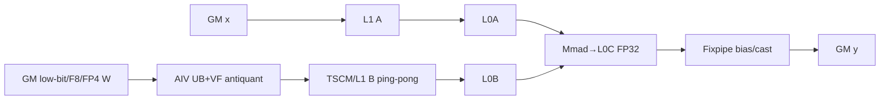

# WeightQuantBatchMatmul 950 ACLNN 算子知识

## 算子速览

| 项目 | 内容 |
|---|---|
| 实际入口 | `aclnnWeightQuantBatchMatmulV3GetWorkspaceSize` + `aclnnWeightQuantBatchMatmulV3`；内部 OpType/entry 为 `WeightQuantBatchMatmulV2`/`weight_quant_batch_matmul_v2` |
| 计算语义 | `y=x@((weight+antiquantOffset)*antiquantScale)+bias`；950 公开 dtype 表不支持带角标 1 的输出量化参数/INT8 y |
| 输入输出 | x FP16/BF16 ND；weight 支持 INT8/INT4、F8/HIF8、FP4/MX 等 950 公开类型，ND/FRACTAL_NZ；y FP16/BF16 |
| 执行类型 | 单 Kernel MIX_CV；arch35 key 声明 AIC:AIV=1:2 或 1:1，实际 body 用 `ASCEND_IS_AIC/AIV` 分开 Cube 与 Vector 任务 |
| Kernel 路线 | R-001 Adaptive Split；R-002 RegBase；R-003 ASW；R-004 A16W8 NZ backward-compatible；注册的 IterBatch 被公开 V3 二维校验阻断，不是正式 Route |
| 核心资源 | GM、最低 16 MiB workspace（RegBase 追加指针表）、512 KiB L1/TSCM、L0A/B/C、AIV UB/寄存器、SSBUF/CrossCore flag |
| 来源闭包 | `source_closed`：公开 V3 → Host/launcher → capability/resource selector → arch35 tiling/POD → arch35 MIX_CV entry/body → build target `ascend950` |
| 验证状态 | 已完成源码闭包检查；本次知识提取未执行编译、真机、数值或性能测试。 |

## 接口与语义

### 计算语义

反量化顺序固定为 `weight+offset` 后乘 `scale`；AIV 将低比特/F8/FP4/MX 权重变成 x dtype 或当前 Matmul specialization 需要的表示，写入 L1/TSCM，AIC 以 `TCubeTiling` 完成 `x@B`，再融合 bias 与输出 cast。`innerPrecise=1` 用于 A16W4 per-group 小 batch 高性能选择；它不是新的逻辑算子。

### 输入、输出与属性

| 参数 | shape/layout | dtype | 约束、默认值与语义 |
|---|---|---|---|
| `x` | `[M,K]` ND | FP16/BF16 | K 与 weight 相等；非连续只支持转置视图 |
| `weight` | `[K,N]` ND/FRACTAL_NZ | INT8/INT4/INT32、F8E4M3/HIF8、FLOAT/FP4E2M1 | INT32/FLOAT 是低比特打包表示，由 arch35 key 宏重解释；格式/transpose 受 Route guard 约束 |
| `antiquantScale` | tensor/channel/group/MX shape | FP16/BF16/F8E8M0 | 950 不支持 UINT64/INT64 特殊 Fixpipe输入；MX 由 scale 指数驱动 |
| `antiquantOffsetOptional` | 同普通 scale | FP16/BF16 | 可空；950 不支持角标 1 的 INT32 offset |
| `quantScaleOptional`,`quantOffsetOptional` | 可选 | UINT64/FLOAT | V3 文档角标 1，950 不支持，必须为空 |
| `biasOptional` | 1～2 维 | FP16/BF16/FP32 | 可空；BF16/FP32 由 key 的 `IS_BIAS_FP32` 等区分 |
| `antiquantGroupSize` | 标量 | int | 0 或 32 倍数；具体 RegBase/Adaptive Split guard 进一步限制 |
| `innerPrecise` | 标量 | int | 0/1；参与 Adaptive Split 高性能条件 |
| `y` | `[M,N]` ND | FP16/BF16 | 950 不支持角标 1 的 INT8 y |

### 入口与版本

旧 `aclnnWeightQuantBatchMatmul` 文档要求使用最新 V3；V3 产品表明确支持 Ascend 950PR/DT，因此 950 只提取 V3。V3 复用内部 V2 OpType，但保留 `innerPrecise`，与公开 V2 固定 0 的行为不同。

## Host/Launcher 执行流程

### 参数校验与前处理

V3 第一段创建 executor，`CheckSocValid` 接受 DAV_3510，检查空指针、format、`innerPrecise`、dtype/shape/group 和可选参数关系；公共流程做连续化、转置识别与必要的 ReFormat/Transpose/TransData。950 的 dtype 列表由 `Get*DtypeSupportList()` 的 DAV_3510 分支生产。之后 L0 创建 ND y，infer shape，添加一个 `WeightQuantBatchMatmulV2` AICore 节点，最终 `ViewCopy` 到用户输出。

### 参数、Workspace 与生命周期

Adaptive Split 与 ASW 写入 16 MiB workspace；RegBase 为 `16 MiB + cubeNumBlocksN*cubeNumBlocksM*sizeof(uintptr_t)`，追加每 tile 指针/状态表；backward-compatible 继承 common Custom weight-cache 公式。executor 持有预处理 tensor、POD 与节点图，调用者 workspace 必须活到 `CommonOpExecutorRun` 在同一 stream 完成。

### 启动图与失败传播

```text
V3 GetWorkspaceSize -> preprocess -> WeightQuantBatchMatmulV2 tiling
  -> resource.supportMmadS8S4 ? [IterBatch(IsCapable=false for rank-2 V3) -> ASW] : DAV_3510 arch registry [AdaptiveSplit -> RegBase -> BackwardCompatible]
  -> arch35/weight_quant_batch_matmul_v2<<<blockDim>>>
       AIV: antiquant/format conversion -> L1/TSCM
       AIC: wait -> Matmul/Fixpipe -> y
  -> ViewCopy
```

selector、tiling、launch 或 ViewCopy 任一步失败都停止；第二段原样返回 executor 状态。只有一个核心语义 Kernel，不存在跨 kernel workspace 边。

## Route 与参数设计

### 分核与资源计算

公共 tiling 得到 M/N/K、dtype/layout、per-* 模式和 platform resources。Adaptive Split 用 `cubeNumBlocksM*N` 个逻辑 Cube block，POD 给出 main/tail L1 block、`aPreloadSize` 和 `TCubeTiling`；RegBase 用 solver 计算 `base/step/depth`、`nBubSize/kBubSize` 和 `vecCoreParallel`；ASW 计算滑窗 main/tail tile。`blockDim` 按 kernel task ratio 编码 AIC/AIV。

### Route 选择

| 顺序 | Route | Key/模板 | 精确选择条件与优先级 | 不适用去向 |
|---:|---|---|---|---|
| 1a | R-003 ASW | FIXPIPE/ASW，priority 10 | platform resource 声明 s8s4；priority 9 的 IterBatch 因 V3 非 310P `CheckDimValid` 强制 rank=2 而 `batchX=batchWeight=1`，其 `IsCapable` 返回 false；合法 A16W8 常规场景进入 ASW | 失败 |
| 1b | R-001 Adaptive Split | VECTOR_ANTIQUANT/N_FIRST_*，arch priority 7 | DAV_3510 arch 分支；scale 非 UINT64；INT4 NZ 禁止 transA/transB；NZ c0=16；per-group 只接受 INT4 NZ group∈{32,64,128,256} | R-002 |
| 2b | R-002 RegBase | VECTOR_ANTIQUANT/ANTI_REG_SCSC，arch priority 8 | 非 910_55；NZ c0=16；per-group；weight INT4/FP4/INT8；y 非 INT8；scale 非 UINT64 | R-004 |
| 3b | R-004 Backward-compatible | CUSTOM_BACKWARD_COMPATIBLE，arch priority 11 | A16W8 FRACTAL_NZ c0=32，`!transA`，K/N≤65535，per-channel/group；group 时 64/128、K%group=0、K/N%64=0、`!transB` | 失败 |

```text
if supportMmadS8S4: IterBatch(unreachable from rank-2 V3) -> ASW
else if arch==DAV_3510: AdaptiveSplit -> RegBase -> CustomBackwardCompatible
else: not an A5 route
```

### 模板/实现执行矩阵

| Route | key/selector | dtype/shape/platform 完整命中条件 | 执行族与 kernel 节点 | 实际模板/body | 内存与同步特征 | tail/fallback |
|---|---|---|---|---|---|---|
| R-001 | N_FIRST_TAIL_RESPLIT/BASIC_BLOCK + MTE2 config | 上表，含 INT4/F8/FP4/MX specialization | MIX_CV 1:2（310R6 子架构编译分支为 1:1） | `WeightQuantBatchMatmulV2BasicBlockController`→`WeightQuantMatmulBasicBlock` | AIV GM→UB→L1；AIC L1/L0→Mmad；CrossCore双向 flag；16 MiB | 两段 N tail；R-002 |
| R-002 | ANTI_REG_SCSC | per-group low-bit | MIX_CV 1:2 | `WeightQuantBatchMatmulV2RegBaseKernel/CommonKernel` | RegBase VF，L1 pingpong，workspace 指针表，Notify/Wait | solver tail；R-004 |
| R-003 | ASW | s8s4 fallback | MIX_CV 1:2 | `WeightQuantBatchMatmulV2ASWKernel` | AIV antiquant 滑窗供 B，AIC Matmul，16 MiB | `mTailTile/nTailTile`；失败 |
| R-004 | CUSTOM_BACKWARD_COMPATIBLE | A16W8 NZ c0=32 | MIX_CV 1:2 | `WeightQuantBatchMatmulV2CustomWeightNzKernel` | common Custom L1/UB/flags | K/N≤65535 tail；失败 |

### 隐藏性能 Guard

| Guard | Host/Tiling 条件 | Device/资源原因 | 影响 Route | 不满足时去向 | 源码符号 |
|---|---|---|---|---|---|
| resource branch | `supportMmadS8S4` | 决定 Fixpipe ASW 还是 AIV antiquant arch solver | 全部 | 另一 selector 树 | `WeightQuantBatchMatmulV2TilingFunc` |
| NZ c0 | c0=16（R-001/2）或 c0=32（R-004） | 对应 arch35 L1/Cube layout specialization | R-001/2/4 | 下一 Route | `IsCapable` |
| L1/UB/L0C extension | `CheckL1SizeAfterExtending/CheckUbSizeAfterExtending/CheckL0CSizeAfterExtending` | 扩大 baseN 不能超过硬件容量 | R-001 | solver 选择较小 tile | AdaptiveSplit tiling |
| MTE2 config | 256/512/1024 inner × 2/4 buffer | 匹配权重 dtype/layout 与 UB 容量 | R-001 | 其它 key/fail | arch35 tiling key |
| `vecCoreParallel` | B1 单 buffer、K loop 恰为双缓冲、N 全覆盖 | 允许 Vector 子核并行填充 B L1 | R-002 | 串行握手 | `SetAdditionalParam` |

### POD/ABI

arch35 POD 使用 `#pragma pack(8)`；固定仓未提供编译后 `sizeof/offsetof`，不推测具体数值。默认成员初始化为 0，未激活字段不得被当作有效参数。

| 结构 | 字段 | 类型/位宽 | ABI 布局 | 单位 | Host/launcher producer | Device consumer | 边界 |
|---|---|---|---|---|---|---|---|
| `WeightQuantBatchMatmulV2ASTilingDataParams` | `cubeNumBlocksM/N,hasBias,firstTailBlockCount,secondTailBlockCount,weightL2Cacheable,mainBlockL1Size,firstTailBlockL1Size,secondTailBlockL1Size,aPreloadSize` | uint32 | pack 8，声明序 | 核/块/元素 | AdaptiveSplit | BasicBlockController | 仅 R-001 |
| 同上 | `groupSize,mainBlockCount,mSize,kSize,nSize` | uint64 | 同上 | 元素/块 | AdaptiveSplit | controller/basic block | tail 用原始 M/N |
| 同上 | `matmulTiling` | `TCubeTiling` | 尾部嵌套 POD | tile/step/depth | Matmul tiler | CubeCompute | 公共 ABI 边界 |
| `WeightQuantBatchMatmulV2RegBaseTilingDataParams` | `cubeNumBlocksN/M,vecCoreParallel,reserve1,AL1Pingpong,BL1Pingpong,kSize,nSize,groupSize,mSize,nBubSize,kBubSize,matmulTiling` | u8/u16/u64/POD | pack 8 | 核/深度/元素 | RegBase tiling | RegBase kernel | 仅 R-002 |
| `WeightQuantBatchMatmulV2ASWTilingDataParams` | `hasBias,mTailTile,nTailTile,reserved1,matmulTiling,params` | u32/POD | pack 8 | bool/tile | ASW tiling | ASW | R-003 |
| `WeightQuantBatchMatmulV2BatchParams` | `batchA/B/C,batchA1..4,batchB1..4,batchC1..4,biasWithBatch` | uint64 | pack 8 | batch/stride | ASW base tiling | ASW block | V3 rank-2 时 batch 值退化为 1 |
| `WeightQuantBatchMatmulV2TilingData` | common vec/cube dims、queue/tail、M/N/K/group、L1/UB 和 `TCubeTiling` | u8/u16/u32/u64/POD | pack/align 8 | 核/元素/字节 | backward-compatible common tiling | CustomWeightNz | 仅 R-004 |

### Route 源码闭包

| Route | Key/selector | Host/Tiling producer | POD/参数 | Kernel entry/router | Kernel body/直接依赖 | 构建接线 |
|---|---|---|---|---|---|---|
| R-001 | arch priority 7 | `arch35/...adaptive_split_tiling.cpp` | AS POD | `arch35/weight_quant_batch_matmul_v2.cpp` | `n_first/*basic_block*`,`cube_compute`,`vec_compute` | `op_kernel/CMakeLists.txt` ascend950 |
| R-002 | arch priority 8 | `arch35/...reg_base_tiling.cpp` | RegBase POD | 同上 | `...reg_base.h`,`...reg_base_common.h`,`...vf.h` | 同上 |
| R-003 | priority 10 | `arch35/...adaptive_sliding_window_tiling.cpp` | ASW+Batch POD | 同上 | `...adaptive_sliding_window.h`,`...asw_block.h` | 同上 |
| R-004 | arch priority 11 | `arch35/backward_compatible/...cpp` + common Custom | common POD | 同上 | `../weight_quant_batch_matmul_v2_custom_weight_nz.h` | 同上 |

## Kernel 实现

### 公共执行流程

arch35 entry 设置 `KERNEL_TYPE_MIX_AIC_1_2`，特定 310R6 specialization 设置 1:1；`ASCEND_IS_AIV` 把 task-ratio 编码后的 block id 还原到逻辑 tile。AIV 负责低比特权重 CopyIn、offset/scale、cast/format conversion，写入 TSCM/L1；AIC 读取 x 与该 B tile，走 GM→L1→L0A/L0B→Matmul/Mmad→L0C→Fixpipe/GM。POD 在同 launch 两侧共享。

### Route R-001：Adaptive Split N-first

#### 适用条件

##### 选择证据

| 层级 | 文件 | 符号 | 源码谓词/参数 | 结果/下一跳 |
|---|---|---|---|---|
| Tiling | `...adaptive_split_tiling.cpp` | `IsCapable` | scale非UINT64；INT4 NZ不转置；c0=16；per-group必须 INT4 NZ group 32/64/128/256 | R-001/R-002 |

#### Device 数据流

##### 函数级调用链

```text
entry -> BasicBlockController::Init/Process -> WeightQuantMatmulBasicBlock::ComputeBasicBlock -> AIV WeightAntiQuantCompute -> AIC CubeCompute -> End
```

##### 源码等价伪码

```text
for m tile; for main N blocks; for first/second N tails:
  AIV split N or K across two subcores; low-bit W GM->UB; antiquant; wait AIC ack; write L1 ping/pong; notify AIC
  AIC wait AIV; x/B L1->L0A/L0B; Mmad FP32; Fixpipe bias/cast to y; notify AIV before reuse
```

#### 内存与数据搬运

##### 资源与搬运表

| 层级/缓冲区 | offset/地址公式 | extent/容量公式 | dtype/layout | producer | consumer | owner/lifetime | 对齐/复用 |
|---|---|---|---|---|---|---|---|
| GM W/scale/offset | N/K tile offset | physical ND/NZ tile | low-bit/F8/MX | Host | AIV | call | c0/32B alignment |
| AIV UB/register | subcore N/K slice | `ubMte2InnerSize*tile*sizeof(dtype)*bufferNum` | source/A dtype | MTE2/VF | VF/MTE3 | loop | 2/4 buffers, HardEvent |
| L1/TSCM B | `(cvLoopIdx&1)*weightF16L1DbOffset` | `baseN*stepKb*baseK` per buffer | A dtype/Cube layout | AIV | AIC | basic block | CrossCore ack |
| L1 x, L0A/B/C | TCubeTiling | base/step/depth | A/A/FP32 | AIC DMA/Mmad | Mmad/Fixpipe | tile | pingpong/dbL0C |
| workspace | 0..16MiB | 16 MiB | bytes | framework | current specialization/library | call | no cross-kernel edge |

##### 分层内存布局



##### 字节账、交接边与复用顺序

```text
workspace_total = 16*1024*1024
L1_B_per_buffer = baseN*stepKb*baseK*sizeof(A); total uses actual BL1Pingpong
L0A/L0B/L0C = baseM*baseK*sizeof(A) + baseK*baseN*sizeof(A) + baseM*baseN*4, multiplied by depth/db
UB_total = ubMte2InnerSize * assigned N-or-K * source/A bytes * ubMte2BufferNum + scale/offset temporaries
```

| 边/复用子区 | producer | offset/extent | dtype/layout | consumer | ordering/sync | owner/lifetime | 安全条件 |
|---|---|---|---|---|---|---|---|
| AIV→AIC B | `WeightAntiQuantCompute` | L1 parity offset / valid K*N tile | A dtype/Cube layout | Cube MTE1 | `SYNC_AIV_AIC_FLAG` 及 `+FLAG_ID_MAX` 双子核 flag | basic block | AIC ack 后覆盖 |
| AIC→AIV ack | Cube/Fixpipe | flag only | control | next AIV write | `SYNC_AIC_AIV_FLAG`, PIPE_MTE3/MTE1 | loop | cvLoopIdx parity |

#### 同步、精度与尾块

##### 同步与数值边界表

| 阶段 | primitive/机制 | producer | consumer/等待点 | 保护对象 | 精度/尾块 |
|---|---|---|---|---|---|
| GM→UB→V | HardEvent MTE2_V/V_MTE2 | MTE2/VF | VF/下一搬运 | UB buffer | mte2RealK/N 裁尾 |
| AIV→AIC | CrossCoreSet/WaitFlag SYNC_MODE4 | 两个 AIV | AIC PIPE_MTE1 | L1 B | 两子核均完成 |
| AIC→AIV | CrossCoreSet/WaitFlag | AIC | AIV PIPE_MTE3 | L1 reuse | ping/pong |
| Cube | MTE1_MTE2、Matmul | DMA | Mmad/Fixpipe | L0 | FP32 accumulate，M/N tail |

#### 关键实现

##### 符号证据表

| 阶段 | 文件 | 符号/模板实例 | 实现事实 |
|---|---|---|---|
| Host/Tiling producer | `...adaptive_split_tiling.cpp` | `ComputeCubeTiling/GetTilingKey` | N-first、MTE2 config、16MiB |
| Kernel entry/router | `arch35/weight_quant_batch_matmul_v2.cpp` | `InvokeKernel/BasicBlockController` | key→MIX specialization |
| Device body/helper | `arch35/n_first/weight_quant_batch_matmul_v2_basic_block.h` | `ComputeBasicBlock*` | AIV/AIC task graph/flags |

### Route R-002～R-004：RegBase、ASW 与兼容 NZ

#### 适用条件

##### 选择证据

| 层级 | 文件 | 符号 | 源码谓词/参数 | 结果/下一跳 |
|---|---|---|---|---|
| Tiling | arch35 三个 tiling 文件 | `IsCapable/GetTilingKey` | Route 表中的 per-group、resource 与 c0 谓词 | R-002～R-004/失败 |

#### Device 数据流

##### 函数级调用链

```text
entry -> selected {RegBaseKernel,ASWKernel,CustomWeightNzKernel}::Init -> Process -> AIV antiquant -> AIC Matmul/Fixpipe -> y
```

##### 源码等价伪码

```text
map block to (batch,M,N); AIV transforms assigned W tile in UB/register and publishes L1; AIC waits, loops K through L0A/B and accumulates L0C; Fixpipe adds bias/casts; tail kernel stores only valid batch/M/N.
```

#### 内存与数据搬运

##### 资源与搬运表

| 层级/缓冲区 | offset/地址公式 | extent/容量公式 | dtype/layout | producer | consumer | owner/lifetime | 对齐/复用 |
|---|---|---|---|---|---|---|---|
| GM | batch/M/N/K offsets | logical tensors | route dtype/layout | Host | AIV/AIC | call | batch broadcast |
| workspace | 0 | 16MiB；RegBase再加 tile pointer table；compat 为 common cache | bytes/pointers | tiling/framework | body/library | call | 8B pointer entry |
| L1/L0 | TCubeTiling + nBub/kBub | actual tile capacities | A/FP32 | AIV/AIC | AIC | tile | buffer depth |
| UB/register | VF block | route config | low-bit/F8/A | MTE2/VF | VF/MTE3 | loop | mask/tail |

##### 分层内存布局


##### 字节账、交接边与复用顺序

```text
workspace = route minimum 16MiB + optional cubeBlocksM*cubeBlocksN*sizeof(uintptr_t)
L1/L0/UB = TCubeTiling and route POD physical capacities; double buffers multiply AL1Pingpong/BL1Pingpong or configured bufferNum
```

| 边/复用子区 | producer | offset/extent | dtype/layout | consumer | ordering/sync | owner/lifetime | 安全条件 |
|---|---|---|---|---|---|---|---|
| CV L1 | AIV VF | route tile | A dtype/Cube | AIC | NotifyVector/WaitForCube or CrossCore flags | tile | ack before overwrite |
| output tile | AIC | y M/N stride | y dtype ND | Host | kernel completion on stream | call | M/N tail from POD |

#### 同步、精度与尾块

##### 同步与数值边界表

| 阶段 | primitive/机制 | producer | consumer/等待点 | 保护对象 | 精度/尾块 |
|---|---|---|---|---|---|
| RegBase | SSBUF/NotifyVector/WaitForCube + MTE events | AIV/AIC | peer | L1/UB | vecCoreParallel guard |
| ASW | Matmul pipe + task ratio | AIV/AIC | peer | sliding tile | mTail/nTail |
| numeric | VF dequant→A dtype；Mmad FP32→Fixpipe y | AIV/AIC | output | register/L0C | no 950 output quant |

#### 关键实现

##### 符号证据表

| 阶段 | 文件 | 符号/模板实例 | 实现事实 |
|---|---|---|---|
| Host/Tiling producer | `op_host/op_tiling/arch35/*.cpp` | `IsCapable/DoOpTiling` | route、tile、workspace |
| Kernel entry/router | `op_kernel/arch35/weight_quant_batch_matmul_v2.cpp` | subalgorithm branches | key→body |
| Device body/helper | `op_kernel/arch35/{reg_base*,iterbatch*,adaptive_sliding_window*}` | `Init/Process` | MIX dataflow/tail |

## 算子特定优化

### Trick T-001：N-first 两段尾块重切分

#### 触发与源码依据

- 适用 Route：R-001
- 触发条件：Adaptive Split 命中；tiling 生成 main、first-tail、second-tail 三种 N-L1 extent
- Golden 来源：[`weight_quant_batch_matmul_v2_basic_block_controller.h:81-109`](../../../../../../../cann-ops-raw/ascendc/ops-nn/955f8b33985b6d72989ebff341bb9c2c564a51bc/matmul/weight_quant_batch_matmul_v2/op_kernel/arch35/n_first/weight_quant_batch_matmul_v2_basic_block_controller.h#L81-L109)

**官方源码（固定 Commit 连续逐字摘录）**：

```cpp
uint64_t totalTailBlockCount = tiling_->firstTailBlockCount + tiling_->secondTailBlockCount;
uint64_t tailBasicBlockIdx = nDimIdx_;
```

#### 机制与设计原因

Host 不把 N 尾强塞进单一过小 tile，而是给出两段 tail block 计数与 L1 大小；Device 先处理 main，再分别遍历 first/second tail，使最后一段按真实 `nSize-nOffset` 截断，同时维持多核 N 步进。

#### 迁移边界

- 适用：N 尾导致单一 basic block 利用率差、且 tiling 能证明 L1/UB/L0C 容量的 MIX_CV Matmul。
- 前提：POD 五个 tail/main 字段、`cubeNumBlocksN` 与 Controller 循环保持一致。
- 失效：RegBase/ASW 有各自 tail scheduler，不直接套用。
- 未验证：本次知识提取未执行编译、真机、数值或性能测试。

#### 错误做法

只复制 Device 两段循环而不由 Host 生产一致的 count/extent，会产生 N 覆盖或漏算。

### Trick T-002：两 AIV 子核向一个 AIC 发布 L1 B

#### 触发与源码依据

- 适用 Route：R-001、R-002、R-003
- 触发条件：MIX_AIC_1_2 key；AIV 依据 `GetSubBlockIdx()` 切 N 或 K
- Golden 来源：[`weight_quant_batch_matmul_v2_basic_block.h:301-340`](../../../../../../../cann-ops-raw/ascendc/ops-nn/955f8b33985b6d72989ebff341bb9c2c564a51bc/matmul/weight_quant_batch_matmul_v2/op_kernel/arch35/n_first/weight_quant_batch_matmul_v2_basic_block.h#L301-L340)

**官方源码（固定 Commit 连续逐字摘录）**：

```cpp
#ifndef __CCE_KT_TEST__
#ifndef __DAV_310R6__
    CrossCoreWaitFlag<SYNC_MODE4, PIPE_MTE1>(SYNC_AIC_AIV_FLAG + FLAG_ID_MAX);
#endif
    CrossCoreWaitFlag<SYNC_MODE4, PIPE_MTE1>(SYNC_AIC_AIV_FLAG);
#endif
```

#### 机制与设计原因

两个 AIV 子核分别反量化半个 N/K tile，AIC 必须等待普通 flag 与 `+FLAG_ID_MAX` 两个完成信号才消费完整 L1；AIC 回 ACK 后 AIV 才能覆盖该 ping/pong 区，形成明确 owner/lifetime。

#### 迁移边界

- 适用：AIC:AIV=1:2 且两 AIV 共同生产一个 Cube B tile。
- 前提：task ratio、subBlock 映射、两 flag ID、PIPE_MTE1/MTE3 与 buffer parity 全部保留。
- 失效：310R6 的 1:1 分支或 AIC-only 算子需要不同协议。
- 未验证：本次知识提取未执行编译、真机、数值或性能测试。

#### 错误做法

只等待一个子核会让 AIC 读取半完成的 L1 B；源码双 wait 是直接反例。

## 模板与实现对比

| 对比维度 | R-001 AdaptiveSplit | R-002 RegBase | R-003 ASW | R-004 Compat NZ | 设计选择依据 |
|---|---|---|---|---|---|
| 命中条件/优先级 | arch 7，广泛低比特/MX | arch 8，per-group | resource s8s4 priority 10 | arch 11，A16W8 NZ c0=32 | capability/resource |
| 执行族/节点图 | MIX 1:2/1:1 | MIX 1:2 | MIX 1:2 | MIX 1:2 | weight producer 数量 |
| M/N/K、tile 与 scheduler | N-first main+双 tail | solver/RegBase | 滑窗 | common Custom | shape/layout |
| workspace/L1/L0/UB | 16MiB，512KiB L1 | +pointer table | 16MiB | cache formula | 调度状态 |
| AIC/AIV 或 kernel 交接 | 双子核 CrossCore | SSBUF/Notify | task-ratio handshake | common flags | 防覆盖 |
| 同步、精度与 tail | FP32 L0C，双 N tail | VF tail | M/N tail | K/N pad | POD specialization |
| fallback/失败边界 | R-002 | R-004 | 失败 | 失败 | selector 树 |

## 平台差异

| 项目 | A2 | A3 | 950 |
|---|---|---|---|
| 支持状态 | V3 支持 | V3 支持 | V3 支持 |
| Host/Launcher | DAV_2201 dtype 子集 | 同 A2 | DAV_3510，支持 950 F8/FP4/MX；不支持角标 1 输出量化 |
| Kernel/资源 | 公共 AIC-only/MIX | 同 A2 | arch35 MIX、专用 POD、512KiB L1、16MiB workspace 起点 |

## 限制与失败边界

- 950 不支持文档角标 1 的 UINT64/INT64 antiquantScale、INT32 offset、输出 quantScale/quantOffset 和 INT8 y；因此没有 A2/A3 的整型-scale AIC-only Fixpipe Route。
- arch35 `IterBatch` 虽已注册，但 `CheckDimValid` 对非 Ascend310P 的公开 V3 强制 x/weight/y 为二维，`batchX=batchWeight=1` 使其 `IsCapable` 返回 false；本卡不把该 dormant route 当作公开链路。
- `supportMmadS8S4` 是平台资源查询结果，决定两棵互斥 selector；不得仅由文件名 `arch35` 推断某一路必达。
- `TCubeTiling` 与 SSBUF primitive 的库内 ABI/实现位于固定仓外边界；当前 specialization、flag/pipe、workspace 与 tail 已闭合，不推测库内部。
- 所有 selector 均失败、solver/容量检查失败、POD 超容量或 launch 失败时返回错误；无隐藏 fallback。
- 本次知识提取未执行编译、真机、数值或性能测试。

## 源码索引

### 链路索引

| 链路阶段 | 文件 | 关键符号 | 支撑内容 |
|---|---|---|---|
| 入口声明/约束 | `matmul/weight_quant_batch_matmul_v2/docs/aclnnWeightQuantBatchMatmulV3.md` | V3 产品/dtype 表 | 950 公开支持与角标 |
| 入口实现 | `matmul/weight_quant_batch_matmul_v2/op_host/op_api/aclnn_weight_quant_batch_matmul_v2.cpp` | V3 GetWorkspaceSize/execute | DAV3510 checks/preprocess |
| Launcher | `matmul/weight_quant_batch_matmul_v2/op_host/op_api/weight_quant_batch_matmul_v2.cpp` | L0 `WeightQuantBatchMatmulV2` | infer/launch |
| Host selector | `matmul/weight_quant_batch_matmul_v2/op_host/op_tiling/weight_quant_batch_matmul_v2_tiling_registry.cpp` | `TilingFunc/ArchNotSupportMmadS8S4` | resource→registry |
| Host/Tiling | `matmul/weight_quant_batch_matmul_v2/op_host/op_tiling/arch35/weight_quant_batch_matmul_v2_adaptive_split_tiling.cpp` | `IsCapable/DoOpTiling/GetTilingKey` | R-001 |
| POD | `matmul/weight_quant_batch_matmul_v2/op_kernel/arch35/weight_quant_batch_matmul_v2_arch35_tiling_data.h` | arch35 structs | ABI |
| Kernel entry | `matmul/weight_quant_batch_matmul_v2/op_kernel/arch35/weight_quant_batch_matmul_v2.cpp` | `weight_quant_batch_matmul_v2` | key router/task ratio |
| Kernel body | `matmul/weight_quant_batch_matmul_v2/op_kernel/arch35/n_first/weight_quant_batch_matmul_v2_basic_block.h` | `ComputeBasicBlock*` | CV dataflow/sync |
| 构建接线 | `matmul/weight_quant_batch_matmul_v2/op_kernel/CMakeLists.txt` | `COMPUTE_UNITS ascend950` | 950 source target、SSBUF option |

### 实现复用检查

| 检查项 | 可复用事实 | 不得改变的约束 | 源码符号 |
|---|---|---|---|
| ABI/POD | AS/RegBase/ASW/Batch/common POD | pack(8)、字段序/宽度、inactive=0 | arch35_tiling_data.h |
| 调用顺序 | V3 preprocess→one kernel→ViewCopy | V3 innerPrecise、950 dtype guards | V3 GetWorkspaceSize |
| workspace/内存 | 16MiB base、RegBase pointer table、512KiB L1 | extent/alignment/owner lifetime | route GetWorkspaceSize/Init |
| 同步 | two-AIV flags、HardEvent、SSBUF/Notify | task ratio、flag+FLAG_ID_MAX、pipe/ack | basic_block/reg_base_common |
| 精度与尾块 | VF antiquant→FP32 Mmad→bias/cast | MX/FP4 dtype traits、main/双 tail、batch tail | key/body/POD |
| 失败边界 | resource branch + priority fallback | capability/solver/capacity failure不可绕过 | registry/IsCapable |