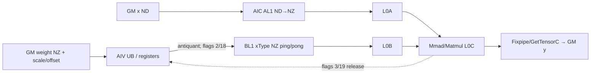
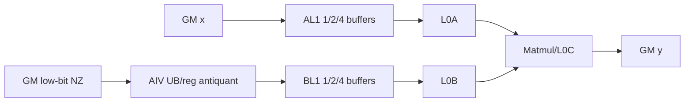
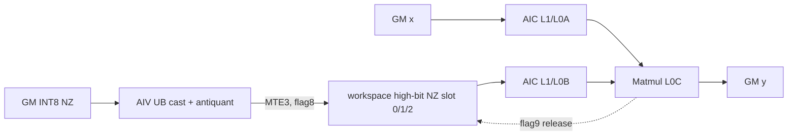

# WeightQuantBatchMatmulNz 950 ACLNN 算子知识

## 算子速览

| 项目 | 内容 |
|---|---|
| 实际入口 | `aclnnWeightQuantBatchMatmulNzGetWorkspaceSize` / `aclnnWeightQuantBatchMatmulNz`，公开两段式 ACLNN；内部节点为 `WeightQuantBatchMatmulV2`，但本卡不把 V2/V3 当作公开入口。 |
| 计算语义 | `B̂=(weight+antiquantOffset)*antiquantScale`，`y=x@B̂+bias`；950 的 `quantScaleOptional/quantOffsetOptional` 必须为空，故没有输出量化阶段。 |
| 输入输出 | `x:[M,K]` ND FP16/BF16；`weight` 的逻辑矩阵为 `[K,N]`、物理格式 FRACTAL_NZ；输出 `y:[M,N]` ND FP16/BF16。公开头与 binary config 覆盖 INT8、INT4/INT32 载体、FLOAT4_E2M1/FLOAT 载体。 |
| 执行类型 | 三条 Route 都是单 Kernel `MIX_CV`，默认任务比 `AIC:AIV=1:2`；AIV 将低位 NZ weight 反量化为高位 L1 或 workspace，AIC 走 Cube Matmul。 |
| Kernel 路线 | R-001 Adaptive Split/CMCT；R-002 RegBase；R-003 INT8 NZ backward-compatible workspace cache。 |
| 核心资源 | 输入/输出 GM；R-003 使用用户 workspace 三槽高位 weight cache；R-001/R-002 的用户 workspace 仅保留框架要求；L1 512 KiB 共享布局、L0A/L0B/L0C 由当前 `TCubeTiling` 驱动，AIV 使用 UB/寄存器反量化。 |
| 来源闭包 | `source_closed`：公开 API 校验与预处理 → `l0op::WeightQuantBatchMatmulV2` launcher → DAV_3510 tiling registry/三个可达模板 → tiling key/router → 三个 MIX_CV body → AIC/AIV 交接与构建配置均在固定仓闭合。 |
| 验证状态 | 已完成源码闭包检查；本次知识提取未执行编译、真机、数值或性能测试。 |

## 接口与语义

### 计算语义

设 `x∈R^{M×K}`，FRACTAL_NZ 权重的逻辑矩阵为 `weight∈Q^{K×N}`。反量化模式由 scale shape/dtype 与 `antiquantGroupSize` 决定：标量为 per-tensor，按 N 为 per-channel，`antiquantGroupSize>0` 为 per-group，`FLOAT8_E8M0` scale 为 MX（group 固定 32）。Device 先按 `(weight + offset) * scale` 生成 `xType` 高位 B，再以 FP16/BF16 A、B 做 Cube 累加并在 Matmul epilogue 加 bias、写 FP16/BF16 `y`。950 API 明确拒绝非空输出量化参数，因此公开 Nz 路线不执行文档通式中的 `QUANT`。

### 输入、输出与属性

| 参数 | shape/layout | dtype | 约束、默认值与语义 |
|---|---|---|---|
| `x` | 2-D ND `[M,K]` | FP16/BF16 | 必选、连续、不可转置，`M,K>0`。 |
| `weight` | 4-D storage FRACTAL_NZ；逻辑 `[K,N]` | INT8、INT4、FLOAT4_E2M1；INT32/FLOAT 可作打包载体 | 必选；`FRACTAL_NZ_C0_2` 会规范化成 FRACTAL_NZ；INT32 视图扩大 8 倍并改成 INT4，FLOAT 同样改成 FLOAT4_E2M1。 |
| `antiquantScale` | ND 1-D/2-D | 与 `x` 相同或 MX 的 FLOAT8_E8M0 | 必选；per-channel/per-group/MX 的物理 shape 必须与 K/N/group 语义一致。 |
| `antiquantOffsetOptional` | ND 1-D/2-D | FP16/BF16 | 可空；非空时 dtype 与 scale 相同；FP4/MX 场景固定不支持。 |
| `quantScaleOptional` / `quantOffsetOptional` | N/A | N/A | 950 `CheckOptionalNotNull` 要求均为空。 |
| `biasOptional` | `[N]` 或 `[1,N]` ND | FP16/BF16/FP32，实际组合受 x/weight 检查约束 | 可空；由 `matmulTiling.isBias` 运行时控制。 |
| `antiquantGroupSize` | 标量 | C `int` | per-channel 传 0；per-group 取 32 的倍数且 `<K`；MX 固定 32；Route 还施加更窄集合。 |
| `y` | 2-D ND `[M,N]` | 与 `x` 相同 | 必选、连续、不可为空。 |

### 入口与版本

固定 Commit 的公开文档把 `aclnnWeightQuantBatchMatmulNz` 仅列为 Ascend 950PR/950DT 支持，A2/A3 明确不支持。第一段创建 executor，进行 `CheckNzSocValid`、参数/shape/dtype/连续性检查与 packed-view 修正，随后仅添加一个 `WeightQuantBatchMatmulV2` AICore 节点和最终框架 `ViewCopy`；第二段调用 `CommonOpExecutorRun`。内部节点名字沿用 V2 是实现复用，不改变本卡的 Nz 公开语义和版本边界。

## Host/Launcher 执行流程

### 参数校验与前处理

调用顺序为：创建 executor → `CheckNzSocValid` 仅放行 `NpuArch::DAV_3510` → 必选指针检查 → 强制 weight 为 FRACTAL_NZ/FRACTAL_NZ_C0_2 → `ContiguousCheck` / `OptionalContiguousCheck` → `TensorPreProcess` → 推导 transpose → `CheckParams` → `CheckContiguous`。950 强制 x 连续且不转置；普通 NZ weight 不做 `Contiguous` 破坏 storage shape，scale/offset 按 weight transpose 语义处理。INT32/FLOAT 打包载体由 `PackedWeightPreProcess` 创建 view、修正 shape/stride，并分别改为 INT4/FLOAT4_E2M1；`FRACTAL_NZ_C0_2` 被改写为 FRACTAL_NZ。任一步失败即返回对应 ACLNN 状态，不添加核心节点。

### 参数、Workspace 与生命周期

`l0op::WeightQuantBatchMatmulV2` 分配 ND 输出临时张量，执行 infer shape 后把一个 AICore launcher 节点加入 executor。`*workspaceSize=executor->GetWorkspaceSize()` 同时覆盖框架 workspace 与算子 workspace；executor 在第一段移交给调用者并保持到第二段 stream 提交完成。R-001 固定请求 16 MiB，R-002 请求 `16 MiB + cubeNumBlocksM*cubeNumBlocksN*sizeof(uintptr_t)`；两条 body 不以该用户区物化 B。R-003 请求 `align256(kAlign*weightCacheNSize)*min(3,cubeSingleNLoop)*sizeof(xType)+workspaceNum`，Device 将前三槽视为循环复用的高位 NZ B cache。

### 启动图与失败传播

```text
aclnnWeightQuantBatchMatmulNzGetWorkspaceSize
  -> l0op::WeightQuantBatchMatmulV2
    -> INFER_SHAPE
    -> ADD_TO_LAUNCHER_LIST_AICORE(WeightQuantBatchMatmulV2)
  -> ViewCopy(l0Result, y)
aclnnWeightQuantBatchMatmulNz
  -> CommonOpExecutorRun(workspace, workspaceSize, executor, stream)
    -> weight_quant_batch_matmul_v2<<<blockDim, MIX_CV 1:2>>>
       AIV: low-bit NZ -> UB/reg -> high-bit L1 or workspace
       AIC: x/高位 B -> L1/L0A/L0B -> Matmul -> L0C/Fixpipe -> y
```

launcher 添加、infer shape、ViewCopy 或 stream 执行失败均向上返回且不自行继续后继节点。核心语义只有一个 MIX_CV kernel；`ViewCopy` 是框架输出提交边界，不是第二个算子语义节点。

## Route 与参数设计

### 分核与资源计算

公共 tiling 先由 x/weight origin/storage shape 得到 `M,N,K`、`c0Size`、transpose、dtype、bias、scale 模式；INT32/FLOAT/FRACTAL_NZ_C0_2 再规范化成 INT4/FLOAT4/FRACTAL_NZ。DAV_3510 不走通用注册表，而按 arch-specific priority `7→8→11` 调用 `IsCapable`。

- R-001：`singleCoreM` 初值 256（bias 时 240），`singleCoreN=256`，`baseK=(L0A/2)/sizeof(x)/singleCoreN`，随后按 L1/L0、tail 与高性能谓词调整；`blockDim=cubeNumBlocksM*cubeNumBlocksN`。
- R-002：BasicBlock solver 输入平台上限 AIC 数、UB 248 KiB、L1 512 KiB、L0A 64 KiB、L0C 256 KiB，求出 `baseM/N/K`、step、AL1/BL1 buffer 数；`blockDim=mDim*nDim`。
- R-003：通用 Matmul tiler给出 Cube tile/core；Vector 默认块按 dtype/transpose/group 计算，`vecSingleN/K` 截断到 `nAlign/kAlign`；`blockDim=max(usedAicNum, CalcTschBlockDim(usedAivNum,...))`。

### Route 选择

| 顺序 | Route | Key/模板 | 精确选择条件与优先级 | 不适用去向 |
|---:|---|---|---|---|
| 1 | R-001 Adaptive Split/CMCT | priority 7；`ALGO_VECTOR_ANTIQUANT`，N-first basic/tail-resplit，`isWeightNz=1` | DAV_3510；scale 非 UINT64；NZ `c0=16`；INT4 NZ 不允许 A/B transpose；若 per-group，则必须是 INT4 NZ 且 group∈{32,64,128,256}。非 per-group 的 INT4/FP4/MX NZ 由该模板接收。 | priority 8。 |
| 2 | R-002 RegBase | priority 8；`SUB_ALGO_ANTI_REG_SCSC` | DAV_3510；`c0=16`；per-group；weight∈{INT4, FP4, INT8}；y 非 INT8；scale 非 UINT64。对本入口主要承接 R-001 排除的 FP4 per-group NZ。 | priority 11。 |
| 3 | R-003 INT8 NZ backward-compatible | priority 11；`SUB_ALGO_CUSTOM_BACKWARD_COMPATIBLE` | DAV_3510；x FP16/BF16；weight INT8 NZ、`c0=32`；x 不转置；`K,N<=65535`；per-channel，或 per-group 且 group∈{64,128}、K%group=0、K/N 均 64 对齐、B 不转置。 | 无模板命中则 tiling 失败。 |

```text
DAV_3510 arch registry
  if AdaptiveSplit::IsCapable() -> R-001
  else if RegBase::IsCapable() -> R-002
  else if BackwardCompatible::IsCapable() -> R-003
  else -> GRAPH_FAILED
```

### 模板/实现执行矩阵

| Route | key/selector | dtype/shape/platform 完整命中条件 | 执行族与 kernel 节点 | 实际模板/body | 内存与同步特征 | tail/fallback |
|---|---|---|---|---|---|---|
| R-001 | priority 7；N-first basic/tail-resplit；MTE2 256/512/1024、2/4 buffer | 上表条件 + API 的合法 Nz 组合 | 单节点 MIX_CV 1:2 | `InvokeKernel→ScmcKernel→KernelMatmulAPrefetchBAntiquant<BlockMmad,BlockPrologue,BlockSchedulerTailResplitExpanded>` | AIV GM→UB→reg→BL1；AIC GM A→AL1→L0→GM y；flags 2/3 交接双缓冲 BL1 | 三段 N 主/尾块；K/M/N 实际 shape 均用 `CalcRealLen/Min/SetTail`。 |
| R-002 | priority 8；RegBase | per-group、c0=16，R-001 未命中 | 单节点 MIX_CV 1:2 | `WeightQuantBatchMatmulV2RegBaseKernel::Process` | AIV 分 N 优先、再分 K，UB→BL1 1/2/4 buffer；AIC AL1/BL1→Matmul；跨核 Notify/Wait | M/N 核尾与 L0 tail；K 按 `min(kAL1,kBL1)` 迭代。 |
| R-003 | priority 11；custom backward compatible | INT8 NZ c0=32 的窄兼容域 | 单节点 MIX_CV 1:2 | `WeightQuantBatchMatmulV2CustomWeightNzKernel` | AIV 把 B 反量化到 workspace 三槽；AIC 从槽读取；flags 6/7/8/9 形成领先一拍协议 | N loop tail、M tail；三槽轮转，失败无其它 fallback。 |

### 隐藏性能 Guard

| Guard | Host/Tiling 条件 | Device/资源原因 | 影响 Route | 不满足时去向 | 源码符号 |
|---|---|---|---|---|---|
| NZ C0 | R-001/R-002 `c0==16`；R-003 `c0==32` | 决定 NZ 物理 stride、低位打包和 BL1 layout | 全部 | 下一 priority / 失败 | 三个 `IsCapable` |
| AS per-group migration | per-group 仅 INT4 + group 32/64/128/256 | 当前 CMCT per-group specialization 集合 | R-001 | R-002 | `WeightQuantBatchMatmulV2TilingAS::IsCapable` |
| A preload | `M<512 && M*K*sizeof(x) < mDim*nDim*aL1MaxSize` | 每核预取切片能容入 AL1 预算 | R-001 | `aPreloadSize=0`，仍走 R-001 | `SetPreLoad` |
| MTE2 buffer | templateCustom 映射 256/512/1024 与 2/4 buffer | UB 输入与输出 ping-pong/quad-buffer 容量 | R-001 | tiler选择另一 config | `InvokeKernel` |
| RegBase L1 buffer | solver 选择 AL1/BL1 1/2/4；INT4 NZ 允许四缓冲 | 512 KiB L1 中 A/B/bias 无重叠 | R-002 | solver 失败后下一模板 | `GetBasicBlockTiling`、`InitL1Buffer` |
| 兼容 workspace | cache count=`min(3,cubeSingleNLoop)`，每槽向 256 元素对齐 | AIV 必须领先 AIC，且防止 MTE3 覆盖仍被消费槽 | R-003 | 无 | `GetWorkspaceSize`、`weightCacheIdx_` |
| INT8 NZ shape | `K,N<=65535`；per-group 还需 K/N 64 对齐 | POD/旧实现的 tile 与 stride 上限 | R-003 | tiling 失败 | `BackwardCompatible::IsCapable` |

### POD/ABI

三种 POD 都以 `#pragma pack(push,8)` 定义，Custom 另有 `alignas(8)`；其外层对齐为 8 字节，`matmulTiling` 之前及该字段自身的 offset 可由声明顺序精确确定。固定仓没有 `kernel_tiling/kernel_tiling.h` 中 `TCubeTiling` 的完整定义，因此外层总 `sizeof` 和嵌套字段的 `sizeof/alignof/offsetof` 不可证明；下表不臆造这些数值。

| 结构 | 字段 | 类型/位宽 | ABI 布局 | 单位 | Host/launcher producer | Device consumer | 边界 |
|---|---|---|---|---|---|---|---|
| AS | `cubeNumBlocksM` | uint32/32 | align=8，off=0；总 sizeof 不可见 | core blocks | `ComputeCubeSplit/SetAttrs` | scheduler/controller | ≥1 |
| AS | `cubeNumBlocksN` | uint32/32 | align=8，off=4；总 sizeof 不可见 | core blocks | 同上 | N scheduler | ≥1 |
| AS | `hasBias` | uint32/32 | align=8，off=8；总 sizeof 不可见 | bool | `DoOpTiling` | `BlockMmad::isBias` | 0/1 |
| AS | `firstTailBlockCount` | uint32/32 | align=8，off=12；总 sizeof 不可见 | blocks | `ResplitTail/ComputeBasicTiling` | N scheduler | 可为0 |
| AS | `secondTailBlockCount` | uint32/32 | align=8，off=16；总 sizeof 不可见 | blocks | 同上 | N scheduler | 可为0 |
| AS | `weightL2Cacheable` | uint32/32 | align=8，off=20；总 sizeof 不可见 | bool | tiling resource logic | prologue copy policy | 0/1 |
| AS | `mainBlockL1Size` | uint32/32 | align=8，off=24；总 sizeof 不可见 | elements N | tail split | scheduler | 16 对齐策略 |
| AS | `firstTailBlockL1Size` | uint32/32 | align=8，off=28；总 sizeof 不可见 | elements N | tail split | scheduler | 尾段 |
| AS | `secondTailBlockL1Size` | uint32/32 | align=8，off=32；总 sizeof 不可见 | elements N | tail split | scheduler | 尾段 |
| AS | `aPreloadSize` | uint32/32 | align=8，off=36；总 sizeof 不可见 | elements | `SetPreLoad` | `BlockMmad::PreloadA` | 0 表示关闭 |
| AS | `groupSize` | uint64/64 | align=8，off=40；总 sizeof 不可见 | elements K/group | `DoOpTiling` | prologue scale layout | mode-dependent |
| AS | `mainBlockCount` | uint64/64 | align=8，off=48；总 sizeof 不可见 | blocks | tail split | scheduler | 可为0 |
| AS | `mSize` | uint64/64 | align=8，off=56；总 sizeof 不可见 | elements | `DoOpTiling` | problem shape | >0 |
| AS | `kSize` | uint64/64 | align=8，off=64；总 sizeof 不可见 | elements | `DoOpTiling` | problem shape/prologue | >0 |
| AS | `nSize` | uint64/64 | align=8，off=72；总 sizeof 不可见 | elements | `DoOpTiling` | problem shape/scheduler | >0 |
| AS | `matmulTiling` | `TCubeTiling` | align=8，off=80；字段/总 sizeof 不可见 | mixed | `SetDefaultMatmulTiling/OptimizeMatmulTiling` | BlockMmad/Matmul | 嵌套字段 ABI 固定仓不可见 |
| RegBase | `cubeNumBlocksN` | uint8/8 | align=8，off=0；总 sizeof 不可见 | core blocks | `SetMatmulTiling` | core map | 1..255 |
| RegBase | `cubeNumBlocksM` | uint8/8 | align=8，off=1；总 sizeof 不可见 | core blocks | `SetMatmulTiling` | core map | 1..255 |
| RegBase | `vecCoreParallel` | uint8/8 | align=8，off=2；总 sizeof 不可见 | bool | `SetAdditionalParam` | 调度辅助 | 0/1 |
| RegBase | `reserve1` | uint8/8 | align=8，off=3；总 sizeof 不可见 | N/A | default 0 | 不读取 | inactive |
| RegBase | `AL1Pingpong` | uint16/16 | align=8，off=4；总 sizeof 不可见 | buffers | solver result | `Init`/L1 layout | 1/2/4 |
| RegBase | `BL1Pingpong` | uint16/16 | align=8，off=6；总 sizeof 不可见 | buffers | solver result | `Init`/L1+UB | 1/2/4 |
| RegBase | `kSize` | uint64/64 | align=8，off=8；总 sizeof 不可见 | elements | `DoOpTiling` | all K loops | >0 |
| RegBase | `nSize` | uint64/64 | align=8，off=16；总 sizeof 不可见 | elements | `DoOpTiling` | core/tail/GM offsets | >0 |
| RegBase | `groupSize` | uint64/64 | align=8，off=24；总 sizeof 不可见 | elements | `SetAdditionalParam` | AIV scale index | >0 |
| RegBase | `mSize` | uint64/64 | align=8，off=32；总 sizeof 不可见 | elements | `DoOpTiling` | core/tail/GM offsets | >0 |
| RegBase | `nBubSize` | uint64/64 | align=8，off=40；总 sizeof 不可见 | elements | `SetBubTiling` | AIV N split/UB | >0 |
| RegBase | `kBubSize` | uint64/64 | align=8，off=48；总 sizeof 不可见 | elements | `SetBubTiling` | AIV K split/UB | >0 |
| RegBase | `matmulTiling` | `TCubeTiling` | align=8，off=56；字段/总 sizeof 不可见 | mixed | `SetMatmulTiling` | RegBase Matmul | 嵌套字段 ABI 固定仓不可见 |
| Custom | `vecBlockDimN` | uint8/8 | align=8，off=0；总 sizeof 不可见 | AIV groups N | `DoOpTiling` | `ComputeConstexpr/AntiquantWeight` | ≥1 |
| Custom | `vecBlockDimK` | uint8/8 | align=8，off=1；总 sizeof 不可见 | AIV groups K | 固定1 | 同上 | 1 |
| Custom | `cubeBlockDimN` | uint8/8 | align=8，off=2；总 sizeof 不可见 | AIC blocks N | `GetMatMulTiling` | `ProcessCube` | ≥1 |
| Custom | `cubeBlockDimM` | uint8/8 | align=8，off=3；总 sizeof 不可见 | AIC blocks M | `GetMatMulTiling` | `ProcessCube` | ≥1 |
| Custom | `cubeBlockDimK` | uint8/8 | align=8，off=4；总 sizeof 不可见 | reserved/core K | 当前 custom producer 未赋值 | 固定仓当前 body 不读 | inactive |
| Custom | `kPadSize` | uint8/8 | align=8，off=5；总 sizeof 不可见 | elements | `SetShapeSize` | 固定仓当前 custom NZ body 不直接读 | 0..align-1 |
| Custom | `nPadSize` | uint8/8 | align=8，off=6；总 sizeof 不可见 | elements | `SetShapeSize` | 固定仓当前 custom NZ body 不直接读 | 0..align-1 |
| Custom | `haveBatchA` | uint8/8 | align=8，off=7；总 sizeof 不可见 | bool | 固定0 | body不读 | 0 |
| Custom | `haveBatchB` | uint8/8 | align=8，off=8；总 sizeof 不可见 | bool | 固定0 | body不读 | 0 |
| Custom | `reserve1` | uint8/8 | align=8，off=9；总 sizeof 不可见 | N/A | 当前 custom producer 未赋值 | 不读取 | inactive |
| Custom | `reserve2` | uint8/8 | align=8，off=10；总 sizeof 不可见 | N/A | 当前 custom producer 未赋值 | 不读取 | inactive |
| Custom | `reserve3` | uint8/8 | align=8，off=11；总 sizeof 不可见 | N/A | 当前 custom producer 未赋值 | 不读取 | inactive |
| Custom | `vecSingleKGroupNum` | uint16/16 | align=8，off=12；总 sizeof 不可见 | groups | 当前 custom producer 未赋值 | 当前 custom NZ body 不读取 | inactive |
| Custom | `vecSingleKTailGroupNum` | uint16/16 | align=8，off=14；总 sizeof 不可见 | groups | 当前 custom producer 未赋值 | 当前 custom NZ body 不读取 | inactive |
| Custom | `AL1Pingpong` | uint16/16 | align=8，off=16；总 sizeof 不可见 | buffers | 当前 custom producer 未赋值 | 当前 custom NZ body 不读取 | inactive |
| Custom | `BL1Pingpong` | uint16/16 | align=8，off=18；总 sizeof 不可见 | buffers | 当前 custom producer 未赋值 | 当前 custom NZ body 不读取 | inactive |
| Custom | `vecSingleK` | uint32/32 | align=8，off=20；总 sizeof 不可见 | elements | `DoOpTiling` | Vector K tile | >0 |
| Custom | `vecSingleN` | uint32/32 | align=8，off=24；总 sizeof 不可见 | elements | `DoOpTiling` | Vector N tile | >0 |
| Custom | `vec2SingleM` | uint32/32 | align=8，off=28；总 sizeof 不可见 | elements | 当前 custom producer 未赋值 | 当前 custom NZ body 不读取 | inactive |
| Custom | `vecSingleKTail` | uint32/32 | align=8，off=32；总 sizeof 不可见 | elements | 当前 custom producer 未赋值 | 当前 custom NZ body 不读取 | inactive |
| Custom | `vecSingleNTail` | uint32/32 | align=8，off=36；总 sizeof 不可见 | elements | 当前 custom producer 未赋值 | 当前 custom NZ body 不读取 | inactive |
| Custom | `wInQueueSize` | uint32/32 | align=8，off=40；总 sizeof 不可见 | bytes | 当前 custom producer 未赋值 | 当前 custom NZ body 不读取 | inactive |
| Custom | `offsetInQueueSize` | uint32/32 | align=8，off=44；总 sizeof 不可见 | bytes | 当前 custom producer 未赋值 | 当前 custom NZ body 不读取 | inactive |
| Custom | `scaleInQueueSize` | uint32/32 | align=8，off=48；总 sizeof 不可见 | bytes | 当前 custom producer 未赋值 | 当前 custom NZ body 不读取 | inactive |
| Custom | `wOutQueueSize` | uint32/32 | align=8，off=52；总 sizeof 不可见 | bytes | 当前 custom producer 未赋值 | 当前 custom NZ body 不读取 | inactive |
| Custom | `antiQuantTmpBufferSize` | uint32/32 | align=8，off=56；总 sizeof 不可见 | bytes | 当前 custom producer 未赋值 | 当前 custom NZ body 不读取 | inactive |
| Custom | `vecCubeNRatio` | uint32/32 | align=8，off=60；总 sizeof 不可见 | ratio | 当前 custom producer 未赋值 | 当前 custom NZ body 不读取 | inactive |
| Custom | `vecCubeTailNRatio` | uint32/32 | align=8，off=64；总 sizeof 不可见 | ratio | 当前 custom producer 未赋值 | 当前 custom NZ body 不读取 | inactive |
| Custom | `vecCubeKRatio` | uint32/32 | align=8，off=68；总 sizeof 不可见 | ratio | 当前 custom producer 未赋值 | 当前 custom NZ body 不读取 | inactive |
| Custom | `vecCubeTailKRatio` | uint32/32 | align=8，off=72；总 sizeof 不可见 | ratio | 当前 custom producer 未赋值 | 当前 custom NZ body 不读取 | inactive |
| Custom | `cubeTailM` | uint32/32 | align=8，off=76；总 sizeof 不可见 | elements | `DoLibApiTiling` | `SetMatmulParams` | 1..singleCoreM |
| Custom | `cubeTailN` | uint32/32 | align=8，off=80；总 sizeof 不可见 | elements | `DoLibApiTiling` | 当前 custom NZ body 不直接读取；Matmul tail 由运行时 N offset 计算 | 1..baseN |
| Custom | `cubeSingleNLoop` | uint32/32 | align=8，off=84；总 sizeof 不可见 | loops | `DoLibApiTiling` | AIV/AIC loop | ≥1 |
| Custom | `cubeSingleNTailLoop` | uint32/32 | align=8，off=88；总 sizeof 不可见 | loops | `DoLibApiTiling` | tiling bookkeeping | ≥1 |
| Custom | `repeatAxisMax` | uint32/32 | align=8，off=92；总 sizeof 不可见 | elements/repeat stride | `ComputeGroupDefaultBlock` 在相应分支赋值 | `Init` 的 repeat 分支条件 | 分支相关 |
| Custom | `vecSingleKLoop` | uint64/64 | align=8，off=96；总 sizeof 不可见 | loops | `DoOpTiling` | Vector schedule | ceil(K/vecK) |
| Custom | `vecSingleNLoop` | uint64/64 | align=8，off=104；总 sizeof 不可见 | loops | `DoOpTiling` | Vector schedule | ceil(Ntile/vecN) |
| Custom | `vecSingleKTailLoop` | uint64/64 | align=8，off=112；总 sizeof 不可见 | loops | 当前 custom producer 未赋值 | 当前 custom NZ body 不读取 | inactive |
| Custom | `vecSingleNTailLoop` | uint64/64 | align=8，off=120；总 sizeof 不可见 | loops | `DoOpTiling` | tail schedule | ceil(tail/vecN) |
| Custom | `vec2SingleMLoop` | uint64/64 | align=8，off=128；总 sizeof 不可见 | loops | 当前 custom producer 未赋值 | 当前 custom NZ body 不读取 | inactive |
| Custom | `kAlign` | uint64/64 | align=8，off=136；总 sizeof 不可见 | elements | `SetShapeSize` | workspace/NZ stride | ≥K |
| Custom | `nAlign` | uint64/64 | align=8，off=144；总 sizeof 不可见 | elements | `SetShapeSize` | NZ stride | ≥N |
| Custom | `kSize` | uint64/64 | align=8，off=152；总 sizeof 不可见 | elements | `SetShapeSize` | loops/scale | >0 |
| Custom | `nSize` | uint64/64 | align=8，off=160；总 sizeof 不可见 | elements | `SetShapeSize` | loops/output | >0 |
| Custom | `groupSize` | uint64/64 | align=8，off=168；总 sizeof 不可见 | elements | `SetShapeSize` | per-group AIV | 0/64/128 |
| Custom | `mSize` | uint64/64 | align=8，off=176；总 sizeof 不可见 | elements | `SetShapeSize` | output/core map | >0 |
| Custom | `blockBatch` | uint64/64 | align=8，off=184；总 sizeof 不可见 | batches | `GetMatMulTiling` 写 `multiCoreResult.batchDim` | 当前 custom NZ body 不读取 | 非 batch 入口 |
| Custom | `shapeBatch` | uint64/64 | align=8，off=192；总 sizeof 不可见 | batches | 固定1 | body不读 | 1 |
| Custom | `mAubSize` | uint64/64 | align=8，off=200；总 sizeof 不可见 | elements | 当前 custom producer 未赋值 | 当前 custom NZ body 不读取 | inactive |
| Custom | `kAubSize` | uint64/64 | align=8，off=208；总 sizeof 不可见 | elements | 当前 custom producer 未赋值 | 当前 custom NZ body 不读取 | inactive |
| Custom | `nBubSize` | uint64/64 | align=8，off=216；总 sizeof 不可见 | elements | 当前 custom producer 未赋值 | 当前 custom NZ body 不读取 | inactive |
| Custom | `kBubSize` | uint64/64 | align=8，off=224；总 sizeof 不可见 | elements | 当前 custom producer 未赋值 | 当前 custom NZ body 不读取 | inactive |
| Custom | `mCubSize` | uint64/64 | align=8，off=232；总 sizeof 不可见 | elements | 当前 custom producer 未赋值 | 当前 custom NZ body 不读取 | inactive |
| Custom | `nCubSize` | uint64/64 | align=8，off=240；总 sizeof 不可见 | elements | 当前 custom producer 未赋值 | 当前 custom NZ body 不读取 | inactive |
| Custom | `mAL1Size` | uint64/64 | align=8，off=248；总 sizeof 不可见 | elements | 当前 custom producer 未赋值 | 当前 custom NZ body 不读取 | inactive |
| Custom | `kAL1Size` | uint64/64 | align=8，off=256；总 sizeof 不可见 | elements | 当前 custom producer 未赋值 | 当前 custom NZ body 不读取 | inactive |
| Custom | `nBL1Size` | uint64/64 | align=8，off=264；总 sizeof 不可见 | elements | 当前 custom producer 未赋值 | 当前 custom NZ body 不读取 | inactive |
| Custom | `kBL1Size` | uint64/64 | align=8，off=272；总 sizeof 不可见 | elements | 当前 custom producer 未赋值 | 当前 custom NZ body 不读取 | inactive |
| Custom | `matmulTiling` | `TCubeTiling` | align=8，off=280；字段/总 sizeof 不可见 | mixed | `MultiCoreMatmulTiling` | `MatmulImpl` | 嵌套字段 ABI 固定仓不可见 |

### Route 源码闭包

| Route | Key/selector | Host/Tiling producer | POD/参数 | Kernel entry/router | Kernel body/直接依赖 | 构建接线 |
|---|---|---|---|---|---|---|
| R-001 | arch priority 7 | `weight_quant_batch_matmul_v2_adaptive_split_tiling.cpp` | `WeightQuantBatchMatmulV2ASTilingDataParams` | `arch35/weight_quant_batch_matmul_v2.cpp::weight_quant_batch_matmul_v2/InvokeKernel` | `cmct_convertor.h` + CMCT kernel/prologue/block scheduler | ascend950 binary JSON + kernel CMake |
| R-002 | arch priority 8 | `weight_quant_batch_matmul_v2_reg_base_tiling.cpp` + basic-block solver | `WeightQuantBatchMatmulV2RegBaseTilingDataParams` | 同一 entry，`SUB_ALGO_ANTI_REG_SCSC` | `weight_quant_batch_matmul_v2_reg_base.h/common.h` | 同上 |
| R-003 | arch priority 11 | backward-compatible selector + custom tiler | `WeightQuantBatchMatmulV2TilingData` | 同一 entry，`SUB_ALGO_CUSTOM_BACKWARD_COMPATIBLE` | `weight_quant_batch_matmul_v2_custom_weight_nz.h/common.h` | 同上 |

## Kernel 实现

### 公共执行流程

entry 先取得 `userWS=GetUserWorkspace(workspace)`，为空则直接返回；创建 `TPipe`，声明默认 `KERNEL_TYPE_MIX_AIC_1_2`，按 tiling key 的 `SUB_ALGORITHM` 选择三个 body。AIV 的 `GetBlockIdx` 按 task ratio 映射到对应 AIC tile；AIV 只处理 B/scale/offset，AIC 只处理 x/bias/y。三条路线都以显式 cross-core flag 保证“反量化高位 B 可见后 AIC 才消费”，并在复用前由反向 flag 确认 AIC 已完成。

### Route R-001：Adaptive Split/CMCT

#### 适用条件

##### 选择证据

| 层级 | 文件 | 符号 | 源码谓词/参数 | 结果/下一跳 |
|---|---|---|---|---|
| API | `aclnn_weight_quant_batch_matmul_v2.cpp` | `CheckNzSocValid` | arch==DAV_3510 | 继续，否则 runtime error |
| Tiling | adaptive split cpp | `IsCapable` | scale!=UINT64；NZ c0=16；INT4 NZ 无 transpose；per-group 仅 INT4+group集合 | priority 7 命中 |
| Router | arch35 entry | `SUB_ALGORITHM` | N_FIRST_BASIC_BLOCK 或 N_FIRST_TAIL_RESPLIT | `InvokeKernel` |
| Template | `cmct_convertor.h` | `InvokeKernel` | templateCustom→UB inner/buffer，IsWeightNz=true | `ScmcKernel` MIX 1:2 |

#### Device 数据流

##### 函数级调用链

```text
weight_quant_batch_matmul_v2
  -> InvokeKernel<templateCustom, transA=false, transB, antiquantType, hasOffset, isBiasFp32, true>
    -> ScmcKernel::operator()
      -> KernelMatmulAPrefetchBAntiquant::operator()<AIV>
         -> BlockPrologueBAntiquantScmc: GM low-bit NZ/scale/offset -> UB -> registers -> BL1
      -> KernelMatmulAPrefetchBAntiquant::operator()<AIC>
         -> BlockMmad: GM x/bias -> AL1 -> MatmulImpl -> GM y
```

##### 源码等价伪码

```text
// AIV（两个 sub-block 分 N）
for M-scheduler tile:
  for N main/tail tile:
    for K chunk by UB_MTE2_INNER_SIZE:
      wait UB input slot; copy packed NZ B + scale[/offset] GM->UB
      for K-L1 chunk:
        wait AIC release when reusing BL1 ping/pong
        vector antiquant (offset then scale), write xType NZ B UB->BL1
        CrossCoreSetFlag(flag=2, PIPE_MTE3)
// AIC
preload A when aPreloadSize>0
for same M,N tiles:
  for K-L1 chunk:
    copy x[/bias] GM->AL1; wait flags 2 and 18 from two AIV
    SetTensorA/SetTensorB/SetBias; Matmul Iterate(accumulate = Koffset!=0)
    CrossCoreSetFlag(flag=3 and 19, PIPE_MTE1)
  GetTensorC(GM y), applying SetTail(Mreal,Nreal,Kreal)
```

#### 内存与数据搬运

##### 资源与搬运表

| 层级/缓冲区 | offset/地址公式 | extent/容量公式 | dtype/layout | producer | consumer | owner/lifetime | 对齐/复用 |
|---|---|---|---|---|---|---|---|
| GM x | `(mOffset*K+kOffset)` | M*K | xType ND | API | AIC prologue | caller | M/N/K tail |
| GM weight | NZ layout from `XWeightStride<true,transB>` | physical NZ K×N | low bit NZ | caller | AIV prologue | caller | C0=16 |
| user workspace | framework base only | 16 MiB | opaque | Host | framework/Matmul lib | executor | body未建 B slice |
| BL1 | offset 0 / pong=`512KiB/sizeof(half)-baseN*stepKb*baseK` | each `baseN*stepKb*baseK*sizeof(xType)` | xType NZ | AIV | AIC Matmul B | kernel L1 | ping/pong；flags防覆盖 |
| AL1 | `weightL1Space+biasL1Space` | remaining 512 KiB，1/2 buffer | xType NZ from ND | AIC MTE2 | L0A | kernel L1 | stepKa<=stepKb 时 DB |
| L0A/L0B | Matmul `baseM*baseK`, `baseN*baseK` | `dbL0A/B*...*sizeof(xType)` | cube tiles | Matmul load | Mmad | Matmul instance | external lib ABI |
| L0C | Matmul baseM*baseN | `dbL0C*baseM*baseN*4` bytes | accumulator | Mmad | Fixpipe/GetTensorC | Matmul instance | tail via `SetTail` |
| AIV UB input | slot=`loop%bufNum` | bufNum×low-bit tile；config maps 2/4×256/512/1024 K | packed low bit NZ | MTE2 | vector antiquant | AIV | V_MTE2 flags |
| AIV UB output/reg | slot=`calLoop%2/4` | high-bit VF tile | xType | vector registers | MTE3→BL1 | AIV | MTE3_V flags |

##### 分层内存布局



##### 字节账、交接边与复用顺序

```text
workspace_total = 16 MiB（Host最低请求；当前 body 不划分语义 slice）
BL1_one = baseN * stepKb * baseK * sizeof(xType)
L0A = dbL0A * baseM * baseK * sizeof(xType)
L0B = dbL0B * baseN * baseK * sizeof(xType)
L0C = dbL0C * baseM * baseN * 4
L1_total <= 512 KiB（BL1 ping/pong + AL1 single/double + optional bias）
```

| 边/复用子区 | producer | offset/extent | dtype/layout | consumer | ordering/sync | owner/lifetime | 安全条件 |
|---|---|---|---|---|---|---|---|
| AIV→AIC BL1 | BlockPrologue | `(cvLoop&1)*BL1_one`，当前 N×K-L1 | xType NZ | BlockMmad | flags 2、18；AIC `WaitAivToAic` | kernel L1 | 两个 AIV 均完成 |
| AIC→AIV release | BlockMmad | 同一 BL1 slot | N/A | next prologue loop | flags 3、19；AIV `WaitAicToAiv` | kernel L1 | 使用后才覆盖 |
| UB input reuse | AIV MTE2 | `loop%bufNum` | low bit NZ | vector | V_MTE2 event | AIV | 前一轮 vector结束 |

#### 同步、精度与尾块

##### 同步与数值边界表

| 阶段 | primitive/机制 | producer | consumer/等待点 | 保护对象 | 精度/尾块 |
|---|---|---|---|---|---|
| GM→UB | MTE2_V set/wait | MTE2 | vector | packed B/scale | 按实际 N/K copy |
| UB→BL1 | V_MTE3 + MTE3_V | vector/MTE3 | MTE3/vector | high-bit tile | offset 后 scale；MX 先 E8M0 cast |
| AIV→AIC | CrossCore flags 2/18 | 两个 AIV | AIC PIPE_MTE1 | BL1 slot | 两核各自 N 半块 |
| AIC→AIV | CrossCore flags 3/19 | AIC | AIV PIPE_MTE3 | BL1 reuse | K-loop 双缓冲 |
| Matmul | `Iterate(kOffset!=0)` + `SetTail` | L0 | Fixpipe | accumulator/output | K 累加；M/N/K tail |

#### 关键实现

##### 符号证据表

| 阶段 | 文件 | 符号/模板实例 | 实现事实 |
|---|---|---|---|
| Host/Tiling producer | adaptive split cpp | `IsCapable/DoOpTiling/GetTilingKey/GetWorkspaceSize` | priority、tile、tail、workspace |
| Kernel entry/router | arch35 entry + `cmct_convertor.h` | `InvokeKernel/ScmcKernel` | MIX 1:2、templateCustom 映射 |
| Device body/helper | CMCT kernel/prologue/block mmad | `KernelMatmulAPrefetchBAntiquant` | AIV prologue和AIC Matmul任务图 |

### Route R-002：RegBase

#### 适用条件

##### 选择证据

| 层级 | 文件 | 符号 | 源码谓词/参数 | 结果/下一跳 |
|---|---|---|---|---|
| Tiling | reg-base tiling cpp | `IsCapable` | per-group、c0=16、weight INT4/FP4/INT8、y非INT8、scale非UINT64 | priority 8 |
| Solver | basic-block tiling | `GetBasicBlockTiling` | 资源与 shape 搜索成功 | 写 base/step/buffer |
| Router | arch35 entry | `SUB_ALGO_ANTI_REG_SCSC` | `IS_WEIGHT_NZ=1` | RegBase body |

#### Device 数据流

##### 函数级调用链

```text
weight_quant_batch_matmul_v2
  -> WeightQuantBatchMatmulV2RegBaseKernel::Init
  -> Process
     -> IterMatmulOut
     -> GetAL1(AIC: x GM->AL1)
     -> GetBL1(AIV: weight GM->UB->reg antiquant->BL1; AIC waits)
     -> GetBiasL1
     -> IterateMatmul(AIC)
     -> PostProcess/NotifyVector
     -> GetTensorC(GM y)
```

##### 源码等价伪码

```text
for each core M/N tile:
  init AIC/AIV flags and AL1/BL1/bias buffers
  while next baseM/baseN tile:
    for kFactor:
      AIC load AL1 when kFactor crosses kAl1Factor
      AIV split BL1 demand by N first, then K; dequant low-bit NZ in UB/registers
      AIV wait cube release -> copy UB to selected BL1 -> notify cube
      AIC wait vector -> SetTensorA/B[/Bias] -> SetTail -> Iterate(accumulate=kFactor!=0)
      AIC notify vector and advance buffer indices
    AIC GetTensorC(y offset)
  drain/release events
```

#### 内存与数据搬运

##### 资源与搬运表

| 层级/缓冲区 | offset/地址公式 | extent/容量公式 | dtype/layout | producer | consumer | owner/lifetime | 对齐/复用 |
|---|---|---|---|---|---|---|---|
| GM | x/weight/scale/offset/bias/y logical offsets | M*K、NZ K*N、scale groups、M*N | mixed | caller | AIC/AIV | caller | tail guarded |
| workspace | 16 MiB + pointer table | Host formula | opaque | Host | framework/lib | executor | body不建语义 B cache |
| AL1 | after selected BL1 buffers | `AL1Pingpong*baseM*kAL1*sizeof(xType)` | xType NZ | AIC | L0A | L1 | 1/2/4 |
| BL1 | route-specific 0/half-L1 offsets | `BL1Pingpong*baseN*kBL1*sizeof(xType)` | xType NZ | AIV | L0B | L1 | INT4 NZ 可1/2/4 |
| bias L1 | after A/B buffers | `biasPingPong*baseN*sizeof(biasType)` | biasType | AIC | Matmul | L1 | 1/2 |
| UB input | after output buffer | `bubPingpong*ceilN*ceilK*sizeof(lowbit)` | packed NZ | MTE2 | vector | AIV | V_MTE2 |
| UB output | offset0 | `bubPingpong*ceilN*ceilK*sizeof(xType)` | xType | vector | MTE3→BL1 | AIV | MTE3_V |
| L0A/B/C | Matmul tile | baseM*baseK、baseN*baseK、baseM*baseN*4 | cube | L1/Matmul | Mmad/Fixpipe | Matmul | `SetTail` |

##### 分层内存布局



##### 字节账、交接边与复用顺序

```text
workspace_total = 16 MiB + mDim*nDim*sizeof(uintptr_t)
AL1 = AL1Pingpong * baseM * (stepKa*baseK) * sizeof(xType)
BL1 = BL1Pingpong * baseN * (stepKb*baseK) * sizeof(xType)
biasL1 = biasPingPong * baseN * sizeof(biasType)
L1_total <= 512 KiB
UB = outputBuffers*ceilN*ceilK*sizeof(xType) + inputBuffers*ceilN*ceilK*bits(weight)/8 + scale/offset
```

| 边/复用子区 | producer | offset/extent | dtype/layout | consumer | ordering/sync | owner/lifetime | 安全条件 |
|---|---|---|---|---|---|---|---|
| UB→BL1 | `BL1Process` | selected `curBL1BufIdx` | xType NZ | AIC Matmul | `WaitForCube/NotifyCube` | L1 | buffer index modulo pingpong |
| BL1 release | AIC `PostProcess` | same slot | N/A | AIV | `NotifyVector` | L1 | kBl1Factor boundary |
| AL1 reuse | AIC | selected slot | xType NZ | Matmul | MTE1_MTE2 event per slot | L1 | kAl1Factor boundary |

#### 同步、精度与尾块

##### 同步与数值边界表

| 阶段 | primitive/机制 | producer | consumer/等待点 | 保护对象 | 精度/尾块 |
|---|---|---|---|---|---|
| AIV input/output | V_MTE2、MTE3_V | MTE2/vector/MTE3 | reverse stage | UB slots | INT4/FP4→xType，offset后scale |
| CV handoff | `NotifyCube/WaitForVector` | AIV | AIC | BL1 | 两个 AIV 按 N/K split |
| CV release | `NotifyVector/WaitForCube` | AIC | AIV | BL1 | 1/2/4 buffer |
| Cube | `SetOrgShape/SetTail/Iterate` | AL1/BL1 | L0/Fixpipe | output tile | M/N核尾、K尾，K累加 |

#### 关键实现

##### 符号证据表

| 阶段 | 文件 | 符号/模板实例 | 实现事实 |
|---|---|---|---|
| Host/Tiling producer | reg-base tiling cpp | `IsCapable/SetMatmulTiling/SetBubTiling/GetWorkspaceSize` | solver与buffer参数 |
| Kernel entry/router | arch35 entry | `SUB_ALGO_ANTI_REG_SCSC` | RegBase实例 |
| Device body/helper | reg-base h/common h | `Process/InitL1Buffer/CopyUb2L1/IterateMatmul` | 完整 CV pipeline |

### Route R-003：INT8 NZ backward-compatible workspace cache

#### 适用条件

##### 选择证据

| 层级 | 文件 | 符号 | 源码谓词/参数 | 结果/下一跳 |
|---|---|---|---|---|
| Tiling | backward compatible cpp | `IsCapable` | INT8 NZ c0=32，x不转置，K/N上限，per-channel/group窄域 | priority 11 |
| Parent tiler | custom tiling cpp | `DoOpTiling/GetWorkspaceSize/PostTiling` | Matmul tiling成功，UB vector块可求 | custom POD/workspace |
| Router | arch35 entry | `SUB_ALGO_CUSTOM_BACKWARD_COMPATIBLE` | W8、非ND、IS_WEIGHT_NZ=1 | custom body |

#### Device 数据流

##### 函数级调用链

```text
weight_quant_batch_matmul_v2
  -> WeightQuantBatchMatmulV2CustomWeightNzKernel::Init
  -> Process
     AIV -> ProcessVector -> AntiquantWeight -> WeightCopyIn -> WeightCast
         -> CopyInAntiquantParams -> AntiQuantCompute -> WeightCopyOut(workspace slot)
     AIC -> ProcessCube -> WaitForVector -> SetMatmulParams(workspace B)
         -> MatmulImpl::IterateAll(y) -> End -> release/lead flags
```

##### 源码等价伪码

```text
// AIV
for cubeNLoop:
  slot = cubeNLoop % 3
  partition (Nloops*Kloops) across vecBlockDimN
  copy INT8 NZ GM->UB; cast to FP16 (BF16 path computes in FP32)
  copy/broadcast scale[/offset]; add then multiply
  BF16 path cast result RINT to BF16
  MTE3 high-bit NZ -> workspace[slot]
  all-AIV flag6; publish slot with flag8; keep one tile ahead and wait flag9 before overwrite
// AIC
for cubeNLoop:
  wait flag8
  B = workspace[(loop%3)*slotSize + bOffset]
  Matmul x@B [+bias] -> y, SetTail(Mtail,Ntail)
  flag7 orders AIC local completion; flag9 releases slot two iterations later
```

#### 内存与数据搬运

##### 资源与搬运表

| 层级/缓冲区 | offset/地址公式 | extent/容量公式 | dtype/layout | producer | consumer | owner/lifetime | 对齐/复用 |
|---|---|---|---|---|---|---|---|
| workspace B cache | `(loop%3)*weightCacheSizeAlign + bOffset` | `align256(kAlign*weightCacheN)*min(3,loops)*sizeof(xType)` | xType NZ | AIV MTE3 | AIC Matmul | executor workspace | 3槽轮转 |
| UB low-bit queue | 0 | `vecNzSingleN*alignedK*sizeof(INT8)` | INT8 NZ | MTE2 | cast | AIV TQue depth1 | per tile |
| UB high-bit output queue | separate queue | `2*weightShape*sizeof(xType)` | xType NZ | antiquant | MTE3 | AIV TQue depth2 | double buffer |
| UB scale/offset | queue + broadcast TBuf | `antiquantShape*sizeof(xType/calType)` | xType/FP32 | MTE2/vector | antiquant | AIV | per-channel/group |
| L1/L0 | MatmulImpl current tiling | external `TCubeTiling` | xType NZ | AIC loads x/workspace B | Mmad | AIC | library-managed |
| GM y | `mOffset*N+nOffset` | Mreal*Nreal | yType ND | Fixpipe | caller | output | tail protected |

##### 分层内存布局



##### 字节账、交接边与复用顺序

```text
slot_elems = align256(kAlign * weightCacheNSize)
slot_count = min(3, cubeSingleNLoop)
workspace_total = slot_elems * slot_count * sizeof(xType) + workspaceNum
UB_total = offsetQueue + scaleQueue + broadcast TBufs + lowbitQueue
         + 2*highbitOutputQueue + weight16TBuf [+ BF16 FP32 buffers]
```

| 边/复用子区 | producer | offset/extent | dtype/layout | consumer | ordering/sync | owner/lifetime | 安全条件 |
|---|---|---|---|---|---|---|---|
| AIV→AIC cache | `WeightCopyOut` | slot formula；当前 N×K-align | xType NZ | `SetTensorB` | all-AIV flag6 then cross-core flag8 | workspace/executor | 全AIV完成当前槽 |
| AIC local order | Matmul/Fixpipe | current slot | N/A | next AIC iteration | flag7 | kernel | loop>0 wait |
| AIC→AIV release | `NotifyVector` | slot two iterations behind | N/A | AIV overwrite | cross-core flag9 | workspace | 三槽领先一拍协议 |

#### 同步、精度与尾块

##### 同步与数值边界表

| 阶段 | primitive/机制 | producer | consumer/等待点 | 保护对象 | 精度/尾块 |
|---|---|---|---|---|---|
| AIV汇合 | mode0 flag6 | each AIV | `NotifyCube` | completed cache slot | no partial slot visible |
| AIV→AIC | mode2 PIPE_MTE3 flag8 | AIV | AIC `WaitForVector` | workspace slot | xType NZ |
| AIC→AIV | mode2 PIPE_FIX flag9 | AIC | AIV `WaitForCube` | slot reuse | two-loop lead |
| BF16 antiquant | FP32 temp then `CAST_RINT` | vector | workspace | B values | round-to-nearest integer mode enum `CAST_RINT` |
| tail | `SetTail(mmSingleM,mmSingleN)` | scheduler | Matmul | output tile | M last core、N last loop |

#### 关键实现

##### 符号证据表

| 阶段 | 文件 | 符号/模板实例 | 实现事实 |
|---|---|---|---|
| Host/Tiling producer | backward compatible + custom tiling cpp | `IsCapable/DoOpTiling/GetWorkspaceSize` | 兼容域与三槽公式 |
| Kernel entry/router | arch35 entry | custom backward-compatible branch | W8 NZ实例 |
| Device body/helper | custom weight NZ + common h | `ProcessVector/ProcessCube/WeightCopyOut` | workspace交接、同步、精度/tail |

## 算子特定优化

### Trick T-001：Adaptive Split 将反量化 B 直接交接到 BL1

#### 触发与源码依据

- 适用 Route：R-001
- 触发条件：priority 7 命中；MTE2 config 与 antiquant specialization 可实例化。
- Golden 来源：[`op_kernel/arch35/cmct_convertor.h:488-510`](../../../../../../../cann-ops-raw/ascendc/ops-nn/955f8b33985b6d72989ebff341bb9c2c564a51bc/matmul/weight_quant_batch_matmul_v2/op_kernel/arch35/cmct_convertor.h#L488-L510)

**官方源码（固定 Commit 连续逐字摘录）**：

```cpp
KERNEL_TASK_TYPE_DEFAULT(KERNEL_TYPE_MIX_AIC_1_2);
static constexpr uint32_t UB_MTE2_INNER_SIZE = TemplateCustom == 0 || TemplateCustom == 1 || TemplateCustom == 4 ?
                                                   512 :
                                               TemplateCustom == 2 || TemplateCustom == 6 ? 1024 :
                                                                                            256;
static constexpr uint32_t UB_MTE2_BUF_NUM =
    TemplateCustom == 0 || TemplateCustom == 2 || (TemplateCustom == 4 && B8) || TemplateCustom == 5 ? 2 : 4;
```

#### 机制与设计原因

同一 kernel 内两条 AIV 先把 packed NZ B 在 UB/寄存器中反量化，再以 xType NZ 写 BL1；AIC 直接从 BL1 进入 L0B。`templateCustom` 同时冻结 K 搬运粒度和 2/4 buffer 深度，使 Host 选择的容量方案与 Device slot 数一致，避免中间 GM B 物化。

#### 迁移边界

- 适用：具有两条 AIV 可为一个 AIC 生产 B、并支持同类 cross-core flag 的 MIX_CV matmul。
- 前提：950、NZ c0=16、合法 dtype/mode、Host 与 kernel 使用同一 templateCustom。
- 失效：INT8 c0=32 转 R-003；R-001 不支持的 per-group 转 R-002。
- 未验证：本次知识提取未执行编译、真机、数值或性能测试。

#### 错误做法

不能只复制 UB tile 大小而遗漏 `UB_MTE2_BUF_NUM` 和 AIC↔AIV flags；否则会在 slot 尚未消费时覆盖。

### Trick T-002：RegBase 为 INT4 NZ 联合搜索 AL1/BL1 四缓冲

#### 触发与源码依据

- 适用 Route：R-002
- 触发条件：per-group、NZ c0=16，RegBase solver 命中；`L1_4BUFFER=Is4BitWeight<wType>() && weightNz`。
- Golden 来源：[`op_kernel/arch35/weight_quant_batch_matmul_v2_reg_base_common.h:456-460`](../../../../../../../cann-ops-raw/ascendc/ops-nn/955f8b33985b6d72989ebff341bb9c2c564a51bc/matmul/weight_quant_batch_matmul_v2/op_kernel/arch35/weight_quant_batch_matmul_v2_reg_base_common.h#L456-L460)

**官方源码（固定 Commit 连续逐字摘录）**：

```cpp
static constexpr int32_t MAX_BL1_BUF_NUM = GetMaxBubOutBufNum<DTYPE_WEIGHT, bTrans, weightNz, antiQuantType>();
static constexpr bool USE_VSSTB =
    IsSameType<wType, int8_t>::value || (IsSameType<wType, int4b_t>::value && !weightNz);
static constexpr bool IS_4BIT_WEIGHT = Is4BitWeight<wType>();
static constexpr bool L1_4BUFFER = Is4BitWeight<wType>() && weightNz;
```

#### 机制与设计原因

Host solver 输出 AL1/BL1 的 buffer 数；Device 对 INT4/FP4 NZ 单独布置四缓冲 L1，并让两条 AIV 优先分 N、再分 K。AIC 的 `PostProcess` 仅在对应 K factor 完成后释放 BL1，扩大搬运、反量化和 Cube 的可重叠窗口，同时保持确定的 L1 字节上界。

#### 迁移边界

- 适用：低位 NZ per-group、反量化结果落 BL1 的 RegBase 路线。
- 前提：512 KiB L1、Host solver与Device布局一致、buffer数只取1/2/4。
- 失效：资源搜索失败或非 per-group，转其它 priority。
- 未验证：本次知识提取未执行编译、真机、数值或性能测试。

#### 错误做法

不能把 `AL1Pingpong/BL1Pingpong` 独立放大；二者和 bias 必须共同满足 512 KiB，且 offset 布局随 1/2/4 分支变化。

### Trick T-003：三槽 workspace 让 AIV 领先 AIC 一拍

#### 触发与源码依据

- 适用 Route：R-003
- 触发条件：INT8 NZ c0=32 backward-compatible route，`cubeSingleNLoop>0`。
- Golden 来源：[`op_kernel/weight_quant_batch_matmul_v2_custom_weight_nz.h:781-802`](../../../../../../../cann-ops-raw/ascendc/ops-nn/955f8b33985b6d72989ebff341bb9c2c564a51bc/matmul/weight_quant_batch_matmul_v2/op_kernel/weight_quant_batch_matmul_v2_custom_weight_nz.h#L781-L802)

**官方源码（固定 Commit 连续逐字摘录）**：

```cpp
for (int32_t cubeNLoopIdx = 0; cubeNLoopIdx < this->tiling_->cubeSingleNLoop; cubeNLoopIdx++) {
    this->WaitForVector();
    uint64_t nOffset = cubeNOffset + cubeNLoopIdx * this->cubeBaseN_;
    uint64_t cOffset = mOffset * this->tiling_->matmulTiling.N + nOffset;
    if (likely(nOffset < this->tiling_->nSize &&
               this->curBlockIdx_ < this->tiling_->cubeBlockDimM * this->tiling_->cubeBlockDimN)) {
        SetMatmulParams(cubeNLoopIdx, aOffset, bOffset, nOffset);
        mmObj.IterateAll(this->yGlobal_[cOffset]);
        mmObj.End();
    }
```

#### 机制与设计原因

AIV 把完整高位 B tile 写入 `loop%3` 槽；AIC 每轮先等当前槽，再计算，完成后延迟两轮通知 AIV 可复用。三槽而非双槽给“正在算、已生产、下一拍生产”各留一个 owner，Host 只按实际 N loop 数申请最多三槽。

#### 迁移边界

- 适用：反量化结果必须经 GM/workspace 交接、且 producer/consumer 可流水的 MIX_CV。
- 前提：workspace 按 xType、256 元素对齐；flags 6/7/8/9 和三槽索引保持一致。
- 失效：无用户 workspace 或不能保证 cross-core 可见性时不得复用。
- 未验证：本次知识提取未执行编译、真机、数值或性能测试。

#### 错误做法

把槽数固定写成 3 而不取 `min(3,cubeSingleNLoop)` 会改变 workspace ABI；去掉 flag9 会允许 AIV 提前覆盖 AIC 仍读取的槽。

## 模板与实现对比

| 对比维度 | R-001 Adaptive Split | R-002 RegBase | R-003 backward-compatible | 设计选择依据 |
|---|---|---|---|---|
| 命中条件/优先级 | c0=16，priority7，覆盖主流 non-group与INT4 group集合 | c0=16 per-group，priority8 | INT8 c0=32，priority11 | arch registry 首个 capable |
| 执行族/节点图 | MIX 1:2，BL1直交 | MIX 1:2，BL1直交 | MIX 1:2，workspace交接 | 都是单 kernel，不是多 kernel |
| M/N/K、tile 与 scheduler | N三段 main/tail resplit，CMCT scheduler | solver搜索base/step/buffer | Matmul tiler + Vector N/K任务 | dtype/shape/resource |
| workspace/L1/L0/UB | 16MiB；512KiB L1共享；UB 2/4槽 | 16MiB+表；L1 1/2/4；UB随solver | 动态三槽高位B + system ws | 中间B落点不同 |
| AIC/AIV 或 kernel 交接 | flags 2/18、3/19，BL1 | Notify/Wait，BL1 | flags 6/7/8/9，workspace | 防覆盖协议不可互换 |
| 同步、精度与 tail | CMCT antiquant；M/N/K real len | RegBase loop/tail | FP16或BF16经FP32/RINT；M/N tail | 当前 specialization |
| fallback/失败边界 | 不命中→R-002 | 不命中→R-003 | 不命中→GRAPH_FAILED | 无静默通用 fallback |

## 平台差异

| 项目 | A2 | A3 | 950 |
|---|---|---|---|
| 支持状态 | 公开文档明确不支持 | 公开文档明确不支持 | Ascend 950PR/950DT 支持 |
| Host/Launcher | 不发布 | 不发布 | `CheckNzSocValid` 仅放行 DAV_3510；一个 `WeightQuantBatchMatmulV2` AICore节点 |
| Kernel/资源 | N/A | N/A | arch35 单 Kernel MIX_CV 三 route；ascend950 binary config 与 CMake 接线 |

## 限制与失败边界

- API 不支持空 tensor、x transpose/non-contiguous、非 NZ weight 或 950 以外产品；`quantScaleOptional/quantOffsetOptional` 必须为空。
- INT4 NZ 不允许 transpose；per-tensor INT4 NZ 被 API 拒绝。INT8 NZ 在 950 不允许 per-group，公开头/文档与 backward-compatible selector 中仍保留的 per-group body是固定仓内部可达性受 API 前置校验截断的 dormant 组合，不列为 ACLNN Route 输入域。
- `TCubeTiling` 来自固定仓外部公共头，完整 `sizeof/alignof/offsetof` 不可见；本卡只陈述当前仓可证的 producer/consumer 和容量公式，不补造 ABI 数值。
- `CommonOpExecutorRun`、generated launcher 与 Matmul primitive 的框架实现是官方库边界；本卡已闭合当前节点、POD、模板实例、内存交接与同步，不外推库内部未公开实现。
- 本次知识提取未执行编译、真机、数值或性能测试。

## 源码索引

### 链路索引

| 链路阶段 | 文件 | 关键符号 | 支撑内容 |
|---|---|---|---|
| 入口声明/约束 | `docs/aclnnWeightQuantBatchMatmulNz.md` | 产品支持表/函数原型 | 950公开支持、语义和参数 |
| 入口声明/约束 | `op_host/op_api/aclnn_weight_quant_batch_matmul_nz.h` | 两段式声明 | ABI入口 |
| 入口实现 | `op_host/op_api/aclnn_weight_quant_batch_matmul_v2.cpp` | Nz workspace/run + common checks | 校验、预处理、executor |
| Host/Launcher | `op_host/op_api/weight_quant_batch_matmul_v2.cpp` | `l0op::WeightQuantBatchMatmulV2` | infer/launcher节点 |
| Host/Tiling/Launcher | `op_host/op_tiling/weight_quant_batch_matmul_v2_tiling_registry.cpp` | `WeightQuantBatchMatmulV2TilingFunc` | DAV_3510 registry分发 |
| Host/Tiling/Launcher | `op_host/op_tiling/weight_quant_batch_matmul_v2_tiling.cpp` | `GetInputs/ConfigureReuseScenarios` | M/N/K与模式归一化 |
| Host/Tiling/Launcher | `op_host/op_tiling/arch35/weight_quant_batch_matmul_v2_adaptive_split_tiling.cpp` | AdaptiveSplit | R-001 |
| Host/Tiling/Launcher | `op_host/op_tiling/arch35/weight_quant_batch_matmul_v2_reg_base_tiling.cpp` | RegBase | R-002 |
| Host/Tiling/Launcher | `op_host/op_tiling/arch35/backward_compatible/weight_quant_batch_matmul_v2_tiling_custom_backward_compatible.cpp` | backward compatible | R-003 selector |
| Host/Tiling/Launcher | `op_host/op_tiling/weight_quant_batch_matmul_v2_tiling_custom.cpp` | custom tiler | R-003 POD/workspace |
| Kernel entry/body | `op_kernel/arch35/weight_quant_batch_matmul_v2_arch35_tiling_data.h` | three POD structs | Host/Device ABI |
| Kernel entry/body | `op_kernel/arch35/weight_quant_batch_matmul_v2.cpp` | global entry | router/MIX task type |
| Kernel entry/body | `op_kernel/arch35/cmct_convertor.h` | `ScmcKernel/InvokeKernel` | R-001当前实例 |
| Kernel entry/body | `matmul/common/cmct/kernel/kernel_matmul_a_prefetch_b_antiquant.h` | CMCT kernel | R-001 AIC/AIV task图 |
| Kernel entry/body | `matmul/common/cmct/prologue/block_prologue_b_antiquant_scmc_nd_nk_nz_kn.h` | B antiquant prologue | R-001 UB/BL1/sync |
| Kernel entry/body | `op_kernel/arch35/weight_quant_batch_matmul_v2_reg_base.h` | RegBase Process | R-002主循环 |
| Kernel entry/body | `op_kernel/arch35/weight_quant_batch_matmul_v2_reg_base_common.h` | RegBase common | R-002内存/sync |
| Kernel entry/body | `op_kernel/weight_quant_batch_matmul_v2_custom_weight_nz.h` | custom NZ body | R-003任务图 |
| Kernel entry/body | `op_kernel/weight_quant_batch_matmul_v2_common.h` | common buffer/sync | R-003 workspace/UB |
| 构建接线 | `op_host/config/ascend950/weight_quant_batch_matmul_v2_binary.json` | NZ binary entries | 950 dtype/format binary |
| 构建接线 | `op_kernel/CMakeLists.txt` | ascend950 kernel source | arch35 source接线 |

### 实现复用检查

| 检查项 | 可复用事实 | 不得改变的约束 | 源码符号 |
|---|---|---|---|
| ABI/POD | 三个 route 的外层字段和 producer/consumer | pack(8)、字段顺序、外部 TCubeTiling边界 | tiling data headers |
| 调用顺序 | ACLNN校验→单AICore节点→ViewCopy→stream run | 失败不得继续；Nz入口不得改成V2/V3入口 | Nz API implementation |
| workspace/内存 | R-001/R-002框架区；R-003三槽B cache | R-003 offset、256元素对齐、owner/lifetime | three `GetWorkspaceSize` + custom body |
| 同步 | BL1 flags或workspace flags | AIV发布与AIC释放必须成对，flag ID/pipe不可混换 | CMCT/RegBase/custom body |
| 精度与尾块 | offset→scale→Matmul+bias；BF16 custom用FP32/RINT | mode/dtype specialization和M/N/K tail | prologue/custom/Matmul calls |
| 失败边界 | priority 7→8→11→失败 | A2/A3不发布，API截断的 dormant route 不升级为公开支持 | docs/registry/checkers |