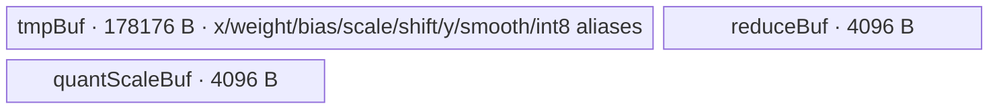
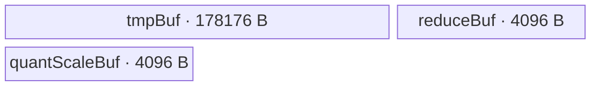

# AdaLayerNormQuant A2/A3 ACLNN 算子知识

## 算子速览

| 项目 | 内容 |
|---|---|
| 实际入口 | `aclnnAdaLayerNormQuantGetWorkspaceSize` + `aclnnAdaLayerNormQuant`，公开两段式 ACLNN |
| 计算语义 | 对 `[B…,S,H]` 每行做 LayerNorm，再算 `LN*(1+scale)+shift`，可选乘 `smoothScales`，按行动态量化为 INT8 |
| 输入输出 | `x/scale/shift/weight/bias/smoothScales` 为 FP16/BF16、ND；`out` 为 INT8、shape 同 `x`；`quantScale` 为 FP32、shape `[B…,S]` |
| 执行类型 | 单 Kernel，节点为 `AIV_VECTOR`；entry 显式声明 `KERNEL_TYPE_AIV_ONLY` |
| Kernel 路线 | R-001：`H<=6144` 全载入；R-002：`H>6144` 分片、workspace 暂存归一化结果；两者均为 key 1 |
| 核心资源 | GM + 三个 `TBuf`；R-002 另用每核 `align_up(H,32)*4` 字节 user workspace |
| 来源闭包 | `source_closed`：ACLNN→L0 launcher→共享 Tiling/POD→key 1 router→`AdaLayerNormND<*,*,QUANT_OP_CODE>`→Vector helper→平台注册/二进制配置闭合 |
| 验证状态 | 已完成源码闭包检查；本次知识提取未执行编译、真机、数值或性能测试。 |

## 接口与语义

### 计算语义

令最后两维为 `S,H`，展平前导维得到 `B`，行号 `r∈[0,B*S)`。先计算 `n=(x-mean(x))/sqrt(var(x)+epsilon)`，再按可选项计算 `l=n*weight+bias`，最后 `y=l*(1+scale[b])+shift[b]`；若提供 `smoothScales`，再令 `y*=smoothScales`。A2/A3 固定 `Qmax=127`，`quantScale[r]=max(abs(y[r,:]))/127`，`out[r,:]` 经 `y/quantScale` 与源码规定的两段 cast 得到 INT8。

### 输入、输出与属性

| 参数 | shape/layout | dtype | 约束、默认值与语义 |
|---|---|---|---|
| `x` | `[B…,S,H]`，ND，2–8 维 | FP16/BF16 | 必需；各维乘积 `B`、`S`、`H` 均须大于 0 |
| `scale`,`shift` | `[B…,H]` 或 `[B…,1,H]`，ND | 同 `x` | 必需；Device 对 `scale` 先加 1 |
| `weight`,`bias` | `[H]`，ND | 同 `x` | 可选；缺失时分别跳过乘法/加法 |
| `smoothScales` | `[H]`，ND | 同 `x` | 可选；缺失时跳过平滑乘法 |
| `epsilon` | scalar | API `double`，下传 FP32 | 默认 1e-5；API 未额外限制取值 |
| `quantMode` | C 字符串 | — | `nullptr` 等价 `dynamic`；非 `dynamic` 报参数错误 |
| `out` | 同 `x` | INT8 | A2/A3 API 只接受 INT8 |
| `quantScale` | `[B…,S]`，ND | FP32 | 每行一个 scale |
| `quantOffsetOptional` | `[B…,S]`（接口语义） | — | 当前实现必须为 `nullptr` |

### 入口与版本

固定 Commit 仅公开未带版本后缀的 `aclnnAdaLayerNormQuant`，不存在更高版本入口。README/API 产品表同时标明 Atlas A2、A3 支持；`AdaLayerNormQuant` OpDef 注册 `ascend910b`、`ascend910_93`，各 binary config 含 FP16/BF16→INT8 实例，证据一致。

## Host/Launcher 执行流程

### 参数校验与前处理

`CheckParams` 依次执行非空、dtype、shape、`quantMode` 校验。随后空 Tensor 分支存在，但 `CheckShape` 已要求 `B,S,H>0`，因此公开有效域不会命中该成功早返。所有存在的输入通过 `l0op::Contiguous`；L0 分配同 `x` shape/format 的 INT8 临时输出和 `[B…,S]` FP32 scale，并通过 `ADD_TO_LAUNCHER_LIST_AICORE` 添加一个 `AdaLayerNormQuant` 节点，最后两个 `ViewCopy` 将临时结果提交到用户输出。任一步返回空指针或 launcher 添加失败即中止 executor 构建。

### 参数、Workspace 与生命周期

Tiling 固定预留 `16 MiB`；仅 `H>6144` 时增量为 `needCoreNum*align_up(H,32)*sizeof(float)`。Kernel 通过 `GetUserWorkspace` 得到算子可用区；R-002 每个 block 使用 `blockIdx*align_up(H,32)` 个 FP32 的私有切片。workspace 由第一段 executor 汇总，用户持有至第二段 `CommonOpExecutorRun` 完成；单 stream 保证 Contiguous→算子→ViewCopy 的 executor 顺序。

### 启动图与失败传播

```text
aclnnAdaLayerNormQuantGetWorkspaceSize
  -> Contiguous(各存在输入)
  -> l0op::AdaLayerNormQuant
    -> 单节点 ada_layer_norm_quant(blockDim=needCoreNum, key=1, POD=AdaLayerNormTilingData)
  -> ViewCopy(out临时量 -> out)
  -> ViewCopy(scale临时量 -> quantScale)
aclnnAdaLayerNormQuant(workspace, executor, stream)
  -> CommonOpExecutorRun
```

算子节点没有跨 Kernel 边。R-002 的 `normGm` 是节点内部两遍量化的 GM workspace 边，producer/consumer 均为同一 block；`MTE3_MTE2` event 保证回读前写入可见。`ADD_TO_LAUNCHER_LIST_AICORE` 失败会令 L0 返回空 tuple，从而阻断 ViewCopy；第二段直接返回 executor 的运行状态。

## Route 与参数设计

### 分核与资源计算

`rows=B*S`，`hiddenDimCeil=align_up(H,32)`。`singleCoreNum=rows/coreNumPlatform`，`tailNum=rows%coreNumPlatform`，`needCoreNum=(singleCoreNum>0?coreNumPlatform:tailNum)`；block `i` 处理 `[singleCoreNum*i+min(i,tailNum), start+singleCoreNum+(i<tailNum)]`。`H<=3072` 时 `rowNum=floor(6144/hiddenDimCeil)`，否则为 1；`H>6144` 时先取 `batch=ceil(H/6144)`，再取 `sliceSize=align_up(ceil(H/batch),32)`。所有 A2/A3 路径 key 均为 1。

### Route 选择

| 顺序 | Route | Key/模板 | 精确选择条件与优先级 | 不适用去向 |
|---:|---|---|---|---|
| 1 | R-001 全载入 | key 1 / `AdaLayerNormND<X,X,2>` | `isRegBase=false && H<=6144`；其中 `H<=3072` 可一次处理多行 | `H>6144` 到 R-002 |
| 2 | R-002 分片 | key 1 / `AdaLayerNormND<X,X,2>` | `isRegBase=false && H>6144` | 无；有效 shape 均可达 |

```text
isRegBase=false -> key=1
  H <= 6144 -> R-001 FastProcess
  H > 6144  -> R-002 SliceProcess
```

### 模板/实现执行矩阵

| Route | key/selector | dtype/shape/platform 完整命中条件 | 执行拓扑与 Kernel 节点 | 实际模板/body | 内存与同步特征 | tail/fallback |
|---|---|---|---|---|---|---|
| R-001 全载入 | 1 | A2/A3；X=FP16/BF16；out=INT8；`H<=6144` | 单 AIV Kernel | `AdaLayerNormND<half,half,2>` 或 `<bfloat16_t,bfloat16_t,2>`；`FastProcess` | 固定 186368 B UB；无算子 user workspace；event/pipe barrier | 行尾由 `actualRowNum`，列尾由有效 `H` 和 DataCopyPad |
| R-002 分片 | 1 | A2/A3；同 dtype；`H>6144` | 单 AIV Kernel，两遍 GM 暂存 | 同模板；`SliceProcess/QuantSliceCompute` | 固定 186368 B UB；每核 `align_up(H,32)*4` B workspace；`MTE3_MTE2` | `min(sliceSize,H-h)`；`H>16384` 的均值/方差再按 16384 分段 |

### 隐藏性能 Guard

| Guard | Host/Tiling 条件 | Device/资源原因 | 影响 Route | 不满足时去向 | 源码符号 |
|---|---|---|---|---|---|
| full/slice | `H<=6144` | 固定 UB 数据区以 6144 为工作粒度 | 两 Route | R-002 | `SplitCore`,`Process` |
| multi-row | `H<=3072`，`rowNum=6144/align_up(H,32)` | 在同一 6144 容量内并行多行 | R-001 | 单行 R-001 | `SplitCore`,`FastProcess` |
| reduce 上限 | `count<=16384` | `ReduceMaxCustom` 注释与 64×256 repeat 上限 | R-002 | `sliceSize` 由 6144 目标保证；均值/方差显式按 16384 切 | `ReduceMaxCustom`,`SliceProcess` |
| A3 BF16 guard | 非 `__NPU_ARCH__==3003` | 该架构编译条件排除 BF16 实例 | key 1 | 未实例化时无输出 | `ada_layer_norm_quant` router |

### POD/ABI

`TILING_DATA_FIELD_DEF` 的最终 packed/对齐规则以及嵌套 `LayerNormSeparateTiling` 的大小由外部注册头生成，固定仓未展开，因此 `sizeof/alignof/offsetof` 不可见；字段顺序如下，Host/Device 结构名均为 `AdaLayerNormTilingData`。

| 结构 | 字段 | 类型/位宽 | ABI 布局 | 单位 | Host/launcher producer | Device consumer | 边界 |
|---|---|---|---|---|---|---|---|
| `AdaLayerNormTilingData` | `batchSize` | int64/64 | offset 不可见 | batch | 前导维乘积 | `ParseTilingData` | 正数 |
| 同上 | `seqLen` | int64/64 | 不可见 | row/batch | 倒数第 2 维 | scale/shift batch offset | 正数 |
| 同上 | `hiddenDim` | int64/64 | 不可见 | element | 最后一维 | 所有循环/地址 | 正数 |
| 同上 | `epsilon` | float/32 | 不可见 | scalar | attr[0] | rstd | API double 窄化到 float |
| 同上 | `aveFactor` | float/32 | 不可见 | reciprocal | `float(1.0/H)` | mean/variance | H 非零 |
| 同上 | `hasWeight` | int32/32 | 不可见 | bool | optional pointer | 乘 gamma 分支 | 0/1 |
| 同上 | `hasBias` | int32/32 | 不可见 | bool | optional pointer | 加 beta 分支 | 0/1 |
| 同上 | `hasSmooth` | int32/32 | 不可见 | bool | optional pointer | smooth 分支 | 0/1 |
| 同上 | `singleCoreNum` | int64/64 | 不可见 | row/core | `rows/coreNum` | `rowStart/end` | 可为 0 |
| 同上 | `tailNum` | int64/64 | 不可见 | core | `rows%coreNum` | 前 tailNum 核多 1 行 | `[0,coreNum)` |
| 同上 | `sliceSize` | int64/64 | 不可见 | element | `SplitCore` | fast/slice 与 h 步长 | 32 对齐或 H |
| 同上 | `rowNum` | int64/64 | 不可见 | row/iteration | `SplitCore` | FastProcess | 至少 1 |
| 同上 | `tmpBufferSize` | int64/64 | 不可见 | byte | A2/A3 不调用 `DoLayerNormTiling`，保持默认 | A2/A3 body 不读取 | inactive |
| 同上 | `layerNormTiling` | nested | 不可见 | API POD | A2/A3 未生产 | A2/A3 body 不读取 | inactive |

### Route 源码闭包

| Route | Key/selector | Host/Tiling producer | POD/参数 | Kernel entry/router 节点 | Kernel body/直接依赖 | 构建接线 |
|---|---|---|---|---|---|---|
| R-001 | key 1 + `H<=6144` | `ada_layer_norm_tiling.cpp::RunBigKernelTiling/SplitCore` | `AdaLayerNormTilingData` | `ada_layer_norm_quant.cpp::ada_layer_norm_quant` | `AdaLayerNormND::FastProcess` 及 `ada_layer_norm_base_v1.h` helpers | OpDef `ascend910b/ascend910_93` + 两份 binary config |
| R-002 | key 1 + `H>6144` | 同上 | 同上 + workspace | 同上 | `AdaLayerNormND::SliceProcess/QuantSliceCompute` | 同上 |

## Kernel 实现

### 公共执行流程

entry 解析 POD、取得 user workspace，空指针直接返回；key 1 按 `DTYPE_X` 实例化 FP16/BF16 的 `AdaLayerNormND`，调用 `InitQuant` 与 `Process`。所有算术在 FP32 LocalTensor 中完成，输入先 cast 到 FP32；INT8 输出按 `FP32 -> half(CAST_RINT) -> int8(CAST_ROUND)` 写出。

### Route R-001：全载入

#### 适用条件

##### 选择证据

| 层级 | 文件 | 符号 | 源码谓词/参数 | 结果/下一跳 |
|---|---|---|---|---|
| API | `op_api/aclnn_ada_layer_norm_quant.cpp` | `CheckDtypeValid` | 非 RegBase output 仅 INT8 | launcher |
| Tiling | `ada_layer_norm_tiling.cpp` | `SplitCore` | `H<=6144` 令 `sliceSize=H` | `Process` 选 fast |
| Router | `op_kernel/ada_layer_norm_quant.cpp` | `ada_layer_norm_quant` | `TILING_KEY_IS(1)` | `AdaLayerNormND<DTYPE_X,DTYPE_X,2>` |

#### Device 数据流

##### 函数级调用链

```text
ada_layer_norm_quant -> InitQuant -> Process -> FastProcess
  -> CopyInOtherData / CopyInScaleShift / CopyInX
  -> MultiCalMeanRstd+MultiLayerNorm 或 SingleLayerNorm
  -> Adaption -> DynamicQuant -> CopyOut(INT8) -> CopyScaleOut(FP32)
```

##### 源码等价伪码

```text
for row-group in this core, at most rowNum rows:
  reuse scale/shift when batchStart,batchEnd equal previous group
  DMA x; cast FP16/BF16 -> FP32
  compute mean and variance per row in FP32; rstd=1/sqrt(var+epsilon)
  optional weight/bias; y=normalized*(1+scale)+shift; optional y*=smooth
  max=reduce_max(abs(y)); quantScale=max/127
  q=cast_int8(cast_half_rint(y*127/max)); DMA valid H bytes
flush up to 1024 quantScale values
```

#### 内存与数据搬运

##### 资源与搬运表

| 层级/缓冲区 | offset/地址公式 | extent/容量公式 | dtype/layout | producer | consumer | owner/lifetime | 对齐/复用 |
|---|---|---|---|---|---|---|---|
| GM `x/out` | `row*H` | group×H | X / INT8 ND | API / Kernel | Kernel / API | caller | multi-row pad to `hiddenDimCeil` only in UB |
| `tmpBuf` | fixed subviews | `7*6144*4+6144` B | FP32 + INT8 | Copy/Vector | Vector/CopyOut | pipe lifetime | subviews alias by documented offsets |
| `reduceBuf` | row index | `1024*4` B | FP32 | reductions | scalar/broadcast | pipe lifetime | reused per group |
| `quantScaleBuf` | batchCount | `1024*4` B | FP32 | DynamicQuant | CopyScaleOut | pipe lifetime | flush before counter reset |
| workspace | N/A | N/A | — | — | — | — | 16 MiB framework reservation remains, body does not touch user slice |

##### 分层内存布局



##### 字节账与复用顺序

```text
UB_total = (7*6144*4 + 6144*1) + 1024*4 + 1024*4 = 186368 B
dynamic_ub = N/A
workspace_total(body-visible) = 0; Tiling仍报告16 MiB框架预留
```

| 复用子区 | 写入者 | 读取者/消费点 | 下一次覆盖 | 同步或释放依据 | 安全条件 |
|---|---|---|---|---|---|
| scale/shift LocalTensor | `CopyInScaleShift` | `Adaption` | batch 范围变化时 | V↔MTE2 event + PipeBarrier | batchStart/end 不变才复用 |
| `yFloat`/`yHalf`/`yInt` alias 区 | norm/adaption | quant cast/CopyOut | 下一 row-group | PipeBarrier + MTE3 event | CopyOut 完成后覆盖 |

#### 同步、精度与尾块

##### 同步与数值边界表

| 阶段 | primitive/机制 | producer | consumer/等待点 | 保护对象 | 精度/尾块 |
|---|---|---|---|---|---|
| GM→UB | `DataCopyPad`, `MTE2_V` | DMA | Vector | x/params | 多行 pad 0，计算/输出只用 H |
| Vector 链 | `PipeBarrier<PIPE_V>` | 每次算术 | 后续算术 | FP32 中间量 | mean/var/normalize/scale 均 FP32 |
| UB→GM | `V_MTE3` | cast | CopyOut | INT8 与 scale | blockLen 为有效 H/有效 batchCount |

#### 关键实现

##### 符号证据表

| 阶段 | 文件 | 符号/模板实例 | 实现事实 |
|---|---|---|---|
| Host/Tiling producer | `norm/ada_layer_norm/op_host/ada_layer_norm_tiling.cpp` | `SplitCore/GetTilingKey` | rowNum、分核、key 1 |
| Kernel entry/router | `norm/ada_layer_norm_quant/op_kernel/ada_layer_norm_quant.cpp` | `ada_layer_norm_quant` | AIV-only + dtype 实例 |
| Device body/helper | `norm/ada_layer_norm/op_kernel/ada_layer_norm_base.h` | `FastProcess` | group 循环与参数复用 |
| Device body/helper | `norm/ada_layer_norm/op_kernel/ada_layer_norm_base_v1.h` | `DynamicQuant/CopyInScaleShift` | `(1+scale)`、max/127、cast/tail |

### Route R-002：分片与 workspace 两遍量化

#### 适用条件

##### 选择证据

| 层级 | 文件 | 符号 | 源码谓词/参数 | 结果/下一跳 |
|---|---|---|---|---|
| Tiling | `ada_layer_norm_tiling.cpp` | `SplitCore` | `H>6144` | 32 对齐 slice；额外 workspace |
| Device | `ada_layer_norm_base.h` | `Process` | `sliceSize<hiddenDim` | `SliceProcess` |
| Router | `ada_layer_norm_quant.cpp` | entry | key 1 | 同一模板 |

#### Device 数据流

##### 函数级调用链

```text
ada_layer_norm_quant -> AdaLayerNormND::SliceProcess
  -> (可按16384片) ComputeMean + ComputeVar
  -> QuantSliceCompute
    -> 每片 ComputeSliceNorm/Adaption/Smooth/Abs/ReduceMax
    -> CopyOut FP32 norm 到本核 workspace
    -> MTE3_MTE2
    -> 回读每片 -> ComputeSliceQuant -> INT8 CopyOut
  -> CopyScaleOut
```

##### 源码等价伪码

```text
for row in core rows:
  scan x to obtain FP32 mean; rescan x to obtain FP32 variance
  for h by sliceSize:
    form FP32 y slice, write to workspace[blockIdx*align32(H)+h]
    reduce abs max into row max
  quantScale=max/127
  for h by sliceSize:
    read y slice from workspace, multiply 127/max, cast FP32->FP16->INT8, write out
```

#### 内存与数据搬运

##### 资源与搬运表

| 层级/缓冲区 | offset/地址公式 | extent/容量公式 | dtype/layout | producer | consumer | owner/lifetime | 对齐/复用 |
|---|---|---|---|---|---|---|---|
| per-core workspace | `(blockIdx*align_up(H,32)+h)*4` B | `align_up(H,32)*4` B/core | FP32 row slice | first quant pass | second quant pass | executor, kernel duration | core-private; reuse each row after second pass |
| UB buffers | 同 R-001 | 186368 B | FP32/INT8 | copy/vector | vector/copy | pipe | sliceSize <= about 6144 |

##### 分层内存布局



##### 字节账与复用顺序

```text
UB_total = 186368 B
workspace_total = 16 MiB + needCoreNum*align_up(H,32)*4 B
```

| 复用子区 | 写入者 | 读取者/消费点 | 下一次覆盖 | 同步或释放依据 | 安全条件 |
|---|---|---|---|---|---|
| 本核 norm workspace | first h-loop | second h-loop | 下一 row | `MTE3_MTE2` wait | 每核 offset 独立；第二遍完成 |

#### 同步、精度与尾块

##### 同步与数值边界表

| 阶段 | primitive/机制 | producer | consumer/等待点 | 保护对象 | 精度/尾块 |
|---|---|---|---|---|---|
| workspace 写→读 | `HardEvent::MTE3_MTE2` | FP32 CopyOut | CopyInAndCast | norm slice | `min(sliceSize,H-h)` |
| reduction | `ReduceMaxCustom` + `V_S` | Vector | scalar max | row max | 64-lane repeat + tail mask |
| quant cast | barriers/events | FP32 scale | cast/copy | output | FP32→FP16 RINT→INT8 ROUND |

#### 关键实现

##### 符号证据表

| 阶段 | 文件 | 符号/模板实例 | 实现事实 |
|---|---|---|---|
| Host/Tiling producer | `ada_layer_norm_tiling.cpp` | `RunBigKernelTiling/SplitCore` | workspace 与 sliceSize |
| Kernel entry/router | `ada_layer_norm_quant.cpp` | `ada_layer_norm_quant` | key 1 AIV |
| Device body/helper | `ada_layer_norm_base.h` | `SliceProcess` | 两阶段均值/方差与 per-row 循环 |
| Device body/helper | `ada_layer_norm_base_v1.h` | `QuantSliceCompute` | workspace 两遍量化 |

## 算子特定优化

### Trick T-001：同 batch 的 scale/shift 驻留复用

#### 触发与源码依据

- 适用 Route：R-001
- 触发条件：连续 row-group 的 `batchStart`、`batchEnd` 与前一组完全相同。
- Golden 来源：[`norm/ada_layer_norm/op_kernel/ada_layer_norm_base.h:319-326`](https://gitcode.com/cann/ops-nn/blob/955f8b33985b6d72989ebff341bb9c2c564a51bc/norm/ada_layer_norm/op_kernel/ada_layer_norm_base.h#L319-326)

**官方源码（固定 Commit 连续逐字摘录）**：

```cpp
bool scaleShiftReuse = (lastBatchStart == range.batchStart && lastBatchEnd == range.batchEnd);
if (!scaleShiftReuse) {
    SetFlag<HardEvent::V_MTE2>(eventIdVToMte2);
    WaitFlag<HardEvent::V_MTE2>(eventIdVToMte2);
    CopyInScaleShift(range.batchStart * hiddenDim, range.batchEnd - range.batchStart, hiddenDim);
}
CopyInX(range.rowStart * hiddenDim, range.actualRowNum, hiddenDim);
```

#### 机制与设计原因

scale/shift 只随 batch 变化、在 S 行间共享；上述 guard 避免为同一 batch 的连续 row-group 重复 GM→UB 搬运。event 在真正覆盖旧参数前建立 Vector→MTE2 顺序。

#### 迁移边界

- 适用：参数按 batch 广播且 row 调度连续的融合归一化。
- 前提：batchStart/end 相同且 UB 参数区尚未覆盖。
- 失效：跨 batch 或 group 覆盖范围变化时必须重新 CopyIn。
- 未验证：本次知识提取未执行编译、真机、数值或性能测试。

#### 错误做法

固定仓未提供可验证反例。

### Trick T-002：超长行只物化一次 FP32 自适应结果

#### 触发与源码依据

- 适用 Route：R-002
- 触发条件：`H>6144`，量化 scale 必须先知道整行最大绝对值。
- Golden 来源：[`norm/ada_layer_norm/op_kernel/ada_layer_norm_base_v1.h:91-107`](https://gitcode.com/cann/ops-nn/blob/955f8b33985b6d72989ebff341bb9c2c564a51bc/norm/ada_layer_norm/op_kernel/ada_layer_norm_base_v1.h#L91-107)

**官方源码（固定 Commit 连续逐字摘录）**：

```cpp
Abs(yFloat, xFloat, dataCount);
PipeBarrier<PIPE_V>();
CopyOut(normGm[normOffset + h], xFloat, 1, dataCount);
SetFlag<HardEvent::MTE3_MTE2>(eventIdMte3ToMte2);
WaitFlag<HardEvent::MTE3_MTE2>(eventIdMte3ToMte2);
ReduceMaxCustom(reduceFloat, yFloat, dataCount);
```

#### 机制与设计原因

第一遍把已经完成 LN、adaptive 与 smooth 的 FP32 `xFloat` 写入 core-private workspace，同时用别名 `yFloat` 归约绝对值；scale 得到后第二遍只回读并量化，避免重新执行 LayerNorm 与参数融合。`MTE3_MTE2` 明确约束同一片的 GM 写回/后续回读。

#### 迁移边界

- 适用：整行 scale 依赖全局归约、UB 无法容纳整行的动态量化。
- 前提：每核 workspace 至少 `align_up(H,32)*4` B 且不同 core 不重叠。
- 失效：workspace 不足时固定实现没有替代 Route。
- 未验证：本次知识提取未执行编译、真机、数值或性能测试。

#### 错误做法

固定仓未提供可验证反例。

## 模板与实现对比

| 对比维度 | R-001 全载入 | R-002 分片 | 设计选择依据 |
|---|---|---|---|
| 命中条件/优先级 | `H<=6144` | `H>6144` | 固定工作容量 |
| 模板与 dtype | key 1，同 FP16/BF16 模板 | 同 | body 内部分支 |
| 循环与分核 | 行组，可多行 | 逐行、逐 slice，两遍量化 | H 是否装入 UB |
| Queue/TBuf/寄存器/dynamic UB/通信 window | 三个 TBuf | 同 | 无 Queue/dynamic UB/通信 |
| 内存总占用与复用 | 186368 B UB | 186368 B UB + per-core workspace | 超长行暂存 |
| 搬运/Vector/SIMT/NDDMA/通信 API | DataCopyPad + Vector | 同，增加 workspace 写读 | 均 AIV_VECTOR |
| 同步、精度与 tail | event/barrier；FP32→half→INT8 | 增加 MTE3_MTE2；slice tail | 数据依赖 |
| fallback/失败边界 | H 增大转 R-002 | 无更低 Route | 单 key 内部分支 |

## 平台差异

| 项目 | A2 | A3 | 950 |
|---|---|---|---|
| 支持状态 | 支持 | 支持 | 支持，见独立 `_950` 卡 |
| Host/Launcher | `ascend910b`，共享 Tiling | `ascend910_93`，共享 Tiling | RegBase key 11/21 |
| Kernel/资源 | key 1 AIV；INT8 | key 1 AIV；INT8；架构 3003 的 BF16 编译 guard 需服从 binary 实例 | MicroAPI + FullLoad/Welford；支持四种 8-bit 输出 |

## 限制与失败边界

- API 未显式校验 epsilon 范围、总元素乘法溢出或 `max(abs(y))==0`；Device 在零 max 时会执行 `127/maxValue`，固定源码没有单独零保护。
- `tmpBufferSize/layerNormTiling` 在 A2/A3 Route 为 inactive；其 ABI 展开、框架 16 MiB 预留的内部 offset 与 executor stream 实现位于固定仓外。
- unknown key、`GetUserWorkspace()==nullptr` 或被编译 guard 排除的 dtype 会无输出返回；entry 本身不传播 Device 错误码。
- 本次知识提取未执行编译、真机、数值或性能测试。

## 源码索引

### 链路索引

| 链路阶段 | 文件 | 关键符号 | 支撑内容 |
|---|---|---|---|
| 入口声明/约束 | `norm/ada_layer_norm_quant/docs/aclnnAdaLayerNormQuant.md` | API 原型/产品表 | 公开入口、平台与接口语义 |
| 入口实现 | `norm/ada_layer_norm_quant/op_host/op_api/aclnn_ada_layer_norm_quant.cpp` | `CheckParams/GetWorkspaceSize` | 校验、Contiguous、ViewCopy、executor |
| 入口实现 | `norm/ada_layer_norm_quant/op_host/op_api/ada_layer_norm_quant.cpp` | `l0op::AdaLayerNormQuant` | 输出分配与单节点 launcher |
| Host/Tiling/Launcher | `norm/ada_layer_norm/op_host/ada_layer_norm_tiling.cpp` | `AdaLayerNormTiling` | 分核、route、workspace、POD producer |
| Host/Tiling/Launcher | `norm/ada_layer_norm/op_host/ada_layer_norm_tiling.h` | `AdaLayerNormTilingData` | POD 字段 |
| Kernel entry/body | `norm/ada_layer_norm_quant/op_kernel/ada_layer_norm_quant.cpp` | `ada_layer_norm_quant` | AIV router |
| Kernel entry/body | `norm/ada_layer_norm/op_kernel/ada_layer_norm_base.h` | `AdaLayerNormND` | 初始化、内存与主循环 |
| Kernel entry/body | `norm/ada_layer_norm/op_kernel/ada_layer_norm_base_v1.h` | Vector helpers | 算法、搬运、精度、tail |
| 构建接线 | `norm/ada_layer_norm_quant/op_host/ada_layer_norm_quant_def.cpp` | `AdaLayerNormQuant` OpDef | A2/A3 注册 |
| 构建接线 | `norm/ada_layer_norm_quant/op_host/config/ascend910b/ada_layer_norm_quant_binary.json` | `op_list` | A2 FP16/BF16→INT8 二进制实例 |
| 构建接线 | `norm/ada_layer_norm_quant/op_host/config/ascend910_93/ada_layer_norm_quant_binary.json` | `op_list` | A3 FP16/BF16→INT8 二进制实例 |

### 实现复用检查

| 检查项 | 可复用事实 | 不得改变的约束 | 源码符号 |
|---|---|---|---|
| ABI/POD | 共享 `AdaLayerNormTilingData` | 字段顺序/位宽与 inactive 字段仍须保留 | tiling header |
| 调用顺序 | 单 AIV 节点 | Contiguous→kernel→ViewCopy | ACLNN/L0 |
| workspace/内存 | H>6144 的 per-core FP32 暂存 | `blockIdx*align_up(H,32)` 与 MTE3_MTE2 | `QuantSliceCompute` |
| 同步 | event + Vector barrier | 写读方向不可倒置 | util/base_v1 helpers |
| 精度与尾块 | FP32 归一化、两段 INT8 cast | scale=amax/127；有效 H 写出 | `DynamicQuant` |
| 失败边界 | key 1 与 workspace 非空 | unknown key/空 userWS 无 fallback | entry |