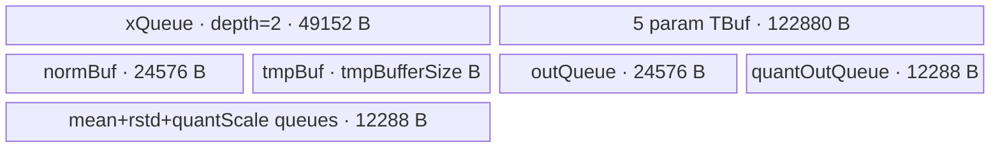
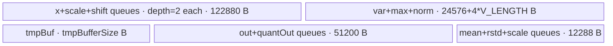

# AdaLayerNormQuant 950 ACLNN 算子知识

## 算子速览

| 项目 | 内容 |
|---|---|
| 实际入口 | `aclnnAdaLayerNormQuantGetWorkspaceSize` + `aclnnAdaLayerNormQuant`，公开两段式 ACLNN |
| 计算语义 | 每行 LayerNorm 后计算 `LN*(1+scale)+shift`，可选乘 smooth，再按输出类型的最大有限值做动态 8-bit 量化 |
| 输入输出 | X/参数为 FP16/BF16；out 为 INT8/HIFLOAT8/FP8_E4M3FN/FP8_E5M2；quantScale 为 FP32；均为 ND |
| 执行类型 | 单 Kernel，key 11/21 节点均为 `AIV_VECTOR`，entry 声明 `KERNEL_TYPE_AIV_ONLY`；内部使用 AscendC MicroAPI/Vector API |
| Kernel 路线 | R-001 key 11 FullLoad（`H<=6144`）；R-002 key 21 Welford 分片（`H>6144`） |
| 核心资源 | R-001：TQue/TBuf/RegTensor；R-002：双缓冲 TQue/TBuf/RegTensor + 每核 FP32 GM workspace |
| 来源闭包 | `source_closed`：公开 ACLNN→L0 launcher→共享 RegBase Tiling/POD→APT router→FullLoad/Welford body/helper→Ascend 950 OpDef/binary config 闭合 |
| 验证状态 | 已完成源码闭包检查；本次知识提取未执行编译、真机、数值或性能测试。 |

## 接口与语义

### 计算语义

将前导维展平为 `B`，对 `[B,S,H]` 的每行计算 `n=(x-E(x))/sqrt(Var(x)+epsilon)`；可选 `weight/bias` 后得到 `l`，再做 `y=l*(1+scale[b])+shift[b]`，可选 `y*=smoothScales`。输出类型 `Y` 对应 `Qmax`：INT8=127、HIFLOAT8=32768、FP8_E4M3FN=448、FP8_E5M2=57344；`quantScale=max(abs(y))/Qmax`，输出由 `y/quantScale` 按类型特定 cast trait 量化。

### 输入、输出与属性

| 参数 | shape/layout | dtype | 约束、默认值与语义 |
|---|---|---|---|
| `x` | `[B…,S,H]`，ND，2–8 维 | FP16/BF16 | 必需；B/S/H 均大于 0 |
| `scale`,`shift` | `[B…,H]` 或 `[B…,1,H]` | 同 `x` | 必需；scale 的“+1”在 Device MicroAPI 内完成 |
| `weight`,`bias` | `[H]` | 同 `x` | 可选 gamma/beta |
| `smoothScales` | `[H]` | 同 `x` | 可选平滑因子 |
| `epsilon` | scalar | API double→POD float | 默认 1e-5 |
| `quantMode` | 字符串 | — | 仅 `dynamic`；`nullptr` 也按 dynamic |
| `out` | 同 `x` | INT8/HIFLOAT8/FP8_E4M3FN/FP8_E5M2 | 950 RegBase dtype 集 |
| `quantScale` | `[B…,S]` | FP32 | 每行一个量化尺度 |
| `quantOffsetOptional` | 可选输出位置 | — | 当前必须为 `nullptr` |

### 入口与版本

固定仓仅有未带版本后缀的公开 API，因此它是 950 实际支持的最新公开版本。README/API 产品表明确支持 Ascend 950PR/950DT；OpDef 的 `ascend950` config 打开动态 rank/shape 并指定 `opFile.value=ada_layer_norm_quant_apt`，binary config 列出 2 种输入 dtype × 4 种输出 dtype，共 8 个实例，公开与实现接线无冲突。

## Host/Launcher 执行流程

### 参数校验与前处理

API 的检查顺序是 required 指针→输入/输出 dtype→shape→`quantMode`。`Ops::NN::AclnnUtil::IsRegbase()` 为真时 out 接受四种 8-bit dtype；所有存在的输入经 `Contiguous`，L0 分配临时 out/quantScale，添加唯一 AICore launcher 节点，再以两个 `ViewCopy` 写用户输出。校验失败、Contiguous/L0/ViewCopy 空指针或 launcher 添加失败均阻断后续节点。

### 参数、Workspace 与生命周期

`rows=B*S`。Tiling 总 workspace 为 `16 MiB`，R-002 追加 `needCoreNum*align_up(H,32)*4` 字节。R-001 的 Kernel 不绑定 user workspace 数据；R-002 将 `GetUserWorkspace(workspace)` 绑定为 `normGm`，每个 block 使用 `blockIdx*align_up(H,32)` 个 FP32 的切片并在每行后复用。workspace/executor 从第一段移交给调用者，第二段在给定 stream 中运行整个 Contiguous→Kernel→ViewCopy 图。

### 启动图与失败传播

```text
GetWorkspaceSize -> Contiguous* -> l0op::AdaLayerNormQuant
  -> ada_layer_norm_quant_apt(blockDim=needCoreNum, POD, key=11 or 21)
-> ViewCopy(out) -> ViewCopy(quantScale)
Run -> CommonOpExecutorRun(workspace, executor, stream)
```

这是单 Device 节点拓扑。R-002 内部的 workspace 写/读由同一 Kernel 的 `MTE3_MTE2` event 排序；无跨 Kernel workspace 边。entry 遇到 user workspace 为空或未知 key 直接返回，固定 Device entry 无错误码回传。

## Route 与参数设计

### 分核与资源计算

`hiddenDimCeil=align_up(H,32)`（Host；Device 输入对齐按 X 的 32B block，INT8 输出也向 32 element 对齐）。`needCoreNum` 与 A2/A3 相同：若 `rows/coreNumPlatform>0` 使用全部 Vector core，否则使用 `rows%coreNumPlatform`。每核的 `rowStart/end` 采用 quotient/remainder 均分。950 `H<=3072` 时 `rowNum=floor(6144/hiddenDimCeil)`，`3072<H<=6144` 时 rowNum=1；`H>6144` 时 `batch=ceil(H/5120)`，`sliceSize=align_up(ceil(H/batch),32)`。Tiling API 为 FullLoad 生成 `LayerNormSeparateTiling/tmpBufferSize`，为 Welford 将 WelfordUpdate、WelfordFinalize、Normalize 三个最大临时区字节数相加。

### Route 选择

| 顺序 | Route | Key/模板 | 精确选择条件与优先级 | 不适用去向 |
|---:|---|---|---|---|
| 1 | R-001 FullLoad | key 11 / `AdaLayerNormFullLoad<X,X,Y,2>` | `isRegBase && H<=6144` | H>6144 到 R-002 |
| 2 | R-002 Welford | key 21 / `AdaLayerNormWelford<X,X,Y,2>` | `isRegBase && H>6144` | 无 |

```text
isRegBase=true
  H <= 6144 -> tilingKey=(1*10)+1=11 -> FullLoad
  H >  6144 -> tilingKey=(2*10)+1=21 -> Welford
```

### 模板/实现执行矩阵

| Route | key/selector | dtype/shape/platform 完整命中条件 | 执行拓扑与 Kernel 节点 | 实际模板/body | 内存与同步特征 | tail/fallback |
|---|---|---|---|---|---|---|
| R-001 FullLoad | 11 | 950；X FP16/BF16；Y 四种 8-bit；H<=6144 | 单 AIV Kernel | `AdaLayerNormFullLoad<DTYPE_X,DTYPE_X,DTYPE_OUT,2>` | double-buffer x/quantOut、TBuf、MicroAPI regs；无 user slice | multi-row pair + odd row；列用 UpdateMask |
| R-002 Welford | 21 | 同平台/dtype；H>6144 | 单 AIV Kernel，内部两遍 workspace | `AdaLayerNormWelford<DTYPE_X,DTYPE_X,DTYPE_OUT,2>` | x/scale/shift/out/quant 双缓冲；Welford/Normalize temp；GM norm slice | full slices + tailSize；无其他 fallback |

### 隐藏性能 Guard

| Guard | Host/Tiling 条件 | Device/资源原因 | 影响 Route | 不满足时去向 | 源码符号 |
|---|---|---|---|---|---|
| FullLoad 上界 | `H<=6144` | `DATA_COUNT=6144` 的 Queue/TBuf 容量 | R-001 | R-002 | `GetTilingKey`,`InitQuant` |
| Welford slice | `H>6144`, batch 按 5120 目标切分 | `WELFORD_COUNT=5120` | R-002 | 固定仓无第三 Route | `SplitCore`,`ParseTilingData` |
| row pairing | `rowNum>>1` 与 `rowNum&1` | MicroAPI 同时处理两行，奇数行独立 tail | R-001 | odd tail loop | `AdaptionVF`,`DynamicQuant` |
| dtype cast | `Y` 编译期类型 | 每种 8-bit 的 cast trait/最大有限值不同 | 两 Route | binary config 未实例化即不可达 | `GetQuantFactor`,`DynamicQuant/ProcessQuant` |
| UB temp | `tmpBufferSize>0` 才 InitBuffer | LayerNorm/Welford API 临时空间 | 两 Route | 固定仓无显式 UB fallback | 两个 `InitQuant` |

### POD/ABI

宏生成的 packed/对齐规则及 `LayerNormSeparateTiling` 具体结构位于固定仓外，故精确 `sizeof/alignof/offsetof` 不可见；字段声明顺序、类型和 producer/consumer 可闭合。

| 结构 | 字段 | 类型/位宽 | ABI 布局 | 单位 | Host/launcher producer | Device consumer | 边界 |
|---|---|---|---|---|---|---|---|
| `AdaLayerNormTilingData` | `batchSize` | int64/64 | offset 不可见 | batch | 前导维乘积 | 当前 950 body 不直接读 | 正数 |
| 同上 | `seqLen` | int64/64 | 不可见 | row/batch | x 倒数第 2 维 | scale offset | 正数 |
| 同上 | `hiddenDim` | int64/64 | 不可见 | element | x 最后一维 | loop/address/mask | 正数，Device FullLoad 窄化 uint32 |
| 同上 | `epsilon` | float/32 | 不可见 | scalar | attr[0] | LayerNorm/Normalize | API double 窄化 |
| 同上 | `aveFactor` | float/32 | 不可见 | reciprocal | `float(1/H)` | 950 body 不直接读 | inactive |
| 同上 | `hasWeight` | int32/32 | 不可见 | bool | optional presence | LayerNorm/Normalize config | 0/1 |
| 同上 | `hasBias` | int32/32 | 不可见 | bool | optional presence | LayerNorm/Normalize config | 0/1 |
| 同上 | `hasSmooth` | int32/32 | 不可见 | bool | optional presence | VF 模板 bool 路径 | 0/1 |
| 同上 | `singleCoreNum` | int64/64 | 不可见 | row/core | rows/coreNum | rowStart/end | 可为 0 |
| 同上 | `tailNum` | int64/64 | 不可见 | core | rows%coreNum | 前 tailNum 核 +1 行 | `[0,coreNum)` |
| 同上 | `sliceSize` | int64/64 | 不可见 | element | FullLoad=H；Welford 32 对齐切片 | Welford sliceCount/tail | R-001 不用于切分 |
| 同上 | `rowNum` | int64/64 | 不可见 | row/group | `6144/hiddenDimCeil` 或 1 | FullLoad FastProcess | Welford inactive |
| 同上 | `tmpBufferSize` | int64/64 | 不可见 | byte | AscendC tiling API max-size 求和 | `InitQuant(tmpBuf)` | 可为 0 |
| 同上 | `layerNormTiling` | nested | 不可见 | API POD | `GetLayerNormNDTilingInfo` | FullLoad `LayerNorm` | Welford inactive |

### Route 源码闭包

| Route | Key/selector | Host/Tiling producer | POD/参数 | Kernel entry/router 节点 | Kernel body/直接依赖 | 构建接线 |
|---|---|---|---|---|---|---|
| R-001 | key 11 | `AdaLayerNormTiling::{SplitCore,DoLayerNormTiling,GetTilingKey}` | `AdaLayerNormTilingData` + `LayerNormSeparateTiling` | `ada_layer_norm_quant_apt.cpp::ada_layer_norm_quant` | `AdaLayerNormFullLoad` + `AdaptionVF` + impl copy helpers | Ascend 950 OpDef `opFile` + 8 binary entries |
| R-002 | key 21 | 同上，Welford temp producers | 同 POD + workspace | 同 entry | `AdaLayerNormWelford` + Welford/Normalize/MicroAPI helpers | 同上 |

## Kernel 实现

### 公共执行流程

APT entry 解析 POD、验证 `GetUserWorkspace`，按 key 11/21 实例化唯一 AIV 模板。两条 Route 都把 LayerNorm 与 adaptive/quant 算术保持在 FP32；X/scale/shift/可选参数从 FP16/BF16 加载，MicroAPI 用 `UpdateMask` 保护尾列，并按 Y 选择 INT8 三段 cast、HIFLOAT8 cast 或 FP8 cast。单 Kernel 没有跨节点同步图。

### Route R-001：FullLoad

#### 适用条件

##### 选择证据

| 层级 | 文件 | 符号 | 源码谓词/参数 | 结果/下一跳 |
|---|---|---|---|---|
| API | `aclnn_ada_layer_norm_quant.cpp` | `CheckDtypeValid` | `IsRegbase()` 选择 4 种 out dtype | 950 launcher |
| Tiling | `ada_layer_norm_tiling.cpp` | `GetTilingKey` | `isRegBase && H<=6144` | key 11 |
| Router | `ada_layer_norm_quant_apt.cpp` | entry | `TILING_KEY_IS(11)` | FullLoad 模板 |

#### Device 数据流

##### 函数级调用链

```text
ada_layer_norm_quant(key11) -> FullLoad::InitQuant -> Process -> CopyInOtherData -> FastProcess
  -> CopyInScaleShift(含batch内复制) -> CopyInX
  -> ProcessLayerNorm -> AscendC::LayerNorm
  -> Adaption -> AdaptionVF/SingleComputeAdaption/DoubleComputeAdaption
  -> DynamicQuant -> type-specific MicroAPI Cast -> QuantCopyOut
  -> CopyScaleOut
```

##### 源码等价伪码

```text
load optional weight/bias/smooth once per core
for row-group (<=rowNum):
  if batch span changed: DMA one scale/shift vector per batch, Copy it across S rows in UB
  DMA x rows into double-buffer queue; cast to FP32
  LayerNorm<float> with config selected by hasWeight/hasBias
  pair rows: y=norm*(1+scale)+shift; optional smooth; reduce abs max; scale=max*quantFactor
  odd row uses single-row tail
  divide y by per-row scale; cast according to Y; pack-store valid H; DMA to GM
flush up to 1024 FP32 scales
```

#### 内存与数据搬运

##### 资源与搬运表

| 层级/缓冲区 | offset/地址公式 | extent/容量公式 | dtype/layout | producer | consumer | owner/lifetime | 对齐/复用 |
|---|---|---|---|---|---|---|---|
| `xQueue` | queue slot | `2*6144*4` B | X payload / FP32 reinterpret | CopyInX | LayerNorm | TPipe | depth 2 |
| scale/shift/smooth/weight/bias/norm TBuf | separate | each `6144*4` B | mixed X/FP32 | DMA/LayerNorm | VF | TPipe | param residency |
| `tmpBuf` | separate | `tmpBufferSize` B | uint8 scratch | LayerNorm | LayerNorm | TPipe | conditional |
| `outQueue` | one slot | `6144*4` B | FP32 | AdaptionVF | DynamicQuant | queue | Free after quant |
| `quantOutQueue` | two slots | `2*6144` B | Y 8-bit | DynamicQuant | GM CopyOut | queue | depth 2 |
| mean/rstd/scale queues | separate | each `1024*4` B | FP32 | LayerNorm/VF | scale CopyOut（mean/rstd 对 quant 路线不输出） | queue | depth 1 |

##### 分层内存布局



##### 字节账与复用顺序

```text
UB_total = 2*6144*4 + 5*6144*4 + 6144*4 + tmpBufferSize
         + 6144*4 + 2*6144*1 + 3*1024*4
         = 245760 + tmpBufferSize B
dynamic_ub = N/A
workspace_total(body-visible) = 0; Tiling报告16 MiB框架预留
```

| 复用子区 | 写入者 | 读取者/消费点 | 下一次覆盖 | 同步或释放依据 | 安全条件 |
|---|---|---|---|---|---|
| xQueue slot | CopyInX | ProcessLayerNorm | 下一 row-group | EnQue/DeQue/FreeTensor | depth 2 |
| outQueue FP32 | AdaptionVF | DynamicQuant | 下一 group | EnQue/DeQue/FreeTensor | quant 完成后释放 |
| scale/shift TBuf | CopyInScaleShift | AdaptionVF | batch span 改变 | batch guard + pipe order | span 相同才复用 |

#### 同步、精度与尾块

##### 同步与数值边界表

| 阶段 | primitive/机制 | producer | consumer/等待点 | 保护对象 | 精度/尾块 |
|---|---|---|---|---|---|
| queue pipeline | EnQue/DeQue/FreeTensor | DMA | LayerNorm/VF/CopyOut | x/out/qout | depth 控制覆盖 |
| MicroAPI | `UpdateMask<float>` | sreg=H | load/compute/store | 尾列 | zeroing cast traits |
| INT8 cast | F32→I16 RINT→F16 ROUND→I8 TRUNC | div | packed store | INT8 | 只写 H |
| FP8/HIF8 cast | 类型特定 trait | div | packed store | Y | E4M3/E5M2 RINT，HIF8 ROUND |

#### 关键实现

##### 符号证据表

| 阶段 | 文件 | 符号/模板实例 | 实现事实 |
|---|---|---|---|
| Host/Tiling producer | `ada_layer_norm_tiling.cpp` | `DoLayerNormTiling/GetTilingKey` | LayerNorm POD、tmp 与 key 11 |
| Kernel entry/router | `ada_layer_norm_quant_apt.cpp` | key 11 branch | FullLoad AIV 实例 |
| Device body/helper | `ada_layer_norm_full_load.h` | `FastProcess/ProcessLayerNorm/DynamicQuant` | group、LayerNorm、量化 cast |
| Device body/helper | `ada_layer_norm_common.h` | `AdaptionVF/GetQuantFactor` | adaptive、amax 与类型 factor |
| Device body/helper | `ada_layer_norm_impl.h` | FullLoad Copy helpers | DMA 参数与 queue lifetime |

### Route R-002：Welford 分片

#### 适用条件

##### 选择证据

| 层级 | 文件 | 符号 | 源码谓词/参数 | 结果/下一跳 |
|---|---|---|---|---|
| Tiling | `ada_layer_norm_tiling.cpp` | `GetTilingKey/SplitCore` | `isRegBase && H>6144`；以 5120 为切分目标 | key 21 |
| Router | `ada_layer_norm_quant_apt.cpp` | entry | `TILING_KEY_IS(21)` | Welford 模板 |
| Device | `ada_layer_norm_welford.h` | `ParseTilingData` | `sliceCount=H/sliceSize,tailSize=H%sliceSize` | full/tail slices |

#### Device 数据流

##### 函数级调用链

```text
entry(key21) -> Welford::InitQuant -> SliceProcess
  -> ComputeMeanVar -> WelfordInitialize -> WelfordUpdate* -> WelfordFinalize
  -> ComputeAdaLayerNorm per slice
     -> CopyInX/OtherData -> Normalize -> CopyInScaleShift -> WelfordAdaptionVF
     -> CopyNormOut(workspace), accumulate max
  -> DynamicQuant -> CalculateScale -> MTE3_MTE2
     -> CopyInNorm -> ProcessQuant(type cast) -> QuantCopyOut
  -> CopyScaleOut
```

##### 源码等价伪码

```text
for row in this core:
  initialize mean/var vectors for sliceSize
  for each full slice and tail: WelfordUpdate; WelfordFinalize -> row mean,var
  maxTmp=0
  for each slice:
    Normalize with row statistics and optional weight/bias
    adaptive + optional smooth; update maxTmp; write FP32 y to core-private workspace
  quantScale=maxTmp*quantFactor; wait MTE3_MTE2
  for each slice: read FP32 y, divide by scale, type-specific masked cast/pack, write Y
flush quantScale every 1024 rows or at core tail
```

#### 内存与数据搬运

##### 资源与搬运表

| 层级/缓冲区 | offset/地址公式 | extent/容量公式 | dtype/layout | producer | consumer | owner/lifetime | 对齐/复用 |
|---|---|---|---|---|---|---|---|
| x/scale/shift queues | queue slots | each `2*5120*4` B | X/FP32 reinterpret | DMA/Welford init | Welford/Normalize/VF | TPipe | depth 2，多用途复用 |
| var/max/norm TBuf | separate | `4096 + V_LENGTH*4 + 5120*4` B | FP32 | Welford/VF | Normalize/scale/workspace | TPipe | max 持续整行 |
| `tmpBuf` | separate | `tmpBufferSize` B | scratch | primitives | primitives | TPipe | Host 三项 max-size 求和 |
| out/quantOut queues | separate | `2*5120*4 + 2*5120` B | FP32/Y | VF/quant | workspace/GM | queue | depth 2 |
| mean/rstd/scale queues | separate | each `1024*4` B | FP32 | finalize/scale | Normalize/GM | queue | depth 1 |
| GM workspace | `(blockIdx*align_up(H,32)+h)*4` | `align_up(H,32)*4` B/core | FP32 | CopyNormOut | CopyInNorm | executor/kernel | 每行复用；core-private |

##### 分层内存布局



##### 字节账与复用顺序

```text
UB_total = 3*(2*5120*4) + 1024*4 + V_LENGTH*4 + 5120*4
         + tmpBufferSize + 2*5120*4 + 2*5120*1 + 3*1024*4
         = 210944 + 4*V_LENGTH + tmpBufferSize B
workspace_total = 16 MiB + needCoreNum*align_up(H,32)*4 B
dynamic_ub = N/A
```

| 复用子区 | 写入者 | 读取者/消费点 | 下一次覆盖 | 同步或释放依据 | 安全条件 |
|---|---|---|---|---|---|
| scaleQueue/shiftQueue slots | WelfordInitialize / optional params / scale-shift CopyIn | Welford/Normalize/Adaption | FreeTensor 后 | queue protocol + PipeBarrier | optional branch须配对分配/释放 |
| per-core workspace | CopyNormOut | CopyInNorm | 下一 row | `MTE3_MTE2` | 全部 slice 写完且 scale 已算出 |
| maxBuf | Duplicate 0 / VF max | CalculateScale | 下一 row Duplicate | PIPE_V barrier | 覆盖前本行 scale 已保存 |

#### 同步、精度与尾块

##### 同步与数值边界表

| 阶段 | primitive/机制 | producer | consumer/等待点 | 保护对象 | 精度/尾块 |
|---|---|---|---|---|---|
| Welford | queue + `PipeBarrier<PIPE_V>` | Update/Finalize | Normalize | mean/var | `headCountLength=tailSize`，`tailCountLength=sliceSize-tailSize` |
| workspace | `MTE3_MTE2` | CopyNormOut | CopyInNorm | FP32 y | full slice + tailSize |
| quant | `UpdateMask<float>` | dataCount | div/cast/store | final slice | 与 R-001 相同类型 cast |

#### 关键实现

##### 符号证据表

| 阶段 | 文件 | 符号/模板实例 | 实现事实 |
|---|---|---|---|
| Host/Tiling producer | `ada_layer_norm_tiling.cpp` | `SplitCore/DoLayerNormTiling` | slice 与 Welford tmp |
| Kernel entry/router | `ada_layer_norm_quant_apt.cpp` | key 21 branch | Welford AIV 实例 |
| Device body/helper | `ada_layer_norm_welford.h` | `SliceProcess/ComputeMeanVar/DynamicQuant/ProcessQuant` | 两遍主循环、tail、cast |
| Device body/helper | `ada_layer_norm_impl.h` | `ProcessWelford*/ProcessNormalize/Copy*` | primitive 参数、DMA 与 lifetime |
| Device body/helper | `ada_layer_norm_common.h` | `WelfordAdaptionVF` | adaptive/smooth/amax |

## 算子特定优化

### Trick T-001：两行成对的 adaptive、amax 与量化

#### 触发与源码依据

- 适用 Route：R-001
- 触发条件：`rowNum>=2`；成对部分为 `rowNum>>1`，奇数余行走 `rowNum&1` tail。
- Golden 来源：[`norm/ada_layer_norm/op_kernel/arch35/ada_layer_norm_common.h:193-220`](https://gitcode.com/cann/ops-nn/blob/955f8b33985b6d72989ebff341bb9c2c564a51bc/norm/ada_layer_norm/op_kernel/arch35/ada_layer_norm_common.h#L193-220)

**官方源码（固定 Commit 连续逐字摘录）**：

```cpp
uint16_t rowLoopTimes = rowNum >> 1;
uint16_t tailLoopTimes = rowNum & 1;
uint16_t colLoopTimes = static_cast<uint16_t>(CeilA2B(hiddenDim, V_LENGTH));
uint32_t halfLength = rowLoopTimes * hiddenDimCeil;

__VEC_SCOPE__
{
    RegTensor<float> tmpMax1;
    RegTensor<float> tmpMax2;
```

#### 机制与设计原因

`DoubleComputeAdaption` 在一个列循环中并行加载两行 norm/scale/shift，完成 `(1+scale)`、FMA、可选 smooth、输出写入和两个 amax 累加；奇数行才走 Single path。这改变了寄存器级行并行度，并共用同一 `UpdateMask`/列循环控制。

#### 迁移边界

- 适用：多行独立、列长一致、UB 中以 `hiddenDimCeil` 分隔的行布局。
- 前提：两行的 scale/shift 已按行展开到 UB，寄存器资源允许双路。
- 失效：仅一行或奇数尾行必须走 Single path。
- 未验证：本次知识提取未执行编译、真机、数值或性能测试。

#### 错误做法

固定仓未提供可验证反例。

### Trick T-002：Welford 路线用 per-core workspace 避免重做融合计算

#### 触发与源码依据

- 适用 Route：R-002
- 触发条件：`H>6144`，完整 y 无法常驻当前 UB 路线。
- Golden 来源：[`norm/ada_layer_norm/op_kernel/arch35/ada_layer_norm_welford.h:322-339`](https://gitcode.com/cann/ops-nn/blob/955f8b33985b6d72989ebff341bb9c2c564a51bc/norm/ada_layer_norm/op_kernel/arch35/ada_layer_norm_welford.h#L322-339)

**官方源码（固定 Commit 连续逐字摘录）**：

```cpp
CalculateScale(batchCount);
event_t eventIdMte3ToMte2 = static_cast<event_t>(GetTPipePtr()->FetchEventID(HardEvent::MTE3_MTE2));
SetFlag<HardEvent::MTE3_MTE2>(eventIdMte3ToMte2);
WaitFlag<HardEvent::MTE3_MTE2>(eventIdMte3ToMte2);
int64_t h = 0;
for (int64_t i = 0; i < sliceCount; i ++) {
    CopyInNorm(normOffset + h, sliceSize);
    ProcessQuant(sliceSize, batchCount);
```

#### 机制与设计原因

第一遍每片完成 Normalize、adaptive、smooth，并在更新整行 amax 的同时把 FP32 y 写入私有 workspace；scale 确定后第二遍只执行回读、除法与 cast。明确的 MTE3→MTE2 event 保证写后读，不需重做 Welford/Normalize/参数融合。

#### 迁移边界

- 适用：整行动态 scale 依赖归约而 UB 无法容纳全行的融合量化。
- 前提：每核独占 `align_up(H,32)*4` B，workspace 与 blockDim 公式同步。
- 失效：workspace 不足时固定仓没有其他 950 Route。
- 未验证：本次知识提取未执行编译、真机、数值或性能测试。

#### 错误做法

固定仓未提供可验证反例。

## 模板与实现对比

| 对比维度 | R-001 FullLoad | R-002 Welford | 设计选择依据 |
|---|---|---|---|
| 命中条件/优先级 | H<=6144，key 11 | H>6144，key 21 | DATA_COUNT/WELFORD_COUNT 容量 |
| 模板与 dtype | FullLoad<X,X,Y,2> | Welford<X,X,Y,2> | Y 编译期专化 |
| 循环与分核 | row-group、双行+奇尾 | 逐行、Welford slice+tail、两遍 | 全行是否可载入 |
| Queue/TBuf/寄存器/dynamic UB/通信 window | 245760+tmp B UB | 210944+4V_LENGTH+tmp B UB | 均无 dynamic UB/通信 |
| 内存总占用与复用 | 参数驻留、无 body workspace | core-private FP32 workspace | 超长行暂存 |
| 搬运/Vector/SIMT/NDDMA/通信 API | DataCopyPad、LayerNorm、MicroAPI | Welford/Normalize + MicroAPI | 均 AIV_VECTOR |
| 同步、精度与 tail | queue/mask；按 Y cast | queue+MTE3_MTE2+mask | slice tail 与写后读 |
| fallback/失败边界 | H 大转 key 21 | 无后续 Route | unknown key 无输出 |

## 平台差异

| 项目 | A2 | A3 | 950 |
|---|---|---|---|
| 支持状态 | 支持，见无后缀卡 | 支持，见无后缀卡 | 支持 |
| Host/Launcher | 非 RegBase key 1 | 非 RegBase key 1 | RegBase key 11/21，公共 ACLNN/L0 |
| Kernel/资源 | `AdaLayerNormND`，INT8 | `AdaLayerNormND`，INT8 | APT FullLoad/Welford，四种 8-bit Y，MicroAPI |

## 限制与失败边界

- API/Host 未显式限制 epsilon 数值、shape 乘法溢出或 `amax==0`；两条 Device Route 都会以 `quantScale` 作除数，固定代码没有零 scale 分支。
- FullLoad/Welford 的 `tmpBufferSize` 来自 AscendC tiling API，但固定实现没有显式以 `ubSizePlatForm` 做 `IsCapable`/fallback；UB 可用量字段被采集却未用于 selector。
- `LayerNormSeparateTiling`、注册宏最终 ABI、`VECTOR_REG_WIDTH` 的平台数值以及 framework 16 MiB 基础 workspace 的内部布局在固定仓不可见，本文保留源码公式而不推测数值。
- unknown key 或空 user workspace 直接无输出返回；Device entry 不传播错误。quantOffset 当前不支持。
- 本次知识提取未执行编译、真机、数值或性能测试。

## 源码索引

### 链路索引

| 链路阶段 | 文件 | 关键符号 | 支撑内容 |
|---|---|---|---|
| 入口声明/约束 | `norm/ada_layer_norm_quant/docs/aclnnAdaLayerNormQuant.md` | 产品表/API 原型 | 公开性、平台、语义 |
| 入口实现 | `norm/ada_layer_norm_quant/op_host/op_api/aclnn_ada_layer_norm_quant.cpp` | `CheckParams/GetWorkspaceSize` | 校验、前后处理、executor |
| 入口实现 | `norm/ada_layer_norm_quant/op_host/op_api/ada_layer_norm_quant.cpp` | `l0op::AdaLayerNormQuant` | 单节点 launcher |
| Host/Tiling/Launcher | `norm/ada_layer_norm/op_host/ada_layer_norm_tiling.cpp` | `AdaLayerNormTiling` | key、分核、workspace、tmp producer |
| Host/Tiling/Launcher | `norm/ada_layer_norm/op_host/ada_layer_norm_tiling.h` | `AdaLayerNormTilingData` | POD |
| Kernel entry/body | `norm/ada_layer_norm_quant/op_kernel/ada_layer_norm_quant_apt.cpp` | `ada_layer_norm_quant` | AIV key router |
| Kernel entry/body | `norm/ada_layer_norm/op_kernel/arch35/ada_layer_norm_full_load.h` | `AdaLayerNormFullLoad` | R-001 body |
| Kernel entry/body | `norm/ada_layer_norm/op_kernel/arch35/ada_layer_norm_welford.h` | `AdaLayerNormWelford` | R-002 body |
| Kernel entry/body | `norm/ada_layer_norm/op_kernel/arch35/ada_layer_norm_common.h` | VF helpers | adaptive/amax/type factor |
| Kernel entry/body | `norm/ada_layer_norm/op_kernel/arch35/ada_layer_norm_impl.h` | primitive/DMA helpers | Welford/Normalize/Copy |
| 构建接线 | `norm/ada_layer_norm_quant/op_host/ada_layer_norm_quant_def.cpp` | Ascend 950 config | APT file 与 dtype 注册 |
| 构建接线 | `norm/ada_layer_norm_quant/op_host/config/ascend950/ada_layer_norm_quant_binary.json` | `op_list` | 2 种 X × 4 种 Y 的 8 个实例 |

### 实现复用检查

| 检查项 | 可复用事实 | 不得改变的约束 | 源码符号 |
|---|---|---|---|
| ABI/POD | 两 Route 共用 POD | 字段顺序/位宽；key 11/21 的 active 字段 | tiling header |
| 调用顺序 | 单 AIV 节点 | Contiguous→kernel→ViewCopy | ACLNN/L0 |
| workspace/内存 | R-002 core-private FP32 行缓冲 | blockIdx offset、32 对齐、MTE3_MTE2 | Welford body |
| 同步 | Queue + barrier/event | FreeTensor/覆盖点不可提前 | FullLoad/Welford |
| 精度与尾块 | FP32 normalize/adaptive；Y-specific cast | quantFactor 与 Y 一致；UpdateMask 有效列 | common/dynamic quant |
| 失败边界 | H 分流 key 11/21 | 无 unknown-key fallback；quantOffset=null | router/API |