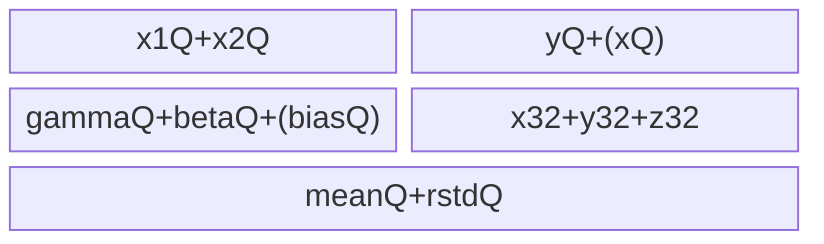
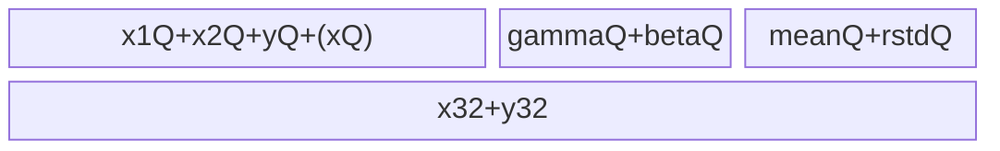
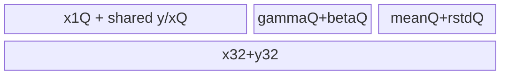
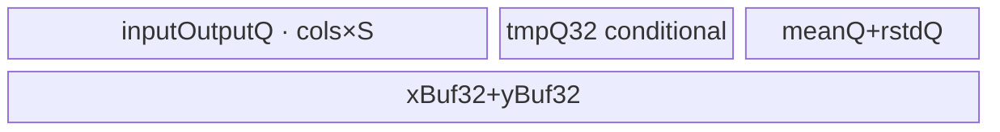
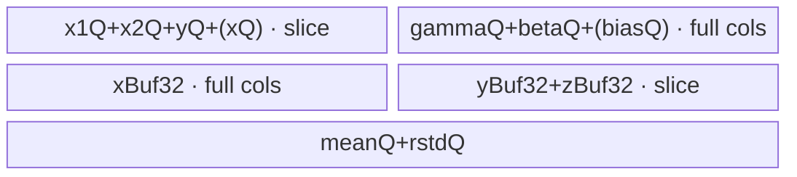
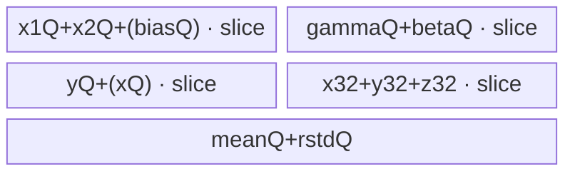

# AddLayerNorm A2/A3 ACLNN 算子知识

## 算子速览

| 项目 | 内容 |
|---|---|
| 实际入口 | 公开两段式 `aclnnAddLayerNormGetWorkspaceSize` / `aclnnAddLayerNorm`；固定仓未见更高版本入口 |
| 计算语义 | `x=x1+x2+biasOptional`，沿 `gamma` 对应尾部维归一化，输出 `y/mean/rstd`，属性开启时输出 `x` |
| 输入输出 | ND；A2/A3 支持 FP16/BF16/FP32 注册组合，`mean/rstd` 为 FP32；rank 1～8 且无零维 |
| 执行类型 | 单 Kernel `AIV_VECTOR`；所有 Host 可达 body 均由 `add_layer_norm.cpp` 启动，无 Cube/AIC/MIX_CV 节点 |
| Kernel 路线 | R-001 special-reduce；R-002 BetterUB；R-003 normal/big-N；R-004 single-row；R-005 single-row-ext；R-006 less-tensor；R-007 slice；R-008 slice-ext |
| 核心资源 | GM、UB、`TQue/TBuf`、Vector API、标量/Vector 硬事件；workspace 为系统保留，body 不消费 |
| 来源闭包 | `source_closed`：公开 ACLNN 文档 → OpDef → shape/Tiling/key/POD → router → 八个 Host 可达实现族及 helper → ascend910b binary config |
| 验证状态 | 已完成源码闭包检查；本次知识提取未执行编译、真机、数值或性能测试。 |

## 接口与语义

### 计算语义

设 `rows=prod(x1 的非归一化前缀维)`，`cols=prod(gamma shape)`。每行先以 FP32 计算 `x=x1+x2+bias`，其中 bias 可缺省、与 x 完全等形或仅覆盖 `cols`；再计算 `mean=sum(x)/cols`、`rstd=1/sqrt(sum((x-mean)^2)/cols+epsilon)`，最后 `y=(x-mean)*rstd*gamma+beta`。A2/A3 的不同 Route 只改变行/列切片、UB 物化与归约方式，不改变数学语义。

### 输入、输出与属性

| 参数 | shape/layout | dtype | 约束、默认值与语义 |
|---|---|---|---|
| `x1`, `x2` | 完全相同，ND，rank 1～8 | FP16/BF16/FP32 的注册组合 | 必选；所有维正；输入由 OpDef 自动连续化 |
| `gamma`, `beta` | 完全相同，等于 x1 尾部归一化维 | FP16/BF16/FP32 的注册组合 | 必选；`numel(gamma)=cols` |
| `biasOptional` | 缺省、与 x 等形，或与 gamma 等 numel | 对应注册组合 | Host 仅以 numel 区分 PRESENT/BROADCAST；接口文档要求相应 shape |
| `epsilon` | scalar | double API→float POD | 推荐/默认 `1e-5` |
| `additionalOutput` | scalar | bool | 控制 key 百位与 xOut 写回，默认 false |
| `yOut`, `xOut` | 与 x1 完全相同 | 与注册组合一致 | 输出不支持非连续；xOut 关闭时不写 |
| `meanOut`, `rstdOut` | rank 同 x1；前缀同 x1，归一化尾维为1 | FP32 | 每行一个统计值 |

### 入口与版本

固定 Commit 的公开文档只列出这一版两段式 API。第一段负责校验、workspace 与 executor，第二段在指定 stream 执行。自动生成 ACLNN inner bridge 未落在固定仓中，作为框架边界；算子自有的 OpDef、Tiling、POD、Kernel router/body 与 binary config 均可追溯。产品表明确 A2/A3 支持；OpDef 将 `ascend910b` 与 `ascend910_93` 注册到传统 `add_layer_norm`，不走 950 `add_layer_norm_apt`。

## Host/Launcher 执行流程

### 参数校验与前处理

`CheckInputShape4AddLayerNorm` 依次检查八个必需输入/输出 shape 指针、rank、x1/x2/y/x 等形、gamma/beta 等形、mean/rstd 等形、gamma 与 x1 尾维匹配、mean 前缀及尾部 1 的广播形状，并拒绝 x1/gamma/mean 的空维。OpDef 对输入声明 `AutoContiguous`。Tiling 读取平台 UB/AIV core 数、属性、三个关键 dtype；x1/x2 不同 dtype 时统一把计算 dtype 记为 FP32。

### 参数、Workspace 与生命周期

每个平台产生 `maxUbSize/maxCoreNum`；`numCore=ceil(rows/ceil(rows/maxCoreNum))`，普通核 `firstDimPerCore=ceil(rows/numCore)`，末核处理余行。算子逻辑 workspace 字段固定为 1，最终对 A2/A3 配置 `currentWorkspace[0]=1+16 MiB` 系统保留。Kernel 虽绑定 `workspace + workspaceSize`，全部可达 body 都不再读取该 GlobalTensor；不存在跨 Kernel 数据边。

### 启动图与失败传播

```text
aclnnAddLayerNormGetWorkspaceSize
  -> generated executor boundary
  -> TilingAddLayerNorm -> Tiling4AddLayerNorm -> AddLayerNormTilingImpl
aclnnAddLayerNorm(workspace, size, executor, stream)
  -> add_layer_norm<<<numCore,stream>>>(..., AddLayerNormTilingData)
     -> one of KernelAddLayerNorm / BetterUB / NormalSpecialReduce / SingleRowLessTensor
```

这是单节点 launch graph：调用者拥有输入输出和 workspace；Tiling 失败时不 launch；router 的 if/else 未命中已注册 key 时无 body 和输出。Kernel 内的 Queue/硬事件只约束同一 AIV core 的 UB/GM/标量阶段。

## Route 与参数设计

### 分核与资源计算

`numColAligned=(cols+31)/32*32`（注意这是元素数按 32 对齐的 Host 公式），Host 按优先级尝试资源模型。`rowPerTime` 最终不超过 `firstdimPerCore`；`colMoveCnt=ceil(cols/colPerTime)`，`colTail` 是最后一片有效元素数。key 编码为 `route十位 + additionalOutput?100:0 + bias尾数`，尾数 `0/1/2` 对应无 bias/逐元素/广播。所有 A2/A3 路线 buffer depth 为 1。

### Route 选择

| 顺序 | Route | Key/模板 | 精确选择条件与优先级 | 不适用去向 |
|---:|---|---|---|---|
| 1 | R-001 special-reduce | 70/72/80/82，加100 | 非 310P；无 bias 或广播 bias；全 FP16；`align(cols,blockElems)<=2040`；资源解得 `tmpRow>1` | R-002/R-003 |
| 2 | R-002 BetterUB | 62/162 | 广播 bias、全 FP16；普通 normal 只能装 `0<tmpRow<2`，专用布局 `tmpRowSpecial>2` | R-003 |
| 3 | R-003 normal/big-N | 0/1/2 或40/41/42，加100 | 普通完整列布局 `tmpRow>1`；`cols<500` 改 big-N；row 最多255 | R-004 |
| 4 | R-004 single-row | 20/21/22，加100 | 四个输出 Queue 版本的一行 footprint `<UB` | R-005 |
| 5 | R-005 single-row-ext | 30/31/32，加100 | 共享 x/y Queue 后一行 footprint `<UB` | R-006 |
| 6 | R-006 less-tensor | 190 或192 | 仅 additionalOutput=true；无 bias 全 FP32，或 x 为同类 B16、gamma/beta FP32、bias none/broadcast；专用 footprint 入 UB | R-007 |
| 7 | R-007 slice | 10/11/12，加100 | 全载 gamma/beta/x 的列片模型 `tmpCol>2048`，且向下 block 对齐发生调整 | R-008 |
| 8 | R-008 slice-ext | 50/51/52，加100 | 最终 fallback；gamma/beta/bias 也逐片，`colPerTime=floor((UB-const)/perCol)` 后 block 对齐 | 资源/参数非法则失败 |

```text
try special-reduce
else try BetterUB special condition / generic normal
else try single-row
else try single-row-ext
else try less-tensor special dtype+output condition
else try slice(full-load weights/x); if its guarded return does not fire
     use slice-ext
then add +100 when outputX, +1/+2 for elementwise/broadcast bias
```

### 模板/实现执行矩阵

| Route | key/selector | dtype/shape/platform 完整命中条件 | 执行拓扑与 Kernel 节点 | 实际模板/body | 内存与同步特征 | tail/fallback |
|---|---|---|---|---|---|---|
| R-001 | 70/72/80/82 ±100 | FP16、none/brc、短列、资源成立 | 单 AIV | `KernelAddLayerNormNormalSpecialReduce` | 拼接 x1/x2 Queue、FP32三 TBuf、短归约/转置辅助区 | 行尾；big-N 对 cols<500 |
| R-002 | 62/162 | FP16 broadcast、专用资源窗口 | 单 AIV | `KernelAddLayerNormBetterUB<half,...>` | 合并 x1x2 Queue；gamma/beta/bias TBuf 常驻 | 行尾 |
| R-003 | 0..2/40..42 ±100 | 完整列普通资源成立 | 单 AIV | `KernelAddLayerNorm` normal/big-N | x1/x2/y Queue；x/y/z FP32 TBuf；权重常驻 | 行尾，short reduce |
| R-004 | 20..22 ±100 | 普通一行入 UB | 单 AIV | generic single-row | x1/x2/y Queue + x/y FP32 TBuf | 每次一行 |
| R-005 | 30..32 ±100 | 共享 Queue 后入 UB | 单 AIV | generic single-row-ext | x1与y Queue承担阶段复用 | 每次一行 |
| R-006 | 190/192 | 特定 dtype、xOut 开启 | 单 AIV | `SingleRowLessTensor` | 单 inputOutput Queue + 两 FP32 TBuf | 一行；无更小 tensor fallback |
| R-007 | 10..12 ±100 | 大 cols 且可全载 weights/x | 单 AIV | generic slice | 三阶段：先统计并物化整行 x，再逐片 affine | `colTail` |
| R-008 | 50..52 ±100 | 最终 UB fallback | 单 AIV | generic slice-ext | 所有输入/权重逐片，两遍归约/仿射 | `colTail` |

### 隐藏性能 Guard

| Guard | Host/Tiling 条件 | Device/资源原因 | 影响 Route | 不满足时去向 | 源码符号 |
|---|---|---|---|---|---|
| special reduce stride | aligned cols <= `255*8` | FP32 Vector repeat stride 上限 | R-001 | 后续 Route | `AddLayerNormTilingImpl` |
| BetterUB 窗口 | normal `tmpRow` in (0,2)，special >2 | 通过合并 Queue 减少逐行 UB | R-002 | R-003/004 | 同上 |
| big-N row cap | cols<500 且 rows/time>255 | repeatTimes 最大255 | R-001/R-003 | 同 Route row=255 | Tiling4AddLayerNorm |
| block tail | colPerTime 向 `32/dtypeSize` 元素对齐 | GM/UB 搬运块约束 | R-007/008 | 调整 colPerTime | 同上 |
| less-tensor dtype | 精确的 FP32 或 B16+gammaFP32 条件且 outputX | 复用单 Queue、分两段载 gamma/beta | R-006 | slice | AddLayerNormTilingImpl |
| scalar/vector handoff | ReduceSum 后 S_V | 标量 mean/rstd 被 Vector 再使用 | 全部 | 无 fallback | 各 Compute |
| 输出 x | key 百位=1 | 编译期消除 x Queue/CopyOut | 所有 | xOut 不写 | router/body macros |

### POD/ABI

结构宏展开后的精确 offset/sizeof/alignof 在固定仓不可见；声明字段均写入后序列化。entry 将多数 `int64_t` 字段传给 `uint32_t` 形参，存在显式 ABI 位宽不同与隐式窄化边界。

| 结构 | 字段 | 类型/位宽 | ABI 布局 | 单位 | Host/launcher producer | Device consumer | 边界 |
|---|---|---|---|---|---|---|---|
| AddLayerNormTilingData | numCore | int64/64 | 宏 offset 不可见 | cores | 分核公式 | Init `uint32_t num_core_` | 窄化 |
| 同上 | numLastDim | int64/64 | 同上 | elements/row | prod gamma | 所有地址/归约 | 正值，窄化 |
| 同上 | numFirstDim | int64/64 | 同上 | rows | prod prefix | 记录/循环 | 正值，窄化 |
| 同上 | firstDimPerCore | int64/64 | 同上 | rows/core | ceil | 普通核 rowWork | 窄化 |
| 同上 | firstDimPerCoreTail | int64/64 | 同上 | rows/core | 余行 | 末核 rowWork | 窄化 |
| 同上 | firstDimPerTime | int64/64 | 同上 | rows/loop | UB 解式 | rowStep | 至少1，窄化 |
| 同上 | lastDimPerTime | int64/64 | 同上 | elements/slice | UB 解式 | slice copy/vector | block 对齐，窄化 |
| 同上 | eps | float/32 | 同上 | scalar | API double 转 float | sqrt 前加法 | 精度降为float |
| 同上 | aveFactor | float/32 | 同上 | reciprocal | `1.0/cols` | mean/var scaling | cols>0 |
| 同上 | colMoveCnt | int64/64 | 同上 | loops/row | ceil | slice loops | 窄化 |
| 同上 | colTail | int64/64 | 同上 | elements | 模余 | tail copy/mask | 整除时=colPerTime |
| 同上 | workspaceSize | int64/64 | 同上 | float elements（body仅绑定） | 固定1 | `workspace + workspace_size` | 未继续消费 |

### Route 源码闭包

| Route | Key/selector | Host/Tiling producer | POD/参数 | Kernel entry/router 节点 | Kernel body/直接依赖 | 构建接线 |
|---|---|---|---|---|---|---|
| R-001 | 70/72/80/82±100 | `AddLayerNormTilingImpl` special-reduce | common POD | `add_layer_norm.cpp` | NormalSpecialReduce + base | OpDef AICore + ascend910b JSON |
| R-002 | 62/162 | BetterUB condition | common POD | same | BetterUB + base | same |
| R-003～005/R-007～008 | generic key families | ordered selector | common POD | same | `KernelAddLayerNorm` + base | same |
| R-006 | 190/192 | less-tensor guards | common POD | same | SingleRowLessTensor + base | same |

## Kernel 实现

### 公共执行流程

entry 解析 POD 后以完整 if/else router 实例化唯一模板。所有模板按 core 分配连续行；普通核 GM base=`block_idx*firstDimPerCore*cols`，末核使用 tail 行数，mean/rstd base=`block_idx*firstDimPerCore`。`DataCopyEx/DataCopyPad` 处理 32-byte 尾块；B16/混合输入先 Cast 到 FP32，加法、两次 ReduceSum、中心化、方差、rstd 和 affine 都在 FP32 TBuf 完成，FP16 输出 `CAST_NONE`、BF16 输出 `CAST_RINT`。Queue 的 EnQue/DeQue/FreeTensor 和 `PipeBarrier<PIPE_V>` 约束生命周期；ReduceSum 的标量结果通过 S_V 事件交回 Vector 阶段。

### Route R-001：短列 special-reduce

#### 适用条件

##### 选择证据

| 层级 | 文件 | 符号 | 源码谓词/参数 | 结果/下一跳 |
|---|---|---|---|---|
| Tiling | `add_layer_norm_tiling.cpp` | `AddLayerNormTilingImpl` | A2/A3、FP16 all、bias none/brc、aligned cols<=2040、tmpRow>1 | type70；cols<500→80 |
| Router | `add_layer_norm.cpp` | 70/72/80/82 ±100 | key | `NormalSpecialReduce` |

#### Device 数据流

##### 函数级调用链

```text
NormalSpecialReduce::Init -> Process
 -> preload/cast gamma,beta,(broadcast bias)
 -> CopyIn or CopyInAndAddBroadCast -> optional CopyOutAdditionalOutput
 -> PrecisionCompute / PrecisionComputeBigN -> CopyOut(y,mean,rstd)
```

##### 源码等价伪码

```text
for row batch: concatenate x1,x2 in one Queue; fp32 x=x1+x2(+bias)
reduce mean/variance with special short-column helper; rstd; affine; write valid rows
```

#### 内存与数据搬运

##### 资源与搬运表

| 层级/缓冲区 | offset/地址公式 | extent/容量公式 | dtype/layout | producer | consumer | owner/lifetime | 对齐/复用 |
|---|---|---|---|---|---|---|---|
| x1x2Que | second input at `rowStep*colsAligned` | `2*rowStep*colsAligned*2` | FP16 | GM | add | per row batch | depth1 |
| x/z TBuf | 0 | each `rowStep*colsAligned*4` | FP32 | cast/add | reduce/affine | per batch | reuse |
| y reduce TBuf | 0 | `rowStep*64*4` or broadcast-rounded | FP32 | special reduce | scalar results | per batch | repeat workspace |
| gamma/beta | 0 | each `colsAligned*4` | FP32 | preload/cast | affine | Process | constant |
| transpose/or | 0 | big-N: two `16*16*8*2` +32 bytes | FP16/int16 | helper | short reduction | per batch | only key80/180 |

##### 分层内存布局


##### 字节账与复用顺序

```text
UB_total = x1x2Q+yQ+gammaBuf+betaBuf+(biasBuf)+x32+z32+yReduce+(bigN aux)+meanQ+rstdQ+256
UB_total <= maxUbSize by special-reduce tmpRow formula
workspace_total = 16 MiB + 1 byte-equivalent logical reserve; body consumption=0
```

| 复用子区 | 写入者 | 读取者/消费点 | 下一次覆盖 | 同步或释放依据 | 安全条件 |
|---|---|---|---|---|---|
| x1x2Que | DMA | cast/add | next batch | FreeTensor | add complete |
| FP32 calc | add/reduce | affine | next batch | PIPE_V barriers | y enqueued |

#### 同步、精度与尾块

##### 同步与数值边界表

| 阶段 | primitive/机制 | producer | consumer/等待点 | 保护对象 | 精度/尾块 |
|---|---|---|---|---|---|
| reduce scalar | S_V | Vector ReduceSum | scalar/next Vector | mean/var | FP32 |
| row tail | DataCopyEx + rowTail | Host row split | CopyOut | GM | only valid rows |
| output | Cast | FP32 affine | y Queue | dtype | FP16 CAST_NONE |

#### 关键实现

##### 符号证据表

| 阶段 | 文件 | 符号/模板实例 | 实现事实 |
|---|---|---|---|
| Host/Tiling producer | `op_host/add_layer_norm_tiling.cpp` | lines169-220 | special priority/resource |
| Kernel entry/router | `op_kernel/add_layer_norm.cpp` | keys70..182 | body map |
| Device body/helper | `op_kernel/add_layer_norm_normal_special_reduce.h` | `Process`, `PrecisionCompute*` | packed Queue and reduction |

### Route R-002：BetterUB 广播融合

#### 适用条件

##### 选择证据

| 层级 | 文件 | 符号 | 源码谓词/参数 | 结果/下一跳 |
|---|---|---|---|---|
| Tiling | tiling.cpp | `normalSpecialTiling` | broadcast FP16；normal只装1.x行；special>2行 | 62/162 |
| Router | kernel entry | 62/162 | exact key | BetterUB |

#### Device 数据流

##### 函数级调用链

```text
BetterUB::Process -> one-time gamma/beta/bias preload
 -> packed x1/x2 DMA -> CopyInAndAddBroadCast -> optional x copy
 -> precisionCompute -> CopyOut
```

##### 源码等价伪码

```text
pack x1 and x2 back-to-back; reuse two FP32 TBuf for add, reduce and affine; keep broadcast vectors resident
```

#### 内存与数据搬运

##### 资源与搬运表

| 层级/缓冲区 | offset/地址公式 | extent/容量公式 | dtype/layout | producer | consumer | owner/lifetime | 对齐/复用 |
|---|---|---|---|---|---|---|---|
| x1x2Que | 0 / elementCount | `2*rows*colsA*2` | FP16 | combined DMA | add | batch | one Queue replaces two |
| x/y FP32 TBuf | 0 | each `rows*colsA*4` | FP32 | add/reduce | affine | batch | alternating roles |
| weights+bias | 0 | gamma/beta each colsA*4; bias cols*2 | vector | once | all rows | Process | resident |

##### 分层内存布局


##### 字节账与复用顺序

```text
UB_total = packedQ+yQ+x32+y32+gamma32+beta32+bias16+meanQ+rstdQ
rows=floor((UB-fixed)/perRow), and Host requires rows>2
```

| 复用子区 | 写入者 | 读取者/消费点 | 下一次覆盖 | 同步或释放依据 | 安全条件 |
|---|---|---|---|---|---|
| packed Q | two DMA | broadcast add | next batch | FreeTensor | add materialized |

#### 同步、精度与尾块

##### 同步与数值边界表

| 阶段 | primitive/机制 | producer | consumer/等待点 | 保护对象 | 精度/尾块 |
|---|---|---|---|---|---|
| cast/add | PIPE_V | packed Q | reduce | FP32 TBuf | right pad zero |
| scalar | S_V | ReduceSum | Adds/Muls | mean/rstd | FP32 |

#### 关键实现

##### 符号证据表

| 阶段 | 文件 | 符号/模板实例 | 实现事实 |
|---|---|---|---|
| Host/Tiling producer | tiling.cpp | `normalSpecialTiling` | resource window |
| Kernel entry/router | add_layer_norm.cpp | 62/162 | BetterUB map |
| Device body/helper | special_kernel.h | `Process`, `precisionCompute` | Queue merge and resident weights |

### Route R-003：normal / normal-big-N

#### 适用条件

##### 选择证据

| 层级 | 文件 | 符号 | 源码谓词/参数 | 结果/下一跳 |
|---|---|---|---|---|
| Tiling | tiling.cpp | generic `tmpRow>1` | full column ordinary footprint | 0/1/2±100；cols<500→40/41/42 |
| Router | kernel entry | corresponding keys | exact key | generic normal |

#### Device 数据流

##### 函数级调用链

```text
ProcessNormal -> CopyInPhase0(weights/broadcast bias)
 -> per row batch CopyIn -> optional bias add -> optional x output
 -> precision_compute / precision_compute_big_n -> CopyOut
```

##### 源码等价伪码

```text
preload weights; for batch load x1/x2, cast/add(+bias), store x if enabled,
reduce mean and variance in fp32, normalize+affine, cast and output
```

#### 内存与数据搬运

##### 资源与搬运表

| 层级/缓冲区 | offset/地址公式 | extent/容量公式 | dtype/layout | producer | consumer | owner/lifetime | 对齐/复用 |
|---|---|---|---|---|---|---|---|
| x1/x2/y Q | batch | each `rows*colsA*S` | storage dtype | GM/VF | VF/GM | batch | depth1 |
| x Q | batch | same, only output enabled | storage | add | GM | batch | conditional allocation |
| gamma/beta/bias Q | 0 | each aligned cols | storage | preload | affine/add | Process | broadcast bias only |
| x/y/z TBuf | 0 | each `rows*colsA*4` | FP32 | pipeline | pipeline | batch | z keeps centered x |

##### 分层内存布局



##### 字节账与复用顺序

```text
UB_total = S*(3+outputX)*rows*colsA + weightS*2*colsA + broadcastBias
         + 4*3*rows*colsA + 4*2*rows + reduceScratch + 256
rowsPerTime=floor((UB-fixed)/perRow), capped by core rows and 255 for big-N
```

| 复用子区 | 写入者 | 读取者/消费点 | 下一次覆盖 | 同步或释放依据 | 安全条件 |
|---|---|---|---|---|---|
| zBuf | add/center | variance/affine | next batch | PIPE_V | y ready |

#### 同步、精度与尾块

##### 同步与数值边界表

| 阶段 | primitive/机制 | producer | consumer/等待点 | 保护对象 | 精度/尾块 |
|---|---|---|---|---|---|
| mean/var | ReduceSum + S_V | FP32 vector | scalar broadcast | stats | big-N short reduction avoids stride overflow |
| batch tail | rowTail | Host | CopyIn/Out | GM | last core and last batch |

#### 关键实现

##### 符号证据表

| 阶段 | 文件 | 符号/模板实例 | 实现事实 |
|---|---|---|---|
| Host/Tiling producer | tiling.cpp | tmpRow/cols<500 | normal selection |
| Kernel entry/router | add_layer_norm.cpp | 0..52 and +100 | generic mapping |
| Device body/helper | add_layer_norm_kernel.h | `ProcessNormal`, `precision_compute*` | body |

### Route R-004：single-row

#### 适用条件

##### 选择证据

| 层级 | 文件 | 符号 | 源码谓词/参数 | 结果/下一跳 |
|---|---|---|---|---|
| Tiling | tiling.cpp | `tmpUbSize<maxUbSize` first one-row check | full row with separate x Queue | keys20..22±100 |
| Router | kernel entry | corresponding key | exact | generic single row |

#### Device 数据流

##### 函数级调用链

```text
ProcessSingleRow -> CopyInPhase0 -> per row CopyInAddSingleRow
 -> precision_compute_single_row -> CopyOut
```

##### 源码等价伪码

```text
for each row: full-load x1/x2(+bias), fp32 add; optional x; reduce mean/var; affine; output
```

#### 内存与数据搬运

##### 资源与搬运表

| 层级/缓冲区 | offset/地址公式 | extent/容量公式 | dtype/layout | producer | consumer | owner/lifetime | 对齐/复用 |
|---|---|---|---|---|---|---|---|
| x1/x2/y Q | row*cols | each aligned cols*S | storage | GM/VF | VF/GM | row | separate |
| x Q | same | aligned cols*S | storage | add | GM | row | only outputX |
| x/y TBuf | 0 | each cols*4 | FP32 | add | reduce/affine | row | reuse |

##### 分层内存布局



##### 字节账与复用顺序

```text
UB_total = S*(3+outputX)*cols + weightS*2*cols + 4*2*cols + 8 + 256
```

| 复用子区 | 写入者 | 读取者/消费点 | 下一次覆盖 | 同步或释放依据 | 安全条件 |
|---|---|---|---|---|---|
| x/y TBuf | add/reduce | affine | next row | PIPE_V/S_V | copyout complete |

#### 同步、精度与尾块

##### 同步与数值边界表

| 阶段 | primitive/机制 | producer | consumer/等待点 | 保护对象 | 精度/尾块 |
|---|---|---|---|---|---|
| scalar | S_V | ReduceSum | Vector Muls | mean/rstd | FP32 |
| column tail | DataCopyEx | GM | Queue | padding | valid cols |

#### 关键实现

##### 符号证据表

| 阶段 | 文件 | 符号/模板实例 | 实现事实 |
|---|---|---|---|
| Host/Tiling producer | tiling.cpp | singleRowQue/Buf/Const | resource |
| Kernel entry/router | entry | 20 family | map |
| Device body/helper | kernel.h | `ProcessSingleRow` | one row |

### Route R-005：single-row-ext Queue 共享

#### 适用条件

##### 选择证据

| 层级 | 文件 | 符号 | 源码谓词/参数 | 结果/下一跳 |
|---|---|---|---|---|
| Tiling | tiling.cpp | first one-row fails，two-Queue footprint succeeds | share x/y path | 30 family |
| Router | entry | 30..32±100 | exact | generic ext |

#### Device 数据流

##### 函数级调用链

```text
ProcessSingleRow -> CopyInAddSingleRow(IS_SINGLE_ROW_EXT_CASE)
 -> x1_que/y_que staged reuse -> precision_compute_single_row -> CopyOut
```

##### 源码等价伪码

```text
load one input, consume/cast it, then reuse that Queue storage for later stage/output; no dedicated x2 Queue
```

#### 内存与数据搬运

##### 资源与搬运表

| 层级/缓冲区 | offset/地址公式 | extent/容量公式 | dtype/layout | producer | consumer | owner/lifetime | 对齐/复用 |
|---|---|---|---|---|---|---|---|
| x1 Queue | row | cols*S | storage | staged DMA | add | first half row | freed before reuse |
| y Queue | row | cols*S | storage | optional x / final y | GM | phased | x and y share physical Queue |
| FP32 TBuf | 0 | two*cols*4 | FP32 | add/reduce | affine | row | same as R-004 |

##### 分层内存布局



##### 字节账与复用顺序

```text
UB_total = S*2*cols + weightS*2*cols + 4*2*cols + 8 + 256
```

| 复用子区 | 写入者 | 读取者/消费点 | 下一次覆盖 | 同步或释放依据 | 安全条件 |
|---|---|---|---|---|---|
| shared Queue | input/x | add/GM | final y | DeQue/FreeTensor | preceding consumer done |

#### 同步、精度与尾块

##### 同步与数值边界表

| 阶段 | primitive/机制 | producer | consumer/等待点 | 保护对象 | 精度/尾块 |
|---|---|---|---|---|---|
| Queue alias | Queue lifecycle | staged input/x | y allocation | UB slot | one row only |

#### 关键实现

##### 符号证据表

| 阶段 | 文件 | 符号/模板实例 | 实现事实 |
|---|---|---|---|
| Host/Tiling producer | tiling.cpp | second one-row footprint | smaller UB |
| Kernel entry/router | entry | 30 family | map |
| Device body/helper | kernel.h | `CopyInAddSingleRow` | Queue sharing |

### Route R-006：single-row less-tensor

#### 适用条件

##### 选择证据

| 层级 | 文件 | 符号 | 源码谓词/参数 | 结果/下一跳 |
|---|---|---|---|---|
| Tiling | tiling.cpp | exact dtype/no-or-brc bias/outputX guards | dedicated footprint fits | 190/192 |
| Router | entry | 190/192 | exact | SingleRowLessTensor |

#### Device 数据流

##### 函数级调用链

```text
Process -> CopyInAdd -> CopyOutX -> CopyInGammaOneRow
 -> ComputeFirstPart(mean,rstd,normalized*gamma) -> CopyInBetaOneRow
 -> ComputeSecondPart -> CopyOut
```

##### 源码等价伪码

```text
reuse one inputOutput Queue: form x and write it before later phases;
load gamma, compute statistics and multiply; release/replace with beta; add beta and write y
```

#### 内存与数据搬运

##### 资源与搬运表

| 层级/缓冲区 | offset/地址公式 | extent/容量公式 | dtype/layout | producer | consumer | owner/lifetime | 对齐/复用 |
|---|---|---|---|---|---|---|---|
| inputOutputQue | row/weight 0 | aligned cols*S | phased dtype | x input/gamma/beta/y | next phase | row | aggressive reuse |
| tmpQueFp32 | 0 | cols*4 only B16+gammaFP32 | FP32 | gamma/beta DMA | affine | phase | conditional |
| x/y TBuf | 0 | each cols*4 | FP32 | add | stats/affine | row | reused |

##### 分层内存布局



##### 字节账与复用顺序

```text
UB_total = aligned(cols*S) + [aligned(cols*4)]conditional + 2*aligned(cols*4) + meanQ+rstdQ + 256
```

| 复用子区 | 写入者 | 读取者/消费点 | 下一次覆盖 | 同步或释放依据 | 安全条件 |
|---|---|---|---|---|---|
| inputOutputQ | x input | add | gamma then beta then y | Queue FreeTensor + MTE2/V events | xOut DMA completes before reuse |

#### 同步、精度与尾块

##### 同步与数值边界表

| 阶段 | primitive/机制 | producer | consumer/等待点 | 保护对象 | 精度/尾块 |
|---|---|---|---|---|---|
| xOut→reuse | MTE3_V | CopyOutX | compute overwrite | shared storage | full valid row |
| weight stage | MTE2_V/V_MTE2 | gamma/beta DMA | affine/free | Queue | B16 cast to FP32 |
| scalar | S_V | ReduceSum | Vector | stats | FP32 |

#### 关键实现

##### 符号证据表

| 阶段 | 文件 | 符号/模板实例 | 实现事实 |
|---|---|---|---|
| Host/Tiling producer | tiling.cpp | lessTensor guards | exact route |
| Kernel entry/router | entry | 190/192 | template |
| Device body/helper | single_row_less_tensor.h | `Process`, `ComputeFirstPart/SecondPart` | staged reuse |

### Route R-007：slice（权重与 x 全载）

#### 适用条件

##### 选择证据

| 层级 | 文件 | 符号 | 源码谓词/参数 | 结果/下一跳 |
|---|---|---|---|---|
| Tiling | tiling.cpp | `tmpCol>2048` and alignment adjustment branch | full gamma/beta/x fit | 10 family |
| Router | entry | 10..12±100 | exact | generic slice |

#### Device 数据流

##### 函数级调用链

```text
ProcessSlice -> CopyInSlicePhase0(full gamma/beta/broadcast bias)
 -> pass1 slices CopyInSlicePhase1, form/store full-row xBuf, partial mean
 -> variance over full xBuf -> pass2 slices affine -> CopyOutSlicePhase1/2
```

##### 源码等价伪码

```text
for row: for slices form fp32 x and accumulate mean; center full x; accumulate var;
for slices apply rstd,gamma,beta and output; optional x written from phase1
```

#### 内存与数据搬运

##### 资源与搬运表

| 层级/缓冲区 | offset/地址公式 | extent/容量公式 | dtype/layout | producer | consumer | owner/lifetime | 对齐/复用 |
|---|---|---|---|---|---|---|---|
| gamma/beta/bias Q | 0 | full cols | storage | phase0 DMA | all slices | Process | resident |
| xBuf | colOffset | full `cols*4` | FP32 | phase1 add | mean/var/phase2 | row | whole row materialized |
| slice x1/x2/y Q | colOffset | slice*S | storage | GM/VF | VF/GM | slice | depth1 |
| y/z TBuf | 0 | slice*4 | FP32 | partial/vector | reduce/affine | slice | reused |

##### 分层内存布局



##### 字节账与复用顺序

```text
UB_total = slice*(S*(3+outputX)+8) + fullCols*(2*weightS+biasS+4) + stats + 256
```

| 复用子区 | 写入者 | 读取者/消费点 | 下一次覆盖 | 同步或释放依据 | 安全条件 |
|---|---|---|---|---|---|
| xBuf full row | phase1 slices | variance/phase2 | next row | phase2 complete | no early overwrite |
| slice temps | current slice | partial/affine | next slice | PIPE_V/Queue | current output enqueued |

#### 同步、精度与尾块

##### 同步与数值边界表

| 阶段 | primitive/机制 | producer | consumer/等待点 | 保护对象 | 精度/尾块 |
|---|---|---|---|---|---|
| phase transition | PIPE_V/S_V | partial mean/var | center/affine | full x/stat | final slice uses colTail |
| output | Queue | affine | GM | y slice | only process_count |

#### 关键实现

##### 符号证据表

| 阶段 | 文件 | 符号/模板实例 | 实现事实 |
|---|---|---|---|
| Host/Tiling producer | tiling.cpp | slice resource formula | colPerTime |
| Kernel entry/router | entry | 10 family | generic |
| Device body/helper | kernel.h | `ProcessSlice`, phase helpers | three-phase network |

### Route R-008：slice-ext（全部逐片）

#### 适用条件

##### 选择证据

| 层级 | 文件 | 符号 | 源码谓词/参数 | 结果/下一跳 |
|---|---|---|---|---|
| Tiling | tiling.cpp | final per-column UB formula | previous routes not returned | 50 family |
| Router | entry | 50..52±100 | exact | generic slice-ext |

#### Device 数据流

##### 函数级调用链

```text
ProcessSliceExt -> pass1 per slice CopyIn x1/x2/(bias), accumulate mean/var
 -> pass2 per slice CopyIn gamma/beta and inputs or retained x part -> affine
 -> CopyOut slice + statistics
```

##### 源码等价伪码

```text
for row: scan all column slices to form fp32 statistics; finalize scalar mean/rstd;
scan slices with matching gamma/beta/bias offsets, normalize and output; mask colTail
```

#### 内存与数据搬运

##### 资源与搬运表

| 层级/缓冲区 | offset/地址公式 | extent/容量公式 | dtype/layout | producer | consumer | owner/lifetime | 对齐/复用 |
|---|---|---|---|---|---|---|---|
| all input/weight Q | slice offset | each slice*S | storage | GM each slice | add/affine | slice | no full vectors resident |
| x/y/z TBuf | 0 | each slice*4 | FP32 | add/reduce | affine | slice | reuse between passes |
| stats Q | row | one FP32 each | FP32 | finalized reduction | GM/affine | row | scalar |

##### 分层内存布局



##### 字节账与复用顺序

```text
UB_total = slice*(S*(3+outputX+biasNum)+2*weightS+12) + 8 + 256
colPerTime=floor((UB-constant)/perColumn), then block-aligned
```

| 复用子区 | 写入者 | 读取者/消费点 | 下一次覆盖 | 同步或释放依据 | 安全条件 |
|---|---|---|---|---|---|
| slice TBuf | pass1 add/reduce | partial stats | next slice/pass2 | PIPE_V | partial consumed |
| Queue slots | DMA | VF | next slice | FreeTensor | consumer done |

#### 同步、精度与尾块

##### 同步与数值边界表

| 阶段 | primitive/机制 | producer | consumer/等待点 | 保护对象 | 精度/尾块 |
|---|---|---|---|---|---|
| partial reduction | PIPE_V/S_V | slice VF | scalar accumulator | mean/var | FP32 across slices |
| tail | process_count=colTail | Host POD | DMA/VF | final slice | padded lanes excluded |

#### 关键实现

##### 符号证据表

| 阶段 | 文件 | 符号/模板实例 | 实现事实 |
|---|---|---|---|
| Host/Tiling producer | tiling.cpp | final SLICE_EXT formula | fallback width |
| Kernel entry/router | entry | 50 family | generic |
| Device body/helper | kernel.h | `ProcessSliceExt`, slice helpers | all inputs sliced |

## 算子特定优化

### Trick T-001：按优先级求解 UB，专门用 BetterUB 把 1.x 行提升为多行批

#### 触发与源码依据

- 适用 Route：R-002
- 触发条件：FP16 broadcast bias，普通 normal `tmpRow` 在 `(0,2)`，合并布局 `tmpRowSpecial>2`。
- Golden 来源：[`add_layer_norm_tiling.cpp:232-249`](../../../../../../../cann-ops-raw/ascendc/ops-nn/955f8b33985b6d72989ebff341bb9c2c564a51bc/norm/add_layer_norm/op_host/add_layer_norm_tiling.cpp#L232-L249)

**官方源码（固定 Commit 连续逐字摘录）**：

```cpp
bool isSpecialTiling = (!is310P) && (isBroadcastBias) && isAllInputFP16;
...
bool normalSpecialTiling = isSpecialTiling && tmpRow < 2.0 && tmpRow > 0.0 && tmpRowSpecial > 2.0;
if (normalSpecialTiling) {
    rowPerTime = floor(tmpRowSpecial);
    colPerTime = numCol;
    return TILING_TYPE::NORMAL_SPECIAL;
}
```

#### 机制与设计原因

BetterUB 把 x1/x2 合并进一个 Queue，gamma/beta 用 FP32 TBuf、broadcast bias 常驻，从普通模型只能处理 1.x 行的 UB 中腾出空间，使每次至少处理两行以上。源码可证明减少 Queue 分配与重复广播搬运；未宣称实测收益。

#### 迁移边界

- 适用：FP16、按归一化轴广播 bias、完整列可载入但普通多行布局不足。
- 前提：A2/A3 且三段资源不等式同时成立。
- 失效：不满足时按 selector 继续 generic normal/single-row。
- 未验证：本次知识提取未执行编译、真机、数值或性能测试。

#### 错误做法

只按普通 normal 的 `tmpRow` 判定会丢失 BetterUB 可达路线；固定仓未提供独立性能反例。

### Trick T-002：less-tensor 把同一 Queue 分阶段用于输入、gamma、beta 与输出

#### 触发与源码依据

- 适用 Route：R-006
- 触发条件：`additionalOutput=true` 且命中专用 dtype/bias guard，一行专用 footprint 入 UB。
- Golden 来源：[`add_layer_norm_single_row_less_tensor.h:149-164`](../../../../../../../cann-ops-raw/ascendc/ops-nn/955f8b33985b6d72989ebff341bb9c2c564a51bc/norm/add_layer_norm/op_kernel/add_layer_norm_single_row_less_tensor.h#L149-L164)

**官方源码（固定 Commit 连续逐字摘录）**：

```cpp
for (int32_t rowIdx = 0; rowIdx < rowMoveCnt; ++rowIdx) {
    uint64_t gmOffset = static_cast<uint64_t>(rowIdx) * rowStep * numLastDim;
    CopyInAdd(gmOffset, numLastDim);
    if constexpr (IS_ADDITIONAL_OUTPUT_ENABLE) {
        CopyOutX(gmOffset, numLastDim);
    }
    CopyInGammaOneRow();
    ComputeFirstPart();
    CopyInBetaOneRow();
    ComputeSecondPart();
    CopyOut(rowIdx, 1);
}
```

#### 机制与设计原因

先形成并写出 x，再依靠事件确认 DMA 完成，释放单一 `inputOutputQue`，后续依次承载 gamma、beta 与最终 y；只保留两个 FP32 TBuf。该生命周期把更大 cols 的一行路线留在整行实现，避免立即转逐列 slice。

#### 迁移边界

- 适用：有 xOut 且 dtype 组合与 Route guard 完全一致。
- 前提：必须保留 MTE2_V、MTE3_V、V_MTE2 与 Queue free 顺序。
- 失效：无 additional output 或其它 bias/dtype 组合转 slice。
- 未验证：本次知识提取未执行编译、真机、数值或性能测试。

#### 错误做法

在 xOut DMA 未完成前复用 Queue 会覆盖发送中的数据；源码用 `MTE3_V` 明确保护。

## 模板与实现对比

| 对比维度 | R-001/002 特化 | R-003/004/005 普通整列 | R-006 less | R-007/008 slice | 设计选择依据 |
|---|---|---|---|---|---|
| 命中条件/优先级 | FP16 短列/广播资源窗 | full row 从多行降到共享单行 | 特定 dtype+xOut | 最终大列 | Host 顺序不可交换 |
| 模板与 dtype | 固定 half | generic dtype | generic但受 guard | generic | binary config |
| 循环与分核 | core→row batch | core→row batch/row | core→row | core→row→col slices | UB 可容纳域 |
| Queue/TBuf | packed/专用 reduce | 3→2 Queue、2/3 TBuf | 单共享 Q、2 TBuf | full-x 或全 slice | 资源递减 |
| 内存总占用与复用 | 权重常驻 | normal 常驻；single row | 最强阶段复用 | R-007 full x；R-008 无 full vector | selector 公式 |
| 搬运/Vector API | 特殊 short reduce | ReduceSumFP32/Short | 分阶段 DMA+event | 两遍扫描 | cols 与资源 |
| 同步、精度与 tail | S_V/PIPE_V，行尾 | 同上 | 加 MTE events | 加列尾 `colTail` | 生命周期 |
| fallback/失败边界 | 后续普通 | less/slice | slice | ext 最终 | 无 unknown-key fallback |

## 平台差异

| 项目 | A2 | A3 | 950 |
|---|---|---|---|
| 支持状态 | 公开支持 | 公开支持 | 公开支持，见 `_950` 卡 |
| Host/Launcher | `Tiling4AddLayerNorm` | 与 A2 共用固定仓实现 | RegBase Tiling |
| Kernel/资源 | 传统 Vector 模板与 key0～192 | 同 A2 | apt key8000/8100、RegTensor VF |

## 限制与失败边界

- x1/gamma rank 必须在1～8；空维不支持。公开 API 参数表中的“支持空Tensor”与 Tiling 明确拒绝零维存在文字冲突，正式行为以固定源码 Tiling 的失败终点记录为“不支持零维 launch”。
- bias 的实际 Tiling 分类以 numel 为准，但公开接口 shape 仍要求与 x 或 gamma 对应；不得推广到任意同 numel reshape。
- POD 的多数 64-bit shape/切片字段在 entry 被传给 `uint32_t` 参数；固定源码未提供超 32-bit 保护，不得假设超大 shape 安全。
- R-007 的 `SLICE` 返回位于“colPerTime 需要向下对齐”的分支内；已对齐时继续进入 R-008，这一优先级必须按源码保留。
- `additionalOutput=false` 时 xOut 不写；workspace 只保留/绑定但不参与算子数据流。
- 固定仓未包含 ACLNN 自动生成 bridge/executor 与 AscendC primitive 内部；作为框架边界。本次未编译、未上板、未做数值或性能验证。

## 源码索引

### 链路索引

| 链路阶段 | 文件 | 关键符号 | 支撑内容 |
|---|---|---|---|
| 入口声明/约束 | `norm/add_layer_norm/docs/aclnnAddLayerNorm.md` | API 原型/产品表 | 公开性、接口、平台 |
| 入口实现 | `norm/add_layer_norm/op_host/add_layer_norm_def.cpp` | `ops::AddLayerNorm` | dtype、AutoContiguous、A2/A3 注册 |
| Host/Tiling/Launcher | `norm/add_layer_norm/op_host/add_layer_norm_tiling.cpp` | `Tiling4AddLayerNorm`, `AddLayerNormTilingImpl` | 校验、资源、key、workspace |
| POD | `norm/add_layer_norm/op_host/add_layer_norm_tiling.h` | `AddLayerNormTilingData` | 字段 ABI |
| Kernel entry/body | `norm/add_layer_norm/op_kernel/add_layer_norm.cpp` | `add_layer_norm` | 完整 router |
| Kernel entry/body | `norm/add_layer_norm/op_kernel/add_layer_norm_kernel.h` | `KernelAddLayerNorm` | normal/single/slice |
| Kernel entry/body | `norm/add_layer_norm/op_kernel/add_layer_norm_special_kernel.h` | `KernelAddLayerNormBetterUB` | BetterUB |
| Kernel entry/body | `norm/add_layer_norm/op_kernel/add_layer_norm_normal_special_reduce.h` | special reduce class | 短列路线 |
| Kernel entry/body | `norm/add_layer_norm/op_kernel/add_layer_norm_single_row_less_tensor.h` | less tensor class | 阶段复用 |
| Kernel entry/body | `norm/add_layer_norm/op_kernel/add_layer_norm_base.h` | `DataCopyEx`, reduce helpers | 直接公共依赖 |
| 构建接线 | `norm/add_layer_norm/op_host/config/ascend910b/add_layer_norm_binary.json` | AddLayerNorm op_list | A2/A3 dtype binary 实例 |

### 实现复用检查

| 检查项 | 可复用事实 | 不得改变的约束 | 源码符号 |
|---|---|---|---|
| ABI/POD | 单 common POD 驱动全部传统 key | int64→uint32 窄化、字段顺序/单位 | TilingData + INIT macro |
| 调用顺序 | 单 Kernel；selector 与 router 同 key | Host 优先级和 key 百/十/个位编码 | `AddLayerNormTilingImpl`, entry |
| workspace/内存 | body 不消费 workspace；UB 模板各异 | Queue depth=1、条件分配、full/slice 边界 | InitBuffer calls |
| 同步 | Queue、PIPE_V、S_V，less 另有 MTE events | 共享 Queue 前必须等待/释放 | each Process/Compute |
| 精度与尾块 | FP32 计算；FP16/BF16 不同 round；row/col tail | padding lane 不进 ReduceSum | compute helpers |
| 失败边界 | shape/dtype/资源/key 均有终点 | unknown key 不得假设 fallback | Host checks/router |