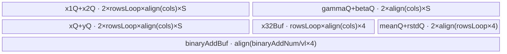
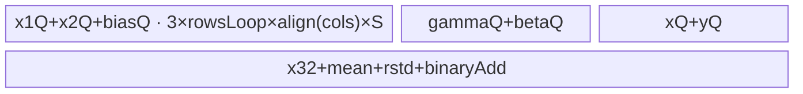
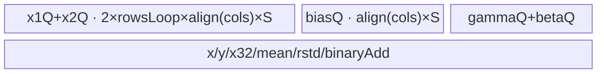
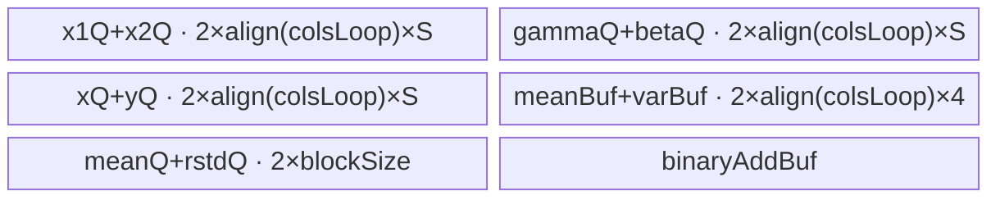
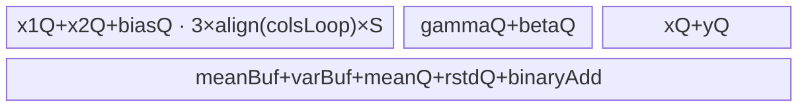
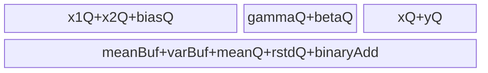

# AddLayerNorm 950 ACLNN 算子知识

## 算子速览

| 项目 | 内容 |
|---|---|
| 实际入口 | 公开两段式 `aclnnAddLayerNormGetWorkspaceSize` / `aclnnAddLayerNorm`，固定仓未出现更高版本号入口 |
| 计算语义 | `x=x1+x2+biasOptional`；在 `gamma` 对应的尾部归一化域上计算 `mean`、`rstd=1/sqrt(var+epsilon)`；`y=(x-mean)*rstd*gamma+beta` |
| 输入输出 | ND；`x1/x2/gamma/beta/bias/y/x` 支持 FP16、BF16、FP32 的公开组合，`mean/rstd` 固定 FP32；rank 不大于 8，所有维必须为正 |
| 执行类型 | 单 Kernel、`AIV_VECTOR`；entry 显式 `KERNEL_TYPE_AIV_ONLY`，无 Cube/AIC/MIX_CV 可达节点 |
| Kernel 路线 | R-001～R-003：full-load × 三种 bias；R-004～R-006：Welford 分列 × 三种 bias |
| 核心资源 | GM、AIV UB、`TQue/TBuf/RegTensor`；workspace 固定 16 MiB 但 Kernel 未消费 |
| 来源闭包 | `source_closed`：公开 ACLNN 文档 → OpDef/平台注册 → RegBase Tiling/POD → `add_layer_norm_apt` router → full-load/Welford body 与 common helper → ascend950 binary config |
| 验证状态 | 已完成源码闭包检查；本次知识提取未执行编译、真机、数值或性能测试。 |

## 接口与语义

### 计算语义

将 `x1` 的 shape 写为前缀行域 `A` 与尾部归一化域 `R`：`rows=prod(A)`，`cols=prod(R)=numel(gamma)`。每行先计算 `x_i=x1_i+x2_i+(bias_i 或 bias_R)`；无 bias 时第三项为零。随后计算 `mean=sum(x_i)/cols`、`var=sum((x_i-mean)^2)/cols`、`rstd=1/sqrt(var+epsilon)`，最后逐元素输出 `y_i=(x_i-mean)*rstd*gamma_i+beta_i`。`additionalOutput=true` 时才把中间和写到 `xOut`；Kernel 仍接收 `xOut` 地址。

### 输入、输出与属性

| 参数 | shape/layout | dtype | 约束、默认值与语义 |
|---|---|---|---|
| `x1`, `x2` | 完全同 shape，ND，scalar 在 Host 内按 `{1}` 处理 | FP16/BF16/FP32 的注册组合 | 必选；维数不大于 8、各维正；定义行域与归一化域 |
| `gamma`, `beta` | 完全同 shape，等于 `x1` 尾部若干维 | FP16/BF16/FP32 的注册组合 | 必选；决定 `cols` |
| `biasOptional` | 缺省，或 numel 等于 `rows*cols`，或 numel 等于 `cols` | 与 binary config/Host 白名单组合一致 | 分别映射 `BIAS_NONE/ELEWISE/BRC`；其它大小失败 |
| `epsilon` | scalar 属性 | Host 读为 float | 缺省 `1e-5`；用于方差开方前稳定项 |
| `additionalOutput` | scalar 属性 | bool | 缺省 `false`；控制 `xOut` 的 GM 写回 |
| `yOut`, `xOut` | 与 `x1` 完全同 shape，ND | `x1==x2` 时同输入；混合输入时 FP32 | `xOut` 仅在属性开启时有效写回 |
| `meanOut`, `rstdOut` | rank 与 `x1` 相同；前缀维同 `x1`，归一化尾维全为 1 | FP32 | 每行各一个有效值 |

### 入口与版本

公开文档给出唯一两段式接口，第一段校验并生成 workspace 与 executor，第二段接收 workspace、executor 和 stream 启动。固定仓不包含自动生成的 ACLNN inner bridge 实体；该生成层按框架边界处理，算子自有的 OpDef、Tiling、POD、router、body 和构建配置均已闭合。README 与 ACLNN 产品表明确支持 Ascend 950PR/950DT，`AddLayerNorm` 的 `config_950` 通过 `ExtendCfgInfo("opFile.value", "add_layer_norm_apt")` 接到 950 Kernel，ascend950 binary config 列出实际 dtype 组合。

## Host/Launcher 执行流程

### 参数校验与前处理

公开第一段接口接收非连续输入；OpDef 对五个输入声明 `AutoContiguous()`，输出不支持非连续。`GetShapeAttrsInfo` 依次读取属性、校验 x1/x2、gamma/beta、可选 bias、四个输出的 shape 与 dtype。所有 shape 先经 `EnsureNotScalar` 把 scalar 视为 `{1}`；任何非正维、rank>8、尾部归一化维不匹配、mean/rstd 广播形状不符、dtype tuple 不在九种白名单中均返回 `GRAPH_FAILED`。

### 参数、Workspace 与生命周期

`TilingPrepare4AddLayerNorm` 从平台生产 `aivCoreNum/ubSize/blockSize/vecRegSize/sysWorkspaceSize`；950 由 `TilingAddLayerNorm` 选择 `AddLayerNormRegbaseTiling`。`GetWorkspaceSize` 固定设置 16 MiB，`PostTiling` 写入 workspace 大小、`blockDim=usedCoreNum` 和 POD。`add_layer_norm_apt` 的形参保留 workspace，但 full-load/Welford body 的 `Init` 不接收 workspace，因此这 16 MiB 是框架/系统保留区，不存在算子 Kernel 间切片或 Device producer/consumer。

### 启动图与失败传播

```text
aclnnAddLayerNormGetWorkspaceSize
  -> 框架生成的 AddLayerNorm executor（固定仓不可见）
  -> TilingAddLayerNorm -> AddLayerNormRegbaseTiling::DoTiling
aclnnAddLayerNorm(workspace, workspaceSize, executor, stream)
  -> 单节点 add_layer_norm<<<usedCoreNum, stream>>>(x1,x2,gamma,beta,bias,y,mean,rstd,x,workspace,POD)
     -> key 8000/8001/8002: RegbaseFullLoad::Init/Process
     -> key 8100/8101/8102: RegbaseWelford::Init/Process
```

单节点无跨 Kernel 边。输入/输出由调用者拥有，executor 与 workspace 从第一段延续到第二段；同一 stream 上的 Kernel 完成后输出可见。Tiling 任一校验失败则不形成 launch；entry 未命中六个 key 时不实例化 body、无输出写回。

## Route 与参数设计

### 分核与资源计算

`rows*cols<=1024` 时只用 1 核；小于 `1024*aivCoreNum` 时逐步增大 `rowsPerCore` 直到每核不少于 1024 元素，再处理余行尾核；更大规模使用 `min(rows,aivCoreNum)` 核，前 `tailCoreStartIndex=rows-rowsPerTailCore*usedCoreNum` 个核处理 `rowsPerCore=ceil(rows/usedCoreNum)` 行，其余核少一行。Host 先按真实 dtype 计算并按 `blockSize` 对齐每个 UB 区；混合 dtype 采用 `2*blockSize` 对齐。若一行完整输入、输出、FP32 中间量、mean/rstd 与二分累加区可放入 UB，则 `colsPerLoop=cols`、`rowsPerLoop` 尽量取多行；否则 `rowsPerLoop=1` 并解出对齐后的 `colsPerLoop`，使用 Welford 分列。

### Route 选择

| 顺序 | Route | Key/模板 | 精确选择条件与优先级 | 不适用去向 |
|---:|---|---|---|---|
| 1 | R-001 full-load/no-bias | 8000 | 完整一行资源式 `<=ubSize` 且 bias 缺省 | 资源不足到 R-004 |
| 2 | R-002 full-load/elewise | 8001 | 同上且 bias numel=`rows*cols` | 资源不足到 R-005 |
| 3 | R-003 full-load/broadcast | 8002 | 同上且 bias numel=`cols` | 资源不足到 R-006 |
| 4 | R-004 Welford/no-bias | 8100 | full-load 资源式失败且 bias 缺省 | Tiling 公式失败则 `GRAPH_FAILED` |
| 5 | R-005 Welford/elewise | 8101 | full-load 资源式失败且 bias numel=`rows*cols` | 同上 |
| 6 | R-006 Welford/broadcast | 8102 | full-load 资源式失败且 bias numel=`cols` | 同上 |

```text
bias absent / numel==rows*cols / numel==cols -> suffix 0 / 1 / 2
if UB >= one-row full-load footprint:
    key = 8000 + suffix
else:
    colsPerLoop = aligned solution of remaining UB; rowsPerLoop=1
    key = 8100 + suffix
```

### 模板/实现执行矩阵

| Route | key/selector | dtype/shape/platform 完整命中条件 | 执行拓扑与 Kernel 节点 | 实际模板/body | 内存与同步特征 | tail/fallback |
|---|---|---|---|---|---|---|
| R-001 | 8000 | 950、合法 tuple、无 bias、full-load 可容纳 | 单 AIV | `RegbaseFullLoad<...,8000>` | gamma/beta 常驻；多行整载；Queue 同步 | 行尾由 `rowsTail` |
| R-002 | 8001 | 同上，逐元素 bias | 单 AIV | `RegbaseFullLoad<...,8001>` | 每行 bias 与 x1/x2 一起搬入 | 同上 |
| R-003 | 8002 | 同上，广播 bias | 单 AIV | `RegbaseFullLoad<...,8002>` | bias 仅搬一次并跨行复用 | 同上 |
| R-004 | 8100 | 950、无 bias、full-load 不可容纳 | 单 AIV | `RegbaseWelford<...,8100>` | 每行两遍分列；mean/var TBuf；V_S event | 最后一列用 `colsTail` 非对齐 finalize |
| R-005 | 8101 | 同上，逐元素 bias | 单 AIV | `RegbaseWelford<...,8101>` | 两遍均随列搬 bias | 同上 |
| R-006 | 8102 | 同上，广播 bias | 单 AIV | `RegbaseWelford<...,8102>` | bias offset 按列，行间复用 | 同上 |

### 隐藏性能 Guard

| Guard | Host/Tiling 条件 | Device/资源原因 | 影响 Route | 不满足时去向 | 源码符号 |
|---|---|---|---|---|---|
| 最小核粒度 | `rows*cols` 与 1024 比较 | 避免把极小行域切得过碎 | 全部 | 改变 usedCore/尾核 | `CalcUsedCoreNum` |
| 混合 dtype 对齐 | `isMix_` 时按 `2*blockSize` | 不同输入元素宽度共享以 half/float 兼容的 UB stride | 全部 mix tuple | 同 Route 的 mix specialization | `GetSizeOfBlockAlign` |
| full-load 上界 | 输入+输出+x32+mean+rstd+binaryAdd+256 <= UB | 一次装下完整归一化行 | R-001～003 | R-004～006 |
| 分列对齐 | `colsPerLoop` 先按 block，再按 `blockSize/2` 对齐 | DataCopyPad 与 VF 尾处理要求 | R-004～006 | 无更小 fallback；计算失败 |
| 快速归约 | full-load 且 `colsPerLoop<=vlFp32` | 单向量寄存器 ReduceSum 足够 | R-001～003 | `VFCalcMeanVar` 二分累加 |
| 空核保护 | `GetBlockIdx()>=usedCoreNum` | 防止超配 block 访问 GM | 全部 | 立即返回 | 两类 `Init/Process` |

### POD/ABI

`BEGIN_TILING_DATA_DEF` 展开后的精确 `sizeof/alignof/offsetof` 不在固定仓可见；下表保留声明顺序与类型，Host producer 与 Device consumer 完全同结构 `AddLayerNormRegbaseTilingData`。

| 结构 | 字段 | 类型/位宽 | ABI 布局 | 单位 | Host/launcher producer | Device consumer | 边界 |
|---|---|---|---|---|---|---|---|
| AddLayerNormRegbaseTilingData | blockSize | int64/64 | 宏展开 offset 不可见 | bytes | 平台 UB block size | 两类 `Init` 对齐 | 必须>0 |
| 同上 | usedCoreNum | int64/64 | 同上 | cores | `CalcUsedCoreNum` | entry body 空核保护 | 1..AIV core count |
| 同上 | vlFp32 | int64/64 | 同上 | FP32 lanes | `vecRegSize/4` | VF loop/mask | 必须>0 |
| 同上 | tailCoreStartIndex | int64/64 | 同上 | core index | 分核公式 | core GM offset | 分隔两种行数 |
| 同上 | rowsPerCore | int64/64 | 同上 | rows/core | 分核公式 | 非尾核循环 | 正值 |
| 同上 | rowsPerTailCore | int64/64 | 同上 | rows/core | 分核公式 | 尾核循环 | 无尾核时可为0且不读 |
| 同上 | rowsPerLoop | int64/64 | 同上 | rows/UB loop | full-load 解式或1 | full-load 行循环 | Welford 固定1 |
| 同上 | cols | int64/64 | 同上 | elements/row | `prod(gamma shape)` | Welford 总列数 | 正值 |
| 同上 | colsPerLoop | int64/64 | 同上 | elements/column loop | full-load=`cols`；否则 UB 解式 | Copy/Vector loop | block 对齐 |
| 同上 | colsLoopCount | int64/64 | 同上 | loops/row | ceil(cols/colsPerLoop) | Welford 两遍循环 | full-load 为1 |
| 同上 | colsTail | int64/64 | 同上 | elements | 模余，整除时等于 colsPerLoop | Welford tail mask | 正值 |
| 同上 | binaryAddNum | int64/64 | 同上 | FP32 elements | 小于 cols/colsPerLoop 的最大 2 次幂骨架 | 二分归约 helper | 至少 vlFp32 |
| 同上 | binaryAddK | int64/64 | 同上 | fold stages | Host while 推导 | `DichotomyAdd` | 可为0 |
| 同上 | binaryAddLastNum | int64/64 | 同上 | valid lanes | Host 推导 | 最后 ReduceSum mask | 1..vlFp32 |
| 同上 | eps | float/32 | 同上 | scalar | 属性或1e-5 | rstd Newton-Raphson | 未额外限制范围 |
| 同上 | outputX | int64/64 | 同上 | bool-as-int | additionalOutput | `if (tiling_->outputX)` | 0/1 |

### Route 源码闭包

| Route | Key/selector | Host/Tiling producer | POD/参数 | Kernel entry/router 节点 | Kernel body/直接依赖 | 构建接线 |
|---|---|---|---|---|---|---|
| R-001～003 | 8000/1/2 | `CalcUbBufferSize`, `DoOpTiling` | RegBase POD | `add_layer_norm_apt.cpp::add_layer_norm` | `RegbaseFullLoad::{Init,Process}`、common helper | `add_layer_norm_def.cpp::config_950`; ascend950 JSON |
| R-004～006 | 8100/1/2 | 同上，full-load 失败分支 | 同上 | 同一 router | `RegbaseWelford::{Init,Process}`、`VFWelfordParallelUpdateCommon`、finalize helper | 同上 |

## Kernel 实现

### 公共执行流程

所有 Route 只启动一个 AIV Kernel。每核按 `tailCoreStartIndex` 选择 `rowsPerCore` 或 `rowsPerTailCore`，GM 起点是先前各核行数乘 `cols`；mean/rstd 起点是行偏移。`DataCopyPad` 按有效字节搬入并把右侧 padding 置零；VF 使用 `UpdateMask` 只消费有效列。加法、均值/方差与仿射均在 FP32 `RegTensor` 中计算，最终通过 `StoreRegToOutput` 按目标 dtype 写 UB，再由 Queue 搬到 GM。

### Route R-001：full-load/no-bias

#### 适用条件

##### 选择证据

| 层级 | 文件 | 符号 | 源码谓词/参数 | 结果/下一跳 |
|---|---|---|---|---|
| Host | `add_layer_norm_tiling_arch35.cpp` | `CalcUbBufferSize` | full-load 字节式成立，bias none | key 8000 |
| Router | `add_layer_norm_apt.cpp` | `add_layer_norm` | `TILING_KEY_IS(8000)` | `RegbaseFullLoad<...,8000>` |

#### Device 数据流

##### 函数级调用链

```text
add_layer_norm -> RegbaseFullLoad::Init -> Process
  -> CopyInputsToUB(x1,x2) -> VFCalcMeanVarFast/VFCalcMeanVar
  -> optional CopyXToGm -> ComputeRstdNewtonRaphson
  -> CopyLocalToGm(mean,rstd) -> CopyGammaAndBetaToUBCommon -> VFCalcY -> CopyYToGm
```

##### 源码等价伪码

```text
for row-batch in this core:
  DMA x1,x2 [rowsCount,cols] with zero pad
  x32=float(x1)+float(x2); optionally store x
  mean=reduce(x32)/cols; var=reduce((x32-mean)^2)/cols; rstd=NR_rsqrt(var+eps)
  y=cast((x32-mean)*rstd*float(gamma)+float(beta)); DMA y,mean,rstd
```

#### 内存与数据搬运

##### 资源与搬运表

| 层级/缓冲区 | offset/地址公式 | extent/容量公式 | dtype/layout | producer | consumer | owner/lifetime | 对齐/复用 |
|---|---|---|---|---|---|---|---|
| x1/x2 Queue | row batch | 各 `rowsPerLoop*align(cols)*sizeof(storage)` | input dtype/row-major | GM DMA | mean/var VF | 每迭代 alloc→free | depth1 |
| gamma/beta Queue | 0 | 各 `align(cols)*sizeof(storage)` | weight dtype | 首迭代 DMA | 所有行 VFCalcY | 整个 Process | depth1 |
| x32 TBuf | row batch | `rowsPerLoop*align(cols)*4` | FP32 | add | reduce、VFCalcY | 每迭代覆盖 | 原地保存中间和 |
| x/y Queue | row batch | 各 `rowsPerLoop*align(cols)*sizeof(output)` | output dtype | VF | GM DMA | 每迭代 | x 仅属性开启写出 |
| mean/rstd Queue | row batch | 各 `align(rowsPerLoop*4)` | FP32 | reduce/NR | GM 与 VFCalcY | 每迭代 | depth1 |
| binaryAdd TBuf | 0 | `align((binaryAddNum/vlFp32)*4)` | FP32 | partial sums | DichotomyAdd | Process 全程 | cols>vl 时使用 |

##### 分层内存布局



##### 字节账与复用顺序

```text
UB_total = x1Q+x2Q+gammaQ+betaQ+xQ+yQ+x32Buf+meanQ+rstdQ+binaryAddBuf+256 reserve
UB_total <= ubSize (Host full-load 判据)
dynamic_ub = N/A
workspace_total = 16 MiB system reserve; Kernel consumption = 0
```

| 复用子区 | 写入者 | 读取者/消费点 | 下一次覆盖 | 同步或释放依据 | 安全条件 |
|---|---|---|---|---|---|
| x32Buf | mean/var VF | VFCalcY | 下一行批 | 单 VF 顺序与 Queue 生命周期 | y 完成后才覆盖 |
| binaryAddBuf | partial ReduceSum | DichotomyAdd | 下一行 | `LocalMemBar` | fold 完成后复用 |

#### 同步、精度与尾块

##### 同步与数值边界表

| 阶段 | primitive/机制 | producer | consumer/等待点 | 保护对象 | 精度/尾块 |
|---|---|---|---|---|---|
| DMA→VF | EnQue/DeQue | CopyInputs | VF | input UB | padding zero，mask=有效 cols |
| partial fold | LocalMemBar | partial sum store | fold load | binaryAddBuf | FP32 二分累加 |
| VF→DMA | EnQue/DeQue | x/y/mean/rstd VF | CopyOut | output UB | 输出按目标 dtype cast |

#### 关键实现

##### 符号证据表

| 阶段 | 文件 | 符号/模板实例 | 实现事实 |
|---|---|---|---|
| Host/Tiling producer | `op_host/add_layer_norm_tiling_arch35.cpp` | `CalcUbBufferSize` | 完整 UB 解式与 key 生产 |
| Kernel entry/router | `op_kernel/add_layer_norm_apt.cpp` | key 8000 branch | AIV-only 单节点 |
| Device body/helper | `op_kernel/arch35/add_layer_norm_regbase_full_load.h` | `RegbaseFullLoad::Process` | 多行整载、FP32 归约与仿射 |

### Route R-002：full-load/逐元素 bias

#### 适用条件

##### 选择证据

| 层级 | 文件 | 符号 | 源码谓词/参数 | 结果/下一跳 |
|---|---|---|---|---|
| Host | `add_layer_norm_tiling_arch35.cpp` | `BiasShapeProcess` / `CalcUbBufferSize` | bias numel=`rows*cols` 且 full-load 可容纳 | 8001 |
| Router | `add_layer_norm_apt.cpp` | key 8001 | key 精确命中 | FullLoad ELEWISE |

#### Device 数据流

##### 函数级调用链

```text
FullLoad::Process -> CopyInputsToUB(x1,x2,bias[row]) -> LoadInputsToReg(add three inputs)
 -> mean/var/rstd -> optional x -> gamma/beta affine -> y
```

##### 源码等价伪码

```text
same as R-001, but each row-batch DMA includes bias at identical GM offset and x32=x1+x2+bias
```

#### 内存与数据搬运

##### 资源与搬运表

| 层级/缓冲区 | offset/地址公式 | extent/容量公式 | dtype/layout | producer | consumer | owner/lifetime | 对齐/复用 |
|---|---|---|---|---|---|---|---|
| biasQueue | same row offset as x1 | `rowsPerLoop*align(cols)*S` | row-major | GM | LoadInputsToReg | per loop | depth1 |
| other buffers | same as R-001 | R-001 formulas | same | same | same | same | same |

##### 分层内存布局



##### 字节账与复用顺序

```text
UB_total = R-001 UB_total + rowsPerLoop*align(cols)*S
workspace_total = 16 MiB reserve; Kernel consumption=0
```

| 复用子区 | 写入者 | 读取者/消费点 | 下一次覆盖 | 同步或释放依据 | 安全条件 |
|---|---|---|---|---|---|
| biasQueue slot | DMA | LoadInputsToReg | next row batch | DeQue/FreeTensor | 加法完成 |

#### 同步、精度与尾块

##### 同步与数值边界表

| 阶段 | primitive/机制 | producer | consumer/等待点 | 保护对象 | 精度/尾块 |
|---|---|---|---|---|---|
| bias DMA→VF | Queue | DataCopyPad | LoadInputsToReg | bias UB | 同 x1 有效 mask |

#### 关键实现

##### 符号证据表

| 阶段 | 文件 | 符号/模板实例 | 实现事实 |
|---|---|---|---|
| Host/Tiling producer | `op_host/add_layer_norm_tiling_arch35.cpp` | `BiasShapeProcess` | ELEWISE 分类 |
| Kernel entry/router | `op_kernel/add_layer_norm_apt.cpp` | 8001 | 模板映射 |
| Device body/helper | `.../add_layer_norm_regbase_full_load.h` | `CopyInputsToUB` | bias 与行偏移一致 |

### Route R-003：full-load/广播 bias

#### 适用条件

##### 选择证据

| 层级 | 文件 | 符号 | 源码谓词/参数 | 结果/下一跳 |
|---|---|---|---|---|
| Host | `add_layer_norm_tiling_arch35.cpp` | `BiasShapeProcess` | bias numel=`cols` 且 full-load 可容纳 | 8002 |
| Router | `add_layer_norm_apt.cpp` | key 8002 | key 精确命中 | FullLoad BRC |

#### Device 数据流

##### 函数级调用链

```text
CopyBiasToUB once -> for row-batch CopyInputsToUB(x1,x2)
 -> LoadInputsToReg(..., bias offset 0) -> mean/var/rstd -> affine -> output
```

##### 源码等价伪码

```text
biasUB=DMA(bias[0:cols]); for every row use the same biasUB to form x=x1+x2+biasUB
```

#### 内存与数据搬运

##### 资源与搬运表

| 层级/缓冲区 | offset/地址公式 | extent/容量公式 | dtype/layout | producer | consumer | owner/lifetime | 对齐/复用 |
|---|---|---|---|---|---|---|---|
| biasQueue | GM offset 0 | `align(cols)*S` | vector | `CopyBiasToUB` once | every row | whole Process | no row multiplier |
| other buffers | same as R-001 | R-001 | same | same | same | same | same |

##### 分层内存布局



##### 字节账与复用顺序

```text
UB_total = R-001 UB_total + align(cols)*S
workspace_total = 16 MiB reserve; Kernel consumption=0
```

| 复用子区 | 写入者 | 读取者/消费点 | 下一次覆盖 | 同步或释放依据 | 安全条件 |
|---|---|---|---|---|---|
| biasQ | one DMA | all row batches | Process end | final FreeTensor | 不在行循环中覆盖 |

#### 同步、精度与尾块

##### 同步与数值边界表

| 阶段 | primitive/机制 | producer | consumer/等待点 | 保护对象 | 精度/尾块 |
|---|---|---|---|---|---|
| bias preload | Queue | CopyBiasToUB | first and later VF | bias vector | right pad zero、有效 mask |

#### 关键实现

##### 符号证据表

| 阶段 | 文件 | 符号/模板实例 | 实现事实 |
|---|---|---|---|
| Host/Tiling producer | `op_host/add_layer_norm_tiling_arch35.cpp` | `BiasShapeProcess` | BRC 分类 |
| Kernel entry/router | `op_kernel/add_layer_norm_apt.cpp` | 8002 | 模板映射 |
| Device body/helper | `.../add_layer_norm_regbase_full_load.h` | `CopyBiasToUB`, `Process` | bias 跨行常驻 |

### Route R-004：Welford/no-bias

#### 适用条件

##### 选择证据

| 层级 | 文件 | 符号 | 源码谓词/参数 | 结果/下一跳 |
|---|---|---|---|---|
| Host | `add_layer_norm_tiling_arch35.cpp` | `CalcUbBufferSize` | full-load footprint 超 UB；无 bias | 8100 |
| Router | `add_layer_norm_apt.cpp` | key 8100 | 精确命中 | Welford none |

#### Device 数据流

##### 函数级调用链

```text
RegbaseWelford::Process
  pass1 per row/column slice: CopyInputsToUB -> VFWelfordParallelUpdateCommon -> optional CopyXToGm
  -> VFWelfordParallelFinalizeAlign/NonAlign -> V_S event -> Copy mean/rstd
  pass2 per slice: CopyInputsToUB + CopyGammaAndBetaToUBCommon -> VFCalcY -> CopyYToGm
```

##### 源码等价伪码

```text
for row:
  for slice j: update parallel mean/M2 over x1+x2; optionally output x
  finalize weighted mean and M2; rstd=NR_rsqrt(var+eps); V_S sync; load scalar mean/rstd
  for slice j: reread x1+x2,gamma,beta; y=(x-mean)*rstd*gamma+beta; write y
```

#### 内存与数据搬运

##### 资源与搬运表

| 层级/缓冲区 | offset/地址公式 | extent/容量公式 | dtype/layout | producer | consumer | owner/lifetime | 对齐/复用 |
|---|---|---|---|---|---|---|---|
| x1/x2 Queue | `row*cols+j*colsPerLoop` | each `align(colsPerLoop)*S` | input | GM pass1/pass2 | Welford/VFCalcY | per slice | depth1 |
| gamma/beta Queue | `j*colsPerLoop` | each `align(colsPerLoop)*S` | weight | GM pass2 | VFCalcY | per slice | depth1 |
| meanBuf/varBuf | 0 | each `align(colsPerLoop)*4` | FP32 partial | Welford update | finalize | per row | overwritten next row |
| mean/rstd Queue | 0 | each blockSize | FP32 scalar | finalize | GM+scalar stage | per row | depth1 |
| x/y Queue | slice | each `align(colsPerLoop)*S` | output | VF | GM | per slice | depth1 |
| binaryAddBuf | 0 | `align(binaryAddNum/vl*4)` | FP32 | partial fold | finalize | per row | barriers |

##### 分层内存布局



##### 字节账与复用顺序

```text
UB_total = (inputNum+2)*align(colsPerLoop)*S + 2*align(colsPerLoop)*4
         + 2*blockSize + align(binaryAddNum/vl*4) + 256 reserve
UB_total <= ubSize by Host colsPerLoop solution
workspace_total = 16 MiB reserve; Kernel consumption=0
```

| 复用子区 | 写入者 | 读取者/消费点 | 下一次覆盖 | 同步或释放依据 | 安全条件 |
|---|---|---|---|---|---|
| meanBuf/varBuf | pass1 update | finalize | next row | V_S after finalize before scalar read | finalize complete |
| x1/x2 slots | pass1 then pass2 DMA | corresponding VF | next slice | Queue FreeTensor | consumer finished |

#### 同步、精度与尾块

##### 同步与数值边界表

| 阶段 | primitive/机制 | producer | consumer/等待点 | 保护对象 | 精度/尾块 |
|---|---|---|---|---|---|
| Welford finalize | `LocalMemBar`/二分 fold | partial mean/M2 | final reduction | TBuf | 非整除用专门 NonAlign 三情形 helper |
| Vector→scalar | `SetFlag/WaitFlag<V_S>` | mean/rstd VF store | scalar `meanLocal(0)` | scalar UB | FP32 |
| pass2 | Queue | DMA | VFCalcY | slice buffers | `copyLen=colsTail` 尾 mask |

#### 关键实现

##### 符号证据表

| 阶段 | 文件 | 符号/模板实例 | 实现事实 |
|---|---|---|---|
| Host/Tiling producer | `op_host/add_layer_norm_tiling_arch35.cpp` | Welford branch | colsPerLoop 解式 |
| Kernel entry/router | `op_kernel/add_layer_norm_apt.cpp` | 8100 | Welford none |
| Device body/helper | `.../add_layer_norm_regbase_welford.h`, common header | `Process`, update/finalize | 两遍分列、加权 finalize |

### Route R-005：Welford/逐元素 bias

#### 适用条件

##### 选择证据

| 层级 | 文件 | 符号 | 源码谓词/参数 | 结果/下一跳 |
|---|---|---|---|---|
| Host | arch35 tiling | UB 失败 + bias elewise | suffix 1 | 8101 |
| Router | apt entry | key 8101 | 精确命中 | Welford ELEWISE |

#### Device 数据流

##### 函数级调用链

```text
R-004 pipeline, with CopyInputsToUB reading bias at row*cols+slice offset in both passes
```

##### 源码等价伪码

```text
for each row/slice: x=float(x1)+float(x2)+float(bias[row,slice]); update/finalize; reread same bias for y pass
```

#### 内存与数据搬运

##### 资源与搬运表

| 层级/缓冲区 | offset/地址公式 | extent/容量公式 | dtype/layout | producer | consumer | owner/lifetime | 对齐/复用 |
|---|---|---|---|---|---|---|---|
| biasQueue | row base + slice | `align(colsPerLoop)*S` | row-major | GM twice | add VF | per slice | depth1 |
| remaining | R-004 | R-004 | same | same | same | same | same |

##### 分层内存布局



##### 字节账与复用顺序

```text
UB_total = R-004 UB_total + align(colsPerLoop)*S
```

| 复用子区 | 写入者 | 读取者/消费点 | 下一次覆盖 | 同步或释放依据 | 安全条件 |
|---|---|---|---|---|---|
| biasQ | DMA | Welford/VFCalcY | next pass/slice | FreeTensor | current add complete |

#### 同步、精度与尾块

##### 同步与数值边界表

| 阶段 | primitive/机制 | producer | consumer/等待点 | 保护对象 | 精度/尾块 |
|---|---|---|---|---|---|
| bias slice | Queue | DMA | add VF | bias Q | tail follows copyLen |

#### 关键实现

##### 符号证据表

| 阶段 | 文件 | 符号/模板实例 | 实现事实 |
|---|---|---|---|
| Host/Tiling producer | arch35 tiling | `BiasShapeProcess` | ELEWISE |
| Kernel entry/router | apt entry | 8101 | template |
| Device body/helper | Welford header | `CopyInputsToUB`, `Process` | row-relative bias |

### Route R-006：Welford/广播 bias

#### 适用条件

##### 选择证据

| 层级 | 文件 | 符号 | 源码谓词/参数 | 结果/下一跳 |
|---|---|---|---|---|
| Host | arch35 tiling | UB 失败 + bias numel=cols | suffix 2 | 8102 |
| Router | apt entry | key 8102 | 精确命中 | Welford BRC |

#### Device 数据流

##### 函数级调用链

```text
R-004 pipeline, biasOffset starts at 0 for every row and advances with each column slice
```

##### 源码等价伪码

```text
for every row: biasOffset=0; for slice: read bias[biasOffset:biasOffset+copyLen]; biasOffset+=copyLen
```

#### 内存与数据搬运

##### 资源与搬运表

| 层级/缓冲区 | offset/地址公式 | extent/容量公式 | dtype/layout | producer | consumer | owner/lifetime | 对齐/复用 |
|---|---|---|---|---|---|---|---|
| biasQueue | slice offset only | `align(colsPerLoop)*S` | vector | GM twice per row | add VF | per slice | broadcast across rows |
| remaining | R-004 | R-004 | same | same | same | same | same |

##### 分层内存布局



##### 字节账与复用顺序

```text
UB_total = R-004 UB_total + align(colsPerLoop)*S
```

| 复用子区 | 写入者 | 读取者/消费点 | 下一次覆盖 | 同步或释放依据 | 安全条件 |
|---|---|---|---|---|---|
| biasQ | slice DMA | current add | next slice/pass | Queue lifecycle | offset resets only at row boundary |

#### 同步、精度与尾块

##### 同步与数值边界表

| 阶段 | primitive/机制 | producer | consumer/等待点 | 保护对象 | 精度/尾块 |
|---|---|---|---|---|---|
| broadcast slice | Queue | DataCopyPad | LoadInputsToReg | bias Q | same tail mask as x |

#### 关键实现

##### 符号证据表

| 阶段 | 文件 | 符号/模板实例 | 实现事实 |
|---|---|---|---|
| Host/Tiling producer | arch35 tiling | `BiasShapeProcess` | BRC |
| Kernel entry/router | apt entry | 8102 | template |
| Device body/helper | Welford header | `Process` | per-row offset reset |

## 算子特定优化

### Trick T-001：整行可容纳时跨多行常驻权重并复用 FP32 中间和

#### 触发与源码依据

- 适用 Route：R-001～R-003
- 触发条件：完整一行资源账加 256 bytes reserve 不超过平台 UB。
- Golden 来源：[`add_layer_norm_tiling_arch35.cpp:698-735`](../../../../../../../cann-ops-raw/ascendc/ops-nn/955f8b33985b6d72989ebff341bb9c2c564a51bc/norm/add_layer_norm/op_host/add_layer_norm_tiling_arch35.cpp#L698-L735)

**官方源码（固定 Commit 连续逐字摘录）**：

```cpp
if (static_cast<int64_t>(ubSize_) >= inputUbSizeForOneRow + outputUbSizeForOneRow + meanUbSizeForOneRow +
                                     rstdUbSizeForOneRow + x32UbSizeForOneRow + binaryAddUbSize +
                                     UB_RESERVED_SIZE) {
    // full-load
    ...
    colsPerLoop_ = cols_;
    isWelford_ = false;
} else {
    // welford
    ...
    rowsPerLoop_ = 1;
    isWelford_ = true;
}
```

#### 机制与设计原因

Host 先做精确 UB 字节账；可整载时一次 DMA 完整行，并让 gamma/beta（以及广播 bias）跨 `rowsLoopCount` 常驻。`x32Buf` 同时服务均值/方差和最终仿射，避免在 full-load 路线重新读取 x1/x2。

#### 迁移边界

- 适用：按尾轴归一化、完整行可放入 UB 的融合 add+norm。
- 前提：950 RegBase、合法 dtype tuple、full-load 字节式成立。
- 失效：资源不足必须转 Welford 两遍分列路线。
- 未验证：本次知识提取未执行编译、真机、数值或性能测试。

#### 错误做法

固定仓可验证的错误边界是忽略 `bias` 类型或 mix 对齐后仍按无 bias/单 dtype 估算 UB，会越过 Host 的 full-load 判据；固定仓未提供性能反例。

### Trick T-002：分列 Welford 的对齐/非对齐 finalize 与二分折叠

#### 触发与源码依据

- 适用 Route：R-004～R-006
- 触发条件：完整行不入 UB；最后一片是否整齐决定 finalize helper。
- Golden 来源：[`add_layer_norm_regbase_welford.h:488-502`](../../../../../../../cann-ops-raw/ascendc/ops-nn/955f8b33985b6d72989ebff341bb9c2c564a51bc/norm/add_layer_norm/op_kernel/arch35/add_layer_norm_regbase_welford.h#L488-L502)

**官方源码（固定 Commit 连续逐字摘录）**：

```cpp
if (colsTail_ != colsPerLoop_) {
    VFWelfordParallelFinalizeNonAlign(
        meanAddr, rstdAddr, tmpMeanAddr, tmpVarAddr, binaryAddAddr, colsPerLoop_, binaryAddNum_,
        binaryAddK_, binaryAddLastNum_, 0, colsTail_, reduceScale, count - 1, eps_);
} else {
    float scale = float(1.0) / static_cast<float>(colsPerLoop_);
    VFWelfordParallelFinalizeAlign(
        meanAddr, rstdAddr, tmpMeanAddr, tmpVarAddr, binaryAddAddr, colsPerLoop_, binaryAddNum_,
        binaryAddK_, binaryAddLastNum_, 0, reduceScale, scale, count, eps_);
}
```

#### 机制与设计原因

每片先产出 FP32 partial mean/M2，finalize 根据尾片真实计数加权合并；二分累加区把向量 partial 压到 scalar，避免把 padding lane 计入统计。非对齐 helper进一步区分 Welford 尾块与二分折叠尾块的相对位置。

#### 迁移边界

- 适用：归一化轴超过 UB、必须分片且需要稳定方差合并的场景。
- 前提：Host POD 中 `colsTail/binaryAdd*` 与 Device helper 完全一致。
- 失效：完整行可容纳时改用 full-load；不能把尾片当满片。
- 未验证：本次知识提取未执行编译、真机、数值或性能测试。

#### 错误做法

把最后一片按 `colsPerLoop` 计数会改变 mean/M2 权重；源码明确走 `VFWelfordParallelFinalizeNonAlign`，固定仓未给出独立错误实现。

## 模板与实现对比

| 对比维度 | R-001～R-003 FullLoad | R-004～R-006 Welford | 设计选择依据 |
|---|---|---|---|
| 命中条件/优先级 | 一行 footprint 入 UB | 否则 | Host 精确资源式 |
| 模板与 dtype | `RegbaseFullLoad`，mix 编译期 specialization | `RegbaseWelford`，同样支持 mix | binary config dtype tuple |
| 循环与分核 | 核→多行批 | 核→行→两遍列片 | 是否能整行常驻 |
| Queue/TBuf/寄存器 | x32 + binaryAdd，权重常驻 | meanBuf/varBuf + binaryAdd，权重逐片 | 中间状态不同 |
| 内存总占用与复用 | 行数由余 UB 解出 | 列宽由余 UB 解出 | 都留 256 bytes |
| 搬运/Vector API | 输入一次读取 | x1/x2/gamma/beta 第二遍读取 | Welford 不保存整行 x32 |
| 同步、精度与 tail | Queue、LocalMemBar；行尾 | Queue、LocalMemBar、V_S；列尾专用 finalize | 尾片计数不同 |
| fallback/失败边界 | 资源不足到 Welford | 无第三 Device fallback | selector 终点 |

## 平台差异

| 项目 | A2 | A3 | 950 |
|---|---|---|---|
| 支持状态 | 公开支持；见无后缀卡 | 公开支持；见无后缀卡 | 公开支持 |
| Host/Launcher | 传统 `Tiling4AddLayerNorm` | 同 A2 | `AddLayerNormRegbaseTiling`，key 8000/8100 族 |
| Kernel/资源 | `add_layer_norm.cpp` 多模板 | 同 A2/A3 最新公开实现 | `add_layer_norm_apt.cpp` + RegBase VF，blockSize/vl 来自平台 |

## 限制与失败边界

- rank 不大于 8；不接受零/负维；x1/x2、gamma/beta、y/x、mean/rstd 各自必须满足精确 shape 关系。
- bias 只能缺省、完整逐元素或等于归一化域；其它 numel 失败。
- dtype 必须命中 Host 九种 tuple 与 binary config；混合 x1/x2 时 y/x 必须 FP32，mean/rstd 始终 FP32。
- `additionalOutput=false` 时 xOut 不写回；不能依赖其旧值或认为 Kernel 会清零。
- entry 未命中六个 key 时静默无 body；正常 Host 不应生产其它 key。
- 固定仓未包含 ACLNN 自动生成 inner bridge、框架 executor 实体与基础 Vector primitive 内部；均作为明确框架边界，不影响算子自有链路闭合。
- 本次知识提取未执行编译、真机、数值或性能测试。

## 源码索引

### 链路索引

| 链路阶段 | 文件 | 关键符号 | 支撑内容 |
|---|---|---|---|
| 入口声明/约束 | `norm/add_layer_norm/docs/aclnnAddLayerNorm.md` | 两段式原型、产品表 | 公开性、语义、参数与错误 |
| 入口实现 | `norm/add_layer_norm/op_host/add_layer_norm_def.cpp` | `ops::AddLayerNorm` | 950 注册、dtype、AutoContiguous、apt 接线 |
| Host/Tiling/Launcher | `norm/add_layer_norm/op_host/add_layer_norm_tiling.cpp` | `TilingAddLayerNorm`, `TilingPrepare4AddLayerNorm` | 950 selector 与平台 compile info |
| Host/Tiling/Launcher | `norm/add_layer_norm/op_host/add_layer_norm_tiling_arch35.cpp` | `AddLayerNormRegbaseTiling` | 校验、分核、UB、key、workspace |
| POD | `norm/add_layer_norm/op_host/add_layer_norm_tiling.h` | `AddLayerNormRegbaseTilingData` | Host/Device 参数 ABI |
| Kernel entry/body | `norm/add_layer_norm/op_kernel/add_layer_norm_apt.cpp` | `add_layer_norm` | 六 key router、AIV-only |
| Kernel entry/body | `norm/add_layer_norm/op_kernel/arch35/add_layer_norm_regbase_full_load.h` | `RegbaseFullLoad` | full-load body |
| Kernel entry/body | `norm/add_layer_norm/op_kernel/arch35/add_layer_norm_regbase_welford.h` | `RegbaseWelford` | Welford body |
| Kernel entry/body | `norm/add_layer_norm/op_kernel/arch35/add_layer_norm_regbase_common.h` | update/finalize helpers | 加法、Welford 尾块 |
| 构建接线 | `norm/add_layer_norm/op_host/config/ascend950/add_layer_norm_binary.json` | `op_type=AddLayerNorm` | 950 binary dtype 实例 |

### 实现复用检查

| 检查项 | 可复用事实 | 不得改变的约束 | 源码符号 |
|---|---|---|---|
| ABI/POD | RegBase 单 POD 驱动六 key | 字段顺序、int64/float 位宽与单位 | `AddLayerNormRegbaseTilingData` |
| 调用顺序 | 单 Kernel；full-load 一遍，Welford 两遍 | Welford finalize 必须在 y pass 前 | 两类 `Process` |
| workspace/内存 | 16 MiB 是保留区，body 不用 | 不得虚构 slice/中间结果 | `GetWorkspaceSize`, entry 形参 |
| 同步 | Queue + LocalMemBar；Welford V_S | scalar 读取必须等待 Vector store | `SetFlag/WaitFlag<V_S>` |
| 精度与尾块 | FP32 add/reduce/affine；mask 有效列 | 非对齐 Welford 计数不可改 | VF helpers |
| 失败边界 | Host 校验失败阻断 launch | unknown key 无输出 | `GetShapeAttrsInfo`, router |