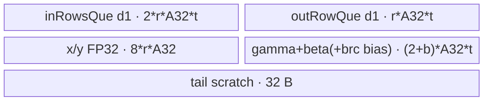
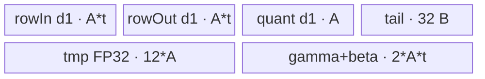
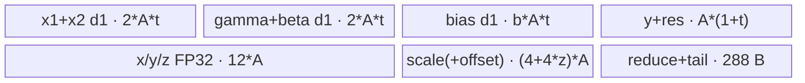

# AddLayerNormQuant A2/A3 ACLNN 算子知识

## 算子速览

| 项目 | 内容 |
|---|---|
| 实际入口 | `aclnnAddLayerNormQuantV2GetWorkspaceSize` / `aclnnAddLayerNormQuantV2`；A2/A3 的最新公开版本为 V2。 |
| 计算语义 | `a=x1+x2+bias`，`ln=(a-mean(a))/sqrt(var(a)+eps)*gamma+beta`，公开 A2/A3 域执行单路静态 per-tensor 量化 `y1=round_int8(ln*scale1+zeroPoint1)`，并输出 `layernormRes=ln`。 |
| 输入输出 | ND；`x1/x2/gamma/beta/bias/scale/zeroPoint/layernormRes` 同输入 dtype（FP16/BF16/FP32），`y1` INT8；公开域要求 `gamma/beta=[1,N]`、`scale1/zeroPoint1=[1]`、`scale2/zeroPoint2=nullptr`。 |
| 执行类型 | 单 AIV_VECTOR Kernel；R-001 Normal、R-002 SingleRow、R-003 Split-D 均为 Vector/MicroAPI 路线，无 Cube/AIC/MIX_CV。 |
| Kernel 路线 | R-001：整列、多行常驻；R-002：整行单行精度路线；R-003：列过大时分 slice、以 workspace 保存 FP32 加法结果。 |
| 核心资源 | GM、AIV UB、depth=1 TQue/TBuf；仅 R-003 使用 `rows*N*sizeof(float)` 用户 workspace，所有路线另含 16 MiB 系统 workspace 预留。 |
| 来源闭包 | `source_closed`：公开 V2 API → executor/L0 launcher → 复用 V1 Host Tiling/POD → V2 router → 三个实际 AIV body → A2/A3 config/CMake。 |
| 验证状态 | 已完成源码闭包检查；本次知识提取未执行编译、真机、数值或性能测试。 |

## 接口与语义

### 计算语义

把 `x1`、`x2` 及可选 `bias` 展平为 `M` 行、归一化域为每行 `N` 个元素：

```text
a[m,n] = x1[m,n] + x2[m,n] + (bias[m,n] / bias[n] / 0)
mu[m] = sum_n(a[m,n]) / N
var[m] = sum_n((a[m,n]-mu[m])^2) / N
ln[m,n] = (a[m,n]-mu[m]) / sqrt(var[m]+epsilon) * gamma[n] + beta[n]
y1[m,n] = int8_rint(ln[m,n] * scale1[0] + zeroPoint1[0])
layernormRes[m,n] = cast_input_dtype(ln[m,n])
```

公开 A2/A3 约束固定 `quantMode="static"`、`additionalOutput=false`、`divMode=false`，因此 `xOut` 没有有效语义，量化使用乘 scale；`y2/outScales1/outScales2` 在该公开域也无有效结果。

### 输入、输出与属性

| 参数 | shape/layout | dtype | 约束、默认值与语义 |
|---|---|---|---|
| `x1`,`x2` | 相同 ND，1–8 维 | FP16/BF16/FP32 且一致 | 加法输入。 |
| `gamma`,`beta` | `[1,N]` | 同 `x1` | A2/A3 V2 公开域的 LayerNorm 参数。 |
| `biasOptional` | `nullptr`、同 `x1` 或同 `gamma` | 同 `x1` | 分别形成无 bias、elementwise、broadcast key。 |
| `scales1Optional` | `[1]` | 同 `x1` | 必须存在，per-tensor 乘法 scale。 |
| `zeroPoints1Optional` | `nullptr` 或 `[1]` | 同 `scales1` | 可选加性 offset。 |
| `scales2Optional`,`zeroPoints2Optional` | `nullptr` | — | A2/A3 V2 公开域禁止第二路。 |
| `quantMode` | 标量字符串 | `char*` | 固定 `"static"`；非 regbase API 校验拒绝 dynamic。 |
| `epsilon` | 标量 | double→L0 float | 默认 `1e-5`，Tiling 写入 FP32。 |
| `additionalOutput`,`divMode` | 标量 | bool | 公开域均为 `false`。 |
| `y1Out` | 同 `x1` | INT8 | 有效量化输出。 |
| `layernormRes` | 同 `x1` | 同 `x1` | V2 新增的 LayerNorm 输出。 |
| `y2Out`,`xOut`,`outScales1Out`,`outScales2Out` | API 要求非空 | INT8 / 输入 dtype / FP32 | 公开域下是占位输出；API 仍校验 shape/dtype。 |

### 入口与版本

V2 相对 `aclnnAddLayerNormQuant` 增加 `layernormRes`。V2 README、API 文档、`AddLayerNormQuantV2` OpDef 和 `SUPPORT_COMPUTE_UNIT("ascend910b","ascend910_93")` 一致支撑 A2/A3；V2 L0 生成 `AddLayerNormQuantV2` 单节点，Tiling/POD 与多个 Kernel body 复用 `add_layer_norm_quant/`。V1 的公开 ACLNN 文档在 A2/A3 标为不支持，故本卡只记录最新公开 V2。

## Host/Launcher 执行流程

### 参数校验与前处理

`CheckParamsV2` 依次检查必选指针、平台相关 `quantMode`、dtype、gamma/beta/输出 shape、可选输入组合。非 regbase 的 A2/A3 只接受 static。随后 `PrepareContiguousAndCompute` 对四个必选输入和所有存在的可选输入调用框架 `Contiguous`。任一内部 tensor 创建失败即返回相应 ACLNN 错误。公开域若出现空 tensor，API 在创建算子节点前令 `workspaceSize=0` 并成功返回；否则调用 `ComputeAddLayerNormQuantV2`，A2/A3 走 `l0op::AddLayerNormQuantV2`，再以框架 `ViewCopy` 提交 `y1/x/layernormRes`（公开域不提交 `y2/outScale`）。

### 参数、Workspace 与生命周期

L0 分配六个计算输出并通过 `ADD_TO_LAUNCHER_LIST_AICORE(AddLayerNormQuantV2, ...)` 把单节点加入 executor。第一段接口最终以 `executor->GetWorkspaceSize()` 返回整个图 workspace，executor 转交调用者；第二段 `CommonOpExecutorRun(workspace, workspaceSize, executor, stream)` 在给定 stream 上执行节点与 ViewCopy。Tiling 的 `SetWorkSapce4AddLayerNormQuant` 令 R-001/R-002 的算子 workspace 为 `1 + 16 MiB`，R-003 为 `M*N*4 + 16 MiB`；Device 通过 `GetUserWorkspace` 取得系统保留区之后的用户区。

### 启动图与失败传播

```text
aclnnAddLayerNormQuantV2GetWorkspaceSize
  -> Contiguous(required/optional)
  -> AddLayerNormQuantV2 L0 node
       -> Tiling4AddLayerNormQuantV2Membase
       -> add_layer_norm_quant_v2<<<numCore, stream>>>
  -> ViewCopy(y1, x, layernormRes)
aclnnAddLayerNormQuantV2
  -> CommonOpExecutorRun(same executor, workspace, stream)
```

这是单 Device 节点图；输入/输出由 executor 持有到执行完成。R-003 的内部边为同一 Kernel 内 `a(FP32)` 的 `UB→user workspace→UB` 交接，offset 为 `core_base + row*N + slice*Nslice`，extent 为 `M*N` 个 FP32；`MTE3_V`/`MTE2_V` event 保证写后读。Host/Tiling 或节点创建失败不产生后续 launch；executor 负责框架临时 tensor 与 ViewCopy 生命周期。

## Route 与参数设计

### 分核与资源计算

V2 将 `gamma=[1,N]` 的首维排除出归一化域，得到 `M=prod(x.shape[:-1])`、`N=gamma[-1]`。`firstDimPerCore=ceil(M/maxAiv)`，`numCore=ceil(M/firstDimPerCore)`；尾核行数 `M-firstDimPerCore*(numCore-1)`，`gmOffset=firstDimPerCore*N`。`A=ceil(N*sizeof(T)/32)*32/sizeof(T)`，另有 `A32=ceil(N/32)*32`。

选择按优先级发生：先计算 Normal 的 `tmpRow=(UB-fixedBytes)/bytesPerRow`；`tmpRow>1` 时取 `rowStep=floor(tmpRow)`。否则检查 SingleRow 的精确 UB 估算；仍不容纳时进入 Split-D，令 slice 长为可用 UB 除以逐列字节因子后向 `32/sizeof(T)` 元素对齐，并调整到末 slice 至少 32 元素。每核最后一轮分别由 `rowTailPerBlock/rowTailLastBlock` 收口。

### Route 选择

| 顺序 | Route | Key/模板 | 精确选择条件与优先级 | 不适用去向 |
|---:|---|---|---|---|
| 1 | R-001 Normal | dtype 基数 1000/2000/3000 + bias 0/1/2 | `tmpRow=((UB-(2*A*t+512))/(t*3*A+8+12*A)) > 1`（公开 `additionalOutput=false`） | R-002 |
| 2 | R-002 SingleRow | dtype 基数 +20 + bias 0/1/2；公开单路选择 `KernelAddLayerNormSoleStaticQuantSingleRowV2` | R-001 失败且 `4*A*t + 3*A*4 + A + 32 + 256 < UB`（`scaleOffsetMode` 100/110，不大于 200） | R-003 |
| 3 | R-003 Split-D | dtype 基数 +50 + bias 0/1/2 | 前两项失败；Tiling 计算正的 block 对齐 slice，并以 workspace 覆盖整张 `M*N` FP32 | shape/算术异常则 Tiling 失败 |

```text
if normal_tmp_row > 1: NORMAL
else if single_row_bytes < UB: SINGLE_ROW
else: SLICE_EXT
key = dtype_base + {0,1,2 by bias} + {0,20,50 by route}
```

### 模板/实现执行矩阵

| Route | key/selector | dtype/shape/platform 完整命中条件 | 执行拓扑与 Kernel 节点 | 实际模板/body | 内存与同步特征 | tail/fallback |
|---|---|---|---|---|---|---|
| R-001 Normal | 1000–1002, 2000–2002, 3000–3002 | A2/A3；公开 static/per-tensor/single；Normal UB 谓词成立；末位按 bias | 单 `add_layer_norm_quant_v2` | `KernelAddLayerNormStaticQuantNormal<T,T,key>` | 整行/多行驻 UB；Queue + `S_V`/`PIPE_V` | 尾核、尾行；UB 不足去 R-002 |
| R-002 SingleRow | 1020–1022, 2020–2022, 3020–3022 | Normal 失败、整行仍可驻 UB、`scaleOffsetMode<200` | 单 Kernel | `KernelAddLayerNormSoleStaticQuantSingleRowV2<T,key>` | 每次一行；per-tensor 标量直接 GM scalar load；多种 MTE/V event | 每核逐行；UB 不足去 R-003 |
| R-003 Split-D | 1050–1052, 2050–2052, 3050–3052 | Normal/SingleRow 均失败 | 单 Kernel，内部三 phase | `KernelAddLayerNormQuantSplitD<T,T,key>` | FP32 workspace 保存 `a`；slice UB 与显式 event | tail slice 使用独立对齐长度；计算失败终止 |

### 隐藏性能 Guard

| Guard | Host/Tiling 条件 | Device/资源原因 | 影响 Route | 不满足时去向 | 源码符号 |
|---|---|---|---|---|---|
| Normal 行数 | `tmpRow>1` | 同时常驻输入、LayerNorm FP32 中间和输出，至少两行才采用 Normal | R-001 | R-002 | `AddLayerNormQuantTilingImplV2` |
| SingleRow 容量 | 精确 `tmpUbSize<maxUbSize` | 整行三块 FP32 临时、输入/输出和参数须同时容纳 | R-002 | R-003 | `AddLayerNormQuantTilingImplV2` |
| Slice 对齐 | `colPerTime` 向 `32/t` 元素对齐，且 tail `>=32` | DMA block 与尾 slice 安全 | R-003 | 缩短 slice；无合法值则失败 | `AddLayerNormQuantTilingImplV2`,`AddAlignParams` |
| 可选输入编码 | static 仅 100/110/200/211；公开域为 100/110 | router 以 `scaleOffsetMode` 决定单/双路和 offset buffer | 全部 | Tiling 失败 | `ComputeOptCode`,`CheckScaleOffset` |
| BF16 编译 guard | `__NPU_ARCH__ != 2002` | 2002 路线不实例化 BF16；A2/A3 binary config 均含 BF16 | 全部 BF16 | 不生成 body | `add_layer_norm_quant_v2` |
| 空域 | A2/A3 API `hasEmptyTensor` | 不创建 Device 节点 | 全部 | workspace=0 成功返回 | `PrepareContiguousAndCompute` |

### POD/ABI

`BEGIN_TILING_DATA_DEF` 的序列化宏在固定仓未显式给出最终 C++ `sizeof/alignof/offsetof`；下表保留声明顺序、源码位宽、producer 与 consumer，不推测 padding。

| 结构 | 字段 | 类型/位宽 | ABI 布局 | 单位 | Host/launcher producer | Device consumer | 边界 |
|---|---|---|---|---|---|---|---|
| `AddLayerNormQuantV2TilingData` | `numCore` | uint32/32 | 声明第1字段；offset不可见 | core | `DoBlockTiling:numCore` | `InitBaseParams` | ≥1 |
| 同上 | `numLastDim` | uint32/32 | 第2 | element | `SetFusedAxisTiling:N` | 所有 body 的行长 | 非空正常域 >0 |
| 同上 | `numFirstDim` | uint32/32 | 第3 | row | `SetFusedAxisTiling:M` | 分核语义 | 乘积窄化到 int32/uint32 |
| 同上 | `firstDimPerCore` | uint32/32 | 第4 | row/core | `DoBlockTiling` | 非尾核 `rowWork` | ceil 分配 |
| 同上 | `firstDimPerCoreTail` | uint32/32 | 第5 | row | `DoBlockTiling` | 尾核 `rowWork` | 最后一核 |
| 同上 | `numLastDimAlign32` | uint32/32 | 第6 | element | `ceil(N/32)*32` | V2 Normal stride | 32 元素对齐 |
| 同上 | `firstDimPerTime` | uint32/32 | 第7 | row/loop | `PostUbTiling` | Normal `rowStep` | ≤每核行数 |
| 同上 | `lastDimPerTime` | uint32/32 | 第8 | element/slice | route selector | 循环 | Normal/Single=N；Split=slice |
| 同上 | `eps` | float/32 | 第9 | 数值 | `GetAttrs` | rstd | API double 窄化为 float |
| 同上 | `aveFactor` | float/32 | 第10 | 1/element | `1.0f/N` | mean/variance | N=0 置0但正常 Kernel 不应命中 |
| 同上 | `colMoveCnt` | uint32/32 | 第11 | loop | `PostUbTiling` | 通用 tail 信息 | ceil(N/slice) |
| 同上 | `sliceSize` | uint32/32 | 第12 | element | `AddLayerNormQuantTilingImplV2` | Split-D | 仅 R-003 |
| 同上 | `colTail` | uint32/32 | 第13 | element | `PostUbTiling` | 通用 tail | 最后一列块 |
| 同上 | `isXOut` | uint32/32 | 第14 | bool code | `additionalOutput?1:0` | body 条件写 `x` | 公开域 0 |
| 同上 | `scaleOffsetMode` | uint32/32 | 第15 | decimal bit code | `ComputeOptCode` | 单/双/offset 分支 | 公开 100/110 |
| 同上 | `isPerTensor` | uint32/32 | 第16 | bool code | gamma `[1,N]` 且 scale size 1 | scalar scale path | 公开域 1 |
| 同上 | `sliceNum` | uint32/32 | 第17 | slice | `ceil(N/sliceSize)` | Split-D | R-003 |
| 同上 | `workspaceSize` | uint32/32 | 第18 | byte | `M*N*4` 或1 | 记录字段，Split body使用 GM | 可能发生 uint32 窄化 |
| 同上 | `numLastDimAlign` | uint32/32 | 第19 | element | 32-byte 对齐 | Normal/Single | dtype相关 |
| 同上 | `tailSliceSize` | uint32/32 | 第20 | element | Split selector | Split-D | 最末 slice |
| 同上 | `mulLoopFp32` | uint32/32 | 第21 | repeat | `A/64` | 继承字段 | 公开 body未形成独立分支 |
| 同上 | `mulTailFp32` | uint32/32 | 第22 | element | `A%64` | 继承字段 | tail |
| 同上 | `dstRepStrideFp32` | uint8/8 | 第23 | 32-byte block | `A/8` | 继承字段 | uint8 窄化 |
| 同上 | `firstDimPerTimeTail` | uint32/32 | 第24 | row | `min(rowStep,tailCoreRows)` | 尾核循环 | >0 |
| 同上 | `rowTailPerBlock` | uint32/32 | 第25 | row | 非尾核余数或 rowStep | Normal last loop | >0 |
| 同上 | `rowTailLastBlock` | uint32/32 | 第26 | row | 尾核余数 | Normal last loop | >0 |
| 同上 | `gmOffset` | uint64/64 | 第27 | element/core | `firstDimPerCore*N` | GM base | 64-bit |
| 同上 | `sliceSizeAligned` | uint32/32 | 第28 | T element | `AddAlignParams` | Split buffer stride | R-003 |
| 同上 | `tailSliceSizeAligned` | uint32/32 | 第29 | T element | `AddAlignParams` | Split tail | R-003 |
| 同上 | `sliceSizeAlignedFp32` | uint32/32 | 第30 | FP32 element | `AddAlignParams` | Split参数；body主要按 T 对齐上界分配 | R-003 |
| 同上 | `tailSliceSizeAlignedFp32` | uint32/32 | 第31 | FP32 element | `AddAlignParams` | Split tail | R-003 |

### Route 源码闭包

| Route | Key/selector | Host/Tiling producer | POD/参数 | Kernel entry/router 节点 | Kernel body/直接依赖 | 构建接线 |
|---|---|---|---|---|---|---|
| R-001 Normal | 1000–3002 | `add_layer_norm_quant_tiling.cpp::Tiling4AddLayerNormQuantV2Membase` | `AddLayerNormQuantV2TilingData` | `add_layer_norm_quant_v2.cpp::add_layer_norm_quant_v2` | `KernelAddLayerNormStaticQuantNormal`、base/helper | V2 CMake + ascend910b/910_93 binary config |
| R-002 SingleRow | 1020–3022 | 同上 | 同上 | 同上 | `KernelAddLayerNormSoleStaticQuantSingleRowV2` | 同上 |
| R-003 Split-D | 1050–3052 | 同上 | 同上 + slice字段 | 同上 | `KernelAddLayerNormQuantSplitD` | 同上 |

## Kernel 实现

### 公共执行流程

三条路线都由一个 `add_layer_norm_quant_v2` AIV entry 解析同一 POD，按 key 实例化 dtype/bias 模板并执行 `Init→Process`。每核 GM 起点为 `block_idx*gmOffset`，末核使用 `firstDimPerCoreTail`。所有 B16 输入先转 FP32 完成加法、均值/方差、affine 与量化；BF16 回写使用 `CAST_RINT`，FP16 使用 `CAST_NONE`。INT8 路径统一执行 FP32 `CAST_RINT` 到 int32，再经 half 和 `CAST_TRUNC` 打包到 int8。

### Route R-001：Normal 整列多行

#### 适用条件

##### 选择证据

| 层级 | 文件 | 符号 | 源码谓词/参数 | 结果/下一跳 |
|---|---|---|---|---|
| Tiling | `norm/add_layer_norm_quant/op_host/add_layer_norm_quant_tiling.cpp` | `AddLayerNormQuantTilingImplV2` | `tmpRow>1` | `NORMAL` |
| Router | `norm/add_layer_norm_quant_v2/op_kernel/add_layer_norm_quant_v2.cpp` | `add_layer_norm_quant_v2` | key 1000–3002 | `KernelAddLayerNormStaticQuantNormal<T,T,key>` |

#### Device 数据流

##### 函数级调用链

```text
add_layer_norm_quant_v2
  -> KernelAddLayerNormStaticQuantNormal::Init
  -> Process
     -> CopyInGammaBeta
     -> per row-tile: CopyInX1X2 -> AddX1X2Bias
        -> CopyOutLayernormRes -> ComputeSoleStaticQuant -> CopyOut(y1)
```

##### 源码等价伪码

```text
for tile in ceil(rowWork/rowStep):
  rows = rowStep or rowTail
  load x1,x2[,bias] with alignedStride=A32
  a_fp32 = fp32(x1)+fp32(x2)+fp32(bias)
  for each row: mu=reduce_sum(a/N); centered=a-mu
  var=reduce_sum(centered^2/N); ln=centered/sqrt(var+eps)*gamma+beta
  write cast<T>(ln) to layernormRes
  q = ln*perTensorScale [+ perTensorOffset]
  write int8_rint(q) to y1, only N valid elements per row
```

#### 内存与数据搬运

##### 资源与搬运表

| 层级/缓冲区 | offset/地址公式 | extent/容量公式 | dtype/layout | producer | consumer | owner/lifetime | 对齐/复用 |
|---|---|---|---|---|---|---|---|
| GM x1/x2 | `core*N + tileRow*N` | `rows*N` | T/ND | caller | CopyIn | caller | valid N，UB stride A32 |
| `inRowsQue` | 0 / `rows*A32` | `2*rows*A32*t` | T | MTE2 | Add | pipe/tile | depth1，x1/x2 拼接 |
| `xBufFp32`,`yBufFp32` | 各自0 | 各 `rows*A32*4` | FP32 | Add/reduce | LN/quant | pipe/tile | 多阶段原地覆盖 |
| gamma/beta/bias TBuf | 0 | `(2+broadcastBias)*A32*t` | T | MTE2 | affine/add | pipe/kernel | 参数跨行 tile 复用 |
| `outRowQue` | 0 | `rows*A32*t` | T 或 reinterpret INT8 | LN/quant | MTE3 | pipe/stage | layernorm 与 y1 顺序复用 |
| GM layernorm/y1 | `core*N+tileRow*N` | `rows*N` | T / INT8 | MTE3 | caller | caller | 非对齐尾用 DataCopyPad helper |

##### 分层内存布局



##### 字节账与复用顺序

```text
UB_total = 32 + 3*r*A32*t + 8*r*A32 + (2+broadcastBias)*A32*t
dynamic_ub = N/A
workspace_total = 1 user byte + 16 MiB system reserve
=> Host 的 Normal tmpRow 必须 > 1
```

| 复用子区 | 写入者 | 读取者/消费点 | 下一次覆盖 | 同步或释放依据 | 安全条件 |
|---|---|---|---|---|---|
| `xBufFp32` | Add | mean/var/LN | quant 原地 scale/offset | `PIPE_V` | layernormRes 已提交后才量化覆盖 |
| `outRowQue` | LN cast | MTE3 layernorm | INT8 quant | EnQue/DeQue/Free | 前一 tensor 已 Free |

#### 同步、精度与尾块

##### 同步与数值边界表

| 阶段 | primitive/机制 | producer | consumer/等待点 | 保护对象 | 精度/尾块 |
|---|---|---|---|---|---|
| reduce scalar→vector | `S_V` event | `ReduceSumFP32` | centered/rstd Muls | mean/var scalar | FP32 两遍方差 |
| Vector stages | `PipeBarrier<PIPE_V>` | cast/add/mul | 下一 Vector op | FP32 TBuf | mask 为有效 N/elementCount |
| 输出 | Queue + tail helper | cast/quant | MTE3 | layernorm/y1 | 每行只写 N；A32 padding 不外写 |

#### 关键实现

##### 符号证据表

| 阶段 | 文件 | 符号/模板实例 | 实现事实 |
|---|---|---|---|
| Host/Tiling producer | `.../add_layer_norm_quant_tiling.cpp` | `AddLayerNormQuantTilingImplV2`,`PostUbTiling` | Normal 判定、rowStep/tail |
| Kernel entry/router | `.../add_layer_norm_quant_v2.cpp` | `add_layer_norm_quant_v2` | key→Normal 模板 |
| Device body/helper | `.../add_layer_norm_static_quant_normal_kernel.h` | `Process`,`ComputeLayerNorm`,`ComputeSoleStaticQuant` | FP32 LN、per-tensor 量化、队列复用 |

### Route R-002：SingleRow 整行

#### 适用条件

##### 选择证据

| 层级 | 文件 | 符号 | 源码谓词/参数 | 结果/下一跳 |
|---|---|---|---|---|
| Tiling | `.../add_layer_norm_quant_tiling.cpp` | `AddLayerNormQuantTilingImplV2` | Normal 失败且 `tmpUbSize<UB` | `SINGLE_ROW` |
| Router | `.../add_layer_norm_quant_v2.cpp` | key 1020–3022 branch | `scaleOffsetMode<200` | Sole V2 body |

#### Device 数据流

##### 函数级调用链

```text
add_layer_norm_quant_v2
  -> KernelAddLayerNormSoleStaticQuantSingleRowV2::Init
  -> Process -> CopyInBetaGammaBias
     -> for row: CopyInAddSingleRow -> precision_compute_single_row
        -> ComputeMeanVarRstd -> ApplyGammaBeta -> CopyOutLayernormRes
        -> ApplyScaleOffsetAndQuantize -> y1
```

##### 源码等价伪码

```text
load gamma,beta once
for row in core_rows:
  load x1,x2[,bias]; cast/add into FP32 xTensor
  mu=sum(x/N); x-=mu; var=sum(x*x/N); x*=rsqrt(var+eps)
  x=x*gamma+beta; write layernormRes
  x*=scale_scalar; if offset: x+=offset_scalar
  write packed int8_rint(x)
```

#### 内存与数据搬运

##### 资源与搬运表

| 层级/缓冲区 | offset/地址公式 | extent/容量公式 | dtype/layout | producer | consumer | owner/lifetime | 对齐/复用 |
|---|---|---|---|---|---|---|---|
| rowIn/rowOut/quant queues | row local | `A*t`, `A*t`, `A` | T/T/INT8 | MTE2/Vector | Vector/MTE3 | per row | depth1 |
| `tmpBuf` | 0,A,2A | `3*A*4` | FP32 | add/LN | quant | kernel/per row | x/tmp/z aliases by phase |
| `gammaBetaBuf` | 0,A | `2*A*t` | T | MTE2 once | affine all rows | kernel | no repeated GM load |
| scale/offset | GM[0] | one scalar each | T | `GetValue(0)` in Init | all rows | caller/kernel | no scale UB queue in perTensor path |
| workspace pointer | `core*2*N` FP32 | not read/written | FP32 | N/A | N/A | N/A | allocated route workspace remains 1 byte |

##### 分层内存布局



##### 字节账与复用顺序

```text
UB_total = 32 + A*(4*t + 13)
dynamic_ub = N/A
workspace_total = 1 + 16 MiB system reserve
```

| 复用子区 | 写入者 | 读取者/消费点 | 下一次覆盖 | 同步或释放依据 | 安全条件 |
|---|---|---|---|---|---|
| `tmpBuf[0:A]` | row add | LN | scale/offset/quant 原地 | `PIPE_V`, `MTE3_MTE2` | layernorm 写完后量化 |
| rowOut Queue | layernorm cast | layernorm MTE3 | scale参数临时（非公开 per-channel） | FreeTensor/event | public perTensor 不走后者 |

#### 同步、精度与尾块

##### 同步与数值边界表

| 阶段 | primitive/机制 | producer | consumer/等待点 | 保护对象 | 精度/尾块 |
|---|---|---|---|---|---|
| GM→Vector | `MTE2_V` | DataCopyPad | add/cast | row input | N 有效、A padding |
| scalar reduce | `S_V` | ReduceSum | centered/rstd | mean/var | FP32 |
| layernorm→quant | `MTE3_MTE2` + `PIPE_V` | layernorm output | quant | tmp/queue | 防止提前复用 |

#### 关键实现

##### 符号证据表

| 阶段 | 文件 | 符号/模板实例 | 实现事实 |
|---|---|---|---|
| Host/Tiling producer | `.../add_layer_norm_quant_tiling.cpp` | `AddLayerNormQuantTilingImplV2` | SingleRow UB gate |
| Kernel entry/router | `.../add_layer_norm_quant_v2.cpp` | 1020–3022 branches | 单路/双路二次选择 |
| Device body/helper | `.../add_layer_norm_sole_static_quant_single_row_kernel.h` | `precision_compute_single_row` | 单行 FP32 LN 与标量量化 |

### Route R-003：Split-D 超长列

#### 适用条件

##### 选择证据

| 层级 | 文件 | 符号 | 源码谓词/参数 | 结果/下一跳 |
|---|---|---|---|---|
| Tiling | `.../add_layer_norm_quant_tiling.cpp` | `AddLayerNormQuantTilingImplV2` | 前两 route 均不容纳 | `SLICE_EXT` + slice POD |
| Router | `.../add_layer_norm_quant_v2.cpp` | 1050–3052 | key | Split-D body |

#### Device 数据流

##### 函数级调用链

```text
add_layer_norm_quant_v2
  -> KernelAddLayerNormQuantSplitD::Process
     -> Phase1 ComputeAddAndWriteWorkspace
     -> Phase2 ComputeVarianceFromWorkspace
     -> Phase3 ComputeLayerNormAndQuant per slice
```

##### 源码等价伪码

```text
for row:
  sum=0
  for slice: a=fp32(x1+x2+bias); sum+=reduce(a); workspace[row,slice]=a
  mean=sum/N; wait MTE3->V
  ssd=0
  for slice: a=workspace[row,slice]; ssd+=reduce((a-mean)^2)
  rstd=1/sqrt(ssd/N+eps)
  for slice:
    a=workspace[row,slice]
    ln=(a-mean)*rstd*gamma+beta; write layernormRes
    q=ln*scale_scalar [+offset_scalar]; write y1
```

#### 内存与数据搬运

##### 资源与搬运表

| 层级/缓冲区 | offset/地址公式 | extent/容量公式 | dtype/layout | producer | consumer | owner/lifetime | 对齐/复用 |
|---|---|---|---|---|---|---|---|
| user workspace | `coreBase + row*N + slice*sliceSize` | `M*N*4` | FP32 row-major | Phase1 | Phase2/3 | executor/Kernel | 不跨核重叠 |
| input/gamma queues | 0 / A | `2*A*t`, `2*A*t` | T | MTE2 | add/affine | per subfunction | depth1 |
| bias queue | 0 | `A*t` if bias | T | MTE2 | add | per slice | conditional |
| out queues | 0 | `A` + `A*t` | INT8/T | Vector | MTE3 | per slice | depth1 |
| FP32 TBuf | each0 | x/y/z/scales各 `A*4`，offset可选 `A*4` | FP32 | Vector | reduce/LN/quant | pipe | phase复用 |
| reduce/tail | 0 | 256 B + 32 B | FP32/raw | reduce/DMA helper | scalar/tail | pipe | fixed |

##### 分层内存布局



##### 字节账与复用顺序

```text
UB_total = A*((5+bias)*t + 17 + 4*hasOffset) + 288
dynamic_ub = N/A
workspace_total = M*N*4 user bytes + 16 MiB system reserve
```

| 复用子区 | 写入者 | 读取者/消费点 | 下一次覆盖 | 同步或释放依据 | 安全条件 |
|---|---|---|---|---|---|
| workspace row | Phase1 | Phase2、Phase3 | Kernel 完成后 | `MTE3_V` 写读 event | core/row slice 不重叠 |
| x/y/z TBuf | add/reduce | 下一 phase | 下一 slice | `PIPE_V` | 每个 helper 自包含 Queue 生命周期 |
| outRes Queue | LN cast | MTE3 | 下一 slice | EnQue/DeQue/Free | `MTE3_MTE2` 后再载 quant 参数 |

#### 同步、精度与尾块

##### 同步与数值边界表

| 阶段 | primitive/机制 | producer | consumer/等待点 | 保护对象 | 精度/尾块 |
|---|---|---|---|---|---|
| Phase1→2 | `MTE3_V` | workspace write | workspace read/reduce | FP32 a | tail slice 真实 size |
| workspace load | `MTE2_V` | GM→UB | subtract/mul | x TBuf | DataCopyPad tail |
| LN→quant参数 | `MTE3_MTE2` | layernorm MTE3 | scale MTE2 | shared pipe | FP32 LN then cast output |
| quant output | `PIPE_V/PIPE_MTE3` | RINT/casts | y1 GM | INT8 | 只写 `size` |

#### 关键实现

##### 符号证据表

| 阶段 | 文件 | 符号/模板实例 | 实现事实 |
|---|---|---|---|
| Host/Tiling producer | `.../add_layer_norm_quant_tiling.cpp` | `AddAlignParams`,`AddLayerNormQuantTilingImplV2` | slice、tail、workspace |
| Kernel entry/router | `.../add_layer_norm_quant_v2.cpp` | 1050–3052 branches | Split-D 实例 |
| Device body/helper | `.../add_layer_norm_quant_split_d.h` | `ComputeAddAndWriteWorkspace`,`ComputeVarianceFromWorkspace`,`ComputeLayerNormAndQuant` | 三阶段、显式 workspace 边 |

## 算子特定优化

### Trick T-001：超长 D 维三阶段分片避免整行 UB 上限

#### 触发与源码依据

- 适用 Route：R-003
- 触发条件：Normal 与 SingleRow UB gate 均失败。
- Golden 来源：[`norm/add_layer_norm_quant/op_kernel/add_layer_norm_quant_split_d.h:72-97`](../../../../../../../cann-ops-raw/ascendc/ops-nn/955f8b33985b6d72989ebff341bb9c2c564a51bc/norm/add_layer_norm_quant/op_kernel/add_layer_norm_quant_split_d.h#L72-L97)

**官方源码（固定 Commit 连续逐字摘录）**：

```cpp
for (uint32_t rowIdx = 0; rowIdx < this->rowWork; rowIdx++) {
    uint32_t rowOffset = rowIdx * this->numLastDim;
    float mean = ComputeAddAndWriteWorkspace(rowOffset);
    event_t eventMTE3V = static_cast<event_t>(GetTPipePtr()->FetchEventID(HardEvent::MTE3_V));
    SetFlag<HardEvent::MTE3_V>(eventMTE3V);
    WaitFlag<HardEvent::MTE3_V>(eventMTE3V);
    float variance = ComputeVarianceFromWorkspace(rowOffset, mean);
    float rstd = 1.0f / sqrt(variance + this->eps);
```

#### 机制与设计原因

把整行 `a` 外溢为 FP32 workspace，使 UB 只与最大 slice 成正比；显式 `MTE3_V` 使 Phase2 不会读取未完成的 Phase1 写入。代价是同一行多次 workspace 流量，因此仅在前两条整行路线都不容纳时使用。

#### 迁移边界

- 适用：需要全行归约但 UB 只能容纳列分片的融合归一化。
- 前提：可分配 `M*N*4` 用户 workspace，slice/tail 满足 32-byte DMA 对齐。
- 失效：workspace 不可用或尺寸乘法/窄化不安全时必须拒绝；整行可驻留时选 R-001/R-002。
- 未验证：本次知识提取未执行编译、真机、数值或性能测试。

#### 错误做法

不能去掉 Phase1→Phase2 的 event 后立即读 workspace；该源码的显式写读同步就是可验证反例。

### Trick T-002：per-tensor scale/offset 标量化并跨行复用

#### 触发与源码依据

- 适用 Route：R-001/R-002/R-003
- 触发条件：`isPerTensor=1` 且 `scales1` 存在。
- Golden 来源：[`norm/add_layer_norm_quant/op_kernel/add_layer_norm_sole_static_quant_single_row_kernel.h:54-56`](../../../../../../../cann-ops-raw/ascendc/ops-nn/955f8b33985b6d72989ebff341bb9c2c564a51bc/norm/add_layer_norm_quant/op_kernel/add_layer_norm_sole_static_quant_single_row_kernel.h#L54-L56)

**官方源码（固定 Commit 连续逐字摘录）**：

```cpp
if (this->isPerTensor) {
    GetPerTensorScaleOffset();
}
```

#### 机制与设计原因

`GetPerTensorScaleOffset` 在 `Init` 中从 GM 读取单个 scale/offset 并转换为 FP32 成员，逐行量化只用 `Muls/Adds`，不再为每行或每 slice 搬运整列 scale tensor。该机制减少参数 GM→UB 流量和 Queue 生命周期。

#### 迁移边界

- 适用：量化参数确为单标量且 Host/POD 明确 `isPerTensor=1`。
- 前提：scale/offset dtype 与 API 约束一致，标量在 Kernel 全生命周期不变。
- 失效：per-channel 参数必须使用逐列加载路线，不能把首元素广播代替完整 scale。
- 未验证：本次知识提取未执行编译、真机、数值或性能测试。

#### 错误做法

固定仓的 per-channel 分支会把完整 scale/offset 搬入 UB；将该分支错误标为 per-tensor 会丢失逐列量化语义。

## 模板与实现对比

| 对比维度 | R-001 Normal | R-002 SingleRow | R-003 Split-D | 设计选择依据 |
|---|---|---|---|---|
| 命中条件/优先级 | `tmpRow>1` | Normal失败、整行可驻 | 前两者失败 | UB 容量递降 |
| 模板与 dtype | Normal<T,T,key> | SoleSingleRow<T,key> | SplitD<T,T,key> | FP16/BF16/FP32均实例化 |
| 循环与分核 | 核→row tile→row | 核→row | 核→row→三 phase→slice | D 维是否整行可驻 |
| Queue/TBuf/寄存器/dynamic UB/通信 window | 多行 Queue + 2 FP32 TBuf | 单行 Queue + 3 FP32 TBuf | slice Queue + 6 FP32 TBuf | 无 dynamic UB/通信 |
| 内存总占用与复用 | 与 `rowStep*A` 成正比 | 与 A 成正比 | 与 slice A 成正比 + workspace | selector 公式 |
| 搬运/Vector/SIMT/NDDMA/通信 API | DataCopyPad、Vector reduce | DataCopyPad、Vector reduce | DataCopyPad、workspace 三遍 | 均 AIV，无 SIMT/NDDMA/通信 |
| 同步、精度与 tail | S_V/PIPE_V，row tail | MTE/V event，逐行 | MTE3_V/MTE2_V，slice tail | FP32 LN、INT8 RINT |
| fallback/失败边界 | →R-002 | →R-003 | Tiling失败 | 无 Device-only fallback |

## 平台差异

| 项目 | A2 | A3 | 950 |
|---|---|---|---|
| 支持状态 | V2 公开支持 | V2 公开支持 | V2 README 标不支持且无 ascend950 构建；本版本族在独立 950 卡采用 V1 |
| Host/Launcher | `ascend910b`，共用 V2 membase Tiling | `ascend910_93`，共用 V2 membase Tiling | regbase selector，不属于本卡 |
| Kernel/资源 | V2 Normal/Single/Split-D AIV | 同左 | V1 arch35 RegBase MicroAPI |

## 限制与失败边界

- A2/A3 V2 公开域仅 static、单路、per-tensor、`additionalOutput=false`、`divMode=false`；源码中可见的双路、dynamic 或 per-channel 分支不是本平台公开路线。
- shape 乘积先进入 `int32_t numRow/numCol`，多个 POD 字段为 uint32，超大 shape 存在固定源码可见的窄化边界；仓内未提供额外溢出保护。
- R-003 `workspaceSize=M*N*4` 写入 uint32 POD，同时 Host workspace 使用 `size_t`；必须避免超出可表示范围。
- V2 README 明确 950 不支持，尽管 V2 API 文档表格一处标为支持；同时 V2 CMake/OpDef 无 ascend950。因此不把 950 V2 实现信号发布为正式路线。
- 框架 `Contiguous/ViewCopy/CommonOpExecutorRun` 内部实现是允许的框架边界；其 stream 顺序由 executor 保证，固定算子仓未展开框架源码。
- 本次知识提取未执行编译、真机、数值或性能测试。

## 源码索引

### 链路索引

| 链路阶段 | 文件 | 关键符号 | 支撑内容 |
|---|---|---|---|
| 入口声明/约束 | `norm/add_layer_norm_quant_v2/docs/aclnnAddLayerNormQuantV2.md` | 产品表、接口签名、A2/A3约束 | 公开性、版本、平台与参数域 |
| 入口实现 | `norm/add_layer_norm_quant_v2/op_api/aclnn_add_layer_norm_quant_v2.cpp` | `CheckParamsV2`,`PrepareContiguousAndCompute` | API校验、空域、executor流程 |
| 入口实现 | `norm/add_layer_norm_quant_v2/op_api/add_layer_norm_quant_v2.cpp` | `l0op::AddLayerNormQuantV2` | 输出分配、单节点 launcher |
| Host/Tiling/Launcher | `norm/add_layer_norm_quant/op_host/add_layer_norm_quant_tiling.cpp` | `Tiling4AddLayerNormQuantV2Membase` | selector、分核、workspace、POD producer |
| Host/Tiling/Launcher | `norm/add_layer_norm_quant/op_host/add_layer_norm_quant_tiling.h` | `AddLayerNormQuantV2TilingData` | POD字段顺序与位宽 |
| Kernel entry/body | `norm/add_layer_norm_quant_v2/op_kernel/add_layer_norm_quant_v2.cpp` | `add_layer_norm_quant_v2` | key router |
| Kernel entry/body | `norm/add_layer_norm_quant/op_kernel/add_layer_norm_static_quant_normal_kernel.h` | `KernelAddLayerNormStaticQuantNormal` | R-001 |
| Kernel entry/body | `norm/add_layer_norm_quant/op_kernel/add_layer_norm_sole_static_quant_single_row_kernel.h` | `KernelAddLayerNormSoleStaticQuantSingleRowV2` | R-002 |
| Kernel entry/body | `norm/add_layer_norm_quant/op_kernel/add_layer_norm_quant_split_d.h` | `KernelAddLayerNormQuantSplitD` | R-003 |
| Kernel helper | `norm/add_layer_norm_quant/op_kernel/add_layer_norm_quant_base.h` | `KernelAddLayerNormQuantBase` | 公共GM绑定、分核与参数 |
| Kernel helper | `norm/add_layer_norm_quant/op_kernel/add_layer_norm_quant_helper.h` | copy/reduce/quant helpers | 公共搬运、统计、量化 |
| 构建接线 | `norm/add_layer_norm_quant_v2/CMakeLists.txt` | `SUPPORT_COMPUTE_UNIT` | A2/A3 活动构建 |
| 平台与约束 | `norm/add_layer_norm_quant_v2/README.md` | 产品支持表与A2/A3约束 | 公开平台和受限参数域 |
| 平台注册 | `norm/add_layer_norm_quant_v2/op_host/add_layer_norm_quant_v2_def.cpp` | `AddLayerNormQuantV2` OpDef | 910b/910_93配置 |
| Binary接线 | `norm/add_layer_norm_quant_v2/op_host/config/ascend910b/add_layer_norm_quant_v2_binary.json` | key/dtype实例 | A2 Kernel binary |
| Binary接线 | `norm/add_layer_norm_quant_v2/op_host/config/ascend910_93/add_layer_norm_quant_v2_binary.json` | key/dtype实例 | A3 Kernel binary |

### 实现复用检查

| 检查项 | 可复用事实 | 不得改变的约束 | 源码符号 |
|---|---|---|---|
| ABI/POD | V2 三 route 共用 POD | 字段顺序、uint8 stride、uint32 workspace 不得改 | `AddLayerNormQuantV2TilingData` |
| 调用顺序 | 单节点 router→Init→Process | R-003 三 phase 顺序不可交换 | `add_layer_norm_quant_v2`,`Process` |
| workspace/内存 | Split-D 可复用 FP32 外溢方案 | `M*N*4`、core offset 与 event 必须一致 | `ComputeAddAndWriteWorkspace` |
| 同步 | Queue/PIPE/event 模式可复用 | MTE3→MTE2/V 依赖不得删除 | 各 body `Process` |
| 精度与尾块 | FP32 LN、RINT INT8、有效 N 写回 | BF16 RINT、slice/row tail 不得改 | `RoundFloat2Int8`,`QuantAndOut` |
| 失败边界 | 三阶 UB fallback | 不得把非公开 dynamic/dual 路线补入 A2/A3 | `AddLayerNormQuantTilingImplV2` |