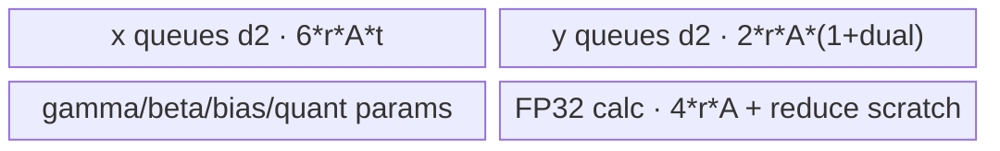
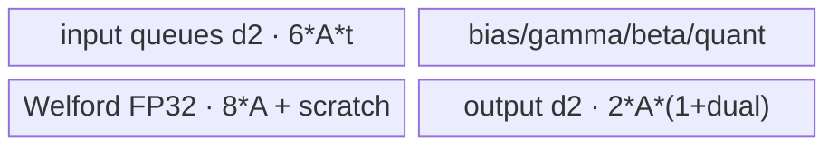
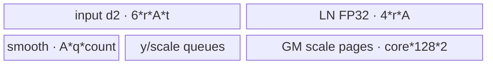
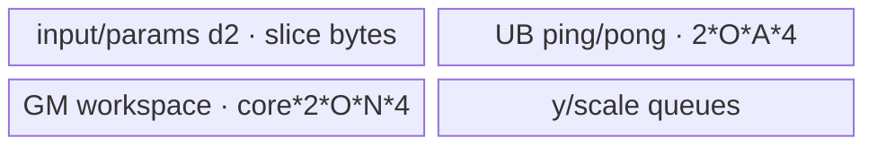

# AddLayerNormQuant 950 ACLNN 算子知识

## 算子速览

| 项目 | 内容 |
|---|---|
| 实际入口 | `aclnnAddLayerNormQuantGetWorkspaceSize` / `aclnnAddLayerNormQuant`；950 最新实际公开可达版本为 V1。 |
| 计算语义 | 融合 `Add + LayerNorm + 1/2 路静态或动态量化`，可选回写加法结果 `x`。 |
| 输入输出 | ND；静态 FP32/FP16/BF16、动态 FP16/BF16 输入，INT8 y、可选同 dtype x、动态 FP32 outScale；bias 可无、逐元素或按 gamma 广播。 |
| 执行类型 | 单 `AIV_VECTOR` RegBase/MicroAPI Kernel；entry 标记 `KERNEL_TYPE_MIX_AIV_1_0`，但 AIC 核数为 0，无 Cube、AIC、MIX_CV 路径。 |
| Kernel 路线 | 静态 FullLoad/Welford、动态 FullLoad/Welford、空输入共五类。FullLoad 优先，UB 不足才 Welford。 |
| 核心资源 | GM、AIV UB、Vector 寄存器；动态 Welford 使用 FP32 workspace，动态小 N 使用每核 128-byte scale 页。 |
| 来源闭包 | `source_closed`：公开 ACLNN → executor/L0 → arch35 Tiling/POD → APT router → 五类 AIV body → ascend950 OpDef/binary config。 |
| 验证状态 | 已完成源码闭包检查；本次知识提取未执行编译、真机、数值或性能测试。 |

## 接口与语义

### 计算语义

设每行归一化列数为 `N`：

```text
a = x1 + x2 + optional_bias
mean = sum(a) / N
var = sum((a-mean)^2) / N
ln = (a-mean) / sqrt(var+epsilon) * gamma + beta

static, divMode=false: yk = int8_rint(ln * scalesK + zeroPointsK)
static, divMode=true : yk = int8_rint(ln / scalesK + zeroPointsK)
dynamic: uk = ln * optional_smoothK
         outScalesK = max(abs(uk)) / 127
         yk = int8_rint(uk / outScalesK)
```

第二路只在合法的 `scales2` 组合下有效；`additionalOutput=true` 时 `xOut=a`。V1 不输出 V2 的 `layernormRes`。

### 输入、输出与属性

| 参数 | shape/layout | dtype | 约束、默认值与语义 |
|---|---|---|---|
| `x1`,`x2` | 相同 ND，静态 1–8 维、动态 2–8 维 | 静态 FP32/FP16/BF16；动态 FP16/BF16 | 加法输入。 |
| `gamma`,`beta` | 相同 ND，总元素数 N；动态时 gamma 必须 1-D | 同 x | shape 对应 x 的最后若干维；动态退化为最后一维归一化。 |
| `biasOptional` | 无、同 x 或同 gamma | 同 x | 分别编码 no/elementwise/broadcast bias。 |
| `scales1Optional`,`scales2Optional` | 同 gamma，ND | 静态与 x 同 dtype；动态 FP16/BF16 | 静态 `scale1` 必须存在，`scale2` 决定第二路；动态为 smooth，均可空但不能只有 scale2。 |
| `zeroPoints1Optional`,`zeroPoints2Optional` | 同 gamma，ND | 同 x | 仅静态有效；必须与相应 scale 形成文档规定组合。动态必须为空。 |
| `quantMode` | 标量字符串 | `char*` | `"static"` 或 `"dynamic"`，选择 body。 |
| `epsilon` | 标量 | double→Tiling float | LayerNorm 稳定项，默认 `1e-5`。 |
| `additionalOutput` | 标量 | bool | 是否输出加法结果 `xOut`。 |
| `divMode` | 标量 | bool | 静态时选择除 scale 或乘 scale；动态时无效。 |
| `y1Out`,`y2Out` | 同 x shape/layout | INT8 | 一路/两路量化结果；第二路按组合有效。 |
| `xOut` | 同 x shape/layout | 同 x | 仅 `additionalOutput=true` 有效。 |
| `outScales1Out`,`outScales2Out` | x 去掉末维，ND | FP32 | 仅动态量化有效。 |

### 入口与版本

V1 文档的平台表仅把 Ascend 950 标为支持，API `CheckPlatform` 又要求当前架构满足 `IsRegbase`；`AddLayerNormQuant` OpDef 将 ascend950 的 `opFile.value` 接到 `add_layer_norm_quant_apt`，对应 binary config 存在。V2 README 明示 Ascend 950 不支持，且 V2 CMake/OpDef/binary config 无 ascend950；虽然 V2 API 文档的产品表一处写支持，该冲突不足以构成可构建闭环，所以 950 选择 V1。

## Host/Launcher 执行流程

### 参数校验与前处理

`CheckParams` 先校验必选指针、RegBase 平台、quantMode、dtype/shape、输出和可选输入组合。之后必选输入以及存在的可选输入都经 `Contiguous`。正常域调用 `ComputeAddLayerNormQuant`；空域有两种行为：950 上 `outScales1Out` 自身为空时直接成功返回、workspace 为 0，其余 `hasEmptyTensor` 进入 `ComputeAddLayerNormQuantEmptyInput`，创建 key 9 的节点处理动态 scale 边界。

### 参数、Workspace 与生命周期

L0 `l0op::AddLayerNormQuant` 分配计算输出并用 `ADD_TO_LAUNCHER_LIST_AICORE` 加入单算子节点；随后 `ViewCopy` 只提交当前模式有效的输出。executor 持有连续化 tensor、计算输出和拷贝节点，第一段返回总 workspace，第二段用调用者传入的 workspace/stream 执行。

正常 Tiling 的用户 workspace：静态与一般动态 FullLoad 为 32 B；动态 Welford 为 `sysWorkspace + usedCore*2*outQuantNums*N*4`。动态且 `rowsPerCore==1` 时再加 `usedCore*128*2`；若此时是 FullLoad，还加 system workspace。空输入 Tiling 分配 16 MiB。

### 启动图与失败传播

```text
aclnnAddLayerNormQuantGetWorkspaceSize
  -> CheckParams -> Contiguous
  -> normal: l0op::AddLayerNormQuant -> arch35 Tiling -> add_layer_norm_quant
     empty:  l0op::AddLayerNormQuantEmptyInput -> empty Tiling -> key 9
  -> ViewCopy(valid outputs)
aclnnAddLayerNormQuant -> CommonOpExecutorRun(workspace, stream)
```

Host 校验、Contiguous、L0 输出分配、launcher 或 ViewCopy 任一步失败即返回 ACLNN 错误，不继续构图。Device 内部只有单 AIV 节点；动态 Welford 的 workspace 写读和小 N scale 合并均发生在该节点内。

## Route 与参数设计

### 分核与资源计算

`N=prod(gamma.shape)`，`rows=prod(x.shape)/N`。`rowsPerCore=ceil(rows/aivCoreNum)`，据此计算 `usedCoreNum=ceil(rows/rowsPerCore)` 后再次均衡；尾核为 `rows-rowsPerCore*(usedCoreNum-1)`。Tiling 先尝试 FullLoad：整列 `colsPerLoop=N`，`rowsPerLoop=min(rowStep,rowsPerCore,255)`。若 UB 估算失败，再用 Welford 按 `colsPerLoop` 切 N，`colsLoopCount=ceil(N/colsPerLoop)`、`colsTail` 收口。

### Route 选择

| 顺序 | Route | Key/模板 | 精确选择条件与优先级 | 不适用去向 |
|---:|---|---|---|---|
| 1 | R-001 静态 FullLoad | 8000–8002；div 为 8010–8012 | static，FullLoad UB 公式可容纳；末位 0/1/2 表示 bias | R-002 |
| 2 | R-002 静态 Welford | 8100–8102；div 为 8110–8112 | static 且 FullLoad 失败 | Tiling 失败 |
| 3 | R-003 动态 FullLoad | 8020–8022 | dynamic，FullLoad UB 公式可容纳 | R-004 |
| 4 | R-004 动态 Welford | 8120–8122 | dynamic 且 FullLoad 失败 | Tiling 失败 |
| 5 | R-005 空输入 | 9 | 空域经专用 L0/Tiling 且未被 API 提前返回 | 无 |

```text
if empty and outScales1 is non-empty: EMPTY(key=9)
else if static:
  if full_load_ub_fits: STATIC_FULL_LOAD(key=800x/801x)
  else: STATIC_WELFORD(key=810x/811x)
else if dynamic:
  if full_load_ub_fits: DYNAMIC_FULL_LOAD(key=802x)
  else: DYNAMIC_WELFORD(key=812x)
```

### 模板/实现执行矩阵

| Route | key/selector | dtype/shape/platform 完整命中条件 | 执行拓扑与 Kernel 节点 | 实际模板/body | 内存与同步特征 | tail/fallback |
|---|---|---|---|---|---|---|
| R-001 静态 FullLoad | 8000–8002/8010–8012 | 950；静态 FP32/FP16/BF16；scale1 必有；FullLoad UB 可容纳 | 单 `add_layer_norm_quant` AIV 节点 | `KernelAddLayerNormStaticQuantRegbaseFullLoad<X,S,key,opt,2>` | 整行/多行驻 UB；Queue/MicroAPI | row tail；UB 不足→R-002 |
| R-002 静态 Welford | 8100–8102/8110–8112 | 950；同 R-001，但 FullLoad 失败 | 单 AIV 节点 | `KernelAddLayerNormStaticQuantRegbaseWelford<X,S,key,opt,2>` | 两遍 GM、Welford state | column tail；无更低 route |
| R-003 动态 FullLoad | 8020–8022 | 950；动态 FP16/BF16；0/1/2 路 smooth 合法；FullLoad可容纳 | 单 AIV 节点 | `KernelAddLayerNormDynamicQuantRegbaseFullLoad<X,S,key,opt,2>` | 整行驻 UB；小 N `SyncAll` merge | row tail；UB 不足→R-004 |
| R-004 动态 Welford | 8120–8122 | 950；同 R-003，但 FullLoad 失败 | 单 AIV 节点 | `KernelAddLayerNormDynamicQuantRegbaseWelford<X,S,key,opt,2>` | FP32 workspace ping/pong + event | column tail；无更低 route |
| R-005 空输入 | 9 | 950 空域且 API 未提前返回 | 单 AIV 节点 | `KernelAddLayerNormQuantEmptyInput<2>` | depth2 queue 填 `-inf` | Empty POD block/tail |

### 隐藏性能 Guard

| Guard | Host/Tiling 条件 | Device/资源原因 | 影响 Route | 不满足时去向 | 源码符号 |
|---|---|---|---|---|---|
| FullLoad 容量 | `DoFullLoadUbTiling` 逐项扣减后可容纳 | Queue/TBuf/归约 scratch 必须同时存在 | R-001/R-003 | Welford | `DoFullLoadUbTiling` |
| 最大行 tile | `rowsPerLoop<=255` | 行 tile 字段/循环上限 | R-001/R-003 | 缩小 rowStep | `ApplyFullLoadTilingResult` |
| Welford列块 | block/vector 对齐且存在正的 `colsPerLoop` | DMA与MicroAPI mask/repeat | R-002/R-004 | Tiling失败 | `DoWelfordUbTiling` |
| 动态 workspace | Welford 分配 `core*2*outQuantNums*N*4` | 保存整行平滑 LN | R-004 | executor/launch失败 | `SetTilingDataAndTilingKeyAndWorkSpace` |
| 小 N scale 合并 | `rowsPerCore==1 && isDynamicQuant` | 每核独立scale页与全核同步 | R-003/R-004 | 正常逐行scale路径 | 同上 |
| dual/offset 编码 | `OPT_STATUS` 由四个可选输入宏组成 | 编译期裁剪参数与输出 | 全路线 | API拒绝非法组合 | `OPT_STATUS`,`CheckParams` |

### POD/ABI

序列化宏未在算子仓暴露最终 `sizeof/alignof/offsetof`，因此只记录声明顺序和源码位宽，不推测 padding。

| 结构 | 字段 | 类型/位宽 | ABI 布局 | 单位 | Host/launcher producer | Device consumer | 边界 |
|---|---|---|---|---|---|---|---|
| `AddLayerNormQuantRegbaseTilingData` | `rowsPerCore` | int64/64 | 声明第1；offset不可见 | row/core | `set_rowsPerCore(rowsPerCore_)` | body非尾核工作量 | ≥1 |
| 同上 | `rowsPerTailCore` | int64/64 | 第2 | row | `set_rowsPerTailCore(rowsPerTailCore_)` | 尾核工作量 | 1..rowsPerCore |
| 同上 | `rowsPerLoop` | int64/64 | 第3 | row/loop | `set_rowsPerLoop(rowsPerLoop_)` | FullLoad行tile循环 | ≤255；Welford按行 |
| 同上 | `cols` | int64/64 | 第4 | element | `set_cols(cols_)` | 所有body的N | 正常域>0 |
| 同上 | `colsPerLoop` | int64/64 | 第5 | element/loop | `set_colsPerLoop(colsPerLoop_)` | 列slice | FullLoad=N |
| 同上 | `colsLoopCount` | int64/64 | 第6 | loop | `set_colsLoopCount(colsLoopCount_)` | Welford列循环 | FullLoad=1 |
| 同上 | `colsTail` | int64/64 | 第7 | element | `set_colsTail(colsTail_)` | 尾slice mask/copy | ≤colsPerLoop |
| 同上 | `binaryAddNum` | int64/64 | 第8 | FP32 element | `set_binaryAddNum(binaryAddNum_)` | reduce scratch | 对齐后值 |
| 同上 | `binaryAddK` | int64/64 | 第9 | level | `ComputeBinaryAddVars` | 二进制归约 | ≥0 |
| 同上 | `binaryAddLastNum` | int64/64 | 第10 | element | `ComputeBinaryAddVars` | 归约末层 | ≤FP32 VL |
| 同上 | `eps` | float/32 | 第11 | 数值 | `set_eps(eps_)` | rstd | API double窄化 |
| 同上 | `outputX` | uint32/32 | 第12 | bool code | `set_outputX(needOutputX_)` | 条件回写 a | 0/1 |

空输入另用 `AddLayerNormQuantEmptyTilingData`，包括 `blockSize/numBlocks/lastBlockSize/numBlocksLastCore/sizeLastCore/rowsPerCore/rowsLastCore/workspaceSize` 八个 uint64 字段。

### Route 源码闭包

| Route | Key/selector | Host/Tiling producer | POD/参数 | Kernel entry/router 节点 | Kernel body/直接依赖 | 构建接线 |
|---|---|---|---|---|---|---|
| R-001 静态 FullLoad | 800x/801x | `add_layer_norm_quant_tiling_arch35.cpp::DoFullLoadUbTiling` | Regbase POD | `add_layer_norm_quant_apt.cpp::add_layer_norm_quant` | static full-load + regbase helper | OpDef + ascend950 binary config |
| R-002 静态 Welford | 810x/811x | 同文件 `DoWelfordUbTiling` | Regbase POD | 同entry | static Welford + LN/Welford common | 同上 |
| R-003 动态 FullLoad | 802x | 同文件 `DoFullLoadUbTiling` | Regbase POD + workspace | 同entry | dynamic full-load + regbase helper | 同上 |
| R-004 动态 Welford | 812x | 同文件 `DoWelfordUbTiling` | Regbase POD + workspace | 同entry | dynamic Welford + reduce common | 同上 |
| R-005 空输入 | 9 | `add_layer_norm_quant_empty_tiling.cpp::DoTiling` | Empty POD | 同entry key9 | empty-input body | 同上 |

## Kernel 实现

### 公共执行流程

APT entry 先声明 `KERNEL_TYPE_MIX_AIV_1_0`，取得 user workspace 和 POD，再按 key/编译期 `OPT_STATUS` 创建唯一 body，调用 `Init→Process`。这里的 MIX 是 AIV task 标记，不代表 MIX_CV；所有可达 body 只使用 AIV Vector/MicroAPI，未启动 AIC。B16 输入在 FP32 中完成统计、affine、max 和量化尺度计算，最终 RINT/cast 为 INT8。

### Route R-001：静态 FullLoad

#### 适用条件

##### 选择证据

| 层级 | 文件 | 符号 | 源码谓词/参数 | 结果/下一跳 |
|---|---|---|---|---|
| Tiling | `norm/add_layer_norm_quant/op_host/add_layer_norm_quant_tiling_arch35.cpp` | `DoFullLoadUbTiling` | static 且整行 UB 字节可容纳 | key 800x/801x；否则R-002 |
| Router | `norm/add_layer_norm_quant/op_kernel/add_layer_norm_quant_apt.cpp` | `CREATE_STATIC_QUANT_KRENEL` | key + `OPT_STATUS` | static FullLoad body |

#### Device 数据流

##### 函数级调用链

```text
Init -> Process -> CopyIn(inputs/params) -> VFCalcMeanVarFast or VFCalcMeanVar
     -> normalization + gamma/beta -> optional xOut -> mul/div scale + offset -> y1[/y2]
```

##### 源码等价伪码

```text
for rowTile:
  load x1,x2[,bias], gamma,beta[,scales,offsets]
  a=fp32(x1+x2+bias); mean,var=reduce(a); ln=(a-mean)*rsqrt(var+eps)*gamma+beta
  if outputX: store a
  for active lane k: yk=rint(ln (* or /) scaleK + optional offsetK)
```

#### 内存与数据搬运

##### 资源与搬运表

| 层级/缓冲区 | offset/地址公式 | extent/容量公式 | dtype/layout | producer | consumer | owner/lifetime | 对齐/复用 |
|---|---|---|---|---|---|---|---|
| GM x1/x2/x | `coreRow*N+tileRow*N` | `r*N` | T/ND | caller/Vector | MTE2/caller | caller | 有效N |
| x queues | 各Queue offset 0 | 每路 `2*r*A*t` | T/row-major | MTE2 | Vector | pipe/tile | depth2；A block对齐 |
| y queues | 0 | `2*r*A*(1+dual)` | INT8 | Vector | MTE3 | pipe/tile | depth2 |
| gamma/beta | 0/A | `2*A*t` | T | MTE2 | affine | pipe/tile | 跨行复用 |
| bias | 行或列offset | elementwise `2*r*A*t` 或 broadcast `A*t` | T | MTE2 | add | conditional | bias key裁剪 |
| FP32 temp | 0 | `4*r*A` | FP32 | add | reduce/LN/quant | pipe/tile | 分阶段复用 |

##### 分层内存布局



##### 字节账与复用顺序

`UB≈6*r*A*t + 2*r*A*(1+dual) + bias + 2*A*t + A*q*quantParamCount + 4*r*A + binaryScratch + 2*align(4*r)`；具体选择以 Tiling 的逐项 `ubSizeRemain` 扣减为准。gamma/beta/量化参数只在行 tile 首次列循环装入；FP32 区先承载 a/LN，再被量化阶段消费。

```text
dynamic_ub = N/A
workspace_total = 32 B
=> FullLoad bytes <= available UB
```

| 复用子区 | 写入者 | 读取者/消费点 | 下一次覆盖 | 同步或释放依据 | 安全条件 |
|---|---|---|---|---|---|
| FP32 temp | add/LN | reduce/quant | 下一row tile | Vector barrier/循环顺序 | 当前输出已入队 |
| input/output Queue | MTE2/Vector | Vector/MTE3 | 下一tile | DeQue/FreeTensor | 前一消费者完成 |

#### 同步、精度与尾块

##### 同步与数值边界表

| 阶段 | primitive/机制 | producer | consumer/等待点 | 保护对象 | 精度/尾块 |
|---|---|---|---|---|---|
| DMA→Vector→DMA | TQue EnQue/DeQue/Free | MTE2/Vector | Vector/MTE3 | Queue tensor | 仅有效N回写 |
| mean/var | MicroAPI reduction | add | LN等待统计 | FP32 state | 短列Fast；rstd含epsilon |
| quant | `IS_DIV_SCALE` + RINT | LN | MTE3 | y Queue | 单/双路编译裁剪 |

#### 关键实现

##### 符号证据表

| 阶段 | 文件 | 符号/模板实例 | 实现事实 |
|---|---|---|---|
| Host/Tiling producer | `norm/add_layer_norm_quant/op_host/add_layer_norm_quant_tiling_arch35.cpp` | `DoFullLoadUbTiling` | FullLoad优先、行tile |
| Kernel entry/router | `norm/add_layer_norm_quant/op_kernel/add_layer_norm_quant_apt.cpp` | 800x/801x branches | bias/mul/div映射 |
| Device body/helper | `norm/add_layer_norm_quant/op_kernel/arch35/add_layer_norm_static_quant_regbase_full_load_kernel.h` | `Process` | 完整静态数据流 |

### Route R-002：静态 Welford

#### 适用条件

##### 选择证据

| 层级 | 文件 | 符号 | 源码谓词/参数 | 结果/下一跳 |
|---|---|---|---|---|
| Tiling | `norm/add_layer_norm_quant/op_host/add_layer_norm_quant_tiling_arch35.cpp` | `DoWelfordUbTiling` | 静态 FullLoad 失败 | key 810x/811x；失败终止 |
| Router | `norm/add_layer_norm_quant/op_kernel/add_layer_norm_quant_apt.cpp` | 810x/811x branches | bias/mul-div | static Welford body |

#### Device 数据流

##### 函数级调用链

```text
Process row -> column pass 1: VFWelfordParallelUpdateCommon/Finalize
            -> column pass 2: reload x/gamma/beta/quant params -> normalize -> y1[/y2]
```

##### 源码等价伪码

```text
for row:
  state=(count=0,mean=0,m2=0)
  for colSlice: state=welford_update(state,x1+x2+bias); optionally store x
  mean,var=welford_finalize(state)
  for colSlice: recompute a; ln=(a-mean)*rstd*gamma+beta; static_quant_and_store
```

#### 内存与数据搬运

##### 资源与搬运表

| 层级/缓冲区 | offset/地址公式 | extent/容量公式 | dtype/layout | producer | consumer | owner/lifetime | 对齐/复用 |
|---|---|---|---|---|---|---|---|
| GM slices | `coreRow*N+colLoop*A` | `copyLen` | T/ND | caller | MTE2 | caller | colsTail收口 |
| input queues | 0 | `6*A*t` | T/slice | MTE2 | Vector | pipe/slice | x1/x2/x depth2 |
| bias/gamma/beta | 0 | bias `2*A*t`，gamma+beta `4*A*t` | T | MTE2 | add/affine | pipe/slice | conditional |
| output/quant | 0 | `2*A*(1+dual)` + quant params | INT8/T | Vector/MTE2 | MTE3/Vector | pipe/slice | depth2 |
| FP32 state | 0 | `8*A + small/binary scratch` | FP32 | Welford | finalize/LN | pipe/row | 跨slice保留统计 |

##### 分层内存布局



##### 字节账与复用顺序

`UB≈6*A*t + bias + 4*A*t + 2*A*(1+dual) + 2*A*q*quantParamCount + 8*A + 64 + binaryScratch`。同一 slice 缓冲在第一遍统计完成后释放，第二遍重载，不使用用户 workspace 保存 a。

```text
dynamic_ub = N/A
workspace_total = 32 B
=> colsPerLoop is the largest aligned slice that fits UB
```

| 复用子区 | 写入者 | 读取者/消费点 | 下一次覆盖 | 同步或释放依据 | 安全条件 |
|---|---|---|---|---|---|
| input Queue | MTE2 pass1/pass2 | Welford/LN | 下一slice | DeQue/FreeTensor | 对应Vector完成 |
| Welford state | update | finalize | 下一row | loop顺序 | 全部slice已合并 |

#### 同步、精度与尾块

##### 同步与数值边界表

| 阶段 | primitive/机制 | producer | consumer/等待点 | 保护对象 | 精度/尾块 |
|---|---|---|---|---|---|
| 跨slice统计 | Welford combine | 当前slice | 下一slice/finalize | mean/m2 | FP32状态 |
| 两遍重载 | Queue/Event | pass1 finalize | pass2 LN | 输入Queue | 必须已有最终mean/rstd |
| tail | `colsTail`+mask | MTE2 | Vector/MTE3 | 末slice | 仅有效列 |

#### 关键实现

##### 符号证据表

| 阶段 | 文件 | 符号/模板实例 | 实现事实 |
|---|---|---|---|
| Host/Tiling producer | `norm/add_layer_norm_quant/op_host/add_layer_norm_quant_tiling_arch35.cpp` | `DoWelfordUbTiling` | 列slice与归约参数 |
| Kernel entry/router | `norm/add_layer_norm_quant/op_kernel/add_layer_norm_quant_apt.cpp` | 810x/811x branches | key映射 |
| Device body/helper | `norm/add_layer_norm_quant/op_kernel/arch35/add_layer_norm_static_quant_regbase_welford_kernel.h` | `Process`,`VFWelfordParallelUpdateCommon` | 两遍静态路线 |

### Route R-003：动态 FullLoad

#### 适用条件

##### 选择证据

| 层级 | 文件 | 符号 | 源码谓词/参数 | 结果/下一跳 |
|---|---|---|---|---|
| Tiling | `norm/add_layer_norm_quant/op_host/add_layer_norm_quant_tiling_arch35.cpp` | `DoFullLoadUbTiling` | dynamic 且整行可驻 | 802x；否则R-004 |
| Router | `norm/add_layer_norm_quant/op_kernel/add_layer_norm_quant_apt.cpp` | 8020–8022 branches | bias + `OPT_STATUS` | dynamic FullLoad |

#### Device 数据流

##### 函数级调用链

```text
Process -> load/add/LN -> optional smooth1/smooth2 -> row abs-max
        -> outScale=max/127 -> quantize -> store y/outScale -> optional MergeOutScales
```

##### 源码等价伪码

```text
u1=ln*(smooth1 or 1); [u2=ln*smooth2]
s1=max(abs(u1))/127; y1=rint(u1/s1)
[s2=max(abs(u2))/127; y2=rint(u2/s2)]
if one_row_per_core: write scale into per-core 128B page; SyncAll; block0 compacts scales
```

#### 内存与数据搬运

##### 资源与搬运表

| 层级/缓冲区 | offset/地址公式 | extent/容量公式 | dtype/layout | producer | consumer | owner/lifetime | 对齐/复用 |
|---|---|---|---|---|---|---|---|
| GM input/LN | `coreRow*N+tileRow*N` | `r*N` | T/ND | caller/Vector | MTE2/Vector | caller | 有效N |
| UB input/LN | 0 | `6*r*A*t + 4*r*A` | T+FP32/row | MTE2/add | LN/max/quant | pipe/tile | depth2输入，FP32复用 |
| dynamic outputs | 0 | `2*r*A*(1+dual)+8*r*(1+dual)` | INT8+FP32 | Vector | MTE3 | pipe/tile | 路数条件分配 |
| smooth | 0 | `A*q`/路 | T/column | MTE2 | mul | pipe/tile | optional |
| GM scale pages | `core*128`, `(core+blockNum)*128` | `usedCore*128*2` | FP32/page | each core | block0 merge | executor/kernel | 128B隔离 |

##### 分层内存布局



##### 字节账与复用顺序

`UB≈6*r*A*t + bias + 2*A*t + 2*r*A*(1+dual) + 8*r*(1+dual) + 4*r*A + A*q*smoothCount + binaryScratch + 2*align(4*r)`。LN FP32 缓冲先求各路平滑值/max，再原地除 scale 量化。

```text
dynamic_ub = N/A
workspace_total = 32 B normally; small-N adds system workspace + usedCore*128*2
=> FullLoad bytes <= available UB
```

| 复用子区 | 写入者 | 读取者/消费点 | 下一次覆盖 | 同步或释放依据 | 安全条件 |
|---|---|---|---|---|---|
| FP32 LN | normalize/smooth | max/quant | 下一tile | Vector barrier | max与quant已完成 |
| scale page | each core | block0 merge | Kernel完成 | `SyncAll()` | 每核页不重叠 |

#### 同步、精度与尾块

##### 同步与数值边界表

| 阶段 | primitive/机制 | producer | consumer/等待点 | 保护对象 | 精度/尾块 |
|---|---|---|---|---|---|
| row max | FP32 abs/reduce | smooth/LN | scale计算 | row max | scale=`max/127` |
| 小N merge | 128B页+`SyncAll()` | all cores | block0 merge | scale pages | 防止并发覆盖 |
| quant | FP32 divide+RINT | LN/scale | MTE3 | y Queue | row tail/dual裁剪 |

#### 关键实现

##### 符号证据表

| 阶段 | 文件 | 符号/模板实例 | 实现事实 |
|---|---|---|---|
| Host/Tiling producer | `norm/add_layer_norm_quant/op_host/add_layer_norm_quant_tiling_arch35.cpp` | `SetTilingDataAndTilingKeyAndWorkSpace` | 小N页/system workspace |
| Kernel entry/router | `norm/add_layer_norm_quant/op_kernel/add_layer_norm_quant_apt.cpp` | 802x branches | 动态FullLoad映射 |
| Device body/helper | `norm/add_layer_norm_quant/op_kernel/arch35/add_layer_norm_dynamic_quant_regbase_full_load_kernel.h` | `Process`,`MergeOutScales` | max/scale/量化与全核合并 |

### Route R-004：动态 Welford

#### 适用条件

##### 选择证据

| 层级 | 文件 | 符号 | 源码谓词/参数 | 结果/下一跳 |
|---|---|---|---|---|
| Tiling | `norm/add_layer_norm_quant/op_host/add_layer_norm_quant_tiling_arch35.cpp` | `DoWelfordUbTiling` | dynamic FullLoad 失败 | 812x；失败终止 |
| Router | `norm/add_layer_norm_quant/op_kernel/add_layer_norm_quant_apt.cpp` | 8120–8122 branches | bias + options | dynamic Welford |

#### Device 数据流

##### 函数级调用链

```text
pass1 Welford -> pass2 recompute LN/smooth/max and CopyNormToWorkspace
 -> derive outScale -> pass3 CopyNormFromWorkspace and quantize -> optional scale merge
```

##### 源码等价伪码

```text
for row:
  mean,rstd=welford_over_slices()
  max1=max2=0
  for slice: u=normalize(reloaded inputs); max=max(max,abs(u)); workspace[pingpong,route,slice]=u
  outScale=max/127
  for slice: u=workspace[...]; y=rint(u/outScale)
```

#### 内存与数据搬运

##### 资源与搬运表

| 层级/缓冲区 | offset/地址公式 | extent/容量公式 | dtype/layout | producer | consumer | owner/lifetime | 对齐/复用 |
|---|---|---|---|---|---|---|---|
| per-core workspace | `core*2*outQuantNums*N + pingpong*outQuantNums*N + route*N + col` | `2*outQuantNums*N*4`/core | FP32/route-major | pass2 | pass3 | executor/kernel | ping/pong不重叠 |
| input/parameter queues | slice offset | `6*A*t+bias+4*A*t+2*A*q*smoothCount` | T/slice | MTE2 | Vector | pipe/slice | depth2 |
| output queues | 0 | `2*A*(1+dual)` | INT8 | Vector | MTE3 | pipe/slice | depth2 |
| FP32 ping/pong temp | `pingpong*outQuantNums*A` | `2*outQuantNums*A*4` | FP32 | LN/smooth | max/MTE3 | pipe/slice | event保护复用 |
| scale buffers/pages | 0/core*128 | `64*(1+dual)` UB；小N另有GM页 | FP32 | reduce | quant/merge | row/kernel | dual条件分配 |

##### 分层内存布局



##### 字节账与复用顺序

`UB≈6*A*t + bias + 4*A*t + 2*A*(1+dual) + 2*A*q*smoothCount + 64*(1+dual) + 2*outQuantNums*A*4 + 128 + binaryScratch`。workspace 的两份 buffer 交替承载相邻工作项；同一路的 N 元素布局保持连续。

```text
dynamic_ub = N/A
workspace_total = system + usedCore*2*outQuantNums*N*4 [+ usedCore*128*2 for small-N]
=> colsPerLoop is the largest aligned Welford slice fitting UB
```

| 复用子区 | 写入者 | 读取者/消费点 | 下一次覆盖 | 同步或释放依据 | 安全条件 |
|---|---|---|---|---|---|
| UB ping/pong | normalize/smooth | MTE3 workspace写 | 两个slice后 | `MTE3_V` | 旧DMA已完成 |
| workspace slice | MTE3 pass2 | MTE2 pass3 | Kernel结束 | `MTE3_MTE2`,`MTE2_V` | 写后读完成 |

#### 同步、精度与尾块

##### 同步与数值边界表

| 阶段 | primitive/机制 | producer | consumer/等待点 | 保护对象 | 精度/尾块 |
|---|---|---|---|---|---|
| UB→workspace | `V_MTE3`/`MTE3_V` | Vector | MTE3/下一次Vector | ping/pong UB | copyLen tail |
| workspace→UB | `MTE3_MTE2`/`MTE2_V` | MTE3 workspace | MTE2/Vector | FP32 workspace slice | 写后读 |
| scale | FP32 max/127 | pass2 | pass3 quant | 每路scale | 双路独立 |
| tail | copyLen/colsTail mask | MTE2 | Vector/MTE3 | 末slice | 仅有效列 |

#### 关键实现

##### 符号证据表

| 阶段 | 文件 | 符号/模板实例 | 实现事实 |
|---|---|---|---|
| Host/Tiling producer | `norm/add_layer_norm_quant/op_host/add_layer_norm_quant_tiling_arch35.cpp` | `SetTilingDataAndTilingKeyAndWorkSpace` | workspace公式 |
| Kernel entry/router | `norm/add_layer_norm_quant/op_kernel/add_layer_norm_quant_apt.cpp` | 812x branches | 动态Welford映射 |
| Device body/helper | `norm/add_layer_norm_quant/op_kernel/arch35/add_layer_norm_dynamic_quant_regbase_welford_kernel.h` | `CopyNormToWorkspace`,`CopyNormFromWorkspace`,`Process` | 三遍/ping-pong/event |

### Route R-005：空输入

#### 适用条件

##### 选择证据

| 层级 | 文件 | 符号 | 源码谓词/参数 | 结果/下一跳 |
|---|---|---|---|---|
| API | `norm/add_layer_norm_quant/op_host/op_api/aclnn_add_layer_norm_quant.cpp` | `hasEmptyTensor` | 950且outScales1非空 | 专用Empty L0；其自身为空则no-launch |
| Tiling/router | `norm/add_layer_norm_quant/op_host/add_layer_norm_quant_empty_tiling.cpp` | `AddLayerNormQuantEmptyTiling` | key9 | Empty body |

#### Device 数据流

##### 函数级调用链

```text
Empty Tiling -> add_layer_norm_quant key 9 -> KernelAddLayerNormQuantEmptyInput::Init -> Process
```

##### 源码等价伪码

```text
if dynamic outScale storage has elements:
  split scale elements by core/block; fill outScale1[/outScale2] with -infinity
else: no meaningful output write
```

#### 内存与数据搬运

##### 资源与搬运表

| 层级/缓冲区 | offset/地址公式 | extent/容量公式 | dtype/layout | producer | consumer | owner/lifetime | 对齐/复用 |
|---|---|---|---|---|---|---|---|
| empty UB Queue | 0 | `2*blockSize*4` | FP32/block | Vector fill | MTE3 | pipe/block | depth2 |
| outScale GM | `coreBase+blockOffset` | Empty POD block/tail | FP32/flat | MTE3 | caller | caller | block/tail收口 |
| workspace | 0 | 16 MiB | raw | executor | runtime | executor/node | 固定最小值 |

##### 分层内存布局


##### 字节账与复用顺序

UB 只需 `2*blockSize*sizeof(float)` 的 depth2 queue；每块填充后提交并释放，末核由 `lastBlockSize/sizeLastCore` 收口。

```text
dynamic_ub = N/A
workspace_total = 16 MiB
=> block/tail由Empty POD覆盖全部有效outScale元素
```

| 复用子区 | 写入者 | 读取者/消费点 | 下一次覆盖 | 同步或释放依据 | 安全条件 |
|---|---|---|---|---|---|
| empty Queue tensor | Vector fill | MTE3 copy | 下一block | EnQue/DeQue/FreeTensor | 当前copy完成 |

#### 同步、精度与尾块

##### 同步与数值边界表

| 阶段 | primitive/机制 | producer | consumer/等待点 | 保护对象 | 精度/尾块 |
|---|---|---|---|---|---|
| fill→copy | Queue | Vector | MTE3 | UB tensor | FP32 `-inf` |
| tail | Empty POD | Tiling | body loop | outScale GM | 不越界 |
| API no-launch | early return | API | 无 | executor | workspace=0 |

#### 关键实现

##### 符号证据表

| 阶段 | 文件 | 符号/模板实例 | 实现事实 |
|---|---|---|---|
| Host/Tiling producer | `norm/add_layer_norm_quant/op_host/add_layer_norm_quant_empty_tiling.cpp` | `CalcuTilingData` | block/tail/workspace |
| Kernel entry/router | `norm/add_layer_norm_quant/op_kernel/add_layer_norm_quant_apt.cpp` | key9 branch | Empty body映射 |
| Device body/helper | `norm/add_layer_norm_quant/op_kernel/arch35/add_layer_norm_quant_empty_input_kernel.h` | `Process` | scale边界填充 |

## 算子特定优化

### Trick T-001：动态 Welford 用 ping/pong workspace 解耦归约与量化

#### 触发与源码依据

- 适用 Route：R-004。
- 触发条件：动态 FullLoad UB 估算失败。
- Golden 来源：[`add_layer_norm_dynamic_quant_regbase_welford_kernel.h:636-649`](../../../../../../../cann-ops-raw/ascendc/ops-nn/955f8b33985b6d72989ebff341bb9c2c564a51bc/norm/add_layer_norm_quant/op_kernel/arch35/add_layer_norm_dynamic_quant_regbase_welford_kernel.h#L636-L649)。

**官方源码（固定 Commit 连续逐字摘录）**：

```cpp
if (likely(j > 1)) {
    WaitFlag<HardEvent::MTE3_V>(localMte3ToVecID);
}
VFCalcNormlization(
    x1Local, x2Local, biasLocal, betaLocal, gammaLocal, smooth1Local, smooth2Local, meanLocal,
    rstdLocal, smoothedNorm1Local, smoothedNorm2Local, tmpMaxLocal1, tmpMaxLocal2, copyLen, vlFp32_);

SetFlag<HardEvent::V_MTE3>(localVecToMte3Id);
WaitFlag<HardEvent::V_MTE3>(localVecToMte3Id);
CopyNormToWorkspace(
    smoothedNorm1Local, smoothedNorm2Local, (workspaceOffset + workspaceBaseOffset), copyLen);
```

#### 机制与设计原因

动态 scale 必须先看到整行最大绝对值，而量化又需要保存平滑后的 LN。两份 workspace window 与 event 让当前 slice 的 MTE3 外溢同下一 slice 的 Vector 计算安全交叠，UB 容量只随列 slice 而非 N 增长。

#### 迁移边界

- 适用：需要“全局归约结果后才能逐元素输出”的长列融合算子。
- 前提：保留每核、每路、ping/pong 的不重叠 offset 和 MTE3↔V/MTE2 event。
- 失效：workspace 不足时拒绝；可整行驻 UB 时改用 R-003。
- 未验证：本次知识提取未执行编译、真机、数值或性能测试。

#### 错误做法

不能在 `CopyNormToWorkspace` 尚未完成时复用同一 UB window，也不能在回读前删除写后读 event；两者都会形成跨流水级数据竞争。

### Trick T-002：动态小 N 用 128-byte 每核页集中合并 scale

#### 触发与源码依据

- 适用 Route：R-003/R-004。
- 触发条件：`rowsPerCore==1 && isDynamicQuant`。
- Golden 来源：[`add_layer_norm_quant_tiling_arch35.cpp:153-159`](../../../../../../../cann-ops-raw/ascendc/ops-nn/955f8b33985b6d72989ebff341bb9c2c564a51bc/norm/add_layer_norm_quant/op_host/add_layer_norm_quant_tiling_arch35.cpp#L153-L159)。

**官方源码（固定 Commit 连续逐字摘录）**：

```cpp
if (1 == rowsPerCore_ && isDynamicQuant_) {
    // every core need 128 Bytes
    usrWorkspaceSize += static_cast<size_t>(usedCoreNum_* 128U * 2U);
    if (this->ubTilingPolicy_ != UB_TILING_POLICY::WELFORD) {
        usrWorkspaceSize += this->sysWorkspaceSize_;
    }
}
```

#### 机制与设计原因

每核先把行 scale 写入独立 128-byte 页，`SyncAll()` 后由 block 0 合并为紧凑 outScale。隔离页避免多核小标量直接落在相邻输出地址造成写粒度冲突，也为全核同步提供稳定中转区。

#### 迁移边界

- 适用：每核恰好一行的动态路线。
- 前提：允许全核同步且 system workspace 可用；双路始终预留两组页。
- 失效：多行每核由正常逐行输出路径处理，单路也不能据此假设第二路输出有效。
- 未验证：本次知识提取未执行编译、真机、数值或性能测试。

#### 错误做法

不能仅把页间距压成 4 字节后保留相同的并发写和合并逻辑；固定实现明确按每核 128 B 计算 workspace。

## 模板与实现对比

| 对比维度 | R-001 静态 FullLoad | R-002 静态 Welford | R-003 动态 FullLoad | R-004 动态 Welford | R-005 Empty | 设计选择依据 |
|---|---|---|---|---|---|---|
| 命中条件/优先级 | 静态首选 | 静态fallback | 动态首选 | 动态fallback | 空域 | FullLoad优先，UB不足分片 |
| 模板与 dtype | FP32/FP16/BF16 | 同左 | FP16/BF16 | 同左 | FP32 fill | 公开dtype域与模式 |
| 循环与分核 | core→row tile | core→row→2pass→slice | core→row tile | core→row→3pass→slice | core→block | 是否整行驻留 |
| Queue/TBuf/寄存器/dynamic UB/通信 window | Full row Queue/FP32 reg | slice Queue/Welford reg | Full row + scale reg | slice ping/pong + Welford reg | depth2 Queue | 均无dynamic UB/通信window |
| 内存总占用与复用 | 32B workspace | 32B workspace | 小N附加页 | FP32整行workspace | 16MiB | 动态长列需保存LN |
| 搬运/Vector/SIMT/NDDMA/通信 API | 一遍GM+MicroAPI | 两遍GM+MicroAPI | 一遍GM+reduce | GM+workspace三遍 | fill/copy | 均AIV，无SIMT/NDDMA/通信 |
| 同步、精度与 tail | Queue/FP32/row tail | Welford/col tail | SyncAll/FP32 scale | event/FP32 ws/col tail | Queue/-inf | 数据依赖决定同步 |
| fallback/失败边界 | →R-002 | Tiling失败 | →R-004 | Tiling失败 | 无 | 无Device内隐式fallback |

## 平台差异

| 项目 | A2 | A3 | 950 |
|---|---|---|---|
| 支持状态 | V2公开支持 | V2公开支持 | V1公开支持；V2存在发布冲突而不采用 |
| Host/Launcher | V2 membase Normal/Single/Split-D | 同左 | V1 arch35 RegBase FullLoad/Welford/Empty |
| Kernel/资源 | AIV常规AscendC | 同左 | AIV RegBase/MicroAPI；`MIX_AIV_1_0`但AIC为0 |

## 限制与失败边界

- 950 发布的是 V1；不得因 V2 API 文档单处产品表而跳过 V2 README、OpDef/CMake/binary config 的反证。
- static 必须有 scales1；dual/offset 只能采用文档列出的组合。dynamic 不接受 zeroPoint，不能仅提供 scales2。
- dynamic 的 gamma 必须 1-D，outScale shape 为 x 去掉最后一维；静态支持 1–8 维，动态支持 2–8 维。
- FullLoad/Welford 的 UB 字节账来自 Tiling 与 body 的条件分配；不得把 dual、bias、smooth 或 offset 缓冲视为恒定存在。
- 动态 Welford 的 workspace offset 与 `size_t` 计算依赖 shape/core/路数；固定仓未给出独立的超大 shape 溢出证明。
- `KERNEL_TYPE_MIX_AIV_1_0` 不等于 MIX_CV；本闭环没有 Cube/AIC body 或 AIC launch。
- 框架内部 `Contiguous/ViewCopy/CommonOpExecutorRun` 是允许的框架边界，固定算子仓不展开其实现。
- 本次知识提取未运行测试、编译、真机、数值或性能验证。

## 源码索引

### 链路索引

| 链路阶段 | 文件 | 关键符号 | 支撑内容 |
|---|---|---|---|
| 公开 API | `docs/aclnnAddLayerNormQuant.md` | 产品表、签名、约束表 | 950公开性与完整语义 |
| ACLNN | `op_host/op_api/aclnn_add_layer_norm_quant.cpp` | `CheckPlatform`,`CheckParams`,`ComputeAddLayerNormQuantEmptyInput` | 校验、空域、executor |
| L0 | `op_host/op_api/add_layer_norm_quant.cpp` | `l0op::AddLayerNormQuant` | 输出创建与 launcher |
| Tiling | `op_host/add_layer_norm_quant_tiling_arch35.cpp` | `DoBlockTiling`,`DoFullLoadUbTiling`,`DoWelfordUbTiling`,`SetTilingDataAndTilingKeyAndWorkSpace` | 分核、route、workspace、POD producer |
| Tiling | `op_host/add_layer_norm_quant_empty_tiling.cpp` | `AddLayerNormQuantEmptyTiling` | key9 空输入 |
| POD | `op_host/add_layer_norm_quant_tiling.h` | `AddLayerNormQuantRegbaseTilingData`,`AddLayerNormQuantEmptyTilingData` | ABI声明 |
| Router | `op_kernel/add_layer_norm_quant_apt.cpp` | `add_layer_norm_quant` | 800x/810x/802x/812x/9 |
| Kernel | `op_kernel/arch35/add_layer_norm_static_quant_regbase_full_load_kernel.h` | `KernelAddLayerNormStaticQuantRegbaseFullLoad` | R-001 |
| Kernel | `op_kernel/arch35/add_layer_norm_static_quant_regbase_welford_kernel.h` | `KernelAddLayerNormStaticQuantRegbaseWelford` | R-002 |
| Kernel | `op_kernel/arch35/add_layer_norm_dynamic_quant_regbase_full_load_kernel.h` | `KernelAddLayerNormDynamicQuantRegbaseFullLoad` | R-003 |
| Kernel | `op_kernel/arch35/add_layer_norm_dynamic_quant_regbase_welford_kernel.h` | `KernelAddLayerNormDynamicQuantRegbaseWelford` | R-004 |
| Kernel | `op_kernel/arch35/add_layer_norm_quant_empty_input_kernel.h` | `KernelAddLayerNormQuantEmptyInput` | R-005 |
| Helper | `op_kernel/arch35/add_layer_norm_quant_regbase_helper.h` | `IS_DIV_SCALE`,`VFWelford*`调用 | 可选编码、统计 |
| Transitive helper | `norm/add_layer_norm/op_kernel/arch35/add_layer_norm_regbase_common.h` | RegBase common | LN MicroAPI复用 |
| Transitive helper | `norm/norm_common/op_kernel/reduce_common_regbase.h` | reduce common | 归约复用 |
| Platform wiring | `op_host/add_layer_norm_quant_def.cpp` | `AddConfig("ascend950")`,`opFile.value` | 950 entry映射 |
| Binary wiring | `op_host/config/ascend950/add_layer_norm_quant_binary.json` | key与dtype/optional编译项 | 950 Kernel实例 |
| 版本冲突 | `norm/add_layer_norm_quant_v2/README.md` | Ascend 950产品表 | 明示V2不支持950 |
| 版本冲突 | `norm/add_layer_norm_quant_v2/docs/aclnnAddLayerNormQuantV2.md` | 产品表 | 与README冲突 |
| 版本冲突 | `norm/add_layer_norm_quant_v2/CMakeLists.txt` | `SUPPORT_COMPUTE_UNIT` | 无ascend950构建 |
| 版本冲突 | `norm/add_layer_norm_quant_v2/op_host/add_layer_norm_quant_v2_def.cpp` | AICore configs | 无ascend950注册 |

### 实现复用检查

| 检查项 | 可复用事实 | 不得改变的约束 | 源码符号 |
|---|---|---|---|
| POD/route | 五类 route 共用稳定 key编码 | 8000前缀、+100 Welford、+10 div、+20 dynamic、bias末位 | `SetTilingDataAndTilingKeyAndWorkSpace` |
| FullLoad | 整行驻 UB 的 Add+LN 骨架 | conditional buffer 必须随 bias/dual/options 重算 | `DoFullLoadUbTiling` |
| Welford | 长列分片统计模式 | 跨 slice state、tail mask、第二/三遍顺序不可改 | `VFWelfordParallelUpdateCommon` |
| dynamic workspace | FP32 smooth 外溢和 ping/pong | core/route offset 与 event 不可删 | `CopyNormToWorkspace` |
| small-N scale | 每核 128 B 页 + 全核合并 | 仅 `rowsPerCore==1`；需 system workspace | `MergeOutScales` |
| precision | FP32 统计/scale、RINT INT8 | 不得以输入 dtype 做均值方差或 max | 各 RegBase body |
| platform | 950 V1 source closure | 不得把 V2 文档冲突推断成 950 V2 支持 | `CheckPlatform`,`AddConfig("ascend950")` |