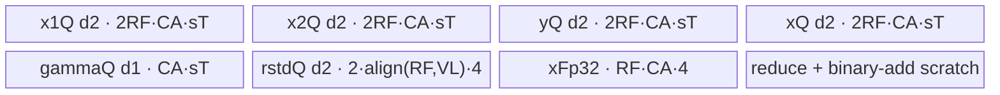
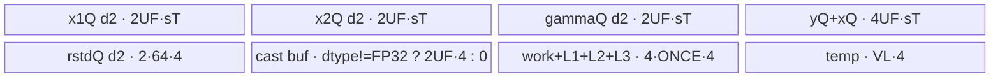

# AddRmsNorm 950 ACLNN 算子知识

## 算子速览

| 项目 | 内容 |
|---|---|
| 实际入口 | `aclnnAddRmsNormGetWorkspaceSize` + `aclnnAddRmsNorm`，公开 ACLNN 两段式接口，无更新版本 |
| 计算语义 | `x=x1+x2`；每个归一化行 `rstd=1/sqrt(mean(x^2)+epsilon)`；`y=x*rstd*gamma` |
| 输入输出 | ND；`x1/x2/gamma/y/x` 同 dtype（FP16/FP32/BF16），`rstd` FP32；归一化域为 `gamma` 对应的尾部维度 |
| 执行类型 | 单个 `AIV_VECTOR` Kernel；950 entry 显式 `KERNEL_TYPE_AIV_ONLY`，无 Cube/AIC/MIX_CV 可达节点 |
| Kernel 路线 | R-001 行全载 regbase（key 1000）；R-002 D 轴切分 regbase（key 2000） |
| 核心资源 | GM、双缓冲 TQue、FP32 TBuf/RegTensor；Host workspace 固定 `16 MiB + 256 B`，Kernel 未读 workspace |
| 来源闭包 | `source_closed`：公开 ACLNN→L0 launcher→950 selector/POD→AIV entry→两套 body/helper→950 config/OpDef 已闭合 |
| 验证状态 | 已完成源码闭包检查；本次知识提取未执行编译、真机、数值或性能测试。 |

## 接口与语义

### 计算语义

令 `D=gamma.GetShapeSize()`，`N=product(x1.shape[0:xRank-gammaRank])`。每行先以 FP32 语义形成 `x=x1+x2`，再计算 `rstd=1/sqrt(sum(x_i^2)/D+epsilon)`，输出 `y_i=x_i*rstd*gamma_i`、`rstd` 和 `x`。950 两条路线都生成三路内部输出；ACLNN 层仅对调用者非空的输出安排 `ViewCopy`。

### 输入、输出与属性

| 参数 | shape/layout | dtype | 约束、默认值与语义 |
|---|---|---|---|
| `x1` | ND，1–8 维 | FP16/FP32/BF16 | 必选；允许非连续，ACLNN 先 `Contiguous` |
| `x2` | 与 `x1` 相同 | 与 `x1` 相同 | 必选；逐元素相加 |
| `gamma` | 等于 `x1` 尾部若干维 | 与 `x1` 相同 | 必选；缩放权重 |
| `epsilon` | 标量 | Host `double`→算子属性 `float` | 必须 `>=0`，文档建议 `1e-6` |
| `yOut` | 与 `x1` 相同，ND | 与 `x1` 相同 | 必选 |
| `rstdOut` | 前导维同 `x1`、归一化维为 1 | FP32 | 可传空；非空时为倒均方根 |
| `xOut` | 与 `x1` 相同 | 与 `x1` 相同 | 可传空，但 `rstdOut` 非空时必须非空 |

### 入口与版本

固定仓只公开 `aclnnAddRmsNorm`，未发现更高版本。文档产品表明确支持 Ascend 950PR/950DT；`AddRmsNorm` OpDef 的 `ascend950` 配置将 `opFile.value` 指向 `add_rms_norm_apt`，950 binary config 覆盖 FP16/FP32/BF16，三层证据一致。Cast/Quant/DynamicQuant/Inplace 目录不属于本卡。

## Host/Launcher 执行流程

### 参数校验与前处理

`aclnnAddRmsNormGetWorkspaceSize` 创建 executor；`CheckParams` 先根据输出空指针选 mode 0/1/2，再依次校验必选指针、dtype、1–8 维及 shape。空 `x1` 或 `gamma` 直接返回 workspace 0。非空输入依次经 `l0op::Contiguous`，`ComputeAddRmsNorm` 调用 `l0op::AddRmsNorm`；后者分配三路连续中间输出并用 `ADD_TO_LAUNCHER_LIST_AICORE` 添加一个 AddRmsNorm 节点。随后按 mode 添加 `ViewCopy(y)`、可选 `ViewCopy(rstd)`、可选 `ViewCopy(x)`。任一步返回空指针或 launcher 失败即终止。

### 参数、Workspace 与生命周期

L0 将 `epsilon` 窄化为 `float` 属性。Tiling 将 `numCol=gamma.shape_size`、`numRow=product(x.shape[0:xRank-gammaRank])`，设置 `workspace[0]=256+16*1024*1024` B；该空间由 executor 汇总并由调用者在第二段接口提供。950 Kernel entry 没有 workspace 参数，故该固定值属于框架/系统 workspace，不是两条 body 的数据交接边。executor 从第一段成功返回后持有 launch 和 ViewCopy 序列，第二段在调用者 stream 上由 `CommonOpExecutorRun` 执行。

### 启动图与失败传播

单 Kernel 图：`aclnnAddRmsNorm` executor → `add_rms_norm(x1,x2,gamma,y,rstd,x,workspace,tiling)`，其中 950 实际 entry 参数无 workspace，按 key 1000/2000解析对应 POD；同一 stream 上随后执行输出 `ViewCopy`。节点 grid 为 `useCoreNum=ceil(numRow/blockFactor)`，`blockFactor=ceil(numRow/numCoreAiv)`；无节点间算子 workspace。Tiling/launcher 失败不会加入或执行后续 ViewCopy，Kernel 无 unknown-key fallback（未知 key 不写输出）。

## Route 与参数设计

### 分核与资源计算

`ubSize=平台 UB-1024`。`numColAlign=ceil(numCol*sizeof(T)/ubBlockSize)*ubBlockSize/sizeof(T)`。每核最多 `blockFactor=ceil(numRow/numCore)` 行，尾核 `rowWork=numRow-(blockNum-1)*blockFactor`。Host 计算 `binAddQuotient` 为小于 `numColAlign` 的最高 2 次幂（恰为 2 次幂时减半），并据 VReg/UB 算出 `rowFactor`。若全载公式得到 `rowFactor>=1`，取 R-001；否则改成 512 B 对齐列宽，按 `ComputeTotalBufSize` 倍增 `ubFactor` 并进入 R-002。

### Route 选择

| 顺序 | Route | Key/模板 | 精确选择条件与优先级 | 不适用去向 |
|---:|---|---|---|---|
| 1 | R-001 行全载 | 1000 / `KernelAddRmsNormRegBase<DTYPE_X1>` | `tmpSize=ubSize-1024-numColAlign*sizeof(T)>0` 且 `numColAlign<=vlfp32^2*4`，并且所得 `rowFactor>=1` | R-002 |
| 2 | R-002 D 轴切分 | 2000 / `KernelAddRmsNormRegBaseSplitD<DTYPE_X1>` | R-001 的 `rowFactor<1` | 无；Tiling 已校验 dtype/epsilon |

```text
IsRegbaseSocVersion(A5)
  -> compute rowFactor for full-row UB load
  -> rowFactor >= 1 ? key 1000 : key 2000
```

### 模板/实现执行矩阵

| Route | key/selector | dtype/shape/platform 完整命中条件 | 执行拓扑与 Kernel 节点 | 实际模板/body | 内存与同步特征 | tail/fallback |
|---|---|---|---|---|---|---|
| R-001 | 1000 | 950，FP16/FP32/BF16，完整行满足 Host UB 公式 | 单 AIV node | `KernelAddRmsNormRegBase<DTYPE_X1>::Process` | 行批量双缓冲，MicroAPI 寄存器计算，queue ordering | `curRows` 与 `UpdateMask` 保护尾行/尾列 |
| R-002 | 2000 | 950，FP16/FP32/BF16，R-001 不成立 | 单 AIV node | `KernelAddRmsNormRegBaseSplitD<DTYPE_X1>::Process` | 列 tile 双缓冲，多级归约 TBuf，pipe barrier | `calColNum`、512 B 补零和三级 tail 分支 |

### 隐藏性能 Guard

| Guard | Host/Tiling 条件 | Device/资源原因 | 影响 Route | 不满足时去向 | 源码符号 |
|---|---|---|---|---|---|
| 全载 UB | `rowFactor>=1` 的精确分母含四类双缓冲队列、FP32 区、rstd 与 binary-add 区 | R-001 同时驻留多行 x1/x2/y/x 与 FP32 sum | R-001 | R-002 | `TilingAddRmsNormRegbase` |
| 二分归约上限 | `numColAlign<=vlfp32*vlfp32*4` | binary-add scratch 的层级上限 | R-001 | R-002 | `TilingAddRmsNormRegbase` |
| 512 B tile | R-002 `numColAlign=ceil(bytes/512)*512/sizeof(T)` | `ComputeFormerImplV2` 以 512 B 对齐块归约 | R-002 | 无 | `TilingAddRmsNormRegbase`, `ComputeFormerHandle` |
| 非负 epsilon | `epsilon>=0` | 避免非法倒平方根输入参数 | 全部 | `GRAPH_FAILED` | `TilingAddRmsNormRegbase` |
| AIV-only | entry 执行 `KERNEL_TASK_TYPE_DEFAULT(KERNEL_TYPE_AIV_ONLY)` | 禁止 Cube task | 全部 | N/A | `add_rms_norm` in `add_rms_norm_apt.cpp` |

### POD/ABI

| 结构 | 字段 | 类型/位宽 | ABI 布局 | 单位 | Host/launcher producer | Device consumer | 边界 |
|---|---|---|---|---|---|---|---|
| `AddRMSNormRegbaseRFullLoadTilingData` | `numRow` | uint64/64 | 宏生成布局，固定仓未展开 sizeof/offsetof | 行 | `set_numRow(numRow)` | `Init` 分核 | shape 连乘为 uint64 |
| 同上 | `numCol` | uint64/64 | 同上 | 元素/行 | `set_numCol` | 搬运有效列 | gamma size |
| 同上 | `numColAlign` | uint64/64 | 同上 | 元素/行 | UB block 对齐 | UB stride | `>=numCol` |
| 同上 | `blockFactor` | uint64/64 | 同上 | 行/核 | `ceil(numRow/numCore)` | GM base | 尾核另算 |
| 同上 | `rowFactor` | uint64/64 | 同上 | 行/tile | UB 公式并截到 blockFactor | 行循环/分配 | `>=1` |
| 同上 | `binAddQuotient` | uint64/64 | 同上 | 元素 | 最高 2 次幂分界 | square reduce helper | 不大于对齐列 |
| 同上 | `epsilon` | float/32 | 同上 | 标量 | ACLNN double→L0 float→tiling | rstd helper | `>=0` |
| 同上 | `avgFactor` | float/32 | 同上 | 1/元素 | `1.0f/numCol` | rstd helper | numCol 0 时 0 |
| `AddRMSNormRegbaseTilingData` | `numRow` | uint32/32 | 宏生成布局，固定仓未展开 sizeof/offsetof | 行 | `set_numRow` | split Init | 950 split POD 窄化为 32 位 |
| 同上 | `numCol` | uint32/32 | 同上 | 元素/行 | `set_numCol` | 循环/地址 | 同上 |
| 同上 | `numColAlign` | uint32/32 | 同上 | 元素/行 | 512 B 对齐 | 当前 body 不读 | inactive |
| 同上 | `blockFactor` | uint32/32 | 同上 | 行/核 | Host | GM base | `>=1` |
| 同上 | `rowFactor` | uint32/32 | 同上 | 行/tile | 固定 64 | 行循环/rstd queue | 64 |
| 同上 | `ubFactor` | uint32/32 | 同上 | 元素/tile | UB 倍增循环 | 列循环 | 2 的幂 |
| 同上 | `epsilon` | float/32 | 同上 | 标量 | Host | `ComputeRstd` | `>=0` |
| 同上 | `avgFactor` | float/32 | 同上 | 1/元素 | Host | `ComputeRstd` | `1/numCol` |
| 同上 | `ubLoop` | uint32/32 | 同上 | tile 数 | 最大 2 次幂循环数 | master/tail 拆分 | `>=1` |
| 同上 | `colBuferLength` | uint32/32 | 同上 | 元素 | `ubFactor` | queue 容量 | 等于 ubFactor |
| 同上 | `multiNNum` | uint32/32 | 同上 | 行 | 0 | 当前 body 不读 | inactive |
| 同上 | `isNddma` | uint32/32 | 同上 | 布尔 | `numCol<512` 时 1 | 当前 950 split body 不读 | inactive；不据此声称 NDDMA |

### Route 源码闭包

| Route | Key/selector | Host/Tiling producer | POD/参数 | Kernel entry/router 节点 | Kernel body/直接依赖 | 构建接线 |
|---|---|---|---|---|---|---|
| R-001 | 1000 | `add_rms_norm_tiling_arch35.cpp::TilingAddRmsNormRegbase` | `AddRMSNormRegbaseRFullLoadTilingData` | `add_rms_norm_apt.cpp::add_rms_norm` | `KernelAddRmsNormRegBase` + `norm_common::CalculateSquareReduceSum/ComputeRstdNewtonRaphson` | OpDef `ascend950` + `ascend950/...binary.json` |
| R-002 | 2000 | 同上 | `AddRMSNormRegbaseTilingData` | 同上 | `KernelAddRmsNormRegBaseSplitD` + AddRmsNorm/rms_norm/norm_common reduce helpers | 同上 |

## Kernel 实现

### 公共执行流程

每个 AIV core 接管连续 `blockFactor` 行，尾核按剩余行缩短。两条路线都按 `CopyIn x1/x2 → FP32 add/square/reduce → rstd → gamma scaling → CopyOut y/rstd/x` 执行；TQue 的 EnQue/DeQue/FreeTensor 与 Vector `PipeBarrier`/MicroAPI `LocalMemBar` 建立 UB 阶段顺序。没有跨 Kernel workspace 或 atomic。

### Route R-001：行全载 regbase

#### 适用条件

##### 选择证据

| 层级 | 文件 | 符号 | 源码谓词/参数 | 结果/下一跳 |
|---|---|---|---|---|
| Host | `op_host/add_rms_norm_tiling.cpp` | `Tiling4AddRmsNorm` | `IsRegbaseSocVersion(context)` | 950 selector |
| Tiling | `op_host/add_rms_norm_tiling_arch35.cpp` | `TilingAddRmsNormRegbase` | `rowFactor>=1` | key 1000 |
| Router | `op_kernel/add_rms_norm_apt.cpp` | `add_rms_norm` | `TILING_KEY_IS(1000)` | `KernelAddRmsNormRegBase<DTYPE_X1>` |

#### Device 数据流

##### 函数级调用链

```text
add_rms_norm(key=1000)
  -> KernelAddRmsNormRegBase::Init
  -> Process -> CopyInGamma
    -> Compute -> CopyInXMutiMoveAlign -> CalculateXAdd -> CopyOutX
               -> CalculateSquareReduceSum -> ComputeRstdNewtonRaphson
               -> CopyOutRstd -> CalculateY -> CopyOutY
```

##### 源码等价伪码

```text
for rowTile in ceil(rowWork/rowFactor):
  curRows=min(rowFactor, remaining)
  DMA x1/x2[curRows,numCol] into UB with row stride numColAlign
  masked MicroAPI: fp32X=float(x1)+float(x2); xOut=cast_T(fp32X)
  reduce each fp32X row's squares with binAddQuotient; rstd=NR_rsqrt(sum*avg+epsilon)
  DMA rstd[curRows]
  for rows folded by 2 and VL_FP32 column chunks:
    y=cast_T(fp32X*broadcast(rstd)*float(gamma)), masked at numCol
  DMA xOut/y valid numCol columns only
```

#### 内存与数据搬运

##### 资源与搬运表

| 层级/缓冲区 | offset/地址公式 | extent/容量公式 | dtype/layout | producer | consumer | owner/lifetime | 对齐/复用 |
|---|---|---|---|---|---|---|---|
| GM x1/x2/y/x | `core*blockFactor*numCol + tile*rowFactor*numCol` | `curRows*numCol` | T, row-major ND | caller/kernel | copy/consumer | caller/executor | UB stride numColAlign |
| x1/x2 queues | 0 | each depth2 × `rowFactor*numColAlign*sizeof(T)` | T | DMA | CalculateXAdd | TPipe/tile | double buffer |
| gamma queue | 0 | `numColAlign*sizeof(T)` | T | DMA once | CalculateY | Process | depth1 |
| y/x queues | 0 | each depth2 × `rowFactor*numColAlign*sizeof(T)` | T | vector | DMA | TPipe/tile | double buffer |
| rstd queue | 0 | depth2 × `align(rowFactor,VL_FP32)*4` | FP32 | rstd helper | DMA/Y | tile | broadcast reuse |
| xFp32 | 0 | `rowFactor*numColAlign*4` | FP32 | CalculateXAdd | reduce/Y | TBuf/tile | retained through Y |
| reduce/binary scratch | 0 | `align(rowFactor,VL)*4 + binaryAddBufLen` | FP32 | reduce helper | reduce helper | TBuf/tile | LocalMemBar governed |

##### 分层内存布局



##### 字节账与复用顺序

```text
UB_total = 8*RF*CA*sizeof(T) + CA*sizeof(T)
         + 3*align(RF,VL_FP32)*4 + RF*CA*4 + binaryAddBufLen
binaryAddBufLen=align(ceil(binAddQuotient/VL_FP32),BLK_B32)*4*RF
workspace_total=16*1024*1024+256 B (framework/system; body does not read it)
dynamic_ub=N/A
=> Host rowFactor denominator is the conservative admission guard.
```

| 复用子区 | 写入者 | 读取者/消费点 | 下一次覆盖 | 同步或释放依据 | 安全条件 |
|---|---|---|---|---|---|
| xFp32 | `CalculateXAdd` | reduce + `CalculateY` | next row tile | functions complete before loop continues | y 必须消费后覆盖 |
| rstd queue slot | rstd helper | DMA then `CalculateY` | next tile | DeQue/FreeTensor | CopyOut 不释放，Y 后释放 |
| input queue slots | DMA | CalculateXAdd | next AllocTensor | DeQue/FreeTensor | double-buffer queue protocol |

#### 同步、精度与尾块

##### 同步与数值边界表

| 阶段 | primitive/机制 | producer | consumer/等待点 | 保护对象 | 精度/尾块 |
|---|---|---|---|---|---|
| DMA→vector | TQue EnQue/DeQue | DataCopyPad | CalculateXAdd | x/gamma UB | row padding不作为有效输出 |
| add/reduce | MicroAPI masks + helper barriers | x registers | reduction | FP32 scratch | `UpdateMask` 限制有效列 |
| reduce→Y | queue + function order | rstd helper | CalculateY | rstd/xFp32 | FP32 rstd；FP16/BF16 最终 store cast |
| tail | `curRows`, `reduceNum=numCol` | Host POD | all loops | GM | 尾核/尾行/尾列均缩短 |

#### 关键实现

##### 符号证据表

| 阶段 | 文件 | 符号/模板实例 | 实现事实 |
|---|---|---|---|
| Host/Tiling producer | `op_host/add_rms_norm_tiling_arch35.cpp` | `TilingAddRmsNormRegbase` | 全载 UB 公式、key 1000、POD |
| Kernel entry/router | `op_kernel/add_rms_norm_apt.cpp` | `add_rms_norm`, key 1000 | AIV-only 与模板映射 |
| Device body/helper | `op_kernel/arch35/add_rms_norm_regbase.h` | `KernelAddRmsNormRegBase::{Process,CalculateXAdd,CalculateY}` | row folding、mask、DMA 与 UB 生命周期 |
| Device body/helper | `op_kernel/arch35/add_rms_norm_regbase_common.h` | reduction helpers | MicroAPI FP32 归约同步 |
| Device body/helper | `norm/norm_common/op_kernel/reduce_common_regbase.h` | `CalculateSquareReduceSum`, `ComputeRstdNewtonRaphson<true,true>` | 按 VL/2VL/二分支路平方归约；先乘 avg，再 epsilon 与 Newton-Raphson 倒平方根 |

### Route R-002：D 轴切分 regbase

#### 适用条件

##### 选择证据

| 层级 | 文件 | 符号 | 源码谓词/参数 | 结果/下一跳 |
|---|---|---|---|---|
| Host | `op_host/add_rms_norm_tiling.cpp` | `Tiling4AddRmsNorm` | regbase SoC | 950 selector |
| Tiling | `op_host/add_rms_norm_tiling_arch35.cpp` | `TilingAddRmsNormRegbase` | full-load `rowFactor<1` | key 2000 |
| Router | `op_kernel/add_rms_norm_apt.cpp` | `add_rms_norm` | `TILING_KEY_IS(2000)` | split-D body |

#### Device 数据流

##### 函数级调用链

```text
add_rms_norm(key=2000)
  -> KernelAddRmsNormRegBaseSplitD::Process
    -> SubProcess
      -> ComputeFormer -> ComputeFormerHandle -> ComputeFormerImplV2
                        -> ComputeSum/ComputeMultiLevelReduce/ComputeMultiLevelRstd
      -> ComputeRstd
      -> ComputeLatter -> CopyInGamma/CopyInX -> ComputeLatterY -> CopyOutY/X
      -> CopyOutRstd
```

##### 源码等价伪码

```text
for rowBatch of up to 64 rows:
  rstd=0
  for each row:
    decompose numCol into masterLoop, paired tailLoop, tail around ubFactor
    load x1/x2 tiles; zero-pad to 32/512 B; fp32 add+square
    fold partial sums through level1/2/3 buffers into row rstd accumulator
  rstd = 1/sqrt(rstd*avgFactor + epsilon)
  for colTile in ceil(numCol/ubFactor):
    load gamma tile
    for row: load x1/x2, fp32 add, y=x*rstd*gamma, materialize x, write valid calColNum
  write calRowNum rstd values
```

#### 内存与数据搬运

##### 资源与搬运表

| 层级/缓冲区 | offset/地址公式 | extent/容量公式 | dtype/layout | producer | consumer | owner/lifetime | 对齐/复用 |
|---|---|---|---|---|---|---|---|
| input/gamma/output queues | `row*numCol+tile*ubFactor` | five T queues each depth2 × `ubFactor*sizeof(T)` | T | DMA/vector | reduce/Y/DMA | TPipe/tile | tail padded |
| rstd queue | row batch | depth2 × `64*4` | FP32 | ComputeRstd | Y/DMA | row batch | reused across col tiles |
| xFp32 pair | 0 | conditional 2 × `ubFactor*4` | FP32 | cast/add | ComputeLatterY | tile | absent for FP32 |
| level buffers | 0 | four × `ONCE_VECTOR_SIZE*4` + `V_LENGTH*4` | FP32 | partial reduce | next level | row | barriers in helpers |

##### 分层内存布局



##### 字节账与复用顺序

```text
UB_total = 10*ubFactor*sizeof(T) + 2*64*4
         + (T!=float ? 2*ubFactor*4 : 0)
         + 4*ONCE_VECTOR_SIZE*4 + V_LENGTH*4
workspace_total=16*1024*1024+256 B; dynamic_ub=N/A
=> ubFactor is doubled only while ComputeTotalBufSize(2,T,sizeof(T),2*ubFactor,true)<ubSize.
```

| 复用子区 | 写入者 | 读取者/消费点 | 下一次覆盖 | 同步或释放依据 | 安全条件 |
|---|---|---|---|---|---|
| level1/2/3 | partial reduce | multi-level reducer | next row/tile | `ComputeMultiLevelReduce` + barriers | each level consumed before compaction |
| rstdLocal | ComputeRstd | every ComputeLatter + CopyOut | next row batch | CopyOut after all col tiles | must remain live through Y |
| x1 local | DMA/add | `ComputeLatterY` (FP32 direct) | queue free | PipeBarrier + FreeTensor | output computed before free |

#### 同步、精度与尾块

##### 同步与数值边界表

| 阶段 | primitive/机制 | producer | consumer/等待点 | 保护对象 | 精度/尾块 |
|---|---|---|---|---|---|
| load padding | DataCopyPad/DataCopyImpl | GM | reduce | input UB | 32/512 B 右侧补零 |
| multi-level reduce | PipeBarrier/LocalMemBar | partial sum | next level | L1/L2/L3 | FP32 sum |
| normalize | `ComputeRstd` | row sums | latter pass | rstdLocal | epsilon/avg FP32 |
| output | queue ordering | ComputeLatterY | DMA | y/x queues | only `calColNum` copied to GM |

#### 关键实现

##### 符号证据表

| 阶段 | 文件 | 符号/模板实例 | 实现事实 |
|---|---|---|---|
| Host/Tiling producer | `op_host/add_rms_norm_tiling_arch35.cpp` | `TilingAddRmsNormRegbase` | split POD、UB tile、key 2000 |
| Kernel entry/router | `op_kernel/add_rms_norm_apt.cpp` | key 2000 branch | dtype-specialized AIV body |
| Device body/helper | `op_kernel/arch35/add_rms_norm_regbase_split_d.h` | `ComputeFormer`, `ComputeLatter` | 三阶段 tail、二遍扫描、输出 |
| Device body/helper | `op_kernel/arch35/add_rms_norm_regbase_common.h` | `ComputeFormerImplV2`, `ComputeLatterY` | masked FP32 add/reduce/scale/cast |
| Device body/helper | `norm/rms_norm/op_kernel/arch35/rms_norm_regbase_common.h` | `ComputeMultiLevelReduce`, `ComputeSum`, `ComputeRstd` | 每 256 个 partial sum 向高层折叠，并执行 `1/sqrt(sum*avg+epsilon)` |
| Device body/helper | `norm/norm_common/op_kernel/reduce_common_regbase.h` | `ComputeMultiLevelRstd` | 末级 partial sum 选择与合并 |

## 算子特定优化

### Trick T-001：全载路线按两行折叠并复用一次 gamma

#### 触发与源码依据

- 适用 Route：R-001
- 触发条件：Host 全载 `rowFactor>=1`，Device `curRows>=2` 时进入成对行循环。
- Golden 来源：[`op_kernel/arch35/add_rms_norm_regbase.h:203-219`](../../../../../../../cann-ops-raw/ascendc/ops-nn/955f8b33985b6d72989ebff341bb9c2c564a51bc/norm/add_rms_norm/op_kernel/arch35/add_rms_norm_regbase.h#L203-L219)

**官方源码（固定 Commit 连续逐字摘录）**：

```cpp
for (uint16_t i = 0; i < loopRowsFold; ++i) {
    uint32_t sregCount = reduceNum;
    DataCopy<float, LoadDist::DIST_BRC_B32>(rstd1Reg, rstdInUb + 2 * i);
    DataCopy<float, LoadDist::DIST_BRC_B32>(rstd2Reg, rstdInUb + (2 * i + 1));
    for (uint16_t r = 0; r < loopCols; ++r) {
        uint32_t offset1 = (2 * i) * numColAlign + r * VL_FP32;
        uint32_t offset2 = (2 * i + 1) * numColAlign + r * VL_FP32;
        MaskReg regCurLoop = UpdateMask<float>(sregCount);
        LoadRegForDtype<float>(xFp32Tmp, x1Reg, regCurLoop, offset1);
        LoadRegForDtype<float>(xFp32Tmp, x2Reg, regCurLoop, offset2);
        Mul(mul1Reg, x1Reg, rstd1Reg, regCurLoop);
        Mul(mul1UnrollReg, x2Reg, rstd2Reg, regCurLoop);
        LoadRegForDtype<T>(gammaInUb, gammaReg, regCurLoop, r * VL_FP32);
        Mul(mul2Reg, mul1Reg, gammaReg, regCurLoop);
        Mul(mul2UnrollReg, mul1UnrollReg, gammaReg, regCurLoop);
```

#### 机制与设计原因

同一列块只装载一次 gamma 寄存器，同时对两行广播各自 rstd 并并行完成两组乘法，减少 gamma 的重复寄存器装载；`UpdateMask` 由剩余有效列驱动，保留尾列安全。该结论只说明源码级搬运/调度变化，不声称实测收益。

#### 迁移边界

- 适用：同一权重跨多行的逐行归一化。
- 前提：整行驻留 UB、两行共享 gamma、FP32 中间值尚存活。
- 失效：行不能全载时使用 R-002；奇数尾行走单行循环。
- 未验证：本次知识提取未执行编译、真机、数值或性能测试。

#### 错误做法

固定仓未提供可验证反例。

### Trick T-002：Split-D 用分级在线归约避免整行 FP32 物化

#### 触发与源码依据

- 适用 Route：R-002
- 触发条件：R-001 UB guard 失败；列域按 `ubFactor` 分块。
- Golden 来源：[`op_kernel/arch35/add_rms_norm_regbase_split_d.h:175-216`](../../../../../../../cann-ops-raw/ascendc/ops-nn/955f8b33985b6d72989ebff341bb9c2c564a51bc/norm/add_rms_norm/op_kernel/arch35/add_rms_norm_regbase_split_d.h#L175-L216)

**官方源码（固定 Commit 连续逐字摘录）**：

```cpp
for (uint32_t repeat = 0; repeat < tailLoop; repeat++) {
    ComputeFormerHandle(tempLocal, offset, 0, ubFactor, ubFactor);
    offset += ubFactor;
    ComputeFormerHandle(tempLocal, offset, 1, ubFactor, ubFactor);
    offset += ubFactor;
    ComputeSum(level1Local, tempLocal, level1, SUM_COUNT);
    level1 += 1;
    ComputeMultiLevelReduce(level1Local, level2Local, level3Local, level1, level2, level3);
}
```

#### 机制与设计原因

每两个列 tile 先合并到 `level1`，再在线压缩到更高层，因而只保留固定大小的 work/L1/L2/L3 scratch，而不在 UB 中物化整行 FP32 平方数组。tail 分为 `<=ubFactor/2` 与 `>ubFactor/2`，配合补零保证归约只计有效元素。

#### 迁移边界

- 适用：归一化轴超过整行 UB 容量的 reduce-then-scale 算子。
- 前提：可重读 GM 做第二遍 Y/x 输出，且 FP32 分级和顺序满足精度要求。
- 失效：整行可载时 R-001 更直接；不能重读输入时需额外持久化介质。
- 未验证：本次知识提取未执行编译、真机、数值或性能测试。

#### 错误做法

固定仓未提供可验证反例。

## 模板与实现对比

| 对比维度 | R-001 行全载 | R-002 Split-D | 设计选择依据 |
|---|---|---|---|
| 命中条件/优先级 | `rowFactor>=1` | 否则 | Host UB admission |
| 模板与 dtype | `KernelAddRmsNormRegBase<DTYPE_X1>`，三 dtype binary | `KernelAddRmsNormRegBaseSplitD<DTYPE_X1>` | 950 binary dtype 专门化 |
| 循环与分核 | core→row tile→两行折叠→VL | core→row batch→row→col tile→第二遍 col tile | 是否能保留整行 |
| Queue/TBuf/寄存器/dynamic UB/通信 window | 多行双缓冲 + xFp32 + binary scratch | tile 双缓冲 + 分级 scratch | 无 dynamic UB/通信 |
| 内存总占用与复用 | 与 RF×CA 成正比 | 与 UF 成正比，固定 levels | Host 选择约束 |
| 搬运/Vector/SIMT/NDDMA/通信 API | strided DataCopyPad + MicroAPI | DataCopyImpl + Vector/MicroAPI | 均为 AIV_VECTOR；未使用 SIMT/NDDMA/通信 |
| 同步、精度与 tail | mask、queue、FP32 reduce | padding、barrier、多级 FP32 reduce | 两者最终 cast 到 T |
| fallback/失败边界 | guard 失败→R-002 | unknown key/非法参数失败 | 无第三路线 |

## 平台差异

| 项目 | A2 | A3 | 950 |
|---|---|---|---|
| 支持状态 | 公开支持；见无后缀卡 | 公开支持；见无后缀卡 | 公开支持，本卡 |
| Host/Launcher | 通用 5-route selector | 同 A2 | regbase selector，只产 1000/2000 |
| Kernel/资源 | 常规 AscendC Vector classes | 同 A2 | AIV-only arch35 MicroAPI、双缓冲与分级归约 |

## 限制与失败边界

- ACLNN shape/dtype/指针约束失败分别返回 `ACLNN_ERR_PARAM_NULLPTR` 或 `ACLNN_ERR_PARAM_INVALID`；epsilon 负值在 Tiling 返回 `GRAPH_FAILED`。
- 空 `x1` 或 `gamma` 在 ACLNN 层直接成功返回且 workspace 为 0，不启动 Kernel；Tiling 自身拒绝空 x1，因此两层边界不可互换。
- 950 split POD 把 `numRow/numCol` 写入 uint32 字段；固定仓未见显式溢出检查，超出范围不得推断行为。
- `isNddma` 被 Host 写入但 950 split body 不读取；`MultiCopyParams` 成员也未被调用，故本卡不将其判为 NDDMA 节点。
- 本次知识提取未执行编译、真机、数值或性能测试。

## 源码索引

### 链路索引

| 链路阶段 | 文件 | 关键符号 | 支撑内容 |
|---|---|---|---|
| 入口声明/约束 | `norm/add_rms_norm/docs/aclnnAddRmsNorm.md` | `aclnnAddRmsNorm*` | 产品、参数、公开语义 |
| 入口实现 | `norm/add_rms_norm/op_host/op_api/aclnn_add_rms_norm.cpp` | `CheckParams`, `ComputeAddRmsNorm`, 两段入口 | ACLNN 校验、空域、executor |
| 入口实现 | `norm/add_rms_norm/op_host/op_api/add_rms_norm.cpp` | `l0op::AddRmsNorm` | 中间输出和 launcher |
| Host/Tiling/Launcher | `norm/add_rms_norm/op_host/add_rms_norm_tiling.cpp` | `Tiling4AddRmsNorm` | regbase 分流与公共校验 |
| Host/Tiling/Launcher | `norm/add_rms_norm/op_host/add_rms_norm_tiling_arch35.cpp` | `TilingAddRmsNormRegbase` | 950 key/POD/UB/workspace |
| Host/Tiling/Launcher | `norm/add_rms_norm/op_host/add_rms_norm_tiling.h` | POD definitions | 字段顺序/位宽 |
| Kernel entry/body | `norm/add_rms_norm/op_kernel/add_rms_norm_apt.cpp` | `add_rms_norm` | AIV-only router |
| Kernel entry/body | `norm/add_rms_norm/op_kernel/arch35/add_rms_norm_regbase.h` | `KernelAddRmsNormRegBase` | R-001 |
| Kernel entry/body | `norm/add_rms_norm/op_kernel/arch35/add_rms_norm_regbase_split_d.h` | `KernelAddRmsNormRegBaseSplitD` | R-002 |
| Kernel entry/body | `norm/add_rms_norm/op_kernel/arch35/add_rms_norm_regbase_common.h` | reduction/Y helpers | MicroAPI 直接依赖 |
| Kernel entry/body | `norm/rms_norm/op_kernel/rms_norm_base.h` | `DataCopyImpl`, 常量/traits | 950 DMA、queue 常量与 dtype helper |
| Kernel entry/body | `norm/rms_norm/op_kernel/arch35/rms_norm_regbase_common.h` | `ComputeMultiLevelReduce`, `ComputeSum` | Split-D 分级归约 |
| Kernel entry/body | `norm/norm_common/op_kernel/reduce_common_regbase.h` | square-reduce/rstd helpers | R-001 二分平方归约、Newton-Raphson；R-002 rstd merge |
| 构建接线 | `norm/add_rms_norm/op_host/add_rms_norm_def.cpp` | `AddRmsNorm` OpDef | `ascend950`→`add_rms_norm_apt` |
| 构建接线 | `norm/add_rms_norm/op_host/config/ascend950/add_rms_norm_binary.json` | `AddRmsNorm_fp16/fp32/bf16` | 950 dtype binary |

### 实现复用检查

| 检查项 | 可复用事实 | 不得改变的约束 | 源码符号 |
|---|---|---|---|
| ABI/POD | 两套 key/POD 对应两 body | 字段顺序、64/32 位差异、inactive 字段 | `add_rms_norm_tiling.h` |
| 调用顺序 | add→reduce→rstd→scale，单 AIV node | R-002 必须二遍读，R-001 rstd 在 Y 后释放 | 两个 `Process` |
| workspace/内存 | workspace 非节点间数据边 | queue depth 必须计入；950 body 不读 workspace | Tiling + InitBuffer |
| 同步 | queue/barrier/LocalMemBar | 不得提前覆盖 FP32/rstd/level scratch | body/helpers |
| 精度与尾块 | FP32 add/reduce/rstd，mask/pad tail | 有效 GM 只写 numCol/calColNum | Calculate*/Compute* |
| 失败边界 | full-load 自动落 split | unknown key、负 epsilon、窄化边界不可补推 | Tiling/router |