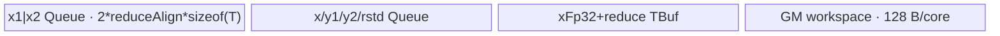

# AddRmsNormCast 950 ACLNN 算子知识

## 算子速览

| 项目 | 内容 |
|---|---|
| 实际入口 | `aclnnAddRmsNormCastGetWorkspaceSize` + `aclnnAddRmsNormCast`，公开两段式 ACLNN；950 使用同一无版本后缀入口的 arch35/regbase 最新公开实现。 |
| 计算语义 | `x=cast_T(fp32(x1)+fp32(x2))`，`rstd=1/sqrt(sum(x_fp32^2)/N+epsilon)`，`y1=x_fp32*rstd*fp32(gamma)`，`y2=cast_T(y1)`；其中参与 y 的 `x_fp32` 是加法的 FP32 中间值。 |
| 输入输出 | `x1/x2/gamma: ND, FP16/BF16`；`y1/rstd: FP32`；`y2/x: FP16/BF16`；`M` 为外层行数、`N=numel(gamma)`。 |
| 执行类型 | 单 entry、单 Device 节点：AIV_VECTOR/MicroAPI；R-002 的 GM→UB 可选择 NDDMA，仍是同一 AIV Kernel 内搬运分支。entry 标记 `KERNEL_TYPE_MIX_AIV_1_0`，不含 AIC/Cube/MIX_CV。 |
| Kernel 路线 | R-001 key103 HighPerformance；R-002 key100 Normal/Cut-M；R-003 key102 Single-N；R-004 key101 Split-N；R-005 key199 Empty。 |
| 核心资源 | GM、AIV UB Queue/TBuf/RegTensor；Split-N 用户 workspace；Single-N 128 B/core workspace 与 `SyncAll`；NDDMA/`DataCopyPad` 二选一搬运。 |
| 来源闭包 | `source_closed`：公开 ACLNN→OpDef/生成 bridge 边界→regbase selector/POD→APT router→全部 100/101/102/103/199 body/helper→Ascend 950 binary config。 |
| 验证状态 | 已完成源码闭包检查；本次知识提取未执行编译、真机、数值或性能测试。 |

## 接口与语义

### 计算语义

`x1` 的 gamma 对应尾维展平为 N，其余维展平为 M 行。950 的 regbase reduce helper在寄存器中把 FP16/BF16 输入升到 FP32 相加，同时可将和分别落成低精度 `xOut` 与 FP32 `xOutTmp`。归约对 `xOutTmp²` 求和，之后计算 rstd；`ComputeY/ComputeYMulti` 以 FP32 中间值乘 rstd 和升精度 gamma，直接写 FP32 `y1`，并按 `castTraitB322B16` 写低精度 `y2`。

### 输入、输出与属性

| 参数 | shape/layout | dtype | 约束、默认值与语义 |
|---|---|---|---|
| `x1` | ND，最多 8 维 | FP16/BF16 | 与 `x2/y1/y2/x` 同 shape；950 Tiling 允许零元素并走 key199。 |
| `x2` | 同 x1 | 同 x1 | 必选，加数。 |
| `gamma` | x1 的末尾若干维 | 同 x1 | 必选，元素数为 N。 |
| `epsilon` | 标量属性 | double 入口，POD float | 默认 `1e-6`；950 regbase Host 未像旧 Tiling 那样显式拒绝负值。 |
| `y1Out` | 同 x1，连续 ND | FP32 | 未降精度的归一化乘积。 |
| `y2Out` | 同 x1，连续 ND | FP16/BF16 | `y1` 的降精度输出。 |
| `rstdOut` | x1 前缀 shape | FP32 | 每行一个 rstd。 |
| `xOut` | 同 x1，连续 ND | FP16/BF16 | Add 输出。 |

### 入口与版本

README/API 产品表明确支持 Ascend 950PR/950DT；OpDef 为 `ascend950` 指定 `add_rms_norm_cast_apt`，binary config 同时列出 FP16/BF16。`Tiling4AddRmsNormCast` 通过 `IsRegbaseSocVersion` 转入 `AddRmsNormCastRegbaseTiling`，不存在另一个更高版本公开 ACLNN，因此本卡提取这一 950 实现。ACLNN executor 生成代码不可见，被严格界定为框架 bridge；算子自有 selector、POD、entry/body 与构建接线均已追到。

## Host/Launcher 执行流程

### 参数校验与前处理

ACLNN/OpDef 负责空指针、dtype、连续化和输出约束；regbase `GetShapeAttrsInfo` 检查所有必选 shape 非空、x1/x2 维数不超过 8、各维非负、`x1/x2/y1/y2/x` 完全同形、gamma 是 x1 的尾维。`CheckInputDtype` 只检查 x1/x2/gamma 三者相等，实际支持集合由 OpDef/binary config 限定为 FP16/BF16。零 M 或 N 设置 `needRun=false`，而不是失败。

### 参数、Workspace 与生命周期

`M=prod(x1前缀维)`，`N=prod(gamma维)`；`dtypeAlign=32/sizeof(T)`，`reduceAlign=512/sizeof(T)`，`V_LENGTH=VRegBytes/4`。`mPerCore=ceil(M/AIVCoreNum)`，`usedCoreNum=ceil(M/mPerCore)`，末核 `mLastCore=M-(usedCoreNum-1)*mPerCore`。Normal/HighPerformance 用户 workspace 为 0；Split-N 为 `usedCoreNum*N*4` B，每核 slice `[blockIdx*N,(blockIdx+1)*N)`；Single-N 为 `usedCoreNum*128` B；系统 workspace 追加 `GetLibApiWorkSpaceSize()`。executor、用户/系统 workspace 到 stream 完成前有效。

### 启动图与失败传播

单节点图：executor 启动 `add_rms_norm_cast`，entry 读取 `AddRmsNormCastRegbaseTilingData`，按 key 构造一个 AIV 模板。100/101/102/103 均在一个 Kernel 节点内完成四输出；199 是显式空 body。没有跨 Kernel 边。Split-N 的 workspace 是同节点内部 GM 暂存边，producer `ComputeFormerHandle` 写每核 FP32 xTmp slice，consumer `SubProcessY` 同核读回；V_MTE3→MTE3_V 建立可见性。Single-N 在 core 数大于 7 时每核把 rstd 写独占 128 B 页面，`SyncAll` 后 block0 compact gather 并写最终 rstd；失败的 Tiling/overflow 直接阻断 launch。

## Route 与参数设计

### 分核与资源计算

selector 先尝试 HighPerformance：`baseN=N`、`baseNDtypeAlign=align(N,32/sizeof(T))`，扣除 1024 B 与 gamma 后，以双缓冲公式求 `baseM`，并要求 `baseNDtypeAlign<=16384`、`baseM>=1`、`mPerCore>1`。否则依次检查整核不切、Cut-M、Cut-N。Normal/Cut-M 的 Host UB 账由 `CalUBTotalSize(baseM,N)` 给出；Split-N 从 `reduceAlign` 起按 2 倍扩大 `powerSplit` 到 UB 上限，再取最大 2 的幂 `powerLoop`。所有可运行路线 `blockDim=usedCoreNum`。

### Route 选择

| 顺序 | Route | Key/模板 | 精确选择条件与优先级 | 不适用去向 |
|---:|---|---|---|---|
| 1 | R-005 Empty | 199 | `M==0 \|\| N==0`，最终覆盖其它 tiling key | 空 Kernel |
| 2 | R-001 HighPerformance | 103 | `baseNDtypeAlign<=16384` 且双缓冲公式求得 `baseM>=1` 且 `mPerCore>1` | R-002/R-003 尝试不切 |
| 3 | R-002 Normal/Cut-M | 100 | HighPerformance 不适用；`CalUBTotalSize(mPerCore,N)<maxUB` 或 `CalUBTotalSize(1,N)<=maxUB`，且 `mPerCore>1` | R-003（若单行）或 R-004 |
| 4 | R-003 Single-N | 102 | 同一“不切/Cut-M 可容纳”条件，但 `mPerCore==1` | R-004 |
| 5 | R-004 Split-N | 101 | 前述均不适用，且 `CalUBTotalSize(1,reduceAlign,SPILT)<=maxUB` | 否则 `GRAPH_FAILED` |

```text
if empty: key199
else if HP_ub_formula gives baseM>=1 and mPerCore>1 and alignN<=16384: key103
else if full-mPerCore fits: key100 if mPerCore>1 else key102
else if one-row fits: choose Cut-M baseM; key100 if mPerCore>1 else key102
else if minimal split-N tile fits: key101
else: tiling failure
```

### 模板/实现执行矩阵

| Route | key/selector | dtype/shape/platform 完整命中条件 | 执行拓扑与 Kernel 节点 | 实际模板/body | 内存与同步特征 | tail/fallback |
|---|---|---|---|---|---|---|
| R-001 HighPerformance | 103 | 950 FP16/BF16；HP 谓词 | 单 AIV | `KernelAddRmsNormCastRegBaseHighPerformance<T>` | 双缓冲、MicroAPI、Newton-Raphson rstd | 尾 M tile、mask N tail |
| R-002 Normal/Cut-M | 100 | 950；整 N 可载且每核多行 | 单 AIV，CopyIn 内含 NDDMA/Pad 分支 | `KernelAddRmsNormCastRegBaseNormal<T>` | depth1 Queue；FP32 xTmp；N<512 用 NDDMA | 末核/末 M tile |
| R-003 Single-N | 102 | 950；整 N 可载、每核一行 | 单 AIV + 可选全核同步 | `KernelAddRmsNormCastRegBaseSingleN<T>` | 组合 x1/x2 Queue；128 B/core workspace | `GetBlockNum()>7` 合并 rstd |
| R-004 Split-N | 101 | 950；整 N 一行不进 UB | 单 AIV | `KernelAddRmsNormCastRegBaseSpiltReduce<T>` | 多级归约 TBuf；FP32 workspace xTmp | N tile/tail 多阶段 |
| R-005 Empty | 199 | M/N 为 0 | 单 entry 空 body | router `else if (199)` | 无 UB/GM 访问 | 正常无输出写 |

### 隐藏性能 Guard

| Guard | Host/Tiling 条件 | Device/资源原因 | 影响 Route | 不满足时去向 | 源码符号 |
|---|---|---|---|---|---|
| HP N 上限 | `baseNDtypeAlign<=16384` | 双缓冲与寄存器二分归约上界 | R-001 | R-002/3/4 | `SetTilingParams` |
| NDDMA 阈值 | `isNddma=(N<512)` | 小 N 多行搬运用 5D `MultiCopyParams`，大 N 用 `DataCopyPad` | R-002 | 同 Route 的 Pad 分支 | `SetInputParams`、`Compute` |
| 512 B reduce 对齐 | `baseNReduceAlign=align(baseN,512/sizeof(T))` | `ReduceSumRstd*` 按 `2*V_LENGTH` 分块 | R-002/3/4 | padding 置零 |
| Single-N 全核合并 | `GetBlockNum()>7` | rstd 的逐核小块写先落 128 B page，再 compact gather | R-003 | `<=7` 直接写 rstd | `MAGIC_CONDITION` |
| workspace overflow | `N <= UINT64_MAX/usedCoreNum/4` | Split-N slice 乘法 | R-004 | `GRAPH_FAILED` | `GetWorkspaceSize` |
| 空域 | `!needRun` | 避免零 core/循环下溢 | R-005 | key199 | `GetTilingKey` |

### POD/ABI

`BEGIN_TILING_DATA_DEF` 的宏生成结构在固定仓未输出 `sizeof/alignof/offsetof` 常量；下表保留源码声明顺序，复用时必须由同一生成宏序列化，不能手工假定无尾 padding。

| 结构 | 字段 | 类型/位宽 | ABI 布局 | 单位 | Host/launcher producer | Device consumer | 边界 |
|---|---|---|---|---|---|---|---|
| `AddRmsNormCastRegbaseTilingData` | `numN` | uint64/64 | 第1字段 | 元素/行 | `SetInputParams` | 全 body GM stride | 乘积 uint64 |
| 同上 | `numM` | uint64/64 | 第2字段 | 行 | 同上 | 分核 | 可为0→199 |
| 同上 | `baseN` | uint64/64 | 第3字段 | 元素 | `SetTilingParams` | tile/body | Route相关 |
| 同上 | `baseM` | uint64/64 | 第4字段 | 行/tile | 同上 | M loop | 至少1（运行路线） |
| 同上 | `baseNReduceAlign` | uint64/64 | 第5字段 | 元素 | `align(baseN,512/sizeof(T))` | reduce/UB | 零 padding |
| 同上 | `baseNDtypeAlign` | uint64/64 | 第6字段 | 元素 | `align(baseN,32/sizeof(T))` | DMA/stride | dtype 对齐 |
| 同上 | `powerLoop` | uint64/64 | 第7字段 | 循环 | Split-N producer | Split-N stage | 其它路线 inactive |
| 同上 | `powerSplit` | uint64/64 | 第8字段 | 元素 | 二的幂公式 | reduce helper | power-of-two |
| 同上 | `mLastCore` | uint64/64 | 第9字段 | 行 | 分核公式 | 末核 | 非零运行路线 |
| 同上 | `mPerCore` | uint64/64 | 第10字段 | 行 | `ceil(M/core)` | 核 offset | Route guard |
| 同上 | `avgFactor` | float/32 | 第11字段 | 1/元素 | `1/N` | rstd helper | N=0 时0 |
| 同上 | `epsilon` | float/32 | 第12字段 | 数值 | attr | rstd helper | 950 无显式非负 check |
| 同上 | `isNddma` | uint32/32 | 第13字段 | 布尔 | `N<512` | Normal CopyIn | 仅 R-002 读取 |

### Route 源码闭包

| Route | Key/selector | Host/Tiling producer | POD/参数 | Kernel entry/router 节点 | Kernel body/直接依赖 | 构建接线 |
|---|---|---|---|---|---|---|
| R-001 | 103 | `tiling_arch35.cpp::SetTilingParams` | regbase POD | `add_rms_norm_cast_apt.cpp` | `...high_performance.h` + reduce helpers | ascend950 binary JSON |
| R-002 | 100 | 同上 | 同上 | 同上 | `...regbase.h` + common/reduce helpers | 同上 |
| R-003 | 102 | 同上 | 同上 | 同上 | `...single_n.h` + common/reduce helpers | 同上 |
| R-004 | 101 | 同上 | 同上 | 同上 | `...spilt_reduce.h` + common/reduce helpers | 同上 |
| R-005 | 199 | `GetTilingKey` | 同上 | router empty branch | 无 body | 同上 |

## Kernel 实现

### 公共执行流程

APT entry 仅在 `__CCE_AICORE__==310` 编译，声明 `KERNEL_TYPE_MIX_AIV_1_0` 并按 key 选择一个 AIV 类。运行路线共享的 MicroAPI helper把一行对半展开，`UpdateMask` 保护 N tail；`ReduceSumRstd/Multi` 在寄存器完成 FP32 Add、可选 x/xFp32 物化、平方归约和 rstd；`ComputeY/Multi` 广播单行 rstd、加载并升精度 gamma，同时写 FP32 y1 与 pack B16 y2。

### Route R-001：HighPerformance 双缓冲多行

#### 适用条件

##### 选择证据

| 层级 | 文件 | 符号 | 源码谓词/参数 | 结果/下一跳 |
|---|---|---|---|---|
| Host | `op_host/add_rms_norm_cast_tiling_arch35.cpp` | `SetTilingParams` | HP UB 公式、alignN<=16384、baseM>=1、mPerCore>1 | key103 |
| Router | `op_kernel/add_rms_norm_cast_apt.cpp` | `add_rms_norm_cast` | key103 | HighPerformance body |

#### Device 数据流

##### 函数级调用链

```text
Process -> CopyInGamma -> per baseM tile Compute
  -> CopyInXMutiMoveAlign -> CalculateXAdd -> CopyOutX
  -> CalculateSquareReduceSum -> ComputeRstdNewtonRaphson -> CopyOut rstd
  -> CalculateY1Y2 -> CopyOutY1Y2
```

##### 源码等价伪码

```text
for rows tile:
  2D DMA x1/x2; MicroAPI fp32 add; simultaneously store xOut(T) and xFp32
  binary-tree square reduce per row; Newton-Raphson rstd
  for row pairs and N vector chunks: broadcast rstd; load gamma; y=x*rstd*gamma
  store y1(fp32), y2(T), rstd, x
```

#### 内存与数据搬运

##### 资源与搬运表

| 层级/缓冲区 | offset/地址公式 | extent/容量公式 | dtype/layout | producer | consumer | owner/lifetime | 对齐/复用 |
|---|---|---|---|---|---|---|---|
| x1/x2/x/y2 queues | UB | each `depth2*baseM*alignN*sizeof(T)` | T | DMA/Vector | Vector/GM | tile | double buffer |
| y1 queue | UB | `depth2*baseM*alignN*4` | FP32 | Vector | GM | tile | double buffer |
| rstd queue | UB | `depth2*align(baseM,VL)*4` | FP32 | reduce | y/GM | tile | double buffer |
| xFp32 | UB TBuf | `baseM*alignN*4` | FP32 | Add | reduce/y | tile | single materialization |
| binaryAddBuf | UB | `align(ceil(powerSplit/VL),8)*4*baseM` | FP32 | tree reduce | reduce | tile | scratch |

##### 分层内存布局


##### 字节账与复用顺序

```text
UB_total = Σ InitBuffer(含各 depth2)；Host 用同构保守分母求 baseM，并额外预留 1024 B/gamma
dynamic_ub = N/A
workspace_total = system workspace only
```

| 复用子区 | 写入者 | 读取者/消费点 | 下一次覆盖 | 同步或释放依据 | 安全条件 |
|---|---|---|---|---|---|
| `xFp32Buff` | CalculateXAdd | reduce + CalculateY1Y2 | 下一 tile | 同函数顺序/Queue | y 完成后覆盖 |
| depth2 queues | MTE/Vector | Vector/MTE | 下一 tile | EnQue/DeQue/FreeTensor | depth 计入 Host 上界 |

#### 同步、精度与尾块

##### 同步与数值边界表

| 阶段 | primitive/机制 | producer | consumer/等待点 | 保护对象 | 精度/尾块 |
|---|---|---|---|---|---|
| Add | Queue + RegTensor | DMA | reduce/x GM | x | FP32 Add，T xOut |
| Reduce | MicroAPI tree | xFp32 | Newton-Raphson | scratch | N mask、FP32 |
| y | row-pair unroll | rstd/gamma | GM | y buffers | 奇数行单独循环，N mask |

#### 关键实现

##### 符号证据表

| 阶段 | 文件 | 符号/模板实例 | 实现事实 |
|---|---|---|---|
| Host/Tiling producer | `op_host/add_rms_norm_cast_tiling_arch35.cpp` | `SetTilingParams` | HP 优先和 baseM 公式 |
| Kernel entry/router | `op_kernel/add_rms_norm_cast_apt.cpp` | key103 | AIV body |
| Device body/helper | `op_kernel/arch35/add_rms_norm_cast_regbase_high_performance.h` | `CalculateXAdd/CalculateY1Y2` | 双缓冲、多行展开 |

### Route R-002：Normal/Cut-M 全 N

#### 适用条件

##### 选择证据

| 层级 | 文件 | 符号 | 源码谓词/参数 | 结果/下一跳 |
|---|---|---|---|---|
| Host | `...tiling_arch35.cpp` | `CalUBTotalSize/SetTilingParams` | HP 未命中，整 N 至少一行可放且 mPerCore>1 | key100 |
| Router | `...add_rms_norm_cast_apt.cpp` | | key100 | `RegBaseNormal<T>` |

#### Device 数据流

##### 函数级调用链

```text
Process -> CopyInGamma -> per M tile Compute
  -> CopyInXMultiNddma(N<512) / CopyInXMultiMoveAlign
  -> ReduceSumRstdMulti -> CopyOut x
  -> ComputeYMulti -> CopyOut rstd/y1/y2
```

##### 源码等价伪码

```text
for M tile:
  copy rows to UB with zero padding (NDDMA if isNddma, else DataCopyPad)
  reduce helper emits x(T), xFp32 and rstd
  store x; reuse xFp32 to compute y1/y2; store rstd/y
```

#### 内存与数据搬运

##### 资源与搬运表

| 层级/缓冲区 | offset/地址公式 | extent/容量公式 | dtype/layout | producer | consumer | owner/lifetime | 对齐/复用 |
|---|---|---|---|---|---|---|---|
| x1/x2/x queues | UB | each `baseM*reduceAlign*sizeof(T)` | padded rows | NDDMA/Pad/Vector | reduce/GM | tile | depth1 |
| gamma queue | UB | `reduceAlign*sizeof(T)` | T | GM | y | whole Process | oversized allocation |
| y1/y2/rstd | UB | `baseM*reduceAlign*4`, `baseM*reduceAlign*sizeof(T)`, `align(baseM,8)*4` | outputs | Vector | GM | tile | depth1 |
| xTmp/reduce | UB | `baseM*reduceAlign*4 + align(reduceAlign/(2VL),8)*4` | FP32 | reduce | y | tile | TBuf |
| NDDMA layout | `{repeatTimes=realM,blockLen=N,dstStride=reduceAlign,rightPad=reduceAlign-N}` | 5D params | row-major→padded rows | GM | UB | CopyIn | N<512 |

##### 分层内存布局


##### 字节账与复用顺序

```text
UB_total = 3*baseM*reduceAlign*sizeof(T) + baseM*reduceAlign*4
         + reduceBuf + reduceAlign*sizeof(T) + baseM*reduceAlign*4
         + baseM*reduceAlign*sizeof(T) + align(baseM,8)*4
UB_total <= maxUbSize by CalUBTotalSize
workspace_total = system only
```

| 复用子区 | 写入者 | 读取者/消费点 | 下一次覆盖 | 同步或释放依据 | 安全条件 |
|---|---|---|---|---|---|
| xTmp | ReduceSumRstdMulti | ComputeYMulti | next M tile | function order | y 已完成 |
| queues | Copy/compute | next stage | next tile | Queue lifecycle | FreeTensor 后 |

#### 同步、精度与尾块

##### 同步与数值边界表

| 阶段 | primitive/机制 | producer | consumer/等待点 | 保护对象 | 精度/尾块 |
|---|---|---|---|---|---|
| CopyIn | NDDMA 或 DataCopyPad | GM | reduce | padded rows | padding zero，realM tail |
| reduce/y | LocalMemBar/MicroAPI | registers | next reduce level/GM | xTmp/scratch | FP32，UpdateMask |
| CopyOut | strided DataCopyPad | Queue | GM | removes UB padding | only real N/M |

#### 关键实现

##### 符号证据表

| 阶段 | 文件 | 符号/模板实例 | 实现事实 |
|---|---|---|---|
| Host/Tiling producer | `op_host/add_rms_norm_cast_tiling_arch35.cpp` | `CalUBTotalSize` | UB/cut-M |
| Kernel entry/router | `op_kernel/add_rms_norm_cast_apt.cpp` | key100 | Normal body |
| Device body/helper | `op_kernel/arch35/add_rms_norm_cast_regbase.h` | `Compute/CopyInXMultiNddma` | NDDMA/Pad 与完整计算 |

### Route R-003：Single-N 与全核 rstd 合并

#### 适用条件

##### 选择证据

| 层级 | 文件 | 符号 | 源码谓词/参数 | 结果/下一跳 |
|---|---|---|---|---|
| Host | `...tiling_arch35.cpp` | `SetTilingParams` | 整 N 至少一行可放，`mPerCore==1` | key102、scheduleMode=1 |
| Router | `...add_rms_norm_cast_apt.cpp` | | key102 | Single-N body |

#### Device 数据流

##### 函数级调用链

```text
Process -> combined CopyIn x1/x2 -> ReduceSumRstdMulti
  -> CopyOut x/rstd -> load gamma -> ComputeYMulti -> CopyOut y1/y2
  -> if blockNum>7: SyncAll -> block0 MergeOutScales
```

##### 源码等价伪码

```text
one row per core; x1/x2 share one Queue allocation as two slices
compute x/xFp32/rstd; write rstd directly when <=7 cores
otherwise write rstd to workspace[core*128], all-core barrier,
block0 compact-gathers one float/page and writes contiguous rstd
```

#### 内存与数据搬运

##### 资源与搬运表

| 层级/缓冲区 | offset/地址公式 | extent/容量公式 | dtype/layout | producer | consumer | owner/lifetime | 对齐/复用 |
|---|---|---|---|---|---|---|---|
| combined x Queue | offsets 0/reduceAlign | `2*reduceAlign*sizeof(T)` | T | two DMAs | reduce | one row | depth1 |
| output queues/TBuf | UB | Host `CalUBTotalSize(1,N)` | mixed | reduce/y | GM | one row | depth1 |
| workspace pages | `core*128` B | `usedCoreNum*128` | first float valid/page | each core | block0 | executor | only blockNum>7 consumed |

##### 分层内存布局



##### 字节账与复用顺序

```text
UB_total = CalUBTotalSize(1,N)
workspace_total = usedCoreNum*128 B + system workspace
```

| 复用子区 | 写入者 | 读取者/消费点 | 下一次覆盖 | 同步或释放依据 | 安全条件 |
|---|---|---|---|---|---|
| rstd Queue | reduce | GM/workspace + y | route end | Queue + ordering | y holds rstdLocal until consumed |
| workspace pages | each core | block0 gather | executor release | `SyncAll` | scheduleMode=1，独占128B页 |

#### 同步、精度与尾块

##### 同步与数值边界表

| 阶段 | primitive/机制 | producer | consumer/等待点 | 保护对象 | 精度/尾块 |
|---|---|---|---|---|---|
| gamma | MTE2_V native event | GM | ComputeY | gamma TBuf | N tail padded |
| rstd merge | `SyncAll` | all cores | block0 | workspace pages | one FP32/core |
| compact gather | `DataCopyPad<Compact>` | pages | contiguous rstd GM | rstd output | blockCount=core, srcStride=124 B |

#### 关键实现

##### 符号证据表

| 阶段 | 文件 | 符号/模板实例 | 实现事实 |
|---|---|---|---|
| Host/Tiling producer | `op_host/add_rms_norm_cast_tiling_arch35.cpp` | `PostTiling/GetWorkspaceSize` | scheduleMode/workspace |
| Kernel entry/router | `op_kernel/add_rms_norm_cast_apt.cpp` | key102 | Single-N body |
| Device body/helper | `op_kernel/arch35/add_rms_norm_cast_regbase_single_n.h` | `MergeOutScales` | 128 B page 与全核同步 |

### Route R-004：Split-N 多级归约

#### 适用条件

##### 选择证据

| 层级 | 文件 | 符号 | 源码谓词/参数 | 结果/下一跳 |
|---|---|---|---|---|
| Host | `...tiling_arch35.cpp` | `SetTilingParams` | 一行整 N 不入 UB，最小 reduce tile 可入 UB | key101 |
| Router | `...add_rms_norm_cast_apt.cpp` | | key101 | SplitReduce body |

#### Device 数据流

##### 函数级调用链

```text
per row -> SubProcessRstd
  -> staged ComputeFormerHandle tiles -> xOut GM + xFp32 workspace
  -> ComputeMultiLevelReduce/Rstd
  -> SubProcessY: reload workspace tile + gamma -> ComputeY -> y GM
  -> CopyOutRstd
```

##### 源码等价伪码

```text
for each row:
  decompose N into powerSplit/powerLoop master+tail stages
  for each piece: load x1/x2, fp32 add/square/reduce, write x(T), write xFp32 workspace
  merge level1/2/3 partials; calculate rstd
  for each baseN piece: reload xFp32 workspace and gamma; compute/store y1/y2
  store rstd
```

#### 内存与数据搬运

##### 资源与搬运表

| 层级/缓冲区 | offset/地址公式 | extent/容量公式 | dtype/layout | producer | consumer | owner/lifetime | 对齐/复用 |
|---|---|---|---|---|---|---|---|
| workspace xTmp | per core base `blockIdx*N`, tile offset | `usedCoreNum*N*4` total | FP32 row | ComputeFormerHandle | SubProcessY | executor | same core slice |
| x queues/xOut | UB | `3*reduceAlign*sizeof(T)` | padded T | DMA/reduce | reduce/GM | tile | depth1 |
| y/gamma queues | UB | `baseDtypeAlign*(4+2T)` | output/gamma | GM/Vector | GM | tile | depth1 |
| level1/2/3 | UB TBuf | each `256*4` | FP32 | partial reduce | merge | row | hierarchical reuse |
| temp/reduce/xTmp | UB | `VL*4 + reduceBuf + reduceAlign*4` | FP32 | helper | stages | tile/row | event around workspace |

##### 分层内存布局


##### 字节账与复用顺序

```text
UB_total = CalUBTotalSize(1,baseN,SPILT) <= maxUbSize
workspace_total = usedCoreNum*N*4 + system workspace
```

| 复用子区 | 写入者 | 读取者/消费点 | 下一次覆盖 | 同步或释放依据 | 安全条件 |
|---|---|---|---|---|---|
| xTmp UB | reduce helper | workspace MTE3 | next tile | V_MTE3/MTE3_V | GM write complete |
| per-core workspace | ComputeFormerHandle | SubProcessY | next row | same-core ordering + event | slice 不跨 core |
| level buffers | stage reduce | next level | later partial | ComputeMultiLevelReduce order | index counters一致 |

#### 同步、精度与尾块

##### 同步与数值边界表

| 阶段 | primitive/机制 | producer | consumer/等待点 | 保护对象 | 精度/尾块 |
|---|---|---|---|---|---|
| workspace write | V_MTE3/MTE3_V | xTmp vector | later MTE2 | slice | real count only |
| workspace read | V_MTE2/MTE2_V | GM | ComputeY | xTmp UB | realN，pad params |
| staged reduce | LocalMemBar/MicroAPI | partial | next level | level TBuf | master/tail decomposition |

#### 关键实现

##### 符号证据表

| 阶段 | 文件 | 符号/模板实例 | 实现事实 |
|---|---|---|---|
| Host/Tiling producer | `op_host/add_rms_norm_cast_tiling_arch35.cpp` | `SetTilingParams/GetWorkspaceSize` | powerSplit/powerLoop/workspace |
| Kernel entry/router | `op_kernel/add_rms_norm_cast_apt.cpp` | key101 | SplitReduce body |
| Device body/helper | `op_kernel/arch35/add_rms_norm_cast_regbase_spilt_reduce.h` | `SubProcessRstd/SubProcessY` | 多级归约与 GM 边 |

### Route R-005：Empty 空域

#### 适用条件

##### 选择证据

| 层级 | 文件 | 符号 | 源码谓词/参数 | 结果/下一跳 |
|---|---|---|---|---|
| Host | `op_host/add_rms_norm_cast_tiling_arch35.cpp` | `SetInputParams/GetTilingKey` | `M==0 \|\| N==0` | key199 |
| Router | `op_kernel/add_rms_norm_cast_apt.cpp` | key199 branch | 显式注释 Empty kernel | 返回 |

#### Device 数据流

##### 函数级调用链

```text
add_rms_norm_cast -> TILING_KEY_IS(199) -> empty branch -> return
```

##### 源码等价伪码

```text
if M == 0 or N == 0: perform no GM/UB operation
```

#### 内存与数据搬运

##### 资源与搬运表

| 层级/缓冲区 | offset/地址公式 | extent/容量公式 | dtype/layout | producer | consumer | owner/lifetime | 对齐/复用 |
|---|---|---|---|---|---|---|---|
| Device resource | N/A | 0 | N/A | N/A | N/A | executor | 无访问 |

##### 分层内存布局

N/A：empty branch 不初始化 AIV UB，亦无 NDDMA/workspace 数据边。

##### 字节账与复用顺序

```text
UB_total = 0
dynamic_ub = N/A
workspace_total = system workspace size（用户区0）
```

| 复用子区 | 写入者 | 读取者/消费点 | 下一次覆盖 | 同步或释放依据 | 安全条件 |
|---|---|---|---|---|---|
| N/A | N/A | N/A | N/A | N/A | empty key |

#### 同步、精度与尾块

##### 同步与数值边界表

| 阶段 | primitive/机制 | producer | consumer/等待点 | 保护对象 | 精度/尾块 |
|---|---|---|---|---|---|
| Empty | N/A | N/A | return | 空输出 | 无数值计算 |

#### 关键实现

##### 符号证据表

| 阶段 | 文件 | 符号/模板实例 | 实现事实 |
|---|---|---|---|
| Host/Tiling producer | `op_host/add_rms_norm_cast_tiling_arch35.cpp` | `GetTilingKey` | needRun false→199 |
| Kernel entry/router | `op_kernel/add_rms_norm_cast_apt.cpp` | key199 | 空 body |
| Device body/helper | N/A | N/A | 无 body 是该 Route 的闭合终点 |

## 算子特定优化

### Trick T-001：寄存器一次 Add 同时物化低精度 x 与 FP32 xTmp

#### 触发与源码依据

- 适用 Route：R-002/R-003/R-004（reduce common），R-001 有等价 `CalculateXAdd`
- 触发条件：FP16/BF16 950 regbase route
- Golden 来源：[`reduce_common_regbase.h:241-258`](../../../../../../../cann-ops-raw/ascendc/ops-nn/955f8b33985b6d72989ebff341bb9c2c564a51bc/norm/norm_common/op_kernel/reduce_common_regbase.h#L241-L258)

**官方源码（固定 Commit 连续逐字摘录）**：

```cpp
CastAddVF(mainA, x1MainA, x2MainA, pregLoop);
CastAddVF(tailA, x1TailA, x2TailA, pregLoop);
CastAddVF(mainB, x1MainB, x2MainB, pregLoop);
CastAddVF(tailB, x1TailB, x2TailB, pregLoop);
if constexpr (HAS_XOUT) {
    CastStoreTwoCloseRegVF(xOutMainAddr, mainA, mainB, offset, pregLoop);
    CastStoreTwoCloseRegVF(xOutTailAddr, tailA, tailB, offset, pregLoop);
}
if constexpr (HAS_XOUT_FP32) {
    CastStoreTwoCloseRegVF(xOutFp32MainAddr, mainA, mainB, offset, pregLoop);
    CastStoreTwoCloseRegVF(xOutFp32TailAddr, tailA, tailB, offset, pregLoop);
}
```

#### 机制与设计原因

同一组 FP32 Add 寄存器既降精度写公开 `xOut`，又原精度写 `xOutTmp` 供平方归约和 y 使用，避免重复加载/重复 Add，同时把公开输出舍入与归一化内部精度解耦。

#### 迁移边界

- 适用：融合 Add 同时要求低精度公开输出和 FP32 后续计算。
- 前提：UB 同时容纳 T 与 FP32 两种物化，mask/两半地址保持一致。
- 失效：若后续只允许消费已舍入 x，不能保留 FP32 旁路语义。
- 未验证：本次知识提取未执行编译、真机、数值或性能测试。

#### 错误做法

固定仓未提供可验证反例。

### Trick T-002：Single-N 用 128 B 页面规避细粒度多核 rstd 写入

#### 触发与源码依据

- 适用 Route：R-003
- 触发条件：`GetBlockNum()>7`
- Golden 来源：[`add_rms_norm_cast_regbase_single_n.h:138-159`](../../../../../../../cann-ops-raw/ascendc/ops-nn/955f8b33985b6d72989ebff341bb9c2c564a51bc/norm/add_rms_norm_cast/op_kernel/arch35/add_rms_norm_cast_regbase_single_n.h#L138-L159)

**官方源码（固定 Commit 连续逐字摘录）**：

```cpp
if (GetBlockIdx() == 0) {
    constexpr int64_t MAGIC_PAGE_BYTES = 128;
    DataCopyExtParams cpInParam;
    cpInParam.blockCount = GetBlockNum();
    cpInParam.blockLen = sizeof(float) * 1;
    cpInParam.srcStride = MAGIC_PAGE_BYTES - sizeof(float);
    cpInParam.dstStride = 0;
    DataCopyPad<float, PaddingMode::Compact>(tmpLocal, wsGm, cpInParam, padParams);
```

#### 机制与设计原因

每核先写独占 128 B 页面首元素，避开多个核对相邻 4 B rstd 的细粒度写；全核同步后 block0 用 Compact DMA 聚合成连续输出。该机制改变 GM 写入形态与同步图，Host 因此设置 schedule mode 1 并分配 `128*usedCoreNum`。

#### 迁移边界

- 适用：一核一个小标量输出且核数较多。
- 前提：支持 `SyncAll`、独占页面和 Compact DataCopy；必须保持 128 B stride。
- 失效：核数 `<=7` 时源码直接写 rstd；无全核 barrier 时不可迁移。
- 未验证：本次知识提取未执行编译、真机、数值或性能测试。

#### 错误做法

省略 `SyncAll` 就由 block0 提前 gather 会读取尚未提交的页面；源码的 barrier 分支给出可验证反例边界。

## 模板与实现对比

| 对比维度 | R-001 HighPerformance | R-002 Normal | R-003 Single-N | R-004 Split-N | R-005 Empty | 设计选择依据 |
|---|---|---|---|---|---|---|
| 命中条件/优先级 | 双缓冲公式最高优先 | 整 N 可载、多行 | 整 N 可载、一行/核 | 仅切 N 可行 | 零域覆盖 | UB+并行形态 |
| 模板与 dtype | 同一 T=FP16/BF16 | 同 | 同 | 同 | 无实例 | binary 分 dtype |
| 循环与分核 | baseM tile | baseM tile | 一行 | 行×N阶段 | 无 | usedCoreNum |
| Queue/TBuf/寄存器/dynamic UB/通信 window | depth2+RegTensor | depth1+RegTensor/NDDMA | combined Queue+workspace | level TBuf+workspace | 无 | 无 dynamic UB/通信 |
| 内存总占用与复用 | 最大流水占用 | CalUBTotalSize | 单行账 | split 账 | 0 | Host gate |
| 搬运/Vector/SIMT/NDDMA/通信 API | Pad+MicroAPI | NDDMA或Pad+MicroAPI | Pad+Compact | Pad+MicroAPI | 无 | 无 SIMT/通信 |
| 同步、精度与 tail | Queue/mask | Queue/bar/mask | SyncAll 可选 | MTE events/多级 bar | 无 | FP32中间 |
| fallback/失败边界 | 退整N | 退Single/Split | 仅mPerCore=1 | 最后实现，后为失败 | 正常终点 | selector 顺序 |

## 平台差异

| 项目 | A2 | A3 | 950 |
|---|---|---|---|
| 支持状态 | 公开支持，见无后缀卡 | 公开支持，见无后缀卡 | 公开支持 |
| Host/Launcher | 旧决策树 keys 10/11/13 | 同 A2 | regbase TilingBase keys 100–103/199 |
| Kernel/资源 | 普通 AscendC Vector | 同 A2 | MicroAPI、NDDMA、小标量 workspace 合并、Split-N FP32 workspace |

## 限制与失败边界

- 950 `CheckInputDtype` 只检查三输入 dtype 相等，没有调用已定义的支持集合校验；公开 OpDef/binary config 将实际入口限制为 FP16/BF16，不据此推测 FLOAT 可达。
- 公开文档把 `y1` 写成 `float(y2)`；950 `ComputeY/ComputeYMulti` 则在把寄存器结果降为 `y2` 之前直接写 FP32 `y1`。本卡保留固定源码的实际精度顺序，并将该文档/实现差异作为复用边界。
- `epsilon` 在 950 regbase Host 未显式做非负检查；负值进入 sqrt 的行为不在固定仓另行修正。
- HighPerformance Host UB 公式和 Device `InitBuffer` 必须共同维护；任何 Queue depth 改动都必须同步更新 selector。
- Split-N workspace 有显式 uint64 overflow check；其它 shape 乘积虽用 uint64，固定仓未证明所有中间转换均无窄化。
- entry 只在 AICore 310 编译块内执行；未知 key 无显式错误分支。
- 本次知识提取未执行编译、真机、数值或性能测试。

## 源码索引

### 链路索引

| 链路阶段 | 文件 | 关键符号 | 支撑内容 |
|---|---|---|---|
| 入口声明/约束 | `norm/add_rms_norm_cast/docs/aclnnAddRmsNormCast.md` | ACLNN 原型 | 公开 API/平台/语义 |
| 入口实现 | `norm/add_rms_norm_cast/op_host/add_rms_norm_cast_def.cpp` | `ops::AddRmsNormCast` | ascend950 APT 接线 |
| Host/Tiling/Launcher | `norm/add_rms_norm_cast/op_host/add_rms_norm_cast_tiling.cpp` | `Tiling4AddRmsNormCast` | regbase 转发 |
| Host/Tiling/Launcher | `norm/add_rms_norm_cast/op_host/add_rms_norm_cast_tiling_arch35.cpp` | `AddRmsNormCastRegbaseTiling` | Route/UB/workspace |
| Host/Tiling/Launcher | `norm/add_rms_norm_cast/op_host/add_rms_norm_cast_tiling.h` | regbase POD | ABI 字段 |
| Kernel entry/body | `norm/add_rms_norm_cast/op_kernel/add_rms_norm_cast_apt.cpp` | `add_rms_norm_cast` | 100–103/199 router |
| Kernel entry/body | `norm/add_rms_norm_cast/op_kernel/arch35/add_rms_norm_cast_regbase.h` | `RegBaseNormal` | Normal/NDDMA |
| Kernel entry/body | `norm/add_rms_norm_cast/op_kernel/arch35/add_rms_norm_cast_regbase_spilt_reduce.h` | `SpiltReduce` | Split-N/workspace |
| Kernel entry/body | `norm/add_rms_norm_cast/op_kernel/arch35/add_rms_norm_cast_regbase_single_n.h` | `SingleN` | rstd 合并 |
| Kernel entry/body | `norm/add_rms_norm_cast/op_kernel/arch35/add_rms_norm_cast_regbase_high_performance.h` | `HighPerformance` | 双缓冲路线 |
| Kernel helper | `norm/add_rms_norm_cast/op_kernel/arch35/add_rms_norm_cast_regbase_common.h` | `ComputeY/Multi` | y MicroAPI |
| Kernel helper | `norm/norm_common/op_kernel/reduce_common_regbase.h` | `ReduceSumRstd/Multi` | FP32 add/reduce/rstd |
| 构建接线 | `norm/add_rms_norm_cast/op_host/config/ascend950/add_rms_norm_cast_binary.json` | FP16/BF16 op_list | 950 binaries |
| 构建接线 | `norm/add_rms_norm_cast/op_host/CMakeLists.txt` | `add_modules_sources` | ACLNN 生成接线与 rms_norm 依赖 |

### 实现复用检查

| 检查项 | 可复用事实 | 不得改变的约束 | 源码符号 |
|---|---|---|---|
| ABI/POD | 13 个字段与生成宏 | 声明顺序、位宽、inactive 字段 | `AddRmsNormCastRegbaseTilingData` |
| 调用顺序 | 单 entry→单 Route body | key100/101/102/103/199 映射 | APT router |
| workspace/内存 | Normal/HP无用户区；Split=N*core*4；Single=128*core | per-core offset、owner、系统区追加 | `GetWorkspaceSize` |
| 同步 | LocalMemBar/MTE event/SyncAll | Split workspace可见性、Single gather barrier | body helpers |
| 精度与尾块 | FP32 Add/rstd/y1，B16 x/y2 | mask、zero pad、cast trait | reduce/common helpers |
| 失败边界 | minimal split 不入 UB→失败；空域199 | 不把 arch35 路径单独当公开证据 | selector/router |