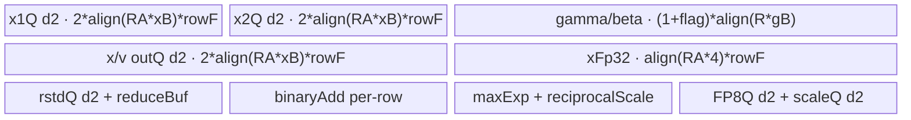
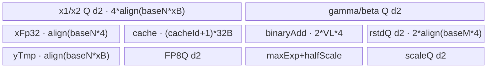

# AddRmsNormDynamicMxQuant 950 ACLNN 算子知识

## 算子速览

| 项目 | 内容 |
|---|---|
| 实际入口 | 公开两段式 `aclnnAddRmsNormDynamicMxQuantGetWorkspaceSize` / `aclnnAddRmsNormDynamicMxQuant`；固定仓没有带版本号的新入口 |
| 计算语义 | `x=x1+x2`；`rstd=1/sqrt(mean(x^2)+epsilon)`；`v=x*rstd*gamma+beta`；尾轴每 32 元素产生一个 E8M0 scale，并把 `v` 量化到 FP8 或 packed FP4 |
| 输入输出 | ND；`x1/x2` 为 FP16/BF16，`gamma/beta` 同输入类型或 FP32，`y` 为 E4M3FN/E5M2/E2M1/E1M2，`xOut` 同 `x1`，`mxscale` 为 E8M0，`rstd` 为 FP32 |
| 执行类型 | ACLNN 的 Contiguous/ViewCopy 为框架边界；核心节点为单 Kernel `AIV_VECTOR`，entry 与模板选择均显式 `AIV_ONLY`，没有 Cube/AIC/MIX_CV 可达节点 |
| Kernel 路线 | R-001 reduce-empty；R-002 FP8 R-full-load；R-003 FP4 R-full-load；R-004 FP8 split-R；R-005 FP4 split-R；FP8 内再按 `scaleAlg=0/1`，FP4 内按 `roundMode` 实例分支 |
| 核心资源 | GM、AIV UB、`TQue/TBuf/RegTensor`；系统 workspace 取平台 `GetLibApiWorkSpaceSize()`，核心 body 不切片消费该地址 |
| 来源闭包 | `source_closed`：公开 ACLNN/API → L0 launcher → OpDef/ascend950 注册 → 优先级 Tiling/POD → AIV router → 五个 body/common reduce helper → ascend950 binary config |
| 验证状态 | 已完成源码闭包检查；本次知识提取未执行编译、真机、数值或性能测试。 |

## 接口与语义

### 计算语义

令 `R=x1.shape[-1]=gamma.numel`，`A=x1.numel/R`。每行先在 FP32 寄存器中形成 `x_i=float(x1_i)+float(x2_i)`，同时把和降回输入 dtype 写 `xOut`。随后计算

```text
s = sum_i(x_i*x_i)
rstd = 1 / sqrt(max(s/R + epsilon, -99.99))
v_i = x_i * rstd * float(gamma_i) + (beta 存在时 float(beta_i)，否则 0)
```

`v` 沿 `R` 每 32 个元素成组。`scaleAlg=0` 从组内最大绝对值的指数生成 OCP shared exponent；`scaleAlg=1`（仅 FP8）以组内 `amax/dtypeMax` 的指数向上取整生成 cuBLAS E8M0 scale。量化值使用相应 reciprocal scale；FP8 固定 rint，FP4 根据 `roundMode` 选择 rint/round/floor 并每字节打包两个元素。`mxscale` 每行长度为 `ceilAlign(ceil(R/32),2)`，最后以 `[..., ceil(ceil(R/32)/2), 2]` 暴露；奇数组数的 pad scale 为 0。

### 输入、输出与属性

| 参数 | shape/layout | dtype | 约束、默认值与语义 |
|---|---|---|---|
| `x1`, `x2` | 完全同 shape，ND，rank 1～7 | 同为 FP16 或 BF16 | 必选；允许 0 维长；非连续输入先 Contiguous |
| `gamma` | 一维，长度等于 `x1[-1]`，ND | 与 `x1` 同 dtype，或 FP32 | 必选；定义归一化尾轴 |
| `beta` | 可选；存在且非空时 shape/dtype 与 gamma 相同 | 同 gamma | nullptr 或空 tensor 令 `betaFlag=0` |
| `epsilon` | scalar | Host `double`，POD `float` | L0 处窄化为 float；默认 `1e-6` |
| `scaleAlg` | scalar | int64 | 0=OCP，1=cuBLAS；FP4 只允许 0；默认 0 |
| `roundMode` | C string | string | FP8 只允许 `rint`；FP4 允许 `rint/floor/round`；映射 4/1/0 |
| `dstType` | scalar | int64 | 35=E5M2，36=E4M3FN，40=E2M1，41=E1M2；必须与 `yOut` dtype 一致 |
| `outputRstd` | scalar | bool | 默认 false；false 时构造 shape `{0}` 的占位 rstd，不执行 ViewCopy |
| `yOut`, `xOut` | 与 `x1` 同 shape，ND | 上述低精度类型；FP16/BF16 | FP4 时 `R` 必须为偶数；均支持非连续输出，末端 ViewCopy |
| `mxscaleOut` | rank=`rank(x1)+1`，尾二维为 `(ceil(ceil(R/32)/2),2)` | FLOAT8_E8M0 | 前缀维同 `x1`；支持非连续输出 |
| `rstdOut` | 与 x1 同 rank；前缀维同 x1，归一化尾维为 1 | FP32 | 仅 `outputRstd=true` 时必选且有效 |

### 入口与版本

公开文档只给出这一组两段式 ACLNN：第一段完成参数/executor/workspace 准备，第二段把 executor 提交到用户 stream。`ComputeAddRmsNormDynamicMxQuant` 分配连续临时输出，L0 `AddRmsNormDynamicMxQuant` 通过 `ADD_TO_LAUNCHER_LIST_AICORE` 添加核心算子，再用四个 `ViewCopy`（rstd 条件执行）交付非连续输出。公开产品表明确 950 的 Ascend 950PR/950DT 支持，而 A2、A3 均为不支持；OpDef 也只添加 `ascend950` config，故本卡只覆盖 950。

## Host/Launcher 执行流程

### 参数校验与前处理

第一段先创建 executor，再要求 `x1/x2/gamma/yOut/xOut/mxscaleOut` 非空；`outputRstd=true` 时额外要求 `rstdOut` 非空。若 `x1` 的任一非归一化前缀维为 0，ACLNN 直接返回成功、workspace 为 0，不添加核心算子。否则对 `x1/x2/gamma` 以及存在的 beta 做 Contiguous，然后添加核心节点和输出 ViewCopy。

Tiling 依次校验：rank 1～7、维长非负；`x1/x2` shape/dtype 相同；gamma 一维且匹配尾轴；beta 与 gamma 完全相同；输入/输出 dtype；`dstType` 对应；FP8/FP4 的 round/scale 组合；FP4 尾轴偶数；`y/x/mxscale/rstd` shape。失败返回 `GRAPH_FAILED`，不形成 Device launch。

### 参数、Workspace 与生命周期

`TilingPrepare4AddRmsNormDynamicMxQuant` 从平台读取 AIV 核数和 UB 容量；基类另读取 vector register bytes、UB block bytes。`GetWorkspaceSize` 把 `PlatformAscendC::GetLibApiWorkSpaceSize()` 写到 Tiling workspace，`PostTiling` 写 `blockDim`、POD 和 workspace size。entry 对传入 `workspace==nullptr` 立即返回，但各实现 `Init` 的第八实参实际传入 `mxscale`，body 没有以 offset 方式消费系统 workspace；因此固定源码只能证明它是 executor/平台保留区，不能把它解释为算子中间张量。

executor 拥有 Contiguous 临时量、四个连续计算输出和 ViewCopy 节点；用户拥有最终 tensor 与第二段传入的 workspace。它们从第一段 executor 构造完成后持续到第二段 stream 执行结束。

### 启动图与失败传播

```text
aclnnAddRmsNormDynamicMxQuantGetWorkspaceSize
  -> Contiguous(x1,x2,gamma,beta?)                         # 框架边界
  -> AddRmsNormDynamicMxQuant launcher
     -> TilingRegistry（priority 500 -> 1000 -> 2000）
     -> 单 AIV 节点 add_rms_norm_dynamic_mx_quant<<<usedCoreNum, stream>>>
        -> reduce-empty / FP8-full / FP4-full / FP8-split / FP4-split
  -> ViewCopy(y,x,mxscale,rstd?)                           # 框架边界
aclnnAddRmsNormDynamicMxQuant(workspace,executor,stream)
  -> CommonOpExecutorRun
```

核心为单 Kernel，无跨 Kernel workspace 边。Contiguous 的输出分别成为核心输入，核心连续输出成为 ViewCopy 输入；这些边由同一 executor/stream 排序，具体框架 Kernel/POD 在固定算子源码外。任一 Contiguous、launcher 添加或 ViewCopy 返回空均由 `CHECK_RET` 阻断后续；Tiling 校验/模板失败则核心节点不启动；entry workspace 为空则静默无输出。

## Route 与参数设计

### 分核与资源计算

公共量：`numRow=A`，`numCol=R`，`numColAlign=ceilAlign(R,64)`，`avgFactor=1/R`，`blockNumInColAxis=numColAlign/32`，`mxScaleSize=ceilAlign(blockNumInColAxis,2)`。非空 Route 令 `mPerCore=ceil(A,totalAivCore)`、`usedCoreNum=ceil(A,mPerCore)`、末核 `mLastCore=A-(usedCoreNum-1)*mPerCore`。

full-load 先取 `binAddQuotient` 为不大于 `numColAlign` 的最大 2 次幂；若正好相等则减半。可用 UB 为 `maxUb-1024-1536-align(R*gammaBytes)-betaFlag*align(R*gammaBytes)`；只有 `R<=16384`、`numColAlign<=4*VL_F32^2` 且至少一行完整 UB 字节账可放下时命中，`rowFactor=min(availableUb/CalUBTotalSize,mPerCore)`。

split-R 从 `baseN=64` 起倍增；每次候选把 x1/x2、gamma/beta、xOut、y、mxscale、xFp32、yTmp、maxExp、halfScale、rstd、cache、binaryAdd 的真实字节式与 `maxUb-256` 比较。选定 `baseN` 后，`nUbLoops=ceil(R/baseN)`，`baseM=128`，并生成 power-of-two fold 的 `powerSplit/mainFoldCount/foldTail/cacheId`。

### Route 选择

| 顺序 | Route | Key/模板 | 精确选择条件与优先级 | 不适用去向 |
|---:|---|---|---|---|
| 1 | R-001 reduce-empty | `(COMPUTE_MODE=2,Y=FP8)`；priority 500 | `numCol==0 \|\| numRow==0`；ACLNN 前缀空已提前返回，因此公开入口实际可启动的是尾轴空 | 若两者均非 0，到 R-002/R-003 |
| 2 | R-002 FP8 full-load | `(0,FP8)`；priority 1000 | 非空、y 为 E4M3FN/E5M2、`R<=16384`，且 `SetTilingParams` 算出 `rowFactor>=1` | full-load 不可容纳到 R-004 |
| 3 | R-003 FP4 full-load | `(0,FP4)`；priority 1000 | 同 R-002，y 为 E2M1/E1M2，`R` 偶数、`scaleAlg=0` | full-load 不可容纳到 R-005 |
| 4 | R-004 FP8 split-R | `(1,FP8)`；priority 2000 | 非空、FP8、前一模板失败且 `R>=64` | 无后续模板，失败 |
| 5 | R-005 FP4 split-R | `(1,FP4)`；priority 2000 | 非空、FP4、前一模板失败且 `R>=64` | 无后续模板，失败 |

```text
if A==0 or R==0: reduce-empty
else:
  family = FP8 if y in {E4M3FN,E5M2} else FP4
  if R<=16384 and full-load UB equation yields rowFactor>=1:
      key=(FULL_LOAD,family)
  else if R>=64:
      key=(SPLIT_R,family)
  else:
      tiling failure
```

### 模板/实现执行矩阵

| Route | key/selector | dtype/shape/platform 完整命中条件 | 执行拓扑与 Kernel 节点 | 实际模板/body | 内存与同步特征 | tail/fallback |
|---|---|---|---|---|---|---|
| R-001 | `(2,FP8)` | 950、`A==0 \|\| R==0` | 单 AIV | `AddRmsNormDynamicMxQuantReduceEmpty` | 单 VECOUT Queue；只可能写 rstd NaN | rstd 无效或 A=0 时立即返回 |
| R-002 | `(0,FP8)` | 950、合法 FP16/BF16 × gamma同型/FP32 × E4M3FN/E5M2；full-load 可容纳 | 单 AIV | `FP8RFullLoad<T_X,T_GAMMA,T_Y>` | 多行整载、x/rstd/y/scale Queue；OCP/cuBLAS runtime 分支 | 行尾 `curRows`，列尾 mask/64 对齐 |
| R-003 | `(0,FP4)` | 同上但 y=E2M1/E1M2、R 偶数、scaleAlg=0 | 单 AIV | `FP4RFullLoad<T_X,T_GAMMA,T_Y>` | y Queue 容量为 FP8 的一半；roundMode 选择模板实参 | packed FP4，最后组 scale 偶数 pad |
| R-004 | `(1,FP8)` | 合法 FP8、full-load 失败、R>=64 | 单 AIV | `FP8SplitR<T_X,T_GAMMA,T_Y>` | 两阶段：先折叠归约整行，再重读每 tile 输出；cache TBuf | `curM/curN/foldTail`；OCP/cuBLAS分支 |
| R-005 | `(1,FP4)` | 合法 FP4、full-load 失败、R>=64 | 单 AIV | `FP4SplitR<T_X,T_GAMMA,T_Y>` | 同 R-004，packed y Queue；三种 round specialization | `curN` 为偶数；无更多 fallback |

16 个 ascend950 binary tuple覆盖 `T_X={half,bfloat16}`、`T_GAMMA={T_X,float}`、`T_Y` 四种。FP16 与 BF16 的 load/cast/scale path 由 `if constexpr` 分开；E4M3/E5M2 和 E2M1/E1M2 的 emax/dtypeMax 也是不同实例，复用时不得把它们当成同一二进制。

### 隐藏性能 Guard

| Guard | Host/Tiling 条件 | Device/资源原因 | 影响 Route | 不满足时去向 | 源码符号 |
|---|---|---|---|---|---|
| 平台 | `IsRegbaseSocVersion(context)` | 只有 arch35/950 body 和配置 | 全部 | `GRAPH_FAILED` | `Tiling4AddRmsNormDynamicMxQuant` |
| full-load R 上限 | `R<=16384` | 二分归约轮数与整行驻留上限 | R-002/003 | split-R | `RFullLoadTiling::IsCapable` |
| 二分寄存器上限 | `numColAlign<=4*VL_F32^2` | `binaryAddBuf` 及两级归约可覆盖 | R-002/003 | split-R | `SetTilingParams` |
| full-load UB | `availableUb/CalUBTotalSize()>=1` | 至少一行的全部 Queue/TBuf 同时分配 | R-002/003 | split-R | `CalUBTotalSize`, `SetTilingParams` |
| split-R 最小列 | `R>=64` | `baseN` 从 64 开始且 MX block 为 32 | R-004/005 | Tiling 失败 | `SplitRTiling::IsCapable` |
| FP4 偶数列 | `R%2==0` | 两个 FP4 打包一字节，GM offset 使用 `/2` | R-003/005 | 参数失败 | `CheckMxQuantParams` |
| FP8 mode | `roundMode==rint` | body 固定 `CAST_RINT` | R-002/004 | 参数失败 | `CheckMxQuantParams` |
| FP4 scale | `scaleAlg==0` | FP4 body只调用 OCP scale helper | R-003/005 | 参数失败 | `CheckMxQuantParams` |
| 尾 tile 清零 | 最后一 tile 且 `R!=numColAlign` | max-exp 必须排除 padding，copyout只提交有效字节 | 全部非空 | 同 Route mask/tail | 各 `Compute/Process` 的 `Duplicate+PipeBarrier` |
| workspace 非空 | `workspace!=nullptr` | entry 的显式前置 guard | 全部 | 立即 return，无写回 | `add_rms_norm_dynamic_mx_quant` |

### POD/ABI

三个 POD 是普通标准字段结构；按声明的 64 位字段自然 8 字节对齐、末尾 32 位字段排列，固定源码没有额外 pack pragma。下表给出可由声明确定的 offset；无 `static_assert(sizeof/offsetof)`，跨不同 ABI 重建时仍应重新核对。

| 结构 | 字段 | 类型/位宽 | ABI 布局 | 单位 | Host/launcher producer | Device consumer | 边界 |
|---|---|---|---|---|---|---|---|
| Full POD | `numRow` | uint64/64 | off 0，sizeof结构112，align8 | rows | `SetInputParams` | Full `Init`/末核行数 | 非空 Route >0 |
| Full POD | `numCol` | uint64/64 | off 8 | elements/row | 同上 | GM stride、VF mask | 1..16384 |
| Full POD | `numColAlign` | uint64/64 | off 16 | elements | `ceilAlign(R,64)` | UB stride/tail | 64 对齐 |
| Full POD | `blockFactor` | uint64/64 | off 24 | rows/core | `mPerCore` | GM block offset | >=1 |
| Full POD | `rowFactor` | uint64/64 | off 32 | rows/UB iter | UB 除式 | `Process` repeat | 1..blockFactor |
| Full POD | `binAddQuotient` | uint64/64 | off 40 | FP32 elements | 2 次幂公式 | square reduce | `<numColAlign` |
| Full POD | `roundMode` | uint64/64 | off 48 | enum | `ParseRoundMode` | FP4 dispatch | 0/1/4 |
| Full POD | `mxBlockSize` | uint64/64 | off 56 | elements/group | 常量32 | quant loop | 固定32 |
| Full POD | `blockNumInColAxis` | uint64/64 | off 64 | groups/row incl pad | `numColAlign/32` | scale/count | 偶数 |
| Full POD | `dstStrideUbBlocks` | uint64/64 | off 72 | UB blocks | `(align-R)*xBytes/blockBytes` | CopyIn dstStride | 整数 |
| Full POD | `mxScaleSize` | uint64/64 | off 80 | bytes/row | group数偶数对齐 | GM scale stride | 偶数 |
| Full POD | `scaleAlg` | int64/64 | off 88 | enum | 属性 | FP8 OCP/cuBLAS branch | 0/1 |
| Full POD | `epsilon` | float/32 | off 96 | scalar | double窄化float | NR rstd | 未限制正值 |
| Full POD | `avgFactor` | float/32 | off 100 | reciprocal | `1.0f/R` | NR rstd | R>0 |
| Full POD | `betaFlag` | uint32/32 | off 104 | bool | optional input check | buffer/CalculateY | 0/1 |
| Full POD | `rstdFlag` | uint32/32 | off 108 | bool | outputRstd | GM rstd write | 0/1 |
| Empty POD | `perCoreElements` | uint64/64 | off 0，sizeof结构80，align8 | elements | empty 分核 | GM offset/extent | rstd有效时 >0 |
| Empty POD | `lastCoreElements` | uint64/64 | off 8 | elements | 尾核公式 | 末核 extent | >=1 |
| Empty POD | `perCoreLoops` | uint64/64 | off 16 | loops | ceilDiv | 非末核 loop | 可为0 inactive |
| Empty POD | `perCorePerLoopElements` | uint64/64 | off 24 | elements | UB floor align | Queue capacity | UB 对齐 |
| Empty POD | `perCoreLastLoopElements` | uint64/64 | off 32 | elements | 余数 | 非末核 tail | <=perLoop |
| Empty POD | `lastCoreLoops` | uint64/64 | off 40 | loops | ceilDiv | 末核 loop | 可为0 inactive |
| Empty POD | `lastCorePerLoopElements` | uint64/64 | off 48 | elements | UB floor align | Queue capacity | >=1 active |
| Empty POD | `lastCoreLastLoopElements` | uint64/64 | off 56 | elements | 余数 | 末核 tail | <=perLoop |
| Empty POD | `numRow` | uint64/64 | off 64 | rows | shape product | early return | 可能0 |
| Empty POD | `rstdFlag` | uint32/32 | off 72 | bool | outputRstd | early return/write | 0/1；尾部4B padding |
| Split POD | `numCol` | uint64/64 | off 0，sizeof结构144，align8 | elements/row | shape | GM stride | >=64 |
| Split POD | `numColAlign` | uint64/64 | off 8 | elements | ceilAlign64 | tail quant | >=R |
| Split POD | `blockFactor` | uint64/64 | off 16 | rows/core | mPerCore | core offset | >=1 |
| Split POD | `mLastCore` | uint64/64 | off 24 | rows | 尾核公式 | mCurCore | 1..blockFactor |
| Split POD | `baseN` | uint64/64 | off 32 | elements/tile | UB 倍增搜索 | DMA/VF tile | 64 的2次倍增 |
| Split POD | `baseNBlockSize` | uint64/64 | off 40 | MX groups/tile | baseN/32 | maxExp/scale buffer | >=2 |
| Split POD | `baseM` | uint64/64 | off 48 | rows/batch | 常量128 | rstd Queue/row loop | 固定128 |
| Split POD | `nUbLoops` | uint64/64 | off 56 | tiles/row | ceilDiv(R,baseN) | Process j loop | >=1 |
| Split POD | `binAddQuotient` | uint64/64 | off 64 | FP32 elements | baseN 2次幂折半 | tile reduce | baseN/2 |
| Split POD | `powerSplit` | uint64/64 | off 72 | fold tiles | `GetPowerSplit` | first pass r loop | 2次幂 |
| Split POD | `mainFoldCount` | uint64/64 | off 80 | full fold tiles | Host公式 | fold branch | <=powerSplit |
| Split POD | `foldTail` | uint64/64 | off 88 | elements | R%baseN | tail DMA/mask | 0..baseN-1 |
| Split POD | `roundMode` | uint64/64 | off 96 | enum | ParseRoundMode | FP4 template dispatch | 0/1/4 |
| Split POD | `mxBlockSize` | uint64/64 | off 104 | elements/group | 32 | quant helper | 固定32 |
| Split POD | `mxScaleSize` | uint64/64 | off 112 | bytes/row | align groups | scale GM offset | 偶数 |
| Split POD | `scaleAlg` | int64/64 | off 120 | enum | 属性 | FP8 branch | 0/1 |
| Split POD | `epsilon` | float/32 | off 128 | scalar | 属性窄化 | NR rstd | 未限制正值 |
| Split POD | `avgFactor` | float/32 | off 132 | reciprocal | 1/R | NR rstd | >0 |
| Split POD | `betaFlag` | uint32/32 | off 136 | bool | optional input | conditional UB/body | 0/1 |
| Split POD | `rstdFlag` | uint32/32 | off 140 | bool | outputRstd | GM write | 0/1 |

### Route 源码闭包

| Route | Key/selector | Host/Tiling producer | POD/参数 | Kernel entry/router 节点 | Kernel body/直接依赖 | 构建接线 |
|---|---|---|---|---|---|---|
| R-001 | `(2,FP8)` | `ReduceEmptyTiling::{IsCapable,DoOpTiling}` | Empty POD | `add_rms_norm_dynamic_mx_quant` constexpr branch | `ReduceEmpty::{Init,Process}` | OpDef `ascend950` + binary JSON |
| R-002 | `(0,FP8)` | `RFullLoadTiling` | Full POD | 同 entry 的 FP8 full 分支 | `FP8RFullLoad`、common、norm reduce helper | 同上 |
| R-003 | `(0,FP4)` | `RFullLoadTiling` | Full POD | 同 entry 的 FP4 full 分支 | `FP4RFullLoad`、common、norm reduce helper | 同上 |
| R-004 | `(1,FP8)` | `SplitRTiling` | Split POD | 同 entry 的 FP8 split 分支 | `FP8SplitR`、common、norm reduce helper | 同上 |
| R-005 | `(1,FP4)` | `SplitRTiling` | Split POD | 同 entry 的 FP4 split 分支 | `FP4SplitR`、common、norm reduce helper | 同上 |

## Kernel 实现

### 公共执行流程

五条 Route 都通过同一 entry，首先拒绝空 workspace，再声明 `KERNEL_TYPE_AIV_ONLY` 并创建 `TPipe`。所有非空 Route 以 core 映射连续行；`x1/x2` 搬入 UB 后在 FP32 RegTensor 中求和，输入 dtype 只用于 GM/UB 存储。平方和通过 RegBase reduce helper生成 FP32，`ComputeRstdNewtonRaphson<true,true>` 先乘 `1/R`、加 epsilon，再做倒数平方根和修正；Inf/0 有显式选择。`gamma/beta` 转 FP32参与仿射，得到的中间 `v` 保存在输入 dtype UB，随后量化 helper产生 packed y 与 E8M0 scale。

### Route R-001：reduce-empty

#### 适用条件

##### 选择证据

| 层级 | 文件 | 符号 | 源码谓词/参数 | 结果/下一跳 |
|---|---|---|---|---|
| ACLNN | `op_host/op_api/aclnn_add_rms_norm_dynamic_mx_quant.cpp` | GetWorkspaceSize | 前缀维 0 直接成功 | 无核心 launch |
| Tiling | `op_host/...tiling_reduce_empty_arch35.cpp` | `IsCapable` | `numCol==0 \|\| numRow==0` | key `(2,FP8)` |
| Router | `op_kernel/add_rms_norm_dynamic_mx_quant_apt.cpp` | entry constexpr branch | `COMPUTE_MODE_REDUCE_EMPTY` | Empty body |

#### Device 数据流

##### 函数级调用链

```text
entry -> ReduceEmpty::Init(rstd) -> ReduceEmpty::Process
  -> Duplicate(quiet_NaN) -> Queue EnQue/DeQue
  -> loop DataCopyPad(UB NaN -> rstd GM)
```

##### 源码等价伪码

```text
if !outputRstd or A==0: return
coreExtent = nonLast ? perCoreElements : lastCoreElements
allocate one VECOUT buffer of perLoopElements*4 bytes
fill it once with quiet_NaN
for loop: copy min(perLoopElements, remaining)*4 bytes to rstd[coreBase+loopOffset]
```

#### 内存与数据搬运

##### 资源与搬运表

| 层级/缓冲区 | offset/地址公式 | extent/容量公式 | dtype/layout | producer | consumer | owner/lifetime | 对齐/复用 |
|---|---|---|---|---|---|---|---|
| rstd GM | `perCoreElements*blockIdx + i*perLoopElements` | `curElements` | FP32 rows | UB DMA | caller | caller；Kernel期间有效 | 最后一 loop 短拷贝 |
| outNanQueue | 0 | `perLoopElements*4` | FP32 | Duplicate | 所有 loop DMA | pipe；Process末 Free | depth1，同一内容跨 loop 复用 |

##### 分层内存布局


##### 字节账与复用顺序

```text
UB_total = perLoopElements * 4
perLoopElements <= maxUbSize / 4
dynamic_ub = N/A
workspace_total = platform LibApi workspace（body不切片消费）
```

| 复用子区 | 写入者 | 读取者/消费点 | 下一次覆盖 | 同步或释放依据 | 安全条件 |
|---|---|---|---|---|---|
| outNanQueue | `Duplicate` 一次 | 每次 `DataCopyPad` | 无覆盖 | EnQue→DeQue；末尾 Free | 所有输出都要求同一 NaN |

#### 同步、精度与尾块

##### 同步与数值边界表

| 阶段 | primitive/机制 | producer | consumer/等待点 | 保护对象 | 精度/尾块 |
|---|---|---|---|---|---|
| NaN填充 | Queue EnQue/DeQue | Duplicate | DMA | outNanQueue | quiet NaN FP32；末 loop 用 lastLoopElements |

#### 关键实现

##### 符号证据表

| 阶段 | 文件 | 符号/模板实例 | 实现事实 |
|---|---|---|---|
| Host/Tiling producer | `op_host/add_rms_norm_dynamic_mx_quant_tiling_reduce_empty_arch35.cpp` | `DoOpTiling/PostTiling` | 32KiB/核阈值、UB loop、POD、blockDim |
| Kernel entry/router | `op_kernel/add_rms_norm_dynamic_mx_quant_apt.cpp` | reduce constexpr branch | AIV-only，解析 Empty POD |
| Device body/helper | `op_kernel/arch35/add_rms_norm_dynamic_mx_quant_reduce_empty.h` | `Init/Process` | NaN queue与尾 loop copy |

### Route R-002：FP8 R-full-load

#### 适用条件

##### 选择证据

| 层级 | 文件 | 符号 | 源码谓词/参数 | 结果/下一跳 |
|---|---|---|---|---|
| Tiling | `...tiling_r_full_load_arch35.cpp` | `IsCapable/SetTilingParams` | FP8、R<=16384、UB式得到 rowFactor>=1 | key `(0,FP8)` |
| Router | `...add_rms_norm_dynamic_mx_quant_apt.cpp` | full+FP8 branch | constexpr tuple | `FP8RFullLoad` |
| Body | `...fp8_r_full_load.h` | `DynamicMxQuantPhase` | scaleAlg 0/1 | OCP/cuBLAS helper |

#### Device 数据流

##### 函数级调用链

```text
FP8RFullLoad::Init -> Process
  -> CopyInGammabeta (once/core)
  -> repeat rows: CopyInX -> CalculateXAdd -> CopyOutX
  -> CalculateSquareReduceSum -> ComputeRstdNewtonRaphson -> optional CopyOut rstd
  -> CalculateY -> DynamicMxQuantPhase(OCP/cuBLAS) -> CopyOutQuantY -> CopyOutMxScale
```

##### 源码等价伪码

```text
load gamma,beta once
for rowBatch of rowFactor:
  DMA x1/x2 as [curRows,R], UB row stride RAlign
  VF add/cast FP32; store xOut and xFp32
  per row reduce square; rstd=NR(sum/R+eps)
  for two rows at a time: v=xFp32*rstd*gamma+beta; cast to T_X UB
  per 32 lanes: maxExp -> E8M0 scale + reciprocal -> rint FP8
  DMA valid R bytes/row and mxScaleSize bytes/row
```

#### 内存与数据搬运

##### 资源与搬运表

| 层级/缓冲区 | offset/地址公式 | extent/容量公式 | dtype/layout | producer | consumer | owner/lifetime | 对齐/复用 |
|---|---|---|---|---|---|---|---|
| x1/x2 Queue | `repeat*rowFactor*R` | each `2*align(RAlign*xBytes)*rowFactor` | T_X rows | GM | add | per repeat | depth2 |
| gamma/beta Queue | 0 / aligned gamma bytes | `(1+betaFlag)*align(R*gammaBytes)` | T_GAMMA | GM | CalculateY | whole Process | depth1，拼接 |
| outQueueX | row batch | `2*align(RAlign*xBytes)*rowFactor` | T_X | add then CalculateY | x GM then quant | 每阶段 alloc/free | 同一物理 Queue先承载x再承载v |
| xFp32Buff | 0 | `align(RAlign*4)*rowFactor` | FP32 | add | reduce/Y | repeat内 | TBuf |
| rstd Queue + reduce | 0 | `2*ceilAlign(rowFactor,VL_F32)*4 + ceilAlign(rowFactor,VL_F32)*4` | FP32 | reduce/NR | Y/GM | repeat内 | Queue depth2 + TBuf |
| binaryAdd | row stride | `ceilAlign(ceilAlign(ceil(binAdd/VL),8)*4,block)*rowFactor` | FP32 | partial reduce | final reduce | repeat内 | LocalMemBar保护 |
| maxExp/halfScale | 0 | each `align(groups*xBytes)*rowFactor` | uint16 | quant helpers | scale/data | repeat内 | TBuf覆盖 |
| quantY Queue | 0 | `2*ceilAlign(ceil(RAlign*rowFactor/256),4)*256` | uint8 FP8 | cast | GM | repeat内 | depth2 |
| mxScale Queue | 0 | `2*align(mxScaleSize*xBytes)*rowFactor` | E8M0 bytes | scale helper | GM | repeat内 | API以uint16写、uint8搬 |

##### 分层内存布局



##### 字节账与复用顺序

```text
UB_total = 2*x1Cap + 2*x2Cap + gammaBetaCap + 2*xOutCap
         + 2*rstdCap + reduceCap + xFp32Cap + binaryAddCap
         + maxExpCap + halfScaleCap + 2*fp8Cap + 2*scaleCap
UB_total + 1024 + 1536 <= maxUbSize
dynamic_ub = N/A
workspace_total = platform LibApi workspace（Kernel body不切片）
```

| 复用子区 | 写入者 | 读取者/消费点 | 下一次覆盖 | 同步或释放依据 | 安全条件 |
|---|---|---|---|---|---|
| outQueueX | `CalculateXAdd` | CopyOutX | `CalculateY`重新 Alloc | DeQue/Free 后再次 Alloc | x 已提交 GM |
| xFp32Buff | add | reduce、Y | 下一 row batch | 同步调用顺序 | Y 完成前不可覆盖 |
| halfScaleBuff | scale helper | data helper | 下一 repeat | 同函数顺序 | scale已消费 |

#### 同步、精度与尾块

##### 同步与数值边界表

| 阶段 | primitive/机制 | producer | consumer/等待点 | 保护对象 | 精度/尾块 |
|---|---|---|---|---|---|
| DMA/VF | Queue EnQue/DeQue | CopyIn | add | x Queues | DataCopyPad零补齐到 RAlign |
| 尾列清零 | `Duplicate + PipeBarrier<PIPE_V>` | Duplicate | CalculateY/quant | v padding | 无效 lane 不影响 max-exp |
| reduce | `LocalMemBar<VEC_STORE,VEC_LOAD>`（helper） | partial sums | final reduce | binaryAdd | mask按R，不含padding |
| 精度 | cast+FP32 Reg | input | x/rstd/Y | arithmetic | add、平方、归约、仿射 FP32；v降到T_X后量化 |
| scale | OCP/cuBLAS branch | max-exp | data quant | maxExp/halfScale | Inf/NaN/zero 显式生成 scale 255/0 |

#### 关键实现

##### 符号证据表

| 阶段 | 文件 | 符号/模板实例 | 实现事实 |
|---|---|---|---|
| Host/Tiling producer | `op_host/...tiling_r_full_load_arch35.cpp` | `CalUBTotalSize/SetTilingParams` | rowFactor、完整 UB 公式 |
| Kernel entry/router | `op_kernel/add_rms_norm_dynamic_mx_quant_apt.cpp` | full+FP8 | POD到模板实例 |
| Device body/helper | `op_kernel/arch35/...fp8_r_full_load.h` | `Process/Compute/DynamicMxQuantPhase` | 多行整载与两种scale算法 |

### Route R-003：FP4 R-full-load

#### 适用条件

##### 选择证据

| 层级 | 文件 | 符号 | 源码谓词/参数 | 结果/下一跳 |
|---|---|---|---|---|
| Host | `...tiling_base_arch35.cpp` | `CheckMxQuantParams` | FP4、R偶数、scaleAlg=0、round合法 | 保留候选 |
| Tiling | `...tiling_r_full_load_arch35.cpp` | full selector | R/UB式成立 | key `(0,FP4)` |
| Body | `...fp4_r_full_load.h` | `Compute` | round 4/0/1 | rint/round/floor模板 |

#### Device 数据流

##### 函数级调用链

```text
FP4RFullLoad::Init -> Process -> Compute
  -> 与 R-002 相同的 Add/Rstd/Y
  -> MxQuantComputeMaxExpOCP -> MxQuantComputeScaleOCP
  -> MxQuantComputeDataFP4<toBf16RoundMode,roundMode>
  -> CopyOutQuantYFP4 + CopyOutMxScale
```

##### 源码等价伪码

```text
执行整行 Add/RmsNorm
if rint: FP16 path先FP32显式round，最终packed FP4 CAST_RINT
if round: 同样FP32显式round，最终CAST_ROUND
if floor: FP16先CAST_FLOOR到BF16，再packed FP4 CAST_FLOOR
BF16输入直接乘reciprocal scale并Interleave/Cast
每两个FP4值打包一字节，只DMA R/2有效字节
```

#### 内存与数据搬运

##### 资源与搬运表

| 层级/缓冲区 | offset/地址公式 | extent/容量公式 | dtype/layout | producer | consumer | owner/lifetime | 对齐/复用 |
|---|---|---|---|---|---|---|---|
| 公共 Add/RmsNorm 区 | 同 R-002 | 同 R-002 | 同上 | 同上 | FP4 quant | repeat | 同上 |
| quantY Queue | GM `blockOffset/2` | `2*ceilAlign(ceil(RAlign*rowFactor/2/256),4)*256` | packed FP4 | FP4 helper | GM | repeat | depth2 |
| scale Queue | row*mxScaleSize | 与 R-002 相同 | E8M0 | OCP scale | GM | repeat | 偶数组数pad |

##### 分层内存布局


##### 字节账与复用顺序

```text
UB_total_FP4 = UB_total_FP8 - 2*fp8QuantCap + 2*fp4PackedCap
fp4PackedCap约为FP8容量一半，均按256处理步长/UB block对齐
dynamic_ub = N/A
workspace_total = platform LibApi workspace
```

| 复用子区 | 写入者 | 读取者/消费点 | 下一次覆盖 | 同步或释放依据 | 安全条件 |
|---|---|---|---|---|---|
| outQueueX/xFp32/halfScale | 同R-002 | FP4 helper | 下一repeat | Queue/调用顺序 | FP4 copyout完成 |

#### 同步、精度与尾块

##### 同步与数值边界表

| 阶段 | primitive/机制 | producer | consumer/等待点 | 保护对象 | 精度/尾块 |
|---|---|---|---|---|---|
| round dispatch | runtime if→模板 | POD roundMode | FP4 cast | quant lanes | rint=4, round=0, floor=1 |
| packed store | `DIST_PACK4_B32` | 两组FP4寄存器 | GM DMA | y bytes | R偶数；有效字节R/2 |
| padding | Duplicate+barrier | zero | max-exp | 最后MX组 | RAlign-R lanes为0 |

#### 关键实现

##### 符号证据表

| 阶段 | 文件 | 符号/模板实例 | 实现事实 |
|---|---|---|---|
| Host/Tiling producer | `op_host/...tiling_base_arch35.cpp` | `CheckMxQuantParams` | FP4 guard |
| Kernel entry/router | `op_kernel/add_rms_norm_dynamic_mx_quant_apt.cpp` | full+FP4 | FP4 body |
| Device body/helper | `op_kernel/arch35/...fp4_r_full_load.h`、`...common.h` | `DynamicMxQuantPhaseFP4/MxQuantComputeDataFP4` | 三round、packed store |

### Route R-004：FP8 split-R

#### 适用条件

##### 选择证据

| 层级 | 文件 | 符号 | 源码谓词/参数 | 结果/下一跳 |
|---|---|---|---|---|
| Tiling | `...tiling_split_r_arch35.cpp` | `IsCapable/GetMaxBaseN` | full失败、R>=64、FP8 | key `(1,FP8)` |
| Router | `...apt.cpp` | split+FP8 branch | constexpr tuple | `FP8SplitR` |
| Body | `...fp8_split_r.h` | `Process` | scaleAlg 0/1 | OCP/cuBLAS |

#### Device 数据流

##### 函数级调用链

```text
FP8SplitR::Init -> Process
  phase1 each row: ComputeOneLineXSquareSum
    -> main/fold DMA -> MainBlockSquareVF/FoldBlockSquareAddVF
    -> CalculateReduceSum -> UpdateCache
  -> ComputeRstdNewtonRaphson
  phase2 each R tile/row: Copy gamma/beta -> re-Copy x1/x2 -> CalculateXAdd -> CopyOutX
    -> CalculateY -> DynamicMxQuantPhase -> CopyOut y/scale
  -> optional CopyOut rstd
```

##### 源码等价伪码

```text
for up to baseM rows:
  for r in [0,powerSplit):
    square(main tile); optionally add paired full/tail fold tile
    reduce baseN values; binary-carry accumulate into cache[cacheId(r)]
  rstd[row]=NR(cache[resultCacheID]/R+eps)
for each tile j:
  load gamma/beta tile once
  for each row k: reload x1/x2 tile, compute/store xOut and v
                  quant FP8 and store y/scale
store rstd batch if requested
```

#### 内存与数据搬运

##### 资源与搬运表

| 层级/缓冲区 | offset/地址公式 | extent/容量公式 | dtype/layout | producer | consumer | owner/lifetime | 对齐/复用 |
|---|---|---|---|---|---|---|---|
| x1/x2 Queue | row*R+tile*baseN | each `2*align(baseN*xBytes)` | T_X tile | phase1/2 GM | square/add | per tile | depth2，phase2重读 |
| gamma/beta Queue | tile*baseN | `2*(1+betaFlag)*align(baseN*gammaBytes)` | T_GAMMA | GM | all rows in tile | tile lifetime | depth2 |
| xFp32Buf | 0 | `align(baseN*4)` | FP32 | square/add | reduce/Y | tile | 同区在两阶段复用 |
| cacheBuf | cacheId*8 floats | `align((resultCacheID+1)*8*4)` | FP32 | UpdateCache | final rstd | row reduction | binary carry slots |
| binaryAddBuf | 0 | `align(2*VL_F32*4)` | FP32 | partial reduce | final | row reduction | LocalMemBar |
| rstd Queue | row index | `2*align(baseM*4)` | FP32 | NR | phase2/GM | m batch | depth2 |
| yTmp | 0 | `align(baseN*xBytes)` | T_X | CalculateY | quant | row/tile | 最后tile预清零 |
| quant/scale/exp | 0 | `2*align(baseN*1)` + `2*align(baseN/32)` + two `align(baseN/32*2)` | FP8/E8M0/u16 | quant | GM | row/tile | Queue depth2/TBuf |

##### 分层内存布局



##### 字节账与复用顺序

```text
UB_total = 4*xBuf + 2*(1+betaFlag)*gammaTile + 2*xOutBuf + 2*rstdBuf
         + 2*fp8Buf + 2*scaleBuf + xFp32Buf + yTmpBuf
         + cacheBuf + binaryAddBuf + maxExpBuf + halfScaleBuf
UB_total <= maxUbSize - 256
dynamic_ub = N/A
workspace_total = platform LibApi workspace
```

| 复用子区 | 写入者 | 读取者/消费点 | 下一次覆盖 | 同步或释放依据 | 安全条件 |
|---|---|---|---|---|---|
| x queues | phase1 square | reduce | phase1下一fold/phase2 reload | FreeTensor | 当前VF完成 |
| xFp32Buf | square/fold | tile reduce | phase2 add/Y | phase1完整结束 | cache已取得每行sum |
| cache slots | `UpdateCache` | final cache load | 下一行 | 同步函数顺序 | resultCacheID已完成 |

#### 同步、精度与尾块

##### 同步与数值边界表

| 阶段 | primitive/机制 | producer | consumer/等待点 | 保护对象 | 精度/尾块 |
|---|---|---|---|---|---|
| phase1 DMA | Queue | GM | square VF | x tile | foldTail只搬有效元素并用mask |
| cache | VF顺序/LocalMemBar in reduce | partial sum | UpdateCache/final | cache slots | FP32 binary accumulation |
| phase2 | Queue+PipeBarrier | zero/add/Y | quant | yTmp | last tile用RAlign后的curN量化，GM只写真实R |
| scale | runtime branch | max abs/exp | quant | scale buffers | FP8固定rint，OCP/cuBLAS不同指数算法 |

#### 关键实现

##### 符号证据表

| 阶段 | 文件 | 符号/模板实例 | 实现事实 |
|---|---|---|---|
| Host/Tiling producer | `op_host/...tiling_split_r_arch35.cpp` | `GetMaxBaseN/DoOpTiling` | UB搜索、fold参数 |
| Kernel entry/router | `op_kernel/...apt.cpp` | split+FP8 | POD到body |
| Device body/helper | `op_kernel/arch35/...fp8_split_r.h` | `ComputeOneLineXSquareSum/Process` | 两阶段、重读、cache折叠 |

### Route R-005：FP4 split-R

#### 适用条件

##### 选择证据

| 层级 | 文件 | 符号 | 源码谓词/参数 | 结果/下一跳 |
|---|---|---|---|---|
| Host | `...tiling_base_arch35.cpp` | FP4 guards | R偶数、scaleAlg0 | 保留 |
| Tiling | `...tiling_split_r_arch35.cpp` | split selector | full失败且R>=64 | key `(1,FP4)` |
| Body | `...fp4_split_r.h` | round dispatch | 4/0/1 | 三个 FP4 helper实例 |

#### Device 数据流

##### 函数级调用链

```text
FP4SplitR::Init -> Process
  -> 与 R-004 相同的 phase1 rstd 与 phase2 x/Y
  -> DynamicMxQuantPhaseFP4(OCP)
  -> MxQuantComputeDataFP4<rint|round|floor>
  -> CopyOutQuantYFP4 + CopyOutMxScale + optional rstd
```

##### 源码等价伪码

```text
按split-R折叠求每行rstd并重读每个tile
v tile -> OCP scale
根据roundMode选择FP4 cast path
packedBytes=curN/2
DMA y[row*R/2 + tile*baseN/2 : packedBytes]
DMA scale到 row*mxScaleSize + tile*(baseN/32)
```

#### 内存与数据搬运

##### 资源与搬运表

| 层级/缓冲区 | offset/地址公式 | extent/容量公式 | dtype/layout | producer | consumer | owner/lifetime | 对齐/复用 |
|---|---|---|---|---|---|---|---|
| split公共区 | 同R-004 | 同R-004 | 同上 | 同上 | FP4 helper | m/tile | 同上 |
| packed y Queue | GM `gmOffset/2` | `2*align(baseN/2)` | uint8 packed FP4 | FP4 helper | GM | row/tile | depth2 |
| scale/exp | tile*baseN/32 | 同R-004 | E8M0/u16 | OCP helper | GM/quant | row/tile | scaleAlg1不可达 |

##### 分层内存布局


##### 字节账与复用顺序

```text
UB_total_FP4_split = UB_total_FP8_split - 2*align(baseN) + 2*align(baseN/2)
UB_total_FP4_split <= maxUbSize - 256
dynamic_ub = N/A
workspace_total = platform LibApi workspace
```

| 复用子区 | 写入者 | 读取者/消费点 | 下一次覆盖 | 同步或释放依据 | 安全条件 |
|---|---|---|---|---|---|
| x queues/xFp32/cache | 同R-004 | 同R-004 | 同R-004 | Queue/VF顺序 | phase1完成才进入phase2 |
| packed y Queue | FP4 helper | GM DMA | 下一row/tile | DeQue/Free | DMA只提交curN/2字节 |

#### 同步、精度与尾块

##### 同步与数值边界表

| 阶段 | primitive/机制 | producer | consumer/等待点 | 保护对象 | 精度/尾块 |
|---|---|---|---|---|---|
| round | runtime→constexpr template | POD | FP4 cast | lanes | rint/round/floor路径不可混用 |
| tail | zero+PipeBarrier/mask | yTmp | maxExp/pack | last tile | R偶数；curN/2有效字节 |
| store | `DIST_PACK4_B32`+DataCopyPad | VF | GM | packed y | 两个元素/byte |

#### 关键实现

##### 符号证据表

| 阶段 | 文件 | 符号/模板实例 | 实现事实 |
|---|---|---|---|
| Host/Tiling producer | `op_host/...tiling_split_r_arch35.cpp` | `GetMaxBaseN/SetTilingData` | split参数 |
| Kernel entry/router | `op_kernel/...apt.cpp` | split+FP4 | AIV FP4 body |
| Device body/helper | `op_kernel/arch35/...fp4_split_r.h`、`...common.h` | `DynamicMxQuantPhaseFP4/MxQuantComputeDataFP4` | packed tail与round分支 |

## 算子特定优化

### Trick T-001：full-load 让 Add、RmsNorm 与 MX quant 共用一次 x 搬入

#### 触发与源码依据

- 适用 Route：R-002、R-003
- 触发条件：`R<=16384` 且完整资源式至少容纳一行，`rowFactor>=1`
- Golden 来源：[`add_rms_norm_dynamic_mx_quant_fp8_r_full_load.h:141-156`](../../../../../../../cann-ops-raw/ascendc/ops-nn/955f8b33985b6d72989ebff341bb9c2c564a51bc/norm/add_rms_norm_dynamic_mx_quant/op_kernel/arch35/add_rms_norm_dynamic_mx_quant_fp8_r_full_load.h#L141-L156)

**官方源码（固定 Commit 连续逐字摘录）**：

```cpp
// --- x = x1 + x2 ---
CalculateXAdd(xLocal1, xLocal2, xOutLocal, xFp32Local, curRows);
inQueueX1.FreeTensor(xLocal1);
inQueueX2.FreeTensor(xLocal2);
outQueueX.EnQue<T_X>(xOutLocal);

// --- CopyOut x ---
CopyOutX(offset, curRows);

// --- ReduceSum(x^2) ---
LocalTensor<float> rstdLocal = outQueueRstd.AllocTensor<float>();
LocalTensor<float> xReduceLocal = xReduceBuff.Get<float>();
NormCommon::NormCommonRegbase::CalculateSquareReduceSum<float>(
    xFp32Local, xReduceLocal, binaryAddBuf, static_cast<uint16_t>(curRows),
    static_cast<uint32_t>(numColAlign_), static_cast<uint32_t>(numCol_),
    static_cast<uint32_t>(binAddQuotient_), static_cast<uint32_t>(BLOCK_F32_ALIGN_NUM));
```

#### 机制与设计原因

`CalculateXAdd` 同时写输入 dtype 的 `xOutLocal` 和 FP32 `xFp32Local`。前者立即流向 xOut，后者继续完成平方归约、rstd 与仿射，因此不为 RmsNorm 重读 x1/x2，也不把独立 RmsNorm 中间量物化到 GM。随后 `outQueueX` 在 x 已 Free 后重新承载 `v`，直接进入 quant。Host 用完整 UB 字节式保证这些同时驻留区合法。

#### 迁移边界

- 适用：融合 Add 后还需输出和、并继续做归一化/量化的单行或多行整载算子。
- 前提：950 AIV、R/UB guard成立；FP8/FP4的dtype、round、scale约束保持。
- 失效：至少一行放不下时必须用 R-004/R-005 的 split-R；其 phase2 会重读 x1/x2。
- 未验证：本次知识提取未执行编译、真机、数值或性能测试。

#### 错误做法

不能仅按逻辑有效长度计算 UB；Queue depth=2、RAlign、rstd预留和 gamma/beta 常驻区都必须计入，否则 Host 可能错误选择 full-load。

### Trick T-002：split-R 用二进制 carry cache 折叠跨 tile 平方和

#### 触发与源码依据

- 适用 Route：R-004、R-005
- 触发条件：full-load失败、R>=64；`powerSplit` 由 tile 数的最高2次幂生成
- Golden 来源：[`add_rms_norm_dynamic_mx_quant_fp8_split_r.h:265-269`](../../../../../../../cann-ops-raw/ascendc/ops-nn/955f8b33985b6d72989ebff341bb9c2c564a51bc/norm/add_rms_norm_dynamic_mx_quant/op_kernel/arch35/add_rms_norm_dynamic_mx_quant_fp8_split_r.h#L265-L269)

**官方源码（固定 Commit 连续逐字摘录）**：

```cpp
NormCommon::NormCommonRegbase::CalculateReduceSum(
    xFp32Tmp, xFp32Tmp, binaryAddBuf, baseN_, static_cast<uint32_t>(binAddQuotient_));
int64_t cacheId = GetCacheId(r);
UpdateCache(cacheLocal, xFp32Tmp, cacheId, AR_RECOMPUTE_SUM_LEN);
```

#### 机制与设计原因

每个 main/fold tile 先在同一个 `xFp32Tmp` 中累加平方，再归约为标量。`GetCacheId(r)=ct1(r xor (r+1))-1` 给出二进制进位层级，`UpdateCache` 把低层 cache 一并合到当前层；最终只读取 `resultCacheID`，无需为所有 tile 保存独立 partial sum。cache 每层固定 32 bytes，Host 只按层数计 UB。

#### 迁移边界

- 适用：长尾轴分 tile、每 tile 可归约成标量且顺序二进制合并允许的 FP32 归约。
- 前提：`baseN` 为 64 的2次倍增，Host/Device 的 `GetCacheId` 和 `AR_RECOMPUTE_SUM_LEN=8` 一致。
- 失效：若归约不可结合、需要严格线性顺序或 cache 层容量变化，必须重新设计 POD/同步，不能直接复用。
- 未验证：本次知识提取未执行编译、真机、数值或性能测试。

#### 错误做法

不能在 `UpdateCache` 前覆盖 `xFp32Tmp`，也不能只分配一个 float/层；helper 会按 `stride=8` 访问每层槽位。

### Trick T-003：FP4 针对 FP16 rint/round 的显式 FP32 尾数处理

#### 触发与源码依据

- 适用 Route：R-003、R-005
- 触发条件：`T_X=half` 且 roundMode 为 rint 或 round
- Golden 来源：[`add_rms_norm_dynamic_mx_quant_common.h:739-751`](../../../../../../../cann-ops-raw/ascendc/ops-nn/955f8b33985b6d72989ebff341bb9c2c564a51bc/norm/add_rms_norm_dynamic_mx_quant/op_kernel/arch35/add_rms_norm_dynamic_mx_quant_common.h#L739-L751)

**官方源码（固定 Commit 连续逐字摘录）**：

```cpp
if constexpr (roundMode == RoundMode::CAST_RINT || roundMode == RoundMode::CAST_ROUND) {
    // tail_axis_optimize_fp16 -> fp4 (rint, round)
    AscendC::MicroAPI::Cast<float, bfloat16_t, castTraitF16toFp32Zero>(
        halfScaleForMulFP32, (AscendC::MicroAPI::RegTensor<bfloat16_t>&)halfScaleForMul,
        dataMaskB16);
    AscendC::MicroAPI::Cast<float, T_X, castTraitF16toFp32Zero>(
        vdExp0ZeroFP32, vdExp0, dataMaskB16);
    AscendC::MicroAPI::Cast<float, T_X, castTraitF16toFp32One>(vdExp0OneFP32, vdExp0, dataMaskB16);
    AscendC::MicroAPI::Mul(vdExp0ZeroFP32, vdExp0ZeroFP32, halfScaleForMulFP32, dataMaskB32);
    AscendC::MicroAPI::Mul(vdExp0OneFP32, vdExp0OneFP32, halfScaleForMulFP32, dataMaskB32);
    ComputeFP4FromHalf<toBf16RoundMode, roundMode, T_Y>(vdExp0ZeroFP32);
    ComputeFP4FromHalf<toBf16RoundMode, roundMode, T_Y>(vdExp0OneFP32);
}
```

#### 机制与设计原因

FP16 的 rint/round 路径把数据与 reciprocal scale 提升到 FP32，再由 `ComputeFP4FromHalf` 按 E1M2 或 E2M1 的指数区间执行 truncate/scale，随后才转 BF16 载体并打包 FP4。它避免直接在 FP16/BF16 载体上丢失决定 FP4 舍入的尾数；floor 则走独立 `CAST_FLOOR` 路径。

#### 迁移边界

- 适用：FP16→FP4，且需要 rint/round 的 packed 转换。
- 前提：目标仅 E1M2/E2M1，scaleAlg=OCP，roundMode模板与 Host enum完全一致。
- 失效：BF16 输入、floor 或 FP8 不走该路径，必须保留各自 specialization。
- 未验证：本次知识提取未执行编译、真机、数值或性能测试。

#### 错误做法

把三种 roundMode 合并成一次普通 FP4 Cast 会改变 FP16 rint/round 的源码数值顺序；固定仓已经提供不同 constexpr 分支，不能抹平。

## 模板与实现对比

| 对比维度 | R-001 empty | R-002/003 full-load | R-004/005 split-R | 设计选择依据 |
|---|---|---|---|---|
| 命中条件/优先级 | A或R空，500 | 非空、R<=16384且UB容纳，1000 | full失败、R>=64，2000 | 先语义空域，再整载，最后长轴fallback |
| 模板与 dtype | 无dtype计算 | FP8/FP4及16 tuple实例 | 同样实例 | y family决定body，binary tuple决定T_X/T_GAMMA/T_Y |
| 循环与分核 | 线性rstd填充 | core→row batch→R整行 | core→M batch→phase1 fold；tile→row phase2 | split以重读换较小UB |
| Queue/TBuf/寄存器 | 单VECOUT | 双缓冲x/xOut/y/scale + FP32/reduce | 再加cache/yTmp，tile容量 | Host逐项字节式 |
| 内存总占用与复用 | `perLoop*4` | 随RAlign*rowFactor增长 | 随baseN增长，cache随log(tile) | UB selector决定 |
| 搬运/Vector API | Duplicate/DataCopyPad | 多行2D DMA、FP32 Reg reduce、packed quant | tile DMA两阶段、UpdateCache | 计算拓扑不同 |
| 同步、精度与 tail | Queue；最后loop短拷 | Queue/LocalMemBar/PipeBarrier；行/列mask | 同上加phase顺序；foldTail | 不读取padding |
| fallback/失败边界 | rstd无效直接return | 到split | 无后续模板 | 资源/shape不满足即Tiling失败 |

## 平台差异

| 项目 | A2 | A3 | 950 |
|---|---|---|---|
| 支持状态 | 公开 ACLNN 产品表明确不支持 | 公开 ACLNN 产品表明确不支持 | Ascend 950PR/950DT 支持 |
| Host/Launcher | 不发布 | 不发布 | RegBase priority templates、AIV core/UB平台参数 |
| Kernel/资源 | 无正式卡 | 无正式卡 | arch35 AIV-only，五个body，ascend950 16个binary tuple |

## 限制与失败边界

- `roundMode` 指针、workspaceSize/executor 输出指针的通用框架校验不在本算子显式 `CheckNotNull` 中；固定仓外行为不推测。
- `epsilon` 在 L0 从 double 窄化为 float，Host 未限制必须为正；负值的数值行为只按 Kernel 的 `max(var+eps,-99.99)` 与 NR 源码理解。
- 非归一化前缀维为 0 时 ACLNN 第一段直接成功且不形成核心 launch；尾轴 0 才可能进入 R-001。`outputRstd=false` 时 R-001 不写任何输出。
- full-load 的 `dstStrideUbBlocks=(RAlign-R)*xBytes/blockBytes` 使用整数除法；RAlign=64对齐且xBytes=2使其为UB block整数。
- split-R phase1 为求 rstd 读取 x1/x2，phase2 为生成 xOut/y 再次读取；不能宣称长轴路线仍是单次GM读取。
- entry 要求 workspace 非空，但 body不消费其切片；系统 workspace 的精确内部用途属于平台库边界。
- unknown/未实例化模板组合在 constexpr router 中无 body、无输出；Tiling只会生成已声明的五种 tuple。
- 固定仓未提供编译、真机、数值或性能验证；本文不承诺性能百分比。

## 源码索引

### 链路索引

| 链路阶段 | 文件 | 关键符号 | 支撑内容 |
|---|---|---|---|
| 入口声明/约束 | `norm/add_rms_norm_dynamic_mx_quant/docs/aclnnAddRmsNormDynamicMxQuant.md` | 产品表、两段式原型、约束表 | 950公开支持、语义、dtype/shape/错误 |
| 入口声明/约束 | `norm/add_rms_norm_dynamic_mx_quant/op_host/op_api/aclnn_add_rms_norm_dynamic_mx_quant.h` | 两段式声明 | ABI参数顺序 |
| 入口实现 | `norm/add_rms_norm_dynamic_mx_quant/op_host/op_api/aclnn_add_rms_norm_dynamic_mx_quant.cpp` | CheckNotNull、Compute、GetWorkspaceSize、run | Contiguous、临时输出、ViewCopy、executor |
| 入口实现 | `norm/add_rms_norm_dynamic_mx_quant/op_host/op_api/add_rms_norm_dynamic_mx_quant.cpp` | L0 AddRmsNormDynamicMxQuant | 添加核心launcher |
| Host/Tiling/Launcher | `norm/add_rms_norm_dynamic_mx_quant/op_host/add_rms_norm_dynamic_mx_quant_def.cpp` | OpDef、config950 | dtype tuple与ascend950 kernel接线 |
| Host/Tiling/Launcher | `norm/add_rms_norm_dynamic_mx_quant/op_host/add_rms_norm_dynamic_mx_quant_tiling.cpp` | Tiling/Prepare | RegBase gate、AIV核/UB producer |
| Host/Tiling/Launcher | `norm/add_rms_norm_dynamic_mx_quant/op_host/add_rms_norm_dynamic_mx_quant_tiling.h` | 基类/三个模板 | priority、字段与selector声明 |
| Host/Tiling/Launcher | `norm/add_rms_norm_dynamic_mx_quant/op_host/add_rms_norm_dynamic_mx_quant_tiling_base_arch35.cpp` | validation/SetInputParams | shape/dtype/attr/公共公式 |
| Host/Tiling/Launcher | `norm/add_rms_norm_dynamic_mx_quant/op_host/add_rms_norm_dynamic_mx_quant_tiling_reduce_empty_arch35.cpp` | Empty template | 空域分核/POD |
| Host/Tiling/Launcher | `norm/add_rms_norm_dynamic_mx_quant/op_host/add_rms_norm_dynamic_mx_quant_tiling_r_full_load_arch35.cpp` | Full template | UB字节式、rowFactor/key |
| Host/Tiling/Launcher | `norm/add_rms_norm_dynamic_mx_quant/op_host/add_rms_norm_dynamic_mx_quant_tiling_split_r_arch35.cpp` | Split template | baseN搜索、fold参数/key |
| Kernel entry/body | `norm/add_rms_norm_dynamic_mx_quant/op_kernel/add_rms_norm_dynamic_mx_quant_apt.cpp` | entry | AIV-only、五分支router |
| Kernel entry/body | `norm/add_rms_norm_dynamic_mx_quant/op_kernel/arch35/add_rms_norm_dynamic_mx_quant_tiling_data.h` | 三个POD | Host/Device ABI |
| Kernel entry/body | `norm/add_rms_norm_dynamic_mx_quant/op_kernel/arch35/add_rms_norm_dynamic_mx_quant_tiling_key.h` | template args/select | 五种AIV实例 |
| Kernel entry/body | `norm/add_rms_norm_dynamic_mx_quant/op_kernel/arch35/add_rms_norm_dynamic_mx_quant_reduce_empty.h` | Empty body | rstd NaN填充 |
| Kernel entry/body | `norm/add_rms_norm_dynamic_mx_quant/op_kernel/arch35/add_rms_norm_dynamic_mx_quant_fp8_r_full_load.h` | FP8 full body | 整载FP8 OCP/cuBLAS |
| Kernel entry/body | `norm/add_rms_norm_dynamic_mx_quant/op_kernel/arch35/add_rms_norm_dynamic_mx_quant_fp4_r_full_load.h` | FP4 full body | 整载packed FP4 |
| Kernel entry/body | `norm/add_rms_norm_dynamic_mx_quant/op_kernel/arch35/add_rms_norm_dynamic_mx_quant_fp8_split_r.h` | FP8 split body | 两阶段/cache/FP8 |
| Kernel entry/body | `norm/add_rms_norm_dynamic_mx_quant/op_kernel/arch35/add_rms_norm_dynamic_mx_quant_fp4_split_r.h` | FP4 split body | 两阶段/cache/packed FP4 |
| Kernel entry/body | `norm/add_rms_norm_dynamic_mx_quant/op_kernel/arch35/add_rms_norm_dynamic_mx_quant_common.h` | quant/load/cache helpers | OCP/cuBLAS、FP8/FP4、round特殊化 |
| Kernel entry/body | `norm/norm_common/op_kernel/reduce_common_regbase.h` | reduce/NR helpers | FP32平方归约、LocalMemBar、rstd |
| Host/Tiling/Launcher | `norm/norm_common/op_host/norm_tiling_check_common.h` | `CheckDimBiggerZero` | 维长允许0、拒绝负数 |
| Host/Tiling/Launcher | `common/inc/op_host/tiling_templates_registry.h` | `TilingRegistry::DoTilingImpl` | 按升序priority尝试、PARAM_INVALID继续 |
| 构建接线 | `norm/add_rms_norm_dynamic_mx_quant/op_host/CMakeLists.txt` | `add_modules_sources` | Host模块与 norm_common 依赖 |
| 构建接线 | `norm/add_rms_norm_dynamic_mx_quant/op_host/config/ascend950/add_rms_norm_dynamic_mx_quant_binary.json` | 16 op_list | 950二进制dtype组合 |

### 实现复用检查

| 检查项 | 可复用事实 | 不得改变的约束 | 源码符号 |
|---|---|---|---|
| ABI/POD | 三种POD按Route复用 | 字段顺序/位宽/单位；Empty/Full/Split不可混用 | tiling_data.h |
| 调用顺序 | Add→square reduce→rstd→affine→scale→quant | split必须先完成整行phase1，再phase2 | 五个 `Process` |
| workspace/内存 | 平台系统workspace与AIV UB分离 | Queue depth2、对齐、cache层数、gamma/beta条件容量 | Tiling字节式/InitBuffer |
| 同步 | Queue、PipeBarrier、LocalMemBar | padding清零后才quant；partial store后才final reduce | body/reduce helper |
| 精度与尾块 | FP32 add/reduce/affine，v降T_X后量化 | FP8 rint；FP4三round；RAlign/foldTail/mxscale偶数pad | common quant helper |
| 失败边界 | full→split fallback，空域独立 | 950 only；FP4偶数/scale0；FP8 rint；unknown tuple无输出 | Host selector/router |
