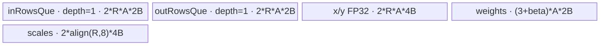
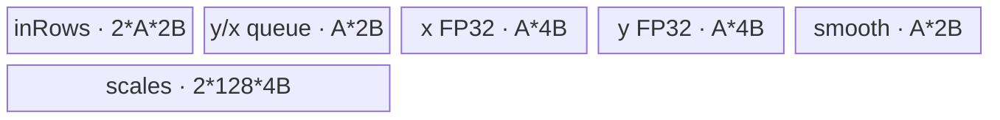
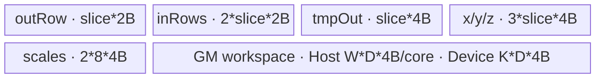

# AddRmsNormDynamicQuant A2/A3 ACLNN 算子知识

## 算子速览

| 项目 | 内容 |
|---|---|
| 实际入口 | 最新公开版本 `aclnnAddRmsNormDynamicQuantV2GetWorkspaceSize` / `aclnnAddRmsNormDynamicQuantV2`；旧版同名无 `V2` 入口不进入本卡 |
| 计算语义 | `x=x1+x2`，逐最后一维做 RMSNorm，可选 `beta`，再按 `outputMask` 对一路或两路结果做 INT8/INT4 对称动态量化 |
| 输入输出 | `x1/x2:[...,D]`、`gamma/smooth/beta:[D]` 为 FP16/BF16；`y1/y2` 为 INT8 或 INT4（ACLNN 用 INT32 承载打包 INT4）；`x` 同输入，`scale1/2` 为 FP32 |
| 执行类型 | R-001～R-003 均为单 Kernel `AIV_VECTOR`；无可达 Cube/AIC、MIX_CV、SIMT、NDDMA 或通信节点 |
| Kernel 路线 | R-001 multi-row normal（key 1）；R-002 single-row（key 2）；R-003 slice-D（key 3） |
| 核心资源 | GM、AIV UB、`TQue/TBuf`、标量寄存器；仅 R-003 使用用户 workspace |
| 来源闭包 | `source_closed`：公开 V2 → ACLNN 校验/连续化/执行器 → L0 launcher → Host Tiling/POD → router → 三个 AIV body/helper → OpDef/config 已闭合 |
| 验证状态 | 已完成源码闭包检查；本次知识提取未执行编译、真机、数值或性能测试。 |

## 接口与语义

### 计算语义

令 `M=prod(x1.shape[:-1])`、`D=x1.shape[-1]`。对行 `m`：

```text
x[m,d] = fp32(x1[m,d]) + fp32(x2[m,d])
rstd[m] = 1 / sqrt(sum_d(x[m,d]^2) / D + epsilon)
z[m,d] = x[m,d] * rstd[m] * fp32(gamma[d]) + (beta ? fp32(beta[d]) : 0)
q_i[m,d] = z[m,d] * (smooth_i ? fp32(smooth_i[d]) : 1)
scale_i[m] = max_d(abs(q_i[m,d])) / Qmax
y_i[m,d] = cast_quant(round(q_i[m,d] / scale_i[m]))
```

INT8 的 `Qmax=127`，INT4 的 `Qmax=7`。`outputMaskOptional` 为空时一路始终有效，只有 `smoothScale1Optional` 与 `smoothScale2Optional` 同时存在时第二路有效；非空时由两个 bool 决定输出，且不能全 false。`xOut` 是加法结果降回输入 dtype 后的输出。

### 输入、输出与属性

| 参数 | shape/layout | dtype | 约束、默认值与语义 |
|---|---|---|---|
| `x1` | rank 2～8，ND；可非连续 | FP16/BF16 | 必选；支持空 Tensor；运行 Route 将前导维折叠为 `M` |
| `x2` | 同 `x1` | 同 `x1` | 必选；shape/dtype 与 `x1` 相同 |
| `gamma` | `[D]`，ND | 同 `x1` | 必选；最后维权重 |
| `smoothScale1Optional` | `[D]` | 同 `gamma` | 可空；存在时必须允许输出一路 |
| `smoothScale2Optional` | `[D]` | 同 `gamma` | 可空；`outputMask` 为空时必须与 smooth1 配套 |
| `betaOptional` | `[D]` | 同 `gamma` | 可空；在量化前加到 RMSNorm 输出 |
| `epsilon` | 标量 | Host `double`、POD FP32 | 文档建议 `1e-6`；Tiling 要求严格大于 0 |
| `outputMaskOptional` | 空指针或长度 2 | bool array | 非空时 smooth 输入对应位必须 true，且两位不能同时 false |
| `y1Out/y2Out` | 有效时同 `x1`；无效 `y2` 可为 `[1]`/`[]` | INT8；INT4 以 ACLNN `INT32` packed view 承载 | 两路 dtype 必须相同；A2/A3 只支持 INT8/INT4 |
| `xOut` | 同 `x1` | 同 `x1` | 加法输出 |
| `scale1Out/scale2Out` | `x1` 去掉最后维，或展平为 `[M]` | FP32 | 每行反量化尺度；无效路不写 |

### 入口与版本

公开文档同时列出旧入口和 V2；V2 增加 `betaOptional` 与 `outputMaskOptional`，且产品表明确支持 Atlas A2/A3，故本卡只提取每平台最新公开 V2。V2 在 `ComputeAddRmsNormDynamicQuantV2` 中把 INT32 输出解释为 INT4 计算，再创建最后维除以 8 的 INT32 view；其它输出直接 `ViewCopy`。算子实际 L0 节点仍为 `AddRmsNormDynamicQuant`，`dstType` 由输出 dtype 产生。

## Host/Launcher 执行流程

### 参数校验与前处理

`CheckParams` 依次检查必选指针、输入/输出 dtype、两路输出 dtype 一致性、INT32 packed 末维关系及 `outputMask` 组合。空域在构造计算节点前返回零 workspace；非空输入分别通过框架 `Contiguous`，可选输入只在非空指针时连续化。INT4 时 ACLNN 仅对有效输出创建 INT32 packed view 并 `ViewCopy`；`Contiguous/ViewCopy` 与执行器调度属于框架边界。

### 参数、Workspace 与生命周期

L0 `AddRmsNormDynamicQuantAiCore` 分配 `y1/x` 与条件形状的 `y2`，把 `epsilon` 窄化为 FP32，并用 `ADD_TO_LAUNCHER_LIST_AICORE` 加入单个算子节点。执行器拥有临时 Tensor 和连续化 workspace；第二段 `CommonOpExecutorRun` 在调用者 stream 上执行。

Tiling 取得 AIV 核数 `C`、UB 字节 `U`、系统库 workspace `S`。R-001/R-002 用户 workspace 为 1 字节占位；R-003 分配 `useCore * D * 4 * W`：默认空 mask 且无 smooth 时 `W=1`，存在任一 smooth 时 `W=2`，显式 mask 时 `W=2`。Device 的每核 base 系数 `K` 为：默认无 smooth 或仅 smooth1 时 1，默认双 smooth 或显式 mask 时 2；因此默认仅 smooth1 会保守多分配一倍，但实际 core slice 仍按 `K*core*D` 不重叠。总 workspace 为 `S + userBytes`；其 owner/lifetime 由 ACLNN executor 与调用者提供的 workspace 保持到 stream 节点完成。

### 启动图与失败传播

```text
V2 GetWorkspaceSize
  -> CheckParams -> empty short circuit / Contiguous
  -> l0op::AddRmsNormDynamicQuant -> one AICore launcher node
     -> Tiling4AddRmsNormDynamicQuant -> key 1 / 2 / 3
     -> add_rms_norm_dynamic_quant -> one AIV Route body
  -> ViewCopy packed-or-direct outputs
V2(workspace, executor, stream) -> CommonOpExecutorRun
```

| 节点 | Host 启动函数 | entry | blockDim/POD | 输入→输出/workspace | ordering 与失败 |
|---|---|---|---|---|---|
| K-001 | `AddRmsNormDynamicQuantAiCore` / `Tiling4AddRmsNormDynamicQuant` | `add_rms_norm_dynamic_quant` | `useCore=ceil(M/ceil(M/C))`；`AddRmsNormDynamicQuantTilingData` | 六输入 → `y1/y2/x/scale1/scale2`；R-003 使用 user workspace | 单 stream 单 Kernel；ACLNN、Tiling 或 launcher 失败阻断后续 ViewCopy |

公开 V2 的空 Tensor 分支在 ACLNN 层不加入算子节点，因此 key 0/空 body 不是公开入口可达 Route。

## Route 与参数设计

### 分核与资源计算

```text
rowsPerCore0 = ceil(M/C)
useCore = ceil(M/rowsPerCore0)
firstDimPerCore = ceil(M/useCore)
tailRows = M - firstDimPerCore*(useCore-1)
A = align(D, y==INT4 ? 64 : 32)       # 元素
avgFactor = 1.0f / D
```

Host 按 R-001→R-002→R-003 的短路顺序选择。R-001 计算可共存行数并封顶 16；R-002 固定一行；R-003 按 INT8 取 slice 8864 元素、INT4 取 8832 元素，`loop=(D-tail)/slice`。

### Route 选择

| 顺序 | Route | Key/模板 | 精确选择条件与优先级 | 不适用去向 |
|---:|---|---|---|---|
| 1 | R-001 normal | key 1；`KernelAddRmsNormDynamicQuantNormal<T,T_Y,1>` | `rowStep=floor((U-(A*2*(beta?4:3)+768))/((4*2+2*4)*A+8)) >= 1`，取 `min(rowStep,16)` | R-002 |
| 2 | R-002 single-row | key 2；`KernelAddRmsNormDynamicQuantSingleRow<T,T_Y,2>` | R-001 不成立，且 `((2+1+1)*2+2*4)*A + 2*128*4 <= U` | R-003 |
| 3 | R-003 slice-D | key 3；`KernelAddRmsNormDynamicQuantSliceD<T,T_Y,3>` | 前两者不成立；固定选择 8864/8832 元素切 D | 无更低 Route；Tiling 本身返回成功 |

```text
if normal_row_step >= 1: key=1
else if single_row_bytes <= U: key=2
else: key=3
```

### 模板/实现执行矩阵

| Route | key/selector | dtype/shape/platform 完整命中条件 | 执行拓扑与 Kernel 节点 | 实际模板/body | 内存与同步特征 | tail/fallback |
|---|---|---|---|---|---|---|
| R-001 normal | 1 | FP16/BF16；INT8/INT4；normal UB 谓词首先成立 | 单 K-001 AIV | `Kernel...Normal::Process` | 多行驻留；Queue + FP32 TBuf；V/S event | 每核尾行、每批尾行；失败转 R-002 |
| R-002 single-row | 2 | R-001 失败且单行 UB 可容纳 | 单 K-001 AIV | `Kernel...SingleRow::Process` | 一行重复加载 gamma/beta；scale 每 128 行批量写 | `rowWork%128`；失败转 R-003 |
| R-003 slice-D | 3 | 前两条失败 | 单 K-001 AIV | `Kernel...SliceD::Process` | D 分片三遍扫描；GM workspace；MTE/V/S event | D 尾片显式处理；无 fallback |

### 隐藏性能 Guard

| Guard | Host/Tiling 条件 | Device/资源原因 | 影响 Route | 不满足时去向 | 源码符号 |
|---|---|---|---|---|---|
| normal UB | 上表精确 rowStep 公式 | 常驻 gamma/smooth/beta、双输入/双输出及两块 FP32 行缓冲 | R-001 | R-002 | `CheckUbNormalTiling` |
| 最大行 tile | `firstDimPerLoop=min(rowStep,16)` | 源码禁止 multi-N 超过 16 行 | R-001 | 同 Route 更小 tile | `CheckUbNormalTiling` |
| single UB | `((8+8)*A)+1024 <= U`（字节，输入 dtype 固定 2B） | 一行 Queue/TBuf 与两组 128 FP32 scale | R-002 | R-003 | `CheckUbSingleRowTiling` |
| INT4 对齐 | `A=align(D,64)`；slice=8832 | packed INT4 搬运按半字节计，仍需 32B 对齐 | 全部 | 对齐/尾拷贝 | `CalculateShapeParameters`、`CalculateBlockLen` |
| epsilon | `epsilon>0` | rstd 标量不能接受非正稳定项 | 全部 | Tiling 失败 | `ValidateBaseParameters` |
| output flags | 默认 `(-1,-1)` 或显式 `(0/1,0/1)` | 控制可选 smooth 的搬入、两路 UB/GM 写出与 workspace 行数 | 全部 | ACLNN/Tiling 失败 | `CheckFlag`、`SetFlagsAndCheckConsistency` |

### POD/ABI

`BEGIN_TILING_DATA_DEF` 的宏实现不在固定仓中，故 `sizeof/alignof/offsetof` 不可从本仓独立证明；下表保留声明顺序、源码类型以及两端 producer/consumer。

| 结构 | 字段 | 类型/位宽 | ABI 布局 | 单位 | Host/launcher producer | Device consumer | 边界 |
|---|---|---|---|---|---|---|---|
| `AddRmsNormDynamicQuantTilingData` | `useCore` | uint64/64 | 宏生成，精确 offset 不可见 | core | `SetTilingData...=useCore_` | `InitBaseParams::numCore` | `1..C` |
| 同上 | `numFirstDim` | uint64/64 | 同上 | 行 | `M` | 行域 | 非空 Route `>0` |
| 同上 | `numLastDimAligned` | uint64/64 | 同上 | 元素 | `align(D,32/64)` | UB stride | `>=D` |
| 同上 | `numLastDim` | uint64/64 | 同上 | 元素/行 | `D` | 有效 mask/GM stride | `>0` |
| 同上 | `firstDimPerCoreTail` | uint64/64 | 同上 | 行 | `M-firstDimPerCore*(useCore-1)` | 末核 | `1..firstDimPerCore` |
| 同上 | `firstDimPerCore` | uint64/64 | 同上 | 行/core | `ceil(M/useCore)` | 非末核行数/GM base | `>=1` |
| 同上 | `firstDimPerLoop` | uint64/64 | 同上 | 行/tile | Route producer | R-001/2 行循环 | R-003 为 1 |
| 同上 | `lastDimLoopNum` | uint64/64 | 同上 | 次 | R-003 `(D-tail)/slice` | D 主循环 | R-001/2 为 1 |
| 同上 | `lastDimSliceLen` | uint64/64 | 同上 | 元素 | `A` 或 8864/8832 | UB 容量/切片 | `>0` |
| 同上 | `lastDimSliceLenTail` | uint64/64 | 同上 | 元素 | R-003 模；其它 0 | 尾片 | R-003 `1..slice` |
| 同上 | `smoothNum1` | uint32/32 | 同上 | bool | optional shape 是否存在 | smooth1 分支 | 0/1 |
| 同上 | `smoothNum2` | uint32/32 | 同上 | bool | optional shape 是否存在 | smooth2/第二输出分支 | 0/1 |
| 同上 | `epsilon` | float/32 | 同上 | FP32 | attr | rstd | `>0` |
| 同上 | `outQuant1Flag` | int32/32 | 同上 | tri-state | mask[0] 或 -1 | 路一路写出 | -1/0/1 |
| 同上 | `outQuant2Flag` | int32/32 | 同上 | tri-state | mask[1] 或 -1 | 路二写出 | -1/0/1 |
| 同上 | `avgFactor` | float/32 | 同上 | FP32 | `1.0f/D` | square sum 缩放 | D>0 |
| 同上 | `betaFlag` | uint32/32 | 同上 | bool | beta shape 是否存在 | beta buffer/加法 | 0/1 |

### Route 源码闭包

| Route | Key/selector | Host/Tiling producer | POD/参数 | Kernel entry/router 节点 | Kernel body/直接依赖 | 构建接线 |
|---|---|---|---|---|---|---|
| R-001 | 1 | `add_rms_norm_dynamic_quant_tiling.cpp::DoUbTiling/CheckUbNormalTiling` | `AddRmsNormDynamicQuantTilingData` | `add_rms_norm_dynamic_quant.cpp::add_rms_norm_dynamic_quant` | `...normal_kernel.h`、`...base.h`、`...helper.h`、`reduce_common.h` | `add_rms_norm_dynamic_quant_def.cpp`、ascend910b/910_93 binary config |
| R-002 | 2 | `DoUbTiling/CheckUbSingleRowTiling` | 同上 | 同上 key 2 | `...single_row_kernel.h` 与公共 helper | 同上 |
| R-003 | 3 | `DoUbTiling/CheckUbSliceDTiling` | 同上 | 同上 key 3 | `...cut_d_kernel.h` 与公共 helper | 同上 |

## Kernel 实现

### 公共执行流程

router 解析同一 POD，根据 key 实例化 `T={half|bfloat16_t}`、`T_Y={int8_t|int4b_t}` 的 Route class。各核负责连续行；输入加法先升 FP32，`xOut` 再按 FP16 `CAST_NONE` 或 BF16 `CAST_RINT` 降精度。平方和、rstd、gamma/beta 与 smooth 乘法均以 FP32 中间值完成；量化采用 `CAST_RINT` 到 int32、经 half 中转后 `CAST_TRUNC` 到目标整数类型。`DataCopyPad` 的 `blockLen` 为 `len*sizeof(T)` 字节，INT4 为 `len/2` 字节；尾部只提交有效 `D` 元素。

### Route R-001：multi-row normal

#### 适用条件

##### 选择证据

| 层级 | 文件 | 符号 | 源码谓词/参数 | 结果/下一跳 |
|---|---|---|---|---|
| Tiling | `op_host/add_rms_norm_dynamic_quant_tiling.cpp` | `CheckUbNormalTiling` | `rowStep>=1`，并封顶 16 | key 1，否则 single-row |
| Router | `op_kernel/add_rms_norm_dynamic_quant.cpp` | `add_rms_norm_dynamic_quant` | `TILING_KEY_IS(1)` | `Kernel...Normal::Process` |

#### Device 数据流

##### 函数级调用链

```text
K-001 -> Normal::Init -> InitBaseParams/Init*GlobalTensors/InitBuffer
  -> Process -> CopyInWeights
     -> per row tile: CopyInX1X2 -> AddX1X2 -> CopyOutX
        -> ComputeRmsNorm -> ComputeDynamicQuant -> CopyOut
```

##### 源码等价伪码

```text
# 伪码
load gamma, active smooth1/smooth2, optional beta once/core
for rows in core by rowStep, tail=rowTail:
  padded x1/x2 -> fp32 add; cast valid D back to xOut
  square; for each row reduce D -> rstd; multiply gamma; optional add beta
  for each active quant branch: optional smooth; abs/reduce-max; scale=max/Qmax
  multiply Qmax/max; RINT -> int32 -> half -> INT8/INT4; copy valid D and row scales
```

#### 内存与数据搬运

##### 资源与搬运表

| 层级/缓冲区 | offset/地址公式 | extent/容量公式 | dtype/layout | producer | consumer | owner/lifetime | 对齐/复用 |
|---|---|---|---|---|---|---|---|
| GM rows | `(core*firstDimPerCore+localRow)*D` | 有效 D | FP16/BF16 ND | caller | CopyIn/CopyOut | caller | UB stride A |
| `inRowsQue` | UB | `2*rowStep*A*sizeof(T)` depth1 | T | CopyIn | add/临时量化 | pipe/tile | 释放后复用为 FP32 tmp |
| `outRowsQue` | UB | `2*rowStep*A*sizeof(T)` depth1 | T/重解释 T_Y/float | x/quant producer | GM copy | pipe/tile | 同物理队列按阶段复用 |
| `xBufFp32/yBufFp32` | UB | 各 `rowStep*A*4` | FP32 | add/square | norm/quant | core | 原地覆盖 |
| weights | UB | `(3+betaFlag)*A*2` | T | GM | norm/smooth | core | 可选 beta 条件分配 |
| scales | UB | `2*align(rowStep,8)*4` | FP32 | max reduce | scale GM | tile | 两路分区 |

##### 分层内存布局



##### 字节账与复用顺序

```text
UB_total = 4*R*A + 4*R*A + 8*R*A + 2*(3+beta)*A + 8*align(R,8)
UB_total <= U 由 CheckUbNormalTiling 的含 768B 保守项公式保证
dynamic_ub = N/A
workspace_total = system_workspace + 1B user placeholder
```

| 复用子区 | 写入者 | 读取者/消费点 | 下一次覆盖 | 同步或释放依据 | 安全条件 |
|---|---|---|---|---|---|
| `inRowsQue` | CopyInX1X2 | AddX1X2 | 量化 tmp/下一 tile | DeQue/FreeTensor + pipe barrier | 消费后才覆盖 |
| `xBufFp32` | AddX1X2 | norm/quant | 下一 tile | `PIPE_V` | 本 tile CopyOut/quant 完成 |

#### 同步、精度与尾块

##### 同步与数值边界表

| 阶段 | primitive/机制 | producer | consumer/等待点 | 保护对象 | 精度/尾块 |
|---|---|---|---|---|---|
| Queue | EnQue/DeQue/FreeTensor | MTE2 | Vector/MTE3 | 输入输出队列 | `DataCopyPad` 只搬 D，UB padding 不参与 reduce |
| reduce→scalar | `V_S` event | WholeReduce | GetValue | sum/max | 只归约有效 D |
| scalar→vector | `S_V` event | sqrt/scale 标量 | Muls | rstd/scale | FP32 |
| cast | `PIPE_V` | FP32 math | integer pack | y | RINT 后 TRUNC；尾搬运有效 D |

#### 关键实现

##### 符号证据表

| 阶段 | 文件 | 符号/模板实例 | 实现事实 |
|---|---|---|---|
| Host/Tiling producer | `op_host/add_rms_norm_dynamic_quant_tiling.cpp` | `CheckUbNormalTiling` | UB 公式、R≤16、key 1 |
| Kernel entry/router | `op_kernel/add_rms_norm_dynamic_quant.cpp` | key 1 branch | dtype 模板到 normal body |
| Device body/helper | `op_kernel/add_rms_norm_dynamic_quant_normal_kernel.h` | `Process/ComputeRmsNorm/ScaleTensor` | 多行 FP32 norm 与两路量化 |

### Route R-002：single-row

#### 适用条件

##### 选择证据

| 层级 | 文件 | 符号 | 源码谓词/参数 | 结果/下一跳 |
|---|---|---|---|---|
| Tiling | `op_host/add_rms_norm_dynamic_quant_tiling.cpp` | `CheckUbSingleRowTiling` | single-row bytes≤U | key 2，否则 slice-D |
| Router | `op_kernel/add_rms_norm_dynamic_quant.cpp` | key 2 branch | `TILING_KEY_IS(2)` | SingleRow body |

#### Device 数据流

##### 函数级调用链

```text
K-001 -> SingleRow::Init -> Process
  -> per row: CopyInX1X2 -> AddSingleRow/CopyOut x -> CopyInGamma
     -> ComputeRmsNorm(+beta) -> CopyInSmooth -> ComputeDynamicQuant -> CopyOut y
  -> each 128 rows/tail: CopyOutScale
```

##### 源码等价伪码

```text
# 伪码
cache smooth1 when active
for groups of 128 rows and tail:
  for row: fp32 add and xOut; load gamma/beta; reduce sum and norm
           load smooth2 when active; reduce max per active branch; quantize and y copy
  batch-copy scale1/scale2 for completed rows
```

#### 内存与数据搬运

##### 资源与搬运表

| 层级/缓冲区 | offset/地址公式 | extent/容量公式 | dtype/layout | producer | consumer | owner/lifetime | 对齐/复用 |
|---|---|---|---|---|---|---|---|
| `inRowsQue` | UB | `2*A*2` depth1 | T/FP32 reinterpret | x/gamma/beta/smooth2 | compute | row | 严格 Queue 生命周期 |
| `yQue` | UB | `A*2` depth1，但按阶段保存 x 或两路 packed y | T/T_Y | add/quant | GM | row | 两路量化按对齐分区 |
| `xBuf/yBuf` | UB | 各 `A*4` | FP32 | add/square | norm/quant | row | 原地复用 |
| `smoothBuf` | UB | `A*2` | T | smooth1 GM | quant1 | core | 只在 active 情况读取 |
| `scalesQue` | UB | `2*128*4` depth1 | FP32 | per-row max | scale GM | 128-row group | 两路各 128 |

##### 分层内存布局



##### 字节账与复用顺序

```text
UB_total = 4A + 2A + 4A + 4A + 2A + 1024 = 16A + 1024
UB_total <= U
dynamic_ub = N/A
workspace_total = system_workspace + 1B
```

| 复用子区 | 写入者 | 读取者/消费点 | 下一次覆盖 | 同步或释放依据 | 安全条件 |
|---|---|---|---|---|---|
| `yQue` | AddSingleRow | x GM | ComputeDynamicQuant | DeQue/FreeTensor | x 已写回 |
| `yBufFp32` | square/gamma | norm/smooth | 下一行 | `PIPE_V` 与 Queue 释放 | y 已提交 |

#### 同步、精度与尾块

##### 同步与数值边界表

| 阶段 | primitive/机制 | producer | consumer/等待点 | 保护对象 | 精度/尾块 |
|---|---|---|---|---|---|
| sum/max scalar | V_S/S_V events | vector reduce/scalar | GetValue/Muls | rstd、scale | FP32；D 有效域 |
| 行输出 | Queue | Vector | MTE3 | x/y | 每行 D；scale 最后组用 `rowWork%128` |

#### 关键实现

##### 符号证据表

| 阶段 | 文件 | 符号/模板实例 | 实现事实 |
|---|---|---|---|
| Host/Tiling producer | `op_host/add_rms_norm_dynamic_quant_tiling.cpp` | `CheckUbSingleRowTiling` | 16A+1024 字节 |
| Kernel entry/router | `op_kernel/add_rms_norm_dynamic_quant.cpp` | key 2 | SingleRow 实例 |
| Device body/helper | `op_kernel/add_rms_norm_dynamic_quant_single_row_kernel.h` | `Process/ScaleTensor` | 逐行计算、128 行 scale batching |

### Route R-003：slice-D

#### 适用条件

##### 选择证据

| 层级 | 文件 | 符号 | 源码谓词/参数 | 结果/下一跳 |
|---|---|---|---|---|
| Tiling | `op_host/add_rms_norm_dynamic_quant_tiling.cpp` | `CheckUbSliceDTiling` | 前两 Route 失败；INT8 8864、INT4 8832 | key 3 |
| Router | `op_kernel/add_rms_norm_dynamic_quant.cpp` | key 3 branch | `TILING_KEY_IS(3)` | SliceD body |

#### Device 数据流

##### 函数级调用链

```text
K-001 -> SliceD::Init(workspace slice) -> Process per row
  pass1 slices: ComputeSliceAdd -> CopyOutX/workspace -> ReduceSquareSumSlice
  pass2 slices: CopyInTmpX/gamma/beta/smooth -> ComputeNormAndSmooth -> workspace -> max
  pass3 slices: CopyInSmoothNorm -> ComputeDynamicQuant -> CopyOutQuant
  -> CopyOutScale
```

##### 源码等价伪码

```text
# 伪码
for row:
  sum=0; for D slices including tail: add x1+x2, write xOut and workspace x, sum += squares
  rstd=1/sqrt(sum/D+eps)
  for slices: read workspace x; norm*gamma+beta; apply active smooth; overwrite workspace with q_i; max_i=max(abs(q_i))
  inv_i=Qmax/max_i
  for slices: read q_i; multiply inv_i; RINT/pack; write active y_i
  write scale_i=1/inv_i
```

#### 内存与数据搬运

##### 资源与搬运表

| 层级/缓冲区 | offset/地址公式 | extent/容量公式 | dtype/layout | producer | consumer | owner/lifetime | 对齐/复用 |
|---|---|---|---|---|---|---|---|
| workspace/core | `base=K*core*D` FP32 elements | Host 分配 `W*D*4` bytes/core，Device 实用 `K*D*4` | FP32 row-major | pass1/pass2 | pass2/pass3 | executor | `K<=W`；同一行阶段覆盖 |
| `inRowsQue` | UB | `2*slice*2` | T/FP32 | GM/workspace | compute | slice | 释放复用 |
| `outRowQue` | UB | `slice*2` | T/T_Y | add/quant | GM | slice | x/y 分阶段复用 |
| `tmpOutQue` | UB | `slice*4` | FP32 | compute | workspace | slice | Queue |
| x/y/z TBuf | UB | 各 `slice*4` | FP32 | passes | reduce/quant | slice | 原地覆盖 |
| scale Queue | UB | `2*8*4` | FP32 | scalar | GM | row | 32B 分区 |

##### 分层内存布局



##### 字节账与复用顺序

```text
UB_total = 2*slice + 4*slice + 4*slice + 12*slice + 64 = 22*slice + 64 bytes
dynamic_ub = N/A
workspace_total = system_workspace + useCore*D*4*W
```

| 复用子区 | 写入者 | 读取者/消费点 | 下一次覆盖 | 同步或释放依据 | 安全条件 |
|---|---|---|---|---|---|
| workspace lane 0 | pass1 x | pass2 norm | pass2 q1 | `MTE3_MTE2` event | x 已读取后覆盖 |
| workspace lane 1 | pass2 q2 | pass3 quant2 | 下一行 | MTE event/顺序 | 只在双路布局启用 |

#### 同步、精度与尾块

##### 同步与数值边界表

| 阶段 | primitive/机制 | producer | consumer/等待点 | 保护对象 | 精度/尾块 |
|---|---|---|---|---|---|
| workspace 回读 | `MTE3_MTE2` | GM store | GM load | x/q workspace | 同核同 Kernel；显式 event |
| 标量交接 | `V_S`/`S_V` | sum/max | sqrt/Muls | rstd/scale | FP32 跨 slice 累加 |
| D tail | `lastDimSliceLenTail` | Host | every pass | 最后切片 | 始终显式执行 1..slice |

#### 关键实现

##### 符号证据表

| 阶段 | 文件 | 符号/模板实例 | 实现事实 |
|---|---|---|---|
| Host/Tiling producer | `op_host/add_rms_norm_dynamic_quant_tiling.cpp` | `CheckUbSliceDTiling/GetworkspaceRowsNum` | slice、tail、workspace |
| Kernel entry/router | `op_kernel/add_rms_norm_dynamic_quant.cpp` | key 3 | SliceD 实例 |
| Device body/helper | `op_kernel/add_rms_norm_dynamic_quant_cut_d_kernel.h` | `Process/ComputeNormAndSmooth/CopyOutSmoothNorm` | 三遍 D 扫描、workspace 复用 |

## 算子特定优化

### Trick T-001：按 UB 容量优先批行，逐级退化到单行和切 D

#### 触发与源码依据

- 适用 Route：R-001～R-003
- 触发条件：依次尝试 normal、single-row、slice-D 的 UB 谓词。
- Golden 来源：[`add_rms_norm_dynamic_quant_tiling.cpp:373-378`](../../../../../../../cann-ops-raw/ascendc/ops-nn/955f8b33985b6d72989ebff341bb9c2c564a51bc/norm/add_rms_norm_dynamic_quant/op_host/add_rms_norm_dynamic_quant_tiling.cpp#L373-L378)

**官方源码（固定 Commit 连续逐字摘录）**：

```cpp
bool AddRmsNormDynamicQuantTilingHelper::DoUbTiling()
{
    OP_TILING_CHECK(CheckUbNormalTiling(), OP_LOGI(context_->GetNodeName(), "Ub Tiling: Normal."), return true);
    OP_TILING_CHECK(CheckUbSingleRowTiling(), OP_LOGI(context_->GetNodeName(), "Ub Tiling: SingleRow."), return true);
    OP_TILING_CHECK(CheckUbSliceDTiling(), OP_LOGI(context_->GetNodeName(), "Ub Tiling: SliceD."), return true);
    return false;
}
```

#### 机制与设计原因

Normal 复用一次加载的 gamma/smooth/beta 处理最多 16 行；整行不再容纳时改成单行，避免立即引入 GM 临时区；只有整行仍装不下时才切 D 并使用 workspace。该优先级同时改变 UB 驻留、参数重载频率和 GM 往返量。

#### 迁移边界

- 适用：最后维归约并带逐行量化的 FP16/BF16 AIV 算子。
- 前提：三条 Route 的 POD、tail 与量化精度顺序必须共同实现。
- 失效：UB 公式、dtype 对齐或输出路数改变时必须重算 Route guard。
- 未验证：本次知识提取未执行编译、真机、数值或性能测试。

#### 错误做法

固定仓的真实 fallback 是 single-row 与 slice-D；只保留 normal 会在 UB 谓词失败时无可执行实现。

### Trick T-002：slice-D 在同一 workspace 子区按阶段覆盖 x 与量化中间值

#### 触发与源码依据

- 适用 Route：R-003
- 触发条件：key 3，完成 pass1 的 x 回读后再写 q。
- Golden 来源：[`add_rms_norm_dynamic_quant_cut_d_kernel.h:385-392`](../../../../../../../cann-ops-raw/ascendc/ops-nn/955f8b33985b6d72989ebff341bb9c2c564a51bc/norm/add_rms_norm_dynamic_quant/op_kernel/add_rms_norm_dynamic_quant_cut_d_kernel.h#L385-L392)

**官方源码（固定 Commit 连续逐字摘录）**：

```cpp
LocalTensor<T> x = outRowQue.template DeQue<T>();
DataCopyEx(this->xGm[baseGmOffset + rowGmOffset], x, elementCount6);
outRowQue.FreeTensor(x);
LocalTensor<float> xFp32 = tmpOutQue.template DeQue<float>();
DataCopyEx(this->workspaceGm[rowGmOffset], xFp32, elementCount6);
tmpOutQue.FreeTensor(xFp32);
```

#### 机制与设计原因

第一遍把 FP32 加法结果保存到 workspace；第二遍读回完成 norm 后，量化中间值可写回同一逻辑 lane，第三遍再量化输出。显式 `MTE3_MTE2` event 约束 store→load，避免为 x 和 q 分配独立、全 D 的更多 workspace。

#### 迁移边界

- 适用：大 D、需要多遍归约/量化且单 Kernel 内可顺序覆盖的实现。
- 前提：每个 core 按 Device 系数 `K` 拥有不重叠的 `K*D` FP32 slice，且 Host 分配系数 `W>=K`；覆盖前必须完成旧值消费。
- 失效：并发流水跨阶段重叠或两路输出布局变化时需重新证明 lifetime。
- 未验证：本次知识提取未执行编译、真机、数值或性能测试。

#### 错误做法

固定仓以 `MTE3_MTE2` event 为真实同步依据；去掉同步后不能证明 workspace 回读看到已提交数据。

## 模板与实现对比

| 对比维度 | R-001 normal | R-002 single-row | R-003 slice-D | 设计选择依据 |
|---|---|---|---|---|
| 命中条件/优先级 | multi-row UB 可容纳 | normal 失败、整行可容纳 | 前两者失败 | 优先减少参数重载和 GM 中间值 |
| 模板与 dtype | `Normal<T,T_Y,1>` | `SingleRow<T,T_Y,2>` | `SliceD<T,T_Y,3>` | 同输入/输出模板，body 不同 |
| 循环与分核 | 行 tile≤16 | 每行；scale 128 行批量 | 每行三遍 D slice | UB 容量驱动 |
| Queue/TBuf/寄存器/dynamic UB/通信 window | 多行 Queue/TBuf | 单行 Queue/TBuf | slice Queue/TBuf + 标量 | 均无 dynamic UB/通信 |
| 内存总占用与复用 | 全部驻 UB | 全行驻 UB | UB 固定 slice；GM workspace 复用 | D 增大时退化 |
| 搬运/Vector/SIMT/NDDMA/通信 API | DataCopyPad + Vector | 同左 | 同左 + workspace GM | 无 SIMT/NDDMA/通信 |
| 同步、精度与 tail | Queue/V-S；行 tail | Queue/V-S；128 行 tail | MTE/V-S；D tail | 全部 FP32 主计算、RINT 量化 |
| fallback/失败边界 | →R-002 | →R-003 | 无更低 Route | epsilon/shape/dtype 失败终止 |

## 平台差异

| 项目 | A2 | A3 | 950 |
|---|---|---|---|
| 支持状态 | 公开 V2 支持 | 公开 V2 支持 | 支持，但见 `_950` 独立卡 |
| Host/Launcher | 共用 legacy Tiling key 1/2/3 | 同 A2 | RegBase key 100～103；ACLNN 禁用 outputMask |
| Kernel/资源 | AIV Vector，normal/single/slice-D | 同 A2 | MicroAPI RegBase；split Route workspace 公式不同 |

## 限制与失败边界

- 只覆盖最新公开 V2；不把无 beta/outputMask 的旧入口作为另一 Route，也不处理其它逻辑变体。
- ACLNN 检查 dtype 与 mask，但完整 shape 关系由 Tiling 再校验；`epsilon<=0` 在 Tiling 失败。
- `M`、`D` 与各乘积写入 uint64；固定源码未显示独立溢出检查。
- INT4 由 INT32 packed view 暴露，输出最后维必须满足输入最后维等于 INT32 输出最后维的 8 倍。
- 框架生成的 executor、Contiguous/ViewCopy 内部实现不可见；算子拥有的校验、selector、POD、Kernel 与同步已闭合。
- 本次知识提取未执行编译、真机、数值或性能测试。

## 源码索引

### 链路索引

| 链路阶段 | 文件 | 关键符号 | 支撑内容 |
|---|---|---|---|
| 入口声明/约束 | `docs/aclnnAddRmsNormDynamicQuantV2.md` | V2 API、产品表 | 公开性、A2/A3、语义与 dtype |
| 入口实现 | `op_host/op_api/aclnn_add_rms_norm_dynamic_quant_v2.cpp` | `CheckParams`、`Compute...V2`、两段接口 | 校验、空域、连续化、INT4 packed、executor |
| L0 launcher | `op_host/op_api/add_rms_norm_dynamic_quant.cpp` | `AddRmsNormDynamicQuantAiCore` | 输出分配与单节点 launch |
| Host/Tiling/POD | `op_host/add_rms_norm_dynamic_quant_tiling.h` | 两个 Tiling data/Helper | POD 与 Route 类 |
| Host/Tiling | `op_host/add_rms_norm_dynamic_quant_tiling.cpp` | `Tiling4...`、`DoUbTiling` | key、分核、workspace |
| Kernel entry/body | `op_kernel/add_rms_norm_dynamic_quant.cpp` | global router | key→body |
| Kernel entry/body | `op_kernel/add_rms_norm_dynamic_quant_normal_kernel.h` | Normal class | R-001 |
| Kernel entry/body | `op_kernel/add_rms_norm_dynamic_quant_single_row_kernel.h` | SingleRow class | R-002 |
| Kernel entry/body | `op_kernel/add_rms_norm_dynamic_quant_cut_d_kernel.h` | SliceD class | R-003 |
| Kernel helper | `op_kernel/add_rms_norm_dynamic_quant_helper.h` | `DataCopyEx*`、reduce/quant helper | 搬运、对齐、round |
| 构建接线 | `op_host/add_rms_norm_dynamic_quant_def.cpp` | `AddRmsNormDynamicQuant` OpDef | 平台、dtype、apt 分流 |
| 构建接线 | `op_host/config/ascend910b/add_rms_norm_dynamic_quant_binary.json` | binary entries | FP16/BF16 A2/A3 binary |

### 实现复用检查

| 检查项 | 可复用事实 | 不得改变的约束 | 源码符号 |
|---|---|---|---|
| ABI/POD | 三 Route 共用 POD | 字段顺序/位宽、tri-state flag、元素/字节单位 | `AddRmsNormDynamicQuantTilingData` |
| 调用顺序 | 单 Kernel，Route 内顺序可复用 | x 必须先保存；norm 在量化前；有效输出才写 | 三个 `Process` |
| workspace/内存 | R-003 阶段覆盖 | Host `W` 与 Device `K` 的每 core offset、D、MTE event | `GetworkspaceRowsNum`、`SliceD::Init` |
| 同步 | Queue + PIPE/event | scalar/vector 与 MTE store/load 依赖不可删 | helper/Route event 方法 |
| 精度与尾块 | FP32 主计算、RINT→pack | BF16 xOut round、D 有效域、INT4 半字节搬运 | `RoundFloat2IntQuant`、`DataCopyEx` |
| 失败边界 | normal→single→slice | shape/dtype/mask/epsilon 失败不得静默 fallback | `DoUbTiling`、`CheckParams` |