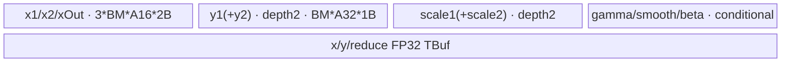
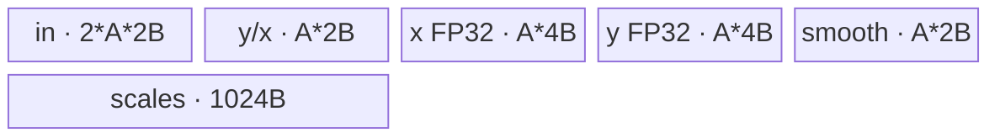

# AddRmsNormDynamicQuant 950 ACLNN 算子知识

## 算子速览

| 项目 | 内容 |
|---|---|
| 实际入口 | 最新公开 `aclnnAddRmsNormDynamicQuantV2GetWorkspaceSize` / `aclnnAddRmsNormDynamicQuantV2`；950 强制把 `outputMaskOptional` 置空后进入 L0 |
| 计算语义 | `x=x1+x2`，逐最后一维 RMSNorm，可选 beta；一路必做动态量化，smooth1+smooth2 同时存在时做第二路 |
| 输入输出 | FP16/BF16 输入；950 `y1/y2` 支持 INT8/HIFLOAT8/FLOAT8_E4M3FN/FLOAT8_E5M2，不支持 INT4；scale 为 FP32 |
| 执行类型 | R-001～R-004 均为单 Kernel `AIV_VECTOR`；router 显式 `KERNEL_TYPE_AIV_ONLY`，无 Cube/AIC、MIX_CV、SIMT、NDDMA 或通信节点 |
| Kernel 路线 | R-001 full-load/perf key100；R-002 normal key101；R-003 single-row key102；R-004 split-reduce key103 |
| 核心资源 | GM、RegBase AIV UB、`TQue/TBuf/RegTensor`；仅 R-004 使用用户 workspace |
| 来源闭包 | `source_closed`：V2 ACLNN → L0 → RegBase Tiling/POD → apt router → 四 Route body/common helper → 950 OpDef/config 已闭合 |
| 验证状态 | 已完成源码闭包检查；本次知识提取未执行编译、真机、数值或性能测试。 |

## 接口与语义

### 计算语义

令 `M=prod(x1.shape[:-1])`、`N=x1.shape[-1]`：

```text
s[m,n] = fp32(x1[m,n]) + fp32(x2[m,n])
xOut[m,n] = cast_input_dtype(s[m,n])
rstd[m] = 1/sqrt(sum_n(s[m,n]^2)/N + epsilon)
z[m,n] = s[m,n]*rstd[m]*fp32(gamma[n]) + (beta ? fp32(beta[n]) : 0)
q1 = z * (smooth1 ? smooth1 : 1)
q2 = z * smooth2                         # 仅 smooth1、smooth2 同时存在才有效
scale_i = max(abs(q_i)) / Qmax(T_Y)
y_i = cast_T_Y(q_i/scale_i)
```

`Qmax` 分别为 INT8 127、FP8E4M3FN 448、FP8E5M2 57344、HIFLOAT8 32768。950 公共文档明确暂不支持 `output_mask` 配置，因此 V2 实现将传入 mask 丢弃；公开可达语义等价于空 mask。

### 输入、输出与属性

| 参数 | shape/layout | dtype | 约束、默认值与语义 |
|---|---|---|---|
| `x1/x2` | rank≤8，ND，运行时连续化 | FP16/BF16 | shape/dtype 相同；前导维折叠为 M |
| `gamma` | `[N]` | 同输入 | 必选；空 gamma 走 ACLNN Fill 空域分支 |
| `smoothScale1Optional` | `[N]` | 同输入 | 可空；第二路存在的前提 |
| `smoothScale2Optional` | `[N]` | 同输入 | 可空；不能在 smooth1 缺失时单独存在 |
| `betaOptional` | `[N]` | 同输入 | 可空；与 gamma shape/dtype 相同 |
| `epsilon` | 标量 | double→POD FP32 | 默认/建议 1e-6；Tiling 写入 FP32 |
| `outputMaskOptional` | API 接受，但 950 不支持配置 | bool array | ACLNN 校验后强制传空给 L0 |
| `y1/y2` | 有效时同 x；无效 y2 为 `[1]` 或 `[]` | INT8/HIFLOAT8/FP8E4M3FN/FP8E5M2 | 两路 dtype 相同；不支持 INT4 |
| `xOut` | 同 x | 同输入 | 加法输出 |
| `scale1/scale2` | x 去最后维或 `[M]` | FP32 | 空 gamma 分支填 `-inf`；无效第二路不参与算子 Kernel |

### 入口与版本

V2 是固定仓对 950 公开支持的最新版本，增加 beta 与 outputMask；但 950 文档与实现共同限定 mask 不可配置。V2 先做通用参数检查；`IsRegbase()` 决定 950 输出 dtype 白名单、无效 `y2` shape 以及空 gamma 行为。非空时实际节点仍是 L0 `AddRmsNormDynamicQuantAiCore`。旧版无 V2 入口不进入本卡。

## Host/Launcher 执行流程

### 参数校验与前处理

`CheckParams` 检查必选指针、FP16/BF16 输入、950 四种 8-bit 输出、两路 dtype 一致、scale FP32，以及 smooth/mask 组合。950 仍执行 `CheckFlag`，但随后 `outputMaskIn=nullptr`，所以非空 mask 不影响 Kernel。`gamma->IsEmpty()` 时 ACLNN 用框架 Fill 把 scale 输出填 `-inf` 并返回零 workspace；其它空输入同样不创建算子节点。非空输入与可选输入通过 `Contiguous`。

### 参数、Workspace 与生命周期

L0 分配 `y1/x`，第二路只在 `smooth1 && smooth2` 时分配同 x shape，否则分配 `[1]`。Tiling 从 compile info 或平台查询得到 UB `U`、AIV 核数 `C`、向量寄存器 FP32 元素数 `V`；`mPerCore=ceil(M/C)`，`usedCore=ceil(M/mPerCore)`。

R-001～R-003 用户 workspace 为 0；R-004 为 `3*usedCore*N*4` 字节，三个大区依次是所有 core 的 `y1Tmp`、所有 core 的 `xOutTmp`、所有 core 的 `y2Tmp`，每区内再以 `core*N` 定位。Tiling 对所有 Route 再加固定 16MiB 系统 workspace。workspace/executor 由第一段接口产生，第二段在指定 stream 上消费；R-004 的三个 slice 在单 Kernel 生命周期内有效。

### 启动图与失败传播

```text
V2 GetWorkspaceSize -> CheckParams
  -> empty: framework Fill/no launch
  -> nonempty: Contiguous -> L0 AddRmsNormDynamicQuant
     -> Tiling4... detects RegBase -> RegbaseTiling
     -> key100/101/102/103 -> one apt AIV global body
  -> ViewCopy outputs
V2 run -> CommonOpExecutorRun(stream)
```

| 节点 | Host 启动函数 | entry | blockDim/POD | 输入→输出/workspace | ordering 与失败 |
|---|---|---|---|---|---|
| K-001 | `AddRmsNormDynamicQuantAiCore` / `Tiling4...` | `add_rms_norm_dynamic_quant` (apt) | `usedCore`；RegBase POD | x1/x2/gamma/optional → y1/optional y2/x/scale；R-004 三路 workspace | 单 stream 单 Kernel；Tiling 找不到 Route 或校验失败则不 launch |

key 199、500 虽在通用 router 中存在，但公开 V2 已在 ACLNN 空域分支返回，因此不是本卡公开入口可达 Route。

## Route 与参数设计

### 分核与资源计算

```text
A16 = align(baseN, 16)              # FP16/BF16 32B 对齐元素
A32 = align(baseN, 32)              # 8-bit 32B 对齐元素
AF32 = align(baseN, 8)              # FP32 32B 对齐元素
R512 = align(baseN, 256)            # 输入 dtype 512B 对齐元素
P = align(R512/(2*V), 8)            # reduce partial FP32 元素
mPerCore = ceil(M/C); usedCore=ceil(M/mPerCore)
mLastCore = M-(usedCore-1)*mPerCore
```

选择严格短路：perf→normal→single-row→split。`quantBufCnt` 是存在的 smooth 数，`hasY2Scale2=hasSmoothScale2`；beta 与第二路会增加 UB 公式。

### Route 选择

| 顺序 | Route | Key/模板 | 精确选择条件与优先级 | 不适用去向 |
|---:|---|---|---|---|
| 1 | R-001 full-load/perf | key100；`RegbasePerf<T_X,T_Y>` | `CalFullLoadBaseM(N)>=1 && N<=16384` | R-002 |
| 2 | R-002 normal | key101；`Regbase<T_X,T_Y>` | R-001 失败且 `CalUBTotalSize(1,N,NORMAL)<=U` | R-003 |
| 3 | R-003 single-row | key102；`RegbaseSingleRow<T_X,T_Y>` | 前两者失败且 `16*align(N,32/sizeof(T_Y))+1024<=U` | R-004 |
| 4 | R-004 split-reduce | key103；`RegbaseSpiltReduce<T_X,T_Y>` | 前三者失败且 `CalUBTotalSize(1,256,SPLIT)<=U`；`baseN` 扩为仍可容纳的最大 `256*2^k` | Tiling 失败 |

```text
if fullLoadBaseM>=1 && N<=16384: key100
else if normalBytes<=U:          key101
else if singleBytes<=U:          key102
else if splitMinBytes<=U:        key103
else:                            GRAPH_FAILED
```

### 模板/实现执行矩阵

| Route | key/selector | dtype/shape/platform 完整命中条件 | 执行拓扑与 Kernel 节点 | 实际模板/body | 内存与同步特征 | tail/fallback |
|---|---|---|---|---|---|---|
| R-001 perf | 100 | 950、非空、四种 8-bit T_Y；首个 guard 成立 | 单 K-001 AIV | `RegbasePerf::Process` | 多行全载；y/scale depth2；RegTensor | core 尾、baseM 尾；→101 |
| R-002 normal | 101 | perf 失败且 normal UB 成立 | 单 K-001 AIV | `Regbase::Process` | 单/多 baseM 逐行；Queue/TBuf | N 对齐 tail；→102 |
| R-003 single | 102 | 前两者失败且整行可容纳 | 单 K-001 AIV | `RegbaseSingleRow::Process` | 一行驻 UB；scale 128 行批写 | 行组 tail；→103 |
| R-004 split | 103 | 前三者失败且最小切片可容纳 | 单 K-001 AIV | `RegbaseSpiltReduce::Process` | D 切片、多级归约、3×GM workspace、MTE event | N 尾片；无 fallback |

### 隐藏性能 Guard

| Guard | Host/Tiling 条件 | Device/资源原因 | 影响 Route | 不满足时去向 | 源码符号 |
|---|---|---|---|---|---|
| perf N | `N<=16384` | full-load 实现的源码上限 | R-001 | R-002 | `TryPerfTiling` |
| perf UB | `CalUsedSize(baseM)<=U`，额外预留 1024B | 全载 x、双缓冲 y/scale、reduce 和可选参数同时驻留 | R-001 | R-002 | `CalFullLoadBaseM/CalUsedSize` |
| normal UB | `CalUBTotalSize(1,N,NORMAL)<=U` | 基础队列、FP32 tmp、reduce、可选 smooth/beta/y2 | R-002 | R-003 | `TryNormTiling` |
| single 对齐 | `outputAlign=32/sizeof(T_Y)` | 8-bit 输出 block 对齐；整体 `16*A+1024` | R-003 | R-004 | `TrySingleRowTiling` |
| split base | 最小 `xReduceAlignNum=256` 可容纳 | 512B reduction 对齐与三级各 256 FP32 buffer | R-004 | 失败 | `TrySplitTiling` |
| dtype specialization | T_Y 四种 8-bit 类型 | scale 常量和 cast trait 不同 | 全部 | ACLNN/Tiling 失败 | `ComputeYScale/ComputeScale/ComputeY` |
| only smooth2 | `!hasSmooth1 && hasSmooth2` | 950 固定空 mask 语义不允许仅二路 | 全部 | 校验失败 | `CheckOptionalInput` |

### POD/ABI

Tiling 宏实现不在固定仓，精确 `sizeof/alignof/offsetof` 不可见；字段声明顺序与类型在固定文件中闭合。

| 结构 | 字段 | 类型/位宽 | ABI 布局 | 单位 | Host/launcher producer | Device consumer | 边界 |
|---|---|---|---|---|---|---|---|
| `AddRmsNormDynamicQuantRegbaseTilingData` | `numM` | uint64/64 | 宏生成，offset 不可见 | 行 | shape 折叠 | 全部 Process | >0 |
| 同上 | `numN` | uint64/64 | 同上 | 元素/行 | gamma size | 地址、mask | >0 |
| 同上 | `baseM` | uint64/64 | 同上 | 行/tile | Route 求解 | perf/normal 外循环 | ≥1 |
| 同上 | `baseN` | uint64/64 | 同上 | 元素/slice | N 或 split cutN | UB/切片 | ≥1 |
| 同上 | `baseNDtypeAlign` | uint64/64 | 同上 | 元素 | align(baseN,16) | UB stride | 32B |
| 同上 | `baseNReduceAlign` | uint64/64 | 同上 | 元素 | align(baseN,256) | reduce buffer | 512B |
| 同上 | `powerSplit` | uint64/64 | 同上 | 元素 | Route producer | reduction tree | 部分 consumer 窄化 uint32 |
| 同上 | `powerLoop` | uint64/64 | 同上 | 次 | split 最大 2 的幂；其它 1 | R-004 | inactive Route 不读 |
| 同上 | `mPerCore` | uint64/64 | 同上 | 行/core | ceil(M/C) | GM core base | ≥1 |
| 同上 | `mLastCore` | uint64/64 | 同上 | 行 | 尾核公式 | CalBlockTail | 1..mPerCore |
| 同上 | `epsilon` | float/32 | 同上 | FP32 | attr | rstd | double 已窄化 |
| 同上 | `avgFactor` | float/32 | 同上 | FP32 | 1.0f/N | rstd | N>0 |
| 同上 | `hasSmoothScale1` | uint32/32 | 同上 | bool | optional shape | 条件 buffer/body | 0/1 |
| 同上 | `hasSmoothScale2` | uint32/32 | 同上 | bool | optional shape | 第二路与 buffer | 0/1，要求 smooth1=1 |
| 同上 | `hasBeta` | uint32/32 | 同上 | bool | optional shape | beta add/buffer | 0/1 |

### Route 源码闭包

| Route | Key/selector | Host/Tiling producer | POD/参数 | Kernel entry/router 节点 | Kernel body/直接依赖 | 构建接线 |
|---|---|---|---|---|---|---|
| R-001 | 100 | `tiling_arch35.cpp::TryPerfTiling` | RegBase POD | `add_rms_norm_dynamic_quant_apt.cpp` key100 | `...regbase_perf.h` + `...regbase_common.h` + norm common | OpDef ascend950 + 950 binary config |
| R-002 | 101 | `TryNormTiling` | 同上 | apt key101 | `...regbase.h` + common | 同上 |
| R-003 | 102 | `TrySingleRowTiling` | 同上 | apt key102 | `...regbase_single_row.h` + common/helper | 同上 |
| R-004 | 103 | `TrySplitTiling` | 同上 | apt key103 | `...regbase_split_reduce.h` + common/norm common | 同上 |

## Kernel 实现

### 公共执行流程

apt router 对非空 key 显式设置 `KERNEL_TYPE_AIV_ONLY`，按编译 dtype 实例化 `T_X` 与 `T_Y`。四 Route 都将 x1/x2 升为 FP32 相加，`xOut` 降回输入 dtype；平方和与 rstd 为 FP32；gamma/beta/smooth 在 RegTensor 中升 FP32。`ComputeYScale`/`ComputeReduceMax` 以 `UpdateMask` 排除 N tail，scale 使用目标 dtype 的 Qmax，INT8 使用 RINT+FP16 中转+TRUNC，FP8/HIFLOAT8 使用对应 cast trait。可选 flag 通过模板 bool dispatch 消除未使用的 smooth/beta 运算与 buffer。

### Route R-001：full-load/perf

#### 适用条件

##### 选择证据

| 层级 | 文件 | 符号 | 源码谓词/参数 | 结果/下一跳 |
|---|---|---|---|---|
| Tiling | `op_host/...tiling_arch35.cpp` | `TryPerfTiling` | `fullLoadBaseM>=1 && N<=16384` | key100，否则 normal |
| Router | `op_kernel/..._apt.cpp` | key100 branch | `TILING_KEY_IS(100)` | Perf body |

#### Device 数据流

##### 函数级调用链

```text
K-001 -> Perf::Init -> CalBlockTail/InitBuffer/InitUBBuffer
  -> Process -> cache gamma/smooth/beta
     -> per baseM: CopyInXMutiMoveAlign -> CalculateXAdd -> CopyOutX
        -> CalculateSquareReduceSum -> ComputeRstdNewtonRaphson
        -> DispatchMutlScale -> ComputeMutlY -> CopyOutY/Scale
```

##### 源码等价伪码

```text
# 伪码
cache parameters once/core
for rowTile<=baseM:
  multi-block DMA x1/x2; register add; write xOut and FP32 xTmp
  binary square reduction for each row; Newton-Raphson rstd
  for active q1/q2: register norm+beta+smooth, reduce max, scale by Qmax, cast y
  depth-2 queues write y and scales
```

#### 内存与数据搬运

##### 资源与搬运表

| 层级/缓冲区 | offset/地址公式 | extent/容量公式 | dtype/layout | producer | consumer | owner/lifetime | 对齐/复用 |
|---|---|---|---|---|---|---|---|
| x queues | core GM base | each `baseM*A16*sizeof(T_X)`, depth1 ×3 | T_X | DMA/add | Vector/GM | tile | xTmp keeps FP32 add |
| y1 queue | UB | `2*baseM*A32*sizeof(T_Y)` | T_Y | quant | GM | tile | depth2；y2 条件同量 |
| scale1 queue | UB | `2*align(baseM,8)*4` | FP32 | reduce max | GM | tile | depth2；scale2 条件同量 |
| params | UB | `(1+smoothCnt+beta)*A16*2` | T_X | GM | RegTensor compute | core | 条件分配 |
| FP32 temps | UB | `baseM*A16*4 + baseM*AF32*4 + 2*align(baseM,8)*4 + firstVcadd*4` | FP32 | add/reduce/quant | later stages | tile | TBuf 原地复用 |

##### 分层内存布局



##### 字节账与复用顺序

```text
UB_total = CalUsedSize(baseM,A32,AF32,A16,firstVcadd)
UB_total <= U，CalFullLoadBaseM 逐减 baseM 到成立并预留 1024B
dynamic_ub = N/A
workspace_total = 16MiB system
```

| 复用子区 | 写入者 | 读取者/消费点 | 下一次覆盖 | 同步或释放依据 | 安全条件 |
|---|---|---|---|---|---|
| xOutTmp | CalculateXAdd | reduce、两路 quant | 下一 tile | PIPE_V/调用顺序 | q2 完成后覆盖 |
| y1Tmp | DispatchMutlScale q1 | ComputeMutlY q1 | q2/下一 tile | PIPE_V | q1 y 已生成 |

#### 同步、精度与尾块

##### 同步与数值边界表

| 阶段 | primitive/机制 | producer | consumer/等待点 | 保护对象 | 精度/尾块 |
|---|---|---|---|---|---|
| DMA/Vector | Queue | MTE2 | Vector/MTE3 | x/y/params | blockLen=realM*N bytes；mask N tail |
| Vector | `PIPE_V` | add/reduce/scale | next VF stage | TBuf/RegTensor | FP32；dtype cast 按目标类型 |

#### 关键实现

##### 符号证据表

| 阶段 | 文件 | 符号/模板实例 | 实现事实 |
|---|---|---|---|
| Host/Tiling producer | `op_host/add_rms_norm_dynamic_quant_tiling_arch35.cpp` | `CalFullLoadBaseM/TryPerfTiling` | baseM 与 guard |
| Kernel entry/router | `op_kernel/add_rms_norm_dynamic_quant_apt.cpp` | key100 | AIV perf 实例 |
| Device body/helper | `op_kernel/arch35/add_rms_norm_dynamic_quant_regbase_perf.h` | `Process/CalculateXAdd/DispatchMutlScale` | 多行全载路径 |

### Route R-002：normal

#### 适用条件

##### 选择证据

| 层级 | 文件 | 符号 | 源码谓词/参数 | 结果/下一跳 |
|---|---|---|---|---|
| Tiling | `...tiling_arch35.cpp` | `TryNormTiling` | `CalUBTotalSize(1,N,NORMAL)<=U` | key101，否则 single |
| Router | `..._apt.cpp` | key101 | key match | Regbase body |

#### Device 数据流

##### 函数级调用链

```text
K-001 -> Regbase::Init/InitUBBuffer -> Process
  -> cache gamma/smooth/beta -> per row/baseM
  -> CopyIn x1/x2 -> Compute(add/square/rstd) -> CopyOut x
  -> DispatchYScale q1/(q2) -> CopyOut y/scale
```

##### 源码等价伪码

```text
# 伪码
for rows assigned to core in baseM groups:
  padded single-row queues -> fp32 add/square reduction -> rstd
  norm/beta/smooth/max and quantize each active branch
  queue-copy valid N and row scales
```

#### 内存与数据搬运

##### 资源与搬运表

| 层级/缓冲区 | offset/地址公式 | extent/容量公式 | dtype/layout | producer | consumer | owner/lifetime | 对齐/复用 |
|---|---|---|---|---|---|---|---|
| x queues | row*N | each `R512*2` ×3 depth1 | T_X | GM/add | vector/GM | row | 512B reduce padding |
| y queues | row*N | `A32*sizeof(T_Y)` each active | T_Y | ComputeYScale | GM | row | 32B |
| params | UB | `(1+smoothCnt+beta)*A16*2` | T_X | GM | quant | core | conditional |
| FP32 TBuf | UB | `R512*4 + AF32*4*(1+hasY2) + align(baseM,8)*4*(2+hasY2) + P*4` | FP32 | stages | stages | row/group | 原地 tmp |

##### 分层内存布局


##### 字节账与复用顺序

```text
UB_total = CalUBTotalSize(baseM,N,NORMAL)
UB_total <= U
dynamic_ub = N/A
workspace_total = 16MiB system
```

| 复用子区 | 写入者 | 读取者/消费点 | 下一次覆盖 | 同步或释放依据 | 安全条件 |
|---|---|---|---|---|---|
| xOutTmp | add | square/norm | next row | PIPE_V | quant branches finished |
| yTmp | q1 transform | y1 cast | q2/next row | PIPE_V | y1 enqueued |

#### 同步、精度与尾块

##### 同步与数值边界表

| 阶段 | primitive/机制 | producer | consumer/等待点 | 保护对象 | 精度/尾块 |
|---|---|---|---|---|---|
| Queue/PIPE_V | DMA/VF | compute/copy | DeQue/barrier | UB | UpdateMask 排除 N padding；末 core 用 mLastCore |

#### 关键实现

##### 符号证据表

| 阶段 | 文件 | 符号/模板实例 | 实现事实 |
|---|---|---|---|
| Host/Tiling producer | `...tiling_arch35.cpp` | `TryNormTiling/CalUBTotalSize` | baseM 与 UB |
| Kernel entry/router | `..._apt.cpp` | key101 | normal 实例 |
| Device body/helper | `op_kernel/arch35/add_rms_norm_dynamic_quant_regbase.h` | `Process/Compute/DispatchYScale` | normal body |

### Route R-003：single-row

#### 适用条件

##### 选择证据

| 层级 | 文件 | 符号 | 源码谓词/参数 | 结果/下一跳 |
|---|---|---|---|---|
| Tiling | `...tiling_arch35.cpp` | `TrySingleRowTiling` | `16*A+1024<=U` | key102，否则 split |
| Router | `..._apt.cpp` | key102 | key match | SingleRow body |

#### Device 数据流

##### 函数级调用链

```text
K-001 -> RegbaseSingleRow::Init -> Process
  -> per row CopyInX1X2/Add/CopyOutX -> CopyInGamma/Beta
  -> ComputeRmsNorm -> CopyInSmooth -> ComputeDynamicQuant -> CopyOut
  -> each 128 rows/tail CopyOutScale
```

##### 源码等价伪码

```text
# 伪码
for scale groups of 128 rows:
  for each row: one full N row in UB; FP32 add/norm; active smooth/max/typed quant
  batch write scale arrays; last group writes exact tail count
```

#### 内存与数据搬运

##### 资源与搬运表

| 层级/缓冲区 | offset/地址公式 | extent/容量公式 | dtype/layout | producer | consumer | owner/lifetime | 对齐/复用 |
|---|---|---|---|---|---|---|---|
| `inRowsQue` | UB | `2*A*2` depth1 | T_X | x/params | compute | row | 复用 |
| `yQue` | UB | `A*2` depth1 | T_X/T_Y | x/quant | GM | row | 阶段复用 |
| x/y FP32 | UB | each `A*4` | FP32 | add/norm | quant | row | 原地 |
| smooth | UB | `A*2` | T_X | GM | q1 | core | active only |
| scales | UB | `2*128*4` | FP32 | row max | GM | group | 第二半仅 q2 active |

##### 分层内存布局



##### 字节账与复用顺序

```text
UB_total = 16*A + 1024
UB_total <= U
dynamic_ub = N/A
workspace_total = 16MiB system
```

| 复用子区 | 写入者 | 读取者/消费点 | 下一次覆盖 | 同步或释放依据 | 安全条件 |
|---|---|---|---|---|---|
| yQueue | x cast | x GM | y quant | Queue Free | x 已写出 |
| y FP32 | square/gamma | norm/q branches | next row | PIPE_V | y 已写 |

#### 同步、精度与尾块

##### 同步与数值边界表

| 阶段 | primitive/机制 | producer | consumer/等待点 | 保护对象 | 精度/尾块 |
|---|---|---|---|---|---|
| scalar reduce | V_S/S_V | sum/max | scalar/Muls | rstd/scale | FP32；N mask |
| group scale | Queue | 128 rows | MTE3 | scale | tail 为 `rowWork%128` |

#### 关键实现

##### 符号证据表

| 阶段 | 文件 | 符号/模板实例 | 实现事实 |
|---|---|---|---|
| Host/Tiling producer | `...tiling_arch35.cpp` | `TrySingleRowTiling` | guard/powerSplit |
| Kernel entry/router | `..._apt.cpp` | key102 | SingleRow |
| Device body/helper | `...regbase_single_row.h` | `Process/ComputeRmsNorm/ComputeDynamicQuant` | 逐行/scale batching |

### Route R-004：split-reduce

#### 适用条件

##### 选择证据

| 层级 | 文件 | 符号 | 源码谓词/参数 | 结果/下一跳 |
|---|---|---|---|---|
| Tiling | `...tiling_arch35.cpp` | `TrySplitTiling` | 最小 256 元素 UB 成立，扩展最大 2^k cutN | key103，否则失败 |
| Router | `..._apt.cpp` | key103 | key match | SplitReduce body |

#### Device 数据流

##### 函数级调用链

```text
K-001 -> SplitReduce::Init(workspace) -> Process per row
  -> SubProcessRstd: ComputeFormerHandle slices -> multi-level reduce -> rstd
  -> SubProcessReduceMax: workspace x read -> gamma/beta/smooth -> yTmp workspace + max
  -> SubProcessScale -> SubProcessY: workspace yTmp read -> typed quant -> GM y
  -> CopyOutScale
```

##### 源码等价伪码

```text
# 伪码
for row:
  partition N into powerSplit chunks and tail; each chunk adds x1+x2, writes xOut and FP32 x workspace
  hierarchical level1/2/3 reduction -> rstd
  for chunks: read x workspace; norm+beta+smooth; accumulate max and write q1/q2 workspace
  scale=max/Qmax
  for chunks: read q workspace; divide scale; typed cast; write y
```

#### 内存与数据搬运

##### 资源与搬运表

| 层级/缓冲区 | offset/地址公式 | extent/容量公式 | dtype/layout | producer | consumer | owner/lifetime | 对齐/复用 |
|---|---|---|---|---|---|---|---|
| workspace q1 | `core*N + [0,N)` FP32 | N*4/core | | pass2 | pass3 | executor/Kernel | 第一个 `usedCore*N` 大区，core-private |
| workspace x | `usedCore*N + core*N + [0,N)` | N*4/core | | pass1 | pass2 | same | 第二个大区 |
| workspace q2 | `2*usedCore*N + core*N + [0,N)` | N*4/core | | pass2 | pass3 | same | 第三个大区；only q2 active，Host 始终预留 |
| slice queues | UB | x queues `3*R512*2`；y active `A32*1` | mixed | DMA/compute | stages | slice | Queue |
| FP32 slice tmp | UB | x/y tmp + rstd/reduce P | FP32 | stages | stages | slice | 原地 |
| hierarchy | UB | `3*256*4 + V*4` | FP32 | chunk sums | final reduce | row | level1/2/3 |

##### 分层内存布局


##### 字节账与复用顺序

```text
UB_total = CalUBTotalSize(1,baseN,SPLIT) <= U
dynamic_ub = N/A
workspace_total = 16MiB + 3*usedCore*N*4
```

| 复用子区 | 写入者 | 读取者/消费点 | 下一次覆盖 | 同步或释放依据 | 安全条件 |
|---|---|---|---|---|---|
| x workspace | ComputeFormerHandle | SubProcessReduceMax | next row/core lifetime | V_MTE3/MTE3_V + V_MTE2/MTE2_V | core slices不重叠 |
| q workspace | SubProcessReduceMax | SubProcessY | next row | MTE events | y 已输出 |

#### 同步、精度与尾块

##### 同步与数值边界表

| 阶段 | primitive/机制 | producer | consumer/等待点 | 保护对象 | 精度/尾块 |
|---|---|---|---|---|---|
| UB→workspace | `V_MTE3/MTE3_V` | Vector | MTE3/store completion | x/q | FP32 valid realN |
| workspace→UB | `V_MTE2/MTE2_V` | prior store | Vector | x/q | DataCopyPad zeroes UB tail |
| hierarchical reduce | `PIPE_V` + level buffers | chunk sums/max | rstd/scale | row scalar | powerLoop/tail branches |

#### 关键实现

##### 符号证据表

| 阶段 | 文件 | 符号/模板实例 | 实现事实 |
|---|---|---|---|
| Host/Tiling producer | `...tiling_arch35.cpp` | `TrySplitTiling/GetWorkspaceSize` | cutN/powerLoop/3N workspace |
| Kernel entry/router | `..._apt.cpp` | key103 | SplitReduce |
| Device body/helper | `...regbase_split_reduce.h` | `ComputeFormerHandle/SubProcessRstd/SubProcessReduceMax/SubProcessY` | 多级归约、workspace 网络 |

## 算子特定优化

### Trick T-001：可选 smooth/beta 通过 Host flag 与模板 bool 同时消除 buffer 和指令

#### 触发与源码依据

- 适用 Route：R-001、R-002、R-004（R-003 使用等价条件分支）
- 触发条件：`hasSmoothScale1/2`、`hasBeta` 的任意组合（不允许 only smooth2）。
- Golden 来源：[`add_rms_norm_dynamic_quant_regbase_common.h:204-224`](../../../../../../../cann-ops-raw/ascendc/ops-nn/955f8b33985b6d72989ebff341bb9c2c564a51bc/norm/add_rms_norm_dynamic_quant/op_kernel/arch35/add_rms_norm_dynamic_quant_regbase_common.h#L204-L224)

**官方源码（固定 Commit 连续逐字摘录）**：

```cpp
if constexpr (HAS_SMOOTH_SCALE) {
    NormCommon::LoadCastRegVF(smoothScaleRegFp32, smoothScaleAddr, idx, maskReg);
}
if constexpr (HAS_BETA) {
    NormCommon::LoadCastRegVF(betaRegFp32, betaAddr, idx, maskReg);
}
Mul(xRegFp32, xRegFp32, rstdReg, maskReg);
Mul(xRegFp32, xRegFp32, gammaRegFp32, maskReg);
if constexpr (HAS_BETA) {
    Add(xRegFp32, xRegFp32, betaRegFp32, maskReg);
}
```

#### 机制与设计原因

Host UB 公式只计入存在的 smooth/beta，Device dispatch 再实例化 `HAS_*` 编译期布尔，未启用参数不会分配 Queue、不会搬运，也不会进入 RegTensor load/mul/add。该闭包同时降低 UB 与计算/搬运量，并能提高更高优先级 Route 的可达性。

#### 迁移边界

- 适用：可选逐列参数能在 launch 前静态确定的融合归一化。
- 前提：Host flag、POD、InitBuffer 与模板实参必须一致；only smooth2 必须仍拒绝。
- 失效：运行中才变化的参数不能用 `if constexpr`。
- 未验证：本次知识提取未执行编译、真机、数值或性能测试。

#### 错误做法

固定仓的真实错误终点是 `CheckOptionalInput` 对 only smooth2 返回失败；不能用未绑定 GM 指针模拟缺省 smooth1。

### Trick T-002：split-reduce 用三级小 buffer 汇总大 N，并以三段 GM workspace 交接

#### 触发与源码依据

- 适用 Route：R-004
- 触发条件：整行 Route 均不满足且最小 256 元素 split buffer 可容纳。
- Golden 来源：[`add_rms_norm_dynamic_quant_tiling_arch35.cpp:514-531`](../../../../../../../cann-ops-raw/ascendc/ops-nn/955f8b33985b6d72989ebff341bb9c2c564a51bc/norm/add_rms_norm_dynamic_quant/op_host/add_rms_norm_dynamic_quant_tiling_arch35.cpp#L514-L531)

**官方源码（固定 Commit 连续逐字摘录）**：

```cpp
if (tmpUBSize <= tilingParams.maxUbSize) {
    uint64_t tmpPowerCutN = tilingParams.xReduceAlignNum;
    while (CalUBTotalSize(1, tmpPowerCutN * MULTI_FACTOR_2, TILING_TYPE_SPILT) <= tilingParams.maxUbSize) {
        tmpPowerCutN *= MULTI_FACTOR_2;
    }
    tilingParams.powerSplit = tmpPowerCutN;
    uint64_t curLoop = 1;
    while (curLoop * MULTI_FACTOR_2 * tilingParams.powerSplit <= tilingParams.numN) {
        curLoop *= MULTI_FACTOR_2;
    }
```

#### 机制与设计原因

Host 把 slice 扩到 UB 能容纳的最大 2 的幂倍数；Device 用 level1/2/3 各 256 FP32 元素和一个 vector temp 做分层归约。全 D 的 x/q 不驻 UB，而写入每 core 三段 workspace，通过显式 MTE event 再读回，保证大 N 仍闭合。

#### 迁移边界

- 适用：大归约维、单核多遍处理、可承受 GM 临时区的 AIV 算子。
- 前提：`3*usedCore*N*4` workspace、core-private offset、MTE ordering 都必须保留。
- 失效：workspace 不足或跨核共享归约时需另一同步/归约拓扑。
- 未验证：本次知识提取未执行编译、真机、数值或性能测试。

#### 错误做法

固定仓提供的失败终点是最小 split UB 仍超限时 `GRAPH_FAILED`；不能继续减小到未实现的任意 slice。

## 模板与实现对比

| 对比维度 | R-001 perf | R-002 normal | R-003 single | R-004 split | 设计选择依据 |
|---|---|---|---|---|---|
| 命中条件/优先级 | 全载可行且 N≤16384 | 单行 normal 可行 | 整行最小实现可行 | 最小 256 slice 可行 | 依次减少 UB 驻留 |
| 模板与 dtype | RegbasePerf<T_X,T_Y> | Regbase<T_X,T_Y> | RegbaseSingleRow<T_X,T_Y> | RegbaseSpiltReduce<T_X,T_Y> | 四种 T_Y specialization |
| 循环与分核 | baseM 行 tile | baseM/逐行 | 逐行、128 scale | 行×N slice×多遍 | U、N 驱动 |
| Queue/TBuf/寄存器/dynamic UB/通信 window | depth2 y/scale | depth1 | 轻量全行 | 三级 reduce + workspace | 均无 dynamic UB/通信 |
| 内存总占用与复用 | 全载最大 | 中 | 16A+1024 | 固定 slice + 3N GM/core | Route guard |
| 搬运/Vector/SIMT/NDDMA/通信 API | multi-block DMA+MicroAPI | DMA+MicroAPI | DataCopy+Vector | DMA/workspace+MicroAPI | 无 SIMT/NDDMA/通信 |
| 同步、精度与 tail | Queue/PIPE_V | 同左 | V/S event | MTE+PIPE_V | FP32 主计算，typed cast |
| fallback/失败边界 | →101 | →102 | →103 | GRAPH_FAILED | 无隐藏 Device fallback |

## 平台差异

| 项目 | A2 | A3 | 950 |
|---|---|---|---|
| 支持状态 | 支持，见无后缀卡 | 支持，见无后缀卡 | 公开 V2 支持 |
| Host/Launcher | legacy key1/2/3，支持 outputMask、INT4 | 同 A2 | RegBase key100～103；outputMask 禁用；不支持 INT4 |
| Kernel/资源 | Vector API；slice-D workspace 1/2 行 | 同 A2 | RegBase MicroAPI；split workspace 固定 3N/core；支持 FP8/HIFLOAT8 |

## 限制与失败边界

- 950 公开 V2 不支持配置 `outputMaskOptional`；实现即使接收非空数组也在 L0 前强制改成空指针。
- 只覆盖 V2，不覆盖旧版接口或其它语义变体。
- `M/N` 乘积、workspace `3*usedCore*N*4` 与若干 uint64→uint32/uint16 窄化未见独立溢出 guard。
- 空 gamma 的 scale `-inf` 由框架 Fill 节点完成；Fill 内部 Kernel 是框架边界，不属于本算子 AIV Route。其它公开非空 Route 已 source closed。
- executor、Contiguous、ViewCopy 的内部实现不可见；算子 selector/POD/body/sync 已闭合。
- 本次知识提取未执行编译、真机、数值或性能测试。

## 源码索引

### 链路索引

| 链路阶段 | 文件 | 关键符号 | 支撑内容 |
|---|---|---|---|
| 入口声明/约束 | `docs/aclnnAddRmsNormDynamicQuantV2.md` | 产品表/约束 | 950 公开支持、mask/INT4 限制 |
| 入口实现 | `op_host/op_api/aclnn_add_rms_norm_dynamic_quant_v2.cpp` | `CheckParams`、V2 两段接口 | RegBase 分支、空域、mask 置空 |
| L0 launcher | `op_host/op_api/add_rms_norm_dynamic_quant.cpp` | `AddRmsNormDynamicQuantAiCore` | 单节点与 y2 条件形状 |
| Host/Tiling/POD | `op_host/add_rms_norm_dynamic_quant_tiling.h` | RegBase POD/class | 字段与 Route 类型 |
| Host/Tiling | `op_host/add_rms_norm_dynamic_quant_tiling_arch35.cpp` | `SetTilingParams/Try*` | guard、UB、workspace |
| Kernel entry/body | `op_kernel/add_rms_norm_dynamic_quant_apt.cpp` | global router | AIV-only key100～103 |
| Kernel entry/body | `op_kernel/arch35/add_rms_norm_dynamic_quant_regbase_perf.h` | Perf class | R-001 |
| Kernel entry/body | `op_kernel/arch35/add_rms_norm_dynamic_quant_regbase.h` | Regbase class | R-002 |
| Kernel entry/body | `op_kernel/arch35/add_rms_norm_dynamic_quant_regbase_single_row.h` | SingleRow class | R-003 |
| Kernel entry/body | `op_kernel/arch35/add_rms_norm_dynamic_quant_regbase_split_reduce.h` | SplitReduce class | R-004 |
| Kernel helper | `op_kernel/arch35/add_rms_norm_dynamic_quant_regbase_common.h` | `ComputeYScale/ReduceMax/Scale/Y` | typed scale/cast、optional template |
| 构建接线 | `op_host/add_rms_norm_dynamic_quant_def.cpp` | ascend950 AICore config | 950 dtype/apt target |
| 构建接线 | `op_host/config/ascend950/add_rms_norm_dynamic_quant_binary.json` | 950 binaries | FP16/BF16 × 8-bit 输出 |

### 实现复用检查

| 检查项 | 可复用事实 | 不得改变的约束 | 源码符号 |
|---|---|---|---|
| ABI/POD | 四 Route 共用 RegBase POD | 字段顺序/位宽、flag 与单位 | `AddRmsNormDynamicQuantRegbaseTilingData` |
| 调用顺序 | 单 Kernel Route body | add→rstd→max/scale→typed y | 各 `Process` |
| workspace/内存 | split 三段 workspace | `3*core*N` FP32 offset/lifetime | `GetWorkspaceSize`、Split `Init` |
| 同步 | Queue/PIPE_V/MTE event | store/load event 和 Queue Free 不可删 | common/Route methods |
| 精度与尾块 | FP32 主计算、Qmax specialization、UpdateMask | INT8 与三种浮点8 cast trait、realN | `ComputeYScale/ComputeY` |
| 失败边界 | perf→normal→single→split | only smooth2、dtype/shape、最小 split 失败终止 | `SetTilingParams/CheckOptionalInput` |