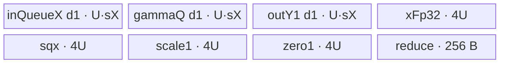
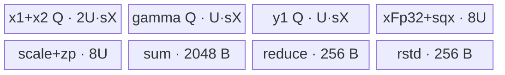
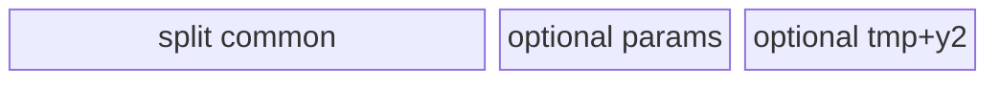

# AddRmsNormQuant A2/A3 ACLNN 算子知识

## 算子速览

| 项目 | 内容 |
|---|---|
| 实际入口 | `aclnnAddRmsNormQuantV2GetWorkspaceSize` + `aclnnAddRmsNormQuantV2`；A2/A3 上取版本族最新公开 V2 |
| 计算语义 | `x=x1+x2`；`r=x/sqrt(mean(x²)+epsilon)*gamma`；可选 `beta` 后量化；V2 还可输出不含 beta 的 `rmsNormOut` |
| 输入输出 | ND，1–8 维；A2/A3 支持 FP16/FP32 scale/INT32 组合与全 BF16 组合，量化输出 INT8 |
| 执行类型 | 每条核心路线均为单个 `AIV_VECTOR` Kernel；未发现 Cube/AIC/MIX_CV、SIMT、NDDMA 或多 Kernel 核心图 |
| Kernel 路线 | R-001～R-003 V2 post；R-004～R-006 V2 pre；R-007～R-009 V1 fallback；各组三种 body 为 normal/split-D/single-N |
| 核心资源 | GM、AIV UB、TQue/TBuf、Vector API、标量事件；Tiling 报告 `16 MiB + 256 B` workspace，核心 Kernel 不读该指针 |
| 来源闭包 | `source_closed`：公开 V2 ACLNN→V2 selector/V1 fallback→L0 launcher→共享 Tiling/POD→全部 router/body/helper→OpDef/config 已闭合 |
| 验证状态 | 已完成源码闭包检查；本次知识提取未执行编译、真机、数值或性能测试。 |

## 接口与语义

### 计算语义

令 `D=product(gamma.shape)`，`M=product(x1.shape[0:xRank-gammaRank])`。逐行计算 `x=x1+x2`、`r=x/sqrt(sum(x²)/D+epsilon)*gamma`。V2 专用 pre 路线输出 `xOut=x`，先做 `y=r+beta` 再以标量 `scales1/zeroPoints1` 量化；post 路线输出 `rmsNormOut=r`，不允许 beta。其余合法组合回退到 V1 body，输出 `xOut`，支持逐元素 scale/zero-point、可选第二量化输出及乘/除两种模式。

### 输入、输出与属性

| 参数 | shape/layout | dtype | 约束、默认值与语义 |
|---|---|---|---|
| `x1`, `x2` | 相同 ND，1–8 维 | FP16 或 BF16 | 必选；允许非连续，先 `Contiguous`；空 tensor 直接成功、workspace 0 |
| `gamma` | `x1` 的归一化尾维，V2 快路仅 `[D]`/`[1,D]` | 同 `x1` | V2 快路会把 `[1,D]` reshape 为 `[D]` |
| `scales1` | 一般与 gamma 相同；V2 快路必须 `[1]` | FP32（FP16 路）或 BF16 | 必选；输入 FP16 scale 会由 ACLNN `Cast` 成 FP32 |
| `scales2Optional` | 与 `scales1` 相同 | 与 `scales1` 相容 | 非空即离开 V2 快路；控制 y2 是否有效 |
| `zeroPoints1Optional` | 一般与 gamma 相同；V2 快路必须 `[1]` | INT32（FP16 路）或 BF16 | V2 快路必传 |
| `zeroPoints2Optional` | 与第一组相同 | 与第一组相同 | 非空即离开 V2 快路 |
| `betaOptional` | 与 gamma 相同 | 同 `x1` | pre 快路必传，post 快路必须为空；fallback 可选 |
| `axis` | Host `int64` | 标量 | 文档仅支持 `-1`；Device 不读取 axis |
| `epsilon` | Host `double`→属性 `float` | 标量 | 进入 rstd 公式 |
| `divMode` | 标量 | bool | 快路仅 true；fallback 支持 true/false |
| `y1Out`, `y2Out` | 与 `x1` 相同 | INT8 | 两者指针必选；无 `scales2` 时 y2 值无效 |
| `xOut` | 与 `x1` 相同 | 同 `x1` | pre/fallback 输出；与 `rmsNormOut` 二选一 |
| `rmsNormOut` | 与 `x1` 相同 | 同 `x1` | post 快路输出不含 beta 的 `r` |

### 入口与版本

V2 文档明确支持 Atlas A2/A3，OpDef 注册 `ascend910b`、`ascend910_93`，两个 binary config 都接入 `AddRmsNormQuantV2`。V2 是该平台版本族最新公开接口；旧 `aclnnAddRmsNormQuant` 仅作为 V2 ACLNN 在不满足快路时实际调用的内部 body。V2 文档明确不支持 Ascend 950，因此本文件不覆盖 950。

## Host/Launcher 执行流程

### 参数校验与前处理

第一段创建 executor，先检查 `x1/x2/gamma/scales1/y1/y2` 非空；`SpecialTransform` 把 FP16 `scales1` cast 为 FP32。任一 `x1/gamma/y2` 为空时返回 workspace 0。随后对所有存在输入执行 `Contiguous`。`CheckSupportV2` 仅接受 A2/A3/310P、无 s2/z2、`divMode=true`、gamma 为 `[D]`/`[1,D]`、s1/zp1 为 `[1]`，且恰好是 `(beta,xOut)` 或 `(无 beta,rmsNormOut)`。命中后 `SelfPreDealData` reshape 二维 gamma/beta 并调用 V2 L0；否则仅在 `xOut!=nullptr` 时进入 V1 L0，更否则报空指针错误。内部结果通过同 stream 的 `ViewCopy` 提交。

### 参数、Workspace 与生命周期

L0 为核心节点分配连续临时 y1/y2/x/rmsNorm tensor，并加入一个 AICore launcher。Tiling 写 `workspace[0]=16*1024*1024+256` B；Kernel entry 虽含 `workspace` 参数但所有 body 均未读取，故没有核心节点间 workspace 边。executor 拥有 Contiguous/Cast/Reshape、核心节点及 ViewCopy 的生命周期；第二段 `CommonOpExecutorRun` 在调用者 stream 上按 executor 顺序执行，前一步失败阻断后续节点。

### 启动图与失败传播

```text
aclnnAddRmsNormQuantV2GetWorkspaceSize
  -> optional Cast + Contiguous + optional Reshape
  -> [V2 fast] AddRmsNormQuantV2 AIV node
     or [fallback] AddRmsNormQuant AIV node
  -> ViewCopy(y1) -> optional ViewCopy(y2/x/rmsNorm)
aclnnAddRmsNormQuantV2(workspace, executor, stream)
  -> CommonOpExecutorRun
```

核心 launch 只有一个 Device 节点，`blockDim=ceil(M/blockFactor)`；POD 为 `AddRMSNormQuantTilingData`。框架临时 tensor 是节点输出到 ViewCopy 的 GM 边，shape/dtype 与最终输出相同，owner 为 executor，stream 顺序保证可见性；任一空返回或错误状态立即终止。

## Route 与参数设计

### 分核与资源计算

`numCol=D`，`numRow=M`；`blockFactor=ceil(numRow/numCoreAiv)`，`useCoreNum=ceil(numRow/blockFactor)`，尾核行数由 Device 反算。可用 UB 先减 1024 B。基础 `normalUbFactor=8192`、`singleUbFactor=12224`；含 beta/s2 时按 `floor((UB-静态字节)/(静态每元素字节+可选每元素字节)/32)*32` 重算。`splitDUbFactor=ceil(D/(ceil(D/(7680 或 4096))*16))*16`，含可选项时亦按 UB 公式重算。选择优先级固定为：`blockFactor==1 && SoC!=310P && D<=singleUbFactor`→single-N；否则 `D>normalUbFactor`→split-D；否则 normal。

### Route 选择

| 顺序 | Route | Key/模板 | 精确选择条件与优先级 | 不适用去向 |
|---:|---|---|---|---|
| 1 | R-003/R-006/R-009 single-N | 30101/31011/3 | 对应 V2 post/pre/fallback，且 `blockFactor==1 && D<=singleUbFactor` | 本组 split-D |
| 2 | R-002/R-005/R-008 split-D | 10101/11011/1 | 未命中 single-N 且 `D>normalUbFactor` | 本组 normal |
| 3 | R-001/R-004/R-007 normal | 101/1011/0 | 未命中前两项 | 无 |

```text
CheckSupportV2 ?
  post(no beta,rmsNormOut) -> base key {0,1,3}*10000 + 101
  pre(beta,xOut)           -> base key {0,1,3}*10000 + 1011
  false and xOut != null   -> V1 key {0,1,3}
```

### 模板/实现执行矩阵

| Route | key/selector | dtype/shape/platform 完整命中条件 | 执行拓扑与 Kernel 节点 | 实际模板/body | 内存与同步特征 | tail/fallback |
|---|---|---|---|---|---|---|
| R-001 | 101 | V2 post + normal | 单 AIV | `KernelAddRmsNormQuant<TX,TS,TZ,true,false,true>` | 行全载、输出 rmsNorm、per-token 量化 | 行/列有效长 |
| R-002 | 10101 | V2 post + split-D | 单 AIV | `KernelAddRmsNormQuantSplitD<...,true,false,true>` | 两遍列 tile，FP32 行归约 | `colTail` |
| R-003 | 30101 | V2 post + single-N | 单 AIV | `KernelAddRmsNormQuantSingleN<...,true,false,true>` | 单行手工 UB 切片/事件 | `D<=singleUbFactor` |
| R-004 | 1011 | V2 pre + normal | 单 AIV | `KernelAddRmsNormQuant<...,false,true,true>` | 行全载、beta、输出 x | 行/列有效长 |
| R-005 | 11011 | V2 pre + split-D | 单 AIV | `KernelAddRmsNormQuantSplitD<...,false,true,true>` | 两遍列 tile、beta | `colTail` |
| R-006 | 31011 | V2 pre + single-N | 单 AIV | `KernelAddRmsNormQuantSingleN<...,false,true,true>` | 单行 UB、beta | `D<=singleUbFactor` |
| R-007 | 0 | V1 fallback + normal | 单 AIV | `KernelAddRmsNormQuant<...,false,true,false>` | 行全载、可选 s2/zp/beta | 行/列有效长 |
| R-008 | 1 | V1 fallback + split-D | 单 AIV | `KernelAddRmsNormQuantSplitD<...,false,true,false>` | 两遍列 tile、可选第二输出 | `colTail` |
| R-009 | 3 | V1 fallback + single-N | 单 AIV | `KernelAddRmsNormQuantSingleN<...,false,true,false>` | 单行 UB、可选第二输出 | `D<=singleUbFactor` |

### 隐藏性能 Guard

| Guard | Host/Tiling 条件 | Device/资源原因 | 影响 Route | 不满足时去向 | 源码符号 |
|---|---|---|---|---|---|
| V2 快路 | `CheckSupportV2` 的平台、s2/z2、divMode、shape、beta/output 联合谓词 | PT 模板只实现标量第一组量化和指定输出模式 | R-001～R-006 | R-007～R-009 或错误 | `CheckSupportV2` |
| single-N 优先 | `blockFactor==1 && SoC!=310P && D<=singleUbFactor` | body 固定一行大 UB 并直接取标量 scale | R-003/006/009 | split/normal | `CalcModeAndUbFactor` |
| normal UB | `D<=normalUbFactor` | normal body整行驻留 | R-001/004/007 | split-D | `CalcModeAndUbFactor` |
| 32 元素对齐 | 动态 UB 因子向下对齐 32 | 各 FP32/TX 子区及 DMA 尾块需要安全容量 | 全部 | 更小 factor 或失败 | `CalcModeAndUbFactor` |
| 空 tensor | `x1.empty \|\| gamma.empty \|\| y2.empty` | 不启动 Device | 全部 | workspace 0 成功 | `aclnnAddRmsNormQuantV2GetWorkspaceSize` |
| unknown key | router 的 if/else 均不命中 | 无默认 body | 全部 | 不写输出 | `add_rms_norm_quant_v2` / `add_rms_norm_quant` |

### POD/ABI

宏生成结构 `AddRMSNormQuantTilingData` 的固定仓未展开 `sizeof/alignof/offsetof`；字段按声明顺序序列化。

| 结构 | 字段 | 类型/位宽 | ABI 布局 | 单位 | Host/launcher producer | Device consumer | 边界 |
|---|---|---|---|---|---|---|---|
| `AddRMSNormQuantTilingData` | `numRow` | uint32/32 | 宏生成，offset 不可见 | 行 | `GetOpDescInfo`/`set_numRow` | 各 `Init` 分核 | shape 连乘窄化为 uint32 |
| 同上 | `numCol` | uint32/32 | 同上 | 元素/行 | `gamma.shape_size` | 循环、地址、平均值 | 0 时 Host avg=0，但非空 gate通常排除 |
| 同上 | `blockFactor` | uint32/32 | 同上 | 行/核 | `ceil(M/useCore)` | GM core base | `>=1` |
| 同上 | `rowFactor` | uint32/32 | 同上 | 行/batch | 固定 64 | normal/split 外层 | 64 |
| 同上 | `ubFactor` | uint32/32 | 同上 | 元素 | `CalcModeAndUbFactor` | UB 分配/列 tile | 16/32 对齐 |
| 同上 | `epsilon` | float/32 | 同上 | 标量 | attr[1] | rstd | ACLNN double 窄化 |
| 同上 | `avgFactor` | float/32 | 同上 | 1/元素 | `1.0f/D` | body 实际重新计算同值 | D=0 时 0 |
| 同上 | `hasZeroPoints1` | uint32/32 | 同上 | 布尔 | optional shape存在 | 条件 buffer/加法 | PT 快路必须 1 |
| 同上 | `hasBeta` | uint32/32 | 同上 | 布尔 | optional shape存在 | 条件 buffer/beta | post 0，pre 1 |
| 同上 | `divMode` | uint32/32 | 同上 | 布尔 | attr[2] | Div/Mul | 快路仅 1 |
| 同上 | `hasScales2` | uint32/32 | 同上 | 布尔 | s2 存在 | 条件 y2 | PT 编译参数强制屏蔽 |
| 同上 | `hasZeroPoints2` | uint32/32 | 同上 | 布尔 | `z2&&s2` | 条件加法 | s2 缺失时写 0 |

### Route 源码闭包

| Route | Key/selector | Host/Tiling producer | POD/参数 | Kernel entry/router 节点 | Kernel body/直接依赖 | 构建接线 |
|---|---|---|---|---|---|---|
| R-001～R-006 | 101/10101/30101/1011/11011/31011 | `CheckSupportV2`, `Tiling4AddRmsNormQuantV2` | `AddRMSNormQuantTilingData` | `add_rms_norm_quant_v2` | normal/split-D/single-N + base helpers | V2 OpDef + 910B/910_93 config |
| R-007～R-009 | 0/1/3 | V2 ACLNN fallback, `Tiling4AddRmsNormQuant` | 同上 | `add_rms_norm_quant` | 同三 body，PT=false | AddRmsNorm OpDef/config，经 V2 CMake dependency |

## Kernel 实现

### 公共执行流程

各 core 绑定 `core*blockFactor*D` 的连续行域。FP16 normal/split 路线先以 FP16 相加再转 FP32；BF16 与 PT 路线先转 FP32 相加，再按 TX round 回写 `x`（A=true 时）。rstd 始终以 FP32 平方、求和、加 epsilon、sqrt、倒数；gamma 乘法在 FP16 非 PT normal/split 中经过 FP16，BF16/PT 中以 FP32 执行。量化最终统一走 `FP32→INT32(RINT)→FP32→FP16→INT8(TRUNC)`。TQue 的 EnQue/DeQue/FreeTensor、`PipeBarrier` 与显式 MTE/Vector/Scalar event 保护 UB 生命周期。

### Route R-001：V2 post normal

#### 适用条件

##### 选择证据

| 层级 | 文件 | 符号 | 源码谓词/参数 | 结果/下一跳 |
|---|---|---|---|---|
| ACLNN | `add_rms_norm_quant_v2.cpp` | `CheckSupportV2` | post 联合谓词为真 | V2 L0 |
| Tiling | `add_rms_norm_quant_tiling.cpp` | `CalcModeAndUbFactor` | 非 single 且 `D<=normalUbFactor` | base key 0→101 |
| Router | `op_kernel/add_rms_norm_quant_v2.cpp` | `add_rms_norm_quant_v2` | key 101 | normal `<true,false,true>` |

#### Device 数据流

##### 函数级调用链

```text
add_rms_norm_quant_v2 -> KernelAddRmsNormQuant::Init -> Process
  -> CopyInGammaBeta -> CopyIn -> Compute -> ComputePart2 -> doQuant -> CopyOutY
```

##### 源码等价伪码

```text
for each core row and row batch:
  load x1,x2; fp32 add (PT); do not write x
  rstd=1/sqrt(reduce(fp32x^2)/D+eps)
  rmsNormOut=cast_TX(fp32x*rstd*gamma)
  y1=round_int8((fp32x*rstd*gamma)/scalar_scale + scalar_zp)
  write valid D bytes/elements
```

#### 内存与数据搬运

##### 资源与搬运表

| 层级/缓冲区 | offset/地址公式 | extent/容量公式 | dtype/layout | producer | consumer | owner/lifetime | 对齐/复用 |
|---|---|---|---|---|---|---|---|
| GM x1/x2/y1/rms | `core*blockFactor*D+row*D` | D valid elements | TX/INT8 ND | caller/body | body/ViewCopy | caller/executor | tail copy helper |
| inQueueX/inQueueGamma | 0 | each `U*sX`, depth1 | TX | DMA | vector | TPipe/row or process | U=`ubFactor` |
| outQueueY1 | 0 | `U*sX`, depth1 | aliased TX/INT8 | vector | DMA | TPipe/row | intentionally overallocated |
| xFp32/sqx/scales/zp/reduce | 0 | `4U+4U+4U+4U+256` B | FP32/int32 | vector/DMA | vector | TBuf/process | sqx 多阶段覆盖 |

##### 分层内存布局



##### 字节账与复用顺序

```text
UB_total = 3*U*sizeof(TX) + 4*U*4 + 64*4
dynamic_ub=N/A
workspace_total=16*1024*1024+256 B；核心 body 不读
```

| 复用子区 | 写入者 | 读取者/消费点 | 下一次覆盖 | 同步或释放依据 | 安全条件 |
|---|---|---|---|---|---|
| `sqxBuf` | square/reduce | rstd 与 gamma/beta临时 | ComputePart2 | `PipeBarrier<PIPE_V>` | 前一阶段消费完成 |
| `outQueueY1` | rms临时/量化 y1 | GM copy | 下一行 | EnQue/DeQue/FreeTensor | RN 输出先写完再分配 y1 |

#### 同步、精度与尾块

##### 同步与数值边界表

| 阶段 | primitive/机制 | producer | consumer/等待点 | 保护对象 | 精度/尾块 |
|---|---|---|---|---|---|
| DMA→V | queue/event | CopyIn | vector | x/gamma/scale | `DataCopyCustom` 处理非 32B 尾 |
| reduce→scalar→V | V_S/S_V | rstd vector | scalar GetValue/Muls | rstd | FP32 |
| quant | barriers | FP32 normalized | cast chain | y1 | RINT 后 TRUNC |

#### 关键实现

##### 符号证据表

| 阶段 | 文件 | 符号/模板实例 | 实现事实 |
|---|---|---|---|
| Host/Tiling producer | `op_host/add_rms_norm_quant_tiling.cpp` | `Tiling4AddRmsNormQuantV2` | key 复合、POD、UB |
| Kernel entry/router | `add_rms_norm_quant_v2/op_kernel/add_rms_norm_quant_v2.cpp` | key 101 | `<true,false,true>` |
| Device body/helper | `op_kernel/add_rms_norm_quant.h` | `Compute/ComputePart2/doQuant` | post 输出、PT 标量量化 |

### Route R-002：V2 post split-D

#### 适用条件

##### 选择证据

| 层级 | 文件 | 符号 | 源码谓词/参数 | 结果/下一跳 |
|---|---|---|---|---|
| Tiling | `add_rms_norm_quant_tiling.cpp` | `CalcModeAndUbFactor` | 非 single 且 `D>normalUbFactor` | key 10101 |
| Router | `add_rms_norm_quant_v2.cpp` | key 10101 | post | split-D `<true,false,true>` |

#### Device 数据流

##### 函数级调用链

```text
SplitD::Process -> SubProcess -> ComputeFormer(all col tiles) -> ComputeRstd
  -> ComputeLatter(all col tiles) -> ComputeY -> doQuant -> CopyOutY
```

##### 源码等价伪码

```text
for <=64 rows: first pass over ceil(D/U) tiles computes fp32 partial square sums;
form rstd; second pass reloads x1/x2 and gamma, writes rmsNormOut and scalar-quantized y1;
last tile uses colTail and only valid bytes leave UB.
```

#### 内存与数据搬运

##### 资源与搬运表

| 层级/缓冲区 | offset/地址公式 | extent/容量公式 | dtype/layout | producer | consumer | owner/lifetime | 对齐/复用 |
|---|---|---|---|---|---|---|---|
| x queue | `row*D+tile*U` | `2U*sX` | concatenated x1/x2 | DMA | add/reduce/Y | row/tile | depth1 |
| gamma/y/FP32 buffers | tile offset | gamma/y `U*sX`; xFp32/sqx/scale/zp/tmp each `4U` | mixed | DMA/vector | vector/DMA | tile | conditional RN/zp |
| sum/rstd/reduce | row batch | `64*8*4 + 64*4 + 64*4` B | FP32 | reduction | rstd/Y | SubProcess | barriers |

##### 分层内存布局



##### 字节账与复用顺序

```text
UB_total = (2+1+1)*U*sX + 4*4U + 2560 B（post PT，不含 beta/s2）
workspace_total=16 MiB+256 B；dynamic_ub=N/A
```

| 复用子区 | 写入者 | 读取者/消费点 | 下一次覆盖 | 同步或释放依据 | 安全条件 |
|---|---|---|---|---|---|
| x/FP32 tile | first/second pass CopyIn | sum或Y | 下一 tile | queue释放+barrier | rstd 在独立 buffer 保留 |

#### 同步、精度与尾块

##### 同步与数值边界表

| 阶段 | primitive/机制 | producer | consumer/等待点 | 保护对象 | 精度/尾块 |
|---|---|---|---|---|---|
| partial sum | `PipeBarrier<PIPE_V>` | tile square | block reduce/add | sumBuf | `colTail` |
| rstd | V barriers | accumulated rows | second pass | rstdBuf | FP32 |
| output | queue + PIPE_ALL | quant | MTE3 | y/rms | valid `num` only |

#### 关键实现

##### 符号证据表

| 阶段 | 文件 | 符号/模板实例 | 实现事实 |
|---|---|---|---|
| Host/Tiling producer | `add_rms_norm_quant_tiling.cpp` | `CalcModeAndUbFactor` | split predicate/factor |
| Kernel entry/router | `add_rms_norm_quant_v2.cpp` | key 10101 | split post |
| Device body/helper | `add_rms_norm_quant_split_d.h` | `SubProcess/ComputeFormer/ComputeLatter` | 双遍列切分 |

### Route R-003：V2 post single-N

#### 适用条件

##### 选择证据

| 层级 | 文件 | 符号 | 源码谓词/参数 | 结果/下一跳 |
|---|---|---|---|---|
| Tiling | `add_rms_norm_quant_tiling.cpp` | `CalcModeAndUbFactor` | `blockFactor==1 && D<=singleUbFactor` | key 30101 |
| Router | `add_rms_norm_quant_v2.cpp` | key 30101 | post | single-N `<true,false,true>` |

#### Device 数据流

##### 函数级调用链

```text
SingleN::Process -> ProcessFp16/ProcessBf16 -> ReduceSumHalfInterval/ReduceSumCustom
  -> optional rmsNormOut -> Quant_Mul -> RoundFloat2Int8 -> GM
```

##### 源码等价伪码

```text
one row/core: partition unitBuf into x1,x2,xFp32,square,tmp; overlap DMA with vector via events;
compute rstd, rms output, scalar quantization and write y1; PT suppresses x and y2.
```

#### 内存与数据搬运

##### 资源与搬运表

| 层级/缓冲区 | offset/地址公式 | extent/容量公式 | dtype/layout | producer | consumer | owner/lifetime | 对齐/复用 |
|---|---|---|---|---|---|---|---|
| `unitBuf` | manual slices at `0,U,2U,3U` | `191 KiB-optionNum*U` | aliased TX/FP32/INT8 | DMA/vector | vector/DMA | whole Process | event-protected reuse |
| optional buffers | separate | post: none except no beta/s2; zero1 lives in unit aliases | mixed | DMA | quant | Process | PT scalar access |

##### 分层内存布局


##### 字节账与复用顺序

```text
UB_total = 191*1024 B（post 无 beta/s2 option deduction）
workspace_total=16 MiB+256 B；dynamic_ub=N/A
```

| 复用子区 | 写入者 | 读取者/消费点 | 下一次覆盖 | 同步或释放依据 | 安全条件 |
|---|---|---|---|---|---|
| x2 slice | x2 DMA | add | gamma DMA | MTE2_V/V_MTE2 | add 已完成 |
| tmp slice | scales/square/rstd | quant | int8 y | V/MTE events | each consumer completes |

#### 同步、精度与尾块

##### 同步与数值边界表

| 阶段 | primitive/机制 | producer | consumer/等待点 | 保护对象 | 精度/尾块 |
|---|---|---|---|---|---|
| overlapping DMA | allocated MTE2_V events | x/gamma/scale loads | vector | aliased unitBuf | D is valid mask/count |
| vector↔scalar | V_S/S_V | rstd | Muls | scalar | FP32 |
| GM reuse | V_MTE3/MTE3_V | x/rms writes | later vector use | same slice | PT disables x |

#### 关键实现

##### 符号证据表

| 阶段 | 文件 | 符号/模板实例 | 实现事实 |
|---|---|---|---|
| Host/Tiling producer | `add_rms_norm_quant_tiling.cpp` | `CalcModeAndUbFactor` | single-N priority |
| Kernel entry/router | `add_rms_norm_quant_v2.cpp` | key 30101 | single post |
| Device body/helper | `add_rms_norm_quant_single_n.h` | `ProcessFp16/ProcessBf16` | 手工别名与事件图 |

### Route R-004：V2 pre normal

#### 适用条件

##### 选择证据

| 层级 | 文件 | 符号 | 源码谓词/参数 | 结果/下一跳 |
|---|---|---|---|---|
| ACLNN | `aclnn_add_rms_norm_quant_v2.cpp` | `CheckSupportV2` | beta、xOut 非空，rms空，其余快路谓词 | V2 pre |
| Router | `add_rms_norm_quant_v2.cpp` | key 1011 | normal | `<false,true,true>` |

#### Device 数据流

##### 函数级调用链

```text
normal common chain -> CopyInGammaBeta(beta) -> CopyIn writes xOut -> ComputePart2 adds beta -> PT quant
```

##### 源码等价伪码

```text
same as R-001, but write cast_TX(x1+x2) to xOut, do not write rmsNormOut,
and add fp32(beta) after gamma before scalar quantization.
```

#### 内存与数据搬运

##### 资源与搬运表

| 层级/缓冲区 | offset/地址公式 | extent/容量公式 | dtype/layout | producer | consumer | owner/lifetime | 对齐/复用 |
|---|---|---|---|---|---|---|---|
| R-001 resources + betaQ | 0 | `U*sX` | TX | DMA once | ComputePart2 | Process | depth1 |
| xOut GM | row base | D TX | TX | CopyIn add | ViewCopy | executor | valid D |

##### 分层内存布局


##### 字节账与复用顺序

```text
UB_total = R-001 + U*sizeof(TX)；workspace_total=16 MiB+256 B
```

| 复用子区 | 写入者 | 读取者/消费点 | 下一次覆盖 | 同步或释放依据 | 安全条件 |
|---|---|---|---|---|---|
| sqx | rstd/gamma | beta cast | quant | PIPE_V | beta add完成后覆盖 |

#### 同步、精度与尾块

##### 同步与数值边界表

| 阶段 | primitive/机制 | producer | consumer/等待点 | 保护对象 | 精度/尾块 |
|---|---|---|---|---|---|
| beta DMA→V | queue + PIPE_MTE2 | CopyInBeta | Cast/Add | beta/sqx | beta升 FP32，D valid |

#### 关键实现

##### 符号证据表

| 阶段 | 文件 | 符号/模板实例 | 实现事实 |
|---|---|---|---|
| Host/Tiling producer | `aclnn_add_rms_norm_quant_v2.cpp` | `CheckSupportV2/SelfPreDealData` | pre mode |
| Kernel entry/router | `add_rms_norm_quant_v2.cpp` | key 1011 | pre normal |
| Device body/helper | `add_rms_norm_quant.h` | `CopyIn/ComputePart2` | xOut+beta |

### Route R-005：V2 pre split-D

#### 适用条件

##### 选择证据

| 层级 | 文件 | 符号 | 源码谓词/参数 | 结果/下一跳 |
|---|---|---|---|---|
| Tiling | `add_rms_norm_quant_tiling.cpp` | `CalcModeAndUbFactor` | pre 且 D 超 normal UB | key 11011 |
| Router | `add_rms_norm_quant_v2.cpp` | key 11011 | split | `<false,true,true>` |

#### Device 数据流

##### 函数级调用链

```text
R-002 split chain -> first/second pass both materialize xOut -> beta in ComputeY -> y1
```

##### 源码等价伪码

```text
two-pass split-D as R-002; second pass adds beta tile; A=true writes x tiles; RN=false suppresses rms output.
```

#### 内存与数据搬运

##### 资源与搬运表

| 层级/缓冲区 | offset/地址公式 | extent/容量公式 | dtype/layout | producer | consumer | owner/lifetime | 对齐/复用 |
|---|---|---|---|---|---|---|---|
| R-002 + betaQ | tile*U | `U*sX` | TX | DMA | ComputeY | tile | conditional allocation |

##### 分层内存布局


##### 字节账与复用顺序

```text
UB_total = R-002 + U*sizeof(TX)；workspace_total=16 MiB+256 B
```

| 复用子区 | 写入者 | 读取者/消费点 | 下一次覆盖 | 同步或释放依据 | 安全条件 |
|---|---|---|---|---|---|
| betaQ | tile DMA | ComputeY | next tile | DeQue/FreeTensor | current rows consumed |

#### 同步、精度与尾块

##### 同步与数值边界表

| 阶段 | primitive/机制 | producer | consumer/等待点 | 保护对象 | 精度/尾块 |
|---|---|---|---|---|---|
| beta/tail | queue+barrier | beta tile | add | beta/x | `num=colTail` |

#### 关键实现

##### 符号证据表

| 阶段 | 文件 | 符号/模板实例 | 实现事实 |
|---|---|---|---|
| Host/Tiling producer | `add_rms_norm_quant_tiling.cpp` | `CalcModeAndUbFactor` | split key |
| Kernel entry/router | `add_rms_norm_quant_v2.cpp` | key 11011 | pre split |
| Device body/helper | `add_rms_norm_quant_split_d.h` | `ComputeLatter/ComputeY` | beta tile、xOut |

### Route R-006：V2 pre single-N

#### 适用条件

##### 选择证据

| 层级 | 文件 | 符号 | 源码谓词/参数 | 结果/下一跳 |
|---|---|---|---|---|
| Tiling | `add_rms_norm_quant_tiling.cpp` | `CalcModeAndUbFactor` | pre single-N 谓词 | key 31011 |
| Router | `add_rms_norm_quant_v2.cpp` | key 31011 | pre | `<false,true,true>` |

#### Device 数据流

##### 函数级调用链

```text
R-003 single chain -> xOut DMA -> beta queue/cast/add -> scalar quant y1
```

##### 源码等价伪码

```text
one-row manual UB graph; retain rounded x for xOut, reuse queue for beta, then quantize normalized+beta.
```

#### 内存与数据搬运

##### 资源与搬运表

| 层级/缓冲区 | offset/地址公式 | extent/容量公式 | dtype/layout | producer | consumer | owner/lifetime | 对齐/复用 |
|---|---|---|---|---|---|---|---|
| unitBuf | fixed slices | `191KiB-4U` | mixed | common | common | Process | beta option deduction |
| beta queue | 0 | `4U` B allocation | physical TX data in FP32-sized slot | DMA | add | Process | shared optional queue |

##### 分层内存布局


##### 字节账与复用顺序

```text
UB_total = (191KiB-4U)+4U = 191KiB；workspace_total=16 MiB+256 B
```

| 复用子区 | 写入者 | 读取者/消费点 | 下一次覆盖 | 同步或释放依据 | 安全条件 |
|---|---|---|---|---|---|
| optional queue | beta DMA | beta add | later temporary allocation | FreeTensor | beta consumed first |

#### 同步、精度与尾块

##### 同步与数值边界表

| 阶段 | primitive/机制 | producer | consumer/等待点 | 保护对象 | 精度/尾块 |
|---|---|---|---|---|---|
| x GM write/UB reuse | V_MTE3/MTE3_V | xOut | later gamma multiply | aliased x slice | one row, D valid |

#### 关键实现

##### 符号证据表

| 阶段 | 文件 | 符号/模板实例 | 实现事实 |
|---|---|---|---|
| Host/Tiling producer | `add_rms_norm_quant_tiling.cpp` | `CalcModeAndUbFactor` | single factor含 beta |
| Kernel entry/router | `add_rms_norm_quant_v2.cpp` | key 31011 | pre single |
| Device body/helper | `add_rms_norm_quant_single_n.h` | `initSingleNUbSize/Process*` | 191KiB 切片 |

### Route R-007：V1 fallback normal

#### 适用条件

##### 选择证据

| 层级 | 文件 | 符号 | 源码谓词/参数 | 结果/下一跳 |
|---|---|---|---|---|
| ACLNN | `aclnn_add_rms_norm_quant_v2.cpp` | `CheckSupportV2` | 返回 false 且 xOut 非空 | `ComputeAddRmsNormQuantV1` |
| Router | `add_rms_norm_quant.cpp` | key 0 | normal | `<false,true,false>` |

#### Device 数据流

##### 函数级调用链

```text
V2 ACLNN -> l0op::AddRmsNormQuant -> add_rms_norm_quant(key0) -> normal common chain
```

##### 源码等价伪码

```text
per row full-load x/gamma/optional beta and elementwise quant params;
write x; compute normalized(+beta); optional y2 first, then y1; valid D only.
```

#### 内存与数据搬运

##### 资源与搬运表

| 层级/缓冲区 | offset/地址公式 | extent/容量公式 | dtype/layout | producer | consumer | owner/lifetime | 对齐/复用 |
|---|---|---|---|---|---|---|---|
| common normal | row base | R-001 common | mixed | common | common | Process | PT=false |
| optional beta/s2/zp2/y2/tmp | 0 | beta `U*sX`; each FP32 `4U`; y2 `U*sX` | mixed | DMA/vector | vector/DMA | conditional | POD flags |

##### 分层内存布局


##### 字节账与复用顺序

```text
UB_total = normal common + hasBeta*U*sX + hasZp1*4U
         + hasS2*(4U + U*sX + 4U + hasZp2*4U)
workspace_total=16 MiB+256 B
```

| 复用子区 | 写入者 | 读取者/消费点 | 下一次覆盖 | 同步或释放依据 | 安全条件 |
|---|---|---|---|---|---|
| xFp32 | norm | y2 then y1 quant | next row | barriers | y2 uses separate tmp，y1可原地覆盖 |

#### 同步、精度与尾块

##### 同步与数值边界表

| 阶段 | primitive/机制 | producer | consumer/等待点 | 保护对象 | 精度/尾块 |
|---|---|---|---|---|---|
| dual quant | V_MTE2 + PIPE_V | scale loads/norm | y2/y1 | param buffers | optional flags, D tail |

#### 关键实现

##### 符号证据表

| 阶段 | 文件 | 符号/模板实例 | 实现事实 |
|---|---|---|---|
| Host/Tiling producer | `aclnn_add_rms_norm_quant_v2.cpp` | `ComputeAddRmsNormQuantV1` | fallback |
| Kernel entry/router | `op_kernel/add_rms_norm_quant.cpp` | key 0 | normal fallback |
| Device body/helper | `add_rms_norm_quant.h` | PT=false | elementwise/dual quant |

### Route R-008：V1 fallback split-D

#### 适用条件

##### 选择证据

| 层级 | 文件 | 符号 | 源码谓词/参数 | 结果/下一跳 |
|---|---|---|---|---|
| ACLNN/Tiling | V2 API + tiling | | fallback 且 D 超 normal UB | key 1 |
| Router | `add_rms_norm_quant.cpp` | key 1 | split | `<false,true,false>` |

#### Device 数据流

##### 函数级调用链

```text
fallback -> SplitD::Process -> first-pass sums -> rstd -> second-pass elementwise/dual quant
```

##### 源码等价伪码

```text
R-002 two-pass topology, but PT=false loads scale/zp by col tile, may add beta and emit y2.
```

#### 内存与数据搬运

##### 资源与搬运表

| 层级/缓冲区 | offset/地址公式 | extent/容量公式 | dtype/layout | producer | consumer | owner/lifetime | 对齐/复用 |
|---|---|---|---|---|---|---|---|
| split common + option | tile*U | R-002 plus conditional beta/s2/zp/y2/tmp | mixed | DMA/vector | vector/DMA | tile | conditional allocation |

##### 分层内存布局



##### 字节账与复用顺序

```text
UB_total = split fixed + conditional option bytes from InitBuffer；workspace_total=16 MiB+256 B
```

| 复用子区 | 写入者 | 读取者/消费点 | 下一次覆盖 | 同步或释放依据 | 安全条件 |
|---|---|---|---|---|---|
| col-tile queues | DMA/vector | sum/Y | next col | FreeTensor/PIPE_ALL | `num=colTail` on last |

#### 同步、精度与尾块

##### 同步与数值边界表

| 阶段 | primitive/机制 | producer | consumer/等待点 | 保护对象 | 精度/尾块 |
|---|---|---|---|---|---|
| two pass | function order + barriers | first pass | second pass | rstdBuf | FP32, tail shortened |

#### 关键实现

##### 符号证据表

| 阶段 | 文件 | 符号/模板实例 | 实现事实 |
|---|---|---|---|
| Host/Tiling producer | `add_rms_norm_quant_tiling.cpp` | `CalcModeAndUbFactor` | fallback split |
| Kernel entry/router | `add_rms_norm_quant.cpp` | key 1 | body mapping |
| Device body/helper | `add_rms_norm_quant_split_d.h` | PT=false | general quant params |

### Route R-009：V1 fallback single-N

#### 适用条件

##### 选择证据

| 层级 | 文件 | 符号 | 源码谓词/参数 | 结果/下一跳 |
|---|---|---|---|---|
| ACLNN/Tiling | V2 API + tiling | | fallback 且 single-N首选谓词 | key 3 |
| Router | `add_rms_norm_quant.cpp` | key 3 | single | `<false,true,false>` |

#### Device 数据流

##### 函数级调用链

```text
fallback -> SingleN::ProcessFp16/ProcessBf16 -> optional beta/y2 -> y1/x GM
```

##### 源码等价伪码

```text
R-003 one-row event graph with PT=false: write x, load vector scales/zp, optional beta and y2.
```

#### 内存与数据搬运

##### 资源与搬运表

| 层级/缓冲区 | offset/地址公式 | extent/容量公式 | dtype/layout | producer | consumer | owner/lifetime | 对齐/复用 |
|---|---|---|---|---|---|---|---|
| unitBuf | manual slices | `191KiB-(hasS2+hasZp2+hasBeta)*4U` | mixed | common | common | Process | option-adjusted |
| option buffers | separate | returned deduction: beta/sharedQ `4U`, s2 `4U`, z2 `4U` | mixed | DMA | quant | Process | no overlap before release |

##### 分层内存布局


##### 字节账与复用顺序

```text
UB_total = 191KiB (+ zeroPoints1 aliases inside unitBuf design)；workspace_total=16 MiB+256 B
```

| 复用子区 | 写入者 | 读取者/消费点 | 下一次覆盖 | 同步或释放依据 | 安全条件 |
|---|---|---|---|---|---|
| unit aliases | x/scale/gamma/rstd | staged vector pipeline | next stage | explicit event graph | producer event waited |

#### 同步、精度与尾块

##### 同步与数值边界表

| 阶段 | primitive/机制 | producer | consumer/等待点 | 保护对象 | 精度/尾块 |
|---|---|---|---|---|---|
| alias pipeline | MTE2_V/V_MTE2/V_MTE3/MTE3_V | DMA/vector | next user | unitBuf | D valid count |

#### 关键实现

##### 符号证据表

| 阶段 | 文件 | 符号/模板实例 | 实现事实 |
|---|---|---|---|
| Host/Tiling producer | `add_rms_norm_quant_tiling.cpp` | `CalcModeAndUbFactor` | single selection |
| Kernel entry/router | `add_rms_norm_quant.cpp` | key 3 | fallback single |
| Device body/helper | `add_rms_norm_quant_single_n.h` | PT=false | full option/event graph |

## 算子特定优化

### Trick T-001：ACLNN 形状/输出语义选择专用 PT Kernel，其他组合复用 V1

#### 触发与源码依据

- 适用 Route：R-001～R-009
- 触发条件：V2 快路要求无 s2/z2、divMode=true、gamma 与标量量化参数形状及 beta/output 组合同时成立；否则 xOut 非空时回退 V1。
- Golden 来源：[`norm/add_rms_norm_quant_v2/op_host/op_api/aclnn_add_rms_norm_quant_v2.cpp:555-597`](../../../../../../../cann-ops-raw/ascendc/ops-nn/955f8b33985b6d72989ebff341bb9c2c564a51bc/norm/add_rms_norm_quant_v2/op_host/op_api/aclnn_add_rms_norm_quant_v2.cpp#L555-L597)

**官方源码（固定 Commit 连续逐字摘录）**：

```cpp
if (inputTensor.zeroPoints2Optional != nullptr || inputTensor.scales2Optional != nullptr || paramStruct.divMode == false) {
    OP_LOGD("Go addRmsNormQuantV1 because z2/s2/divMode are not supported.");
    return false;
}
```

#### 机制与设计原因

PT 模板以编译期 `PT=true` 屏蔽第二组量化和 x/rms 二选一之外的工作，并通过标量 `GetValue(0)` 形成倒 scale；一般逐元素、双输出或乘法量化仍走完整 V1 body，避免在快路内保留无效 UB buffer/分支。

#### 迁移边界

- 适用：具有明确标量量化和互斥输出语义的融合归一化。
- 前提：A2/A3、V2 API、shape 与 optional 组合完全满足 `CheckSupportV2`。
- 失效：进入 R-007～R-009；若仅有 rmsNormOut 且不满足快路则接口报错。
- 未验证：本次知识提取未执行编译、真机、数值或性能测试。

#### 错误做法

固定仓给出的真实反例是把 s2/z2 或 `divMode=false` 送入 PT body；selector 明确回退，不能强行套用 PT key。

### Trick T-002：single-N 用事件保护的手工 UB 别名减少中间物化

#### 触发与源码依据

- 适用 Route：R-003、R-006、R-009
- 触发条件：`blockFactor==1 && D<=singleUbFactor`。
- Golden 来源：[`norm/add_rms_norm_quant/op_kernel/add_rms_norm_quant_single_n.h:124-143`](../../../../../../../cann-ops-raw/ascendc/ops-nn/955f8b33985b6d72989ebff341bb9c2c564a51bc/norm/add_rms_norm_quant/op_kernel/add_rms_norm_quant_single_n.h#L124-L143)

**官方源码（固定 Commit 连续逐字摘录）**：

```cpp
LocalTensor<float> ubLocal = unitBuf.Get<float>();
LocalTensor<TX> xLocal = ubLocal.template ReinterpretCast<TX>();
LocalTensor<TX> x1Local = xLocal[0];
LocalTensor<TX> x2Local = xLocal[ubFactor];
LocalTensor<float> xFp32Local = ubLocal[ubFactor];
LocalTensor<float> sqxLocal = ubLocal[ubFactor * 2];
LocalTensor<float> tmpLocal = ubLocal[ubFactor * 3];
```

#### 机制与设计原因

同一 `unitBuf` 同时以 TX、FP32、INT8 视图切片，并用 MTE2/V/MTE3/Scalar event 明确相邻阶段的可覆盖点；这减少独立 TBuf，但要求完全保留事件图和切片偏移。

#### 迁移边界

- 适用：单行可全载、阶段生命周期不重叠的 Vector pipeline。
- 前提：UB 至少满足 191 KiB 设计与 option deduction，且事件资源可用。
- 失效：多行或 D 超界走 normal/split-D。
- 未验证：本次知识提取未执行编译、真机、数值或性能测试。

#### 错误做法

不能删除 `WaitFlag/ReleaseEventID` 后提前覆盖 x2/gamma/tmp 切片；源码事件依赖表明这会破坏 DMA/Vector 可见性。

## 模板与实现对比

| 对比维度 | R-001/004/007 normal | R-002/005/008 split-D | R-003/006/009 single-N | 设计选择依据 |
|---|---|---|---|---|
| 命中条件/优先级 | D fits normal，非 single | D 超 normal | 单行且 D fits single | single 优先、split 次之 |
| 模板与 dtype | 三组 RN/A/PT 实参 | 同三组 | 同三组 | 入口语义决定编译参数 |
| 循环与分核 | core→row batch→row | core→row batch→两遍 col tile | 一 core 一行 | UB 与重载成本 |
| Queue/TBuf/寄存器/dynamic UB/通信 window | 多个 depth1 queue/TBuf | tile queue+行归约 | 单大 TBuf 手工别名 | 均无 dynamic UB/通信 |
| 内存总占用与复用 | 按 U 和 optional 增长 | U 较小，固定 2560B 行归约 | 约 191KiB | Host 公式约束 |
| 搬运/Vector/SIMT/NDDMA/通信 API | DataCopy、Vector | 两遍 DataCopy、Vector | DataCopy+event | 无 SIMT/NDDMA/通信 |
| 同步、精度与 tail | queue/barrier，FP32 rstd | barrier，colTail | 显式 event，D有效长 | 均统一 int8 cast链 |
| fallback/失败边界 | unknown key无输出 | 同左 | 同左 | V2 selector不满足则V1/错误 |

## 平台差异

| 项目 | A2 | A3 | 950 |
|---|---|---|---|
| 支持状态 | V2公开支持 | V2公开支持 | V2文档明确不支持；另见 `_950` 的 V1 卡 |
| Host/Launcher | 共用 910B 路线 | 共用 910_93 路线 | 不进入本卡 |
| Kernel/资源 | 共用 non-regbase 三 body | 共用 non-regbase 三 body | V1 改用 regbase MicroAPI 三 body |

## 限制与失败边界

- `axis` 文档仅支持 `-1`，固定 Host/Tiling 未据 axis 改变计算域。
- V2 快路不支持 s2/z2 或 `divMode=false`；不满足时只有 `xOut` 非空才能回退 V1。
- `numRow/numCol` 与多项地址字段窄化为 uint32；公开文档仅限制单维不超过 INT32_MAX，固定仓未给出总元素乘积溢出的额外防护。
- `DataCopyCustom` 的旧架构非对齐尾部会搬最后一个完整 32B 块并修改本地头部；必须保留其 event 顺序。
- Host 报告 16 MiB+256 B workspace，但核心 Kernel 未使用；框架内部 Contiguous/Cast/ViewCopy workspace 的精确切片属于框架边界。
- 本次知识提取未执行编译、真机、数值或性能测试。

## 源码索引

### 链路索引

| 链路阶段 | 文件 | 关键符号 | 支撑内容 |
|---|---|---|---|
| 入口声明/约束 | `norm/add_rms_norm_quant_v2/docs/aclnnAddRmsNormQuantV2.md` | `aclnnAddRmsNormQuantV2*` | 平台、公式、接口约束 |
| 入口实现 | `norm/add_rms_norm_quant_v2/op_host/op_api/aclnn_add_rms_norm_quant_v2.cpp` | `CheckSupportV2`, `Compute*`, ACLNN entry | 快路/fallback与executor |
| L0 Launcher | `norm/add_rms_norm_quant/op_host/op_api/add_rms_norm_quant.cpp` | `l0op::AddRmsNormQuant(V2)` | 临时输出和AICore节点 |
| Host/Tiling/POD | `norm/add_rms_norm_quant/op_host/add_rms_norm_quant_tiling.cpp` | `CalcModeAndUbFactor`, `Tiling4*` | key、block、UB、workspace |
| Host/Tiling/POD | `norm/add_rms_norm_quant/op_host/add_rms_norm_quant_tiling.h` | `AddRMSNormQuantTilingData` | ABI字段 |
| Kernel entry | `norm/add_rms_norm_quant_v2/op_kernel/add_rms_norm_quant_v2.cpp` | `add_rms_norm_quant_v2` | 六个V2 key映射 |
| Kernel entry | `norm/add_rms_norm_quant/op_kernel/add_rms_norm_quant.cpp` | `add_rms_norm_quant` | 三个V1 fallback key映射 |
| Kernel body | `norm/add_rms_norm_quant/op_kernel/add_rms_norm_quant.h` | `KernelAddRmsNormQuant` | normal body |
| Kernel body | `norm/add_rms_norm_quant/op_kernel/add_rms_norm_quant_split_d.h` | `KernelAddRmsNormQuantSplitD` | split body |
| Kernel body | `norm/add_rms_norm_quant/op_kernel/add_rms_norm_quant_single_n.h` | `KernelAddRmsNormQuantSingleN` | single body/event |
| Kernel helper | `norm/add_rms_norm_quant/op_kernel/add_rms_norm_quant_base.h` | copy/reduce/quant helpers | DMA、round、同步 |
| 构建接线 | `norm/add_rms_norm_quant_v2/op_host/add_rms_norm_quant_v2_def.cpp` | `AddRmsNormQuantV2` | 910B/910_93注册 |
| 构建接线 | `norm/add_rms_norm_quant_v2/op_host/config/ascend910b/add_rms_norm_quant_v2_binary.json` | `AddRmsNormQuantV2` entries | A2 binary配置 |

### 实现复用检查

| 检查项 | 可复用事实 | 不得改变的约束 | 源码符号 |
|---|---|---|---|
| ABI/POD | 十二字段共享 | 字段顺序、uint32/float位宽、key复合 | `AddRMSNormQuantTilingData` |
| 调用顺序 | selector→单核心节点→ViewCopy | V2快路与V1 fallback判定顺序 | `CheckSupportV2`, `Compute*` |
| workspace/内存 | 核心不读 workspace；三类UB布局可复用 | U公式、option buffer、191KiB切片 | `CalcModeAndUbFactor`, `InitBuffer` |
| 同步 | queue/barrier/event图可复用 | single-N事件不可删 | `Process*`, `DataCopyCustom` |
| 精度与尾块 | FP32 rstd、固定 int8 cast链 | PT/非PT gamma顺序、colTail | `ComputePart2`, `RoundFloat2Int8` |
| 失败边界 | V2回退与unknown-key边界 | rms-only不满足快路时不得伪造fallback | `CheckSupportV2`, router |