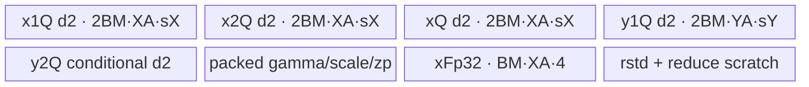
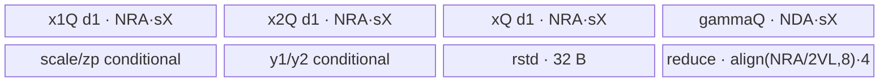
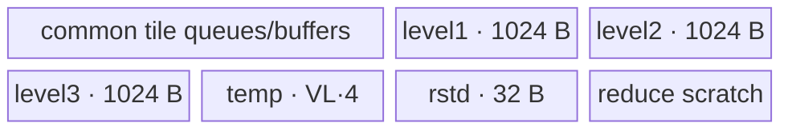

# AddRmsNormQuant 950 ACLNN 算子知识

## 算子速览

| 项目 | 内容 |
|---|---|
| 实际入口 | `aclnnAddRmsNormQuantGetWorkspaceSize` + `aclnnAddRmsNormQuant`；V2 文档明确不支持 950，故取版本族最新受支持的 V1 |
| 计算语义 | `x=x1+x2`；`r=x/sqrt(mean(x²)+epsilon)*gamma`；`y1/y2=round(r ÷或× scale + zeroPoint)` |
| 输入输出 | ND，1–8 维；x/gamma/xOut 支持 FP16/BF16/FP32；scale/zero-point 组合见公开 950 表；y 支持 INT8/FP8/HIFLOAT8 |
| 执行类型 | 单 `AIV_VECTOR` Kernel；entry 显式 `KERNEL_TYPE_AIV_ONLY`，无 Cube/AIC/MIX_CV、SIMT、NDDMA |
| Kernel 路线 | R-001 full-load perf（key 尾 2）；R-002 full-N normal（尾 0）；R-003 split-reduce（尾 1） |
| 核心资源 | GM、AIV UB、TQue/TBuf、MicroAPI RegTensor；无用户 workspace，只有平台 LibApi workspace |
| 来源闭包 | `source_closed`：公开 ACLNN→L0→950 regbase selector/POD→AIV router→三套 body及归约/DMA helper→OpDef/config 已闭合 |
| 验证状态 | 已完成源码闭包检查；本次知识提取未执行编译、真机、数值或性能测试。 |

## 接口与语义

### 计算语义

令 `N=product(gamma.shape)`，`M=product(x1.shape[0:xRank-gammaRank])`。每行 `x=x1+x2`，`rstd=1/sqrt(sum(x²)/N+epsilon)`，`r=x*rstd*gamma`。`divMode=true` 时量化为 `round(r/scale+zeroPoint)`，false 时为 `round(r*scale+zeroPoint)`；第二组 scale/zero-point 控制 y2。公开 ACLNN 不暴露 beta，虽然共享内部算子和 binary 包含 beta specialization，本卡所有 Host 可达 key 的 beta 位恒为 0。

### 输入、输出与属性

| 参数 | shape/layout | dtype | 约束、默认值与语义 |
|---|---|---|---|
| `x1`, `x2` | 相同 ND，1–8 维 | FP16/BF16/FP32 | 必选；允许非连续，ACLNN 做 `Contiguous` |
| `gamma` | 对应 `x1` 归一化尾维 | 同 `x1` | 必选；Tiling 校验 broadcast 关系 |
| `scales1` | 与 gamma 等元素数且尾维一致 | FP16/BF16/FP32 | 必选；与 x/zero-point 的合法 dtype 组合由 Tiling 校验 |
| `scales2Optional` | 与 scales1 相同 | 同 scales1 | 可选；存在时 y2 为正式第二量化输出 |
| `zeroPoints1Optional` | 与 scales1 相同 | INT32/FP16/BF16/FP32 | 可选；dtype 受 x/scale 组合约束 |
| `zeroPoints2Optional` | 与 scales1 相同 | 同第一 zero-point 组合 | 可选；Host 允许独立出现，regbase body 此时仍生成 y2，但 ACLNN 只在 scales2 非空时 ViewCopy y2 |
| `axis` | Host int64 | 标量 | 文档当前仅支持 -1；固定 Tiling 不读取它 |
| `epsilon` | Host double→L0/Tiling float | 标量 | rstd 防零项；默认 1e-6 |
| `divMode` | 标量 | bool | 950 支持 true/false |
| `y1Out`, `y2Out` | 与 x1 相同 | 同一 INT8/HIFLOAT8/FP8 dtype | 指针必选；y2 在无 scales2 的 ACLNN 语义下不复制 |
| `xOut` | 与 x1 相同 | 同 x1 | 必选；保存加法结果 |

### 入口与版本

V1 公开文档产品表明确支持 Ascend 950PR/950DT，并列出 950 dtype 组合；OpDef 的 `ascend950` 配置将 `opFile.value` 指向 `add_rms_norm_quant_apt`，950 binary config 覆盖这些 dtype/optional/output 组合。V2 的 README/API 文档均明确标记 950 不支持，且无 950 V2 binary config，因此 950 只发布 V1。

## Host/Launcher 执行流程

### 参数校验与前处理

ACLNN 依次检查必选指针、输入/输出 dtype 与 1–8 维；空 `x1/gamma/y2Out` 时返回 workspace 0。其余输入分别 `Contiguous`，L0 根据 y1 dtype 映射 `dstType={2,34,35,36}`，为 y1/x 及可选实际 y2 分配临时 tensor并加入一个 `AddRmsNormQuant` AICore节点；之后 `ViewCopy(y1)`、scales2 非空时 `ViewCopy(y2)`、`ViewCopy(x)`。950 更严格的 shape/dtype broadcast 校验在 regbase Tiling 的 `GetShapeAttrsInfo` 内完成，失败返回 `GRAPH_FAILED`。

### 参数、Workspace 与生命周期

`AddRmsNormQuantRegbaseTiling::GetWorkspaceSize` 把用户 workspace 设为 0；`PostTiling` 仅写平台 `GetLibApiWorkSpaceSize()`。核心 entry 接受但不读取 workspace。executor 持有 Contiguous、核心临时输出和 ViewCopy 序列，第二段在同一 stream 上执行；临时 GM 在对应 ViewCopy 完成前有效。

### 启动图与失败传播

```text
aclnnAddRmsNormQuantGetWorkspaceSize
  -> Contiguous(x1,x2,gamma,s1,optional s2/zp1/zp2)
  -> AddRmsNormQuant AIV node(blockDim=usedCoreNum, one POD)
  -> ViewCopy(y1) -> optional ViewCopy(y2) -> ViewCopy(x)
aclnnAddRmsNormQuant -> CommonOpExecutorRun(stream)
```

唯一核心节点的 GM 输出是 executor 临时 y1/y2/x；到 ViewCopy 的边由同 stream 顺序保证。ACLNN/L0/Tiling 任一失败阻断 launcher 或后续 copy。未知 key 在 router 中没有默认实现，不写输出。

## Route 与参数设计

### 分核与资源计算

`mPerCore=ceil(M/totalCoreNum)`，`usedCoreNum=ceil(M/mPerCore)`，尾核 `mLastCore=M-(usedCoreNum-1)*mPerCore`。对齐量：`xDtypeAlign=32/sX`、`xReduceAlign=512/sX`、`quantAlign=32/sScale`、`zpAlign=32/sZp`，VReg FP32 lane 数为 `vecLength`。Tiling 先算 full-load perf 的 `fullLoadBaseM=(UB-preload-256)/perRowBytes`；若 `>=1 && N<=16384` 选 R-001。否则若 `CalUBTotalSize(1,N)<=UB` 选 R-002 并从剩余 UB 推 `baseM`。再否则若最小 512B 列 tile 可容纳，则倍增 `baseN=powerSplit`、计算 `powerLoop` 选 R-003；仍不满足则失败。

公开入口可达 optional 后缀为 `q=40*hasZp1+20*hasS2+10*hasZp2`，即 0/10/20/30/40/50/60/70；完整 key 是 `1000+q+tilingType`，tilingType 分别为 normal 0、split 1、perf 2。beta 位 +100 在 ACLNN 路径不可达。

### Route 选择

| 顺序 | Route | Key/模板 | 精确选择条件与优先级 | 不适用去向 |
|---:|---|---|---|---|
| 1 | R-001 full-load perf | `{1002,1012,...,1072}` | `CalFullLoadBaseM(N)>=1 && N<=16384` | R-002 |
| 2 | R-002 full-N normal | `{1000,1010,...,1070}` | R-001 不成立且 `CalUBTotalSize(1,N,NORMAL)<=maxUbSize` | R-003 |
| 3 | R-003 split-reduce | `{1001,1011,...,1071}` | R-002 不成立且最小 `xReduceAlign` tile 可容纳 | `GRAPH_FAILED` |

```text
Regbase A5
  -> fullLoadBaseM>=1 && N<=16384 ? PERF(type=2)
  -> full N fits UB ? NORMAL(type=0)
  -> 512B minimum tile fits ? SPLIT(type=1)
  -> fail
key=1000 + optional_bitmap*10 + type
```

### 模板/实现执行矩阵

| Route | key/selector | dtype/shape/platform 完整命中条件 | 执行拓扑与 Kernel 节点 | 实际模板/body | 内存与同步特征 | tail/fallback |
|---|---|---|---|---|---|---|
| R-001 | 1002～1072 可达八个 optional key | 950、合法 dtype/broadcast，N<=16384且 full-load baseM>=1 | 单 AIV | `KernelAddRmsNormQuantRegbasePerf<TX,TY,TS,TZ,q+2>` | 多行双缓冲+预载参数，FP32 x临时 | `realM`/mask |
| R-002 | 1000～1070 尾0 | 950，perf不成立但整 N 可容纳 | 单 AIV | `KernelAddRmsNormQuantRegbase<...,q>` | 单行队列、整N参数、MicroAPI二分归约 | `tailM`/mask |
| R-003 | 1001～1071 尾1 | 整N不容纳、最小 tile 可容纳 | 单 AIV | `KernelAddRmsNormQuantRegbaseSpiltReduce<...,q+1>` | 多级局部归约、先生成x再分tile量化 | `tailN`/多级tail |

### 隐藏性能 Guard

| Guard | Host/Tiling 条件 | Device/资源原因 | 影响 Route | 不满足时去向 | 源码符号 |
|---|---|---|---|---|---|
| perf N 上限 | `N<=16384` | perf body全载参数和多行 x/y | R-001 | R-002 | `SetTilingParams` |
| fullLoadBaseM | `(UB-preload-256)/perRowBytes>=1` | 三路 x double buffer、xFp32、y double buffer、rstd/reduce | R-001 | R-002 | `CalFullLoadBaseM` |
| normal UB | `CalUBTotalSize(1,N)<=UB` | 整行 x/gamma/quant/y/reduce同时驻留 | R-002 | R-003 | `CalUBTotalSize` |
| split minimum | `CalUBTotalSize(1,xReduceAlign,SPLIT)<=UB` | 至少容纳 512B x tile及三级归约 | R-003 | 失败 | `SetTilingParams` |
| optional bitmap | s2/zp1/zp2 是否存在 | 编译期消除对应 GM、queue、y2分支 | 全部 | 相应 key | `GetTilingKey`, router guards |
| AIV-only | `KERNEL_TASK_TYPE_DEFAULT(KERNEL_TYPE_AIV_ONLY)` | 禁止 AIC/Cube task | 全部 | N/A | `add_rms_norm_quant_apt.cpp::add_rms_norm_quant` |

### POD/ABI

`AddRmsNormQuantRegbaseTilingData` 由宏生成；固定仓未展开 `sizeof/alignof/offsetof`，字段按声明顺序序列化。

| 结构 | 字段 | 类型/位宽 | ABI 布局 | 单位 | Host/launcher producer | Device consumer | 边界 |
|---|---|---|---|---|---|---|---|
| `AddRmsNormQuantRegbaseTilingData` | `numM` | uint64/64 | 宏生成，offset不可见 | 行 | `SetInputParams` | 分核/GM extent | shape乘积 |
| 同上 | `numN` | uint64/64 | 同上 | 元素/行 | gamma shape乘积 | 所有循环 | 0直接失败 |
| 同上 | `baseM` | uint64/64 | 同上 | 行/tile | `SetTilingParams` | perf/normal loop；split固定1 | `<=mPerCore` |
| 同上 | `baseN` | uint64/64 | 同上 | 元素/tile | full N或powerSplit | UB/列循环 | split为2次幂且512B起步 |
| 同上 | `baseNReduceAlign` | uint64/64 | 同上 | 元素 | ceil(baseN,512/sX) | x queue/reduce | `>=baseN` |
| 同上 | `baseNDtypeAlign` | uint64/64 | 同上 | 元素 | ceil(baseN,32/sX) | gamma/x stride | `>=baseN` |
| 同上 | `powerLoop` | uint64/64 | 同上 | tile组数 | split倍增循环 | split多级归约 | 非split为1 |
| 同上 | `powerSplit` | uint64/64 | 同上 | 元素 | full归约二分点或split baseN | reduce helper | 2次幂 |
| 同上 | `mPerCore` | uint64/64 | 同上 | 行/核 | ceil(M/core) | GM core base | `>=1` |
| 同上 | `mLastCore` | uint64/64 | 同上 | 行 | 尾核公式 | `CalBlockTail` | `1..mPerCore` |
| 同上 | `avgFactor` | float/32 | 同上 | 1/元素 | `1.0f/N` | rstd helper | N非0 |
| 同上 | `epsilon` | float/32 | 同上 | 标量 | attr[1] | rstd helper | ACLNN double窄化 |
| 同上 | `divMode` | uint32/32 | 同上 | 布尔 | attr[2] | quant Div/Mul | 0/1 |

### Route 源码闭包

| Route | Key/selector | Host/Tiling producer | POD/参数 | Kernel entry/router 节点 | Kernel body/直接依赖 | 构建接线 |
|---|---|---|---|---|---|---|
| R-001 | `1002+q` | `SetTilingParams`, `GetTilingKey` | regbase POD | `add_rms_norm_quant_apt.cpp` | perf body + common/reduce helpers | OpDef `ascend950` + 950 config |
| R-002 | `1000+q` | 同上 | 同上 | 同上 | normal body + common/reduce helpers | 同上 |
| R-003 | `1001+q` | 同上 | 同上 | 同上 | split body + common/RmsNorm multilevel helpers | 同上 |

## Kernel 实现

### 公共执行流程

entry 解析 regbase POD，设置 `KERNEL_TYPE_AIV_ONLY`，由编译期 optional 宏和 runtime key 选择一套 body。每核 GM base 为 `blockIdx*mPerCore*N`，尾核使用 `mLastCore`。所有 body 都以 FP32 寄存器形成 `x1+x2`、平方和与 rstd；FP16/BF16 输入在 MicroAPI 中 unpack/cast，FP32直接载入。量化参数升到 FP32，`divMode` 选择 Div/Mul，zero-point 后按 TY 做 INT8/FP8/HIFLOAT8 cast。队列协议、`PipeBarrier`、`LocalMemBar` 和 overflow-control 保存/恢复形成同步图；无 atomic 和跨核归约。

optional key 子路由：q=0 无可选量化；10 仅 zp2；20 仅 s2；30 s2+zp2；40 仅 zp1；50 zp1+zp2；60 s2+zp1；70 三者全有。`HAS_Y2=HAS_SCALE2||HAS_ZEROPOINTS2`，因此仅 zp2 也会在核心生成 y2；但公开 ACLNN 的 `ComputeAddRmsNormQuant` 只在 s2 非空时 ViewCopy y2，这是必须保留的 Host/Device边界。

### Route R-001：full-load perf

#### 适用条件

##### 选择证据

| 层级 | 文件 | 符号 | 源码谓词/参数 | 结果/下一跳 |
|---|---|---|---|---|
| Host | `add_rms_norm_quant_tiling.cpp` | `Tiling4AddRmsNormQuant` | `IsRegbaseSocVersion` | 950 class selector |
| Tiling | `add_rms_norm_quant_tiling_arch35.cpp` | `SetTilingParams` | `fullLoadBaseM>=1 && N<=16384`，第一优先 | type 2 |
| Router | `add_rms_norm_quant_apt.cpp` | `add_rms_norm_quant` | key尾2 + optional宏 | perf模板 |

#### Device 数据流

##### 函数级调用链

```text
add_rms_norm_quant -> Perf::Init -> InitBuffer -> Process
  -> CopyInOthers
  -> per M tile: CopyInXMutiMoveAlign -> CalculateXAdd -> CopyOutX
     -> CalculateSquareReduceSum -> ComputeRstdNewtonRaphson
     -> CalculateQuant -> CopyOutY
```

##### 源码等价伪码

```text
preload gamma, scales, optional zero-points into one packed queue
for mTile in ceil(mCore/baseM):
  DMA realM rows of x1/x2 into double-buffer queues
  fp32 add; store TX xOut and retained fp32 x
  vector multi-row square reduction; Newton-Raphson rstd
  for row and VReg column chunk:
    q=x*rstd*gamma; q=divMode?q/scale:q*scale; q+=optional zp
    cast/store y1 and optional y2, mask last N lanes
```

#### 内存与数据搬运

##### 资源与搬运表

| 层级/缓冲区 | offset/地址公式 | extent/容量公式 | dtype/layout | producer | consumer | owner/lifetime | 对齐/复用 |
|---|---|---|---|---|---|---|---|
| GM x1/x2/x/y | `core*mPerCore*N + tile*baseM*N` | `realM*N` | row-major ND | caller/vector | vector/ViewCopy | caller/executor | DMA blockCount=realM |
| x1/x2 queues | 0 | each depth2 × `baseM*xAlign*sX` | TX | DMA | CalculateXAdd | tile | double buffer |
| xOut queue | 0 | depth2 × `baseM*xAlign*sX` | TX | add | DMA | tile | double buffer |
| y1/y2 queues | 0 | each present depth2 × `baseM*yAlign*sY` | TY | quant | DMA | tile | conditional y2 |
| other queue | packed offsets | `xAlign*sX + scalesAlign*sS + optional buffers` | mixed | CopyInOthers | all tiles | Process | depth1/preloaded once |
| xOutTmp/rstd/reduceTmp | 0 | `baseM*xAlign*4 + align(baseM,8)*4 + baseM*align(ceil(powerSplit/VL),8)*4` | FP32 | vector | reduce/quant | tile | TBuf |

##### 分层内存布局



##### 字节账与复用顺序

```text
preload = XA*sX + scalesA*sS + hasS2*scalesA*sS
        + hasZp1*zpA*sZ + hasZp2*zpA*sZ
per_rows = 2*3*BM*XA*sX + BM*XA*4 + 2*yCount*BM*YA*sY
          + align(BM,8)*4 + BM*align(ceil(powerSplit/VL),8)*4
UB_total = preload + per_rows <= maxUbSize-256（Host CalFullLoadBaseM guard）
workspace_total = platform LibApi workspace；dynamic_ub=N/A
```

| 复用子区 | 写入者 | 读取者/消费点 | 下一次覆盖 | 同步或释放依据 | 安全条件 |
|---|---|---|---|---|---|
| xOutTmp | CalculateXAdd | reduce + quant | next M tile | function order/queue | quant消费完成 |
| other packed queue | CopyInOthers | every tile quant | Process end | queue只在末尾FreeTensor | 不提前复用 |
| double-buffer queue slot | DMA/vector | consumer | later tile | EnQue/DeQue/FreeTensor | depth2协议 |

#### 同步、精度与尾块

##### 同步与数值边界表

| 阶段 | primitive/机制 | producer | consumer/等待点 | 保护对象 | 精度/尾块 |
|---|---|---|---|---|---|
| DMA→V | TQue | CopyIn | CalculateXAdd | x rows | realM tail |
| add→reduce | function order/MicroAPI barriers | xOutTmp | square reduce | FP32 x | mask N |
| rstd | Newton-Raphson helper | variance | quant | FP32 rstd | epsilon与特殊值处理 |
| quant cast | overflow mode save/set/restore | FP32 q | TY store | FP8/HIFLOAT8 saturation mode | UpdateMask(N) |

#### 关键实现

##### 符号证据表

| 阶段 | 文件 | 符号/模板实例 | 实现事实 |
|---|---|---|---|
| Host/Tiling producer | `op_host/add_rms_norm_quant_tiling_arch35.cpp` | `CalFullLoadBaseM`, `SetTilingParams` | perf gate/UB |
| Kernel entry/router | `op_kernel/add_rms_norm_quant_apt.cpp` | key尾2 | optional模板实例 |
| Device body/helper | `op_kernel/arch35/add_rms_norm_quant_regbase_perf.h` | `Process/CalculateQuant` | 多行双缓冲、预载 |
| Device body/helper | `norm/norm_common/op_kernel/reduce_common_regbase.h` | square/rstd helpers | FP32归约 |

### Route R-002：full-N normal

#### 适用条件

##### 选择证据

| 层级 | 文件 | 符号 | 源码谓词/参数 | 结果/下一跳 |
|---|---|---|---|---|
| Tiling | `add_rms_norm_quant_tiling_arch35.cpp` | `SetTilingParams` | perf失败且 `CalUBTotalSize(1,N)<=UB` | type 0 |
| Router | `add_rms_norm_quant_apt.cpp` | key尾0 | optional宏匹配 | normal模板 |

#### Device 数据流

##### 函数级调用链

```text
Normal::Init -> SetQuantGlobalBuffers/InitQuantPipeBuffers -> Process
  -> preload gamma/quant
  -> per row CopyInX(x1,x2) -> ReduceSumRstd -> ComputeY -> CopyOutX/Y
```

##### 源码等价伪码

```text
for each row in core:
  DMA x1/x2 and zero-pad from 32B align to 512B reduce align
  MicroAPI in one pass forms xOut and partial squares; reduce to fp32 rstd
  broadcast rstd, multiply gamma, div/mul scales, add optional zp
  cast TY and copy valid N; xOut copies valid N
```

#### 内存与数据搬运

##### 资源与搬运表

| 层级/缓冲区 | offset/地址公式 | extent/容量公式 | dtype/layout | producer | consumer | owner/lifetime | 对齐/复用 |
|---|---|---|---|---|---|---|---|
| x1/x2/x queues | 0 | each depth1 × `NReduceAlign*sX` | TX | DMA/vector | reduce/DMA | row | 512B align |
| gamma/optional params | 0 | gamma `NDtypeAlign*sX`; scale/zp 32B aligned | native dtype | DMA once | ComputeY | Process | conditional queues |
| y1/y2 queues | 0 | each present depth1 × `align(N,32)*sY` | TY | ComputeY | DMA | row | valid N copy |
| rstd/reduce | 0 | `8*4 + align(NReduceAlign/(2VL),8)*4` | FP32 | reduce | ComputeY | Process/row | barriers |

##### 分层内存布局



##### 字节账与复用顺序

```text
UB_total = 3*NRA*sX + NDA*sX + hasBeta(=0)
         + scalesA*sS + hasS2*scalesA*sS + hasZp1*zpA*sZ + hasZp2*zpA*sZ
         + y1A*sY + hasY2*y2A*sY + 32 + reduceAlign*4
UB_total <= maxUbSize；workspace_total=LibApi workspace；dynamic_ub=N/A
```

| 复用子区 | 写入者 | 读取者/消费点 | 下一次覆盖 | 同步或释放依据 | 安全条件 |
|---|---|---|---|---|---|
| reduceBuf | zero/reduction | rstd | next row | `PipeBarrier<PIPE_V>` | 当前rstd已写独立buf |
| xOut queue | ReduceSumRstd | ComputeY + CopyOutX | next row | EnQue后先ComputeY再DeQue/Free | 两消费者顺序固定 |

#### 同步、精度与尾块

##### 同步与数值边界表

| 阶段 | primitive/机制 | producer | consumer/等待点 | 保护对象 | 精度/尾块 |
|---|---|---|---|---|---|
| pad/reduce | DataCopyPad + Duplicate + PIPE_V | DMA | MicroAPI reduce | NRA padded x | padded lane为0 |
| work folding | LocalMemBar | partial stores | reload/reduce | reduceBuf | mask N |
| x/y output | queue | vector | MTE3 | valid GM | copy blockLen=N |

#### 关键实现

##### 符号证据表

| 阶段 | 文件 | 符号/模板实例 | 实现事实 |
|---|---|---|---|
| Host/Tiling producer | `add_rms_norm_quant_tiling_arch35.cpp` | `CalUBTotalSize`, `SetTilingParams` | full-N gate/baseM |
| Kernel entry/router | `add_rms_norm_quant_apt.cpp` | key尾0 | normal映射 |
| Device body/helper | `arch35/add_rms_norm_quant_regbase.h` | `Process/Compute` | 整行计算 |
| Device body/helper | `arch35/add_rms_norm_quant_regbase_common.h` | `ComputeY` | dtype/quant cast |

### Route R-003：split-reduce

#### 适用条件

##### 选择证据

| 层级 | 文件 | 符号 | 源码谓词/参数 | 结果/下一跳 |
|---|---|---|---|---|
| Tiling | `add_rms_norm_quant_tiling_arch35.cpp` | `SetTilingParams` | full-N不容纳；最小512B tile容纳并倍增到最大 | type 1 |
| Router | `add_rms_norm_quant_apt.cpp` | key尾1 | optional宏匹配 | split-reduce模板 |

#### Device 数据流

##### 函数级调用链

```text
Split::Process
  -> per row ComputeFormer -> repeated ComputeFormerHandle -> ReduceSumRstd(IS_RSTD=false)
     -> ComputeSum/ComputeMultiLevelReduce -> ComputeMultiLevelRstd
  -> per col tile CopyInGamma/Quant/xOut -> ComputeY -> CopyOutY
```

##### 源码等价伪码

```text
for row:
  decompose N into powerSplit blocks, pair tail/main blocks, and three-level partial buffers
  each block loads x1/x2, pads to 32/512B, computes partial sum and immediately writes xOut
  fold level1->level2->level3, then form one rstd
  for nTile in ceil(N/baseN): reload xOut, load gamma/scale/zp tile,
    quantize with broadcast rstd and copy only realN
```

#### 内存与数据搬运

##### 资源与搬运表

| 层级/缓冲区 | offset/地址公式 | extent/容量公式 | dtype/layout | producer | consumer | owner/lifetime | 对齐/复用 |
|---|---|---|---|---|---|---|---|
| GM x1/x2/x | `coreBase+row*N+blockOffset` | block count then valid count | TX | caller/reduce | reduce/second pass | caller/executor | 32/512B pad |
| common queues | tile offset | same formulas as normal using baseN | mixed | DMA/vector | vector/DMA | tile | depth1 |
| level1/2/3 | 0 | each `256*4` B | FP32 | partial reducer | next reduction level | row | explicit zero+fold |
| tempBuf | 0 | `VL*4` B | FP32 | paired partial sums | ComputeSum | row | scratch |
| rstd | 0 | `8*4` B | FP32 | multilevel rstd | all quant tiles | row | broadcast |

##### 分层内存布局



##### 字节账与复用顺序

```text
UB_total = CalUBTotalSize(1,baseN,SPLIT)
         = common tile buffers + 32 + 3*256*4 + VL*4
UB_total <= maxUbSize；workspace_total=LibApi workspace；dynamic_ub=N/A
```

| 复用子区 | 写入者 | 读取者/消费点 | 下一次覆盖 | 同步或释放依据 | 安全条件 |
|---|---|---|---|---|---|
| level buffers | ComputeFormerHandle/ComputeSum | next reduce level | later block | helper内 barrier/计数 | level计数准确 |
| x queues | first pass x1/x2 | ReduceSumRstd | second pass xOut | FreeTensor后重分配 | xOut已写GM |
| rstd | ComputeMultiLevelRstd | every n tile ComputeY | next row | outer loop顺序 | 完成所有n tile后覆盖 |

#### 同步、精度与尾块

##### 同步与数值边界表

| 阶段 | primitive/机制 | producer | consumer/等待点 | 保护对象 | 精度/尾块 |
|---|---|---|---|---|---|
| paired partials | level helper + PIPE_V | block partial | hierarchy fold | level buffers | `tail<=powerSplit/2` 与 `>half` 两分支 |
| GM x handoff | CopyOutX then later CopyInX | first pass | quant pass | xOut GM | 同一 Kernel函数顺序/MTE queue |
| quant tail | DataCopyPad + mask | tail tile | ComputeY/CopyOutY | UB/GM | `realN`, `tailNDtypeAlign` |

#### 关键实现

##### 符号证据表

| 阶段 | 文件 | 符号/模板实例 | 实现事实 |
|---|---|---|---|
| Host/Tiling producer | `add_rms_norm_quant_tiling_arch35.cpp` | `SetTilingParams` | powerSplit/powerLoop/baseN |
| Kernel entry/router | `add_rms_norm_quant_apt.cpp` | key尾1 | split映射 |
| Device body/helper | `arch35/add_rms_norm_quant_regbase_split_reduce.h` | `ComputeFormer/Compute` | 多级归约/二次读取 |
| Device body/helper | `norm/rms_norm/op_kernel/arch35/rms_norm_regbase_common.h` | DataCopy/多级helper | tail DMA和归约 |

## 算子特定优化

### Trick T-001：优先 full-load 多行双缓冲，再逐级退化到整行与切列

#### 触发与源码依据

- 适用 Route：R-001～R-003
- 触发条件：先检查 `fullLoadBaseM>=1 && N<=16384`，再检查整 N UB，最后检查最小切列 UB。
- Golden 来源：[`norm/add_rms_norm_quant/op_host/add_rms_norm_quant_tiling_arch35.cpp:605-619`](../../../../../../../cann-ops-raw/ascendc/ops-nn/955f8b33985b6d72989ebff341bb9c2c564a51bc/norm/add_rms_norm_quant/op_host/add_rms_norm_quant_tiling_arch35.cpp#L605-L619)

**官方源码（固定 Commit 连续逐字摘录）**：

```cpp
int64_t fullLoadBaseM = CalFullLoadBaseM(tilingParams.numN, tmpPower);
if (fullLoadBaseM >= 1 && tilingParams.numN <= FULL_LOAD_R_MAX) {
    tilingParams.baseN = tilingParams.numN;
    tilingParams.baseM = std::min(fullLoadBaseM, static_cast<int64_t>(tilingParams.mPerCore));
    tilingParams.powerSplit = tmpPower;
    tilingParams.tilingType = TILING_TYPE_PERF;
    return ge::GRAPH_SUCCESS;
}
```

#### 机制与设计原因

selector 用精确 UB 字节公式把可全载的多行送入双缓冲 perf body，未覆盖场景再用较小 normal body，超长 N 才付出 GM xOut 中转与两遍列 tile 的代价。它改变的是搬运次数、行并行和 UB 驻留，不是单纯模板命名。

#### 迁移边界

- 适用：按最后若干维归约且输出加法中间值的融合 Vector 算子。
- 前提：950 regbase、UB/VReg/对齐量与 optional buffer 公式一致。
- 失效：最小 512B tile 也不满足时 Tiling 失败。
- 未验证：本次知识提取未执行编译、真机、数值或性能测试。

#### 错误做法

不能只按 N 阈值选择 perf；源码还要求包含 dtype、y数和 optional 参数后的 `fullLoadBaseM>=1`。

### Trick T-002：optional bitmap 在编译期消除参数队列和第二输出

#### 触发与源码依据

- 适用 Route：所有 key 子路由。
- 触发条件：s2/zp1/zp2 的存在位形成 q，router 只编译与 binary optional 宏一致的分支。
- Golden 来源：[`norm/add_rms_norm_quant/op_kernel/arch35/add_rms_norm_quant_regbase_common.h:128-157`](../../../../../../../cann-ops-raw/ascendc/ops-nn/955f8b33985b6d72989ebff341bb9c2c564a51bc/norm/add_rms_norm_quant/op_kernel/arch35/add_rms_norm_quant_regbase_common.h#L128-L157)

**官方源码（固定 Commit 连续逐字摘录）**：

```cpp
constexpr bool HAS_ZEROPOINTS1 = ((INPUT_KEY >> 2) % 2 == 1);
constexpr bool HAS_SCALE2 = ((INPUT_KEY >> 1) % 2 == 1);
constexpr bool HAS_ZEROPOINTS2 = (INPUT_KEY % 2 == 1);
constexpr bool HAS_Y2 = (HAS_SCALE2 || HAS_ZEROPOINTS2);
```

#### 机制与设计原因

optional 位同时控制 GM 绑定、`InitBuffer`、参数 DMA、ComputeY 分支和 y2 输出；不存在的参数不占 UB、不搬运也不执行 Vector 指令。Host 的 `CalUBTotalSize/CalFullLoadBaseM` 使用同一存在位计入容量。

#### 迁移边界

- 适用：可选逐元素参数能在 launch 前冻结的融合量化。
- 前提：binary optional 宏、key bitmap、Host存在性判定完全一致。
- 失效：新增可选项必须同步扩展 key、config、UB公式和router。
- 未验证：本次知识提取未执行编译、真机、数值或性能测试。

#### 错误做法

固定仓的 `z2` 无 `s2` 组合表明不能把 `HAS_Y2` 简化为 `HAS_SCALE2`；核心仍可能生成 y2，只是公开 ACLNN 不把它复制给调用者。

### Trick T-003：FP8/HIFLOAT8 量化前保存并恢复 overflow control

#### 触发与源码依据

- 适用 Route：所有 950 routes，输出 TY 为 FP8/HIFLOAT8 时生效。
- 触发条件：`GetOverflowMode<TY>` 在 3510 保存控制位，量化期间置 0，结束恢复。
- Golden 来源：[`norm/rms_norm/op_kernel/arch35/rms_norm_regbase_common.h:47-67`](../../../../../../../cann-ops-raw/ascendc/ops-nn/955f8b33985b6d72989ebff341bb9c2c564a51bc/norm/rms_norm/op_kernel/arch35/rms_norm_regbase_common.h#L47-L67)

**官方源码（固定 Commit 连续逐字摘录）**：

```cpp
if constexpr (IsSameType<T_Y, fp8_e4m3fn_t>::value || IsSameType<T_Y, fp8_e5m2_t>::value ||
              IsSameType<T_Y, hifloat8_t>::value) {
    AscendC::SetCtrlSpr<FLOAT_OVERFLOW_MODE_CTRL, FLOAT_OVERFLOW_MODE_CTRL>(mode);
}
```

#### 机制与设计原因

量化 cast 使用显式 SAT 与 round trait，并暂时控制浮点溢出模式；保存/恢复避免算子把控制寄存器状态泄漏给后续 Kernel。这是精度与执行状态生命周期约束。

#### 迁移边界

- 适用：950 FP8/HIFLOAT8 输出的 MicroAPI cast。
- 前提：目标架构和 TY 分支支持对应控制寄存器。
- 失效：INT8 不走该控制寄存器分支，但仍需保留固定 cast链。
- 未验证：本次知识提取未执行编译、真机、数值或性能测试。

#### 错误做法

不能只置 overflow mode 而不恢复；各 body 都保存 `oriOverflowMode` 并在量化后恢复。

## 模板与实现对比

| 对比维度 | R-001 full-load perf | R-002 full-N normal | R-003 split-reduce | 设计选择依据 |
|---|---|---|---|---|
| 命中条件/优先级 | 最优先，N<=16384且至少1行可全载 | perf失败、整N可容纳 | 整N不容纳、最小tile可容纳 | UB公式顺序 |
| 模板与 dtype | TX/TY/TS/TZ + optional q | 同左 | 同左 | binary config冻结dtype/optional |
| 循环与分核 | core→M tile→row/VReg | core→M tile→row | core→row→归约block→量化N tile | 数据驻留范围 |
| Queue/TBuf/寄存器/dynamic UB/通信 window | 多路depth2+参数预载 | depth1整行 | depth1 tile+三级TBuf | 均无dynamic UB/通信 |
| 内存总占用与复用 | Host精算每行后最大baseM | CalUBTotalSize推baseM | 固定三级scratch后最大baseN | `<=maxUbSize` |
| 搬运/Vector/SIMT/NDDMA/通信 API | x一次、参数一次 | x一次、参数一次 | x先算写GM再读x量化 | 全为Vector/DMA |
| 同步、精度与 tail | queue+MicroAPI mask | queue+LocalMemBar | 多级barrier+GM阶段 | FP32 rstd/显式cast |
| fallback/失败边界 | →normal | →split | →GRAPH_FAILED | 无Device fallback |

## 平台差异

| 项目 | A2 | A3 | 950 |
|---|---|---|---|
| 支持状态 | 最新公开接口是V2，见无后缀卡 | 同左 | V2明确不支持，V1公开支持 |
| Host/Launcher | non-regbase Tiling，V2快路+fallback | 同左 | regbase TilingBaseClass，V1 |
| Kernel/资源 | normal/split/single，传统Vector API | 同左 | perf/normal/split，MicroAPI RegTensor，FP8/HIFLOAT8 |

## 限制与失败边界

- 公开 ACLNN 不含 beta；共享内部 beta key 1100～1172 不属于本卡可达路线。
- ACLNN 的早期 CheckParams 主要校验 dtype集合与维数；950 具体 shape/broadcast/dtype组合由 Tiling 继续校验，失败不会启动 Kernel。
- `axis` 在文档中仅支持 -1，固定 950 Tiling 不使用该值选择归一化域。
- `zeroPoints2Optional` 可在无 scales2 时到达核心并形成 y2，但 ACLNN 不 ViewCopy y2；调用者不得据此读取有效 y2。
- `CalUBTotalSize` 对 common normal/split 的量化参数项按 `quantDtypeSize` 估算，而实际 zero-point queue 用 `T_ZEROPOINTS` 大小；合法 binary组合与更精确 perf公式是额外边界，固定仓没有真机证据证明所有极端组合的余量。
- 多项输出/shape总元素由 64 位 Tiling 保存，但 ACLNN 文档仅明确单维不超过 INT32_MAX；未见额外总乘积溢出说明。
- 本次知识提取未执行编译、真机、数值或性能测试。

## 源码索引

### 链路索引

| 链路阶段 | 文件 | 关键符号 | 支撑内容 |
|---|---|---|---|
| 入口声明/约束 | `norm/add_rms_norm_quant/docs/aclnnAddRmsNormQuant.md` | ACLNN两段式接口 | 950平台、dtype、公式 |
| 入口实现 | `norm/add_rms_norm_quant/op_host/op_api/aclnn_add_rms_norm_quant.cpp` | `CheckParams`, `ComputeAddRmsNormQuant`, entries | ACLNN校验/前处理/ViewCopy |
| L0 Launcher | `norm/add_rms_norm_quant/op_host/op_api/add_rms_norm_quant.cpp` | `AddRmsNormQuantInner` | dstType、临时输出、launch |
| Host selector | `norm/add_rms_norm_quant/op_host/add_rms_norm_quant_tiling.cpp` | `Tiling4AddRmsNormQuant` | regbase分流 |
| Host/Tiling | `norm/add_rms_norm_quant/op_host/add_rms_norm_quant_tiling_arch35.cpp` | `AddRmsNormQuantRegbaseTiling::*` | 校验、UB、key、POD |
| POD | `norm/add_rms_norm_quant/op_host/add_rms_norm_quant_tiling.h` | `AddRmsNormQuantRegbaseTilingData` | ABI字段 |
| Kernel entry | `norm/add_rms_norm_quant/op_kernel/add_rms_norm_quant_apt.cpp` | `add_rms_norm_quant` | AIV-only与key router |
| Kernel body | `norm/add_rms_norm_quant/op_kernel/arch35/add_rms_norm_quant_regbase_perf.h` | perf class | R-001 |
| Kernel body | `norm/add_rms_norm_quant/op_kernel/arch35/add_rms_norm_quant_regbase.h` | normal class | R-002 |
| Kernel body | `norm/add_rms_norm_quant/op_kernel/arch35/add_rms_norm_quant_regbase_split_reduce.h` | split class | R-003 |
| Kernel helper | `norm/add_rms_norm_quant/op_kernel/arch35/add_rms_norm_quant_regbase_common.h` | `ComputeY`, buffer helpers | dtype/quant/UB |
| Kernel helper | `norm/norm_common/op_kernel/reduce_common_regbase.h` | regbase reduce helpers | FP32平方和rstd归约 |
| Kernel helper | `norm/rms_norm/op_kernel/arch35/rms_norm_regbase_common.h` | DMA/reduce helpers | tail DMA、多级归约与overflow控制 |
| 构建接线 | `norm/add_rms_norm_quant/op_host/add_rms_norm_quant_def.cpp` | `AddRmsNormQuant` 950 config | opFile与dtype注册 |
| 构建接线 | `norm/add_rms_norm_quant/op_host/config/ascend950/add_rms_norm_quant_binary.json` | 950 entries | binary optional/dtype组合 |

### 实现复用检查

| 检查项 | 可复用事实 | 不得改变的约束 | 源码符号 |
|---|---|---|---|
| ABI/POD | 13字段 regbase POD | 声明顺序、64/32位、元素/字节单位 | `AddRmsNormQuantRegbaseTilingData` |
| 调用顺序 | ACLNN→单核心节点→ViewCopy | y2只在s2存在时copy | `ComputeAddRmsNormQuant` |
| workspace/内存 | 用户workspace 0，三类UB公式 | optional bitmap与dtype size、depth2倍数 | `GetWorkspaceSize`, `InitBuffer` |
| 同步 | queue/MicroAPI/barrier图 | xOut GM中转与overflow状态恢复 | 三类 `Process` |
| 精度与尾块 | FP32 rstd/quant主链、TY cast trait | INT8/FP8/HIFLOAT8 round/sat差异、mask | `ComputeY`, `StoreTensorForDtypeTOut` |
| 失败边界 | perf→normal→split→fail | V2不得用于950、beta key不可从公开入口声称可达 | docs、`SetTilingParams` |