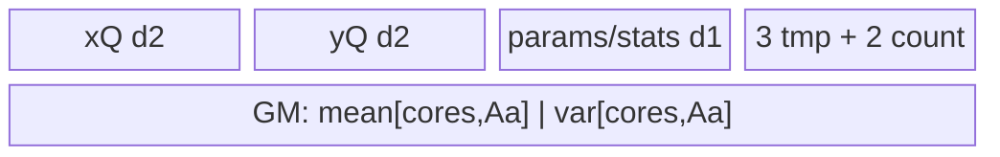

# BatchNorm 950 ACLNN 算子知识

## 算子速览

| 项目 | 内容 |
|---|---|
| 实际入口 | `aclnnBatchNormGetWorkspaceSize` / `aclnnBatchNorm`，公开 ACLNN；950 内部调用 `BatchNormV3` |
| 计算语义 | 训练态按通道计算均值与方差，`y=(x-mean)/sqrt(var+epsilon)*weight+bias`，并更新 running statistics；推理态使用输入 running statistics |
| 输入输出 | `x/y` 支持 FP16/BF16/FP32；950 支持 ND/NCHW/NHWC/NCDHW/NDHWC；参数与统计量为通道向量，saved outputs 为 FP32 |
| 执行类型 | 11 条路线均为单 Kernel AIV_VECTOR；`g_coreType==AIC` 立即返回。小片段可在 AIV 内使用 NDDMA `MultiCopy`，不是独立节点 |
| Kernel 路线 | R-001 RA FullReduce；R-002 RA BlockSplitR；R-003 RA Welford；R-004 RAR FullReduce；R-005 RAR BlockSplitR；R-006 RAR Welford；R-007/008/009 last-channel inference；R-010/011 general inference |
| 核心资源 | GM、AIV UB 的 TQue/TBuf/寄存器；R-002/R-005 使用 GM workspace partial mean/variance 和 `SyncAll` |
| 来源闭包 | `source_closed`：公开 ACLNN→`BatchNormProcDavid`→level-0 `BatchNormV3`→950 tiling→`batch_norm_v3_apt`→11 个公开 body，且 ascend950 config/definition 可见 |
| 验证状态 | 已完成源码闭包检查；本次知识提取未执行编译、真机、数值或性能测试。 |

## 接口与语义

### 计算语义

令归一化轴为通道 `A`，每通道归约元素数为 `R`。训练态先以 FP32 归约得到 `mean` 与总体方差 `var`，输出 `saveMean=mean`、`saveInvstd=1/sqrt(var+epsilon)`，并按 `runningMean=(1-momentum)*runningMean+momentum*mean`、`runningVar=(1-momentum)*runningVar+momentum*R/(R-1)*var` 更新统计量；随后计算 `y=(x-mean)*saveInvstd*weight+bias`。推理态直接以 `runningMean/runningVar` 完成同一仿射归一化，不更新统计量。

### 输入、输出与属性

| 参数 | shape/layout | dtype | 约束、默认值与语义 |
|---|---|---|---|
| `input` | ND/NCHW/NHWC/NCDHW/NDHWC | FP16/BF16/FP32 | 非空维度均须大于 0；API 可把 rank>5 reshape 成 5D |
| `weight` | `[C]` | 与 `input` 相同或 FP32 | 可选；缺省由 API 生成全 1；950 API 路径在 level-0 前做 Contiguous/Cast |
| `bias` | `[C]` | 与 `weight` 相同 | 可选；缺省全 0 |
| `runningMean` | `[C]` | 与 `input` 相同或 FP32 | 可选；缺省全 0；950 API 路径转为 FP32 |
| `runningVar` | `[C]` | 与 `runningMean` 相同 | 可选；缺省全 1；950 API 路径转为 FP32 |
| `training` | scalar attribute | bool | 缺省 `true`；决定训练或推理模板族 |
| `momentum` | scalar attribute | double→float POD | 缺省 `0.1`；仅训练更新 running statistics |
| `eps` | scalar attribute | double→float POD | 缺省 `1e-5`；加入方差后开方 |
| `out` | 与 `input` 同 shape/layout | 与 `input` 相同 | 归一化结果；API 恢复原 rank/format |
| `saveMean` | `[C]` | FP32 | 训练态批均值；空输入 API 填 0 |
| `saveInvstd` | `[C]` | FP32 | 950 为 reciprocal standard deviation；空输入 API 填 NaN |

### 入口与版本

公开声明是 `aclnnBatchNormGetWorkspaceSize` 与 `aclnnBatchNorm`。固定 Commit `955f8b33985b6d72989ebff341bb9c2c564a51bc` 的文档明确列出 Ascend 950；`batch_norm_v3_def.cpp` 为 `config_950` 指定 `batch_norm_v3_apt`。950 由 `IsRegbase(curArch)` 唯一路由到 `BatchNormProcDavid`，不复用仓内旧架构核心 body。本卡只覆盖 `BatchNorm`，不含 Grad、原地或量化变体。

## Host/Launcher 执行流程

### 参数校验与前处理

`aclnnBatchNormGetWorkspaceSize` 创建 executor，检查输出非空、dtype/shape/layout/属性；空 input 直接以 Fill 提交 saved outputs。非空 input 先 Contiguous，rank>5 时 reshape 为 5D NCDHW。950 `BatchNormProcDavid` 为缺省 optional tensor 生成 0/1，依次 Contiguous/Cast weight、bias、input、runningMean、runningVar，调用 `l0op::BatchNormV3(..., training)`，再把 y、running statistics 和 saved outputs Cast/ViewCopy 到用户张量。

### 参数、Workspace 与生命周期

level-0 `BatchNormV3` 以 `ADD_TO_LAUNCHER_LIST_AICORE` 加入 executor；executor 持有前处理临时张量、workspace 查询结果和启动序列，`aclnnBatchNorm` 通过 `CommonOpExecutorRun` 在调用者 stream 上执行。所有模板默认 workspace 基线为 16 MiB；R-002 为 `16 MiB+2*usedCoreNums*patternAAlign*4`，R-005 为 `16 MiB+2*usedCoreNum*patternAAlign*4`。额外区由 Kernel 按 `[core][AAlign]` 切成 mean/variance 两片，生命周期覆盖单次 launch。

### 启动图与失败传播

每次命中恰好启动一个 `batch_norm_v3_apt` AIV 节点，参数为 x/weight/bias/runningMean/runningVar、五个输出、workspace 与 route POD；`blockDim` 由各模板的 `PostTiling` 写入。entry 按 tiling key 实例化对应 body。R-002/R-005 的各 core 先写 workspace partials，经 `SyncAll` 后读取全体 partials；其余 route 无跨核边。Host 校验、template `IsCapable/DoOp/PostTiling`、tiling buffer 容量、schedule-mode 设置或 executor launch 的非成功状态逐层向调用者返回，不存在第二个 Kernel 的补偿执行。

## Route 与参数设计

### 分核与资源计算

平台信息给出 `coreNum=AIV core count`、`ubSize`、`vlLenFp32=vectorLength/4` 与 `blockSize`。训练 RA 将 layout 归一为 `[R,A]`，RAR 为 `[R1,A,R0]`；推理一般形状为 `[B0,A,B1]`。FullReduce 以 A 分核并要求单通道归约驻留 UB；Welford 允许 R 分片；BlockSplitR 用多个 core 合并 Welford partial。推理以三维 tile 数分配 `tilesPerCore=ceil(totalTiles/usedCoreNums)`，所有尾块均由 POD tail 长度和 mask/unaligned copy 限定有效域。

### Route 选择

| 顺序 | Route | Key/模板 | 精确选择条件与优先级 | 不适用去向 |
|---:|---|---|---|---|
| 1 | R-001 RA FullReduce | 400000 / priority 10000 | training；NHWC/NDHWC 或 `r0==1`；UB 可容纳；额外 device-efficiency guard 不触发 | R-002 |
| 2 | R-002 RA BlockSplitR | 600000 / priority 12000 | training RA；`A<=512`；且非 `(A>256 && R<=4096)` | R-003 |
| 3 | R-003 RA Welford | 500000 / priority 15000 | training RA；此前模板未命中 | 训练 RAR 候选 |
| 4 | R-004 RAR FullReduce | 200000 / priority 20000 | training；仅 ND/NCHW/NCDHW；FullReduce UB/binary scratch 可容纳 | R-005 |
| 5 | R-005 RAR BlockSplitR | 250000 / priority 25000 | training NCHW/NCDHW；`A*2<coreNum` | R-006 |
| 6 | R-006 RAR Welford | 300000 / priority 30000 | training NCHW/NCDHW；兜底 `IsCapable()==true` | 无合法模板则失败 |
| 7 | R-007 Infer LastChannel SmallA | 902000 / priority 90000 | inference last-channel 可表达；`0<A<=8 && B>65536` | 同模板 R-008/R-009 |
| 8 | R-008 Infer LastChannel ContinuousA | 901000 / priority 90000 | `A>64 && B>65536 && baseAOuter>1`，且 FP32 `baseAOuter<=6` 或 B16 `<=3` | R-009 |
| 9 | R-009 Infer LastChannel | 900000 / priority 90000 | NHWC/NDHWC，或 NCHW/NCDHW 且 spatial product=1；前两特化不成立 | R-010/R-011 |
| 10 | R-010 Infer SmallAB1 | 911000 / priority 91000 | inference ND/NCHW/NCDHW；`A>0 && B1>0 && A*B1<=32 && B0>2*max(1,coreNum)` | R-011 |
| 11 | R-011 Infer General | 910000 / priority 91000 | inference ND/NCHW/NCDHW；R-010 条件不成立 | 无合法模板则失败 |

```text
training?
  yes -> RA FullReduce(400000) -> RA BlockSplitR(600000) -> RA Welford(500000)
       -> RAR FullReduce(200000) -> RAR BlockSplitR(250000) -> RAR Welford(300000)
  no  -> last-channel selector: SmallA(902000) / ContinuousA(901000) / General(900000)
       -> general selector: SmallAB1(911000) / General(910000)
```

### 模板/实现执行矩阵

| Route | key/selector | dtype/shape/platform 完整命中条件 | 执行拓扑与 Kernel 节点 | 实际模板/body | 内存与同步特征 | tail/fallback |
|---|---|---|---|---|---|---|
| R-001 RA FullReduce | 400000 | 950，训练，RA，归约驻留 UB | 单 AIV | `BatchNormV3RAFullReduce` | 双缓冲 x/y/params；寄存器或 binary reduce | A 尾块；失败到 R-002 |
| R-002 RA BlockSplitR | 600000 | 950，训练，RA，A≤512，R 足够分核 | 单 AIV | `BatchNormV3BlockSplitR` | GM partial workspace + `SyncAll` | former/tail core 与 A/R 尾块 |
| R-003 RA Welford | 500000 | 950，训练，RA | 单 AIV | `BatchNormV3RAWelford` | R tile Welford，第二遍 normalize | R/A 尾块 |
| R-004 RAR FullReduce | 200000 | 950，训练，ND/NCHW/NCDHW，UB 足够 | 单 AIV | `BatchNormV3FullReduce` | gather/loop copy；binary scratch | A/R 尾块；失败到 R-005 |
| R-005 RAR BlockSplitR | 250000 | 950，训练，NCHW/NCDHW，A*2<coreNum | 单 AIV | `BatchNormV3RARBlockSplitR` | GM partial workspace + `SyncAll` | split axis 与 UB axis 尾块 |
| R-006 RAR Welford | 300000 | 950，训练，NCHW/NCDHW | 单 AIV | `BatchNormV3Welford` | R0/R1 cut，FP32 partial | last core/loop tail |
| R-007 Infer Last SmallA | 902000 | 950，推理，last-channel，A≤8，B>65536 | 单 AIV | `BatchNormV3InferLastChannelSmallA` | gather-offset 参数缓存，x/y 双缓冲 | B/A tail mask |
| R-008 Infer Last ContinuousA | 901000 | 950，推理，连续 A guard | 单 AIV | `BatchNormV3InferLastChannelContinuousA` | 参数/rstd FP32 缓存，x/y 双缓冲 | B tail |
| R-009 Infer Last | 900000 | 950，推理，last-channel | 单 AIV | `BatchNormV3InferLastChannel` | 参数按 A tile 双缓冲 | A/B tail |
| R-010 Infer SmallAB1 | 911000 | 950，推理，A*B1≤32 且长 B0 | 单 AIV | `BatchNormV3InferSmallAB1` | gather-offset 缓存，B0 连续 tile | B0 tail |
| R-011 Infer General | 910000 | 950，推理，ND/NCHW/NCDHW | 单 AIV | `BatchNormV3Infer` | B0/A/B1 tile，参数按 A 重载 | 三轴 tail |

### 隐藏性能 Guard

| Guard | Host/Tiling 条件 | Device/资源原因 | 影响 Route | 不满足时去向 | 源码符号 |
|---|---|---|---|---|---|
| RA full-reduce 小块 guard | `r1>8 && aBlockFactor*elemSize>=64 && aFactor<min(vlLenFp32,aBlockFactor)` 时拒绝 | 避免每核 A tile 太窄而浪费向量宽度 | R-001 | R-002 | `BatchNormV3RAFullReduceTilingBase::DoOpTiling` |
| BlockSplitR 范围 | `A<=512 && !(A>256 && R<=4096)` | 控制 partial workspace 与跨核合并代价 | R-002 | R-003 | `BatchNormV3BlockSplitRTiling::IsCapable` |
| RAR 多核门槛 | `A*2<coreNum` | 只有通道不足以占满 core 时才切 R | R-005 | R-006 | `BatchNormV3RARBlockSplitRTiling::IsCapable` |
| small-A | `0<A<=8 && B>65536` | 参数可 gather 成紧凑寄存器/UB cache，长 B 摊销初始化 | R-007 | R-008/R-009 | `BatchNormV3InferLastChannelTiling::GetTilingKey` |
| continuous-A | `A>64 && B>65536 && 1<baseAOuter<=dtypeLimit` | 参数一次缓存，连续处理多个 A outer | R-008 | R-009 | 同上 |
| small-AB1 | `A*B1<=32 && B0>2*max(1,coreNum)` | 小 AB1 参数映射可缓存，沿 B0 分核 | R-010 | R-011 | `BatchNormV3InferTiling::GetTilingKey` |
| AIC guard | `g_coreType==AIC` | 固定 entry 只在 AIV 执行 | 全部 | 该 AIC invocation 直接返回 | `batch_norm_v3_apt` |

### POD/ABI

下表每行一个字段；同一结构的 ABI 按声明顺序排列。宏展开后的 `sizeof/alignof/offsetof` 在固定仓不可见，因此只报告源码可见的字段位宽与顺序，不推测 padding。

| 结构 | 字段 | 类型/位宽 | ABI 布局 | 单位 | Host/launcher producer | Device consumer | 边界 |
|---|---|---|---|---|---|---|---|
| FullReduceRegbase | `r1` | int64/64 | #1，offset 不可见 | elements | FullReduce DoOp | FullReduce Init/Process | >0 |
| FullReduceRegbase | `r0` | int64/64 | #2 | elements | 同上 | 同上 | >0 |
| FullReduceRegbase | `a` | int64/64 | #3 | elements | 同上 | 同上 | >0 |
| FullReduceRegbase | `aFactor` | int64/64 | #4 | elements/tile | 同上 | UB tile | ≥1 |
| FullReduceRegbase | `aBlockFactor` | int64/64 | #5 | elements/core | 同上 | GM offset | ≥1 |
| FullReduceRegbase | `blockNum` | int64/64 | #6 | cores | 同上 | block range | ≤AIV cores |
| FullReduceRegbase | `r1r0LoopCount` | int64/64 | #7 | loops | 同上 | reduce loop | ≥1 |
| FullReduceRegbase | `binaryAddQuotient` | int64/64 | #8 | elements | binary helper | binary reduce | aligned |
| FullReduceRegbase | `binaryAddK` | int64/64 | #9 | stages | binary helper | binary reduce | ≥0 |
| FullReduceRegbase | `binaryAddLastNum` | int64/64 | #10 | elements | binary helper | binary reduce tail | ≥0 |
| FullReduceRegbase | `powerOfTwoForR` | int64/64 | #11 | elements | binary helper | binary reduce | power-of-two prefix |
| FullReduceRegbase | `epsilon` | float/32 | #12 | scalar | attrs | rstd | >0 by API check |
| FullReduceRegbase | `momentum` | float/32 | #13 | scalar | attrs | running update | API range |
| RAFullReduce | `r1` | int64/64 | #1 | elements | RA Full DoOp | Init/Process | >0 |
| RAFullReduce | `a` | int64/64 | #2 | elements | 同上 | 同上 | >0 |
| RAFullReduce | `aFactor` | int64/64 | #3 | elements/tile | 同上 | UB tile | ≥1 |
| RAFullReduce | `aBlockFactor` | int64/64 | #4 | elements/core | 同上 | GM offset | ≥1 |
| RAFullReduce | `blockNum` | int64/64 | #5 | cores | 同上 | block range | ≤AIV cores |
| RAFullReduce | `binaryAddQuotient` | int64/64 | #6 | elements | binary helper | reduction | aligned |
| RAFullReduce | `binaryAddK` | int64/64 | #7 | stages | binary helper | reduction | ≥0 |
| RAFullReduce | `binaryAddLast` | int64/64 | #8 | elements | binary helper | tail | ≥0 |
| RAFullReduce | `powerOfTwoForR` | int64/64 | #9 | elements | binary helper | reduction | prefix |
| RAFullReduce | `epsilon` | float/32 | #10 | scalar | attrs | rstd | >0 |
| RAFullReduce | `momentum` | float/32 | #11 | scalar | attrs | update | API range |
| RAWelford | `r` | int64/64 | #1 | elements | RA Welford DoOp | Process | >0 |
| RAWelford | `rFactor` | int64/64 | #2 | elements/tile | 同上 | UB loop | ≥1 |
| RAWelford | `a` | int64/64 | #3 | elements | 同上 | Process | >0 |
| RAWelford | `aFactor` | int64/64 | #4 | elements/tile | 同上 | UB tile | ≥1 |
| RAWelford | `aBlockFactor` | int64/64 | #5 | elements/core | 同上 | GM offset | ≥1 |
| RAWelford | `blockNum` | int64/64 | #6 | cores | 同上 | block range | ≤AIV cores |
| RAWelford | `binaryAddQuotient` | int64/64 | #7 | elements | helper | finalize | aligned |
| RAWelford | `binaryAddK` | int64/64 | #8 | stages | helper | finalize | ≥0 |
| RAWelford | `binaryAddLast` | int64/64 | #9 | elements | helper | tail | ≥0 |
| RAWelford | `powerOfTwoForR` | int64/64 | #10 | elements | helper | finalize | prefix |
| RAWelford | `epsilon` | float/32 | #11 | scalar | attrs | rstd | >0 |
| RAWelford | `momentum` | float/32 | #12 | scalar | attrs | update | API range |
| BlockSplitR | `patternR` | int64/64 | #1 | elements | BlockSplitR DoOp | R partition | >0 |
| BlockSplitR | `patternA` | int64/64 | #2 | elements | 同上 | A loop | >0 |
| BlockSplitR | `patternAAlign` | int64/64 | #3 | elements | align-up | workspace stride | aligned |
| BlockSplitR | `rUbFactor` | int64/64 | #4 | elements/tile | UB formula | x/y tile | ≥1 |
| BlockSplitR | `tBufUbFactor` | int64/64 | #5 | elements/tile | UB formula | temp buffers | ≥1 |
| BlockSplitR | `aUbFactor` | int64/64 | #6 | elements/tile | `256/elemSize` | A tile | ≥1 |
| BlockSplitR | `aUbLoop` | int64/64 | #7 | loops | ceil-div | A loop | ≥1 |
| BlockSplitR | `aUbTail` | int64/64 | #8 | elements | remainder | last A tile | >0 |
| BlockSplitR | `formerCoreBlockFactor` | int64/64 | #9 | R/core | core split | GM range | ≥tail factor |
| BlockSplitR | `tailCoreBlockFactor` | int64/64 | #10 | R/core | core split | GM range | ≥0 |
| BlockSplitR | `formerCoreNums` | int64/64 | #11 | cores | core split | branch | ≥0 |
| BlockSplitR | `tailCoreNums` | int64/64 | #12 | cores | core split | branch | ≥0 |
| BlockSplitR | `tailR` | int64/64 | #13 | elements | remainder | last core | ≥0 |
| BlockSplitR | `binaryAddQuotient` | int64/64 | #14 | elements | helper | local finalize | aligned |
| BlockSplitR | `binaryAddK` | int64/64 | #15 | stages | helper | local finalize | ≥0 |
| BlockSplitR | `binaryAddLast` | int64/64 | #16 | elements | helper | tail | ≥0 |
| BlockSplitR | `lastBinaryAddQuotient` | int64/64 | #17 | elements | helper | cross-core finalize | aligned |
| BlockSplitR | `lastBinaryAddK` | int64/64 | #18 | stages | helper | cross-core finalize | ≥0 |
| BlockSplitR | `lastBinaryAddLast` | int64/64 | #19 | elements | helper | cross-core tail | ≥0 |
| BlockSplitR | `epsilon` | float/32 | #20 | scalar | attrs | rstd | >0 |
| BlockSplitR | `momentum` | float/32 | #21 | scalar | attrs | update | API range |
| BlockSplitR | `momentumReverse` | float/32 | #22 | scalar | `1-momentum` | update | derived |
| RARBlockSplitR | `patternR1` | int64/64 | #1 | elements | RAR DoOp | address | >0 |
| RARBlockSplitR | `patternA` | int64/64 | #2 | elements | 同上 | address | >0 |
| RARBlockSplitR | `patternR0` | int64/64 | #3 | elements | 同上 | address | >0 |
| RARBlockSplitR | `patternAAlign` | int64/64 | #4 | elements | align-up | workspace stride | aligned |
| RARBlockSplitR | `blockSplitAxis` | int64/64 | #5 | axis id | split logic | Process branch | R1/R0 |
| RARBlockSplitR | `formerBlockOuter` | int64/64 | #6 | loops/core | split logic | former core | ≥0 |
| RARBlockSplitR | `tailBlockOuter` | int64/64 | #7 | loops/core | split logic | tail core | ≥0 |
| RARBlockSplitR | `blockInner` | int64/64 | #8 | elements | split logic | address | ≥1 |
| RARBlockSplitR | `ubFactor` | int64/64 | #9 | elements/tile | UB formula | x/y/tmp | ≥1 |
| RARBlockSplitR | `formerCoreUbSplitAxis` | int64/64 | #10 | axis id | UB split | former branch | R1/A/R0 |
| RARBlockSplitR | `formerCoreUbOuter` | int64/64 | #11 | loops | UB split | former branch | ≥1 |
| RARBlockSplitR | `formerCoreUbInner` | int64/64 | #12 | elements | UB split | former branch | ≥1 |
| RARBlockSplitR | `tailCoreUbSplitAxis` | int64/64 | #13 | axis id | UB split | tail branch | R1/A/R0 |
| RARBlockSplitR | `tailCoreUbOuter` | int64/64 | #14 | loops | UB split | tail branch | ≥1 |
| RARBlockSplitR | `tailCoreUbInner` | int64/64 | #15 | elements | UB split | tail branch | ≥1 |
| RARBlockSplitR | `formerCoreBinaryAddQuotient` | int64/64 | #16 | elements | helper | former finalize | aligned |
| RARBlockSplitR | `tailCoreBinaryAddQuotient` | int64/64 | #17 | elements | helper | tail finalize | aligned |
| RARBlockSplitR | `lastBinaryAddQuotient` | int64/64 | #18 | elements | helper | cross-core finalize | aligned |
| RARBlockSplitR | `lastBinaryAddK` | int64/64 | #19 | stages | helper | cross-core finalize | ≥0 |
| RARBlockSplitR | `lastBinaryAddLast` | int64/64 | #20 | elements | helper | cross-core tail | ≥0 |
| RARBlockSplitR | `epsilon` | float/32 | #21 | scalar | attrs | rstd | >0 |
| RARBlockSplitR | `momentum` | float/32 | #22 | scalar | attrs | update | API range |
| RARBlockSplitR | `momentumReverse` | float/32 | #23 | scalar | `1-momentum` | update | derived |
| WelfordRegbase | `r1` | int64/64 | #1 | elements | Welford DoOp | address | >0 |
| WelfordRegbase | `r0` | int64/64 | #2 | elements | 同上 | address | >0 |
| WelfordRegbase | `a0` | int64/64 | #3 | elements | 同上 | channel | >0 |
| WelfordRegbase | `loopR1outer` | int64/64 | #4 | loops | cut logic | Process | ≥1 |
| WelfordRegbase | `r1Factor` | int64/64 | #5 | elements/tile | cut logic | Process | ≥1 |
| WelfordRegbase | `loopR0outer` | int64/64 | #6 | loops | cut logic | Process | ≥1 |
| WelfordRegbase | `r0Factor` | int64/64 | #7 | elements/tile | cut logic | Process | ≥1 |
| WelfordRegbase | `realCoreNum` | int64/64 | #8 | cores | core split | block range | ≤AIV cores |
| WelfordRegbase | `numLastCore` | int64/64 | #9 | cores | core split | last group | ≥0 |
| WelfordRegbase | `aBlockFactor` | int64/64 | #10 | A/core | core split | GM offset | ≥1 |
| WelfordRegbase | `aGatherLimit` | int64/64 | #11 | elements | UB formula | params queues | aligned |
| WelfordRegbase | `parallelN` | int64/64 | #12 | lanes/groups | Welford formula | vector loop | ≥1 |
| WelfordRegbase | `processSize` | int64/64 | #13 | elements | UB formula | tile | ≥1 |
| WelfordRegbase | `ubSize` | int64/64 | #14 | elements | platform/tiling | x/y/temp | bounded |
| WelfordRegbase | `elemNum` | int64/64 | #15 | elements | tiling | masks | >0 |
| WelfordRegbase | `vlLenFp32` | int64/64 | #16 | FP32 lanes | platform | vector loop | >0 |
| WelfordRegbase | `cutR1OrR0` | int64/64 | #17 | selector | cut logic | branch | enum-like |
| WelfordRegbase | `binaryAddK` | int64/64 | #18 | stages | helper | finalize | ≥0 |
| WelfordRegbase | `binaryAddLastNum` | int64/64 | #19 | elements | helper | tail | ≥0 |
| WelfordRegbase | `binaryAddQuotient` | int64/64 | #20 | elements | helper | finalize | aligned |
| WelfordRegbase | `epsilon` | float/32 | #21 | scalar | attrs | rstd | >0 |
| WelfordRegbase | `momentum` | float/32 | #22 | scalar | attrs | update | API range |
| Infer | `totalTiles` | int64/64 | #1 | tiles | Infer DoOp | Process | ≥1 |
| Infer | `tilesPerCore` | int64/64 | #2 | tiles/core | core split | Process | ≥1 |
| Infer | `usedCoreNums` | int64/64 | #3 | cores | core split | Process | ≤AIV cores |
| Infer | `totalB0Len` | int64/64 | #4 | elements | shape parse | address | >0 |
| Infer | `totalALen` | int64/64 | #5 | elements | shape parse | address | >0 |
| Infer | `totalB1Len` | int64/64 | #6 | elements | shape parse | address | >0 |
| Infer | `b0Outer` | int64/64 | #7 | tiles | ceil-div | tile decode | ≥1 |
| Infer | `aOuter` | int64/64 | #8 | tiles | ceil-div | tile decode | ≥1 |
| Infer | `b1Outer` | int64/64 | #9 | tiles | ceil-div | tile decode | ≥1 |
| Infer | `tileBlockB0Len` | int64/64 | #10 | elements/tile | UB formula | x/y tile | ≥1 |
| Infer | `tileBlockB0Tail` | int64/64 | #11 | elements | remainder | tail | >0 |
| Infer | `tileBlockALen` | int64/64 | #12 | elements/tile | UB formula | params/x/y | ≥1 |
| Infer | `tileBlockATail` | int64/64 | #13 | elements | remainder | tail | >0 |
| Infer | `tileBlockB1Len` | int64/64 | #14 | elements/tile | UB formula | x/y tile | ≥1 |
| Infer | `tileBlockB1Tail` | int64/64 | #15 | elements | remainder | tail | >0 |
| Infer | `tileBlockAPaddingNum` | int64/64 | #16 | elements | align-up | UB stride | ≥tileBlockALen |
| Infer | `epsilon` | float/32 | #17 | scalar | attrs | rstd | >0 |
| InferLastChannel | `totalTiles` | int64/64 | #1 | tiles | InferLast DoOp | Process | ≥1 |
| InferLastChannel | `tilesPerCore` | int64/64 | #2 | tiles/core | core split | Process | ≥1 |
| InferLastChannel | `usedCoreNums` | int64/64 | #3 | cores | core split | Process | ≤AIV cores |
| InferLastChannel | `totalALen` | int64/64 | #4 | elements | shape parse | address | >0 |
| InferLastChannel | `aOuter` | int64/64 | #5 | tiles | ceil-div | tile decode | ≥1 |
| InferLastChannel | `bOuter` | int64/64 | #6 | tiles | ceil-div | tile decode | ≥1 |
| InferLastChannel | `tileBlockALen` | int64/64 | #7 | elements/tile | UB formula | params/x/y | ≥1 |
| InferLastChannel | `tileBlockATail` | int64/64 | #8 | elements | remainder | tail | >0 |
| InferLastChannel | `tileBlockAPaddingNum` | int64/64 | #9 | elements | align-up | UB stride/cache | ≥tileBlockALen |
| InferLastChannel | `tileBlockBLen` | int64/64 | #10 | elements/tile | UB formula | x/y tile | ≥1 |
| InferLastChannel | `tileBlockBTail` | int64/64 | #11 | elements | remainder | tail | >0 |
| InferLastChannel | `epsilon` | float/32 | #12 | scalar | attrs | rstd | >0 |

### Route 源码闭包

| Route | Key/selector | Host/Tiling producer | POD/参数 | Kernel entry/router 节点 | Kernel body/直接依赖 | 构建接线 |
|---|---|---|---|---|---|---|
| R-001 | 400000 | `batch_norm_v3_tiling_arch35.cpp:BatchNormV3RAFullReduceTilingBase` | `BatchNormV3RAFullReduceTilingData` | `batch_norm_v3_apt` | `batch_norm_v3_ra_full_reduce.h` | `config/ascend950/batch_norm_v3_binary.json` |
| R-002 | 600000 | `batch_norm_v3_tiling_block_split_r_arch35.cpp:BatchNormV3BlockSplitRTiling` | `BatchNormV3BlockSplitRTilingData` | 同上 | `batch_norm_v3_block_split_r.h` | 同上 |
| R-003 | 500000 | `batch_norm_v3_tiling_ra_welford_arch35.cpp:BatchNormV3RAWelfordTilingBase` | `BatchNormV3RAWelfordTilingData` | 同上 | `batch_norm_v3_ra_welford.h` | 同上 |
| R-004 | 200000 | `batch_norm_v3_tiling_arch35.cpp:BatchNormV3FullReduceTilingBase` | `BatchNormV3FullReduceRegbaseTilingData` | 同上 | `batch_norm_v3.h` | 同上 |
| R-005 | 250000 | `batch_norm_v3_tiling_rar_block_split_r_arch35.cpp:BatchNormV3RARBlockSplitRTiling` | `BatchNormV3RARBlockSplitRTilingData` | 同上 | `batch_norm_v3_rar_block_split_r.h` | 同上 |
| R-006 | 300000 | `batch_norm_v3_tiling_welford_arch35.cpp:BatchNormV3WelfordReduceTilingBase` | `BatchNormV3WelfordRegbaseTilingData` | 同上 | `batch_norm_v3_welford.h` | 同上 |
| R-007 | 902000 | `batch_norm_v3_tiling_infer_last_channel_arch35.cpp:BatchNormV3InferLastChannelTiling` | `BatchNormV3InferLastChannelTilingData` | 同上 | `batch_norm_v3_infer_last_channel_small_a.h` | 同上 |
| R-008 | 901000 | 同上 | 同上 | 同上 | `batch_norm_v3_infer_last_channel_continuous_a.h` | 同上 |
| R-009 | 900000 | 同上 | 同上 | 同上 | `batch_norm_v3_infer_last_channel.h` | 同上 |
| R-010 | 911000 | `batch_norm_v3_tiling_infer_arch35.cpp:BatchNormV3InferTiling` | `BatchNormV3InferTilingData` | 同上 | `batch_norm_v3_infer_small_ab1.h` | 同上 |
| R-011 | 910000 | 同上 | 同上 | 同上 | `batch_norm_v3_infer.h` | 同上 |

## Kernel 实现

### 公共执行流程

所有 route 共用 `batch_norm_v3_apt`：AIC invocation 立即返回；AIV 根据 tiling key 构造一个模板实例并依次 `Init`、`Process`。训练 body 均以 FP32 计算均值、方差、rstd 和 running-statistics 更新，输出 y 再 cast 到输入 dtype；推理 body 读取 running statistics，不产生训练更新。TQue 的 EnQue/DeQue/FreeTensor 与 pipe 隐式保护 MTE/Vector 流水；只有 R-002/R-005 使用 GM partials 与显式 `SyncAll`。NDDMA `MultiCopy` 仅是 R-001/R-004 的小连续片段 CopyIn/CopyOut 分支。

### Route R-001：RA FullReduce

#### 适用条件

##### 选择证据

| 层级 | 文件 | 符号 | 源码谓词/参数 | 结果/下一跳 |
|---|---|---|---|---|
| Tiling | `op_host/batch_norm_v3_tiling_arch35.cpp` | `BatchNormV3RAFullReduceTilingBase::IsCapable/DoOpTiling` | training 且 RA；UB `aFactor>=1`；效率 guard 不触发 | key 400000，否则 R-002 |
| Router | `op_kernel/batch_norm_v3_apt.cpp` | `batch_norm_v3_apt` | `tilingKey==400000` | `BatchNormV3RAFullReduce<T,...>` |

#### Device 数据流

##### 函数级调用链

```text
BatchNormV3(...) -> batch_norm_v3_apt -> BatchNormV3RAFullReduce::Init
  -> Process -> CopyIn -> ReduceMean/Variance -> UpdateRunning -> Normalize -> CopyOut
```

##### 源码等价伪码

```text
for each core-owned A tile: copy params; copy [R,A_tile]; FP32 reduce mean/var
  -> write saved mean/rstd and updated running stats -> reread tile, normalize, cast, copy y
```

#### 内存与数据搬运

##### 资源与搬运表

| 层级/缓冲区 | offset/地址公式 | extent/容量公式 | dtype/layout | producer | consumer | owner/lifetime | 对齐/复用 |
|---|---|---|---|---|---|---|---|
| xQueue | `Aoff`; strided R rows | B16: `2*r1*aFactorAlign*sizeof(T)`；FP32: `2*(r1+1)*aFactorAlign*4` | T/[R,A] | CopyIn | Compute | core/tile | depth 2；短 A 用 NDDMA MultiCopy |
| yQueue | 同 x | 同 x | T/[R,A] | Compute | CopyOut | core/tile | depth 2 |
| betaQueue/gammaQueue | `Aoff` | each `2*align(aFactor,Tparam)*sizeof(Tparam)` | param | GM | Compute | core/tile | each depth 2 |
| batch/running queues | `Aoff` | each `2*align(aFactor,4)*4` | FP32 | Compute/GM | update/output | core/tile | batch mean/rstd + running in/out 各自 depth 2 |
| castBuf | UB local | B16 only: `(r1+1)*aFactorAlign*4` | FP32 | cast/reduction | normalize | kernel | 独立 TBuf；FP32 route 改由 xQueue 的 `R+1` 预留承载中间值 |

##### 分层内存布局


##### 字节账与复用顺序

```text
UB_total = xQ(dtype-conditional) + yQ + betaQ + gammaQ + 6*statQ + castBuf(B16 only) <= ubSize
dynamic_ub = N/A; workspace_total = 16 MiB
```

| 复用子区 | 写入者 | 读取者/消费点 | 下一次覆盖 | 同步或释放依据 | 安全条件 |
|---|---|---|---|---|---|
| x/y ping-pong | CopyIn/Compute | Compute/CopyOut | next tile | DeQue/FreeTensor | depth 2 |
| x/y local reduction region | reduction | final sum | next channel/tile | `LocalMemBar` | binary fold 完成后覆盖 |

#### 同步、精度与尾块

##### 同步与数值边界表

| 阶段 | primitive/机制 | producer | consumer/等待点 | 保护对象 | 精度/尾块 |
|---|---|---|---|---|---|
| copy/compute | TQue pipe | MTE | Vector/MTE | x/y/params | A tail 由 currentA；FP32 accumulate |
| binary fold | `LocalMemBar` | vector stage | next stage | scratch | quotient/K/last 限定有效元素 |

#### 关键实现

##### 符号证据表

| 阶段 | 文件 | 符号/模板实例 | 实现事实 |
|---|---|---|---|
| Host/Tiling producer | `op_host/batch_norm_v3_tiling_arch35.cpp` | `BatchNormV3RAFullReduceTilingBase` | A 分核、UB 与 binary 参数 |
| Kernel entry/router | `op_kernel/batch_norm_v3_apt.cpp` | key 400000 branch | 单 AIV 实例 |
| Device body/helper | `op_kernel/arch35/batch_norm_v3_ra_full_reduce.h` | `BatchNormV3RAFullReduce::Process` | RA reduce/update/normalize；短 A NDDMA |

### Route R-002：RA BlockSplitR

#### 适用条件

##### 选择证据

| 层级 | 文件 | 符号 | 源码谓词/参数 | 结果/下一跳 |
|---|---|---|---|---|
| Tiling | `op_host/batch_norm_v3_tiling_block_split_r_arch35.cpp` | `IsCapable` | RA，`A<=512 && !(A>256 && R<=4096)` | key 600000，否则 R-003 |
| Router | `op_kernel/batch_norm_v3_apt.cpp` | key branch | 600000 | `BatchNormV3BlockSplitR` |

#### Device 数据流

##### 函数级调用链

```text
batch_norm_v3_apt -> BatchNormV3BlockSplitR::Process
  -> local Welford -> workspace partial write -> SyncAll -> LastFinalize
  -> core0 statistics outputs; all cores Normalize -> y
```

##### 源码等价伪码

```text
partition R by former/tail core; for each A tile compute partial(mean,var,count)
store meanWs[core,A], varWs[core,A]; SyncAll; merge every core partial
if core0 update/write statistics; all cores normalize owned R rows
```

#### 内存与数据搬运

##### 资源与搬运表

| 层级/缓冲区 | offset/地址公式 | extent/容量公式 | dtype/layout | producer | consumer | owner/lifetime | 对齐/复用 |
|---|---|---|---|---|---|---|---|
| workspace mean | `16MiB+coreId*AAlign*4` | `cores*AAlign*4` | FP32 | local Welford | all cores | launch | core-major |
| workspace variance | mean base+`cores*AAlign*4` | same | FP32 | local Welford | all cores | launch | core-major |
| xQueue/yQueue | core R offset | each `2*rUbFactor*aUbFactor*sizeof(T)` | T/[R,A] | MTE/Vector | Vector/MTE | tile | depth 2 |
| gamma/beta；batchMean/batchRstd；runningMean/Var in/out queues | A offset | gamma/beta each `aUbFactor*sizeof(T_GAMMA)`；batch each `aUbFactor*4`；running each `aUbFactor*sizeof(T_RUNNING_MEAN)` | param/FP32 | GM/Vector | Vector/GM | A tile | 每个 queue depth 1 |
| tmp1/tmp2/tmp3 | UB | each `tBufUbFactor*aUbFactor*4` | FP32 | Welford | merge/normalize | tile | separate TBuf |
| count buffers | UB | `align(rUbFactor,4)*4` and `align(cores,4)*4` | FP32/count | Welford | merge | tile | aligned |

##### 分层内存布局



##### 字节账与复用顺序

```text
UB_total = 2*(xTile+yTile) + params/stats + 3*tBufUbFactor*aUbFactor*4 + count buffers <= ubSize
workspace_total = 16 MiB + 2*usedCoreNums*patternAAlign*4
```

| 复用子区 | 写入者 | 读取者/消费点 | 下一次覆盖 | 同步或释放依据 | 安全条件 |
|---|---|---|---|---|---|
| workspace slices | each core | all-core merge | launch end | `SyncAll` | every core has written |
| x/y queues | Copy/Vector | Vector/Copy | next tile | queue lifecycle | depth 2 |

#### 同步、精度与尾块

##### 同步与数值边界表

| 阶段 | primitive/机制 | producer | consumer/等待点 | 保护对象 | 精度/尾块 |
|---|---|---|---|---|---|
| partial merge | `SyncAll` | all core workspace writes | every core reload | GM partials | FP32 Welford；former/tail core |
| stats output | core-id guard | merged result | GM stats | single-writer | only core 0 writes |

#### 关键实现

##### 符号证据表

| 阶段 | 文件 | 符号/模板实例 | 实现事实 |
|---|---|---|---|
| Host/Tiling producer | `op_host/batch_norm_v3_tiling_block_split_r_arch35.cpp` | `DoOpTiling/PostTiling` | R 分核、workspace、schedule mode 1 |
| Kernel entry/router | `op_kernel/batch_norm_v3_apt.cpp` | key 600000 | 单 AIV |
| Device body/helper | `op_kernel/arch35/batch_norm_v3_block_split_r.h` | `BatchNormV3BlockSplitR::Process` | workspace 合并与 `SyncAll` |

### Route R-003：RA Welford

#### 适用条件

##### 选择证据

| 层级 | 文件 | 符号 | 源码谓词/参数 | 结果/下一跳 |
|---|---|---|---|---|
| Tiling | `op_host/batch_norm_v3_tiling_ra_welford_arch35.cpp` | `IsCapable` | RA | key 500000 |
| Router | `op_kernel/batch_norm_v3_apt.cpp` | key branch | 500000 | `BatchNormV3RAWelford` |

#### Device 数据流

##### 函数级调用链

```text
batch_norm_v3_apt -> BatchNormV3RAWelford::Init -> Process
  -> Welford R tiles -> finalize/update stats -> second-pass Normalize -> CopyOut
```

##### 源码等价伪码

```text
for A tile: stream R chunks into Welford mean/M2/count; finalize variance+rstd
write statistics; stream R chunks again and normalize with cached channel parameters
```

#### 内存与数据搬运

##### 资源与搬运表

| 层级/缓冲区 | offset/地址公式 | extent/容量公式 | dtype/layout | producer | consumer | owner/lifetime | 对齐/复用 |
|---|---|---|---|---|---|---|---|
| xQueue/yQueue | `[Roff,Aoff]` | each `2*rFactor*aFactor*sizeof(T)` | T/[R,A] | Copy/Vector | Vector/Copy | tile | depth 2 |
| beta/gamma；batchMean/batchRstd；runningMean/Var in/out queues | Aoff | beta/gamma each `aFactor*sizeof(T_BETA)`；其余 each `aFactor*4` | param/FP32 | GM/Vector | Vector/GM | A tile | 每个 queue depth 1 |
| temp mean/var | UB | each `rFactor*aFactor*4` | FP32 | Welford | next chunk/finalize | A tile | TBuf |
| count | UB | `align(rFactor,4)*4` | FP32/count | Welford | finalize | A tile | TBuf |

##### 分层内存布局


##### 字节账与复用顺序

```text
UB_total = 4*rFactor*aFactor*sizeof(T) + param/stat queues + 2*rFactor*aFactor*4 + align(rFactor,4)*4 <= ubSize
dynamic_ub=N/A; workspace_total=16 MiB
```

| 复用子区 | 写入者 | 读取者/消费点 | 下一次覆盖 | 同步或释放依据 | 安全条件 |
|---|---|---|---|---|---|
| Welford temps | current R chunk | next update/finalize | next A tile | sequential Process | finalize before overwrite |

#### 同步、精度与尾块

##### 同步与数值边界表

| 阶段 | primitive/机制 | producer | consumer/等待点 | 保护对象 | 精度/尾块 |
|---|---|---|---|---|---|
| R stream | queue pipe | CopyIn | Welford/Normalize | x/y tiles | FP32 Welford；last R/A factors |
| two-pass | program order | finalize | normalize | mean/rstd | no y before finalize |

#### 关键实现

##### 符号证据表

| 阶段 | 文件 | 符号/模板实例 | 实现事实 |
|---|---|---|---|
| Host/Tiling producer | `op_host/batch_norm_v3_tiling_ra_welford_arch35.cpp` | `BatchNormV3RAWelfordTilingBase::DoOpTiling` | A/R factors 与 binary 参数 |
| Kernel entry/router | `op_kernel/batch_norm_v3_apt.cpp` | key 500000 | 单 AIV |
| Device body/helper | `op_kernel/arch35/batch_norm_v3_ra_welford.h` | `BatchNormV3RAWelford::Process` | streaming Welford + second pass |

### Route R-004：RAR FullReduce

#### 适用条件

##### 选择证据

| 层级 | 文件 | 符号 | 源码谓词/参数 | 结果/下一跳 |
|---|---|---|---|---|
| Tiling | `op_host/batch_norm_v3_tiling_arch35.cpp` | `BatchNormV3FullReduceTilingBase::IsCapable` | ND/NCHW/NCDHW 且 UB/binary scratch 可容纳 | key 200000，否则 R-005 |
| Router | `op_kernel/batch_norm_v3_apt.cpp` | key branch | 200000 | `BatchNormV3FullReduce` |

#### Device 数据流

##### 函数级调用链

```text
batch_norm_v3_apt -> BatchNormV3FullReduce::Init -> Process
  -> CopyIn RAR(gather/loop) -> FP32 reduce/update -> Normalize -> CopyOut
```

##### 源码等价伪码

```text
for core-owned A tile: gather each channel's R1*R0 slice; reduce mean/variance
update/write stats; normalize full slice; scatter/copy y back to [R1,A,R0]
```

#### 内存与数据搬运

##### 资源与搬运表

| 层级/缓冲区 | offset/地址公式 | extent/容量公式 | dtype/layout | producer | consumer | owner/lifetime | 对齐/复用 |
|---|---|---|---|---|---|---|---|
| xQueue/yQueue | `r1*A*r0+Aoff*r0` | each `2*aFactor*r1r0Align*sizeof(T)` | T/gathered [A,R] | Copy/Vector | Vector/Copy | tile | depth 2；`r0*sizeof(T)<=32` 用 NDDMA |
| beta/gamma queues | Aoff | each `2*align(aFactor,Tparam)*sizeof(Tparam)` | param | GM | Compute | tile | depth 2 |
| batch/running queues | Aoff | each `2*align(aFactor,4)*4` | FP32 | GM/Compute | Compute/GM | tile | depth 2 |
| binary TBuf | UB | `align(binaryAddQuotient/vlLenFp32*4,32)` | FP32 | reduce | fold | tile | LocalMemBar |

##### 分层内存布局


##### 字节账与复用顺序

```text
UB_total = xQ+yQ+betaQ+gammaQ+6*statQ+binaryBuf <= ubSize
dynamic_ub=N/A; workspace_total=16 MiB
```

| 复用子区 | 写入者 | 读取者/消费点 | 下一次覆盖 | 同步或释放依据 | 安全条件 |
|---|---|---|---|---|---|
| x/y ping-pong | Copy/Vector | Vector/Copy | next A tile | queue lifecycle | depth 2 |
| binary scratch | reduce stage | next fold | next channel | `LocalMemBar` | stage ordered |

#### 同步、精度与尾块

##### 同步与数值边界表

| 阶段 | primitive/机制 | producer | consumer/等待点 | 保护对象 | 精度/尾块 |
|---|---|---|---|---|---|
| gather/scatter | NDDMA MultiCopy or DataCopyPad | GM | UB/GM | RAR slices | branch at `r0*sizeof(T)<=32` |
| reduce | `LocalMemBar` | vector fold | next fold | binary scratch | FP32；last quotient |

#### 关键实现

##### 符号证据表

| 阶段 | 文件 | 符号/模板实例 | 实现事实 |
|---|---|---|---|
| Host/Tiling producer | `op_host/batch_norm_v3_tiling_arch35.cpp` | `BatchNormV3FullReduceTilingBase` | RAR shape、A 分核、UB guard |
| Kernel entry/router | `op_kernel/batch_norm_v3_apt.cpp` | key 200000 | 单 AIV |
| Device body/helper | `op_kernel/arch35/batch_norm_v3.h` | `BatchNormV3FullReduce::Process/CopyIn/CopyOut` | RAR gather 与 NDDMA branch |

### Route R-005：RAR BlockSplitR

#### 适用条件

##### 选择证据

| 层级 | 文件 | 符号 | 源码谓词/参数 | 结果/下一跳 |
|---|---|---|---|---|
| Tiling | `op_host/batch_norm_v3_tiling_rar_block_split_r_arch35.cpp` | `IsCapable` | NCHW/NCDHW 且 `A*2<coreNum` | key 250000，否则 R-006 |
| Router | `op_kernel/batch_norm_v3_apt.cpp` | key branch | 250000 | `BatchNormV3RARBlockSplitR` |

#### Device 数据流

##### 函数级调用链

```text
batch_norm_v3_apt -> BatchNormV3RARBlockSplitR::Process
  -> local Welford -> workspace -> SyncAll -> LastFinalize -> stats(core0) + Normalize(all cores)
```

##### 源码等价伪码

```text
split R1 or R0 among cores; choose UB split axis R1/A/R0
compute local partials; store [core,AAlign]; SyncAll; merge; core0 emits stats; normalize owned RAR domain
```

#### 内存与数据搬运

##### 资源与搬运表

| 层级/缓冲区 | offset/地址公式 | extent/容量公式 | dtype/layout | producer | consumer | owner/lifetime | 对齐/复用 |
|---|---|---|---|---|---|---|---|
| workspace mean/var | `16MiB+(0/usedCore+coreId)*AAlign*4` | each `usedCore*AAlign*4` | FP32 | each core | all cores | launch | aligned |
| xQueue/yQueue | split-axis GM offset | each `2*ubFactor*sizeof(T)` | T/RAR tile | Copy/Vector | Vector/Copy | tile | depth 2 |
| gamma/beta；batchMean/batchRstd；runningMean/Var in/out queues | A offset | gamma/beta each `aTGammaAlign*sizeof(T_GAMMA)`；batch each `patternAAlign*4`；running each `aTRunningMeanAlign*sizeof(T_RUNNING_MEAN)` | param/FP32 | GM/Vector | Vector/GM | tile | 每个 queue depth 1 |
| tmp1/tmp2 | UB | each `ubFactor*4` | FP32 | Welford | merge/normalize | tile | TBuf |
| count1/count2/tmp3 | UB | `ubFactor*4`; `align(cores,4)*4`; `max(cores*AAlign,align(128))*4` | FP32 | Welford/workspace read | finalize | tile | distinct |

##### 分层内存布局


##### 字节账与复用顺序

```text
UB_total = 4*ubFactor*sizeof(T) + param/stat queues + 2*ubFactor*4 + count1+count2+tmp3 <= ubSize
workspace_total = 16 MiB + 2*usedCoreNum*patternAAlign*4
```

| 复用子区 | 写入者 | 读取者/消费点 | 下一次覆盖 | 同步或释放依据 | 安全条件 |
|---|---|---|---|---|---|
| workspace | each core | all cores | launch end | `SyncAll` | all partials committed |

#### 同步、精度与尾块

##### 同步与数值边界表

| 阶段 | primitive/机制 | producer | consumer/等待点 | 保护对象 | 精度/尾块 |
|---|---|---|---|---|---|
| cross-core merge | `SyncAll` | partial writers | LastFinalize | workspace | FP32 Welford；former/tail branches |
| stats | core-id guard | merge | outputs | running/saved stats | only core0 |

#### 关键实现

##### 符号证据表

| 阶段 | 文件 | 符号/模板实例 | 实现事实 |
|---|---|---|---|
| Host/Tiling producer | `op_host/batch_norm_v3_tiling_rar_block_split_r_arch35.cpp` | `DoOpTiling/PostTiling` | block/UB split axes、workspace、schedule 1 |
| Kernel entry/router | `op_kernel/batch_norm_v3_apt.cpp` | key 250000 | 单 AIV |
| Device body/helper | `op_kernel/arch35/batch_norm_v3_rar_block_split_r.h` | `BatchNormV3RARBlockSplitR::Process` | RAR partial merge |

### Route R-006：RAR Welford

#### 适用条件

##### 选择证据

| 层级 | 文件 | 符号 | 源码谓词/参数 | 结果/下一跳 |
|---|---|---|---|---|
| Tiling | `op_host/batch_norm_v3_tiling_welford_arch35.cpp` | `IsCapable/GetShapeAttrsInfo` | training NCHW/NCDHW；capable true | key 300000 |
| Router | `op_kernel/batch_norm_v3_apt.cpp` | key branch | 300000 | `BatchNormV3Welford` |

#### Device 数据流

##### 函数级调用链

```text
batch_norm_v3_apt -> BatchNormV3Welford::Process
  -> CopyIn -> ProcessSplitWelfordUpdate -> Finalize -> UpdateRunning -> Normalize -> CopyOut
```

##### 源码等价伪码

```text
split A across cores; if R0 fits choose R1 grouping else cut R0
stream RAR tiles through Welford; finalize FP32 stats; update running; normalize and store y
```

#### 内存与数据搬运

##### 资源与搬运表

| 层级/缓冲区 | offset/地址公式 | extent/容量公式 | dtype/layout | producer | consumer | owner/lifetime | 对齐/复用 |
|---|---|---|---|---|---|---|---|
| xQueue/yQueue | RAR tile offset | each `2*ubSize*sizeof(T)` | T/RAR tile | Copy/Vector | Vector/Copy | tile | depth 2 |
| beta/gamma | A offset | each `2*align(aGatherLimit,Tparam)*sizeof(Tparam)` | param | GM | Compute | A block | depth 2 |
| mean/var/batchMean/batchRstd/outMean/outVar queues | A offset | each `2*aGatherLimitAlign*4` | FP32 | GM/Vector | Vector/GM | A block | 每个 queue depth 2 |
| tMean/tVar | UB | each `ubSize*4` | FP32 | Welford | finalize | tile | TBuf |
| batchVar/binary | UB | `align(A,4)*4` + binary scratch | FP32 | finalize | update | A block | TBuf |

##### 分层内存布局


##### 字节账与复用顺序

```text
UB_total = 4*ubSize*sizeof(T) + param/stat queues + 2*ubSize*4 + align(A,4)*4 + binaryBuf <= platform ubSize
dynamic_ub=N/A; workspace_total=16 MiB
```

| 复用子区 | 写入者 | 读取者/消费点 | 下一次覆盖 | 同步或释放依据 | 安全条件 |
|---|---|---|---|---|---|
| tMean/tVar | Welford update | finalize | next tile | program order/pipe | finalize first |

#### 同步、精度与尾块

##### 同步与数值边界表

| 阶段 | primitive/机制 | producer | consumer/等待点 | 保护对象 | 精度/尾块 |
|---|---|---|---|---|---|
| Welford | queue + vector order | CopyIn/update | finalize | partials | FP32；`cutR1OrR0` 与 last core |
| output | queue pipe | normalize | CopyOut | y tile | mask/remainder |

#### 关键实现

##### 符号证据表

| 阶段 | 文件 | 符号/模板实例 | 实现事实 |
|---|---|---|---|
| Host/Tiling producer | `op_host/batch_norm_v3_tiling_welford_arch35.cpp` | `BatchNormV3WelfordReduceTilingBase` | R0/R1 cut、A 分核、UB fields |
| Kernel entry/router | `op_kernel/batch_norm_v3_apt.cpp` | key 300000 | 单 AIV |
| Device body/helper | `op_kernel/arch35/batch_norm_v3_welford.h` | `BatchNormV3Welford::Process` | RAR streaming Welford |

### Route R-007：Infer LastChannel SmallA

#### 适用条件

##### 选择证据

| 层级 | 文件 | 符号 | 源码谓词/参数 | 结果/下一跳 |
|---|---|---|---|---|
| Tiling | `op_host/batch_norm_v3_tiling_infer_last_channel_arch35.cpp` | `GetTilingKey` | `0<A<=8 && B>65536` | key 902000 |
| Router | `op_kernel/batch_norm_v3_apt.cpp` | key branch | 902000 | `BatchNormV3InferLastChannelSmallA` |

#### Device 数据流

##### 函数级调用链

```text
batch_norm_v3_apt -> SmallA::Init -> InitGatherOffset -> CopyInParams
  -> Gather/cache FP32 gamma,beta,mean,rstd -> tiled CopyInX -> Compute -> CopyOutY
```

##### 源码等价伪码

```text
offset[i]=(i%A)*sizeof(param); gather channel params into repeated FP32 cache once
for long-B tile: unaligned register load x; y=(x-meanCache)*rstdCache*gammaCache+betaCache; store tail safely
```

#### 内存与数据搬运

##### 资源与搬运表

| 层级/缓冲区 | offset/地址公式 | extent/容量公式 | dtype/layout | producer | consumer | owner/lifetime | 对齐/复用 |
|---|---|---|---|---|---|---|---|
| xQueue | B/A tile offset | `2*tileB*tileA*sizeof(T)` | T/[B,A] | DataCopyPad | Compute | tile | depth 2 |
| yQueue | same | same | T/[B,A] | Compute | DataCopyPad | tile | depth 2 |
| beta/gamma/mean/var queues | A offset 0 | each `2*tileA*elementSize` | param/FP32 | GM | cache build | kernel | depth 2 |
| offsetBuf | UB | `offsetLen*4` | uint32 | InitGatherOffset | DataCopyGather | kernel | persistent |
| four FP32 caches | UB | each `paramCacheLen*4` | FP32 | gather/rstd | every B tile | kernel | persistent |

##### 分层内存布局


##### 字节账与复用顺序

```text
UB_total = 4*tileB*tileA*sizeof(T) + 2*tileA*(2*sizeof(Tparam)+8) + offsetLen*4 + 4*paramCacheLen*4 <= ubSize
dynamic_ub=N/A; workspace_total=16 MiB
```

| 复用子区 | 写入者 | 读取者/消费点 | 下一次覆盖 | 同步或释放依据 | 安全条件 |
|---|---|---|---|---|---|
| caches | parameter gather | all B tiles | kernel end | initialized before loop | immutable in loop |
| x/y ping-pong | copy/compute | compute/copy | next tile | queue lifecycle | depth 2 |

#### 同步、精度与尾块

##### 同步与数值边界表

| 阶段 | primitive/机制 | producer | consumer/等待点 | 保护对象 | 精度/尾块 |
|---|---|---|---|---|---|
| cache init | program order | gather/rstd | B loop | four caches | FP32 Newton rstd |
| tile compute | unaligned pre/post + mask | xQueue | yQueue | last B/A | cacheLen covers repeated A |

#### 关键实现

##### 符号证据表

| 阶段 | 文件 | 符号/模板实例 | 实现事实 |
|---|---|---|---|
| Host/Tiling producer | `op_host/batch_norm_v3_tiling_infer_last_channel_arch35.cpp` | `GetTilingKey/DoOpTiling` | SmallA predicate 与 B/A tiles |
| Kernel entry/router | `op_kernel/batch_norm_v3_apt.cpp` | key 902000 | 单 AIV |
| Device body/helper | `op_kernel/arch35/batch_norm_v3_infer_last_channel_small_a.h` | `InitGatherOffset/Compute` | gather 参数缓存与 unaligned tail |

### Route R-008：Infer LastChannel ContinuousA

#### 适用条件

##### 选择证据

| 层级 | 文件 | 符号 | 源码谓词/参数 | 结果/下一跳 |
|---|---|---|---|---|
| Tiling | `op_host/batch_norm_v3_tiling_infer_last_channel_arch35.cpp` | `GetTilingKey` | `A>64 && B>65536 && 1<baseAOuter<=6(FP32)/3(B16)` | key 901000 |
| Router | `op_kernel/batch_norm_v3_apt.cpp` | key branch | 901000 | `BatchNormV3InferLastChannelContinuousA` |

#### Device 数据流

##### 函数级调用链

```text
batch_norm_v3_apt -> ContinuousA::Init -> CopyInParams -> cache FP32 params/rstd
  -> for B tile CopyInX -> Compute over A outers -> CopyOutY
```

##### 源码等价伪码

```text
load full parameter A tile once; convert/cache gamma,beta,mean,rstd in FP32
for each B tile and A outer: vector normalize from cache; cast/store y
```

#### 内存与数据搬运

##### 资源与搬运表

| 层级/缓冲区 | offset/地址公式 | extent/容量公式 | dtype/layout | producer | consumer | owner/lifetime | 对齐/复用 |
|---|---|---|---|---|---|---|---|
| xQueue/yQueue | B tile offset | each `2*tileB*tileA*sizeof(T)` | T/[B,A] | Copy/Vector | Vector/Copy | tile | depth 2 |
| beta/gamma/mean/var queues | A=0 | each `2*paramAlignLen*elementSize` | param/FP32 | GM | cache build | kernel | depth 2 |
| beta/gamma/mean/rstd TBuf | UB | each `paramAlignLen*4` | FP32 | init compute | B loop | kernel | persistent |

##### 分层内存布局


##### 字节账与复用顺序

```text
UB_total = 4*tileB*tileA*sizeof(T) + 2*paramAlignLen*(2*sizeof(Tparam)+8) + 4*paramAlignLen*4 <= ubSize
dynamic_ub=N/A; workspace_total=16 MiB
```

| 复用子区 | 写入者 | 读取者/消费点 | 下一次覆盖 | 同步或释放依据 | 安全条件 |
|---|---|---|---|---|---|
| FP32 caches | init | all tiles | kernel end | program order | full A cache fits UB |

#### 同步、精度与尾块

##### 同步与数值边界表

| 阶段 | primitive/机制 | producer | consumer/等待点 | 保护对象 | 精度/尾块 |
|---|---|---|---|---|---|
| init | queue/program order | param loads | cache readers | params/rstd | FP32 Newton rstd |
| B tile | TQue | CopyIn/Compute | Compute/CopyOut | x/y | curTileBLen tail |

#### 关键实现

##### 符号证据表

| 阶段 | 文件 | 符号/模板实例 | 实现事实 |
|---|---|---|---|
| Host/Tiling producer | `op_host/batch_norm_v3_tiling_infer_last_channel_arch35.cpp` | `GetTilingKey` | dtype-specific baseAOuter guard |
| Kernel entry/router | `op_kernel/batch_norm_v3_apt.cpp` | key 901000 | 单 AIV |
| Device body/helper | `op_kernel/arch35/batch_norm_v3_infer_last_channel_continuous_a.h` | `Compute` | full-A FP32 parameter cache |

### Route R-009：Infer LastChannel General

#### 适用条件

##### 选择证据

| 层级 | 文件 | 符号 | 源码谓词/参数 | 结果/下一跳 |
|---|---|---|---|---|
| Tiling | `op_host/batch_norm_v3_tiling_infer_last_channel_arch35.cpp` | `GetShapeAttrsInfo/GetTilingKey` | NHWC/NDHWC，或 NCHW/NCDHW 且 spatial product=1；非 901/902 | key 900000 |
| Router | `op_kernel/batch_norm_v3_apt.cpp` | key branch | 900000 | `BatchNormV3InferLastChannel` |

#### Device 数据流

##### 函数级调用链

```text
batch_norm_v3_apt -> InferLastChannel::Process
  -> CopyInX + conditional CopyInParams -> register Normalize -> CopyOutY
```

##### 源码等价伪码

```text
decode tile to B/A; reload params only when A tile changes
for each B row and vector A chunk: load/cast x,mean,var,gamma,beta; Newton rstd; normalize; masked store
```

#### 内存与数据搬运

##### 资源与搬运表

| 层级/缓冲区 | offset/地址公式 | extent/容量公式 | dtype/layout | producer | consumer | owner/lifetime | 对齐/复用 |
|---|---|---|---|---|---|---|---|
| xQueue/yQueue | `Boff*A+Aoff` | each `2*tileB*tileAPadding*sizeof(T)` | T/[B,A] | DataCopyPad/Vector | Vector/DataCopyPad | tile | depth 2 |
| beta/gamma queues | Aoff | each `2*tileA*sizeof(Tparam)` | param | GM | registers | A tile | depth 2 |
| mean/var queues | Aoff | each `2*tileA*4` | FP32 | GM | registers | A tile | depth 2 |
| vector registers | A vector offset | VL | FP32 | load/cast/rstd | FMA/store | inner loop | predicate mask |

##### 分层内存布局


##### 字节账与复用顺序

```text
UB_total = 4*tileB*tileAPadding*sizeof(T) + 2*tileA*(2*sizeof(Tparam)+8) <= ubSize
dynamic_ub=N/A; workspace_total=16 MiB
```

| 复用子区 | 写入者 | 读取者/消费点 | 下一次覆盖 | 同步或释放依据 | 安全条件 |
|---|---|---|---|---|---|
| param queues | CopyInParams | all B tiles at same A tile | A tile changes | needCopy flag/queue | A offset unchanged |

#### 同步、精度与尾块

##### 同步与数值边界表

| 阶段 | primitive/机制 | producer | consumer/等待点 | 保护对象 | 精度/尾块 |
|---|---|---|---|---|---|
| params | needCopy + queues | GM copy | register loop | channel vectors | current A tail predicate |
| output | register mask + DataCopyPad | Vector | GM | y tail | FP32 math; B16 pack |

#### 关键实现

##### 符号证据表

| 阶段 | 文件 | 符号/模板实例 | 实现事实 |
|---|---|---|---|
| Host/Tiling producer | `op_host/batch_norm_v3_tiling_infer_last_channel_arch35.cpp` | `DoOpTiling/GetTilingKey` | B/A tile 与 fallback key |
| Kernel entry/router | `op_kernel/batch_norm_v3_apt.cpp` | key 900000 | 单 AIV |
| Device body/helper | `op_kernel/arch35/batch_norm_v3_infer_last_channel.h` | `Process/Compute` | conditional param reload 与 register mask |

### Route R-010：Infer SmallAB1

#### 适用条件

##### 选择证据

| 层级 | 文件 | 符号 | 源码谓词/参数 | 结果/下一跳 |
|---|---|---|---|---|
| Tiling | `op_host/batch_norm_v3_tiling_infer_arch35.cpp` | `GetTilingKey` | `A>0 && B1>0 && A*B1<=32 && B0>2*max(1,coreNum)` | key 911000 |
| Router | `op_kernel/batch_norm_v3_apt.cpp` | key branch | 911000 | `BatchNormV3InferSmallAB1` |

#### Device 数据流

##### 函数级调用链

```text
batch_norm_v3_apt -> InferSmallAB1::Init -> CopyInParams/Gather cache
  -> B0 contiguous tiles -> register Normalize -> CopyOut
```

##### 源码等价伪码

```text
build offset[i]=floor((i%(A*B1))/B1); gather/cache params and rstd for compact AB1
for each B0 tile: contiguous copy x; normalize against repeated cache; unaligned tail store y
```

#### 内存与数据搬运

##### 资源与搬运表

| 层级/缓冲区 | offset/地址公式 | extent/容量公式 | dtype/layout | producer | consumer | owner/lifetime | 对齐/复用 |
|---|---|---|---|---|---|---|---|
| xQueue/yQueue | B0 tile contiguous offset | each `2*tileB0*A*B1*sizeof(T)` | T/[B0,A,B1] | GM/Vector | Vector/GM | tile | depth 2 |
| param queues | channel A | each `2*tileA*elementSize` | param/FP32 | GM | cache init | kernel | depth 2 |
| offsetBuf | UB | repeated AB1 offsets*4 | uint32 | init | gathers | kernel | persistent |
| four caches | UB | each compact AB1 length*4 | FP32 | gather/rstd | all B0 tiles | kernel | persistent |

##### 分层内存布局


##### 字节账与复用顺序

```text
UB_total = 4*tileB0*A*B1*sizeof(T) + param queues + offsets*4 + 4*cacheLen*4 <= ubSize
dynamic_ub=N/A; workspace_total=16 MiB
```

| 复用子区 | 写入者 | 读取者/消费点 | 下一次覆盖 | 同步或释放依据 | 安全条件 |
|---|---|---|---|---|---|
| compact caches | gather init | all B0 tiles | kernel end | init-before-loop | A*B1≤32 |

#### 同步、精度与尾块

##### 同步与数值边界表

| 阶段 | primitive/机制 | producer | consumer/等待点 | 保护对象 | 精度/尾块 |
|---|---|---|---|---|---|
| cache | program order | gather/rstd | B0 loop | repeated params | FP32 |
| B0 tail | unaligned pre/post | load/compute | store | final contiguous elements | exact tile tail |

#### 关键实现

##### 符号证据表

| 阶段 | 文件 | 符号/模板实例 | 实现事实 |
|---|---|---|---|
| Host/Tiling producer | `op_host/batch_norm_v3_tiling_infer_arch35.cpp` | `GetTilingKey` | compact AB1/long B0 predicate |
| Kernel entry/router | `op_kernel/batch_norm_v3_apt.cpp` | key 911000 | 单 AIV |
| Device body/helper | `op_kernel/arch35/batch_norm_v3_infer_small_ab1.h` | `InitGatherOffset/Compute` | gathered repeated parameter cache |

### Route R-011：Infer General

#### 适用条件

##### 选择证据

| 层级 | 文件 | 符号 | 源码谓词/参数 | 结果/下一跳 |
|---|---|---|---|---|
| Tiling | `op_host/batch_norm_v3_tiling_infer_arch35.cpp` | `GetShapeAttrsInfo/GetTilingKey` | inference ND/NCHW/NCDHW 且非 SmallAB1 | key 910000 |
| Router | `op_kernel/batch_norm_v3_apt.cpp` | key branch | 910000 | `BatchNormV3Infer` |

#### Device 数据流

##### 函数级调用链

```text
batch_norm_v3_apt -> BatchNormV3Infer::Process
  -> decode B1/A/B0 tile -> CopyInX/conditional params -> Compute -> CopyOutY
```

##### 源码等价伪码

```text
map tile id to (b0,a,b1); loop-mode copy B0 outer and A rows/B1 blocks
reload params on A-column change; broadcast FP32 mean,var,gamma,beta; normalize every B0/B1 vector; mask tails
```

#### 内存与数据搬运

##### 资源与搬运表

| 层级/缓冲区 | offset/地址公式 | extent/容量公式 | dtype/layout | producer | consumer | owner/lifetime | 对齐/复用 |
|---|---|---|---|---|---|---|---|
| xQueue | decoded B0/A/B1 offset | `2*tileB0*tileA*tileB1*sizeof(T)` | T/[B0,A,B1] | LoopMode/DataCopy | Compute | tile | InitBuffer depth 2 |
| yQueue | same | same | T/[B0,A,B1] | Compute | LoopMode/DataCopy | tile | depth 2 |
| betaQueue | Aoff | `2*tileA*sizeof(Tparam)` | param | GM | Compute | A tile | depth 2 |
| gammaQueue | Aoff | same | param | GM | Compute | A tile | depth 2 |
| meanQueue | Aoff | `2*tileA*4` | FP32 | GM | Compute | A tile | depth 2 |
| varQueue | Aoff | same | FP32 | GM | Compute | A tile | depth 2 |

##### 分层内存布局


##### 字节账与复用顺序

```text
UB_total = 4*tileB0*tileA*tileB1*sizeof(T) + 2*tileA*(2*sizeof(Tparam)+8) <= ubSize
dynamic_ub=N/A; workspace_total=16 MiB
```

| 复用子区 | 写入者 | 读取者/消费点 | 下一次覆盖 | 同步或释放依据 | 安全条件 |
|---|---|---|---|---|---|
| param queues | conditional CopyIn | tiles sharing A column | A column change | queue/needCopy | offset stable |
| x/y buffers | copy/compute | compute/copy | next tile | DeQue/FreeTensor | depth 2 |

#### 同步、精度与尾块

##### 同步与数值边界表

| 阶段 | primitive/机制 | producer | consumer/等待点 | 保护对象 | 精度/尾块 |
|---|---|---|---|---|---|
| tiled copy | LoopMode + TQue | MTE | Vector | B0/A/B1 tile | independent three-axis tails |
| normalize | register mask | param/x loads | y store | vector lane validity | FP32 Newton rstd；B16 pack |

#### 关键实现

##### 符号证据表

| 阶段 | 文件 | 符号/模板实例 | 实现事实 |
|---|---|---|---|
| Host/Tiling producer | `op_host/batch_norm_v3_tiling_infer_arch35.cpp` | `BatchNormV3InferTiling::DoOpTiling` | UB double-buffer equations、three-axis tiles |
| Kernel entry/router | `op_kernel/batch_norm_v3_apt.cpp` | key 910000 | 单 AIV |
| Device body/helper | `op_kernel/arch35/batch_norm_v3_infer.h` | `BatchNormV3Infer::Process/Compute` | tile decode、conditional params、tails |

## 算子特定优化

### Trick T-001：entry 级 AIC 排除

#### 触发与源码依据

- 适用 Route：R-001～R-011
- 触发条件：Kernel invocation 的 `g_coreType == AIC`
- Golden 来源：[`op_kernel/batch_norm_v3_apt.cpp:46-54`](../../../../../../../cann-ops-raw/ascendc/ops-nn/955f8b33985b6d72989ebff341bb9c2c564a51bc/norm/batch_norm_v3/op_kernel/batch_norm_v3_apt.cpp#L46-L54)

**官方源码（固定 Commit 连续逐字摘录）**：

```cpp
if (g_coreType == AIC) {
    return;
}

KERNEL_TASK_TYPE_DEFAULT(KERNEL_TYPE_MIX_AIV_1_0);
```

#### 机制与设计原因

同一个注册 entry 显式阻止 AIC 执行，实际 body 全部落在 AIV。`KERNEL_TYPE_MIX_AIV_1_0` 是 task 配置，不构成 Cube/MIX_CV 算法：后续 11 个 key 均只实例化 AIV 类。

#### 迁移边界

- 适用：入口被 MIX task 调度但计算仅属于 AIV 的 Regbase 算子。
- 前提：AIC invocation 与 AIV invocation 共享同一 entry ABI。
- 失效：若算法需要 Cube/AIC 产出或 AIC/AIV 通信，不能保留此早退。
- 未验证：本次知识提取未执行编译、真机、数值或性能测试。

#### 错误做法

不能仅凭 `KERNEL_TYPE_MIX_AIV_1_0` 把路线标为 MIX_CV；固定源码的 `g_coreType` guard 与 route body 证明其为 AIV_VECTOR。

### Trick T-002：短连续维使用 NDDMA MultiCopy

#### 触发与源码依据

- 适用 Route：R-001、R-004
- 触发条件：RA 为 `currentANum*sizeof(T)<=32`；RAR 为 `r0*sizeof(T)<=32`
- Golden 来源：[`op_kernel/arch35/batch_norm_v3_ra_full_reduce.h:208-229`](../../../../../../../cann-ops-raw/ascendc/ops-nn/955f8b33985b6d72989ebff341bb9c2c564a51bc/norm/batch_norm_v3/op_kernel/arch35/batch_norm_v3_ra_full_reduce.h#L208-L229)

**官方源码（固定 Commit 连续逐字摘录）**：

```cpp
if (currentANum * sizeof(T) <= NDDMA_THRESHOLD) {
    T constValue = 0;
    static constexpr MultiCopyConfig config = {false};
```

#### 机制与设计原因

短连续段用多维 `MultiCopyLoopInfo` 描述 R×A 或 R1×A×R0 的稀疏/跨步片段，一次 NDDMA 描述取代逐行普通搬运；超过 32 B 时走 `DataCopyPad`/LoopMode。NDDMA 在单 AIV Kernel 内部，只改变搬运实现。

#### 迁移边界

- 适用：归约切片连续长度不超过 `NDDMA_THRESHOLD` 的规则多维 strided copy。
- 前提：loop size/stride 与 GM、UB layout 完全匹配，padding 常量为 0。
- 失效：连续段超过阈值时必须使用源码的 `DataCopyPad`/LoopMode 分支。
- 未验证：本次知识提取未执行编译、真机、数值或性能测试。

#### 错误做法

不能把 `currentANum` 与 `r0` 两个阈值互换；两条 route 的最低连续维不同，错误判断会形成错误 stride。

### Trick T-003：跨核 Welford 的两片 workspace

#### 触发与源码依据

- 适用 Route：R-002、R-005
- 触发条件：Host 选择 BlockSplitR/RARBlockSplitR，多核沿 R 分片
- Golden 来源：[`op_host/batch_norm_v3_tiling_block_split_r_arch35.cpp:225-242`](../../../../../../../cann-ops-raw/ascendc/ops-nn/955f8b33985b6d72989ebff341bb9c2c564a51bc/norm/batch_norm_v3/op_host/batch_norm_v3_tiling_block_split_r_arch35.cpp#L225-L242)

**官方源码（固定 Commit 连续逐字摘录）**：

```cpp
currentWorkspace[0] =
    WSP_RESERVED_SIZE + usedCoreNum * MEAN_AND_VAR_NODE_NUM * batchNormV3TilingData.get_patternAAlign() * FP32_BYTE;
```

#### 机制与设计原因

Host 为每个 core 分配按 `AAlign` 对齐的 mean/variance FP32 partial；Device 写完各自 slice 后 `SyncAll`，再合并所有 partial。这样 A 很小时仍能沿 R 使用多个 core，并保持 Welford 合并所需的 mean/M2 信息。

#### 迁移边界

- 适用：通道并行不足、R 足够大且允许单 Kernel 内全核同步的训练归约。
- 前提：workspace 公式、两片 offset、usedCore 数及 schedule mode 1 必须一致。
- 失效：A/shape guard 不满足时改走 R-003 或 R-006 的单核通道归约路线。
- 未验证：本次知识提取未执行编译、真机、数值或性能测试。

#### 错误做法

省略 `SyncAll` 或让非 core0 写最终 statistics 会分别造成未完成 partial 被读取或多写者竞争。

## 模板与实现对比

| 对比维度 | R-001/R-004 FullReduce | R-002/R-005 BlockSplitR | R-003/R-006 Welford | R-007～R-011 Inference | 设计选择依据 |
|---|---|---|---|---|---|
| 命中条件/优先级 | 训练，归约可驻留 UB | 训练，A 并行不足且 R 可分核 | 训练 fallback | 推理，按 last-channel/AB1 特征细分 | 优先用更直接 route，再扩大可覆盖 shape |
| 模板与 dtype | T/param/running 三模板 dtype；FP32 accumulate | 同左 | 同左 | 同左；无训练输出更新 | x FP16/BF16/FP32，内部关键数值 FP32 |
| 循环与分核 | A 分核，完整 R reduction | R 分核，A tile | A 分核，R streaming | tile 均分到 core | shape 决定并行轴 |
| Queue/TBuf/寄存器/dynamic UB/通信 window | 双缓冲 + binary TBuf | 双缓冲 + Welford TBuf + GM partials | 双缓冲 + Welford temps | 双缓冲；特化 route 增加 FP32 caches | 无 dynamic UB/通信 window |
| 内存总占用与复用 | UB 受完整 R slice 限制 | 多 2*cores*AAlign*4 workspace | UB 随 R factor | UB 随 B0/A/B1 tile/cache | template `IsCapable/DoOpTiling` 保证上界 |
| 搬运/Vector/SIMT/NDDMA/通信 API | 短连续段 NDDMA，否则 DataCopyPad | DataCopy + workspace | DataCopy | DataCopyPad/LoopMode/Gather | 均无 SIMT/Cube |
| 同步、精度与 tail | queue/LocalMemBar，FP32，A/R tail | `SyncAll`，FP32，former/tail core | queue，FP32，R tail | queue/register mask，FP32，三轴 tail | 只在跨核 partial merge 需要全核同步 |
| fallback/失败边界 | 资源 guard 到下一训练 route | guard 到 Welford | 无合法 shape 则 tiling 失败 | 特化不成立回 general selector | entry 无未知 key fallback body |

## 平台差异

| 项目 | A2 | A3 | 950 |
|---|---|---|---|
| 支持状态 | 官方 API 文档列支持；固定仓旧核心 body 不可见，未生成卡 | 官方 API 文档列支持；固定仓旧核心 body 不可见，未生成卡 | 支持；本卡 `source_closed` |
| Host/Launcher | 训练可能 `BatchNormV3`；其他情况可达 `BNInfer`、`BNTrainingReduce/Update`、`BN3DTrainingReduce/Update` | 同 A2 | `IsRegbase` 后统一 `BatchNormProcDavid -> BatchNormV3` |
| Kernel/资源 | 上述旧核心算子的 Host/Tiling/Kernel 未在固定仓闭合 | 同 A2 | 11 个 key 的 AIV body、POD、ascend950 binary config 均可见 |

## 限制与失败边界

- 950 Tiling 要求所有 shape 维度大于 0；公开 API 的空 tensor 由上层 Fill 快路径处理，不进入本卡 Kernel route。
- 输入/输出 shape 必须匹配；x/y dtype 必须相同；saved outputs 必须 FP32。level-0 本身允许参数/统计量与 x 同 dtype 或 FP32，公开 950 API 会在调用前 Cast 为所需类型。
- 训练态 layout 分成 RA 与 RAR；推理 last-channel 模板不接收具有非 1 spatial product 的 NCHW/NCDHW，随后由 general inference 模板处理。
- POD 宏展开后的 `sizeof/alignof/offsetof` 在固定仓不可见；字段声明顺序和单字段位宽可见，本卡不推测 padding。
- `momentum`、`epsilon` 从 API double 窄化为 Tiling POD float；固定源码未给出额外误差界。
- running variance 的 Bessel 校正含 `R/(R-1)`；部分 Welford body 在 `R==1` 时显式产生 NaN，FullReduce body 的除零结果依赖设备浮点语义，公开文档未单列该边界，本次未做数值实验。
- A2/A3 无后缀卡被跳过：API 实现可达 `BNInfer`、`BNTrainingReduce`、`BNTrainingUpdate`、`BN3DTrainingReduce`、`BN3DTrainingUpdate`，但这些核心算子的公开 Host/Tiling/Kernel body 在指定固定仓不可见，故不满足 `source_closed`。
- 本次未执行编译、真机、数值或性能测试。

## 源码索引

### 链路索引

| 链路阶段 | 文件 | 关键符号 | 支撑内容 |
|---|---|---|---|
| 入口声明/约束 | `norm/batch_norm_v3/docs/aclnnBatchNorm.md` | API 文档 | 平台、公式、dtype/layout、950 savedInvstd 语义 |
| 入口声明/约束 | `norm/batch_norm_v3/op_host/op_api/aclnn_batch_norm.h` | `aclnnBatchNorm*` | 公开 C ABI |
| 入口实现 | `norm/batch_norm_v3/op_host/op_api/aclnn_batch_norm.cpp` | `aclnnBatchNormGetWorkspaceSize/BatchNormProcDavid` | 校验、预处理、Regbase route、executor |
| 入口实现 | `norm/batch_norm_v3/op_host/op_api/batch_norm.cpp` | `BatchNormV3` | level-0 AICore launcher |
| Host/Tiling/Launcher | `norm/batch_norm_v3/op_host/batch_norm_v3_tiling.h` | POD definitions | 8 类 POD/ABI 字段 |
| Host/Tiling/Launcher | `norm/batch_norm_v3/op_host/batch_norm_v3_tiling_arch35.cpp` | Regbase base/FullReduce/RAFullReduce | shape、平台参数、keys 200000/400000 |
| Host/Tiling/Launcher | `norm/batch_norm_v3/op_host/batch_norm_v3_tiling_block_split_r_arch35.cpp` | `BatchNormV3BlockSplitRTiling` | key 600000、workspace、schedule |
| Host/Tiling/Launcher | `norm/batch_norm_v3/op_host/batch_norm_v3_tiling_ra_welford_arch35.cpp` | `BatchNormV3RAWelfordTilingBase` | key 500000 |
| Host/Tiling/Launcher | `norm/batch_norm_v3/op_host/batch_norm_v3_tiling_rar_block_split_r_arch35.cpp` | `BatchNormV3RARBlockSplitRTiling` | key 250000、workspace |
| Host/Tiling/Launcher | `norm/batch_norm_v3/op_host/batch_norm_v3_tiling_welford_arch35.cpp` | `BatchNormV3WelfordReduceTilingBase` | key 300000 |
| Host/Tiling/Launcher | `norm/batch_norm_v3/op_host/batch_norm_v3_tiling_infer_last_channel_arch35.cpp` | `BatchNormV3InferLastChannelTiling` | keys 900000/901000/902000 |
| Host/Tiling/Launcher | `norm/batch_norm_v3/op_host/batch_norm_v3_tiling_infer_arch35.cpp` | `BatchNormV3InferTiling` | keys 910000/911000 |
| Kernel entry/body | `norm/batch_norm_v3/op_kernel/batch_norm_v3_apt.cpp` | `batch_norm_v3` | AIC guard 与 11-key router |
| Kernel entry/body | `norm/batch_norm_v3/op_kernel/arch35/batch_norm_v3.h` | `BatchNormV3FullReduce` | R-004 body/NDDMA |
| Kernel entry/body | `norm/batch_norm_v3/op_kernel/arch35/batch_norm_v3_ra_full_reduce.h` | `BatchNormV3RAFullReduce` | R-001 body/NDDMA |
| Kernel entry/body | `norm/batch_norm_v3/op_kernel/arch35/batch_norm_v3_block_split_r.h` | `BatchNormV3BlockSplitR` | R-002 body/workspace sync |
| Kernel entry/body | `norm/batch_norm_v3/op_kernel/arch35/batch_norm_v3_ra_welford.h` | `BatchNormV3RAWelford` | R-003 body |
| Kernel entry/body | `norm/batch_norm_v3/op_kernel/arch35/batch_norm_v3_rar_block_split_r.h` | `BatchNormV3RARBlockSplitR` | R-005 body/workspace sync |
| Kernel entry/body | `norm/batch_norm_v3/op_kernel/arch35/batch_norm_v3_welford.h` | `BatchNormV3Welford` | R-006 body |
| Kernel entry/body | `norm/batch_norm_v3/op_kernel/arch35/batch_norm_v3_infer_last_channel_small_a.h` | `BatchNormV3InferLastChannelSmallA` | R-007 body |
| Kernel entry/body | `norm/batch_norm_v3/op_kernel/arch35/batch_norm_v3_infer_last_channel_continuous_a.h` | `BatchNormV3InferLastChannelContinuousA` | R-008 body |
| Kernel entry/body | `norm/batch_norm_v3/op_kernel/arch35/batch_norm_v3_infer_last_channel.h` | `BatchNormV3InferLastChannel` | R-009 body |
| Kernel entry/body | `norm/batch_norm_v3/op_kernel/arch35/batch_norm_v3_infer_small_ab1.h` | `BatchNormV3InferSmallAB1` | R-010 body |
| Kernel entry/body | `norm/batch_norm_v3/op_kernel/arch35/batch_norm_v3_infer.h` | `BatchNormV3Infer` | R-011 body |
| 构建接线 | `norm/batch_norm_v3/op_host/batch_norm_v3_def.cpp` | `config_950/BatchNormV3` | 950 `opFile.value=batch_norm_v3_apt` |
| 构建接线 | `norm/batch_norm_v3/op_host/config/ascend950/batch_norm_v3_binary.json` | binary entries | ascend950 dtype/format binaries |

每行只写一个文件，并确保该文件存在于 Frontmatter `sources`。

### 实现复用检查

| 检查项 | 可复用事实 | 不得改变的约束 | 源码符号 |
|---|---|---|---|
| ABI/POD | 同 key 可复用对应 TilingData 的字段语义 | 字段声明顺序、int64/float 位宽、key-to-struct 映射；不可推测 padding | `batch_norm_v3_tiling.h` POD registrations |
| 调用顺序 | ACLNN 前处理→level-0→单 entry→Init/Process | Regbase branch、单 Kernel 顺序、训练/推理参数位置 | `BatchNormProcDavid`、`batch_norm_v3_apt` |
| workspace/内存 | 常规 route 16 MiB；两条 R-split 增加两片 FP32 partials | 16 MiB base、mean/var slice offset、AAlign、owner/lifetime | 两个 BlockSplitR `PostTiling`/body |
| 同步 | queue pipe 可复用；R-split 使用 `SyncAll` | partial 写完成后才能 reload；仅 core0 写 stats | `BatchNormV3BlockSplitR::Process`、`BatchNormV3RARBlockSplitR::Process` |
| 精度与尾块 | FP32 reduce/rstd/cache；y cast 回 T | Bessel update、Newton rstd、POD tails、mask/unaligned copy | 各 `Compute/LastFinalize/CopyOut` |
| 失败边界 | template 优先链可复用 | layout/training predicate、UB guard、key 无默认 body | 各 `IsCapable/GetTilingKey`、entry router |