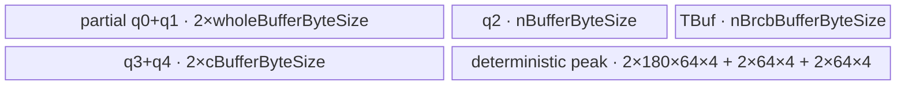

# BatchNormGatherStatsWithCounts 950 ACLNN 算子知识

## 算子速览

| 项目 | 内容 |
|---|---|
| 实际入口 | `aclnnBatchNormGatherStatsWithCountsGetWorkspaceSize` + `aclnnBatchNormGatherStatsWithCounts`，无版本后缀的公开 ACLNN 两段式接口 |
| 计算语义 | 聚合 N 组局部 `mean/invstd/counts` 得到 C 维全局均值、全局标准差倒数，并按 `momentum` 更新 running mean/variance |
| 输入输出 | ACLNN：`input` 2–8 维，仅提供 C 与 dtype；`mean/invstd` 为 `[N,C]`；`counts` 为 `[N]`；输出与可选 running tensor 为 `[C]`。950 支持 FP32/FP16/BF16，ND |
| 执行类型 | 核心节点 `SyncBatchNormGatherStatsFused` 为单 Kernel `AIV_VECTOR`；entry 对 `g_coreType == AIC` 直接返回，不存在可达 Cube/AIC 或 MIX_CV body |
| Kernel 路线 | R-001 Common；R-002 Workspace；R-003 FirstAxisCommon；R-004 FirstAxisWorkspace。每条各有 FP32/FP16/BF16 key |
| 核心资源 | GM 输入输出、AIV UB `TQue/TBuf`、FP32 中间量、跨核 FP32 workspace、`SyncAll`、部分和 workspace；ACLNN executor 还拥有 Contiguous/Cast/ViewCopy 框架节点 |
| 来源闭包 | `source_closed`：公开 ACLNN → 950 Host 分支 → `l0op::SyncBatchNormGatherStatsFused` → 四个优先级 Tiling 模板/POD → key router → 四个 AIV body/helper → 950 binary/config 与构建接线闭合 |
| 验证状态 | 已完成源码闭包检查；本次知识提取未执行编译、真机、数值或性能测试。 |

## 接口与语义

### 计算语义

令 `N = mean.shape[0] = counts.shape[0]`，`C = mean.shape[1]`。对每个通道 `c`：

```text
countsSum = Σ_n counts[n]
meanAll[c] = Σ_n(mean[n,c] * counts[n]) / countsSum
localVar[n,c] = 1 / invstd[n,c]^2 - eps
varSum[c] = Σ_n((localVar[n,c] + (mean[n,c] - meanAll[c])^2) * counts[n])
invstdAll[c] = 1 / sqrt(varSum[c] / countsSum + eps)
runningMeanOut[c] = (1 - momentum) * runningMean[c] + momentum * meanAll[c]
runningVarOut[c] = (1 - momentum) * runningVar[c] + momentum * varSum[c] / (countsSum - 1)
```

ACLNN 文档把 `input` 描述为样本值，但 950 Host 分支不把其数据地址传给核心 Kernel；只读取 `input.shape[1]` 作为 C，并在 running tensor 缺省时读取 `input.dtype` 生成 `[1,C]` 零张量。核心数值来自 `mean/invstd/counts/runningMean/runningVar`。

### 输入、输出与属性

| 参数 | shape/layout | dtype | 约束、默认值与语义 |
|---|---|---|---|
| `input` | 2–8 维，channel 为轴 1；公开格式 ND，Host 拒绝私有 storage format | FP32/FP16/BF16 | 非空指针；950 只消费 C 和 dtype，不读数据 |
| `mean` | `[N,C]`, ND | FP32/FP16/BF16 | 非空指针；公开文档不支持空 tensor，Host 仍保留 `mean->IsEmpty()` 填零/NaN短路 |
| `invstd` | `[N,C]`, ND | FP32/FP16/BF16 | 与 `mean` 的 N、C 相同；非正值精度无保证 |
| `counts` | `[N]`, ND | ACLNN 接受 FP32/FP16/BF16，950 Host 在核心节点前统一 Cast 为 FP32 | 元素应为正整数；源码未检查值域 |
| `runningMean` | `[C]`, ND，可空 | FP32/FP16/BF16 | 空时生成 `[1,C]` 全零中间张量；非空时 Contiguous + Unsqueeze |
| `runningVar` | `[C]`, ND，可空 | FP32/FP16/BF16 | 空时生成 `[1,C]` 全零中间张量；非空时 Contiguous + Unsqueeze |
| `momentum` | scalar | ACLNN `double`，进入核心节点前窄化为 `float` | 核心 Tiling 要求 `[0,1]` |
| `eps` | scalar | ACLNN `double`，进入核心节点前窄化为 `float` | 核心 Tiling 要求 `>0` |
| `meanAll` | `[C]`, ND | FP32/FP16/BF16 | 非空；核心结果必要时 Cast，再 Squeeze/ViewCopy |
| `invstdAll` | `[C]`, ND | FP32/FP16/BF16 | 非空；核心结果必要时 Cast，再 Squeeze/ViewCopy |

### 入口与版本

公开声明是无后缀的 `aclnnBatchNormGatherStatsWithCountsGetWorkspaceSize`/`aclnnBatchNormGatherStatsWithCounts`；固定 Commit 未出现该语义的更高版本公开入口。产品表明确 A2、A3 与 Ascend 950PR/950DT 均支持，但 Host 在 `IsSocVersion950()` 上分流：950 使用本仓公开的最新 `SyncBatchNormGatherStatsFused` 实现，A2/A3 使用另一路组合实现。本文只覆盖 950。

`SyncBatchNormGatherStatsFused` 的 README 明确只支持 Ascend 950PR/950DT，OpDef 仅注册 `ascend950`，binary JSON 仅列 FP32/FP16/BF16 三个 950 binary，三层平台证据一致。

## Host/Launcher 执行流程

### 参数校验与前处理

1. `OP_CHECK_COMM_INPUT` 检查 `workspaceSize/executor`，创建 `uniqueExecutor`。
2. `CheckBatchNormGatherStatsWithCountsParams` 依次检查必需指针、各 tensor dtype 属于 950 的 FP32/FP16/BF16、四个输入不是私有 storage format、shape 关系。它不要求各 tensor dtype 相同。
3. 若 `mean->IsEmpty()`，框架边界 `ProcessEmptyTensorWithValue` 把 `meanAll` 置 0、`invstdAll` 置 NaN，返回 executor；不进入四条核心 Kernel Route。
4. 950 分支 `CalculateRunningTensorNoCast`：可选 running tensor 为空时用 `FillVector([1,C],0,input.dtype)`；非空时 `Contiguous → Unsqueeze(axis=0) → ReFormat(ND)`，不 Cast。
5. `GatherStatsWithCountsFused` 按序添加 `mean/invstd/counts/runningMean/runningVar` 的 Contiguous，且只把 `counts` Cast 为 FP32；随后添加核心 `l0op::SyncBatchNormGatherStatsFused`。
6. 核心四个 `[1,C]` 输出经 `Squeeze(axis=0)` 与 `ViewCopy` 写入 ACLNN 输出；`CopyMeanAndInvstdToDst` 会在 dtype 不同处添加 Cast。`CopyResultTensorToDst` 仅在 `runningMeanDst != nullptr` 时复制两个 running 输出。
7. 任一中间 tensor/launcher 创建失败由 `CHECK_RET` 立即返回；第二段通过 `CommonOpExecutorRun(workspace, workspaceSize, executor, stream)` 按 executor 顺序运行。

### 参数、Workspace 与生命周期

ACLNN 总 workspace 由整个 executor 的 `GetWorkspaceSize()` 产生，包含框架 Contiguous/Cast/ViewCopy 节点，固定算子源码未展开其总量。核心 fused 节点自己的 workspace 由 Tiling 写入：

| Route | 核心 workspace 请求 | Kernel 实际切片 |
|---|---:|---|
| R-001/R-002 | `coreNum * 4 + 16 MiB` bytes | 相对 `GetUserWorkspace` 返回的 `usrWorkspace`，`[0, coreNum)` 个 FP32 是 counts 分核部分和；另加的 16 MiB 是框架约定保留量，原始 workspace 内的放置由框架边界决定，body 不读 |
| R-003 | `(blockNum+2)*cAlignM*4 + coreNum*4 + 16 MiB` | 相对 `usrWorkspace`：mean 汇总 `[0,cAlign)`；var 汇总 `[cAlign,2cAlign)`；每核 partial `[(2+b)cAlign,(3+b)cAlign)`；counts partial 紧随 `(2+blockNum)cAlign`；另加 16 MiB 框架保留量 |
| R-004 | `(blockNum+2)*cAlignV*4 + coreNum*4 + 16 MiB` | 相对 `usrWorkspace` 的切片与 R-003 相同，通道对齐使用 `cAlignV` |

workspace 由 ACLNN 调用者按第一段返回值分配，executor 持有中间 tensor/launch 描述，第二段在传入 stream 上提交；核心 Kernel 内用 `SyncAll` 保证 workspace 阶段可见性，`pipe.Reset()` 只在阶段同步后复用 UB。

### 启动图与失败传播

```text
ACLNN GetWorkspaceSize
  -> runningMean/runningVar: Fill 或 Contiguous→Unsqueeze→ReFormat  [框架边界]
  -> mean/invstd/counts: Contiguous；counts→FP32 Cast               [框架边界]
  -> ADD_TO_LAUNCHER_LIST_AICORE(SyncBatchNormGatherStatsFused)
       -> TilingRegistry priority 1000/2000/3000/4000
       -> 单 Kernel sync_batch_norm_gather_stats_fused<<<coreNum, scheduleMode=1>>>
       -> AIV counts reduction → SyncAll → Route body
  -> outputs: optional Cast→Squeeze→ViewCopy                       [框架边界]
ACLNN execute
  -> CommonOpExecutorRun(..., stream)
```

核心只有一个 Device 节点，无 Kernel 间 workspace 边；R-003/R-004 的多个全核阶段发生在同一 Kernel 内。launcher 添加失败会使 `GatherStatsWithCountsFused` 返回空输出并阻断后处理；Tiling 参数非法或某 Route 的 `DoOpTiling` 失败会终止 launch。框架节点由同一 executor/stream 管理，其内部 Tiling/Kernel 不属于该逻辑算子拥有的源码。

## Route 与参数设计

### 分核与资源计算

平台 producer：`TilingPrepare4SyncBatchNormGatherStatsFused` 读取 `coreNum=GetCoreNumAiv()`、平台 UB bytes、UB block bytes、`vlFp32=VRegSize/4`；四 Route 都设置 `blockDim=coreNum`、`scheduleMode=1`。

- R-001/R-002 按 C 分核：`blockFormer=ceil(C/coreNum)`，`blockNum=ceil(C/blockFormer)`，`blockTail=C-(blockNum-1)*blockFormer`。
- R-003/R-004 按 N 分核：同式把 C 换为 N。
- R-001 令 C 的 FP32 Vector 对齐为 8 元素、FP16/BF16 搬运对齐为 16 元素；迭代找最大 `ubFormer` 行，使 `2*whole+n+nBrcb+4*cBuffer <= UB-1024`。
- R-002 令 `maxBuffer=floor_to_16((UB-1024)/(5*4))`，每核 C 块再按 `maxBuffer` 分 UB loop。
- R-003 对整个 C 做 8/16 元素对齐，迭代找最大 N tile，使 `2*whole+n+nBrcb+2*cBuffer <= UB-1024`。
- R-004 令 `maxBuffer=floor_to_16((UB-1024)/(3*4))`，整个 C 按该值分 UB loop。

所有输入 shape 在 Tiling 前要求 `N>0 && C>0`；Host 计算使用 `int64_t`，POD 也保存 `int64_t`，但部分 `DataCopyExtParams.blockLen` 被窄化为 `uint32_t`。

### Route 选择

| 顺序 | Route | Key/模板 | 精确选择条件与优先级 | 不适用去向 |
|---:|---|---|---|---|
| 1 | R-001 Common | 101/102/103；priority 1000 | `C <= 240000 && !(C < N && N > 255)` | priority 2000 |
| 2 | R-002 Workspace | 201/202/203；priority 2000 | 原始 `IsCapable`: `!(C < N && N > 255)`；结合前序失败等价于 `C > 240000 && !(C < N && N > 255)` | priority 3000 |
| 3 | R-003 FirstAxisCommon | 301/302/303；priority 3000 | 原始 `IsCapable`: `C <= 5000`；结合前序失败等价于 `C < N && N > 255 && C <= 5000` | priority 4000 |
| 4 | R-004 FirstAxisWorkspace | 401/402/403；priority 4000 | `IsCapable()` 恒真；结合前序失败等价于 `C < N && N > 255 && C > 5000` | `DoOpTiling` 失败则整体失败 |

priority 数字越小越先尝试；`TilingRegistry` 按 `std::map` 升序遍历，`IsCapable=false` 返回 `GRAPH_PARAM_INVALID` 才 fallthrough，其他失败立即终止。

```text
if C <= 240000 and not (C < N and N > 255): R-001
else if not (C < N and N > 255):             R-002
else if C <= 5000:                            R-003
else:                                         R-004
dtype suffix: FP32→1, FP16→2, BF16→3
key = templateKey*100 + dtypeSuffix
```

### 模板/实现执行矩阵

| Route | key/selector | dtype/shape/platform 完整命中条件 | 执行拓扑与 Kernel 节点 | 实际模板/body | 内存与同步特征 | tail/fallback |
|---|---|---|---|---|---|---|
| R-001 Common | 101/102/103 | 950；N,C>0；前述 Common 谓词；dtype 同 key | 单 AIV Kernel；counts 全核归约后按 C 分核 | `SyncBatchNormGatherStatsFusedCommon<T>` | N×本核 C 块驻留/分 tile，FP32 累加；counts workspace；两次 N sweep | 尾核 `blockTail`，尾 N tile `ubTail`；大 Vector stride退化逐行 helper |
| R-002 Workspace | 201/202/203 | 950；N,C>0；前述 Workspace 有效谓词 | 单 AIV Kernel；counts 全核归约后按 C 分核并流式扫 N | `SyncBatchNormGatherStatsFusedWorkspace<T>` | 5 个等长 FP32 Queue；只保留当前 C tile与累加器 | 尾核与尾 C tile独立；不适用转 R-003 |
| R-003 FirstAxisCommon | 301/302/303 | 950；`C<N,N>255,C<=5000` | 单 AIV Kernel 内 counts→partial mean→确定性 mean→partial var→确定性 var→final | `SyncBatchNormGatherStatsFusedFirstAxisCommon<T>` + deterministic/running helpers | 按 N 分核；每核 partial 写独占 workspace；多次 `SyncAll`；C 向量化 | N 尾核/尾 tile；C padding；不适用转 R-004 |
| R-004 FirstAxisWorkspace | 401/402/403 | 950；`C<N,N>255,C>5000` | 与 R-003 同五阶段，partial 阶段流式 C tile | `SyncBatchNormGatherStatsFusedFirstAxisWorkspace<T>` + deterministic/running helpers | 3 个 FP32 Queue；per-core partial workspace；多次 `SyncAll` | N 尾核与 C 尾 tile；无后续 fallback |

### 隐藏性能 Guard

| Guard | Host/Tiling 条件 | Device/资源原因 | 影响 Route | 不满足时去向 | 源码符号 |
|---|---|---|---|---|---|
| Common C 上限 | `C<=240000` | Common 将 N×C 分片驻留 UB，且 C stride 进入 Vector repeat stride | R-001 | R-002或首轴 Route | `SyncBatchNormGatherStatsFusedCommonTiling::IsCapable` |
| 首轴启发式 | `C<N && N>255` | C 分核并行度弱且 N 超过 Vector repeat 上限时改按 N 分核 | R-001/R-002 | R-003/R-004 | Common/Workspace `IsCapable` |
| FirstAxisCommon C 上限 | `C<=5000` | 允许整 C 对齐缓冲驻留；更大 C 改为流式 | R-003 | R-004 | `SyncBatchNormGatherStatsFusedFirstAxisCommonTiling::IsCapable` |
| UB 预留 | 每个 Route 的 `UB-1024` 公式，且求得 tile `>0` | 给管线/非显式对象保留 1024 bytes；避免 `InitBuffer` 总量越界 | 全部 | `DoOpTiling` 失败 | 四个 `DoOpTiling/CalculateubFormer` |
| Repeat stride | `CAlign/8 > 255` | Binary repeat stride 字段不能表示更大值 | R-001/R-003 | 同 Route 内逐行、单 repeat helper | `BinElem*LargeStride` |
| Repeat count | 行数按 255 分段；`WholeReduceSum` 行 repeat按 248 分段 | Vector repeat 上限 | R-001/R-003 | 同 Route 内循环分段 | `BinElemWithInlined*`, `LastReduceSum` |
| 全核同步模式 | `scheduleMode=1` | body 多次调用 `SyncAll` | 全部 | 不满足无替代实现 | 四个 `PostTiling` |
| dtype一致性 | fused Tiling 要求 mean/invstd/runningMean/runningVar 同 dtype；counts binary 为 FP32 | router模板 T 与 GM 指针类型必须一致 | 全部 | Tiling失败 | `ValidateInputDtypes`, binary JSON |

### POD/ABI

POD 由 `BEGIN_TILING_DATA_DEF` 宏生成；固定仓未包含该外部宏的结构展开，因此只能确定字段顺序、源码类型和 producer/consumer，不能可靠给出 `sizeof/alignof/offsetof`。下表每个字段独立列出。

| 结构 | 字段 | 类型/位宽 | ABI 布局 | 单位 | Host/launcher producer | Device consumer | 边界 |
|---|---|---|---|---|---|---|---|
| Common | `nLength` | int64/64 | 字段顺序可见；offset不可见 | 元素/行 | `set_nLength(N)` | `Init`/N loops | >0 |
| Common | `cLength` | int64/64 | 同上 | 元素/列 | `set_cLength(C)` | GM stride | >0 |
| Common | `cFormerAlignV_` | int64/64 | 同上 | FP32元素 | `ceil(blockFormer/8)*8` | POD保留，body未读 | inactive consumer |
| Common | `cFormerAlignM_` | int64/64 | 同上 | 元素 | FP32按8、16位按16对齐 | `Init.cAlign` | former core |
| Common | `cTailAlignV_` | int64/64 | 同上 | FP32元素 | `ceil(blockTail/8)*8` | POD保留，body未读 | inactive consumer |
| Common | `cTailAlignM_` | int64/64 | 同上 | 元素 | FP32按8、16位按16对齐 | 尾核 `cAlign` | tail core |
| Common | `blockFormer` | int64/64 | 同上 | C元素/core | `ceil(C/coreNum)` | `blockCStart/curCLength` | former core |
| Common | `blockNum` | int64/64 | 同上 | AIV core | `ceil(C/blockFormer)` | 活跃核 guard | `<=coreNum` |
| Common | `blockTail` | int64/64 | 同上 | C元素 | `C-(blockNum-1)*blockFormer` | 尾核长度 | >0 |
| Common | `ubFormer` | int64/64 | 同上 | N行/tile | `CalculateubFormer()` | N tile loop | >0 |
| Common | `ubLoop` | int64/64 | 同上 | loop | `ceil(N/ubFormer)` | `Process` | >=1 |
| Common | `ubTail` | int64/64 | 同上 | N行 | `N-(ubLoop-1)*ubFormer` | 尾 tile | >0 |
| Common | `wholeBufferByteSize` | int64/64 | 同上 | bytes/Queue | `ubFormer*cFormerAlignM*4` | queue0/1 InitBuffer | 含16位输入暂存与FP32区 |
| Common | `nBufferByteSize` | int64/64 | 同上 | bytes | `align32(ubFormer*4)` | queue2 | counts tile |
| Common | `cBufferByteSize` | int64/64 | 同上 | bytes | `cFormerAlignM*4` | queue3–6 | 以former上界分配 |
| Common | `nBrcbBufferByteSize` | int64/64 | 同上 | bytes | `ceil(ubFormer/8)*8*32` | tmpTensor0 | Brcb展开 |
| Common | `wholeBufferElemNums` | int64/64 | 同上 | FP32元素 | `ubFormer*cFormerAlignM` | 16位输入子区offset | alias边界 |
| Common | `momentum` | float/32 | 同上 | 标量 | ACLNN double→float | running更新 | [0,1] |
| Common | `eps` | float/32 | 同上 | 标量 | ACLNN double→float | var/invstd | >0 |
| Workspace | `nLength` | int64/64 | 字段顺序可见；offset不可见 | 行 | `N` | row loops | >0 |
| Workspace | `cLength` | int64/64 | 同上 | 列 | `C` | GM stride | >0 |
| Workspace | `blockFormer` | int64/64 | 同上 | C元素/core | `ceil(C/coreNum)` | block base | >0 |
| Workspace | `blockNum` | int64/64 | 同上 | core | `ceil(C/blockFormer)` | 活跃核 guard | <=coreNum |
| Workspace | `blockTail` | int64/64 | 同上 | C元素 | tail公式 | 尾核 | >0 |
| Workspace | `ubFormerOfFormer` | int64/64 | 同上 | C元素/tile | `min(maxBuffer,cFormerAlignV)` | former核 UB size | >0 |
| Workspace | `ubTailOfFormer` | int64/64 | 同上 | C元素 | tail公式 | former核尾 tile | >0 |
| Workspace | `ubLoopOfFormer` | int64/64 | 同上 | loop | ceil公式 | former核 loop | >=1 |
| Workspace | `ubFormerOfTail` | int64/64 | 同上 | C元素/tile | `min(maxBuffer,cTailAlignV)` | tail核 UB size | >0 |
| Workspace | `ubTailOfTail` | int64/64 | 同上 | C元素 | tail公式 | tail核尾 tile | >0 |
| Workspace | `ubLoopOfTail` | int64/64 | 同上 | loop | ceil公式 | tail核 loop | >=1 |
| Workspace | `momentum` | float/32 | 同上 | 标量 | ACLNN double→float | running更新 | [0,1] |
| Workspace | `eps` | float/32 | 同上 | 标量 | ACLNN double→float | var/invstd | >0 |
| FirstAxisCommon | `nLength` | int64/64 | 字段顺序可见；offset不可见 | 行 | `N` | counts与GM | >0 |
| FirstAxisCommon | `cLength` | int64/64 | 同上 | 列 | `C` | GM/输出有效长度 | >0 |
| FirstAxisCommon | `cAlignV` | int64/64 | 同上 | FP32元素 | `ceil(C/8)*8` | POD保留，body用`cAlignM` | inactive consumer |
| FirstAxisCommon | `cAlignM` | int64/64 | 同上 | 元素 | FP32按8、16位按16 | UB/workspace stride | >=C |
| FirstAxisCommon | `blockFormer` | int64/64 | 同上 | N行/core | `ceil(N/coreNum)` | blockNStart | >0 |
| FirstAxisCommon | `blockNum` | int64/64 | 同上 | core | `ceil(N/blockFormer)` | workspace rows | <=coreNum |
| FirstAxisCommon | `blockTail` | int64/64 | 同上 | N行 | tail公式 | 尾核 | >0 |
| FirstAxisCommon | `ubFormer` | int64/64 | 同上 | N行/tile | UB搜索 | main partial loop | >0 |
| FirstAxisCommon | `ubLoopOfFormerBlock` | int64/64 | 同上 | loop | `ceil(blockFormer/ubFormer)` | former核 | >=1 |
| FirstAxisCommon | `ubLoopOfTailBlock` | int64/64 | 同上 | loop | `ceil(blockTail/ubFormer)` | tail核 | >=1 |
| FirstAxisCommon | `ubTailOfFormerBlock` | int64/64 | 同上 | N行 | tail公式 | former核尾 tile | >0 |
| FirstAxisCommon | `ubTailOfTailBlock` | int64/64 | 同上 | N行 | tail公式 | tail核尾 tile | >0 |
| FirstAxisCommon | `wholeBufferByteSize` | int64/64 | 同上 | bytes | `ubFormer*cAlignM*4` | queue0/1 | main阶段 |
| FirstAxisCommon | `nBufferByteSize` | int64/64 | 同上 | bytes | `align32(ubFormer*4)` | queue2 | counts |
| FirstAxisCommon | `cBufferByteSize` | int64/64 | 同上 | bytes | `cAlignM*4` | queue3/4 | partial accumulator |
| FirstAxisCommon | `nBrcbBufferByteSize` | int64/64 | 同上 | bytes | `ceil(ubFormer/8)*8*32` | tmpTensor0 | broadcast |
| FirstAxisCommon | `wholeBufferElemNums` | int64/64 | 同上 | FP32元素 | `ubFormer*cAlignM` | 16位输入子区 | alias边界 |
| FirstAxisCommon | `momentum` | float/32 | 同上 | 标量 | ACLNN double→float | deterministic helper | [0,1] |
| FirstAxisCommon | `eps` | float/32 | 同上 | 标量 | ACLNN double→float | variance | >0 |
| FirstAxisWorkspace | `nLength` | int64/64 | 字段顺序可见；offset不可见 | 行 | `N` | loops | >0 |
| FirstAxisWorkspace | `cLength` | int64/64 | 同上 | 列 | `C` | GM stride | >0 |
| FirstAxisWorkspace | `cAlignV` | int64/64 | 同上 | FP32元素 | `ceil(C/16)*16` | workspace stride | >=C |
| FirstAxisWorkspace | `blockFormer` | int64/64 | 同上 | N行/core | `ceil(N/coreNum)` | blockNStart | >0 |
| FirstAxisWorkspace | `blockNum` | int64/64 | 同上 | core | `ceil(N/blockFormer)` | workspace rows | <=coreNum |
| FirstAxisWorkspace | `blockTail` | int64/64 | 同上 | N行 | tail公式 | 尾核 | >0 |
| FirstAxisWorkspace | `ubFormer` | int64/64 | 同上 | C元素/tile | `min(maxBuffer,cAlignV)` | 3 Queue容量 | >0 |
| FirstAxisWorkspace | `ubTail` | int64/64 | 同上 | C元素 | tail公式 | 尾 tile | >0 |
| FirstAxisWorkspace | `ubLoop` | int64/64 | 同上 | loop | `ceil(C/ubFormer)` | C loop | >=1 |
| FirstAxisWorkspace | `momentum` | float/32 | 同上 | 标量 | ACLNN double→float | helper | [0,1] |
| FirstAxisWorkspace | `eps` | float/32 | 同上 | 标量 | ACLNN double→float | helper | >0 |

### Route 源码闭包

| Route | Key/selector | Host/Tiling producer | POD/参数 | Kernel entry/router 节点 | Kernel body/直接依赖 | 构建接线 |
|---|---|---|---|---|---|---|
| R-001 Common | 101/102/103, priority1000 | `sync_batch_norm_gather_stats_fused_common_tiling.cpp` `IsCapable/DoOpTiling` | `SyncBatchNormGatherStatsFusedTilingDataCommon` | `sync_batch_norm_gather_stats_fused` → `INVOKE_COMMON_IMPL` | `SyncBatchNormGatherStatsFusedCommon<T>`、common.inl、CountsSum | OpDef `ascend950` + 950 binary JSON + op_host CMake |
| R-002 Workspace | 201/202/203, priority2000 | `norm/sync_batch_norm_gather_stats_fused/op_host/sync_batch_norm_gather_stats_fused_workspace_tiling.cpp` | `SyncBatchNormGatherStatsFusedTilingDataWorkspace` | entry → `INVOKE_WORKSPACE_IMPL` | `SyncBatchNormGatherStatsFusedWorkspace<T>`、CountsSum | 同上 |
| R-003 FirstAxisCommon | 301/302/303, priority3000 | `norm/sync_batch_norm_gather_stats_fused/op_host/sync_batch_norm_gather_stats_fused_first_axis_common_tiling.cpp` | `SyncBatchNormGatherStatsFusedTilingDataFirstAxisCommon` | entry → `INVOKE_FIRST_AXIS_COMMON_IMPL` | FirstAxisCommon + inl + CountsSum + DeterminsticCompute + RunningCompute | 同上 |
| R-004 FirstAxisWorkspace | 401/402/403, priority4000 | `norm/sync_batch_norm_gather_stats_fused/op_host/sync_batch_norm_gather_stats_fused_first_axis_workspace_tiling.cpp` | `SyncBatchNormGatherStatsFusedTilingDataFirstAxisWorkspace` | entry → `INVOKE_FIRST_AXIS_WORKSPACE_IMPL` | FirstAxisWorkspace + CountsSum + DeterminsticCompute + RunningCompute | 同上 |

## Kernel 实现

### 公共执行流程

entry 参数顺序固定为九个 GM tensor、workspace、tiling。`GetUserWorkspace` 得到用户 workspace；`g_coreType==AIC` 立即返回，AIV 根据 12 个 key 实例化 `float/half/bfloat16_t` body。未知 key 没有输出分支。

四 Route 首阶段共享 `SyncBatchNormGatherStatsFusedCountsSum<T>`：每核先把自己的 `workspace[blockIdx]` 清零；N 个 counts 按 64 元素 task 轮转到 AIV core，每 task `WholeReduceSum` 后原子加到本核 slot；`SyncAll` 后每个核搬入全部 `coreNum` slots，再 `WholeReduceSum` 得到相同 `countsSumScalar`。外层 body 再 `SyncAll`、`pipe.Reset` 后进入 Route 主阶段。16位输入都先 Cast 到 FP32，所有统计与 running 更新以 FP32 计算，最终以 `CAST_RINT` 降回 T。

### Route R-001：Common

#### 适用条件

##### 选择证据

| 层级 | 文件 | 符号 | 源码谓词/参数 | 结果/下一跳 |
|---|---|---|---|---|
| ACLNN | `norm/sync_batch_norm_gather_stats_with_counts/op_host/op_api/aclnn_batch_norm_gather_stats_with_counts.cpp` | `IsSocVersion950` | `SocVersion::ASCEND950` | 调 `GatherStatsWithCountsFused` |
| Tiling | `norm/sync_batch_norm_gather_stats_fused/op_host/sync_batch_norm_gather_stats_fused_common_tiling.cpp` | `SyncBatchNormGatherStatsFusedCommonTiling::IsCapable` | `C<=240000 && !(C<N && N>255)` | key 101/102/103 |
| Registry | `tiling_templates_registry.h` | `DoTilingImpl` | priority1000最先 | false→2000；其他错误终止 |
| Router | `op_kernel/sync_batch_norm_gather_stats_fused.cpp` | `INVOKE_COMMON_IMPL` | key与 T 匹配 | `SyncBatchNormGatherStatsFusedCommon<T>` |

#### Device 数据流

##### 函数级调用链

```text
l0op::SyncBatchNormGatherStatsFused → ADD_TO_LAUNCHER_LIST_AICORE
  → sync_batch_norm_gather_stats_fused
    → Common<T>::Init
    → Common<T>::Process
      → ComputeCountsSum → CountsSum::FinalComputeProcess → SyncAll → pipe.Reset
      → initBuffer
      → for N-tile: ComputeGlobalMean(CopyMean,CopyCount,Brcb,Mul,Div,NlastReduceSum)
      → for N-tile: ComputeGlobalVar(CopyInvstd,CopyMean,Div/Mul/Add,NlastReduceSum)
      → ComputeGlobalInvstdWithRunningOut
      → ResultCoyOut
```

##### 源码等价伪码

```text
# 伪码；core b owns C interval [b*blockFormer, +curCLength)
countsSum = all_core_reduce_sum(counts)
if b < blockNum:
  meanAcc[0:cAlign] = 0; varAcc[0:cAlign] = 0
  for N tile (rows):
    m = fp32(load_pad(mean[rows, Cslice])); k = load(counts[rows])
    meanAcc += reduce_rows(m * broadcast(k) / countsSum)
  for N tile (rows):
    s = fp32(load_pad(invstd[rows,Cslice])); m = fp32(load_pad(mean[rows,Cslice]))
    localVar = (1/s)^2 - eps
    varAcc += reduce_rows((localVar + (m-meanAcc)^2) * broadcast(k))
  runningVarOut = (1-momentum)*runningVar + momentum*varAcc/(countsSum-1)
  runningMeanOut = (1-momentum)*runningMean + momentum*meanAcc
  invstdAll = 1 / sqrt(varAcc/countsSum + eps)
  cast_rint_if_needed_and_store_valid_C_tail()
```

#### 内存与数据搬运

##### 资源与搬运表

| 层级/缓冲区 | offset/地址公式 | extent/容量公式 | dtype/layout | producer | consumer | owner/lifetime | 对齐/复用 |
|---|---|---|---|---|---|---|---|
| mean/invstd GM | `blockCStart + ubIdx*ubFormer*C`，row stride C | `curRows*curCLength` | T, `[N,C]` | ACLNN contiguous | CopyMean/CopyInvstd | caller/executor | DataCopyPad，C tail补到cAlignM |
| counts workspace | `workspace[blockIdx]` | coreNum FP32 | FP32 | CountsSum atomic partial | finalReduce | executor，counts阶段 | SyncAll后读 |
| queue0/1 | 0 | `wholeBufferByteSize` each | FP32，16位输入暂存同块后段 | CopyMean/Invstd | Vector math | Kernel，单 tensor循环复用 | depth1；Cast后原地复用 |
| queue2 | 0 | `nBufferByteSize` | FP32 counts | CopyCount | Brcb | Kernel/tile | depth1 |
| queue3/4 | 0 | `cBufferByteSize` each | FP32 meanAcc/varAcc | NlastReduceSum | final update | Kernel/Route | 跨所有N tile累加 |
| queue5/6 | 0 | `cBufferByteSize` each | FP32 running outputs | final update | CopyOut | Kernel/final | depth1 |
| tmpTensor0 | 0 | `nBrcbBufferByteSize` | FP32 Brcb布局 | BlockBroadcast | weighted math | Kernel/tile | TBuf复用 |

##### 分层内存布局


##### 字节账与复用顺序

```text
counts_phase_UB = 2*64*4 + 2*1*4 bytes（InitBuffer请求量；实际allocator对齐固定仓不可见）
main_UB = 2*wholeBufferByteSize + nBufferByteSize
        + 4*cBufferByteSize + nBrcbBufferByteSize
main_UB <= platformUB - 1024
dynamic_ub = N/A
workspace_total(core node) = coreNum*4 + 16 MiB
```

| 复用子区 | 写入者 | 读取者/消费点 | 下一次覆盖 | 同步或释放依据 | 安全条件 |
|---|---|---|---|---|---|
| queue0 | DMA到16位后段→Cast到FP32前段 | mean/var/running计算 | `FreeTensor`后下次Copy | EnQue/DeQue、PIPE_V、FreeTensor | wholeBuffer同时容纳源与dst |
| queue1 | invstd或Duplicate临时量 | Div/variance | Free后下一步 | PIPE_V + FreeTensor | 不在消费前覆盖 |
| queue3/4 | 跨N tile FP32累加 | final update | Route结束释放 | 每次Add后PIPE_V | padding lane不CopyOut |

#### 同步、精度与尾块

##### 同步与数值边界表

| 阶段 | primitive/机制 | producer | consumer/等待点 | 保护对象 | 精度/尾块 |
|---|---|---|---|---|---|
| counts跨核 | AtomicAdd + SyncAll | 每核64元素partial | 所有核finalReduce | coreNum个FP32 slot | 最后task mask=`colSize` |
| DMA→Vector | TQue + MTE2_V flag | DataCopyPad | Cast/Vector | queue0/1/2 | C tail padding；只输出curCLength |
| Vector链 | `PipeBarrier<PIPE_V>` | 每个算术primitive | 下一primitive | 同一LocalTensor | FP32 Div配置0ULP FTZ false |
| Vector→GM | V_MTE3 event | Cast_RINT/FP32 result | DataCopyPad | 四输出 | blockLen=`curCLength*sizeof(T)` |
| 大stride | helper循环 | `CAlign/8>255` | 单行单repeat操作 | repeat stride | 64列块+remainder |

#### 关键实现

##### 符号证据表

| 阶段 | 文件 | 符号/模板实例 | 实现事实 |
|---|---|---|---|
| Host/Tiling producer | `norm/sync_batch_norm_gather_stats_fused/op_host/sync_batch_norm_gather_stats_fused_common_tiling.cpp` | `SyncBatchNormGatherStatsFusedCommonTiling::DoOpTiling/CalculateubFormer` | C分核、N tile、UB字节公式、workspace |
| Kernel entry/router | `op_kernel/sync_batch_norm_gather_stats_fused.cpp` | keys101–103 | T与Common body映射，AIC返回 |
| Device body/helper | `norm/sync_batch_norm_gather_stats_fused/op_kernel/sync_batch_norm_gather_stats_fused_common.h`、`sync_batch_norm_gather_stats_fused_common.inl` | `SyncBatchNormGatherStatsFusedCommon<T>::Process`、broadcast/reduce helpers | FP32两遍统计、repeat分段、tail、同步 |

### Route R-002：Workspace

#### 适用条件

##### 选择证据

| 层级 | 文件 | 符号 | 源码谓词/参数 | 结果/下一跳 |
|---|---|---|---|---|
| ACLNN | ACLNN实现 | `IsSocVersion950` | 950 | fused node |
| Tiling | `norm/sync_batch_norm_gather_stats_fused/op_host/sync_batch_norm_gather_stats_fused_workspace_tiling.cpp` | `SyncBatchNormGatherStatsFusedWorkspaceTiling::IsCapable` | `!(C<N && N>255)`，且R-001已失败 | 201/202/203 |
| Tiling | 同文件 | `DoOpTiling` | `maxBuffer=floor_to_16((UB-1024)/20)` | C tile参数 |
| Router | kernel entry | `INVOKE_WORKSPACE_IMPL` | dtype key | Workspace<T> |

#### Device 数据流

##### 函数级调用链

```text
entry → Workspace<T>::Init → Process
  → shared CountsSum → SyncAll → pipe.Reset → initBuffer
  → for local C tile:
      for n: ComputeGlobalMean(CopyMeanGm,Muls,Div,Add)
      for n: ComputeGlobalVar(CopyInvstd,CopyMeanGm,Vector chain,Add)
      ComputeRunningMean → meanAllWithRunningMeanCopyOut
      ComputeGlobalInvstdWithRunningVar → FinalCoyOut
```

##### 源码等价伪码

```text
# 伪码；core按C分块，tile只保留ubFormer列
for Ctile:
  meanAcc=0; varAcc=0
  for n in [0,N): meanAcc += fp32(mean[n,Ctile])*counts[n]/countsSum
  for n in [0,N):
    varAcc += ((1/fp32(invstd[n,Ctile]))^2-eps
               +(fp32(mean[n,Ctile])-meanAcc)^2)*counts[n]
  update runningMean and store meanAll/runningMean
  update runningVar; invstdAll=1/sqrt(varAcc/countsSum+eps)
  store valid curColNum
```

#### 内存与数据搬运

##### 资源与搬运表

| 层级/缓冲区 | offset/地址公式 | extent/容量公式 | dtype/layout | producer | consumer | owner/lifetime | 对齐/复用 |
|---|---|---|---|---|---|---|---|
| input GM | `row*C+blockCStart+ubIdx*ubFormer` | curColNum | T | executor | CopyMean/Invstd | caller | 连续单block DMA |
| queue0/1 | 0 | `ubFormer*4` each | FP32/暂存T | Copy/duplicate | vector | per tile | depth1，16位源放offset ubFormer后Cast |
| queue2/3 | 0 | `ubFormer*4` each | FP32 meanAcc/varAcc | row loops | final | per tile | depth1 |
| queue4 | 0 | `ubFormer*4` | FP32 runningMeanOut | update | copyout | per tile | depth1 |
| `usrWorkspace` | 0 | coreNum FP32；workspace请求另含16 MiB框架保留量 | FP32 | counts partial | all core | Kernel | 与R-001相同；原始base偏移由`GetUserWorkspace`隐藏 |

##### 分层内存布局


##### 字节账与复用顺序

```text
main_UB = 5*ubFormer*4 <= platformUB-1024
counts_phase_UB = 520 bytes（请求量）
dynamic_ub = N/A
workspace_total = coreNum*4 + 16 MiB
```

| 复用子区 | 写入者 | 读取者/消费点 | 下一次覆盖 | 同步或释放依据 | 安全条件 |
|---|---|---|---|---|---|
| queue0 | 每行mean/running输入 | 当前Vector链 | Free后下一行 | PIPE_V+Free | 当前行完成 |
| queue1 | 每行invstd/除数 | Div/var | Free后下一行 | PIPE_V+Free | 当前行完成 |
| queue2/3 | tile累加器 | 输出阶段 | CopyOut后Free | V_MTE3+Free | 当前tile输出完成 |

#### 同步、精度与尾块

##### 同步与数值边界表

| 阶段 | primitive/机制 | producer | consumer/等待点 | 保护对象 | 精度/尾块 |
|---|---|---|---|---|---|
| counts | AtomicAdd+SyncAll | CountsSum | Route body | workspace | 同R-001 |
| row scalar | `countsGm.GetValue(rowIdx)` | GM scalar load | Muls | count值 | 固定仓未展开scalar load时序 |
| main math | PIPE_V | FP32 primitive | 下一primitive | queue0–4 | curColNum控制尾tile有效lane |
| output | V_MTE3 | Cast_RINT | DataCopyPad | output Ctile | blockLen curColNum*sizeof(T) |

#### 关键实现

##### 符号证据表

| 阶段 | 文件 | 符号/模板实例 | 实现事实 |
|---|---|---|---|
| Host/Tiling producer | `norm/sync_batch_norm_gather_stats_fused/op_host/sync_batch_norm_gather_stats_fused_workspace_tiling.cpp` | `SyncBatchNormGatherStatsFusedWorkspaceTiling::DoOpTiling` | 五buffer预算、former/tail tile |
| Kernel entry/router | kernel entry | keys201–203 | Workspace<T> |
| Device body/helper | `norm/sync_batch_norm_gather_stats_fused/op_kernel/sync_batch_norm_gather_stats_fused_workspace.h` | `SyncBatchNormGatherStatsFusedWorkspace<T>::Process`与各Compute | 流式C tile、逐N行两遍统计 |

### Route R-003：FirstAxisCommon

#### 适用条件

##### 选择证据

| 层级 | 文件 | 符号 | 源码谓词/参数 | 结果/下一跳 |
|---|---|---|---|---|
| Tiling | `norm/sync_batch_norm_gather_stats_fused/op_host/sync_batch_norm_gather_stats_fused_first_axis_common_tiling.cpp` | `SyncBatchNormGatherStatsFusedFirstAxisCommonTiling::IsCapable` | `C<=5000`且前两模板失败 | 301/302/303 |
| Tiling | 同文件 | `PostTiling` | `blockDim=coreNum,scheduleMode=1` | 支持全核SyncAll |
| Router | kernel entry | `INVOKE_FIRST_AXIS_COMMON_IMPL` | dtype key | FirstAxisCommon<T> |
| Helper | deterministic.h | `MeanAllDeterministicWithRunningMeanUpdate/InvstdAllDeterministic` | blockNum行partial按固定顺序归约 | mean/var final workspace |

#### Device 数据流

##### 函数级调用链

```text
entry → FirstAxisCommon<T>::Init → Process
  → CountsSum → SyncAll → Reset
  → per-core N tiles ComputeGlobalMean → own partial workspace
  → SyncAll → Reset → DeterminsticCompute::MeanAll... → meanAll/runningMeanOut
  → SyncAll → Reset → reload meanAll; per-core N tiles ComputeGlobalVar → own partial workspace
  → SyncAll → Reset → DeterminsticCompute::InvstdAllDeterministic
  → SyncAll → Reset → RunningCompute::FinalComputeProcess → invstdAll/runningVarOut
```

##### 源码等价伪码

```text
# 伪码；core b owns N rows [b*blockFormer, +curNLength)
partialMean[b,:] = Σ_owned mean[n,:]*counts[n]/countsSum
SyncAll
meanAll[:] = deterministic_sum_b(partialMean[b,:])
runningMeanOut = blend(runningMean, meanAll)
SyncAll
partialVar[b,:] = Σ_owned ((1/invstd)^2-eps+(mean-meanAll)^2)*counts
SyncAll
varAll[:] = deterministic_sum_b(partialVar[b,:])
SyncAll
runningVarOut = blend(runningVar,varAll/(countsSum-1))
invstdAll = 1/sqrt(varAll/countsSum+eps)
```

#### 内存与数据搬运

##### 资源与搬运表

| 层级/缓冲区 | offset/地址公式 | extent/容量公式 | dtype/layout | producer | consumer | owner/lifetime | 对齐/复用 |
|---|---|---|---|---|---|---|---|
| mean/var final ws | 0 / cAlign | cAlign each | FP32 `[Cpad]` | deterministic helper | later phases | executor/core node | 全核阶段间存活 |
| per-core ws | `(2+b)*cAlign` | cAlign/core | FP32 `[blockNum,Cpad]` | core b atomic partial | deterministic helper | core node | 每核独占，mean后清零复用为var |
| main q0/q1 | 0 | wholeBufferByteSize each | FP32 + T alias | DMA/Cast | vector | partial phase | depth1 |
| main q2 | 0 | nBufferByteSize | FP32 counts | CopyCount | Brcb | tile | depth1 |
| main q3/q4 | 0 | cBufferByteSize each | FP32 accum | reduce | workspace write | phase | depth1 |
| main tmp | 0 | nBrcbBufferByteSize | FP32 | Brcb | Mul | tile | TBuf |
| deterministic qIn | 0 | depth2×180×64×4 | FP32 partial tile | workspace DMA | Add | helper phase | 固定64列、180行 |
| deterministic qOut/running | 0 | each depth2×64×4 | FP32 | reduce/blend | GM output | helper phase | mean阶段两者，var阶段仅qOut |
| final running helper | 0 | 4×depth2×64×4 | FP32 | workspace/runningVar | output | final phase | 64列task |

##### 分层内存布局



##### 字节账与复用顺序

```text
partial_phase_UB = 2*wholeBufferByteSize + nBufferByteSize
                 + 2*cBufferByteSize + nBrcbBufferByteSize <= UB-1024
deterministic_mean_peak = 93184 bytes
deterministic_var_peak = 92672 bytes
final_running_peak = 2048 bytes
workspace_total = (blockNum+2)*cAlignM*4 + coreNum*4 + 16 MiB
dynamic_ub = N/A
```

| 复用子区 | 写入者 | 读取者/消费点 | 下一次覆盖 | 同步或释放依据 | 安全条件 |
|---|---|---|---|---|---|
| per-core partial ws | mean partial | deterministic mean | 清零后var partial | SyncAll→deterministic→SyncAll→InitOutput | 不在mean消费前清零 |
| UB pipe | counts helper | partial mean | `pipe.Reset` | SyncAll | 全核已完成counts读取 |
| UB pipe | partial mean/helper | later phases | 每阶段Reset | SyncAll | workspace提交已完成 |

#### 同步、精度与尾块

##### 同步与数值边界表

| 阶段 | primitive/机制 | producer | consumer/等待点 | 保护对象 | 精度/尾块 |
|---|---|---|---|---|---|
| partial提交 | AtomicAdd到独占slice + V_MTE3 | 每核acc | deterministic helper | per-core ws | C padding保留，输出仅C |
| 阶段边界 | SyncAll + pipe.Reset | 前一全核阶段 | 后一阶段 | GM workspace与UB | scheduleMode=1必需 |
| deterministic | 固定64列×180行，Add repeat<=255 | per-core rows | mean/var final | 固定归约次序 | last col/row按colSize/rowSize |
| dtype | Cast none→FP32，Cast_RINT→T | DMA/FP32 math | outputs | 所有统计 | padding不写最终输出 |

#### 关键实现

##### 符号证据表

| 阶段 | 文件 | 符号/模板实例 | 实现事实 |
|---|---|---|---|
| Host/Tiling producer | `norm/sync_batch_norm_gather_stats_fused/op_host/sync_batch_norm_gather_stats_fused_first_axis_common_tiling.cpp` | `SyncBatchNormGatherStatsFusedFirstAxisCommonTiling::DoOpTiling/GetWorkspaceSize` | N分核、UB搜索、workspace布局 |
| Kernel entry/router | kernel entry | keys301–303 | FirstAxisCommon<T> |
| Device body/helper | first_axis_common.h/.inl、deterministic.h、compute.h | `Process`和三类helper | 五阶段、partial、确定性归约、final更新 |

### Route R-004：FirstAxisWorkspace

#### 适用条件

##### 选择证据

| 层级 | 文件 | 符号 | 源码谓词/参数 | 结果/下一跳 |
|---|---|---|---|---|
| Tiling | `norm/sync_batch_norm_gather_stats_fused/op_host/sync_batch_norm_gather_stats_fused_first_axis_workspace_tiling.cpp` | `SyncBatchNormGatherStatsFusedFirstAxisWorkspaceTiling::IsCapable` | 恒true；前三模板失败 | 401/402/403 |
| Tiling | 同文件 | `DoOpTiling` | N分核，`CAlign=ceil(C/16)*16`，C按三buffer预算切tile | POD |
| Router | kernel entry | `INVOKE_FIRST_AXIS_WORKSPACE_IMPL` | dtype key | FirstAxisWorkspace<T> |

#### Device 数据流

##### 函数级调用链

```text
entry → FirstAxisWorkspace<T>::Init → Process
  → CountsSum → SyncAll → Reset
  → for Ctile, for owned N row: ComputeGlobalMean → per-core ws
  → SyncAll → deterministic mean/runningMean
  → SyncAll → for Ctile: load meanAll; for owned N row ComputeGlobalVar → per-core ws
  → SyncAll → deterministic var
  → SyncAll → RunningCompute final invstd/runningVar
```

##### 源码等价伪码

```text
# 伪码；按N分核，同时把C切成ubFormer列
for Ctile:
  for owned n: atomic_add(partialMean[b,Ctile], mean[n,Ctile]*counts[n]/countsSum)
SyncAll; deterministic_reduce(partialMean) → meanAll,runningMeanOut
SyncAll
for Ctile:
  meanGlobal = load(meanAll[Ctile])
  for owned n: atomic_add(partialVar[b,Ctile], variance_term(n,Ctile,meanGlobal))
SyncAll; deterministic_reduce(partialVar) → varAll
SyncAll; finalize invstdAll,runningVarOut
```

#### 内存与数据搬运

##### 资源与搬运表

| 层级/缓冲区 | offset/地址公式 | extent/容量公式 | dtype/layout | producer | consumer | owner/lifetime | 对齐/复用 |
|---|---|---|---|---|---|---|---|
| per-core/final workspace | 与R-003相同，stride cAlignV | `(blockNum+2)*cAlignV` FP32 + counts | FP32 | partial/deterministic | 后续阶段 | core node | mean slice清零复用为var |
| queue0/1/2 | 0 | `ubFormer*4` each | FP32 + T alias | mean/invstd/meanAll DMA | Vector | Ctile/row | depth1 |
| deterministic/final helper UB | 同R-003 | 93184/92672/2048 peak | FP32 | GM workspace | helper | 阶段 | Reset隔离 |

##### 分层内存布局


##### 字节账与复用顺序

```text
partial_phase_UB = 3*ubFormer*4 <= platformUB-1024
deterministic_mean_peak = 93184 bytes
deterministic_var_peak = 92672 bytes
final_running_peak = 2048 bytes
workspace_total = (blockNum+2)*cAlignV*4 + coreNum*4 + 16 MiB
dynamic_ub = N/A
```

| 复用子区 | 写入者 | 读取者/消费点 | 下一次覆盖 | 同步或释放依据 | 安全条件 |
|---|---|---|---|---|---|
| queue0/1 | 当前row DMA/Cast | 当前variance/mean链 | Free后下一row | PIPE_V+Free | curColNum有效 |
| queue2 | meanAll Ctile | 每个owned row variance | tile结束Free | DeQue/Free | 整个row loop不覆盖 |
| partial ws | partial mean | deterministic mean | InitOutput后partial var | SyncAll链 | 同R-003 |

#### 同步、精度与尾块

##### 同步与数值边界表

| 阶段 | primitive/机制 | producer | consumer/等待点 | 保护对象 | 精度/尾块 |
|---|---|---|---|---|---|
| partial mean/var | AtomicAdd+V_MTE3 | 每row Ctile | per-core slice | workspace | curColNum控制mean写入；var写入参数见限制 |
| 全核阶段 | SyncAll+Reset | partial/deterministic | 下一阶段 | workspace/UB | scheduleMode=1 |
| helper | 与R-003同固定tile | workspace | output | FP32 | 最终只写C |
| output | Cast_RINT | FP32 helper | GM T | 输出 | 64列tail |

#### 关键实现

##### 符号证据表

| 阶段 | 文件 | 符号/模板实例 | 实现事实 |
|---|---|---|---|
| Host/Tiling producer | `norm/sync_batch_norm_gather_stats_fused/op_host/sync_batch_norm_gather_stats_fused_first_axis_workspace_tiling.cpp` | `SyncBatchNormGatherStatsFusedFirstAxisWorkspaceTiling::DoOpTiling/GetWorkspaceSize` | 三buffer C tile、N分核、workspace |
| Kernel entry/router | kernel entry | keys401–403 | FirstAxisWorkspace<T> |
| Device body/helper | first_axis_workspace.h、deterministic.h、compute.h | `Process` | 流式C tile与五阶段同步 |

## 算子特定优化

### Trick T-001：950 用单个 fused 核心节点替代 A2/A3 多算子组合

#### 触发与源码依据

- 适用 Route：R-001–R-004
- 触发条件：`IsSocVersion950()`
- Golden 来源：[`aclnn_batch_norm_gather_stats_with_counts.cpp:448-455`](../../../../../../../cann-ops-raw/ascendc/ops-nn/955f8b33985b6d72989ebff341bb9c2c564a51bc/norm/sync_batch_norm_gather_stats_with_counts/op_host/op_api/aclnn_batch_norm_gather_stats_with_counts.cpp#L448-L455)

**官方源码（固定 Commit 连续逐字摘录）**：

```cpp
if (IsSocVersion950()) {
    runningMeanMid = CalculateRunningTensorNoCast(
        runningMean, input->GetViewShape()[1], input->GetDataType(), uniqueExecutor.get());
```

#### 机制与设计原因

950 保持 mean/invstd/running dtype，不再像非950分支把统计输入全部 Cast FP32并依次建立 Broadcast、ReduceSum、ReduceMeanWithCount、旧 gather、SyncBNTrainingUpdate 节点；核心统计、running 更新与输出都在一个 AIV Kernel 内完成。源码能证明它减少 executor 中核心中间 tensor 物化与核心 Kernel 启动数，但未提供性能百分比。

#### 迁移边界

- 适用：可在单核内通过 UB/workspace 分阶段完成相同统计图的 950 实现。
- 前提：Ascend950；FP32/FP16/BF16；counts先转FP32；fused OpDef/binary可用。
- 失效：非950进入旧组合路径；该路径在固定仓缺少核心 Kernel 源码，不能据此复刻。
- 未验证：本次知识提取未执行编译、真机、数值或性能测试。

#### 错误做法

固定仓未提供可验证反例；不能把 950 fused body直接声称为 A2/A3 可用，因为 OpDef/README明确仅注册950。

### Trick T-002：Common 路线把 counts 广播与两遍统计保持在 FP32 UB

#### 触发与源码依据

- 适用 Route：R-001、R-003
- 触发条件：对应 Common Route；N tile与对齐C块满足Host UB搜索
- Golden 来源：[`sync_batch_norm_gather_stats_fused_common.h:210-228`](../../../../../../../cann-ops-raw/ascendc/ops-nn/955f8b33985b6d72989ebff341bb9c2c564a51bc/norm/sync_batch_norm_gather_stats_fused/op_kernel/sync_batch_norm_gather_stats_fused_common.h#L210-L228)

**官方源码（固定 Commit 连续逐字摘录）**：

```cpp
BlockBroadcast<float>(buffer7_, buffer2_, curRowNum);
PipeBarrier<PIPE_V>();
BinElemWithInlinedLastBrcFP32(buffer0_, buffer0_, buffer7_, curRowNum, Mul);
```

#### 机制与设计原因

counts 只搬入 N 向量，再由 `Brcb` 展开为每行可广播布局；mean/invstd 在同一 Queue 中由 T 转 FP32，weighted mean与variance都在 UB中累加，避免为 `[N,C]` broadcast counts和中间variance建立GM tensor。Host逐项计算 `whole/n/c/brcb` 缓冲并预留1024 bytes；大stride/repeat通过同Route helper分段，不改变公式。

#### 迁移边界

- 适用：二维 `[N,C]` weighted reduction，C块和N tile可装入UB。
- 前提：C按FP32 8元素、16位输入16元素对齐；FP32累加；repeat上限按255/248分段。
- 失效：Common谓词失败时改R-002或首轴Route，不能继续扩大UB分配。
- 未验证：本次知识提取未执行编译、真机、数值或性能测试。

#### 错误做法

固定仓未提供可验证反例；源码明确存在 `CAlign/8>255` 的逐行fallback，迁移时不能删除该分支。

### Trick T-003：首轴路线用独占 partial slice 加固定顺序归约保持跨核确定性

#### 触发与源码依据

- 适用 Route：R-003、R-004
- 触发条件：`C<N && N>255`
- Golden 来源：[`sync_batch_norm_gather_stats_fused_first_axis_common.h:109-134`](../../../../../../../cann-ops-raw/ascendc/ops-nn/955f8b33985b6d72989ebff341bb9c2c564a51bc/norm/sync_batch_norm_gather_stats_fused/op_kernel/sync_batch_norm_gather_stats_fused_first_axis_common.h#L109-L134)

**官方源码（固定 Commit 连续逐字摘录）**：

```cpp
SyncAll();
pipe.Reset();
ComputeGlobalMeanDterministic();
SyncAll();
```

#### 机制与设计原因

按N分核提升可用AIV并行度；每核把C维partial写到自己的 workspace row，`SyncAll` 后 `DeterminsticCompute` 以固定的64列×180行块顺序累加 `blockNum` rows。mean与var分阶段复用同一per-core区域，既避免并发写同一最终C向量造成不确定顺序，也控制workspace为 `(blockNum+2)*CAlign` 个FP32。

#### 迁移边界

- 适用：首轴很长、尾轴较短或C分核并行度不足的跨核归约。
- 前提：Batch schedule支持 `SyncAll`；workspace owner覆盖整个单Kernel；阶段间不得提前Reset/覆盖GM partial。
- 失效：缺少全核同步或独占partial slice时不能保留相同确定性归约；应改成单核/单C分片Route或重新设计同步。
- 未验证：本次知识提取未执行编译、真机、数值或性能测试。

#### 错误做法

固定仓未提供可验证反例；源码的正确性边界是每次 `pipe.Reset()` 前都有 `SyncAll()`，不能只按代码书写顺序假定跨核可见。

## 模板与实现对比

| 对比维度 | R-001 Common | R-002 Workspace | R-003 FirstAxisCommon | R-004 FirstAxisWorkspace | 设计选择依据 |
|---|---|---|---|---|---|
| 命中条件/优先级 | 1000，常规形状 | 2000，大C | 3000，长N且C<=5000 | 4000，长N且C>5000 | 先C分核，再N分核；Common优先于流式 |
| 模板与 dtype | Common<T>，101–103 | Workspace<T>，201–203 | FirstAxisCommon<T>，301–303 | FirstAxisWorkspace<T>，401–403 | suffix 1/2/3对应FP32/FP16/BF16 |
| 循环与分核 | C分核、N tile | C分核、C tile、逐N行 | N分核、N tile、整C | N分核、C tile、逐N行 | 并行轴和UB驻留策略不同 |
| Queue/TBuf | 7 Queue+1 TBuf | 5 Queue | 5 Queue+TBuf+helper queues | 3 Queue+helper queues | Common换取更宽Vector化 |
| 内存总占用与复用 | Host精确搜索UB；workspace仅counts | 5等长buffer | partial workspace与phase UB复用 | 同左，主phase 3buffer | 长N需要跨核partial |
| 搬运/Vector API | 多block DataCopyPad、Brcb、repeat helper | 单行连续DMA、Muls/Add | Common向量化+deterministic helper | 单行Ctile+deterministic helper | C大小决定整块或流式 |
| 同步、精度与 tail | counts SyncAll；FP32；C/N tail | 同左；Ctile tail | 多次SyncAll；FP32；N/C tail | 同左；Ctile tail | 首轴路线增加跨核阶段 |
| fallback/失败边界 | →R-002 | →R-003 | →R-004 | 无后续 | 非`GRAPH_PARAM_INVALID`错误立即终止 |

## 平台差异

| 项目 | A2 | A3 | 950 |
|---|---|---|---|
| 支持状态 | ACLNN文档支持，但固定仓核心实现不闭合 | ACLNN文档支持，但固定仓核心实现不闭合 | 支持且 `source_closed` |
| Host/Launcher | 非950组合：Cast/Broadcast/ReduceMeanWithCount/`SyncBatchNormGatherStatsWithCounts`/SyncBNTrainingUpdate | 同A2 | `SyncBatchNormGatherStatsFused` 单核心节点 |
| Kernel/资源 | 入口目录README明确只有ACLNN；旧核心只有l0 launcher壳，无公开Tiling/POD/Kernel/config | 同A2 | 四个AIV Route、FP32 UB/workspace、950 binary完整 |

## 限制与失败边界

- ACLNN外层dtype检查只验证“各自在支持集合”，不验证相互一致；950 fused Tiling要求 mean、invstd、runningMean、runningVar dtype一致。若 `input.dtype`、mean dtype或可选running dtype不一致，前处理可能生成不匹配的running中间tensor，最终Tiling失败。
- fused Tiling读取了 `countsDtype` 但没有在 `ValidateInputDtypes` 显式判断；闭包依赖ACLNN 950先Cast counts为FP32以及OpDef/binary约束。
- `momentum/eps` 在ACLNN层不检查，窄化为float后由 fused Tiling分别要求 `[0,1]` 和 `>0`。
- running输出复制以 `runningMeanDst==nullptr` 为总开关；源码未给出“runningMean空、runningVar非空”的独立复制实现。反向组合可能把空 `runningVarDst` 传给ViewCopy；公开接口未声明两者必须同时为空/非空。
- R-004 `ComputeGlobalVar` 构造输出搬运参数时使用 `blockLen=cAlign*sizeof(float)`，而目标offset按 `ubIdx*ubFormer`、UB buffer容量为 `ubFormer`。当 `ubLoop>1` 时，固定源码没有给出将blockLen缩为`curColNum`的分支；本文保留该源码边界，不推测运行结果。
- counts值、`countsSum!=0`、`countsSum>1`、invstd正值均未由核心Host校验；违反时Div/无偏方差的数值行为不受保证。
- `DataCopyExtParams.blockLen` 的若干赋值从int64乘积窄化到uint32；固定源码没有额外大shape溢出guard。
- unknown tiling key、AIC core或`blockIdx>=blockNum`不会写核心输出；正常Host必须保证key与block参数匹配。
- ACLNN总workspace包含框架节点，固定算子源码只能精确闭合核心 fused workspace切片，不能从本目录推出整个executor的逐节点workspace offset。
- 本次知识提取未执行编译、真机、数值或性能测试。

## 源码索引

### 链路索引

| 链路阶段 | 文件 | 关键符号 | 支撑内容 |
|---|---|---|---|
| 入口声明/约束 | `norm/sync_batch_norm_gather_stats_with_counts/README.md` | 目录说明 | 旧核心只有ACLNN接口源码的公开边界 |
| 入口声明/约束 | `norm/sync_batch_norm_gather_stats_with_counts/docs/aclnnBatchNormGatherStatsWithCounts.md` | 产品表、函数原型 | 950公开支持、参数与确定性 |
| 入口声明/约束 | `norm/sync_batch_norm_gather_stats_with_counts/op_host/op_api/aclnn_batch_norm_gather_stats_with_counts.h` | 两段式API | 公开符号与ABI参数顺序 |
| 入口实现 | `norm/sync_batch_norm_gather_stats_with_counts/op_host/op_api/aclnn_batch_norm_gather_stats_with_counts.cpp` | Check/Calculate/Gather/Copy/GetWorkspaceSize | 950分支、前后处理与executor |
| 入口实现 | `norm/sync_batch_norm_gather_stats_with_counts/op_host/op_api/sync_batch_norm_gather_stats_with_counts.cpp` | `l0op::SyncBatchNormGatherStatsWithCounts` | A2/A3旧核心仅有launcher壳 |
| 入口声明/约束 | `norm/sync_batch_norm_gather_stats_fused/README.md` | 产品表、公式 | fused仅支持950与核心数学语义 |
| Host/Launcher | `norm/sync_batch_norm_gather_stats_fused/op_host/op_api/sync_batch_norm_gather_stats_fused.h` | `l0op::SyncBatchNormGatherStatsFused` | 核心节点参数顺序 |
| Host/Launcher | `norm/sync_batch_norm_gather_stats_fused/op_host/op_api/sync_batch_norm_gather_stats_fused.cpp` | `l0op::SyncBatchNormGatherStatsFused` | 输出分配与launcher节点 |
| Host/Tiling | `norm/sync_batch_norm_gather_stats_fused/op_host/sync_batch_norm_gather_stats_fused_tiling.cpp` | TilingPrepare/Tiling4 | coreNum/UB/platform producer |
| Host/Tiling | `norm/sync_batch_norm_gather_stats_fused/op_host/sync_batch_norm_gather_stats_fused_tiling_base.cpp` | Validate/GetShapeAttrsInfo | N/C/dtype/attr校验 |
| Host/Tiling | `norm/sync_batch_norm_gather_stats_fused/op_host/sync_batch_norm_gather_stats_fused_common_tiling.cpp` | CommonTiling | R-001 selector/POD/workspace |
| Host/Tiling | `norm/sync_batch_norm_gather_stats_fused/op_host/sync_batch_norm_gather_stats_fused_workspace_tiling.cpp` | WorkspaceTiling | R-002 |
| Host/Tiling | `norm/sync_batch_norm_gather_stats_fused/op_host/sync_batch_norm_gather_stats_fused_first_axis_common_tiling.cpp` | FirstAxisCommonTiling | R-003 |
| Host/Tiling | `norm/sync_batch_norm_gather_stats_fused/op_host/sync_batch_norm_gather_stats_fused_first_axis_workspace_tiling.cpp` | FirstAxisWorkspaceTiling | R-004 |
| POD | `norm/sync_batch_norm_gather_stats_fused/op_host/sync_batch_norm_gather_stats_fused_tiling.h` | 四个TilingData | 字段、key、模板类 |
| Kernel entry/body | `norm/sync_batch_norm_gather_stats_fused/op_kernel/sync_batch_norm_gather_stats_fused.cpp` | kernel entry/router | 12 key、AIV-only执行 |
| Kernel entry/body | `norm/sync_batch_norm_gather_stats_fused/op_kernel/sync_batch_norm_gather_stats_fused_common.h` | Common<T> | R-001主流程与UB |
| Kernel entry/body | `norm/sync_batch_norm_gather_stats_fused/op_kernel/sync_batch_norm_gather_stats_fused_common.inl` | broadcast/reduce helpers | repeat/stride fallback |
| Kernel entry/body | `norm/sync_batch_norm_gather_stats_fused/op_kernel/sync_batch_norm_gather_stats_fused_workspace.h` | Workspace<T> | R-002流式实现 |
| Kernel entry/body | `norm/sync_batch_norm_gather_stats_fused/op_kernel/sync_batch_norm_gather_stats_fused_first_axis_common.h` | FirstAxisCommon<T> | R-003阶段图 |
| Kernel entry/body | `norm/sync_batch_norm_gather_stats_fused/op_kernel/sync_batch_norm_gather_stats_fused_first_axis_common.inl` | partial helpers | R-003搬运与partial |
| Kernel entry/body | `norm/sync_batch_norm_gather_stats_fused/op_kernel/sync_batch_norm_gather_stats_fused_first_axis_workspace.h` | FirstAxisWorkspace<T> | R-004实现 |
| Kernel helper | `norm/sync_batch_norm_gather_stats_fused/op_kernel/sync_batch_norm_gather_stats_fused_counts_sum.h` | CountsSum | counts跨核归约 |
| Kernel helper | `norm/sync_batch_norm_gather_stats_fused/op_kernel/sync_batch_norm_gather_stats_fused_deterministic.h` | DeterminsticCompute | 首轴固定顺序归约 |
| Kernel helper | `norm/sync_batch_norm_gather_stats_fused/op_kernel/sync_batch_norm_gather_stats_fused_compute.h` | RunningCompute | final invstd/runningVar |
| 构建接线 | `norm/sync_batch_norm_gather_stats_fused/op_host/sync_batch_norm_gather_stats_fused_def.cpp` | OpDef | 仅ascend950配置 |
| 构建接线 | `norm/sync_batch_norm_gather_stats_fused/op_host/config/ascend950/sync_batch_norm_gather_stats_fused_binary.json` | 三个binary | dtype与ND接线 |
| 构建接线 | `norm/sync_batch_norm_gather_stats_fused/op_host/CMakeLists.txt` | `add_modules_sources` | Host模块纳入构建 |
| 分发框架 | `common/inc/op_host/tiling_templates_registry.h` | Registry/REGISTER宏 | priority数值方向与遍历 |
| 分发框架 | `common/inc/op_host/tiling_base.h` | `TilingBaseClass::DoTiling` | IsCapable fallthrough与失败传播 |

### 实现复用检查

| 检查项 | 可复用事实 | 不得改变的约束 | 源码符号 |
|---|---|---|---|
| ABI/POD | 四类POD按Route独立 | key必须对应正确结构；字段顺序/位宽/单位不混用 | tiling.h + entry macros |
| 调用顺序 | counts→mean→var→final；首轴路线含确定性阶段 | 每次workspace交接前的SyncAll和Reset顺序 | 四个Process |
| workspace/内存 | counts slot、final C向量、per-core partial切片 | offset `(2+b)*CAlign`、FP32、owner覆盖整个Kernel | FirstAxis Init/GetWorkspaceSize |
| 同步 | TQue、PIPE_V、V_MTE3、Atomic、SyncAll | scheduleMode=1；AtomicNone恢复；Reset不得提前 | CountsSum/Route bodies |
| 精度与尾块 | FP32统计，16位输入CAST_NONE、输出CAST_RINT | counts FP32；只CopyOut有效C；repeat 255/248分段 | Common/Workspace/helper |
| 失败边界 | 四级priority fallback | 只有GRAPH_PARAM_INVALID继续；DoOpTiling错误立即失败 | Registry + TilingBaseClass |
