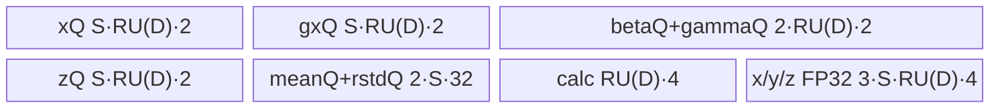

# DeepNorm A2/A3 ACLNN 算子知识

## 算子速览

| 项目 | 内容 |
|---|---|
| 实际入口 | `aclnnDeepNormGetWorkspaceSize` + `aclnnDeepNorm`，公开 ACLNN 两段式接口；固定仓只公开这一版本族。 |
| 计算语义 | 对每个归一化行先算 `x' = alpha*x + gx`，再算 `mean=Σx'/D`、`rstd=1/sqrt(Σ(x'-mean)^2/D+epsilon)`、`y=(x'-mean)*rstd*gamma+beta`。 |
| 输入输出 | `x/gx/y` 同 shape、同 dtype；`beta/gamma` 等于 `x` 的后缀 shape；`mean/rstd` 为 FP32，保留 `x` rank 且归一化后缀维为 1；ND。输入与 `y` 支持 FP16/BF16/FP32。 |
| 执行类型 | 单节点 `AIV_VECTOR`：`deep_norm`；只使用 AscendC Vector、MTE 与标量协同，不含 Cube/AIC/MIX_CV。 |
| Kernel 路线 | R-001～R-012：四个 D 区间 × FP16/BF16/FP32。 |
| 核心资源 | GM；depth=1 的 `x/gx/beta/gamma/z/mean/rstd` TQue；最多六个 FP32 TBuf；无跨 Kernel workspace，框架仍申请 1 byte workspace。 |
| 来源闭包 | `source_closed`：公开 ACLNN 原型与约束→自动生成 ACLNN/OpDef 框架边界→`Tiling4DeepNorm`/`DeepNormTilingData`→`deep_norm` router→`KernelDeepNorm<T>` 全部 body/helper→A2/A3 binary config。 |
| 验证状态 | 已完成源码闭包检查；本次知识提取未执行编译、真机、数值或性能测试。 |

## 接口与语义

### 计算语义

把 `x` 的前 `rank(x)-rank(gamma)` 维折叠为行数 `N`，把与 `gamma` 对齐的后缀维折叠为列数 `D`。对每行 `r`：

```text
x'[r,c] = alpha * x[r,c] + gx[r,c]
mean[r] = (1/D) * sum_c x'[r,c]
rstd[r] = 1 / sqrt((1/D) * sum_c (x'[r,c] - mean[r])^2 + epsilon)
y[r,c] = (x'[r,c] - mean[r]) * rstd[r] * gamma[c] + beta[c]
```

`mean/rstd` 的逻辑 shape 为 `x` 的非归一化前缀不变、后缀置 1；Device 实际按折叠后的每行一个 FP32 标量连续写出。BF16/FP16 路线先转 FP32 完成组合、归约和仿射，最后 BF16 用 `CAST_RINT`、FP16 用 `CAST_NONE` 回写。

### 输入、输出与属性

| 参数 | shape/layout | dtype | 约束、默认值与语义 |
|---|---|---|---|
| `x` | 2～8 维 ND | FP16/BF16/FP32 | 必选；支持非连续 ACL tensor，OpDef `AutoContiguous`；Tiling 拒绝任一 0 维长度。 |
| `gx` | 与 `x` 完全相同，ND | 与 `x` 相同 | 必选；参与 `alpha*x+gx`。 |
| `beta` | 1～7 维，等于 `x` 的后缀 shape，ND | 与 `x` 相同 | 必选；逐列广播。 |
| `gamma` | 与 `beta` 相同，ND | 与 `x` 相同 | 必选；其元素数定义 `D`。 |
| `alpha` | 标量 | API 为 double，内核属性为 float | 必选 API 参数；OpDef 默认 0.3f；Host 按 FP32 位模式写 POD。 |
| `epsilon` | 标量 | API 为 double，内核属性为 float | 必选 API 参数；OpDef 默认 `1e-6`；参与 `sqrt` 前加法。 |
| `meanOut` | rank 与 `x` 相同，前缀同 `x`、后缀为 1，ND | FP32 | 每归一化行一个均值。 |
| `rstdOut` | 同 `meanOut`，ND | FP32 | 每归一化行一个标准差倒数。 |
| `yOut` | 与 `x` 相同，ND | 与 `x` 相同 | 归一化结果。 |

### 入口与版本

公开文档给出唯一两段式版本：第一段 `aclnnDeepNormGetWorkspaceSize(...)` 校验参数并返回 workspace 与 executor，第二段 `aclnnDeepNorm(workspace, workspaceSize, executor, stream)` 在指定 stream 执行。固定仓未保存自动生成的 ACLNN inner bridge 源文件；该层作为框架边界，`deep_norm_def.cpp` 的 `DeepNorm` OpDef 明确输入自动连续化、dtype/layout、属性与 A2/A3 平台接线，之后的 Host/Tiling/Kernel 均已闭合。未发现更高版本入口或旧 body 复用关系。

## Host/Launcher 执行流程

### 参数校验与前处理

1. ACLNN 第一段按公开文档拒绝空指针、非法 dtype、shape/rank 不匹配；非连续 `x/gx/beta/gamma` 由 OpDef `AutoContiguous` 框架边界转连续。
2. `InferShape4DeepNorm` 要求 `rank(x)>=rank(gamma)`，生成 `mean/rstd=[x_prefix,1...]`、`y=x.shape`；`InferDataType4DeepNorm` 固定 `mean/rstd=FP32`、`y=x.dtype`。
3. `Tiling4DeepNorm` 再检查 `rank(x)∈[2,8]`、`rank(gamma)∈[1,7]`、`rank(gx/y/mean/rstd)=rank(x)`、`rank(beta)=rank(gamma)`、`rank(x)>rank(gamma)`，并检查 `gx/y` 全 shape 与 `x` 相同、`beta/gamma` 等于 `x` 后缀、`mean/rstd` 前缀等于 `x`；失败返回 `GRAPH_FAILED`。
4. Host 折叠 `N=Πx[0:rank(x)-rank(gamma)]`、`D=Πgamma`，查询 AIV 核数与 UB 大小，生成 block、行批次、分段、key 和 POD。

### 参数、Workspace 与生命周期

`numCore=ceil(N/ceil(N/maxAivCore))`；普通核处理 `rowWork=ceil(N/numCore)` 行，末核处理 `N-rowWork*(numCore-1)` 行。每次处理 `S=first_dim_per_times` 行，末批为 `row_tail`。当 `D>4096` 时 `S=1`，`K=ceil(D/4096)`，`U=ceil(D/(K*16))*16`；否则 `updated_last_dim=updated_last_times=0`。

Host 查询平台 UB 并用 `totalMemNeed/sumData` 估计 `S`；短路线再把 `S` 限到 255。`eps/1/D/alpha` 先转 FP32，再逐字节复制为三个 `uint32_t` 位模式。Tiling 设置 `blockDim=numCore`。`GetWorkspaceSizes(1)[0]=1`，Kernel 的 `workspace` 参数未被读取；1 byte 由 ACLNN executor/framework 持有至 stream 上的单 Kernel 完成。

### 启动图与失败传播

```text
aclnnDeepNormGetWorkspaceSize
  -> ACLNN generated bridge / AutoContiguous（固定仓框架边界）
  -> DeepNorm OpDef + InferShape/InferDataType
  -> Tiling4DeepNorm -> DeepNormTilingData + key + blockDim + workspace=1
aclnnDeepNorm(workspace, executor, stream)
  -> [node K0] deep_norm<<<numCore, stream>>>(x,gx,beta,gamma,mean,rstd,y,workspace,tiling)
       -> key router -> KernelDeepNorm<T>::Init* -> Process*
```

K0 的输入/输出均为用户/框架 GM tensor；无节点间 workspace 边。POD 与输入必须保持到 K0 读取完成，输出在同一 stream 上 K0 完成后可见。第一段校验、infer 或 tiling 返回失败时不产生有效 executor/launch；单 Kernel 启动失败直接作为 ACLNN 状态返回，没有后继节点或清理边。

## Route 与参数设计

### 分核与资源计算

记 `d=sizeof(T)`，`B=32/d` 元素，`RU(q)=ceil(q/B)*B`。前 `numCore-1` 核的 GM 行起点为 `blockIdx*rowWork*D`，末核沿用相同步长但有效行数变为 `lFirstdimPerCore`；`mean/rstd` 起点为 `blockIdx*rowWork`。普通/短路线每批复制 `repeatTimes` 行，每行有效 `D`、UB stride `RU(D)`；分段路线每次复制一段 `size≤U`。

`bufferNum` 固定为 1，因此 Host 中 double-buffer 分支不可达。`maxUbSize` 只进入 `sumData` 行批次估计，不改变 D 分界：短阈值 500、基本阈值 4096、FP32 common 阈值 8192、FP16/BF16 common 阈值 15360。

### Route 选择

| 顺序 | Route | Key/模板 | 精确选择条件与优先级 | 不适用去向 |
|---:|---|---|---|---|
| 1 | R-001 FP16 short | 17 / `KernelDeepNorm<half>` | dtype=FP16 且 `D<=500` | 按 D 增大到 R-004/R-007/R-010 |
| 2 | R-002 BF16 short | 16 / `KernelDeepNorm<bfloat16_t>` | dtype=BF16 且 `D<=500` | R-005/R-008/R-011 |
| 3 | R-003 FP32 short | 18 / `KernelDeepNorm<float>` | dtype=FP32 且 `D<=500` | R-006/R-009/R-012 |
| 4 | R-004 FP16 resident | 1 / `KernelDeepNorm<half>` | dtype=FP16 且 `500<D<=4096` | R-007 |
| 5 | R-005 BF16 resident | 0 / `KernelDeepNorm<bfloat16_t>` | dtype=BF16 且 `500<D<=4096` | R-008 |
| 6 | R-006 FP32 resident | 2 / `KernelDeepNorm<float>` | dtype=FP32 且 `500<D<=4096` | R-009 |
| 7 | R-007 FP16 segmented-cache | 5 / `KernelDeepNorm<half>` | dtype=FP16 且 `4096<D<=15360` | R-010 |
| 8 | R-008 BF16 segmented-cache | 4 / `KernelDeepNorm<bfloat16_t>` | dtype=BF16 且 `4096<D<=15360` | R-011 |
| 9 | R-009 FP32 segmented-cache | 6 / `KernelDeepNorm<float>` | dtype=FP32 且 `4096<D<=8192` | R-012 |
| 10 | R-010 FP16 common-stream | 13 / `KernelDeepNorm<half>` | dtype=FP16 且 `D>15360` | 不支持 dtype/shape 则 Tiling 失败 |
| 11 | R-011 BF16 common-stream | 12 / `KernelDeepNorm<bfloat16_t>` | dtype=BF16 且 `D>15360` | 同上 |
| 12 | R-012 FP32 common-stream | 14 / `KernelDeepNorm<float>` | dtype=FP32 且 `D>8192` | 同上 |

```text
if D <= 500: key = 16 + (FP16?1:0) + (FP32?2:0)
else if D <= 4096: key = (FP16?1:0) + (FP32?2:0)
else if D <= (FP32?8192:15360): key = 4 + (FP16?1:0) + (FP32?2:0)
else: key = 12 + (FP16?1:0) + (FP32?2:0)
```

### 模板/实现执行矩阵

| Route | key/selector | dtype/shape/platform 完整命中条件 | 执行拓扑与 Kernel 节点 | 实际模板/body | 内存与同步特征 | tail/fallback |
|---|---|---|---|---|---|---|
| R-001 | 17 | FP16，`D<=500`，A2/A3 | K0 | `InitShort`→`ProcessFp16Short`→`ComputeFp16Short` | 多行并行 reduction，FP32 TBuf，Queue/Event | `S<=255`；末批 `row_tail` |
| R-002 | 16 | BF16，`D<=500`，A2/A3 | K0 | `InitShort`→`ProcessBf16Short`→`ComputeBf16Short` | 同 R-001，末 cast RINT | 同上 |
| R-003 | 18 | FP32，`D<=500`，A2/A3 | K0 | `InitShort`→`ProcessFp32Short` | 在 FP32 Queue tensor 上原地复用 | 同上 |
| R-004 | 1 | FP16，`500<D<=4096` | K0 | `Init`→`ProcessFp16LELimit`→`ComputeFp16` | 每批多行，`calc_x/calc_y` 保存 FP32 x' | 末批 `row_tail` |
| R-005 | 0 | BF16，`500<D<=4096` | K0 | `Init`→`ProcessBF16LELimit`→`ComputeBf16` | 同 R-004，末 cast RINT | 同上 |
| R-006 | 2 | FP32，`500<D<=4096` | K0 | `Init`→`ProcessFp32LELimit`→`ComputeFp32` | `gx/z` 原地承载 x'、centered、square | 同上 |
| R-007 | 5 | FP16，`4096<D<=15360` | K0 | `InitExtra`→`ExtraProcessFp16` | U 分段，完整 x' 留 `calc_buf_fp32`，三遍段循环 | 最后一段 `lsize` |
| R-008 | 4 | BF16，`4096<D<=15360` | K0 | `InitExtra`→`ExtraProcessBf16` | 同 R-007，RINT | 同上 |
| R-009 | 6 | FP32，`4096<D<=8192` | K0 | `InitExtra`→`ExtraProcessFp32` | 同 R-007，无 cast | 同上 |
| R-010 | 13 | FP16，`D>15360` | K0 | `InitCommon`→`CommonProcessFp16` | 只保留 U 大小 TBuf，mean/var/result 各阶段重载 | 最后一段 `lsize` |
| R-011 | 12 | BF16，`D>15360` | K0 | `InitCommon`→`CommonProcessBf16` | 同 R-010，RINT | 同上 |
| R-012 | 14 | FP32，`D>8192` | K0 | `InitCommon`→`CommonProcessFp32` | 同 R-010，无 cast | 同上 |

### 隐藏性能 Guard

| Guard | Host/Tiling 条件 | Device/资源原因 | 影响 Route | 不满足时去向 | 源码符号 |
|---|---|---|---|---|---|
| short repeat 上限 | `D<=500` 且 `S=min(S,255)` | `ReduceSumShort` 的 repeat 参数与多行 Vector reduction 受 Host 255 上限保护 | R-001～003 | 更大 D 转 resident；更多行分批 | `deep_norm_tiling.cpp::Tiling4DeepNorm` |
| 32B 行对齐 | `RU(q)=ceil(q/(32/d))*(32/d)` | Queue 容量和 UB stride 必须覆盖 MTE/Vector 的整 block；有效计算仍用 D/size | 全部 | 无 fallback，按 RU 分配 |
| resident D 上限 | `D<=4096` | `Init` 按整行分配多个 FP32 TBuf；超过阈值改 U 分段 | R-004～006 | segmented-cache |
| cache/common 上限 | FP16/BF16 `D<=15360`；FP32 `D<=8192` | Extra 路线的 `calc_buf_fp32=RU(D)*4` 保留整行 x'；更大 D 改仅 U 大小 | R-007～009 | R-010～012 |
| 单 buffer | `bufferNum=1` | Queue depth 全为 1，Host double-buffer 常量分支不可达 | 全部 | 固定，无替代 |
| 非空 D/N | shape value 检查拒绝 `x` 任一 0 维 | `first_dim_per_times`、`row_tail_` 和 `1/D` 需要正域 | 全部 | `GRAPH_FAILED` |
| 平台 BF16 entry guard | A2/A3 编译为 `__CCE_AICORE__==220/310` 路径 | BF16 keys 在 NPU arch 3003/3113 被 entry 条件排除，但 A2/A3 不命中该排除 | R-002/005/008/011 | A2/A3 正常可达 |

### POD/ABI

`DeepNormTilingData` 由 11 个声明顺序连续的 `uint32_t` 字段组成；序列化宏的具体 `sizeof/alignof/offsetof` 定义位于固定仓外部 SDK，故精确 ABI offset 不可见。Host 与 Device 分别通过 `SaveToBuffer` 与 `GET_TILING_DATA` 使用同一注册结构。

| 结构 | 字段 | 类型/位宽 | ABI 布局 | 单位 | Host/launcher producer | Device consumer | 边界 |
|---|---|---|---|---|---|---|---|
| `DeepNormTilingData` | `num_core` | uint32/32 | 宏生成，offset 不可见 | core | `numCore` | `InitBase::num_core`、末核判断 | `>=1` |
| 同上 | `num_last_dim` | uint32/32 | 同上 | element | `D` | 所有地址、reduction、tail | 正数；shape 乘积窄化到 uint32 |
| 同上 | `num_first_dim` | uint32/32 | 同上 | row | `N` | `InitBase` 保存；主循环间接由每核行数驱动 | Host 先以 int32 累乘 |
| 同上 | `nl_firstdim_per_core` | uint32/32 | 同上 | row/core | `rowWork` | 普通核 `row_work` 与 GM 核步长 | 正数 |
| 同上 | `l_firstdim_per_core` | uint32/32 | 同上 | row | `N-rowWork*(C-1)` | 末核 `row_work` | 正数 |
| 同上 | `first_dim_per_times` | uint32/32 | 同上 | row/batch | UB 估计所得 `S` | `row_step`、move count、Queue 容量 | 必须非零；short `<=255` |
| 同上 | `updated_last_dim` | uint32/32 | 同上 | element/segment | D>4096 时 `U`，否则 0 | Extra/Common segment stride | 非分段路线 inactive=0 |
| 同上 | `updated_last_times` | uint32/32 | 同上 | segment count | D>4096 时 `K`，否则 0 | 三阶段 segment 循环 | 非分段路线 inactive=0 |
| 同上 | `eps_str` | uint32/32 | 同上 | FP32 bit pattern | `memcpy_s(float eps→uint32)` | `reinterpret_cast<float*>`→`eps` | 非数值转换 |
| 同上 | `ave_str` | uint32/32 | 同上 | FP32 bit pattern | `float(1.0/D)` 的位模式 | `meanNum` | D=0 分支写 1，但 shape gate 已拒绝 |
| 同上 | `alpha_str` | uint32/32 | 同上 | FP32 bit pattern | `float alpha` 位模式 | `alphaVal` | API double 在框架属性层窄化 FP32 |

### Route 源码闭包

| Route | Key/selector | Host/Tiling producer | POD/参数 | Kernel entry/router 节点 | Kernel body/直接依赖 | 构建接线 |
|---|---|---|---|---|---|---|
| R-001～003 | 17/16/18 | `deep_norm_tiling.cpp::Tiling4DeepNorm/SetTilingKey4DeepNorm` | `DeepNormTilingData` | `deep_norm` | `InitShort`、三个 `Process*Short`、`PrecisionCompute*Short`、CopyIn/Out | A2/A3 binary JSON 的 01/02/03 dtype bins |
| R-004～006 | 1/0/2 | 同上 | 同上 | `deep_norm` | `Init`、三个 `Process*LELimit`、`ComputeFp16/Bf16/Fp32`、CopyIn/Out | 同上 |
| R-007～009 | 5/4/6 | 同上 | 同上 | `deep_norm` | `InitExtra`、`ExtraProcess*`、`ComputeMean/Var/Res*`、ExtraCopy* | 同上 |
| R-010～012 | 13/12/14 | 同上 | 同上 | `deep_norm` | `InitCommon`、`CommonProcess*`、Common helpers/CopyOut | 同上 |

## Kernel 实现

### 公共执行流程

`deep_norm` 解析同一 POD 后按 key 构造一个 `KernelDeepNorm<T>`；未知 key 没有 body，也不写输出。`InitBase` 把当前 block 绑定到连续行区，四输入 Queue 从 GM→VECIN，`z/mean/rstd` 从 VECOUT→GM。所有路线均在单 AIV Kernel 内执行 `x'`、两次 reduction、归一化和仿射；Queue 的 EnQue/DeQue 建立 MTE/Vector 阶段依赖，标量读取 reduction accumulator 前使用 `V_S`，标量写 LocalTensor 后使用 `S_V/S_MTE3`，Vector 依赖用 `PipeBarrier<PIPE_V>`。

### Route R-001：FP16 short

#### 适用条件

##### 选择证据

| 层级 | 文件 | 符号 | 源码谓词/参数 | 结果/下一跳 |
|---|---|---|---|---|
| Host | `op_host/deep_norm_tiling.cpp` | `SetTilingKey4DeepNorm` | `D<=500 && dtype==DT_FLOAT16` | key 17 |
| Router | `op_kernel/deep_norm.cpp` | `deep_norm` | `TILING_KEY_IS(17)` | `InitShort`→`ProcessFp16Short` |

#### Device 数据流

##### 函数级调用链

```text
deep_norm -> InitShort -> ProcessFp16Short
  -> CopyInBetaGamma
  -> foreach row batch: CopyInXGX -> ComputeFp16Short
       -> PrecisionComputeMeanShort -> PrecisionComputeRstdShort -> PrecisionComputeResultShort
     -> CopyOut
```

##### 源码等价伪码

```text
for batch i, rows = (last ? row_tail : S):
  pad-copy x/gx[rows,D] to stride RU(D); cast FP16->FP32
  x' = alpha*x + gx; vector-reduce rows in parallel; mean = sum/D
  centered = x'-mean; rstd = 1/sqrt(reduce(centered^2)/D+eps)
  y = centered*rstd*gamma + beta; cast FP32->FP16(CAST_NONE)
  copy rows*D y and rows mean/rstd to GM
```

#### 内存与数据搬运

##### 资源与搬运表

| 层级/缓冲区 | offset/地址公式 | extent/容量公式 | dtype/layout | producer | consumer | owner/lifetime | 对齐/复用 |
|---|---|---|---|---|---|---|---|
| x/gx Queue | `i*S*D` | 各 `S*RU(D)*2` bytes | FP16, padded row | `CopyInXGX` | `ComputeFp16Short` | depth 1，compute 后 Free | 32B row |
| beta/gamma Queue | 0 | 各 `RU(D)*2` | FP16 vector | `CopyInBetaGamma` | 全部 batch | Process 末 Free | 跨 batch 复用 |
| z Queue | `i*S*D` | `S*RU(D)*2` | FP16 | compute | `CopyOut` | depth 1 | 有效 D |
| FP32 TBuf | UB 内部 | `calc=RU(D)*4`；`x/y/z` 各 `S*RU(D)*4` | FP32 | compute | reduction/result | Kernel 生命周期 | 无别名扣减 |
| mean/rstd Queue | `i*S` | 各 `S*32` | FP32 | compute | CopyOut | depth 1 | 每行仅 1 float 有效 |

##### 分层内存布局



##### 字节账与复用顺序

```text
UB_total = 2*S*RU(D)*2 + 2*RU(D)*2 + S*RU(D)*2 + 2*S*32 + RU(D)*4 + 3*S*RU(D)*4
dynamic_ub = N/A
workspace_total = 1 byte（Kernel 未读）
```

| 复用子区 | 写入者 | 读取者/消费点 | 下一次覆盖 | 同步或释放依据 | 安全条件 |
|---|---|---|---|---|---|
| x/y/z FP32 TBuf | cast/mean/rstd/result | 后续 Vector 阶段 | 下一 batch | `PipeBarrier` + 当前 batch CopyOut | depth=1 串行批次 |

#### 同步、精度与尾块

##### 同步与数值边界表

| 阶段 | primitive/机制 | producer | consumer/等待点 | 保护对象 | 精度/尾块 |
|---|---|---|---|---|---|
| GM→UB | Queue + DataCopyPad | MTE2 | DeQue | x/gx | 右侧补 0，计算 mask 只到 D |
| reduction | `V_S/S_V` + PIPE_V | Vector Reduce | 标量 GetValue/广播 | mean/rstd | 全程 FP32；末批用 `row_tail` |
| UB→GM | Queue + DataCopyPad | Vector | MTE3 | y/mean/rstd | 只写有效 D 与有效行 |

#### 关键实现

##### 符号证据表

| 阶段 | 文件 | 符号/模板实例 | 实现事实 |
|---|---|---|---|
| Host/Tiling producer | `op_host/deep_norm_tiling.cpp` | `Tiling4DeepNorm` | `S<=255`、key 17 |
| Kernel entry/router | `op_kernel/deep_norm.cpp` | `deep_norm` key 17 | `KernelDeepNorm<half>` |
| Device body/helper | 同上 | `ComputeFp16Short/PrecisionCompute*Short` | 多行 reduction 与 FP32 pipeline |

### Route R-002：BF16 short

#### 适用条件

##### 选择证据

| 层级 | 文件 | 符号 | 源码谓词/参数 | 结果/下一跳 |
|---|---|---|---|---|
| Host | `op_host/deep_norm_tiling.cpp` | `SetTilingKey4DeepNorm` | `D<=500 && dtype==DT_BF16` | key 16 |
| Router | `op_kernel/deep_norm.cpp` | `deep_norm` | key 16 | `KernelDeepNorm<bfloat16_t>::ProcessBf16Short` |

#### Device 数据流

##### 函数级调用链

```text
deep_norm -> InitShort -> ProcessBf16Short -> CopyInXGX
  -> ComputeBf16Short -> PrecisionComputeMeanShort -> PrecisionComputeRstdShort
  -> PrecisionComputeResultShort -> CopyOut
```

##### 源码等价伪码

```text
与 R-001 相同的多行 short pipeline；输入 BF16→FP32，mean/rstd/affine 为 FP32，y 用 CAST_RINT 回 BF16。
```

#### 内存与数据搬运

##### 资源与搬运表

| 层级/缓冲区 | offset/地址公式 | extent/容量公式 | dtype/layout | producer | consumer | owner/lifetime | 对齐/复用 |
|---|---|---|---|---|---|---|---|
| Queue/TBuf | 同 R-001 | 同 R-001（d=2） | BF16/FP32 | CopyIn/Compute | Compute/CopyOut | 单批次 | 32B row、beta/gamma 跨批次 |

##### 分层内存布局


##### 字节账与复用顺序

```text
UB_total = 2*S*RU(D)*2 + 2*RU(D)*2 + S*RU(D)*2 + 2*S*32 + RU(D)*4 + 3*S*RU(D)*4
dynamic_ub=N/A; workspace_total=1 byte
```

| 复用子区 | 写入者 | 读取者/消费点 | 下一次覆盖 | 同步或释放依据 | 安全条件 |
|---|---|---|---|---|---|
| FP32 TBuf | cast/reduction | affine/cast | 下一批 | PIPE_V + Queue | 串行 batch |

#### 同步、精度与尾块

##### 同步与数值边界表

| 阶段 | primitive/机制 | producer | consumer/等待点 | 保护对象 | 精度/尾块 |
|---|---|---|---|---|---|
| 全 pipeline | Queue、PIPE_V、V_S/S_V | MTE/Vector/Scalar | 下一阶段 | UB | BF16 升 FP32，`CAST_RINT`；D mask 与 row_tail |

#### 关键实现

##### 符号证据表

| 阶段 | 文件 | 符号/模板实例 | 实现事实 |
|---|---|---|---|
| Host/Tiling producer | `op_host/deep_norm_tiling.cpp` | `SetTilingKey4DeepNorm` | key 16 |
| Kernel entry/router | `op_kernel/deep_norm.cpp` | key 16 | BF16 specialization |
| Device body/helper | 同上 | `ComputeBf16Short` | FP32 pipeline + RINT |

### Route R-003：FP32 short

#### 适用条件

##### 选择证据

| 层级 | 文件 | 符号 | 源码谓词/参数 | 结果/下一跳 |
|---|---|---|---|---|
| Host | `op_host/deep_norm_tiling.cpp` | `SetTilingKey4DeepNorm` | `D<=500 && dtype==DT_FLOAT` | key 18 |
| Router | `op_kernel/deep_norm.cpp` | `deep_norm` | key 18 | `InitShort`→`ProcessFp32Short` |

#### Device 数据流

##### 函数级调用链

```text
deep_norm -> InitShort -> ProcessFp32Short -> CopyInXGX
  -> ComputeFp32Short -> PrecisionComputeMeanShort -> PrecisionComputeRstdShort
  -> PrecisionComputeResultShort -> CopyOut
```

##### 源码等价伪码

```text
gx = alpha*x + gx; z=gx; mean=parallel_reduce(z)/D; z=gx-mean;
gx=z*z; rstd=1/sqrt(parallel_reduce(gx)/D+eps); z=z*rstd*gamma+beta; copy z。
```

#### 内存与数据搬运

##### 资源与搬运表

| 层级/缓冲区 | offset/地址公式 | extent/容量公式 | dtype/layout | producer | consumer | owner/lifetime | 对齐/复用 |
|---|---|---|---|---|---|---|---|
| x/gx/z Queue | batch row offset | 各 `S*RU(D)*4` | FP32 | CopyIn/Compute | Compute/CopyOut | 单批 | gx/z 原地复用 |
| beta/gamma Queue | 0 | 各 `RU(D)*4` | FP32 | CopyIn | affine | Process | 跨批次 |
| calc TBuf | UB | `RU(D)*4` | FP32 | reduction temp | reduction | Kernel | 复用 |
| mean/rstd Queue | row offset | 各 `S*32` | FP32 | compute | CopyOut | 单批 | 1 float/row |

##### 分层内存布局


##### 字节账与复用顺序

```text
UB_total = 2*S*RU(D)*4 + 2*RU(D)*4 + S*RU(D)*4 + 2*S*32 + RU(D)*4
dynamic_ub=N/A; workspace_total=1 byte
```

| 复用子区 | 写入者 | 读取者/消费点 | 下一次覆盖 | 同步或释放依据 | 安全条件 |
|---|---|---|---|---|---|
| gx/z Queue tensor | Axpy/center/square/affine | reduction/CopyOut | 当前阶段原地写 | PIPE_V | 每次写前前序 Vector 完成 |

#### 同步、精度与尾块

##### 同步与数值边界表

| 阶段 | primitive/机制 | producer | consumer/等待点 | 保护对象 | 精度/尾块 |
|---|---|---|---|---|---|
| reduction/affine | PIPE_V、V_S/S_V | Vector | scalar/Vector | gx/z | 全 FP32，无 cast；D tail mask、row_tail |

#### 关键实现

##### 符号证据表

| 阶段 | 文件 | 符号/模板实例 | 实现事实 |
|---|---|---|---|
| Host/Tiling producer | `op_host/deep_norm_tiling.cpp` | key 18 | short FP32 |
| Kernel entry/router | `op_kernel/deep_norm.cpp` | key 18 | `KernelDeepNorm<float>` |
| Device body/helper | 同上 | `ComputeFp32Short` | Queue tensor 原地 FP32 pipeline |

### Route R-004：FP16 resident

#### 适用条件

##### 选择证据

| 层级 | 文件 | 符号 | 源码谓词/参数 | 结果/下一跳 |
|---|---|---|---|---|
| Host | `op_host/deep_norm_tiling.cpp` | selector | `500<D<=4096 && FP16` | key 1 |
| Router | `op_kernel/deep_norm.cpp` | key 1 | `TILING_KEY_IS(1)` | `Init`→`ProcessFp16LELimit` |

#### Device 数据流

##### 函数级调用链

```text
ProcessFp16LELimit -> CopyInBetaGamma -> [CopyInXGX -> ComputeFp16 -> CopyOut] per row batch
ComputeFp16 -> Cast x/gx -> Axpy -> ReduceSumCustom(mean) -> square -> ReduceSumCustom(var) -> affine -> Cast y
```

##### 源码等价伪码

```text
cast all batch rows to calc_x/calc_y FP32; calc_x = alpha*x + gx;
for row: scalar ReduceSumCustom, center; square; for row: scalar reduce, sqrt reciprocal, affine; cast FP16; copy out。
```

#### 内存与数据搬运

##### 资源与搬运表

| 层级/缓冲区 | offset/地址公式 | extent/容量公式 | dtype/layout | producer | consumer | owner/lifetime | 对齐/复用 |
|---|---|---|---|---|---|---|---|
| Queues | batch row offset | x/gx/z 各 `S*RU(D)*2`; beta/gamma 各 `RU(D)*2`; mean/rstd 各 `S*32` | FP16/FP32 | CopyIn/Compute | Compute/CopyOut | depth 1 | 32B |
| FP32 TBuf | UB | calc+x+y+z 各 `RU(D)*4`; calc_x/calc_y 各 `S*RU(D)*4` | FP32 | cast/vector | reduction/affine | Kernel | calc reused as reduce temp |

##### 分层内存布局


##### 字节账与复用顺序

```text
UB_total = 3*S*RU(D)*2 + 2*RU(D)*2 + 2*S*32 + 4*RU(D)*4 + 2*S*RU(D)*4
dynamic_ub=N/A; workspace_total=1 byte
```

| 复用子区 | 写入者 | 读取者/消费点 | 下一次覆盖 | 同步或释放依据 | 安全条件 |
|---|---|---|---|---|---|
| calc_x/calc_y | input cast/Axpy | mean/var/affine | 下一 batch | PIPE_V + z EnQue | batch 串行 |

#### 同步、精度与尾块

##### 同步与数值边界表

| 阶段 | primitive/机制 | producer | consumer/等待点 | 保护对象 | 精度/尾块 |
|---|---|---|---|---|---|
| row reductions | `ReduceSumCustom` + V_S | Vector | scalar accumulator | each row | FP32，D 有效长度；row_tail |
| result | PIPE_V + Queue | affine | MTE3 | y | FP16 CAST_NONE |

#### 关键实现

##### 符号证据表

| 阶段 | 文件 | 符号/模板实例 | 实现事实 |
|---|---|---|---|
| Host/Tiling producer | `op_host/deep_norm_tiling.cpp` | key 1 | resident limit |
| Kernel entry/router | `op_kernel/deep_norm.cpp` | key 1 | half body |
| Device body/helper | 同上 | `ComputeFp16` | batch FP32 x' buffers、逐行 reduction |

### Route R-005：BF16 resident

#### 适用条件

##### 选择证据

| 层级 | 文件 | 符号 | 源码谓词/参数 | 结果/下一跳 |
|---|---|---|---|---|
| Host | `op_host/deep_norm_tiling.cpp` | selector | `500<D<=4096 && BF16` | key 0 |
| Router | `op_kernel/deep_norm.cpp` | key 0 | A2/A3 guard 可达 | `Init`→`ProcessBF16LELimit` |

#### Device 数据流

##### 函数级调用链

```text
ProcessBF16LELimit -> CopyIn* -> ComputeBf16 -> ReduceSumCustom(mean/var) -> affine -> CopyOut
```

##### 源码等价伪码

```text
BF16 batch cast FP32；FP32 x'=alpha*x+gx、mean、variance、rstd、gamma/beta 仿射；CAST_RINT 回 BF16。
```

#### 内存与数据搬运

##### 资源与搬运表

| 层级/缓冲区 | offset/地址公式 | extent/容量公式 | dtype/layout | producer | consumer | owner/lifetime | 对齐/复用 |
|---|---|---|---|---|---|---|---|
| Queue/TBuf | 同 R-004 | 同 R-004（d=2） | BF16/FP32 | CopyIn/Compute | Compute/CopyOut | 单批/Kernel | 32B |

##### 分层内存布局


##### 字节账与复用顺序

```text
UB_total = 3*S*RU(D)*2 + 2*RU(D)*2 + 2*S*32 + 4*RU(D)*4 + 2*S*RU(D)*4
dynamic_ub=N/A; workspace_total=1 byte
```

| 复用子区 | 写入者 | 读取者/消费点 | 下一次覆盖 | 同步或释放依据 | 安全条件 |
|---|---|---|---|---|---|
| calc_x/calc_y | cast/Axpy | reduction/affine | 下一批 | PIPE_V/Queue | 串行批次 |

#### 同步、精度与尾块

##### 同步与数值边界表

| 阶段 | primitive/机制 | producer | consumer/等待点 | 保护对象 | 精度/尾块 |
|---|---|---|---|---|---|
| full compute | Queue、PIPE_V、V_S/S_V | MTE/Vector | 下一阶段 | UB | FP32 accumulation，BF16 `CAST_RINT`; D/row tail |

#### 关键实现

##### 符号证据表

| 阶段 | 文件 | 符号/模板实例 | 实现事实 |
|---|---|---|---|
| Host/Tiling producer | `op_host/deep_norm_tiling.cpp` | key 0 | BF16 resident |
| Kernel entry/router | `op_kernel/deep_norm.cpp` | key 0 | BF16 body |
| Device body/helper | 同上 | `ComputeBf16` | FP32 + RINT |

### Route R-006：FP32 resident

#### 适用条件

##### 选择证据

| 层级 | 文件 | 符号 | 源码谓词/参数 | 结果/下一跳 |
|---|---|---|---|---|
| Host | `op_host/deep_norm_tiling.cpp` | selector | `500<D<=4096 && FP32` | key 2 |
| Router | `op_kernel/deep_norm.cpp` | key 2 | true | `Init`→`ProcessFp32LELimit` |

#### Device 数据流

##### 函数级调用链

```text
ProcessFp32LELimit -> CopyIn* -> ComputeFp32 -> ReduceSumCustom(mean/var) -> affine -> CopyOut
```

##### 源码等价伪码

```text
gx=alpha*x+gx; z=gx; per-row mean; z=gx-mean; gx=z*z; per-row rstd; z=z*rstd*gamma+beta。
```

#### 内存与数据搬运

##### 资源与搬运表

| 层级/缓冲区 | offset/地址公式 | extent/容量公式 | dtype/layout | producer | consumer | owner/lifetime | 对齐/复用 |
|---|---|---|---|---|---|---|---|
| Queues | batch row | x/gx/z 各 `S*RU(D)*4`; beta/gamma 各 `RU(D)*4`; mean/rstd 各 `S*32` | FP32 | CopyIn/Compute | Compute/CopyOut | depth1 | gx/z inplace |
| TBuf | UB | calc+x+y+z 各 `RU(D)*4` | FP32 | reduction/helpers | compute | Kernel | 固定四块；部分逻辑对象未使用仍分配 |

##### 分层内存布局


##### 字节账与复用顺序

```text
UB_total = 3*S*RU(D)*4 + 2*RU(D)*4 + 2*S*32 + 4*RU(D)*4
dynamic_ub=N/A; workspace_total=1 byte
```

| 复用子区 | 写入者 | 读取者/消费点 | 下一次覆盖 | 同步或释放依据 | 安全条件 |
|---|---|---|---|---|---|
| gx/z Queue tensor | Axpy/center/square/affine | reduction/CopyOut | 原地下一阶段 | PIPE_V | 阶段间 barrier |

#### 同步、精度与尾块

##### 同步与数值边界表

| 阶段 | primitive/机制 | producer | consumer/等待点 | 保护对象 | 精度/尾块 |
|---|---|---|---|---|---|
| full compute | Queue、PIPE_V、V_S/S_V | Vector | scalar/Vector/MTE | UB | 全 FP32；有效 D 与末行批 |

#### 关键实现

##### 符号证据表

| 阶段 | 文件 | 符号/模板实例 | 实现事实 |
|---|---|---|---|
| Host/Tiling producer | `op_host/deep_norm_tiling.cpp` | key 2 | FP32 resident |
| Kernel entry/router | `op_kernel/deep_norm.cpp` | key 2 | FP32 body |
| Device body/helper | 同上 | `ComputeFp32` | inplace Queue computation |

### Route R-007：FP16 segmented-cache

#### 适用条件

##### 选择证据

| 层级 | 文件 | 符号 | 源码谓词/参数 | 结果/下一跳 |
|---|---|---|---|---|
| Host | `op_host/deep_norm_tiling.cpp` | selector | `4096<D<=15360 && FP16` | key 5，`S=1`, U/K 有效 |
| Router | `op_kernel/deep_norm.cpp` | key 5 | true | `InitExtra`→`ProcessFp16GTLimit` |

#### Device 数据流

##### 函数级调用链

```text
ExtraProcessFp16(row)
  -> segments: ExtraCopyXGX -> ComputeMeanFp16Bf16 -> ReduceSumCustom
  -> cached segments: ComputeVar -> ReduceSumCustom
  -> segments: ExtraCopyBetaGamma -> ComputeResFp16Bf16 -> cast into full zQ
  -> ExtraCopyOut
```

##### 源码等价伪码

```text
for segment k: load x/gx; store FP32 x' into calc_buf[k*U]; accumulate mean
for segment k: center cached x'; square; accumulate variance
for segment k: load beta/gamma; normalize cached centered x'; affine; cast into full-row zQ
write y row and scalar mean/rstd
```

#### 内存与数据搬运

##### 资源与搬运表

| 层级/缓冲区 | offset/地址公式 | extent/容量公式 | dtype/layout | producer | consumer | owner/lifetime | 对齐/复用 |
|---|---|---|---|---|---|---|---|
| segment input/param Queues | row `iter*D+k*U` / param `k*U` | each `RU(U)*2` | FP16 | ExtraCopy* | helpers | one segment | last size=`lsize` |
| full x' cache | logical `k*U` | `RU(D)*4` | FP32 | ComputeMean | ComputeVar/Res | one row | survives all three passes |
| scratch x/y/z | 0 | each `RU(U)*4` | FP32 | helper | reduction/affine | one segment | overwritten after consume |
| z Queue | row | `RU(D)*2` | FP16 | result pass | ExtraCopyOut | one row | full row materialized |
| mean/rstd Queue | row | each 32 bytes | FP32 | scalar | ExtraCopyOut | one row | 1 float valid |

##### 分层内存布局


##### 字节账与复用顺序

```text
UB_total = 4*RU(U)*2 + 64 + 3*RU(U)*4 + RU(D)*2 + RU(D)*4
dynamic_ub=N/A; workspace_total=1 byte
```

| 复用子区 | 写入者 | 读取者/消费点 | 下一次覆盖 | 同步或释放依据 | 安全条件 |
|---|---|---|---|---|---|
| calc[k*U] | ComputeMean | ComputeVar、ComputeRes | next row | PIPE_V；整行 CopyOut 完成 | Extra 路线 `calc=RU(D)` 足量 |
| x/y/z scratch | per-segment helper | Reduce/affine/cast | next segment | PIPE_V + Queue Free | 串行段 |

#### 同步、精度与尾块

##### 同步与数值边界表

| 阶段 | primitive/机制 | producer | consumer/等待点 | 保护对象 | 精度/尾块 |
|---|---|---|---|---|---|
| segment passes | Queue/PIPE_V/V_S | MTE/Vector | scalar/next pass | cache/scratch | FP16→FP32；last `lsize=D-(K-1)U` |
| output | S_MTE3 + Queue | scalar/vector | CopyOut | mean/rstd/z | FP16 CAST_NONE |

#### 关键实现

##### 符号证据表

| 阶段 | 文件 | 符号/模板实例 | 实现事实 |
|---|---|---|---|
| Host/Tiling producer | `op_host/deep_norm_tiling.cpp` | D split formula/key5 | U/K/S |
| Kernel entry/router | `op_kernel/deep_norm.cpp` | key 5 | `InitExtra` |
| Device body/helper | 同上 | `ExtraProcessFp16/ComputeMeanFp16Bf16/ComputeVar/ComputeResFp16Bf16` | cached three-pass |

### Route R-008：BF16 segmented-cache

#### 适用条件

##### 选择证据

| 层级 | 文件 | 符号 | 源码谓词/参数 | 结果/下一跳 |
|---|---|---|---|---|
| Host | `op_host/deep_norm_tiling.cpp` | selector | `4096<D<=15360 && BF16` | key 4 |
| Router | `op_kernel/deep_norm.cpp` | key 4 | A2/A3 guard 可达 | `InitExtra`→`ProcessBf16GTLimit` |

#### Device 数据流

##### 函数级调用链

```text
ExtraProcessBf16 -> ComputeMeanFp16Bf16 -> ComputeVar -> ComputeResFp16Bf16 -> CAST_RINT -> ExtraCopyOut
```

##### 源码等价伪码

```text
与 R-007 相同的整行 FP32 x' cache 三遍分段；唯一 dtype 路径差异为 BF16 输入 cast 与结果 CAST_RINT。
```

#### 内存与数据搬运

##### 资源与搬运表

| 层级/缓冲区 | offset/地址公式 | extent/容量公式 | dtype/layout | producer | consumer | owner/lifetime | 对齐/复用 |
|---|---|---|---|---|---|---|---|
| queues/cache/scratch | 同 R-007 | `4*RU(U)*2 + RU(D)*4 + 3*RU(U)*4 + RU(D)*2 +64` | BF16/FP32 | Extra helpers | three passes | one row | segment tail |

##### 分层内存布局


##### 字节账与复用顺序

```text
UB_total = 4*RU(U)*2 + 64 + 3*RU(U)*4 + RU(D)*2 + RU(D)*4
dynamic_ub=N/A; workspace_total=1 byte
```

| 复用子区 | 写入者 | 读取者/消费点 | 下一次覆盖 | 同步或释放依据 | 安全条件 |
|---|---|---|---|---|---|
| x' cache/scratch | mean pass | var/result | next row/segment | PIPE_V/Queue | D<=15360 cache fits selector route |

#### 同步、精度与尾块

##### 同步与数值边界表

| 阶段 | primitive/机制 | producer | consumer/等待点 | 保护对象 | 精度/尾块 |
|---|---|---|---|---|---|
| all passes | Queue、PIPE_V、V_S/S_MTE3 | MTE/Vector/scalar | next stage | UB | FP32 reduction；BF16 RINT；last segment lsize |

#### 关键实现

##### 符号证据表

| 阶段 | 文件 | 符号/模板实例 | 实现事实 |
|---|---|---|---|
| Host/Tiling producer | `op_host/deep_norm_tiling.cpp` | key4 | BF16 segmented |
| Kernel entry/router | `op_kernel/deep_norm.cpp` | key4 | BF16 Extra |
| Device body/helper | 同上 | `ExtraProcessBf16` | cached x' + RINT |

### Route R-009：FP32 segmented-cache

#### 适用条件

##### 选择证据

| 层级 | 文件 | 符号 | 源码谓词/参数 | 结果/下一跳 |
|---|---|---|---|---|
| Host | `op_host/deep_norm_tiling.cpp` | selector | `4096<D<=8192 && FP32` | key 6 |
| Router | `op_kernel/deep_norm.cpp` | key6 | true | `InitExtra`→`ProcessFp32GTLimit` |

#### Device 数据流

##### 函数级调用链

```text
ExtraProcessFp32 -> ComputeMeanFp32 -> ComputeVar -> ComputeResFp32 -> Adds(mask=0) into zQ -> ExtraCopyOut
```

##### 源码等价伪码

```text
segment load FP32 x/gx; cache x'; accumulate mean; cached center/square accumulate rstd;
segment gamma/beta affine; Adds(...,0) copies FP32 scratch into full zQ; output。
```

#### 内存与数据搬运

##### 资源与搬运表

| 层级/缓冲区 | offset/地址公式 | extent/容量公式 | dtype/layout | producer | consumer | owner/lifetime | 对齐/复用 |
|---|---|---|---|---|---|---|---|
| segment Queues | row/segment | four × `RU(U)*4` | FP32 | ExtraCopy | helpers | segment | 32B |
| cache/scratch/z | UB | cache `RU(D)*4`; scratch `3*RU(U)*4`; z `RU(D)*4` | FP32 | compute | subsequent passes/CopyOut | row | full-row cache |
| mean/rstd | row | 64 bytes total | FP32 | scalar | CopyOut | row | one float each |

##### 分层内存布局


##### 字节账与复用顺序

```text
UB_total = 4*RU(U)*4 + 64 + 3*RU(U)*4 + 2*RU(D)*4
dynamic_ub=N/A; workspace_total=1 byte
```

| 复用子区 | 写入者 | 读取者/消费点 | 下一次覆盖 | 同步或释放依据 | 安全条件 |
|---|---|---|---|---|---|
| cache/scratch | mean/var/result | later pass | next row/segment | PIPE_V/Queue | D<=8192 |

#### 同步、精度与尾块

##### 同步与数值边界表

| 阶段 | primitive/机制 | producer | consumer/等待点 | 保护对象 | 精度/尾块 |
|---|---|---|---|---|---|
| three passes | Queue/PIPE_V/V_S | Vector | scalar/Vector/MTE | cache | FP32；last `lsize` |

#### 关键实现

##### 符号证据表

| 阶段 | 文件 | 符号/模板实例 | 实现事实 |
|---|---|---|---|
| Host/Tiling producer | `op_host/deep_norm_tiling.cpp` | key6 | FP32 threshold 8192 |
| Kernel entry/router | `op_kernel/deep_norm.cpp` | key6 | FP32 Extra |
| Device body/helper | 同上 | `ExtraProcessFp32` | full FP32 cache/result |

### Route R-010：FP16 common-stream

#### 适用条件

##### 选择证据

| 层级 | 文件 | 符号 | 源码谓词/参数 | 结果/下一跳 |
|---|---|---|---|---|
| Host | `op_host/deep_norm_tiling.cpp` | selector | `D>15360 && FP16` | key13，U/K 有效 |
| Router | `op_kernel/deep_norm.cpp` | key13 | true | `InitCommon`→`ProcessFp16Common` |

#### Device 数据流

##### 函数级调用链

```text
CommonProcessFp16(row)
  -> mean segments: ExtraCopyXGX -> ComputeMeanFp16Bf16 -> ReduceSumCustom
  -> var segments: reload X/GX -> ComputeVarCommonFp16 -> ReduceSumCustom
  -> CommonCopyOutParam
  -> result segments: reload X/GX + beta/gamma -> ComputeResCommonFp16 -> CommonCopyOutRes
```

##### 源码等价伪码

```text
pass1 stream segments and accumulate mean without retaining full x';
pass2 reload segments, reconstruct x', center/square, accumulate variance;
write mean/rstd; pass3 reload segments, reconstruct/normalize/affine/cast and immediately write each y segment。
```

#### 内存与数据搬运

##### 资源与搬运表

| 层级/缓冲区 | offset/地址公式 | extent/容量公式 | dtype/layout | producer | consumer | owner/lifetime | 对齐/复用 |
|---|---|---|---|---|---|---|---|
| segment Queues | row `iter*D+kU` | x/gx/beta/gamma/z each `RU(U)*2` | FP16 | CopyIn/compute | helper/CopyOut | segment | no full-row z/cache |
| FP32 TBuf | 0 | calc+x+y+z each `RU(U)*4` | FP32 | each pass | reduction/affine | segment | overwritten each segment/pass |
| mean/rstd | row | each 32 bytes | FP32 | scalar | immediate CopyOut | row | one float |

##### 分层内存布局


##### 字节账与复用顺序

```text
UB_total = 5*RU(U)*2 + 4*RU(U)*4 + 64
dynamic_ub=N/A; workspace_total=1 byte
```

| 复用子区 | 写入者 | 读取者/消费点 | 下一次覆盖 | 同步或释放依据 | 安全条件 |
|---|---|---|---|---|---|
| four U-sized TBuf | mean/var/result helper | Reduce/affine | next segment/pass | PIPE_V + Queue Free | input reloaded before reconstruction |

#### 同步、精度与尾块

##### 同步与数值边界表

| 阶段 | primitive/机制 | producer | consumer/等待点 | 保护对象 | 精度/尾块 |
|---|---|---|---|---|---|
| multi-pass | Queue/PIPE_V/V_S | MTE/Vector | scalar/next pass | U-sized UB | FP32 reduction；last lsize |
| streaming output | S_MTE3/MTE3_S | Vector/scalar | DataCopyPad | y/mean/rstd | FP16 CAST_NONE；每段立即写 |

#### 关键实现

##### 符号证据表

| 阶段 | 文件 | 符号/模板实例 | 实现事实 |
|---|---|---|---|
| Host/Tiling producer | `op_host/deep_norm_tiling.cpp` | key13/U/K | common threshold |
| Kernel entry/router | `op_kernel/deep_norm.cpp` | key13 | FP16 Common |
| Device body/helper | 同上 | `CommonProcessFp16/ComputeVarCommonFp16/ComputeResCommonFp16` | reload three-pass streaming |

### Route R-011：BF16 common-stream

#### 适用条件

##### 选择证据

| 层级 | 文件 | 符号 | 源码谓词/参数 | 结果/下一跳 |
|---|---|---|---|---|
| Host | `op_host/deep_norm_tiling.cpp` | selector | `D>15360 && BF16` | key12 |
| Router | `op_kernel/deep_norm.cpp` | key12 | A2/A3 guard 可达 | `InitCommon`→`ProcessBf16Common` |

#### Device 数据流

##### 函数级调用链

```text
CommonProcessBf16 -> mean pass -> reload var pass -> CommonCopyOutParam
  -> reload result pass -> ComputeResCommonBf16 -> CommonCopyOutRes
```

##### 源码等价伪码

```text
与 R-010 相同的三次流式重载；BF16 每段升 FP32，结果以 CAST_RINT 回 BF16 后立即写 GM。
```

#### 内存与数据搬运

##### 资源与搬运表

| 层级/缓冲区 | offset/地址公式 | extent/容量公式 | dtype/layout | producer | consumer | owner/lifetime | 对齐/复用 |
|---|---|---|---|---|---|---|---|
| queues/TBuf | segment offset | five × `RU(U)*2`; four × `RU(U)*4`; scalar queues 64 | BF16/FP32 | pass helpers | reduction/output | segment | U-sized only |

##### 分层内存布局


##### 字节账与复用顺序

```text
UB_total = 5*RU(U)*2 + 4*RU(U)*4 + 64
dynamic_ub=N/A; workspace_total=1 byte
```

| 复用子区 | 写入者 | 读取者/消费点 | 下一次覆盖 | 同步或释放依据 | 安全条件 |
|---|---|---|---|---|---|
| U-sized scratch | each pass | reduce/affine | next segment/pass | PIPE_V/Queue | reload before use |

#### 同步、精度与尾块

##### 同步与数值边界表

| 阶段 | primitive/机制 | producer | consumer/等待点 | 保护对象 | 精度/尾块 |
|---|---|---|---|---|---|
| multi-pass/output | Queue、PIPE_V、V_S、S_MTE3 | MTE/Vector/scalar | next stage | UB/GM | FP32 accumulate、BF16 RINT、lsize |

#### 关键实现

##### 符号证据表

| 阶段 | 文件 | 符号/模板实例 | 实现事实 |
|---|---|---|---|
| Host/Tiling producer | `op_host/deep_norm_tiling.cpp` | key12 | BF16 common |
| Kernel entry/router | `op_kernel/deep_norm.cpp` | key12 | BF16 Common |
| Device body/helper | 同上 | `CommonProcessBf16/ComputeResCommonBf16` | streaming + RINT |

### Route R-012：FP32 common-stream

#### 适用条件

##### 选择证据

| 层级 | 文件 | 符号 | 源码谓词/参数 | 结果/下一跳 |
|---|---|---|---|---|
| Host | `op_host/deep_norm_tiling.cpp` | selector | `D>8192 && FP32` | key14 |
| Router | `op_kernel/deep_norm.cpp` | key14 | true | `InitCommon`→`ProcessFp32Common` |

#### Device 数据流

##### 函数级调用链

```text
CommonProcessFp32 -> ComputeMeanFp32 -> reload ComputeVarCommonFp32
  -> CommonCopyOutParam -> reload ComputeResCommonFp32 -> CommonCopyOutRes
```

##### 源码等价伪码

```text
三遍 segment streaming；每遍从 GM 重建 FP32 x'=alpha*x+gx；第二遍归约方差，第三遍仿射并立即写 y segment。
```

#### 内存与数据搬运

##### 资源与搬运表

| 层级/缓冲区 | offset/地址公式 | extent/容量公式 | dtype/layout | producer | consumer | owner/lifetime | 对齐/复用 |
|---|---|---|---|---|---|---|---|
| segment queues | row/segment | five × `RU(U)*4` | FP32 | CopyIn/compute | helper/CopyOut | segment | 32B |
| FP32 TBuf | 0 | four × `RU(U)*4` | FP32 | helper | reduction/affine | segment | reused each pass |
| mean/rstd | row | 64 bytes | FP32 | scalar | CopyOut | row | one float each |

##### 分层内存布局


##### 字节账与复用顺序

```text
UB_total = 9*RU(U)*4 + 64
dynamic_ub=N/A; workspace_total=1 byte
```

| 复用子区 | 写入者 | 读取者/消费点 | 下一次覆盖 | 同步或释放依据 | 安全条件 |
|---|---|---|---|---|---|
| U-sized TBuf/Queue | each pass | reduce/affine/output | next segment/pass | PIPE_V/Queue Free | no cross-pass cached x' |

#### 同步、精度与尾块

##### 同步与数值边界表

| 阶段 | primitive/机制 | producer | consumer/等待点 | 保护对象 | 精度/尾块 |
|---|---|---|---|---|---|
| multi-pass/output | Queue、PIPE_V、V_S、S_MTE3 | MTE/Vector/scalar | next stage | UB/GM | 全 FP32；last segment lsize |

#### 关键实现

##### 符号证据表

| 阶段 | 文件 | 符号/模板实例 | 实现事实 |
|---|---|---|---|
| Host/Tiling producer | `op_host/deep_norm_tiling.cpp` | key14 | FP32 common threshold 8192 |
| Kernel entry/router | `op_kernel/deep_norm.cpp` | key14 | FP32 Common |
| Device body/helper | 同上 | `CommonProcessFp32/ComputeVarCommonFp32/ComputeResCommonFp32` | streaming FP32 |

## 算子特定优化

### Trick T-001：短 D 多行并行归约

#### 触发与源码依据

- 适用 Route：R-001～R-003。
- 触发条件：`D<=500`；Host 将 `firstDimPerTime` 截断到 255。
- Golden 来源：[`op_host/deep_norm_tiling.cpp:271-274`](../../../../../../../cann-ops-raw/ascendc/ops-nn/955f8b33985b6d72989ebff341bb9c2c564a51bc/norm/deep_norm/op_host/deep_norm_tiling.cpp#L271-L274)

**官方源码（固定 Commit 连续逐字摘录）**：

```cpp
uint32_t maxRepeat = 255;
if (numCol <= shortLimit) {
    firstDimPerTime = firstDimPerTime > maxRepeat ? maxRepeat : firstDimPerTime;
}
```

#### 机制与设计原因

short body 的 `ReduceSumShort` 把行数作为 Vector repeat，把列方向按 8 个 FP32 元素 block 累加到临时区，再用 `BlockReduceSum` 一次处理多行。相比 resident body 对每行调用标量 `ReduceSumCustom`，它扩大了短行归约的并行批次；255 cap 直接约束 repeat 生产者。有效列尾通过 `tailCount` mask，行尾通过 `row_tail`。

#### 迁移边界

- 适用：多个较短独立归一化行。
- 前提：A2/A3、ACLNN DeepNorm、D≤500、行批次≤255、32B padded stride。
- 失效：D>500 必须使用 resident/segmented/common body，不能继续套 short repeat 布局。
- 未验证：本次知识提取未执行编译、真机、数值或性能测试。

#### 错误做法

固定仓未提供可验证反例；源码只证明 Host cap 与 Device repeat 布局必须一致。

### Trick T-002：中大 D 缓存完整 FP32 x'，超大 D 改三遍流式重算

#### 触发与源码依据

- 适用 Route：R-007～R-012。
- 触发条件：D>4096；当 FP16/BF16 D≤15360 或 FP32 D≤8192 使用 Extra，否则 Common。
- Golden 来源：[`op_kernel/deep_norm.cpp:201-222`](../../../../../../../cann-ops-raw/ascendc/ops-nn/955f8b33985b6d72989ebff341bb9c2c564a51bc/norm/deep_norm/op_kernel/deep_norm.cpp#L201-L222)

**官方源码（固定 Commit 连续逐字摘录）**：

```cpp
pipe.InitBuffer(y_buf_fp32, sizeof(float) * ROUND_UP(updated_last_dim_));
pipe.InitBuffer(x_buf_fp32, sizeof(float) * ROUND_UP(updated_last_dim_));
pipe.InitBuffer(z_buf_fp32, sizeof(float) * ROUND_UP(updated_last_dim_));
pipe.InitBuffer(z_que, BUFFER_NUM, row_step * ROUND_UP(num_last_dim) * databyte);
pipe.InitBuffer(calc_buf_fp32, ROUND_UP(num_last_dim) * sizeof(float));
}

__aicore__ inline void InitCommon(
    __gm__ uint8_t* x, __gm__ uint8_t* gx, __gm__ uint8_t* beta, __gm__ uint8_t* gamma, __gm__ uint8_t* mean,
    __gm__ uint8_t* rstd, __gm__ uint8_t* z, uint32_t num_core_, uint32_t num_Last_dim_, uint32_t num_first_dim_,
    uint32_t nl_first_dim_per_core_, uint32_t l_first_dim_per_core_, uint32_t first_dim_per_times_,
    uint32_t updated_last_dim_, uint32_t updated_last_times_, uint32_t eps_, uint32_t meanNum_, uint32_t alpha_)
{
    InitBase(
        x, gx, beta, gamma, mean, rstd, z, num_core_, num_Last_dim_, num_first_dim_, nl_first_dim_per_core_,
        l_first_dim_per_core_, first_dim_per_times_, updated_last_dim_, updated_last_times_, eps_, meanNum_,
        alpha_);
    pipe.InitBuffer(x_buf_fp32, sizeof(float) * ROUND_UP(updated_last_dim_));
    pipe.InitBuffer(y_buf_fp32, sizeof(float) * ROUND_UP(updated_last_dim_));
    pipe.InitBuffer(z_buf_fp32, sizeof(float) * ROUND_UP(updated_last_dim_));
    pipe.InitBuffer(z_que, BUFFER_NUM, row_step * ROUND_UP(updated_last_dim_) * databyte);
    pipe.InitBuffer(calc_buf_fp32, ROUND_UP(updated_last_dim_) * sizeof(float));
```

#### 机制与设计原因

`InitExtra` 给 `calc_buf_fp32` 分配整行 D，首遍把各段 x' 写到 `k*U`，方差和结果阶段复用，减少 x/gx 的重复 GM 装载；`InitCommon` 只分配 U 大小，mean/variance/result 三遍都重载 x/gx 并即时输出，从而把超大 D 的 UB 上界从 O(D) 降到 O(U)。Host 的 15360/8192 分界正是两种内存策略的 selector。

#### 迁移边界

- 适用：分段归约且可在 UB 缓存全局中间量的中大向量，或必须限制 UB 的超大向量。
- 前提：U/K 公式、三遍 reduction 顺序、FP32 cache dtype 和 last `lsize` 一致。
- 失效：若 D 超过 dtype 阈值仍保留整行 cache，会破坏源码规定的资源路线；应改 Common 重载。
- 未验证：本次知识提取未执行编译、真机、数值或性能测试。

#### 错误做法

固定仓的真实 fallback 是 Common route：不能在超大 D 上继续使用 `InitExtra` 的 `RU(D)*4` cache。

### Trick T-003：FP32 路线复用 Queue tensor 避免升降精度缓冲

#### 触发与源码依据

- 适用 Route：R-003、R-006，并在 R-009/R-012 使用无 cast helper。
- 触发条件：输入 dtype=FP32。
- Golden 来源：[`op_kernel/deep_norm.cpp:638-660`](../../../../../../../cann-ops-raw/ascendc/ops-nn/955f8b33985b6d72989ebff341bb9c2c564a51bc/norm/deep_norm/op_kernel/deep_norm.cpp#L638-L660)

**官方源码（固定 Commit 连续逐字摘录）**：

```cpp
Axpy(gx_local, x_local, alphaVal, stepSize);
PipeBarrier<PIPE_V>();
Muls(z_local, gx_local, 1.0f, stepSize);
```

#### 机制与设计原因

FP32 resident body 直接在 `gx_local` 写 `alpha*x+gx`，复制到输出 Queue tensor `z_local` 后再把 `z_local` 改为 centered 值、把 `gx_local` 改为平方值；不需要 FP16/BF16 路线的 `calc_x_fp32/calc_y_fp32`。这减少条件分配和 cast，但复用次序依赖每个 `PIPE_V` barrier。

#### 迁移边界

- 适用：输入、计算、输出均 FP32 且 Queue tensor 生命周期覆盖完整 pipeline。
- 前提：不得在 reduction 消费前覆盖 `z/gx`；Queue depth=1、阶段串行。
- 失效：FP16/BF16 必须先升 FP32，不能照搬 FP32 原地布局。
- 未验证：本次知识提取未执行编译、真机、数值或性能测试。

#### 错误做法

固定仓未提供可验证反例；源码明确通过 dtype specialization 避免跨 dtype 复用该路径。

## 模板与实现对比

| 对比维度 | R-001～003 short | R-004～006 resident | R-007～009 segmented-cache | R-010～012 common-stream | 设计选择依据 |
|---|---|---|---|---|---|
| 命中条件/优先级 | D≤500 | 500<D≤4096 | 4096<D≤15360（16-bit）/8192（FP32） | 更大 D | 固定 Host 阈值 |
| 模板与 dtype | 三个 `Process*Short` | 三个 `Process*LELimit` | 三个 `ExtraProcess*` | 三个 `CommonProcess*` | BF16/FP16/FP32 精度与内存不同 |
| 循环与分核 | 多行 batch，repeat reduction | 多行 batch，逐行 reduction | S=1，三遍 segment，缓存整行 x' | S=1，三遍 segment，每遍重载 | 行长增大逐步降低驻留量 |
| Queue/TBuf/寄存器/dynamic UB/通信 window | 16-bit 有 3 个 batch FP32 TBuf | 16-bit 有 2 个 batch FP32 TBuf | D cache + U scratch + full z | 仅 U scratch/z | 无 dynamic UB/通信 window；标量 mean/rstd 在成员值/accumulator 生命周期内 |
| 内存总占用与复用 | O(SD) | O(SD) | O(D)+O(U) | O(U) | UB selector |
| 搬运/Vector/SIMT/NDDMA/通信 API | DataCopyPad + BlockReduceSum | DataCopyPad + ReduceSum | segment DataCopyPad + ReduceSum | 三遍 segment DataCopyPad + ReduceSum | 全部 AIV Vector，无 SIMT/NDDMA/通信 |
| 同步、精度与 tail | repeat mask，row_tail | row reduction，row_tail | last lsize，FP32 cache | last lsize，重载 ordering | BF16 RINT、FP16 NONE、FP32 no cast |
| fallback/失败边界 | D 增大进入 resident | D>4096 进入 segmented | 超 dtype 阈值进入 common | 无更大 D fallback | 非法 shape/dtype Tiling/API 失败 |

## 平台差异

| 项目 | A2 | A3 | 950 |
|---|---|---|---|
| 支持状态 | 公开支持；`ascend910b` config 有 FP16/BF16/FP32 bins | 公开支持；`ascend910_93` config 有同三 bins | 公开 README/API 明确不支持；虽然存在 OpDef/config 实现信号，构成发布冲突，因此不发布 `_950` 卡 |
| Host/Launcher | 共用 `Tiling4DeepNorm` 与 12 keys | 同 A2 | 不进入正式知识 |
| Kernel/资源 | 共用 `deep_norm` AIV_VECTOR body；A2/A3 的 DataCopyPad 分支 | 同 A2 | 不进入正式知识 |

## 限制与失败边界

- `x` rank 2～8，`gamma/beta` rank 1～7，且 `rank(x)>rank(gamma)`；`x` 任一维为 0 时 Tiling 实际返回失败，尽管公开 ACLNN 参数表写“支持空 Tensor”，这是固定仓可见冲突，复用时以实际 Tiling 失败边界为准。
- Host 用 `int32_t numRow` 累乘前缀维，用 `uint32_t` 承载 D/N/POD；固定源码没有乘法溢出检查，超范围行为不得推测。
- Tiling value 检查没有逐项验证 `mean/rstd` 的后缀维必须为 1；正常 ACLNN executor 依赖 infer/第一段接口生成或校验正确输出 shape。
- `firstDimPerTime` 必须非零，源码没有在写 POD 前显式兜底；其有效性依赖平台 UB 估计 `sumData` 与受支持 shape。
- workspace 固定报告 1 byte 且 Device 未使用；不能将它改作跨节点存储。
- 未知 key 在 router 中静默不执行任何 body；合法 Host 只生成列出的 12 个 key。
- 固定仓未包含生成式 ACLNN inner bridge 和 SDK 宏实现；它们只作为框架边界，算子自有 OpDef/Tiling/POD/router/body/构建接线均已闭合。
- 本次知识提取未执行编译、真机、数值或性能测试。

## 源码索引

### 链路索引

| 链路阶段 | 文件 | 关键符号 | 支撑内容 |
|---|---|---|---|
| 入口声明/平台 | `norm/deep_norm/README.md` | 产品支持表、`aclnnDeepNorm` 调用说明 | A2/A3 支持、950 不支持 |
| 入口声明/约束 | `norm/deep_norm/docs/aclnnDeepNorm.md` | `aclnnDeepNormGetWorkspaceSize/aclnnDeepNorm` | 公开 API、平台、dtype/shape、状态语义 |
| 入口实现 | `norm/deep_norm/op_host/deep_norm_def.cpp` | `ops::DeepNorm`、`OP_ADD` | AutoContiguous、dtype、属性、平台注册 |
| infer | `norm/deep_norm/op_host/deep_norm_infershape.cpp` | `InferShape4DeepNorm/InferDataType4DeepNorm` | 输出 shape/dtype |
| POD | `norm/deep_norm/op_host/deep_norm_tiling.h` | `DeepNormTilingData` | 11 字段声明与注册 |
| Host/Tiling/Launcher | `norm/deep_norm/op_host/deep_norm_tiling.cpp` | `Tiling4DeepNorm/SetTilingKey4DeepNorm` | 校验、分核、UB 估计、12 keys、workspace |
| Kernel entry/body | `norm/deep_norm/op_kernel/deep_norm.cpp` | `deep_norm/KernelDeepNorm<T>` | router、四类实现、内存、同步、精度、tail |
| 构建接线 | `norm/deep_norm/op_host/config/ascend910b/deep_norm_binary.json` | `DeepNorm_01/02/03` | A2 FP16/BF16/FP32 bins |
| 构建接线 | `norm/deep_norm/op_host/config/ascend910_93/deep_norm_binary.json` | `DeepNorm_01/02/03` | A3 FP16/BF16/FP32 bins |
| 平台冲突审计 | `norm/deep_norm/op_host/config/ascend950/deep_norm_binary.json` | `DeepNorm_01/02/03` | 950 实现信号；不能覆盖公开文档的不支持结论 |

### 实现复用检查

| 检查项 | 可复用事实 | 不得改变的约束 | 源码符号 |
|---|---|---|---|
| ABI/POD | 11 个 uint32 字段、三个 FP32 位模式 | 字段顺序、位宽、D/N/U/K 单位、inactive=0 | `DeepNormTilingData`、`InitBase` |
| 调用顺序 | 单 Kernel；mean→variance→result | Extra cache 与 Common reload 的三遍顺序 | `ExtraProcess*`、`CommonProcess*` |
| workspace/内存 | workspace=1 未读；UB 按 short/resident/Extra/Common 分配 | depth=1、RU、D/U 容量与 cache lifetime | `Tiling4DeepNorm`、`Init*` |
| 同步 | Queue + PIPE_V + V_S/S_V/S_MTE3/MTE3_S | 标量读写和原地复用前 barrier 不得省略 | `ReduceSumCustom`、Compute/CopyOut helpers |
| 精度与尾块 | FP16/BF16 升 FP32；BF16 RINT；D mask、row_tail、lsize | cast mode、`1/D`、epsilon 顺序和有效写范围 | `Compute*`、`CopyOut/CommonCopyOutRes` |
| 失败边界 | shape gate、12 legal keys、950 文档不支持 | 不发布 950，不把 empty tensor 文档声明覆盖 Tiling 实际失败 | `CheckInputOutputShape*`、README/API 平台表 |