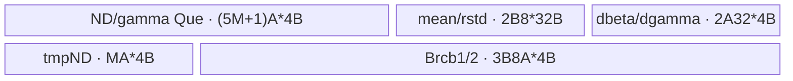

# DeepNormGrad A2/A3 ACLNN 算子知识

## 算子速览

| 项目 | 内容 |
|---|---|
| 实际入口 | `aclnnDeepNormGradGetWorkspaceSize` + `aclnnDeepNormGrad`，公开 ACLNN 两段式接口，无版本后缀 |
| 计算语义 | 将输入展平为 `[N,D]`，计算 DeepNorm 对 `x/gx/gamma/beta` 的反向梯度 `dx/dgx/dgamma/dbeta` |
| 输入输出 | `dy/x/gx/gamma/dx/dgx` 为同一 FP32/FP16/BF16、ND；`mean/rstd/dbeta/dgamma` 为 FP32、ND |
| 执行类型 | 单 Kernel `deep_norm_grad`；九条 Host 可达路线均为 `AIV_VECTOR`，无 Cube/AIC/MIX_CV 节点 |
| Kernel 路线 | R-001～R-003 Merge-N；R-004～R-006 Cut-D；R-007～R-009 Large-N-Small-D，分别对应 FP32/FP16/BF16 |
| 核心资源 | GM、depth=1 的 `TQue`、按 dtype 条件分配的 FP32 `TBuf`、Vector 归约、全核同步、FP32 AtomicAdd；Host 固定上报 36 MiB workspace |
| 来源闭包 | `source_closed`：公开 ACLNN 文档经生成式 ACLNN 框架边界、OpDef、Tiling/POD、router、三类 body/helper 与 A2/A3 binary/build 接线闭合 |
| 验证状态 | 已完成源码闭包检查；本次知识提取未执行编译、真机、数值或性能测试。 |

## 接口与语义

### 计算语义

令 `D=prod(gamma.shape)`、`N=prod(dy.shape[:-rank(gamma)])`，并按 `[N,D]` 解释 `dy/x/gx`。对每行 `n`：

```text
tmpone[n,d] = dy[n,d] * gamma[d]
tmptwo[n,d] = alpha * x[n,d] + gx[n,d] - mean[n]
dvar[n]  = -(1/D) * sum_d(tmpone[n,d] * tmptwo[n,d] * rstd[n]^3)
dmean[n] = -(1/D) * sum_d(tmpone[n,d] * rstd[n])
dgx[n,d] = tmpone[n,d] * rstd[n] + dvar[n] * tmptwo[n,d] + dmean[n]
dx[n,d]  = alpha * dgx[n,d]
dbeta[d] = sum_n(dy[n,d])
dgamma[d]= sum_n(dy[n,d] * rstd[n] * tmptwo[n,d])
```

Kernel 的 `oneDivD` 即 `-1.0f/D`。FP16/BF16 路线在 UB 中提升为 FP32 完成主体计算；FP16 输出以 `CAST_NONE`、BF16 输出以 `CAST_RINT` 降精度。

### 输入、输出与属性

| 参数 | shape/layout | dtype | 约束、默认值与语义 |
|---|---|---|---|
| `dy` | 2～8 维 ND | FP32/FP16/BF16 | 非空；与 `x/gx/dx/dgx` shape、dtype 相同 |
| `x`, `gx` | 同 `dy` | 同 `dy` | 正向 DeepNorm 的两个输入 |
| `gamma` | 1～7 维 ND；等于 `dy` 后缀 shape | 同 `dy` | 归一化缩放参数；`D=prod(gamma.shape)` |
| `mean`, `rstd` | rank 同 `dy`；前缀维同 `dy` | FP32 | 每个 N 行各消费一个标量；公开文档要求二者 shape 相同 |
| `alpha` | 标量 | ACLNN 传入 `double`，Op 属性和 POD 语义为 FP32 | 权重；OpDef 默认 `0.3f`，ACLNN 参数为必传值 |
| `dxOut`, `dgxOut` | 同 `dy` | 同 `dy` | 逐元素梯度 |
| `dbetaOut`, `dgammaOut` | 同 `gamma` | FP32 | 沿 N 归约结果 |

### 入口与版本

公开文档只声明无版本后缀的 `aclnnDeepNormGrad`。第一段创建 executor 并返回 workspace 大小，第二段在调用者 stream 上执行。`op_host/CMakeLists.txt` 以 `OPTYPE deep_norm_grad ACLNNTYPE aclnn` 接入生成式 ACLNN 框架；固定仓未展开生成后的 inner bridge、连续化和 executor 壳，按框架边界处理，算子自有 Host/Tiling/Kernel 均可见。

README 与 API 文档明确支持 Atlas A2、A3；OpDef 注册 `ascend910b` 与 `ascend910_93`，两个 binary config 都包含 FP32/FP16/BF16，未发现同平台更高 API 版本。公开文档同时明确 Ascend 950PR/950DT 不支持，故不生成 950 卡。

## Host/Launcher 执行流程

### 参数校验与前处理

OpDef 为六个输入启用 `AutoContiguous`。公开 ACLNN 第一段检查空指针、dtype 与 shape；Tiling 进一步要求：`dy` rank 为 2～8，`gamma` rank 为 1～7，`rank(dy)>rank(gamma)`；`dy` 各维非零；`x/gx/dx/dgx` 与 `dy` 全 shape 相等；`mean/rstd` rank 同 `dy` 且前 `rank(dy)-rank(gamma)` 维等于 `dy`；`gamma/dbeta/dgamma` 等于 `dy` 后缀 shape。任一检查失败返回 `GRAPH_FAILED`，不保存 POD、不启动 Kernel。

### 参数、Workspace 与生命周期

`SetBaseConfig` 计算 `N`、`D`、AIV 核数与 former/tail 核覆盖；`Tiling4DeepNormGradCompileInfo` 读取 UB 容量，预留 32 B workspace、128 B sync、512 B other 后按 32 B 对齐计算可用量。Host 固定上报 `16 MiB` 系统 workspace + `20 MiB` 用户 workspace。Kernel 通过 `GetUserWorkspace` 取得用户区；A2/A3 的 C220 分支使用硬件 `SyncAll()`，非 C220 分支才把用户区起始 `useCoreNum*32 B` 用作同步数组。executor 与 workspace 从第一段有效到第二段 stream 提交完成。

### 启动图与失败传播

```text
aclnnDeepNormGradGetWorkspaceSize
  -> generated ACLNN framework boundary / DeepNormGrad OpDef
  -> Tiling4DeepNormGradCompileInfo: validate -> SetBaseConfig -> route/key -> POD/workspace
aclnnDeepNormGrad(workspace, executor, stream)
  -> one AIV launch: deep_norm_grad<<<useCoreNum>>>(dy,x,gx,gamma,mean,rstd,dx,dgx,dbeta,dgamma,workspace,tiling)
  -> key router -> one of MergeN / CutD / LargeNSmallD<T>::Init -> Process
```

唯一 Device 节点读写公开 tensor；没有 Kernel 间 workspace 边。`dx/dgx` 由各核写独占 N 行。`dbeta/dgamma` 先由 block 0 清零并全核同步，再由各核 FP32 AtomicAdd；`fixedOutputFlag=1` 还用 `g_FixedOutputSync[0]` 串行化核提交。Tiling 或 launch 失败由 executor/stream 路径返回，单节点失败后无后续节点。

## Route 与参数设计

### 分核与资源计算

记 `Cmax=GetCoreNumAiv()`、`B=32/sizeof(T)`、`A=ceilAlign(D,B)`、`A32=ceilAlign(D,8)`：

```text
useCoreNum = ceilDiv(N, ceilDiv(N,Cmax))
nDealPerCore = ceilDiv(N,useCoreNum)
nDealLastCore = N - nDealPerCore*(useCoreNum-1)
UBavail = floor((UBmax-32-128-512)/32)*32
ubElemNum = UBavail/sizeof(T)
```

每核 `b<useCoreNum-1` 处理 `nDealPerCore` 行，尾核处理 `nDealLastCore` 行，GM 基址为 `b*nDealPerCore*D`。Host 用源码中的 buffer 计数公式求 `mergeNCount` 与 `cutStage`；`D<500` 无条件走 Large-N-Small-D，否则 `D<=cutStageMergeN` 走 Merge-N，剩余走 Cut-D。`mergeNCount` 被当前核行数截断，尾 merge 与尾 D 分别由 `mergeNCountUpdateTail`、`cutDLastTime` 表示。

### Route 选择

| 顺序 | Route | Key/模板 | 精确选择条件与优先级 | 不适用去向 |
|---:|---|---|---|---|
| 1 | R-007/R-008/R-009 Large-N-Small-D | 2/12/22；`KernelDeepNormGradLargeNSmallD<float/half/bfloat16_t>` | dtype 对应 FP32/FP16/BF16 且 `D<500` | `D>=500` 继续判断 |
| 2 | R-001/R-002/R-003 Merge-N | 0/10/20；`KernelDeepNormGradMergeN<float/half/bfloat16_t>` | dtype 对应且 `D>=500 && D<=cutStageMergeN(dtype,UB)` | `D>cutStageMergeN` 去 Cut-D |
| 3 | R-004/R-005/R-006 Cut-D | 1/11/21；`KernelDeepNormGradCutD<float/half/bfloat16_t>` | dtype 对应且 `D>=500 && D>cutStageMergeN(dtype,UB)` | 不支持 dtype 则 `GRAPH_FAILED` |

```text
dtype -> dtypeKey {FP32:0, FP16:1, BF16:2}; otherwise fail
if D < 500: cutDKey=2
else if D <= cutStageMergeN: cutDKey=0
else: cutDKey=1
tilingKey = dtypeKey*10 + cutDKey
```

### 模板/实现执行矩阵

| Route | key/selector | dtype/shape/platform 完整命中条件 | 执行拓扑与 Kernel 节点 | 实际模板/body | 内存与同步特征 | tail/fallback |
|---|---|---|---|---|---|---|
| R-001 Merge-N FP32 | 0 | FP32，`D>=500 && D<=cutStageMergeN`，A2/A3 | 单 AIV | `KernelDeepNormGradMergeN<float>::Process` | 多行同驻 UB；FP32 归约；有序 AtomicAdd | 尾 merge；否则 R-004 |
| R-002 Merge-N FP16 | 10 | FP16，同上 | 单 AIV | `KernelDeepNormGradMergeN<half>::Process` | 条件 FP32 cast buffers；FP16 `CAST_NONE` | 尾 merge；否则 R-005 |
| R-003 Merge-N BF16 | 20 | BF16，同上；C220 guard | 单 AIV | `KernelDeepNormGradMergeN<bfloat16_t>::Process` | FP32 cast buffers；BF16 `CAST_RINT` | 尾 merge；否则 R-006 |
| R-004 Cut-D FP32 | 1 | FP32，`D>=500 && D>cutStageMergeN` | 单 AIV | `KernelDeepNormGradCutD<float>::Process` | 三遍 D 分片，标量归约跨片保留 | `cutDLastTime` |
| R-005 Cut-D FP16 | 11 | FP16，同上 | 单 AIV | `KernelDeepNormGradCutD<half>::Process` | 分片提升 FP32，FP16 `CAST_NONE` | `cutDLastTime` |
| R-006 Cut-D BF16 | 21 | BF16，同上；C220 guard | 单 AIV | `KernelDeepNormGradCutD<bfloat16_t>::Process` | 分片提升 FP32，BF16 `CAST_RINT` | `cutDLastTime` |
| R-007 Small-D FP32 | 2 | FP32，`D<500` | 单 AIV | `KernelDeepNormGradLargeNSmallD<float>::Process` | Brcb 扩展多行 mean/rstd，一次批量 Vector | 尾 merge |
| R-008 Small-D FP16 | 12 | FP16，`D<500` | 单 AIV | `KernelDeepNormGradLargeNSmallD<half>::Process` | Brcb + FP32 批量计算，FP16 `CAST_NONE` | 尾 merge |
| R-009 Small-D BF16 | 22 | BF16，`D<500`；C220 guard | 单 AIV | `KernelDeepNormGradLargeNSmallD<bfloat16_t>::Process` | Brcb + FP32 批量计算，BF16 `CAST_RINT` | 尾 merge |

### 隐藏性能 Guard

| Guard | Host/Tiling 条件 | Device/资源原因 | 影响 Route | 不满足时去向 | 源码符号 |
|---|---|---|---|---|---|
| Small-D 固定门槛 | `D<500`，优先于 UB cutStage | Brcb 路线用短 D、多 N 的跨行 Vector 归约 | R-007～R-009 | Merge-N/Cut-D | `SetFp32Config`、`SetFp16Bf16Config` |
| UB 预算 | `UBavail=floor((UBmax-672)/32)*32` | 为 workspace/sync/other 保留空间并按 dtype 估算 buffer 数 | 全路线 | 通过 cutStage/merge count 改路线 | `Tiling4DeepNormGradCompileInfo` |
| DMA 对齐 | `A=ceilAlign(D,32/sizeof(T))`、`A32=ceilAlign(D,8)` | A2/A3 `DataCopyPad` 按字节 blockLen 搬有效值并右补零 | 全路线 | tail pad/有效长度写回 | `BlockAlign`、`CopyIn*` |
| BF16 编译门 | `__CCE_AICORE__==220` | router 与 BF16 cast 分支仅在 C220 编译 | R-003/R-006/R-009 | 未匹配 key 时无 body | `deep_norm_grad` |
| 有序归约提交 | `fixedOutputFlag=1`（Host 固定写入） | 多核 AtomicAdd 前按 block/cut 序号轮转，固定累加顺序 | 全路线 | 源码中不可达的 0 分支为直接 AtomicAdd | `CopyOut*InOrder` |

### POD/ABI

`DeepNormGradTilingData` 由 11 个连续声明的 `uint32_t` 字段组成；固定仓的注册宏展开不可见，因此下表只确认声明顺序、类型和 producer/consumer，不推测 `sizeof/alignof/offsetof` 数值。

| 结构 | 字段 | 类型/位宽 | ABI 布局 | 单位 | Host/launcher producer | Device consumer | 边界 |
|---|---|---|---|---|---|---|---|
| `DeepNormGradTilingData` | `useCoreNum` | uint32/32 | 第1字段；精确 offset 固定仓不可见 | core | `SetBaseConfig`: 公式见上 | 三类 `Init`，分核/同步 | `1..Cmax` |
| 同上 | `nDimNum` | uint32/32 | 第2字段；offset 不可见 | row | 前缀 shape 乘积 | 三类 `Init` 保存 | 乘积窄化未检查 |
| 同上 | `dDimNum` | uint32/32 | 第3字段；offset 不可见 | element | `gamma.GetShapeSize()` | 地址、归约、`oneDivD` | 非零由 shape 检查间接保证 |
| 同上 | `nDealPerCore` | uint32/32 | 第4字段；offset 不可见 | row/core | `ceilDiv(N,useCoreNum)` | GM base、former core | 非尾核 |
| 同上 | `nDealLastCore` | uint32/32 | 第5字段；offset 不可见 | row | `N-nDealPerCore*(useCoreNum-1)` | 尾核 `nDeal` | 仅最后核 |
| 同上 | `mergeNCount` | uint32/32 | 第6字段；offset 不可见 | row/tile | `CalMergeCountValue` 或 1 | Merge-N/Small-D merge loop | Cut-D 不消费 |
| 同上 | `cutDTime` | uint32/32 | 第7字段；offset 不可见 | tile | `ceilDiv(D,cutDPerTime)` 或 1 | Cut-D loop | 非 Cut-D 为1 |
| 同上 | `cutDPerTime` | uint32/32 | 第8字段；offset 不可见 | element/tile | `cutStageCutD` 或 D | D slice offset/capacity | 32 B 对齐元素数 |
| 同上 | `cutDLastTime` | uint32/32 | 第9字段；offset 不可见 | element | `D-cutDPerTime*(cutDTime-1)` | 尾 D 有效长度 | 最后一片 |
| 同上 | `alpha` | uint32/32 | 第10字段；offset 不可见 | FP32 bit pattern | `reinterpret_cast<uint32_t*>(&alpha)` | 三类 `Init` 反解释为 float | ACLNN double 先转 float 属性 |
| 同上 | `fixedOutputFlag` | uint32/32 | 第11字段；offset 不可见 | boolean flag | `SetBaseConfig`: 固定 1 | 选择有序 AtomicAdd | 当前 Host 恒为1 |

### Route 源码闭包

| Route | Key/selector | Host/Tiling producer | POD/参数 | Kernel entry/router 节点 | Kernel body/直接依赖 | 构建接线 |
|---|---|---|---|---|---|---|
| R-001～R-003 Merge-N | 0/10/20 | `deep_norm_grad_tiling.cpp::Set*Config` | `DeepNormGradTilingData` | `deep_norm_grad` | `KernelDeepNormGradMergeN` + `KernelDeepNormGradBase` | ascend910b/ascend910_93 configs + Host CMake |
| R-004～R-006 Cut-D | 1/11/21 | 同上 | 同上 | `deep_norm_grad` | `KernelDeepNormGradCutD` + base/helpers | 同上 |
| R-007～R-009 Small-D | 2/12/22 | 同上 | 同上 | `deep_norm_grad` | `KernelDeepNormGradLargeNSmallD` + base/helpers | 同上 |

## Kernel 实现

### 公共执行流程

九条路线共享一个 entry 和单 Kernel 图。`GENERAL_OP_IMPL` 调用所选模板的 `Init(...,tiling_data,GetUserWorkspace(workspace))` 后调用 `Process()`。三类 body 均将 GM 按 block 的 N 行分区，使用 depth=1 `TQue` 完成 MTE2→V→MTE3 生命周期；FP16/BF16 先 cast 到 FP32。block 0 初始化 `dbeta/dgamma` 后 `SyncAll()`，最终每核以 FP32 AtomicAdd 归并，并由固定 flag 串行提交。

以下九个 Route 的共同地址式为 `rowBase=blockIdx*nDealPerCore*D`；共同输出 tail helper 在 C220 用 `DataCopyPad` 写有效字节，非 C220 用回滚一个 32 B block 的 `DataCopyCustom/SafeDataCopy`。各节只展开该路线相对共同流程的真实 body、资源和精度差异。

### Route R-001：Merge-N FP32

#### 适用条件

##### 选择证据

| 层级 | 文件 | 符号 | 源码谓词/参数 | 结果/下一跳 |
|---|---|---|---|---|
| Tiling | `op_host/deep_norm_grad_tiling.cpp` | `SetFp32Config` | `D>=500 && D<=cutStageMergeN` | key 0 |
| Router | `op_kernel/deep_norm_grad.cpp` | `deep_norm_grad` | `TILING_KEY_IS(0)` | `MergeN<float>` |

#### Device 数据流

##### 函数级调用链

```text
deep_norm_grad -> KernelDeepNormGradMergeN<float>::Init -> Process
  -> CopyInPre(gamma) -> ProcessMergeN
    -> CopyInMergeN -> ComputeMergeN -> MainCompute -> CopyOutMergeN
  -> CopyOutAfterInOrder(dbeta,dgamma)
```

##### 源码等价伪码

```text
for each merge tile of M rows:
  load dy,x,gx [M,D], mean,rstd [M], gamma [D]
  for each row: tmpone=dy*gamma; tmptwo=alpha*x+gx-mean
                reduce dvar,dmean; dgx=tmpone*rstd+dvar*tmptwo+dmean; dx=alpha*dgx
                dbeta+=dy; dgamma+=dy*rstd*tmptwo
  store valid [M,D] dx,dgx
ordered atomic-add this core's FP32 [D] dbeta,dgamma
```

#### 内存与数据搬运

##### 资源与搬运表

| 层级/缓冲区 | offset/地址公式 | extent/容量公式 | dtype/layout | producer | consumer | owner/lifetime | 对齐/复用 |
|---|---|---|---|---|---|---|---|
| GM rows | `rowBase+i*M*D` | `M*D` | FP32 ND | CopyIn | MainCompute | caller；Kernel期 | D 按 A 对齐进 UB |
| 5个 ND Que | 0 | 各 `M*A*4` B | FP32 | MTE2/V | V/MTE3 | pipe；每 tile | depth=1 |
| mean/rstd Que | 0 | 各 `M*8*4` B | FP32 | MTE2 | scalar V | pipe；每 tile | 每行8元素槽 |
| gamma/dbeta/dgamma Que | 0 | 各 `A*4` B | FP32 | MTE2/V | V/MTE3 | pipe；Kernel期 | dgamma/dbeta 累加 |

##### 分层内存布局


##### 字节账与复用顺序

```text
UB_total = (5*M+3)*A*4 + 2*M*32
workspace_total = 36 MiB reported; C220 body does not address user workspace
=> M is bounded by CalMergeCountValue and UBavail
```

| 复用子区 | 写入者 | 读取者/消费点 | 下一次覆盖 | 同步或释放依据 | 安全条件 |
|---|---|---|---|---|---|
| `inputX1/inputX2` Que tensor | CopyIn | `MainCompute` 原地 `Mul/Axpy/Adds` | `FreeTensor` 后下个 tile | Queue + `PipeBarrier<PIPE_V>` | 当前 tile 已计算并输出 |

#### 同步、精度与尾块

##### 同步与数值边界表

| 阶段 | primitive/机制 | producer | consumer/等待点 | 保护对象 | 精度/尾块 |
|---|---|---|---|---|---|
| 标量读取 | MTE2_S、S_V event | CopyIn mean/rstd | `GetValue`/后续 Vector | 标量可见性 | FP32 |
| 行归约 | `ReduceSumCustom` + V_S | Vector | scalar `GetValue(0)` | dvar/dmean | 有效 D |
| 跨核归约 | ordered AtomicAdd + MTE3_S | 各核 | 下一 block turn | dbeta/dgamma | 有效 D；固定顺序 |

#### 关键实现

##### 符号证据表

| 阶段 | 文件 | 符号/模板实例 | 实现事实 |
|---|---|---|---|
| Host/Tiling producer | `op_host/deep_norm_grad_tiling.cpp` | `SetFp32Config` | key、M、UB 上界 |
| Kernel entry/router | `op_kernel/deep_norm_grad.cpp` | key 0 | 实例化 `MergeN<float>` |
| Device body/helper | `op_kernel/deep_norm_grad_merge_n.h` | `MainCompute` | FP32 逐行公式、tail、AtomicAdd |

### Route R-002：Merge-N FP16

#### 适用条件

##### 选择证据

| 层级 | 文件 | 符号 | 源码谓词/参数 | 结果/下一跳 |
|---|---|---|---|---|
| Tiling | `op_host/deep_norm_grad_tiling.cpp` | `SetFp16Bf16Config` | FP16 且 `D>=500 && D<=cutStageMergeN` | key 10 |
| Router | `op_kernel/deep_norm_grad.cpp` | `deep_norm_grad` | key 10 | `MergeN<half>` |

#### Device 数据流

##### 函数级调用链

```text
deep_norm_grad -> MergeN<half>::Init -> Process -> CopyInMergeN
  -> MainComputeWithCast(Cast in -> MainCompute<float> -> Cast out CAST_NONE) -> CopyOut -> ordered AtomicAdd
```

##### 源码等价伪码

```text
load half rows; per row cast dy/x/gx/gamma to FP32; execute R-001 FP32 formula;
cast dx/dgx to half with CAST_NONE; retain dbeta/dgamma as FP32; store valid tail and ordered atomic-add.
```

#### 内存与数据搬运

##### 资源与搬运表

| 层级/缓冲区 | offset/地址公式 | extent/容量公式 | dtype/layout | producer | consumer | owner/lifetime | 对齐/复用 |
|---|---|---|---|---|---|---|---|
| Base Que | 同 R-001 | 5个 `M*A*2` + gamma `A*2` + mean/rstd `2*M*32` + reductions `2*A32*4` | mixed | CopyIn/V | V/CopyOut | pipe | depth=1 |
| 6个 cast TBuf | 0 | 各 `A32*4` B | FP32 | Cast/compute | compute/Cast | pipe；跨行复用 | dy/x/gx/gamma/dx/dgx |

##### 分层内存布局


##### 字节账与复用顺序

```text
UB_total = (5*M+1)*A*2 + 2*M*32 + 8*A32*4
dynamic_ub = N/A; workspace_total = 36 MiB reported
```

| 复用子区 | 写入者 | 读取者/消费点 | 下一次覆盖 | 同步或释放依据 | 安全条件 |
|---|---|---|---|---|---|
| 6个 cast TBuf | 每行 Cast/MainCompute | 当前行计算/Cast out | 下一行 | `PipeBarrier<PIPE_V>` | 不跨行保留中间值 |

#### 同步、精度与尾块

##### 同步与数值边界表

| 阶段 | primitive/机制 | producer | consumer/等待点 | 保护对象 | 精度/尾块 |
|---|---|---|---|---|---|
| cast | Cast + PIPE_V | half input | FP32 formula | cast buffers | 输入 `CAST_NONE`，输出 `CAST_NONE` |
| output | DataCopyPad/Custom | output Que | GM | 尾 D | 仅写有效 D |

#### 关键实现

##### 符号证据表

| 阶段 | 文件 | 符号/模板实例 | 实现事实 |
|---|---|---|---|
| Host/Tiling producer | `op_host/deep_norm_grad_tiling.cpp` | `SetFp16Bf16Config` | key 10、UB 计数 |
| Kernel entry/router | `op_kernel/deep_norm_grad.cpp` | key 10 | `MergeN<half>` |
| Device body/helper | `op_kernel/deep_norm_grad_merge_n.h` | `MainComputeWithCast` | FP32 提升及降精度 |

### Route R-003：Merge-N BF16

#### 适用条件

##### 选择证据

| 层级 | 文件 | 符号 | 源码谓词/参数 | 结果/下一跳 |
|---|---|---|---|---|
| Tiling | `op_host/deep_norm_grad_tiling.cpp` | `SetFp16Bf16Config` | BF16 且 Merge-N 条件 | key 20 |
| Router | `op_kernel/deep_norm_grad.cpp` | `deep_norm_grad` | C220 且 key 20 | `MergeN<bfloat16_t>` |

#### Device 数据流

##### 函数级调用链

```text
deep_norm_grad -> MergeN<bfloat16_t>::Init -> Process -> MainComputeWithCast -> MainCompute<float> -> CAST_RINT
```

##### 源码等价伪码

```text
同 R-002，但输入/输出存储为 BF16，最终 dx/dgx 采用 RoundMode::CAST_RINT。
```

#### 内存与数据搬运

##### 资源与搬运表

| 层级/缓冲区 | offset/地址公式 | extent/容量公式 | dtype/layout | producer | consumer | owner/lifetime | 对齐/复用 |
|---|---|---|---|---|---|---|---|
| Queue + cast TBuf | 同 R-002 | `(5*M+1)*A*2 + 2*M*32 + 8*A32*4` B | BF16/FP32 | CopyIn/Cast | Vector/Cast out | pipe | depth=1、跨行复用 |

##### 分层内存布局


##### 字节账与复用顺序

```text
UB_total = (5*M+1)*A*2 + 2*M*32 + 8*A32*4
workspace_total = 36 MiB reported
```

| 复用子区 | 写入者 | 读取者/消费点 | 下一次覆盖 | 同步或释放依据 | 安全条件 |
|---|---|---|---|---|---|
| cast TBuf | BF16→FP32 Cast | FP32 MainCompute | 下一行 | PIPE_V | C220 BF16 specialization |

#### 同步、精度与尾块

##### 同步与数值边界表

| 阶段 | primitive/机制 | producer | consumer/等待点 | 保护对象 | 精度/尾块 |
|---|---|---|---|---|---|
| BF16 cast | Cast | FP32 output | BF16 GM | dx/dgx | `CAST_RINT`；有效 D |
| router guard | compile guard | key 20 | body | BF16 可达性 | 仅 C220 |

#### 关键实现

##### 符号证据表

| 阶段 | 文件 | 符号/模板实例 | 实现事实 |
|---|---|---|---|
| Host/Tiling producer | `op_host/deep_norm_grad_tiling.cpp` | dtypeKey 2 | key 20 |
| Kernel entry/router | `op_kernel/deep_norm_grad.cpp` | `#if __CCE_AICORE__ == 220` | BF16 guard |
| Device body/helper | `op_kernel/deep_norm_grad_merge_n.h` | `MainComputeWithCast` | `CAST_RINT` |

### Route R-004：Cut-D FP32

#### 适用条件

##### 选择证据

| 层级 | 文件 | 符号 | 源码谓词/参数 | 结果/下一跳 |
|---|---|---|---|---|
| Tiling | `op_host/deep_norm_grad_tiling.cpp` | `SetFp32Config` | `D>=500 && D>cutStageMergeN` | key 1，计算 cutDTime/per/last |
| Router | `op_kernel/deep_norm_grad.cpp` | key 1 | 精确匹配 | `CutD<float>` |

#### Device 数据流

##### 函数级调用链

```text
CutD<float>::Process
  -> for each row: ProcessFirstPart(all D slices, accumulate dvar/dmean)
                 -> ProcessSecondPart(all slices, produce dx/dgx)
  -> ProcessThirdPart(each D slice across all rows, produce dbeta/dgamma)
```

##### 源码等价伪码

```text
for row:
  pass1 across D slices: accumulate scalar dvar,dmean
  pass2 across same slices: recompute tmpone/tmptwo, apply saved scalars, store dx/dgx
for D slice:
  pass3 across all local rows: accumulate dbeta/dgamma, then ordered atomic-add at slice offset
```

#### 内存与数据搬运

##### 资源与搬运表

| 层级/缓冲区 | offset/地址公式 | extent/容量公式 | dtype/layout | producer | consumer | owner/lifetime | 对齐/复用 |
|---|---|---|---|---|---|---|---|
| 8 D Que | `row*D+slice*P` | 各 `A*4` B | FP32 | CopyIn/V | V/CopyOut | per slice | dy/x/gx/gamma/dx/dgx/dbeta/dgamma |
| mean/rstd Que + tmp scalar TBuf | row | 4×32 B | FP32 scalar slots | MTE2/V | scalar/V | per row | dvar/dmean 跨 pass 保留 |

##### 分层内存布局


##### 字节账与复用顺序

```text
UB_total = 8*A*4 + 4*32
P=cutDPerTime; cutDTime=ceilDiv(D,P); tail=cutDLastTime
```

| 复用子区 | 写入者 | 读取者/消费点 | 下一次覆盖 | 同步或释放依据 | 安全条件 |
|---|---|---|---|---|---|
| tmpVar/tmpMean TBuf | pass1 Adds | pass2 scalar read | 下一行清零 | PIPE_V + GetValue events | 完成该行全部 D 片 |
| D Que | each CopyIn/pass | current Vector pass | 下一 slice | DeQue/FreeTensor | 当前 slice 已消费 |

#### 同步、精度与尾块

##### 同步与数值边界表

| 阶段 | primitive/机制 | producer | consumer/等待点 | 保护对象 | 精度/尾块 |
|---|---|---|---|---|---|
| pass1→pass2 | PIPE_V + scalar events | reductions | second pass | dvar/dmean | FP32 |
| slice output | DataCopyPad/Custom | Queue | GM slice | dx/dgx | `cutDLastTime` |
| reductions | ordered AtomicAdd | local N sum | global output | slice of dbeta/dgamma | offset=`slice*P` |

#### 关键实现

##### 符号证据表

| 阶段 | 文件 | 符号/模板实例 | 实现事实 |
|---|---|---|---|
| Host/Tiling producer | `op_host/deep_norm_grad_tiling.cpp` | `SetFp32Config` | Cut-D tile formulas |
| Kernel entry/router | `op_kernel/deep_norm_grad.cpp` | key 1 | `CutD<float>` |
| Device body/helper | `op_kernel/deep_norm_grad_cut_d.h` | `ProcessFirstPart/SecondPart/ThirdPart` | 三遍分片算法 |

### Route R-005：Cut-D FP16

#### 适用条件

##### 选择证据

| 层级 | 文件 | 符号 | 源码谓词/参数 | 结果/下一跳 |
|---|---|---|---|---|
| Tiling | `op_host/deep_norm_grad_tiling.cpp` | `SetFp16Bf16Config` | FP16 且 Cut-D 条件 | key 11 |
| Router | `op_kernel/deep_norm_grad.cpp` | key 11 | 精确匹配 | `CutD<half>` |

#### Device 数据流

##### 函数级调用链

```text
CutD<half>::Process -> three passes as R-004
  -> each slice Cast inputs/gamma to FP32 -> compute -> Cast dx/dgx CAST_NONE
```

##### 源码等价伪码

```text
同 R-004；每次载入的 half D 分片提升 FP32，跨片 scalar 与 dbeta/dgamma 均为 FP32，dx/dgx 降为 half。
```

#### 内存与数据搬运

##### 资源与搬运表

| 层级/缓冲区 | offset/地址公式 | extent/容量公式 | dtype/layout | producer | consumer | owner/lifetime | 对齐/复用 |
|---|---|---|---|---|---|---|---|
| base Que | slice offset | 6个 `A*2` + 2个 `A32*4` + 4×32 B | mixed | CopyIn/V | V/CopyOut | per slice/row | depth=1 |
| 6 cast TBuf | 0 | 各 `A32*4` B | FP32 | Cast | compute/Cast | pipe | 每 slice 复用 |

##### 分层内存布局


##### 字节账与复用顺序

```text
UB_total = 6*A*2 + 8*A32*4 + 128
workspace_total = 36 MiB reported
```

| 复用子区 | 写入者 | 读取者/消费点 | 下一次覆盖 | 同步或释放依据 | 安全条件 |
|---|---|---|---|---|---|
| cast TBuf | current pass Cast | current pass FP32 vector | next slice/pass | PIPE_V | slice output/reduction 已提交 |

#### 同步、精度与尾块

##### 同步与数值边界表

| 阶段 | primitive/机制 | producer | consumer/等待点 | 保护对象 | 精度/尾块 |
|---|---|---|---|---|---|
| compute | Cast + PIPE_V | FP16 Que | FP32 body | intermediates | output `CAST_NONE` |
| last slice | effective count | Host POD | CopyIn/Vector/CopyOut | padding lanes | 只按 `cutDLastTime` 计算/写出 |

#### 关键实现

##### 符号证据表

| 阶段 | 文件 | 符号/模板实例 | 实现事实 |
|---|---|---|---|
| Host/Tiling producer | `op_host/deep_norm_grad_tiling.cpp` | `SetFp16Bf16Config` | key 11 |
| Kernel entry/router | `op_kernel/deep_norm_grad.cpp` | key 11 | `CutD<half>` |
| Device body/helper | `op_kernel/deep_norm_grad_cut_d.h` | `PrecisionComputeCutD*` | 分片 FP32 提升 |

### Route R-006：Cut-D BF16

#### 适用条件

##### 选择证据

| 层级 | 文件 | 符号 | 源码谓词/参数 | 结果/下一跳 |
|---|---|---|---|---|
| Tiling | `op_host/deep_norm_grad_tiling.cpp` | `SetFp16Bf16Config` | BF16 且 Cut-D 条件 | key 21 |
| Router | `op_kernel/deep_norm_grad.cpp` | C220 key 21 | 精确匹配 | `CutD<bfloat16_t>` |

#### Device 数据流

##### 函数级调用链

```text
CutD<bfloat16_t>::Process -> PrecisionComputeCutD* -> FP32 body -> CAST_RINT
```

##### 源码等价伪码

```text
同 R-005；唯一精度差异是 dx/dgx 以 CAST_RINT 降回 BF16，且 router 受 C220 编译 guard 控制。
```

#### 内存与数据搬运

##### 资源与搬运表

| 层级/缓冲区 | offset/地址公式 | extent/容量公式 | dtype/layout | producer | consumer | owner/lifetime | 对齐/复用 |
|---|---|---|---|---|---|---|---|
| Queue/TBuf | 同 R-005 | `6*A*2 + 8*A32*4 + 128` B | BF16/FP32 | CopyIn/Cast | compute/CopyOut | pipe | depth=1 |

##### 分层内存布局


##### 字节账与复用顺序

```text
UB_total = 6*A*2 + 8*A32*4 + 128
workspace_total = 36 MiB reported
```

| 复用子区 | 写入者 | 读取者/消费点 | 下一次覆盖 | 同步或释放依据 | 安全条件 |
|---|---|---|---|---|---|
| FP32 slice TBuf | Cast | three-pass body | next slice | PIPE_V | C220 BF16 body |

#### 同步、精度与尾块

##### 同步与数值边界表

| 阶段 | primitive/机制 | producer | consumer/等待点 | 保护对象 | 精度/尾块 |
|---|---|---|---|---|---|
| cast out | `CAST_RINT` | FP32 dx/dgx | BF16 Queue | outputs | only valid tail |
| global reduce | ordered AtomicAdd | FP32 local sum | GM | dbeta/dgamma | BF16 input不改变FP32输出 |

#### 关键实现

##### 符号证据表

| 阶段 | 文件 | 符号/模板实例 | 实现事实 |
|---|---|---|---|
| Host/Tiling producer | `op_host/deep_norm_grad_tiling.cpp` | dtypeKey 2 + Cut-D | key 21 |
| Kernel entry/router | `op_kernel/deep_norm_grad.cpp` | C220 key 21 | BF16 Cut-D |
| Device body/helper | `op_kernel/deep_norm_grad_cut_d.h` | `PrecisionComputeCutDSecondPart` | `CAST_RINT` |

### Route R-007：Large-N-Small-D FP32

#### 适用条件

##### 选择证据

| 层级 | 文件 | 符号 | 源码谓词/参数 | 结果/下一跳 |
|---|---|---|---|---|
| Tiling | `op_host/deep_norm_grad_tiling.cpp` | `SetFp32Config` | FP32 且 `D<500` | key 2 |
| Router | `op_kernel/deep_norm_grad.cpp` | key 2 | 精确匹配 | `LargeNSmallD<float>` |

#### Device 数据流

##### 函数级调用链

```text
LargeNSmallD<float>::Process -> CopyInPre -> ProcessMergeNFp32
  -> CopyInMergeN -> MainCompute(Brcb + Level0Mul/Add + ReduceSumFp32Short) -> CopyOut -> ordered AtomicAdd
```

##### 源码等价伪码

```text
load M short rows together; Brcb mean/rstd from aligned per-row scalar lanes across each D row;
perform alpha*x+gx, tmpone, rstd/rstd^3, row reductions and dbeta/dgamma column accumulation in batched Vector calls;
store M rows and ordered atomic-add column reductions.
```

#### 内存与数据搬运

##### 资源与搬运表

| 层级/缓冲区 | offset/地址公式 | extent/容量公式 | dtype/layout | producer | consumer | owner/lifetime | 对齐/复用 |
|---|---|---|---|---|---|---|---|
| 5 ND Que + gamma | merge offset | `5*M*A*4 + A*4` | FP32 | CopyIn/V | V/CopyOut | per merge | depth=1 |
| mean/rstd Que | merge row offset | `2*B8*32` | FP32 scalar lanes | CopyIn | Brcb/scalar | per merge | `B8=align8(M)` |
| reduction Que | 0 | `2*A32*4` | FP32 | Vector | AtomicAdd | Kernel期 | column sum |
| tmp/Brcb TBuf | 0 | `M*A*4 + 3*B8*A*4` | FP32 | Vector/Brcb | Vector | per merge | brcb2 为2倍 |

##### 分层内存布局



##### 字节账与复用顺序

```text
UB_total = (5*M+1)*A*4 + 2*B8*32 + 2*A32*4 + M*A*4 + 3*B8*A*4
workspace_total = 36 MiB reported
```

| 复用子区 | 写入者 | 读取者/消费点 | 下一次覆盖 | 同步或释放依据 | 安全条件 |
|---|---|---|---|---|---|
| Brcb buffers | Brcb mean/rstd/rstd^3/dvar/dmean | subsequent Vector ops | next stage after PIPE_V | explicit barriers | stage consumer complete |
| input Que storage | CopyIn | in-place Axpy/Mul/reduction | Queue free | barriers + FreeTensor | current merge complete |

#### 同步、精度与尾块

##### 同步与数值边界表

| 阶段 | primitive/机制 | producer | consumer/等待点 | 保护对象 | 精度/尾块 |
|---|---|---|---|---|---|
| batched row reduce | `ReduceSumFp32Short` | ND temporary | per-row scalar lanes | dvar/dmean | D tail via processElem；repeat tail via MAX_REP_NUM |
| column accumulate | `Level0AddFp32Short` | M rows | dbeta/dgamma | columns | row repeat tail and D tail |

#### 关键实现

##### 符号证据表

| 阶段 | 文件 | 符号/模板实例 | 实现事实 |
|---|---|---|---|
| Host/Tiling producer | `op_host/deep_norm_grad_tiling.cpp` | `D<SMALL_D_STAGE` | key 2 |
| Kernel entry/router | `op_kernel/deep_norm_grad.cpp` | key 2 | Small-D FP32 |
| Device body/helper | `op_kernel/deep_norm_grad_large_n_small_d.h` | `MainCompute` | Brcb 与短 D 批量归约 |

### Route R-008：Large-N-Small-D FP16

#### 适用条件

##### 选择证据

| 层级 | 文件 | 符号 | 源码谓词/参数 | 结果/下一跳 |
|---|---|---|---|---|
| Tiling | `op_host/deep_norm_grad_tiling.cpp` | `SetFp16Bf16Config` | FP16 且 `D<500` | key 12 |
| Router | `op_kernel/deep_norm_grad.cpp` | key 12 | 精确匹配 | `LargeNSmallD<half>` |

#### Device 数据流

##### 函数级调用链

```text
LargeNSmallD<half>::Process -> ProcessMergeNFp16 -> Cast M rows -> MainCompute<float> -> CAST_NONE -> CopyOut
```

##### 源码等价伪码

```text
批量载入 M 个 FP16 短行并整体提升到 FP32；使用 Brcb 与跨行 Vector helper 完成主体公式；dx/dgx CAST_NONE 回 FP16。
```

#### 内存与数据搬运

##### 资源与搬运表

| 层级/缓冲区 | offset/地址公式 | extent/容量公式 | dtype/layout | producer | consumer | owner/lifetime | 对齐/复用 |
|---|---|---|---|---|---|---|---|
| base Que/TBuf | 同 R-007 | FP16 Que + FP32 scalar/reduce/tmp/Brcb | mixed | CopyIn/Cast | Vector/CopyOut | per merge | depth=1 |
| cast TBuf | 0 | 5个 `M*A*4` + gamma `A32*4` | FP32 | Cast/compute | compute/Cast | per merge | batch reuse |

##### 分层内存布局


##### 字节账与复用顺序

```text
UB_total = (5*M+1)*A*2 + (6*M*A+3*B8*A)*4 + 2*B8*32 + 3*A32*4
```

| 复用子区 | 写入者 | 读取者/消费点 | 下一次覆盖 | 同步或释放依据 | 安全条件 |
|---|---|---|---|---|---|
| batch cast buffers | Cast/MainCompute | current merge | next merge | PIPE_V + Queue lifecycle | output cast completed |

#### 同步、精度与尾块

##### 同步与数值边界表

| 阶段 | primitive/机制 | producer | consumer/等待点 | 保护对象 | 精度/尾块 |
|---|---|---|---|---|---|
| batch cast | Cast + PIPE_V | M FP16 rows | FP32 MainCompute | all ND lanes | output `CAST_NONE` |
| repeat splitting | helpers | `M` repeats | Vector calls | repeat count | chunks of 255 + remainder |

#### 关键实现

##### 符号证据表

| 阶段 | 文件 | 符号/模板实例 | 实现事实 |
|---|---|---|---|
| Host/Tiling producer | `op_host/deep_norm_grad_tiling.cpp` | small-D FP16 branch | key 12 |
| Kernel entry/router | `op_kernel/deep_norm_grad.cpp` | key 12 | half template |
| Device body/helper | `op_kernel/deep_norm_grad_large_n_small_d.h` | `ComputeMergeNFp16` | batch cast/Brcb |

### Route R-009：Large-N-Small-D BF16

#### 适用条件

##### 选择证据

| 层级 | 文件 | 符号 | 源码谓词/参数 | 结果/下一跳 |
|---|---|---|---|---|
| Tiling | `op_host/deep_norm_grad_tiling.cpp` | `SetFp16Bf16Config` | BF16 且 `D<500` | key 22 |
| Router | `op_kernel/deep_norm_grad.cpp` | C220 key 22 | 精确匹配 | `LargeNSmallD<bfloat16_t>` |

#### Device 数据流

##### 函数级调用链

```text
LargeNSmallD<bfloat16_t>::Process -> ProcessMergeNFp16 -> FP32 MainCompute -> CAST_RINT -> CopyOut
```

##### 源码等价伪码

```text
同 R-008，但存储 dtype 为 BF16，dx/dgx 以 CAST_RINT 降精度；C220 guard 保证该模板可达。
```

#### 内存与数据搬运

##### 资源与搬运表

| 层级/缓冲区 | offset/地址公式 | extent/容量公式 | dtype/layout | producer | consumer | owner/lifetime | 对齐/复用 |
|---|---|---|---|---|---|---|---|
| BF16 Que + FP32 aux | 同 R-008 | `(5*M+1)*A*2 + (6*M*A+3*B8*A)*4 + 2*B8*32 + 3*A32*4` B | BF16/FP32 | CopyIn/Cast | Vector/Cast | per merge | depth=1 |

##### 分层内存布局


##### 字节账与复用顺序

```text
UB_total = (5*M+1)*A*2 + (6*M*A+3*B8*A)*4 + 2*B8*32 + 3*A32*4
workspace_total = 36 MiB reported
```

| 复用子区 | 写入者 | 读取者/消费点 | 下一次覆盖 | 同步或释放依据 | 安全条件 |
|---|---|---|---|---|---|
| FP32 batched intermediates | Cast/Brcb/Vector | current stage | next stage/merge | PIPE_V | consumer completes before overwrite |

#### 同步、精度与尾块

##### 同步与数值边界表

| 阶段 | primitive/机制 | producer | consumer/等待点 | 保护对象 | 精度/尾块 |
|---|---|---|---|---|---|
| cast out | `CAST_RINT` | FP32 batch result | BF16 output Que | dx/dgx | M tail × D tail |
| final reduction | ordered AtomicAdd | local FP32 columns | GM | dbeta/dgamma | fixed block order |

#### 关键实现

##### 符号证据表

| 阶段 | 文件 | 符号/模板实例 | 实现事实 |
|---|---|---|---|
| Host/Tiling producer | `op_host/deep_norm_grad_tiling.cpp` | small-D BF16 branch | key 22 |
| Kernel entry/router | `op_kernel/deep_norm_grad.cpp` | C220 key 22 | BF16 guard |
| Device body/helper | `op_kernel/deep_norm_grad_large_n_small_d.h` | `ComputeMergeNFp16` | BF16 `CAST_RINT` |

## 算子特定优化

### Trick T-001：按 D 与 UB 容量选择批行或切 D

#### 触发与源码依据

- 适用 Route：R-001～R-009
- 触发条件：先判 `D<500`，否则比较 `D` 与按真实 dtype buffer 计数得到的 `cutStageMergeN`
- Golden 来源：[`deep_norm_grad_tiling.cpp:167-178`](../../../../../../../cann-ops-raw/ascendc/ops-nn/955f8b33985b6d72989ebff341bb9c2c564a51bc/norm/deep_norm_grad/op_host/deep_norm_grad_tiling.cpp#L167-L178)

**官方源码（固定 Commit 连续逐字摘录）**：

```cpp
uint32_t mergeNCount;
if (dDimNum < SMALL_D_STAGE) {
    mergeNCount = mergeCountMergeN;
    cutDKey = KEY_LARGE_N_SMALL_D;
} else if (dDimNum <= cutStageMergeN) {
    mergeNCount = mergeCountMergeN;
    cutDKey = KEY_MERGE_N;
} else {
    mergeNCount = 1;
    cutDKey = KEY_CUT_D;
}
```

#### 机制与设计原因

短 D 路线把多行合并后用 Brcb/跨行 Vector helper 提高一次指令覆盖；中等 D 路线仍合并 N，但逐行归约；D 超过单行所需 UB 上限时切 D，以三遍算法保留两个 FP32 标量而不要求整行驻留。选择阈值由 `UBmax`、dtype 字节数和真实路线 buffer 数共同产生。

#### 迁移边界

- 适用：具有 `[N,D]` 行归约、且 D 与多行并行度存在资源权衡的 Vector 算子。
- 前提：必须按目标 body 的所有 Queue/TBuf、dtype 与 32 B 对齐重新计算 cutStage。
- 失效：D 较大时不得强行复用 Merge-N；应使用 Cut-D 或重新设计内存。
- 未验证：本次知识提取未执行编译、真机、数值或性能测试。

#### 错误做法

固定仓提供的真实失败边界是绕过 UB 公式仍选 Merge-N 会破坏 `InitBuffer` 容量前提；固定仓未提供可验证的运行时反例。

### Trick T-002：Small-D 用 Brcb 与跨行短归约减少逐行调度

#### 触发与源码依据

- 适用 Route：R-007～R-009
- 触发条件：`D<500`，一个 merge tile 含 `processNCount` 行
- Golden 来源：[`deep_norm_grad_large_n_small_d.h:409-430`](../../../../../../../cann-ops-raw/ascendc/ops-nn/955f8b33985b6d72989ebff341bb9c2c564a51bc/norm/deep_norm_grad/op_kernel/deep_norm_grad_large_n_small_d.h#L409-L430)

**官方源码（固定 Commit 连续逐字摘录）**：

```cpp
uint32_t brcbRepTimes = brcbLineAligned / BRCB_ONCE_ELEM;
uint8_t brcbBlockStride = elemWithDInUB / FLOAT_BLOCK_ELEM;
uint16_t brcbRepStride = brcbBlockStride * BRCB_ONCE_ELEM;
Axpy(inputGx, inputX, alphaVal, processElemND);
PipeBarrier<PIPE_V>();
this->Level0MulFp32Short(outputDgx, inputDy, inputGamma, elemWithDInUB, processNCount, processElem);
```

#### 机制与设计原因

`processElemND=M*A` 使 `Axpy` 一次覆盖多行；`Level0MulFp32Short` 用 `repeat=processNCount` 和按 A 推导的 repeat stride 广播 gamma。mean/rstd 先按 `align8(M)` 存放，再由 Brcb 展开到 `[M,A]`，避免为每一行单独启动同一串 Vector API。超过 255 repeat 时 helper 分块并处理 remainder。

#### 迁移边界

- 适用：D 较短、N 较大且每行共享一个标量或同一列向量的计算。
- 前提：D 对齐后的 repeat stride 可由 API 位宽承载，Brcb buffer 按 `align8(M)*A` 分配。
- 失效：D 不小于 500 或 UB 不能容纳 batched buffers 时改用 Merge-N/Cut-D。
- 未验证：本次知识提取未执行编译、真机、数值或性能测试。

#### 错误做法

固定仓未提供可验证反例。

### Trick T-003：固定顺序的多核 AtomicAdd

#### 触发与源码依据

- 适用 Route：全部路线
- 触发条件：Host 固定写 `fixedOutputFlag=1`
- Golden 来源：[`deep_norm_grad_merge_n.h:215-239`](../../../../../../../cann-ops-raw/ascendc/ops-nn/955f8b33985b6d72989ebff341bb9c2c564a51bc/norm/deep_norm_grad/op_kernel/deep_norm_grad_merge_n.h#L215-L239)

**官方源码（固定 Commit 连续逐字摘录）**：

```cpp
uint32_t alreadyFixOutputSyncVal = GetBlockIdx();
for (int32_t count = 0; count < INT_MAX; count++) {
    if (g_FixedOutputSync[0] == alreadyFixOutputSyncVal) {
        break;
    }
}
SetAtomicAdd<float>();
DataCopyAutomicAdd(output_pd_gamma_gm, dgamma, process_elem, 0, (uint16_t)1);
DataCopyAutomicAdd(output_pd_beta_gm, dbeta, process_elem, 0, (uint16_t)1);
SetAtomicNone();
```

#### 机制与设计原因

block 0 先清零输出并全核同步。各核在本地 FP32 累加 N 行，最后只对 `[D]` 做一次 AtomicAdd；token `g_FixedOutputSync[0]` 又把 block 提交顺序固定为 block index（Cut-D 为 `cutDIndex*useCoreNum+blockIdx`），减少每元素跨核争用并固定加法次序。MTE3_S event 保证本核 DMA 完成后才推进 token。

#### 迁移边界

- 适用：多个 AIV 核产生同一 FP32 向量的局部和。
- 前提：先清零 GM、全核同步；token 的初始化和递增次序必须覆盖所有参与核/分片。
- 失效：不能保证所有核到达或 token 生命周期跨 launch 污染时，必须改用 workspace 多阶段归并。
- 未验证：本次知识提取未执行编译、真机、数值或性能测试。

#### 错误做法

若在 Atomic DMA 完成前递增 token，下一核可与当前核同时更新同一 GM 范围；源码用 MTE3_S `SetFlag/WaitFlag` 明确避免该顺序错误。

## 模板与实现对比

| 对比维度 | R-001～R-003 Merge-N | R-004～R-006 Cut-D | R-007～R-009 Small-D | 设计选择依据 |
|---|---|---|---|---|
| 命中条件/优先级 | `D>=500 && D<=cutStageMergeN` | `D>=500 && D>cutStageMergeN` | `D<500`，最高优先 | D 与 UB 容量 |
| 模板与 dtype | MergeN<float/half/bf16> | CutD<float/half/bf16> | LargeNSmallD<float/half/bf16> | key 十位编码 dtype |
| 循环与分核 | core→merge tile→row | core→row→D pass；再 D→row | core→merge tile，跨行 Vector | 复用整行/分片/批行 |
| Queue/TBuf/寄存器/dynamic UB/通信 window | 多行 Queue；低精度有单行 cast TBuf | 单 D 片 Queue；两个 scalar TBuf；低精度 cast | 多行 Queue + tmp/Brcb + batch cast | 均无 dynamic UB/通信 window |
| 内存总占用与复用 | M 随 UB 缩放 | P 随 UB 缩放，跨片仅保留标量 | M 与 align8(M) 共同约束 | Host 计数保守限界 |
| 搬运/Vector/SIMT/NDDMA/通信 API | DataCopyPad、Axpy/Mul/Add/Reduce | 同类 API，输入重读三遍 | 加入 Brcb、Level0 helpers | 全部 AIV Vector |
| 同步、精度与 tail | Queue/PIPE/event；FP32 主体；尾 merge | 三遍顺序；尾 D | repeat 分块、尾 merge/D | 最终 ordered FP32 AtomicAdd |
| fallback/失败边界 | D 超限到 Cut-D | 无更低 fallback | D>=500 离开 | 不支持 dtype/shape 失败 |

## 平台差异

| 项目 | A2 | A3 | 950 |
|---|---|---|---|
| 支持状态 | 支持；README/API + `ascend910b` config | 支持；README/API + `ascend910_93` config | 公开文档明确不支持 Ascend 950PR/950DT |
| Host/Launcher | 与 A3 共用 Tiling/OpDef，三 dtype binary | 与 A2 共用 Tiling/OpDef，三 dtype binary | 不生成正式卡 |
| Kernel/资源 | C220：DataCopyPad、硬件 SyncAll、BF16 可达 | 同 A2 | 无公开全链路 |

## 限制与失败边界

- `N` 与 `D` 的 shape 乘积保存到 `uint32_t`，固定源码没有乘法溢出或窄化检查；极大 shape 不能据此推定安全。
- 文档说支持空 Tensor，但 Tiling 明确拒绝 `dy` 任一维为 0；这是固定源码中的接口文档/实现冲突，正式卡按实际 Tiling 失败边界记录，不能推定空域可执行。
- `mean/rstd` 的 Tiling 检查只逐项核对 N 前缀维，未显式核对归一化后缀维必须为 1；Kernel 实际每 N 行只读取一个 FP32 标量。
- `fixedOutputFlag` 固定为 1，`context->GetDeterministic()` 只记录日志；不能把未可达的 flag=0 路线宣称为公开可配置行为。
- BF16 router 只在 `__CCE_AICORE__==220` 编译；A2/A3 config 与 OpDef 支持 BF16，Atlas 推理系列的 310P config 只含 FP32/FP16，但该平台不在本卡范围。
- unknown key 没有显式报错 body；Host 只生成九个已知 key。固定仓未展开 ACLNN inner bridge 和 runtime launch 实现，按生成式框架边界处理。
- 本次知识提取未执行编译、真机、数值或性能测试。

## 源码索引

### 链路索引

| 链路阶段 | 文件 | 关键符号 | 支撑内容 |
|---|---|---|---|
| 入口声明/约束 | `norm/deep_norm_grad/docs/aclnnDeepNormGrad.md` | 两段式原型、产品表 | API、参数、A2/A3/950 公开支持状态 |
| 入口声明/约束 | `norm/deep_norm_grad/README.md` | 产品支持与公式 | 逻辑语义、公开调用方式 |
| 入口实现 | `norm/deep_norm_grad/op_host/deep_norm_grad_def.cpp` | `DeepNormGrad` | dtype、AutoContiguous、平台 OpDef |
| Host/Tiling | `norm/deep_norm_grad/op_host/deep_norm_grad_tiling.h` | `DeepNormGradTilingData` | POD 字段顺序与类型 |
| Host/Tiling | `norm/deep_norm_grad/op_host/deep_norm_grad_tiling.cpp` | `Tiling4DeepNormGradCompileInfo` | 校验、分核、UB、route、workspace |
| Kernel entry/body | `norm/deep_norm_grad/op_kernel/deep_norm_grad.cpp` | `deep_norm_grad` | key→模板 router |
| Kernel entry/body | `norm/deep_norm_grad/op_kernel/deep_norm_grad_common.h` | base、copy/reduce helpers | tail、安全搬运、Vector helper |
| Kernel entry/body | `norm/deep_norm_grad/op_kernel/deep_norm_grad_merge_n.h` | `KernelDeepNormGradMergeN` | Merge-N body |
| Kernel entry/body | `norm/deep_norm_grad/op_kernel/deep_norm_grad_cut_d.h` | `KernelDeepNormGradCutD` | Cut-D 三遍 body |
| Kernel entry/body | `norm/deep_norm_grad/op_kernel/deep_norm_grad_large_n_small_d.h` | `KernelDeepNormGradLargeNSmallD` | Small-D Brcb body |
| 构建接线 | `norm/deep_norm_grad/op_host/config/ascend910b/deep_norm_grad_binary.json` | `DeepNormGrad_01/02/03` | A2 FP32/FP16/BF16 binaries |
| 构建接线 | `norm/deep_norm_grad/op_host/config/ascend910_93/deep_norm_grad_binary.json` | `DeepNormGrad_01/02/03` | A3 FP32/FP16/BF16 binaries |
| 构建接线 | `norm/deep_norm_grad/op_host/CMakeLists.txt` | `add_modules_sources` | ACLNN Host 生成式接线 |

每行对应的文件均列入 Frontmatter `sources`。

### 实现复用检查

| 检查项 | 可复用事实 | 不得改变的约束 | 源码符号 |
|---|---|---|---|
| ABI/POD | 11个 uint32 字段与 key 编码 | 字段顺序、alpha 位模式、inactive 字段 | `DeepNormGradTilingData` |
| 调用顺序 | 单 entry：Init 后 Process | block 0 清零必须先于局部和提交 | `GENERAL_OP_IMPL`、`InitGmData` |
| workspace/内存 | Host 固定 36 MiB；C220 用硬件同步 | UB buffer 深度、A/A32/B8 对齐与 dtype 条件分配 | `SetWorkspace`、三类 `InitQueue` |
| 同步 | Queue、PIPE_V、MTE2_S/S_V/V_S/MTE3_S、SyncAll | ordered token 只能在 Atomic DMA 完成后递增 | `CopyOut*InOrder` |
| 精度与尾块 | FP16/BF16 升 FP32；FP16 `CAST_NONE`、BF16 `CAST_RINT` | D/merge/repeat tail 的有效元素数 | `MainComputeWithCast`、`DataCopyCustom` |
| 失败边界 | shape/dtype 检查与三个 cut key | unknown key、950 unsupported、文档空 Tensor 冲突 | `CheckInputOutputShape*`、router、README |