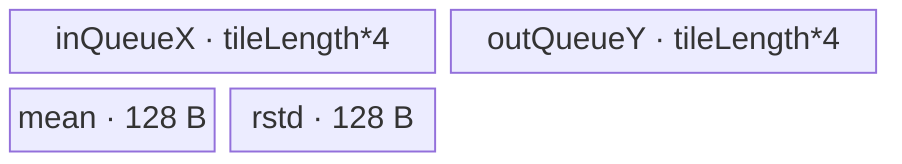
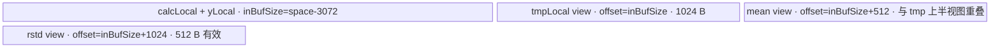

# FastLayerNorm A2/A3 ACLNN 算子知识

## 算子速览

| 项目 | 内容 |
|---|---|
| 实际入口 | `aclnnFastLayerNormGetWorkspaceSize` / `aclnnFastLayerNorm`，公开 ACLNN 两段式接口；内部唯一核心算子为 `LayerNormV4` |
| 计算语义 | 对末尾 `normalizedShape` 轴组成的每一行做 FP32 均值/方差归约，再执行 `(x-mean)*rstd*gamma+beta` |
| 输入输出 | `x/y`: FP32/FP16/BF16 ND；`gamma/beta`: 与 x 相同或 FP32；内部 `mean/rstd`: FP32，API 可再 cast 到输出 dtype |
| 执行类型 | 六条 Route 均为单 Kernel `AIV_VECTOR`；entry 对非目标 `AIC` core 直接返回，无 Cube/MIX_CV 节点 |
| Kernel 路线 | R-001 Transpose；R-002 SingleRead；R-003 MergeN Align；R-004 MergeN AlignLimit；R-005 N=1；R-006 Common fallback |
| 核心资源 | GM、AIV UB、`TQue/TBuf/LocalTensor`；核心 `LayerNormV4` tiling 固定申请 32 B user workspace，但六个 body 均不消费该区 |
| 来源闭包 | `source_closed`：公开 ACLNN → `l0op::LayerNormV4` → priority tiling/POD → `layer_norm_v4` router → 六个 AIV body/helper → A2/A3 注册与 binary config |
| 验证状态 | 已完成源码闭包检查；本次知识提取未执行编译、真机、数值或性能测试。 |

## 接口与语义

### 计算语义

令输入融合为 `M × N`：`N=prod(normalizedShape)`，`M=prod(x.shape[:-len(normalizedShape)])`。逐行计算
`mean=sum(x)/N`、`var=sum((x-mean)^2)/N`、`rstd=1/sqrt(var+eps)`、`y=(x-mean)*rstd*gamma+beta`。内部 `LayerNormV4` 总是产生 FP32 `mean/rstd`；公开接口需要非 FP32 可选输出时，在 executor 中追加 `Cast` 与 `ViewCopy`。Fast 语义只对应该入口，不包括 `aclnnLayerNorm` 或 `aclnnLayerNormWithImplMode`。

### 输入、输出与属性

| 参数 | shape/layout | dtype | 约束、默认值与语义 |
|---|---|---|---|
| `input` | `[A...,R...]`, ND, 1–8 维 | FP32/FP16/BF16 | 非空指针；支持空 Tensor |
| `normalizedShape` | `[R...]`, 1–8 个 INT64 值 | INT64 ACL array | 与 input 尾维逐维相等，乘积 `N<=583705600` |
| `weightOptional` | `[R...]`, ND | input dtype 或 FP32 | 缺失时 executor 以 `Fill` 构造全 1；存在时与 bias dtype 相同 |
| `biasOptional` | `[R...]`, ND | input dtype 或 FP32 | 缺失时 executor 以 `Fill` 构造全 0；存在时与 weight dtype 相同 |
| `eps` | scalar | C++ `double`，下传 FP32 | 加入方差后开方 |
| `out` | 与 input 相同 | 与 input 相同 | 非空指针，`ViewCopy` 提交 |
| `meanOutOptional/rstdOutOptional` | `[A...,1...]` | FP32/FP16/BF16 | 可空；内部 FP32 结果按目标 dtype cast 后提交 |

### 入口与版本

固定 Commit 只公开一个 `aclnnFastLayerNorm` 版本族。文档产品表明确支持 Atlas A2、A3，明确不支持 Ascend 950PR/950DT。API 直接调用 2025 年实现的 `l0op::LayerNormV4`，没有回落到 V3，也不读取 `implMode`。`LayerNormV4` OpDef 对 `ascend910b` 与 `ascend910_93` 注册相同 membase 配置；两平台 binary config 均列出 FP32/FP16/BF16 参数组合。

## Host/Launcher 执行流程

### 参数校验与前处理

`aclnnFastLayerNormGetWorkspaceSize` 先创建 executor，检查必需指针、dtype、最大 8 维、normalizedShape 非空且与 input 尾维及可选参数 shape 相等，并校验 out shape。随后融合 `M/N`：`N==0` 时仅用框架空 Tensor 处理把可选 mean 写 0、rstd 写 NaN；`M==0` 时返回空 executor、workspace 0。非空域依次执行 input/已有 gamma/beta 的 `Contiguous`，缺失 gamma/beta 的 `Fill(1/0)`，再添加 `LayerNormV4` 节点及输出 `ViewCopy`/可选 `Cast`。这些 executor 生成算子是已标注框架边界，核心归一化没有委托给其它逻辑算子。

### 参数、Workspace 与生命周期

`l0op::LayerNormV4` 将 ACL INT64 array 转为 Device INT32 `normalized_shape` Tensor，分配 y 与 FP32 mean/rstd，并以 `ADD_TO_LAUNCHER_LIST_AICORE` 添加核心节点。Tiling 基类给该节点写 `workspace[0]=32`；entry 仅检查框架 workspace 与 `GetUserWorkspace` 非空，六个 body 不读写 user workspace。公开接口返回的是 executor 中全部 Contiguous/Fill/LayerNormV4/Cast/ViewCopy 节点合并后的 `GetWorkspaceSize()`；其总和公式属于框架边界，固定仓未显式展开。executor 持有临时 Tensor 至第二段在同一 `stream` 执行完毕。

### 启动图与失败传播

核心 launch graph 为单 Device 节点：`l0op::LayerNormV4` → `LayerNormV4` launcher → `Tiling4LayerNormV4` → `layer_norm_v4`。节点输入为 contiguous x、INT32 normalized_shape、物化后的 gamma/beta，输出 y/FP32 mean/FP32 rstd，blockDim 由命中 tiling 写入。前后框架节点在 executor/同一 stream 中按列表顺序运行；任一空返回或检查失败立即返回 ACLNN 错误，不再添加后续节点。核心节点无跨 Kernel workspace edge。

## Route 与参数设计

### 分核与资源计算

公共 shape producer 把外轴乘积写 `colSize=M`、归约轴乘积写 `rowSize=N`，`coefficient=1/N`，`rowAlign=ceil(N/(32/sizeof(x)))*(32/sizeof(x))`。平台 producer 取 AIV core 数、UB bytes、block size 与 vector length；A2/A3 `isRegBase=false`。Transpose 按 `ceil(M/coreNum)` 行分核并在 UB 中切 `ubFormer`；SingleRead 以 `singleRowMax=((UB-8*32)/4)/2` 算一次驻留行数；MergeN 以 `mergeRowMax=(UB-2048)/4/2` 做 capable 判断，先均分 M，再以 `ableNRow=(UB-2048)/4/(1+rowAlign)/2` 限制每次行数；Common 令 `tileLength=min(N,(UB-3072)/4/2)`，按行跨 tile 三次读取。

### Route 选择

| 顺序 | Route | Key/模板 | 精确选择条件与优先级 | 不适用去向 |
|---:|---|---|---|---|
| 1 | R-001 Transpose | 200/210/211/220/222，priority 100 | `!isRegBase && N<=64 && N!=rowAlign`，且 dtype key 可生成 | R-002 |
| 2 | R-002 SingleRead | 122，priority 1000 | `!isRegBase && x=BF16 && param=BF16 && (N==1024\|\|N==4096) && rowAlign<=singleRowMax` | R-003/4/5 |
| 3 | R-003 MergeN Align | 600/601/602，priority 1220 | `!isRegBase&&!isAscend310P&&!isV3 && ceil(M/coreNum)>2 && (N<mergeRowMax\|\|N<=1280) && N>1280` | R-006 |
| 4 | R-004 MergeN AlignLimit | 1600/1601/1602，同一 priority | 与 MergeN capable 相同且 `2<=N<=1280` | R-006 |
| 5 | R-005 N=1 | 2600/2601/2602，同一 priority | 与 MergeN capable 相同且 `N==1` | R-006 |
| 6 | R-006 Common | 700/701/702，priority 2000 | A2/A3 上前三个 tiling template 均不 capable；Common 的 `!isRegBase&&!isAscend310P&&!isV3` 恒真 | tiling 失败 |

```text
if N <= 64 && N != align(N): Transpose
else if x=BF16 && param=BF16 && N in {1024,4096} && rowAlign<=singleRowMax: SingleRead
else if ceil(M/coreNum)>2 && (N<mergeRowMax || N<=1280):
    if N==1: MergeN One
    else if N<=1280: MergeN AlignLimit
    else: MergeN Align
else: Common
```

### 模板/实现执行矩阵

| Route | key/selector | dtype/shape/platform 完整命中条件 | 执行拓扑与 Kernel 节点 | 实际模板/body | 内存与同步特征 | tail/fallback |
|---|---|---|---|---|---|---|
| R-001 | 200/210/211/220/222 | 上表 Transpose；dtype 分别 FP32/FP32、FP16/FP32、FP16/FP16、BF16/FP32、BF16/BF16 | 单 AIV Kernel | `LayerNormV4Transpose<Tfm,Tweight>::ProcessBasicBlock` | x depth=2；gamma/beta/y/mean/rstd depth=1；tmp TBuf；显式 PipeBarrier/queue | 借轴 16 行，GM pad 与最后 UB loop 控制尾行 |
| R-002 | 122 | 仅 BF16/BF16、N=1024/4096 | 单 AIV Kernel | `LayerNormV4SingleRead<bfloat16_t,bfloat16_t>` | x/y FP32 容量，各 1 queue；mean/rstd 各 32 FP32 | 最后一核 `tailNRow` |
| R-003 | 600/601/602 | MergeN capable 且 N>1280；key 尾数 0/1/2 表示 param FP32/FP16/BF16 | 单 AIV Kernel | `LayerNormCustomAlign<DTYPE_X,float>` / `<half,half>` / `<bfloat16_t,bfloat16_t>` | 四个 depth=1 queue；逐行 ReduceSum | former/tail core、loop remainder |
| R-004 | 1600/1601/1602 | MergeN capable 且 2<=N<=1280 | 单 AIV Kernel | `LayerNormCustomAlignLimit<DTYPE_X,float>` / `<half,half>` / `<bfloat16_t,bfloat16_t>` | 与 R-003 相同分配；多 repeat reduction/broadcast | 255 repeat 分段，N 尾 mask |
| R-005 | 2600/2601/2602 | MergeN capable 且 N=1 | 单 AIV Kernel | `LayerNormCustomOne<DTYPE_X,float>` / `<half,half>` / `<bfloat16_t,bfloat16_t>` | 仅 x/y 两 queue；直接写 mean/rstd/y | 行数按 8/16 对齐合并，尾行保护 |
| R-006 | 700/701/702 | 上述均未命中 | 单 AIV Kernel | `KernelLayerNormBasic<CopyInBlock,CopyInBlock,CopyInBlock,CopyOutBlock,CopyOutBlock,CopyOutBlock,Tfm,Tweight>`，其中 key 700/701/702 取 `DTYPE_X,float` / `half,half` / `bfloat16_t,bfloat16_t` | 单 `TBuf totalBuf=space`，手工切 calc/y/tmp/mean/rstd | tile tail；均值/方差各重读 x，最终再读一次输出 |

### 隐藏性能 Guard

| Guard | Host/Tiling 条件 | Device/资源原因 | 影响 Route | 不满足时去向 | 源码符号 |
|---|---|---|---|---|---|
| Transpose 非对齐 | `N<=64 && N!=rowAlign` | 16 行借轴转置只为短且未自然 block 对齐的 N | R-001 | R-002 | `LayerNormV4TransposeTiling::IsCapable` |
| SingleRead UB | `rowAlign<=((UB-256)/4)/2` | x/y 两个 FP32 tile 外加四个 32 B 结果/预留区 | R-002 | MergeN | `LayerNormV4SingleReadTiling::IsCapable` |
| MergeN 行并行度 | `ceil(M/coreNum)>2` | 一核至少合并多行才使用行批处理 body | R-003/4/5 | Common | `LayerNormV4MergeNTiling::IsCapable` |
| MergeN UB | `N<((UB-2048)/4/2) \|\| N<=1280` | x/y FP32 双区并保留 2048 B | R-003/4/5 | Common | 同上 |
| Common UB | `maxtileCount >= tileCount` | totalBuf 中 FP16 对齐输入片区与 tile partial 个数不能重叠 | R-006 | `GRAPH_FAILED` | `LayerNormV4CommonTiling::DoOpTiling` |
| AIV only | 非 DAV 3003/3113 时 `g_coreType==AIC` return | body 只使用 Vector/UB primitive | 全部 | 无输出（非目标 core） | `layer_norm_v4` |

### POD/ABI

宏生成结构的字段顺序、源码类型如下；固定仓没有生成后的序列化结构定义，因此 `sizeof/alignof/offsetof` 记为不可见。producer 均为对应 `DoOpTiling`，consumer 为表中 body 的 `Init`（Common 由 `KernelLayerNormBasic::InitInput` 按相同顺序读取）。

| 结构 | 字段 | 类型/位宽 | ABI 布局 | 单位 | Host/launcher producer | Device consumer | 边界 |
|---|---|---|---|---|---|---|---|
| SingleRead | `numBlocks` | uint32/32 | 生成后 offset 不可见 | core | `set_numBlocks` | `Init` 分核 | `<=coreNum` |
| SingleRead | `colSize` | uint32/32 | 同上 | row | `M` | GM extent | API M 乘积窄化 |
| SingleRead | `rowSize` | uint32/32 | 同上 | element | `N` | row reduce | 1024/4096 |
| SingleRead | `eps` | float/32 | 同上 | scalar | API eps cast | rstd | FP32 |
| SingleRead | `coefficient` | float/32 | 同上 | scalar | `1/N` | mean/var scale | FP32 |
| SingleRead | `rowAlign` | uint32/32 | 同上 | element | block align N | row offset | >=N |
| SingleRead | `nRow` | uint32/32 | 同上 | row/tile | rowMax/core split | basic block | <=32 |
| SingleRead | `tailNRow` | uint32/32 | 同上 | row | `M-blockCount*nRow` | last core | may 0 |
| SingleRead | `loopCount` | uint32/32 | 同上 | loop/core | `blockCount/numBlocks` | Process | may 0 |
| SingleRead | `tailLoop` | uint32/32 | 同上 | core count | remainder | extra loop | `<numBlocks` |
| SingleRead | `tileLength` | uint32/32 | 同上 | FP32 element | `nRow*rowAlign` | UB capacity | rowMax bound |
| SingleRead | `blockLength` | uint32/32 | 同上 | x element | `nRow*N` | GM loop stride | valid only full tile |
| SingleRead | `nullptrGamma` | uint32/32 | 同上 | bool | optional desc | gamma branch | Fast API 实际为 0 |
| SingleRead | `nullptrBeta` | uint32/32 | 同上 | bool | optional desc | beta branch | Fast API 实际为 0 |
| Transpose | `col` | uint64/64 | 生成后 offset 不可见 | row | `M` | GM extent | >0 |
| Transpose | `row` | uint64/64 | 同上 | element/row | `N` | reduction width | `N<=64` |
| Transpose | `numBlocks` | uint64/64 | 同上 | core | block split | Process block guard | <=coreNum |
| Transpose | `blockFormer` | uint64/64 | 同上 | row/core | ceil split | GM core stride | full cores |
| Transpose | `blockTail` | uint64/64 | 同上 | row | remainder | last core | last core only |
| Transpose | `ubFormer` | uint64/64 | 同上 | row/UB loop | UB search | loop row factor | capacity bound |
| Transpose | `ubLoopOfFormerBlock` | uint64/64 | 同上 | loop | ceil(blockFormer/ubFormer) | Process | full cores |
| Transpose | `ubLoopOfTailBlock` | uint64/64 | 同上 | loop | ceil(blockTail/ubFormer) | Process | last core |
| Transpose | `ubTailOfFormerBlock` | uint64/64 | 同上 | row | remainder | last UB loop | full cores |
| Transpose | `ubTailOfTailBlock` | uint64/64 | 同上 | row | remainder | last UB loop | last core |
| Transpose | `bFormer` | uint64/64 | 同上 | 16-row group | ceil(ubFormer/16) | borrowed-axis layout | >=1 |
| Transpose | `dichotomizeAddDiffSize` | uint64/64 | 同上 | element | N minus lower power-of-two | reduction helper | 0 if power-of-two |
| Transpose | `eps` | float/32 | 同上 | scalar | API eps cast | rstd | FP32 |
| Transpose | `coefficient` | float/32 | 同上 | scalar | `1/N` | mean/var | FP32 |
| Transpose | `nullptrGamma` | uint32/32 | 同上 | bool | optional desc | gamma branch | Fast API 为 0 |
| Transpose | `nullptrBeta` | uint32/32 | 同上 | bool | optional desc | beta branch | Fast API 为 0 |
| MergeN | `numBlocks` | uint32/32 | 生成后 offset 不可见 | core | min(M,coreNum) | core branch | >0 |
| MergeN | `colSize` | uint32/32 | 同上 | row | `M` | GM extent | 窄化 |
| MergeN | `rowSize` | uint32/32 | 同上 | element/row | `N` | reduction width | route-dependent |
| MergeN | `eps` | float/32 | 同上 | scalar | API eps cast | rstd | FP32 |
| MergeN | `coefficient` | float/32 | 同上 | scalar | `1/N` | mean/var | FP32 |
| MergeN | `rowAlign` | uint32/32 | 同上 | element | block-aligned N | UB row stride | >=N |
| MergeN | `nRow` | uint32/32 | 同上 | row/batch | former-core rows capped by ableNRow | Process | full batch |
| MergeN | `ableNRow` | uint32/32 | 同上 | row | UB formula | informational/body not read | >=nRow |
| MergeN | `loopCount` | uint32/32 | 同上 | loop | former-core batch quotient | Process | >=1 |
| MergeN | `formerNum` | uint32/32 | 同上 | core count | M%numBlocks or numBlocks | core class | >0 |
| MergeN | `formerRemainNum` | uint32/32 | 同上 | row | former batch remainder | tail batch | may 0 |
| MergeN | `tailNRow` | uint32/32 | 同上 | row/batch | smaller core factor | Process | tail cores only |
| MergeN | `tailLoop` | uint32/32 | 同上 | loop | smaller core quotient | Process | tail cores only |
| MergeN | `tailNum` | uint32/32 | 同上 | core count | numBlocks-formerNum | core class | may 0 |
| MergeN | `tailRemainNum` | uint32/32 | 同上 | row | smaller core remainder | tail batch | may 0 |
| MergeN | `tileLength` | uint32/32 | 同上 | aligned FP32 element | nRow*rowAlign | UB queue | full batch |
| MergeN | `blockLength` | uint32/32 | 同上 | aligned FP32 element | ableNRow*rowAlign | UB allocation | capacity bound |
| MergeN | `nullptrGamma` | uint32/32 | 同上 | bool | optional desc | gamma branch | Fast API 为 0 |
| MergeN | `nullptrBeta` | uint32/32 | 同上 | bool | optional desc | beta branch | Fast API 为 0 |
| Common | `numBlocks` | int64/64 | 首字段，Device 按 uint64 读；精确 offset 其余不可见 | core | `selfBlockDim_` | `coreNum_` | <=AIV cores |
| Common | `colSize` | uint32/32 | Device `uint32+2` | element N | Host 特意写 `commonParams.rowSize` | `colSize_` | 归约轴 |
| Common | `rowSize` | uint32/32 | Device `uint32+3` | row M | Host 特意写 `commonParams.colSize` | `rowSize_` | 外轴 |
| Common | `eps` | float/32 | Device `float+4` | scalar | API eps | rstd | FP32 |
| Common | `space` | uint32/32 | Device `uint32+5` | byte | platform UB | totalBuf | 向下 32 B 对齐 |
| Common | `coefficient` | float/32 | Device `float+6` | scalar | `1/N` | reduction | FP32 |
| Common | `nullptrGamma` | uint32/32 | Device `uint32+7` | bool | optional desc | affine | Fast API 0 |
| Common | `nullptrBeta` | uint32/32 | Device `uint32+8` | bool | optional desc | affine | Fast API 0 |

### Route 源码闭包

| Route | Key/selector | Host/Tiling producer | POD/参数 | Kernel entry/router 节点 | Kernel body/直接依赖 | 构建接线 |
|---|---|---|---|---|---|---|
| R-001 | 200/210/211/220/222 | `layer_norm_v4_transpose_tiling.cpp::IsCapable/DoOpTiling` | `LayerNormV4TilingDataTranspose` | `layer_norm_v4.cpp::layer_norm_v4` | `layer_norm_v4_transpose.h::LayerNormV4Transpose` | `layer_norm_v4_def.cpp` + A2/A3 binary JSON |
| R-002 | 122 | `layer_norm_v4_single_read_tiling.cpp` | `LayerNormV4TilingDataSingleRead` | 同上 | `layer_norm_v4_single_read.h::LayerNormV4SingleRead` | 同上 |
| R-003 | 600/601/602 | `layer_norm_v4_merge_n_tiling.cpp` | `LayerNormV4MergeNTilingData` | 同上 | `layer_norm_v4_align.h::LayerNormCustomAlign` | 同上 |
| R-004 | 1600/1601/1602 | 同上 | 同上 | 同上 | `layer_norm_v4_align_limit.h::LayerNormCustomAlignLimit` | 同上 |
| R-005 | 2600/2601/2602 | 同上 | 同上 | 同上 | `layer_norm_v4_one.h::LayerNormCustomOne` | 同上 |
| R-006 | 700/701/702 | `layer_norm_v4_common_tiling.cpp` | `LayerNormV4CommonTilingData` | 同上 | `kernel/kernel_layer_norm.h::KernelLayerNormBasic` + block/subblock/tile helpers | 同上 |

## Kernel 实现

### 公共执行流程

所有非空域 Route 只启动一次 `layer_norm_v4(x,normalized_shape,gamma,beta,y,mean,rstd,workspace,tiling)`。entry 检查 workspace/user workspace，排除 AIC core，然后按 key 构造一个 AIV body。所有 body 都把输入提升到 FP32 做均值、平方差方差、rstd 与 affine；BF16 输出使用 `CAST_ROUND`，FP16 使用 `CAST_NONE`。核心 body 不消费 normalized_shape GM（shape 已被 Host 融合进 POD），也不消费 32 B user workspace。

### Route R-001：Transpose

#### 适用条件

##### 选择证据

| 层级 | 文件 | 符号 | 源码谓词/参数 | 结果/下一跳 |
|---|---|---|---|---|
| Tiling | `op_host/layer_norm_v4_transpose_tiling.cpp` | `IsCapable` | `!isRegBase && N<=64 && N!=rowAlign && key!=0` | key 200/210/211/220/222 |
| Router | `op_kernel/layer_norm_v4.cpp` | `layer_norm_v4` | `TILING_KEY_IS(200..222)` | `LayerNormV4Transpose<Tfm,Tweight>` |

#### Device 数据流

##### 函数级调用链

```text
LayerNormV4 launcher -> layer_norm_v4 -> Transpose::Init -> Process
  -> CopyInGammaBeta
  -> each UB loop: ProcessBasicBlock
     -> CopyInPad -> DoTranspose -> DoReshape -> FP32 reduction
     -> DoSub -> variance/rstd -> DoMulGamma/DoAddBeta
     -> DoPostReshape -> DoPostTranspose -> CopyOutY/Mean/Rstd
```

##### 源码等价伪码

```text
block rows = blockFormer, last blockTail
for ub loop: rows = ubFormer or ubTail
  pack up to 16 source row groups with GM right padding
  transpose/reshape to [N, aligned_rows]
  mean = reduce(x/N); centered = x-mean
  rstd = 1/sqrt(reduce(centered^2/N)+eps)
  y = centered*rstd; y *= gamma; y += beta
  inverse reshape/transpose; copy only valid rows and N columns
```

#### 内存与数据搬运

##### 资源与搬运表

| 层级/缓冲区 | offset/地址公式 | extent/容量公式 | dtype/layout | producer | consumer | owner/lifetime | 对齐/复用 |
|---|---|---|---|---|---|---|---|
| GM x/y | `blockIdx*blockFormer*N + ubLoop*ubFormer*N` | valid UB rows × N | Tfm ND | API/body | body/API | call | 16 行借轴，CopyInPad |
| inQueueX | 0 | `2*inQueueXSize` | Tfm→FP32 working | CopyInPad | transpose/reduce | pipe, depth 2 | x FP32 驻留到 affine 完成 |
| gamma/beta queues | 0 | 各 `align(N,32/sizeof(Tweight))*4` B | Tweight + FP32 cast | GM copy | affine | whole Process | depth 1 |
| outQueueY/tmpBuf | 0 | 各 `inQueueXSize` | Tfm/FP32 transposed | compute | inverse transpose | per loop | tmp 跨阶段覆盖 |
| mean/rstd queues | 0 | 各 `align(bFormer,16)*16*4` B | FP32 | reduction | GM copy | per loop | depth 1 |

##### 分层内存布局


##### 字节账与复用顺序

```text
UB_total = 2*inQueueXSize + inQueueXSize + tmp(inQueueXSize)
         + 2*gammaSize + 2*alignB*16*4
Host DoUbTiling checks the equivalent borrowed-axis sum <= UB-gamma/beta-1024
dynamic_ub = N/A; workspace_total(core) = 32 B requested, 0 B body access
```

| 复用子区 | 写入者 | 读取者/消费点 | 下一次覆盖 | 同步或释放依据 | 安全条件 |
|---|---|---|---|---|---|
| `tmpBuf` | transpose/variance/post-reshape | next vector stage | next stage/loop | `PipeBarrier<PIPE_V>` | preceding consumer complete |
| x queue FP32 view | Cast/reshape | centered+affine | loop end | Queue FreeTensor | valid calcXElements only |

#### 同步、精度与尾块

##### 同步与数值边界表

| 阶段 | primitive/机制 | producer | consumer/等待点 | 保护对象 | 精度/尾块 |
|---|---|---|---|---|---|
| DMA→Vector | queue + barrier | CopyInPad | transpose | x UB | pad lane zero；reduce 使用有效重排域 |
| reduction chain | PipeBarrier | Muls/Mul/Reduce | next vector op | tmp/x | FP32；`coefficient=1/N` |
| Vector→DMA | EnQue/DeQue | inverse transpose | CopyOut | y/mean/rstd | GM `blockLen` 仅有效行 |

#### 关键实现

##### 符号证据表

| 阶段 | 文件 | 符号/模板实例 | 实现事实 |
|---|---|---|---|
| Host/Tiling producer | `op_host/layer_norm_v4_transpose_tiling.cpp` | `DoBlockTiling/DoUbTiling` | 逐 core/UB 行切分与容量检查 |
| Kernel entry/router | `op_kernel/layer_norm_v4.cpp` | `INVOKE_LAYER_NORM_V4_TRANSPOSE_IMPL` | 五个 dtype key 到模板 |
| Device body/helper | `op_kernel/layer_norm_v4_transpose.h` | `ProcessBasicBlock` | 借轴转置、FP32 归约、反转置 |

### Route R-002：SingleRead

#### 适用条件

##### 选择证据

| 层级 | 文件 | 符号 | 源码谓词/参数 | 结果/下一跳 |
|---|---|---|---|---|
| Tiling | `op_host/layer_norm_v4_single_read_tiling.cpp` | `IsCapable` | BF16/BF16，N=1024/4096，非 regbase，UB 可驻留 | key 122 |
| Router | `op_kernel/layer_norm_v4.cpp` | `TILING_KEY_IS(122)` | key | `SingleRead<bfloat16_t,bfloat16_t>` |

#### Device 数据流

##### 函数级调用链

```text
layer_norm_v4 -> SingleRead::Init -> Process -> ProcessBasicBlock
  -> DataCopyPad x -> Cast BF16→FP32 -> row ReduceSum mean
  -> centered square ReduceSum -> scalar rstd
  -> gamma/beta load+cast -> Mul/Add -> Cast FP32→BF16 -> CopyOut
```

##### 源码等价伪码

```text
for assigned nRow batches and last tailNRow:
  copy nRow*N BF16 behind FP32 destination, cast in place
  for row: mean=ReduceSum(x/N); centered=x-mean
  for row: rstd=rsqrt(ReduceSum(centered^2/N)+eps)
  load gamma into reclaimed x row 0, beta into row 1 (or reload for nRow=1)
  y=centered*rstd*gamma+beta; cast/copy valid N values per row
```

#### 内存与数据搬运

##### 资源与搬运表

| 层级/缓冲区 | offset/地址公式 | extent/容量公式 | dtype/layout | producer | consumer | owner/lifetime | 对齐/复用 |
|---|---|---|---|---|---|---|---|
| inQueueX | 0 | `tileLength*4` | FP32, BF16 source staged at `tileLength` half offset | CopyIn | reduction/param scratch | batch | depth 1, in-place cast |
| outQueueY | 0 | `tileLength*4` | FP32→BF16 | compute | GM y | batch | depth 1 |
| mean/rstd queues | 0 | each `32*4` | FP32 | scalar writes | GM | batch | depth 1 |

##### 分层内存布局



##### 字节账与复用顺序

```text
UB_total = 2*tileLength*4 + 2*32*4
tileLength=nRow*rowAlign; Host rowMax=((UB-256)/4)/2
dynamic_ub=N/A; workspace_total(core)=32 B requested, 0 B body access
```

| 复用子区 | 写入者 | 读取者/消费点 | 下一次覆盖 | 同步或释放依据 | 安全条件 |
|---|---|---|---|---|---|
| xLocal row 0/1 | centered/square | reduction | gamma/beta DMA+cast | V_MTE2/MTE2_V events | corresponding row reduction finished |

#### 同步、精度与尾块

##### 同步与数值边界表

| 阶段 | primitive/机制 | producer | consumer/等待点 | 保护对象 | 精度/尾块 |
|---|---|---|---|---|---|
| gamma/beta reuse | V_MTE2, MTE2_V | reduction | parameter copy/cast | xLocal scratch | waits before overwrite/read |
| result | queue, S_MTE3 | scalar mean/rstd | GM DMA | result queues | last batch uses tailNRow |

#### 关键实现

##### 符号证据表

| 阶段 | 文件 | 符号/模板实例 | 实现事实 |
|---|---|---|---|
| Host/Tiling producer | `op_host/layer_norm_v4_single_read_tiling.cpp` | `DoOpTiling` | rowMax、nRow、former/tail loops |
| Kernel entry/router | `op_kernel/layer_norm_v4.cpp` | key 122 branch | BF16/BF16 实例 |
| Device body/helper | `op_kernel/layer_norm_v4_single_read.h` | `ProcessBasicBlock` | 单次驻留与 xLocal 参数复用 |

### Route R-003：MergeN Align

#### 适用条件

##### 选择证据

| 层级 | 文件 | 符号 | 源码谓词/参数 | 结果/下一跳 |
|---|---|---|---|---|
| Tiling | `op_host/layer_norm_v4_merge_n_tiling.cpp` | `IsCapable/GetTilingKey` | MergeN capable 且 N>1280 | 600/601/602 |
| Router | `op_kernel/layer_norm_v4.cpp` | keys 600–602 | dtype tail | `LayerNormCustomAlign` |

#### Device 数据流

##### 函数级调用链

```text
layer_norm_v4 -> LayerNormCustomAlign::Init/Process -> ProcessBasicBlock
 -> DataCopyInX -> per-row ReduceSum mean -> square/ReduceSum rstd
 -> load gamma/beta into reclaimed xLocal -> Mul/Add -> DataCopyOutY
```

##### 源码等价伪码

```text
split M into formerNum larger-core rows and tailNum smaller-core rows
for full batch and remainder:
  padded copy nRow*N -> FP32; y=x/N
  per row reduce mean, center x; reduce centered^2/N; compute rstd
  reuse xLocal for gamma/beta; affine; copy only N valid elements
```

#### 内存与数据搬运

##### 资源与搬运表

| 层级/缓冲区 | offset/地址公式 | extent/容量公式 | dtype/layout | producer | consumer | owner/lifetime | 对齐/复用 |
|---|---|---|---|---|---|---|---|
| x/y queues | core row offsets | each `blockLength*4` | FP32 row-major | DMA/compute | reduce/GM | batch | depth 1 |
| mean/rstd queues | param core offset | each `align(batchRows,8)*4` | FP32 | scalar | GM | batch | depth 1 |

##### 分层内存布局


##### 字节账与复用顺序

```text
UB_total = 2*blockLength*4 + 2*align(batchRows,8)*4
ableNRow=(UB-2048)/4/(1+rowAlign)/2 is Host conservative bound
dynamic_ub=N/A; workspace_total(core)=32 B requested, 0 B body access
```

| 复用子区 | 写入者 | 读取者/消费点 | 下一次覆盖 | 同步或释放依据 | 安全条件 |
|---|---|---|---|---|---|
| xLocal | input/centered/squared | reductions | gamma/beta | `SetEvtFlag` + PipeBarrier | reductions and scalar reads complete |

#### 同步、精度与尾块

##### 同步与数值边界表

| 阶段 | primitive/机制 | producer | consumer/等待点 | 保护对象 | 精度/尾块 |
|---|---|---|---|---|---|
| scalar read/write | V_S/S_V | ReduceSum | GetValue/Adds | row scalar | FP32 |
| queues | EnQue/DeQue/FreeTensor | DMA/vector | next stage | four queues | former/tail remainder explicit |

#### 关键实现

##### 符号证据表

| 阶段 | 文件 | 符号/模板实例 | 实现事实 |
|---|---|---|---|
| Host/Tiling producer | `op_host/layer_norm_v4_merge_n_tiling.cpp` | `PrepareTiling` | ableNRow、core/loop/remainder |
| Kernel entry/router | `op_kernel/layer_norm_v4.cpp` | keys 600/601/602 | Align body |
| Device body/helper | `op_kernel/layer_norm_v4_align.h` | `ProcessBasicBlock` | 逐行 FP32 reduction 与 scratch reuse |

### Route R-004：MergeN AlignLimit

#### 适用条件

##### 选择证据

| 层级 | 文件 | 符号 | 源码谓词/参数 | 结果/下一跳 |
|---|---|---|---|---|
| Tiling | `op_host/layer_norm_v4_merge_n_tiling.cpp` | `GetTilingKey` | MergeN capable 且 `N<=1280 && N!=1` | 1600/1601/1602 |
| Router | `op_kernel/layer_norm_v4.cpp` | keys 1600–1602 | dtype tail | `LayerNormCustomAlignLimit` |

#### Device 数据流

##### 函数级调用链

```text
layer_norm_v4 -> AlignLimit::Init/Process -> ProcessBasicBlock
 -> DataCopyInX -> ReduceSumWithModeDifTensor mean
 -> MultiAdd center -> processCompute variance/rstd -> MultiMul
 -> CopyInGamma/beta -> MultiMulAdd -> DataCopyOutY
```

##### 源码等价伪码

```text
for core batch:
  copy/pad rows; vector-reduce rows in repeat groups <=224/255
  broadcast row mean in 64-element blocks and subtract
  square/scale/reduce; rsqrt; broadcast rstd and multiply
  load gamma,beta; fused stride loops Mul then Add; copy valid tail mask
```

#### 内存与数据搬运

##### 资源与搬运表

| 层级/缓冲区 | offset/地址公式 | extent/容量公式 | dtype/layout | producer | consumer | owner/lifetime | 对齐/复用 |
|---|---|---|---|---|---|---|---|
| x/y queues | same core formulas as R-003 | each `blockLength*4` | FP32 padded rows | DMA/vector | reduction/GM | batch | depth 1 |
| mean/rstd | row result offsets | each `align(rows,8)*4` | FP32 | repeat reduction | broadcast/GM | batch | depth 1 |

##### 分层内存布局


##### 字节账与复用顺序

```text
UB_total = same allocated queues as R-003
repeat segmentation changes vector schedule, not allocation
dynamic_ub=N/A; workspace_total(core)=32 B requested, 0 B body access
```

| 复用子区 | 写入者 | 读取者/消费点 | 下一次覆盖 | 同步或释放依据 | 安全条件 |
|---|---|---|---|---|---|
| xLocal/yLocal | copy/mean/variance | MultiAdd/MultiMul | gamma/beta affine | PipeBarrier after each vector dependency | rowTailMask excludes pad |

#### 同步、精度与尾块

##### 同步与数值边界表

| 阶段 | primitive/机制 | producer | consumer/等待点 | 保护对象 | 精度/尾块 |
|---|---|---|---|---|---|
| repeat reduction | PipeBarrier | WholeReduceSum | broadcast/add | row partials | repeat split <=255; tail mask N%64 |
| affine | PipeBarrier | MultiMul | MultiAdd | yLocal | FP32 then dtype cast |

#### 关键实现

##### 符号证据表

| 阶段 | 文件 | 符号/模板实例 | 实现事实 |
|---|---|---|---|
| Host/Tiling producer | `op_host/layer_norm_v4_merge_n_tiling.cpp` | `GetTilingKey` | N<=1280 加 1000 |
| Kernel entry/router | `op_kernel/layer_norm_v4.cpp` | keys 1600/1601/1602 | AlignLimit body |
| Device body/helper | `op_kernel/layer_norm_v4_align_limit.h` | reduction/Multi helpers | repeat 上限、广播与 tail mask |

### Route R-005：N=1

#### 适用条件

##### 选择证据

| 层级 | 文件 | 符号 | 源码谓词/参数 | 结果/下一跳 |
|---|---|---|---|---|
| Tiling | `op_host/layer_norm_v4_merge_n_tiling.cpp` | `GetTilingKey` | MergeN capable 且 N==1 | 2600/2601/2602 |
| Router | `op_kernel/layer_norm_v4.cpp` | keys 2600–2602 | dtype tail | `LayerNormCustomOne` |

#### Device 数据流

##### 函数级调用链

```text
layer_norm_v4 -> LayerNormCustomOne::Init -> BigCoreInit/SmallCoreInit
 -> Process -> ProcessBasicBlock -> copy x as mean
 -> duplicate beta as y, duplicate 1/sqrt(eps) as rstd -> copy outputs
```

##### 源码等价伪码

```text
N=1 => mean=x, variance=0, normalized term=0
for assigned rows: mean=x; rstd=1/sqrt(eps); y=beta
gamma is mathematically eliminated; missing beta would duplicate zero
```

#### 内存与数据搬运

##### 资源与搬运表

| 层级/缓冲区 | offset/地址公式 | extent/容量公式 | dtype/layout | producer | consumer | owner/lifetime | 对齐/复用 |
|---|---|---|---|---|---|---|---|
| x queue | per-core row offset | `blockLength*4` | FP32 capacity/Tfm staged | GM | mean/y | batch | depth 1 |
| y queue | same | `blockLength*4` | FP32 | Duplicate rstd | GM | batch | depth 1 |

##### 分层内存布局


##### 字节账与复用顺序

```text
UB_total = 2*blockLength*4
rows are regrouped to 8 (FP32) or 16 (16-bit) alignment in Big/SmallCoreInit
dynamic_ub=N/A; workspace_total(core)=32 B requested, 0 B body access
```

| 复用子区 | 写入者 | 读取者/消费点 | 下一次覆盖 | 同步或释放依据 | 安全条件 |
|---|---|---|---|---|---|
| xLocal | x copy | mean GM | beta broadcast/y GM | MTE3_MTE2/MTE2_S/S_V | mean copy issued before overwrite |

#### 同步、精度与尾块

##### 同步与数值边界表

| 阶段 | primitive/机制 | producer | consumer/等待点 | 保护对象 | 精度/尾块 |
|---|---|---|---|---|---|
| mean→beta reuse | hard events | mean copy | beta copy/Duplicate | xLocal | valid rowNum only |
| result | dtype cast + DMA | beta/rstd duplicate | GM | x/y queue | `remainTileLength` handles tail rows |

#### 关键实现

##### 符号证据表

| 阶段 | 文件 | 符号/模板实例 | 实现事实 |
|---|---|---|---|
| Host/Tiling producer | `op_host/layer_norm_v4_merge_n_tiling.cpp` | `GetTilingKey` | N==1 再加 1000 |
| Kernel entry/router | `op_kernel/layer_norm_v4.cpp` | keys 2600/2601/2602 | One body |
| Device body/helper | `op_kernel/layer_norm_v4_one.h` | `ProcessBasicBlock` | mean=x、rstd=rsqrt(eps)、y=beta |

### Route R-006：Common fallback

#### 适用条件

##### 选择证据

| 层级 | 文件 | 符号 | 源码谓词/参数 | 结果/下一跳 |
|---|---|---|---|---|
| Tiling | `op_host/layer_norm_v4_common_tiling.cpp` | `IsCapable` | A2/A3 上 `!isRegBase&&!isAscend310P&&!isV3` | 700/701/702 |
| Router | `op_kernel/layer_norm_v4.cpp` | keys 700–702 | dtype tail | `KernelLayerNormBasic` |

#### Device 数据流

##### 函数级调用链

```text
layer_norm_v4 -> KernelLayerNormBasic::ToUnderlyingArguments -> InitInput/InitBuffer
 -> operator(): per row ProcessNormCoefficient -> ProcessNormX
 -> Block -> SubBlock -> TileCopy/TileCopyOut helpers
```

##### 源码等价伪码

```text
for each assigned row:
  for N tiles: copy x, scale 1/N, reduce tile sum; reduce partials -> mean
  for N tiles: reread x, center, square, reduce; reduce partials/N -> var/rstd
  for N tiles: reread x, center*rstd, copy gamma and beta, affine, copy y
  batch mean/rstd scalars in 128-entry UB arrays and flush at full/tail batch
```

#### 内存与数据搬运

##### 资源与搬运表

| 层级/缓冲区 | offset/地址公式 | extent/容量公式 | dtype/layout | producer | consumer | owner/lifetime | 对齐/复用 |
|---|---|---|---|---|---|---|---|
| totalBuf | 0 | `space=floor(UB/32)*32` | bytes | InitBuffer | all locals | kernel | single TBuf |
| calcLocal | 0 | `align(tileLength,32)*4` effective | FP32 | TileCopy | reduce/affine | tile | overwritten each pass |
| yLocal | after calc | same effective | FP32 | tile partial/gamma/beta | reduce/affine | tile | shared partial/scratch |
| tmpLocal | `inBufSize=space-3072` | 1024 B | FP32 | ReduceSum temp | reduction | kernel | 源码视图覆盖 `[space-3072,space-2048)` |
| meanLocal | `inBufSize+512` | 512 B 有效标量批；LocalTensor 视图声明容量仍为 1024 B | FP32 | scalar writes | batched GM copy | up to 128 rows | 与 tmpLocal 上半区源码视图重叠，依赖阶段生命周期 |
| rstdLocal | `inBufSize+1024` | 512 B 有效标量批；LocalTensor 视图声明容量仍为 1024 B | FP32 | scalar writes | batched GM copy | up to 128 rows | 固定 offset |

##### 分层内存布局



##### 字节账与复用顺序

```text
UB_total = space (one TBuf；所有 LocalTensor 都是该物理 TBuf 的视图，不能重复求和)
calc/y logical regions <= inBufSize; tmp offset=inBufSize;
mean offset=inBufSize+512 (overlaps tmp view upper 512 B); rstd offset=inBufSize+1024
Host rejects maxtileLength-tileLengthFp16Aligned < tileCount
dynamic_ub=N/A; workspace_total(core)=32 B requested, 0 B body access
```

| 复用子区 | 写入者 | 读取者/消费点 | 下一次覆盖 | 同步或释放依据 | 安全条件 |
|---|---|---|---|---|---|
| calcLocal | each TileCopy | reduction/affine/TileCopyOut | next tile/pass | V_MTE2 and MTE3_MTE2 events | preceding DMA/vector done |
| yLocal | partial sum | second-level ReduceSum | gamma/beta tile | PipeBarrier/V_MTE2 | partial reduction complete |
| tmpLocal 上半区/meanLocal | `ReduceSum` 临时区或 mean 标量写 | 当前 reduction 或后续 scalar flush | 下一行/下一批 | 调用顺序与 PipeBarrier/S_MTE3 | tmp 上半区不再有活跃临时值时才写 mean |

#### 同步、精度与尾块

##### 同步与数值边界表

| 阶段 | primitive/机制 | producer | consumer/等待点 | 保护对象 | 精度/尾块 |
|---|---|---|---|---|---|
| copy/reduce | MTE2_V, V_MTE2, PipeBarrier | TileCopy/vector | next copy/reduce | calc/y | FP16/BF16→FP32 |
| output/reload | MTE3_MTE2 | TileCopyOut | next x/gamma/beta copy | shared main region | tail uses `curXLength` |
| scalar flush | S_MTE3/MTE3_V | mean/rstd scalar batch | GM then reuse | 512 B arrays | full 128 or tail count |

#### 关键实现

##### 符号证据表

| 阶段 | 文件 | 符号/模板实例 | 实现事实 |
|---|---|---|---|
| Host/Tiling producer | `op_host/layer_norm_v4_common_tiling.cpp` | `DoOpTiling` | blockDim、UB space、tile capacity guard |
| Kernel entry/router | `op_kernel/layer_norm_v4.cpp` | `INVOKE_LAYER_NORM_V4_GENERAL_IMPL` | 完整 Block/SubBlock/Tile 模板实例 |
| Device body/helper | `op_kernel/kernel/kernel_layer_norm.h` | `ProcessNormCoefficient/ProcessNormX` | 三遍 tiled x、FP32 partial reduction、资源切片 |

## 算子特定优化

### Trick T-001：SingleRead 在 xLocal 归约结束后复用行区装载 gamma/beta

#### 触发与源码依据

- 适用 Route：R-002
- 触发条件：BF16/BF16、`N∈{1024,4096}`，且 SingleRead UB guard 成立
- Golden 来源：[`norm/layer_norm_v4/op_kernel/layer_norm_v4_single_read.h:203-229`](../../../../../../../cann-ops-raw/ascendc/ops-nn/955f8b33985b6d72989ebff341bb9c2c564a51bc/norm/layer_norm_v4/op_kernel/layer_norm_v4_single_read.h#L203-L229)

**官方源码（固定 Commit 连续逐字摘录）**：

```cpp
for (uint32_t rowIdx = 0; rowIdx < nRow; ++rowIdx) {
    uint32_t currentRowOffset = rowIdx * rowAlign;
    ReduceSum(xLocal[currentRowOffset], xLocal[currentRowOffset], xLocal[currentRowOffset], rowSize);
    acc_val = GetAccVal();
    value = *reinterpret_cast<float*>(&acc_val);
    float rstdValue = static_cast<float>(1.0) / sqrt(value + static_cast<float>(eps));
    rstdLocal.SetValue(rowIdx, rstdValue);

    if (!nullptrGamma && rowIdx == 0) {
        event_t eventIdVToMte2 = static_cast<event_t>(GetTPipePtr()->FetchEventID(HardEvent::V_MTE2));
        SetFlag<HardEvent::V_MTE2>(eventIdVToMte2);
        WaitFlag<HardEvent::V_MTE2>(eventIdVToMte2);
        DataCopyPad(
            xLocal.ReinterpretCast<Tweight>()[(sizeof(Tweight) == SINGLE_CONST_TWO) * rowAlign], gammaGm, dataCopyParams,
            padParams);
    }
```

#### 机制与设计原因

`xLocal` 的某一行完成平方差归约后不再需要原值，代码先用 `V_MTE2` 事件保证 Vector 读结束，再把 gamma 搬到同一物理 queue 区（16-bit 参数写到 `rowAlign` half 偏移，随后原地 cast 到 FP32）。beta 对第 1 行采用相同机制，`nRow==1` 时在全部 rstd 完成后重用第 0 行。这样不另设 gamma/beta TQue；UB 公式保持两块 `tileLength*4` 主区加两个小结果队列。

#### 迁移边界

- 适用：输入 tile 在归约后有确定死亡行、随后需要同长度逐元素参数的 AIV 算子。
- 前提：归约消费完成事件可证明；参数 dtype staging offset 与 FP32 destination 不重叠未消费数据。
- 失效：不满足 N/dtype/UB guard 时必须使用 MergeN 或 Common；不能无事件提前覆盖。
- 未验证：本次知识提取未执行编译、真机、数值或性能测试。

#### 错误做法

固定仓提供的真实保护是删除 `V_MTE2/MTE2_V` 等待会让 DMA 覆盖仍被 Vector 读取的 xLocal；固定仓未提供运行时错误结果样例。

### Trick T-002：短未对齐 N 通过 16 行借轴转置扩大连续归约宽度

#### 触发与源码依据

- 适用 Route：R-001
- 触发条件：A2/A3、`N<=64 && N!=rowAlign`
- Golden 来源：[`norm/layer_norm_v4/op_kernel/layer_norm_v4_transpose.h:668-681`](../../../../../../../cann-ops-raw/ascendc/ops-nn/955f8b33985b6d72989ebff341bb9c2c564a51bc/norm/layer_norm_v4/op_kernel/layer_norm_v4_transpose.h#L668-L681)

**官方源码（固定 Commit 连续逐字摘录）**：

```cpp
LocalTensor<Tfm> xLocal = inQueueX.AllocTensor<Tfm>();
CopyInPad<Tfm>(xLocal, xGm, xGmOffset);
inQueueX.EnQue(xLocal);
inQueueX.DeQue<Tfm>();

LocalTensor<Tfm> transposeTemp = tmpBuf.Get<Tfm>();
if constexpr (std::is_same<Tfm, bfloat16_t>::value) {
    LocalTensor<half> transposeTempHalf = transposeTemp.template ReinterpretCast<half>();
    LocalTensor<half> xLocalHalf = xLocal.template ReinterpretCast<half>();
    DoTranspose<half>(transposeTempHalf, xLocalHalf);
} else {
    DoTranspose<Tfm>(transposeTemp, xLocal);
}
PipeBarrier<PIPE_V>();
```

#### 机制与设计原因

Host 只在 N 短且未对齐时选择该 Route。Device 把最多 16 个行组 pad 后转为借轴布局，再 reshape 到 `[N, aligned_rows]`；后续 reduction 与 affine 使用更连续的 Vector repeat，最后做逆变换并仅提交有效 GM 范围。BF16 借用 half 的位宽等价转置 primitive，数值转换仍在后续 FP32 cast 中发生。

#### 迁移边界

- 适用：短归约轴导致每行 Vector lane 利用不足、可批处理多行的逐行归约。
- 前提：N<=64、借轴 UB 字节账成立、转置 repeat<=255、尾行 pad 不进入有效输出。
- 失效：N 对齐或大于 64 时走后续 Route。
- 未验证：本次知识提取未执行编译、真机、数值或性能测试。

#### 错误做法

固定仓未提供可验证反例；源码以 Host 谓词和 DoUbTiling 容量检查限制该机制。

## 模板与实现对比

| 对比维度 | R-001 Transpose | R-002 SingleRead | R-003/4/5 MergeN | R-006 Common | 设计选择依据 |
|---|---|---|---|---|---|
| 命中条件/优先级 | 短未对齐 N，最高 | BF16 特定 N | 多行/core | fallback | 先结构专用，后通用 |
| 模板与 dtype | 五种 `<Tfm,Tweight>` | BF16/BF16 | key 尾数选择 param dtype | DTYPE_X/half/BF16 | gamma/beta dtype 与 x 组合 |
| 循环与分核 | core 行块+UB 行块 | 多行一次驻留 | former/tail core + batch | 一 core 多行，一行多 tile | M/N/UB 决定 |
| Queue/TBuf | 6 queue+tmp | 4 queue | 4/4/2 queue | 单 totalBuf | 专用路线以更多结构换少 GM 重读 |
| 内存总占用与复用 | 借轴预算 | x 行区复用参数 | x/y 行批处理 | calc/y/tmp/manual slice | 均受平台 UB producer 约束 |
| 搬运/Vector API | transpose/reshape/reduce | DataCopyPad/Cast/ReduceSum | ReduceSum 或 repeat WholeReduce | 三遍 TileCopy+Reduce | N 形态不同 |
| 同步、精度与 tail | barrier+queue，借轴尾行 | hard events，tailNRow | former/tail/remain，tail mask | tile tail+scalar batch tail | 全部 FP32 累加 |
| fallback/失败边界 | →SingleRead | →MergeN | →Common | capacity guard 失败 | priority 数值越小越先尝试 |

## 平台差异

| 项目 | A2 | A3 | 950 |
|---|---|---|---|
| 支持状态 | 公开支持；`ascend910b` OpDef/config | 公开支持；`ascend910_93` OpDef/config | 公开文档明确不支持，未生成卡 |
| Host/Launcher | 共用 LayerNormV4 priority tiling | 共用 | 虽存在 ascend950 内部实现信号，但不能覆盖公开不支持结论 |
| Kernel/资源 | 共用非 regbase AIV body | 共用非 regbase AIV body | 不进入本卡 |

## 限制与失败边界

- API normalizedShape 乘积上限是 583705600；Host 用 uint64 融合后，多数 A2/A3 POD 将 M/N 窄化为 uint32，固定仓没有额外溢出保护。
- `N==0` 与 `M==0` 不启动 LayerNormV4；前者可选 mean=0/rstd=NaN，后者直接 workspace 0。
- 公共 API 的全部 executor workspace 公式由框架实现决定，固定仓只明确核心 LayerNormV4 节点请求 32 B。
- binary JSON 只列 dtype 专用文件名 100/110/111/120/122；动态 shape tiling 仍由 router 覆盖 200/600/700 等 Host 可达 key。固定仓未执行构建验证。
- 950 文档明确不支持，因此 `fast_layer_norm_950.md` 不创建；不能以 ascend950 OpDef 或 arch35 文件反推公开支持。

## 源码索引

### 链路索引

| 链路阶段 | 文件 | 关键符号 | 支撑内容 |
|---|---|---|---|
| 入口声明/约束 | `norm/layer_norm_v4/docs/aclnnFastLayerNorm.md` | 产品表、原型、参数表 | A2/A3 支持、950 不支持、公开语义 |
| 入口实现 | `norm/layer_norm_v4/op_host/op_api/aclnn_fast_layer_norm.cpp` | `aclnnFastLayerNormGetWorkspaceSize/doFastLayerNorm` | 校验、空域、框架前后处理 |
| 入口实现 | `norm/layer_norm_v4/op_host/op_api/layer_norm_v4.cpp` | `l0op::LayerNormV4` | 唯一核心 launcher 节点 |
| Host/Tiling/Launcher | `norm/layer_norm_v4/op_host/layer_norm_v4_tiling.h` | POD 与 template classes | ABI 字段/key |
| Host/Tiling/Launcher | `norm/layer_norm_v4/op_host/layer_norm_v4_tiling_base.cpp` | `GetShapeAttrsInfo/GetWorkspaceSize` | M/N、dtype、32 B workspace |
| Host/Tiling/Launcher | `norm/layer_norm_v4/op_host/layer_norm_v4_tiling.cpp` | `Tiling4LayerNormV4/TilingPrepare4CompileInfo` | priority registry 入口、平台资源 producer |
| Host/Tiling/Launcher | `norm/layer_norm_v4/op_host/layer_norm_v4_transpose_tiling.cpp` | Transpose tiling | R-001 |
| Host/Tiling/Launcher | `norm/layer_norm_v4/op_host/layer_norm_v4_single_read_tiling.cpp` | SingleRead tiling | R-002 |
| Host/Tiling/Launcher | `norm/layer_norm_v4/op_host/layer_norm_v4_merge_n_tiling.cpp` | MergeN tiling | R-003/4/5 |
| Host/Tiling/Launcher | `norm/layer_norm_v4/op_host/layer_norm_v4_common_tiling.cpp` | Common tiling | R-006 |
| Kernel entry/body | `norm/layer_norm_v4/op_kernel/layer_norm_v4.cpp` | `layer_norm_v4` | key router/AIV guard |
| Kernel entry/body | `norm/layer_norm_v4/op_kernel/layer_norm_v4_transpose.h` | `LayerNormV4Transpose` | R-001 body |
| Kernel entry/body | `norm/layer_norm_v4/op_kernel/layer_norm_v4_single_read.h` | `LayerNormV4SingleRead` | R-002 body |
| Kernel entry/body | `norm/layer_norm_v4/op_kernel/layer_norm_v4_align.h` | `LayerNormCustomAlign` | R-003 body |
| Kernel entry/body | `norm/layer_norm_v4/op_kernel/layer_norm_v4_align_limit.h` | `LayerNormCustomAlignLimit` | R-004 body |
| Kernel entry/body | `norm/layer_norm_v4/op_kernel/layer_norm_v4_one.h` | `LayerNormCustomOne` | R-005 body |
| Kernel entry/body | `norm/layer_norm_v4/op_kernel/kernel/kernel_layer_norm.h` | `KernelLayerNormBasic` | R-006 body |
| Kernel entry/body | `norm/layer_norm_v4/op_kernel/layer_norm_v4_common.h` | `DataCopyInContiguous/DataCopyOutContiguous/SetEvtFlag` | MergeN 搬运与事件 helper |
| Kernel entry/body | `norm/layer_norm_v4/op_kernel/block/block_layer_norm_copy_in_x.h` | `BlockLayerNormCopyInX` | Common CopyIn block |
| Kernel entry/body | `norm/layer_norm_v4/op_kernel/block/block_layer_norm_copy_out.h` | `BlockLayerNormCopyOut` | Common CopyOut block |
| Kernel entry/body | `norm/layer_norm_v4/op_kernel/subblock/sub_block_layer_norm_copy_in_x.h` | `SubBlockLayerNormCopyInX` | Common CopyIn 下钻 |
| Kernel entry/body | `norm/layer_norm_v4/op_kernel/subblock/sub_block_layer_norm_copy_out.h` | `SubBlockLayerNormCopyOut` | Common CopyOut 下钻 |
| Kernel entry/body | `norm/layer_norm_v4/op_kernel/tile/tile_copy.h` | `TileCopy` | GM→UB、16-bit cast |
| Kernel entry/body | `norm/layer_norm_v4/op_kernel/tile/tile_copy_out.h` | `TileCopyOut` | UB→GM、输出 cast |
| 构建接线 | `norm/layer_norm_v4/op_host/layer_norm_v4_def.cpp` | `LayerNormV4::LayerNormV4` | A2/A3/950 OpDef 信号与 dtype |
| 构建接线 | `norm/layer_norm_v4/op_host/config/ascend910b/layer_norm_v4_binary.json` | `op_list` | A2 binary dtype 组合 |
| 构建接线 | `norm/layer_norm_v4/op_host/config/ascend910_93/layer_norm_v4_binary.json` | `op_list` | A3 binary dtype 组合 |
| 构建接线 | `norm/layer_norm_v4/op_host/CMakeLists.txt` | `add_modules_sources` | LayerNormV4 Host 模块与 ACLNN 排除/依赖接线 |
| Host/Tiling/Launcher | `common/inc/op_host/tiling_templates_registry.h` | `TilingRegistry::DoTilingImpl` | priority 数值升序、首个 capable template 终止 |

### 实现复用检查

| 检查项 | 可复用事实 | 不得改变的约束 | 源码符号 |
|---|---|---|---|
| ABI/POD | M/N、core/tile/loop 可按对应 Route 复用 | 字段顺序、位宽、Common 的 col/row 交换写法 | 四类 TilingData + `InitInput` |
| 调用顺序 | ACLNN 前处理→LayerNormV4→输出 cast/copy | 空域早退、executor 同 stream 顺序 | `doFastLayerNorm` |
| workspace/内存 | 核心 body 不使用 user workspace | entry 要求非空；UB 分配必须逐 Route 保持 | `GetWorkspaceSize/layer_norm_v4/InitBuffer` |
| 同步 | queue/hard event/barrier 模式可复用 | scratch 覆盖前的 V↔MTE 依赖不能删 | 各 body `ProcessBasicBlock` |
| 精度与尾块 | FP32 reduction/affine、BF16 round | former/tail core、tile tail、pad 有效域 | 六 Route body |
| 失败边界 | priority fallthrough 到 Common | Common capacity failure、unknown key 无 body、950 公开不支持 | `TilingRegistry/DoOpTiling/layer_norm_v4` |
