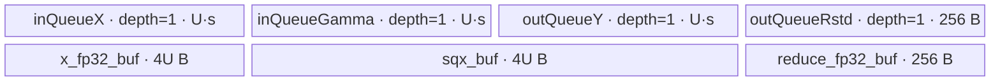
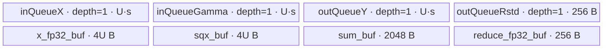

# GemmaRmsNorm A2/A3 ACLNN 算子知识

## 算子速览

| 项目 | 内容 |
|---|---|
| 实际入口 | `aclnnGemmaRmsNormGetWorkspaceSize` + `aclnnGemmaRmsNorm`，公开两段式 ACLNN；固定仓没有更高版本入口 |
| 计算语义 | 对 `gamma` 对应的尾部维度做 RMS 归一化：`rstd=1/sqrt(mean(x²)+epsilon)`，`y=x*rstd*(1+gamma)` |
| 输入输出 | `x/gamma/y` 为同 dtype 的 FP16、BF16 或 FP32，ND；`rstd` 为 FP32；A2/A3 binary config 覆盖三种组合 |
| 执行类型 | 单 Kernel、单个 `AIV_VECTOR` 节点；Tiling 只读取 AIV 核数/UB，body 只用 Vector、DMA、Queue/Event，不含 Cube/AIC/MIX_CV |
| Kernel 路线 | R-001 key 0：归一化尾维全载；R-002 key 1：尾维分片、先归约后再次搬入计算输出 |
| 核心资源 | GM + depth=1 的四个 `TQue` + FP32 `TBuf`；workspace 固定 `16 MiB + 256 B`，Device 不把它作为算法中间量 |
| 来源闭包 | `source_closed`：公开 ACLNN（生成 bridge 为框架边界）→OpDef→共享 Tiling/POD→`gemma_rms_norm` router→两套 AIV body/helper→A2/A3 binary/config 接线闭合 |
| 验证状态 | 已完成源码闭包检查；本次知识提取未执行编译、真机、数值或性能测试。 |

## 接口与语义

### 计算语义

设 `gamma` 的元素数为 `D`，`x` 去掉 `gamma.rank` 个尾维后的元素数为 `N`。对每行 `r∈[0,N)`：

```text
s_r    = sum(i=0..D-1, float(x[r,i])²)
rstd_r = 1 / sqrt(s_r / D + epsilon)
y[r,i] = cast_to_x(float(x[r,i]) * rstd_r * (1 + float(gamma[i])))
```

FP16/BF16 路线先升为 FP32 做平方、归约、缩放和 `gamma+1`；FP16 输出用 `CAST_NONE`，BF16 输出用 `CAST_RINT`。FP32 保持 FP32。`rstd` 每行写一个 FP32 有效值。

### 输入、输出与属性

| 参数 | shape/layout | dtype | 约束、默认值与语义 |
|---|---|---|---|
| `x` | ND，1–8 维 | FP16/BF16/FP32 | 必需；Tiling 要求每维非 0；归一化域之前的维度乘积形成 `N` |
| `gamma` | ND，1–8 维；必须等于 `x` 的同长度尾部 shape | 与 `x` 相同 | 必需；Device 使用 `1+gamma`，而非普通 RmsNorm 的 `gamma` |
| `epsilon` | scalar | ACLNN `double`，Op 属性/POD 为 FP32 | 建议/默认 `1e-6`；Tiling 拒绝负值 |
| `yOut` | shape 与 `x` 完全相同，ND | 与 `x` 相同 | 必需；每个有效元素均写回 |
| `rstdOut` | 公开语义为 `x` 前导维、归一化尾维为 1 | FP32 | 必需；Tiling 接受每轴为对应 `x` 维或 1，但 Device 实际连续写 `N` 个值 |

公开 API 文档称输入/输出支持空 Tensor，但 `CheckInputShape4RmsNorm` 对 `x/gamma/y/rstd` 的任意 0 维均返回失败；正式实现有效域以固定源码的 Tiling 终点为准，此冲突列入限制。

### 入口与版本

固定 Commit 只公开未带版本号的 `aclnnGemmaRmsNormGetWorkspaceSize/aclnnGemmaRmsNorm`，因此它是 A2/A3 实际支持的最新公开版本。ACLNN 文档产品表明确支持 Atlas A2、A3；OpDef 分别注册 `ascend910b`、`ascend910_93`，两份 binary config 均提供 FP16、BF16、FP32 三个实例，`ascendc_config.json` 也只列这两个 Atlas compute unit（另有 Kirin，不在本卡目标平台）。

固定仓没有手写 `op_api` 实体；两段式 ACLNN 到 `GemmaRmsNorm` OpDef/executor 的生成层按框架边界处理。`op_host/CMakeLists.txt` 以 `ACLNNTYPE aclnn` 接入 OpDef，并通过 `DEPENDENCIES rms_norm` 编译共享 Tiling。算子拥有的校验、Tiling、POD、router、body 与构建选择均已追到真实实现。

## Host/Launcher 执行流程

### 参数校验与前处理

公开第一段接口接收 `x/gamma/epsilon/yOut/rstdOut`，返回 workspace 大小与 executor。OpDef 对两路输入声明 `AutoContiguous()`，因此非连续输入的连续化属于生成 executor 的框架节点；输出文档也允许非连续，具体 ViewCopy 壳在固定仓不可见。

核心节点进入 `Tiling4GemmaRmsNorm` 后依次：调用 `CheckInputShape4RmsNorm` 校验 rank、尾部 shape、`y` 同形和 `rstd` 形状；`setEpsTiling` 拒绝 `epsilon<0`；`TilingPrepare4RmsNorm` 从平台读取 AIV 核数和 UB；按 `x` dtype 得到 32 B block 中元素数；生成 `N/D/alignD/blockFactor/ubFactor/key`；写 POD、`blockDim` 和 workspace。任一空 context 字段、shape 错误、负 epsilon 或分片宽度退减到 0 均返回 `GRAPH_FAILED`，不形成 launch。

### 参数、Workspace 与生命周期

`setWorkSize` 固定写 `workspace[0]=256+16*1024*1024` B。entry 取得 `usrWorkspace=GetUserWorkspace(workspace)`，只有 key 0 将地址传给 `KernelRmsNorm::Init`；该参数只继续传入 `InitRstdData` 的形参且函数体不读取它，key 1 根本不传 workspace。因此两条 A2/A3 body 都没有算法 workspace slice、producer/consumer 或跨 Kernel lifetime；这段空间是框架/系统保留请求。

输入/输出 tensor 由调用者拥有，executor 与 workspace 从第一段保持到第二段完成。第二段在调用者传入的 stream 上运行生成的连续化→单 Kernel→输出提交序列；框架 bridge 的细粒度 owner/cleanup 固定仓不可见。

### 启动图与失败传播

```text
aclnnGemmaRmsNormGetWorkspaceSize
  -> generated ACLNN/Contiguous executor boundary
  -> Tiling4GemmaRmsNorm(blockDim=ceil(N/blockFactor), POD=RMSNormTilingData)
aclnnGemmaRmsNorm(workspace, workspaceSize, executor, stream)
  -> gemma_rms_norm(x,gamma,y,rstd,workspace,tiling)
     -> key 0: KernelRmsNorm<DTYPE_X,DTYPE_GAMMA>::Init/Process
     -> key 1: KernelRmsNormSplitD<DTYPE_X,DTYPE_GAMMA>::Init/Process
  -> generated output submission boundary
```

两条 Route 均只有一个 AIV Kernel 节点，没有节点间边。Tiling 失败阻断 launch；entry 未命中 key 0/1 时无 body、无输出写回，Device 没有错误码回传。Queue、pipe barrier 与 hard event 只同步该节点内部的 DMA/Vector/Scalar 阶段。

## Route 与参数设计

### 分核与资源计算

令 `D=gamma.shape_size`、`N=prod(x.shape[0:xRank-gammaRank])`，`B=32/sizeof(T)`。Host 计算 `alignD=ceil(D/B)*B`。初值 `U0=10240`（FP16/BF16）或 `8192`（FP32），`blockFactor=ceil(N/aivCoreNum)`，`usedCoreNum=ceil(N/blockFactor)`；因 `blockFactor` 是一次向上取整，通常前核各处理 `blockFactor` 行、尾核处理 `N-(usedCoreNum-1)*blockFactor` 行。

若 `alignD<=U0`，key 0 且 `ubFactor=U0`。否则 key 1：`tileCount=ceil(D/U0)`，先取 `U=ceil(D/(tileCount*16))*16`，再每次减 16，直到 `D%U==0` 或 `D%U>=16`；若退到 0 则 Tiling 失败。两条 Route 都令 `rowFactor=64`、`is_gemma=1`，workspace 固定 `16 MiB+256 B`。Host 虽读取并减去 `UB_USED=1024` 的平台 UB，但 Gemma 分支没有用剩余值校验固定 `U0` 的字节账，这是源码可见的资源前提。

### Route 选择

| 顺序 | Route | Key/模板 | 精确选择条件与优先级 | 不适用去向 |
|---:|---|---|---|---|
| 1 | R-001 尾维全载 | key 0 / `KernelRmsNorm<DTYPE_X,DTYPE_GAMMA>` | `alignD<=U0`；FP16/BF16 `U0=10240`，FP32 `U0=8192` | R-002 |
| 2 | R-002 尾维分片 | key 1 / `KernelRmsNormSplitD<DTYPE_X,DTYPE_GAMMA>` | `alignD>U0`，且 16 元素步进求得的 `U>0` | `U==0` 时 `GRAPH_FAILED` |

```text
shape/dtype valid && epsilon>=0
  -> D, N, B=32/sizeof(T), alignD=ceil(D/B)*B
  -> U0=(T==FP32 ? 8192 : 10240)
  -> if alignD<=U0: key=0, U=U0
     else:
       key=1
       tileCount=ceil(D/U0)
       U=ceil(D/(tileCount*16))*16
       while D%U!=0 && D%U<16: U-=16
       if U==0: fail
  -> blockDim=ceil(N/ceil(N/aivCoreNum))
```

### 模板/实现执行矩阵

| Route | key/selector | dtype/shape/platform 完整命中条件 | 执行拓扑与 Kernel 节点 | 实际模板/body | 内存与同步特征 | tail/fallback |
|---|---|---|---|---|---|---|
| R-001 尾维全载 | 0 | A2/A3；FP16/BF16/FP32 同 dtype；合法 shape/epsilon；`alignD<=U0` | 单 AIV 节点 | `KernelRmsNorm<T,T>::Process→SubProcess→Compute` | gamma 每核只搬一次；每行 x 全载；depth=1 Queue；Vector/Scalar 用 V_S/S_V event | `DataCopyCustom` 处理非 32 B 尾；尾核/尾行组独立缩短 |
| R-002 尾维分片 | 1 | 同上但 `alignD>U0` 且求得 `U>0` | 单 AIV 节点 | `KernelRmsNormSplitD<T,T>::Process→SubProcess→ComputeFormerPrecision/ComputeLatter` | x 为求平方和与生成 y 搬两遍；gamma 按列片搬；sum TBuf 跨片复用 | 末列片 `jTail=D-(jMax-1)U`；非 32 B 尾由 `DataCopyCustom`；无其它 fallback |

### 隐藏性能 Guard

| Guard | Host/Tiling 条件 | Device/资源原因 | 影响 Route | 不满足时去向 | 源码符号 |
|---|---|---|---|---|---|
| 全载列阈值 | `alignD<=U0` | key 0 同时分配 x/gamma/y、两块 U 长 FP32 TBuf 与 reduce/rstd；固定 U 避免运行时列循环 | R-001 | R-002 | `rms_norm_tiling.cpp::getUbFactor` |
| 分片尾 DMA | `D%U==0 \|\| D%U>=16` | U 以 16 元素对齐，并避免最后一片小于 16 元素；32 B 尾仍由 dtype-aware copy helper 处理 | R-002 | `U-=16`；降到 0 失败 | `rms_norm_tiling.cpp::getUbFactor` |
| 平台 UB 隐式前提 | `totalUbSize-1024` 被读取但未参与 Gemma U 计算 | 实际 `InitBuffer` 总量必须可放入 UB | 两条 | 固定仓无 Host fallback | `Tiling4GemmaRmsNorm`、两类 `Init` |
| dtype 编译实例 | A2/A3 binary config 仅同 dtype FP16/BF16/FP32 | entry 的 `DTYPE_X/DTYPE_GAMMA` 来自离线实例 | 两条 | 未注册组合不形成 binary | 两份 `gemma_rms_norm_binary.json` |
| 空域 | 任一相关维为 0 即失败 | Device 的 `CeilDiv`、尾循环和最后一次无空域保护 | 两条 | Tiling `GRAPH_FAILED` | `CheckInputShape4RmsNorm` |

### POD/ABI

`RMSNormTilingData` 的字段顺序与源码类型可见；宏 `TILING_DATA_FIELD_DEF` 的展开定义来自仓外 CANN 头，固定仓无法可靠给出 `sizeof/alignof/offsetof`，故下表不猜测偏移。Gemma producer 未重写而 Device 不读的字段列为 inactive。

| 结构 | 字段 | 类型/位宽 | ABI 布局 | 单位 | Host/launcher producer | Device consumer | 边界 |
|---|---|---|---|---|---|---|---|
| `RMSNormTilingData` | `num_row` | `uint64_t`/64 | 固定仓不可见 | 行 | `getUbFactor: N` | 两类 `InitVar`：分核有效域 | 非 0 |
| 同上 | `num_col` | `uint64_t`/64 | 固定仓不可见 | 元素 | `getUbFactor: D` | 两类地址/循环长度 | 非 0 |
| 同上 | `num_col_align` | `uint64_t`/64 | 固定仓不可见 | 元素 | `ceil(D/B)*B` | key 1 保存，body 不参与地址计算 | dtype block 对齐 |
| 同上 | `block_factor` | `uint64_t`/64 | 固定仓不可见 | 行/核 | `ceil(N/aivCoreNum)` | 两类 `Init` 的 GM base/尾核 | `>=1` |
| 同上 | `row_factor` | `uint32_t`/32 | 固定仓不可见 | 行/批 | `SetDefaultTiling:64` | key 0 使用；key 1 固定常量 64 覆盖 | 64 |
| 同上 | `ub_factor` | `uint32_t`/32 | 固定仓不可见 | 元素/列片 | `U0` 或分片求得 U（从 `uint64_t` 窄化） | Queue/TBuf 容量、列片地址 | 源码未显式检查 `uint32_t` 窄化；当前算法 U 不超过 U0 |
| 同上 | `reduce_mask` | `uint32_t`/32 | 固定仓不可见 | lane | `SetDefaultTiling:0` | key 1 仅 `__CCE_AICORE__==100` 路径 | A2/A3 常规路径 inactive |
| 同上 | `left_num` | `uint32_t`/32 | 固定仓不可见 | 元素 | `SetDefaultTiling:0` | 同上 | inactive |
| 同上 | `last_reduce_mask` | `uint32_t`/32 | 固定仓不可见 | lane | `SetDefaultTiling:0` | 同上 | inactive |
| 同上 | `last_left_num` | `uint32_t`/32 | 固定仓不可见 | 元素 | `SetDefaultTiling:0` | 同上 | inactive |
| 同上 | `rstd_size` | `uint32_t`/32 | 固定仓不可见 | 字节 | `SetDefaultTiling:0` | Gemma 两 body 不读 | inactive |
| 同上 | `ub_loop` | `uint32_t`/32 | 固定仓不可见 | 次 | Gemma 路径未赋；静态对象初始为 0 | 不读 | inactive |
| 同上 | `col_buffer_length` | `uint32_t`/32 | 固定仓不可见 | 元素 | Gemma 路径未赋 | 不读 | inactive |
| 同上 | `multi_n_num` | `uint32_t`/32 | 固定仓不可见 | 行 | Gemma 路径未赋 | 不读 | inactive |
| 同上 | `is_nddma` | `uint32_t`/32 | 固定仓不可见 | bool | Gemma 路径未赋 | 不读 | inactive；本算子无 NDDMA body |
| 同上 | `epsilon` | `float`/32 | 固定仓不可见 | 数值 | `setEpsTiling:*epsilon` | 两类 rstd 计算 | `>=0` |
| 同上 | `avg_factor` | `float`/32 | 固定仓不可见 | `1/D` | `getUbFactor` | key 1 `ComputeRstd`；key 0 自行算 `1/D` | D 非 0 |
| 同上 | `is_gemma` | `uint8_t`/8 | 固定仓不可见 | bool | `SetDefaultTiling:1` | 两类 `ComputeY/ComputeMulGammaCast` | 必须为 1 才执行 `gamma+1` |
| 同上 | `last_block_factor` | `uint64_t`/64 | 固定仓不可见 | 行 | Gemma 路径未赋 | 不读 | inactive |
| 同上 | `row_loop` | `uint64_t`/64 | 固定仓不可见 | 次 | Gemma 路径未赋 | 不读 | inactive |
| 同上 | `last_block_row_loop` | `uint64_t`/64 | 固定仓不可见 | 次 | Gemma 路径未赋 | 不读 | inactive |
| 同上 | `row_tail` | `uint64_t`/64 | 固定仓不可见 | 行 | Gemma 路径未赋 | 不读 | inactive |
| 同上 | `last_block_row_tail` | `uint64_t`/64 | 固定仓不可见 | 行 | Gemma 路径未赋 | 不读 | inactive |
| 同上 | `mul_loop` | `uint32_t`/32 | 固定仓不可见 | 次 | Gemma 路径未赋 | 不读 | inactive |
| 同上 | `mul_tail` | `uint32_t`/32 | 固定仓不可见 | lane | Gemma 路径未赋 | 不读 | inactive |
| 同上 | `dst_rep_stride` | `uint8_t`/8 | 固定仓不可见 | block | Gemma 路径未赋 | 不读 | inactive |
| 同上 | `is_performance` | `uint8_t`/8 | 固定仓不可见 | bool | Gemma 路径未赋 | 不读 | inactive |
| 同上 | `normal_flag` | `uint8_t`/8 | 固定仓不可见 | flag | Gemma 路径未赋 | 不读 | inactive |

### Route 源码闭包

| Route | Key/selector | Host/Tiling producer | POD/参数 | Kernel entry/router 节点 | Kernel body/直接依赖 | 构建接线 |
|---|---|---|---|---|---|---|
| R-001 尾维全载 | key 0 | `rms_norm_tiling.cpp::Tiling4GemmaRmsNorm/getUbFactor` | `RMSNormTilingData` | `gemma_rms_norm.cpp::gemma_rms_norm` key 0 | `rms_norm.h::KernelRmsNorm`；`reduce_common.h::ReduceSumHalfInterval`；`rms_norm_base.h::DataCopyCustom` | OpDef A2/A3 config + 两份 binary JSON + `ascendc_config.json` |
| R-002 尾维分片 | key 1 | 同上 | 同上 | `gemma_rms_norm.cpp::gemma_rms_norm` key 1 | `rms_norm_split_d.h::KernelRmsNormSplitD`；同两份 helper | 同上 |

## Kernel 实现

### 公共执行流程

entry 解析同一个 `RMSNormTilingData`，按 key 0/1 实例化对应 `DTYPE_X/DTYPE_GAMMA` 模板。两个 body 都把 `blockIdx` 映射到连续的行段：GM base 为 `blockIdx*blockFactor*D`，尾核行数为 `N-(blockNum-1)*blockFactor`。每行均先用 FP32 计算平方和和 rstd，再把 x 与 rstd、`gamma+1` 相乘；所有 GM↔UB 搬运通过 Queue 或 `DataCopyCustom`，没有 Cube、SIMT、NDDMA、通信或第二 Kernel 节点。

### Route R-001：尾维全载

#### 适用条件

##### 选择证据

| 层级 | 文件 | 符号 | 源码谓词/参数 | 结果/下一跳 |
|---|---|---|---|---|
| ACLNN | `norm/gemma_rms_norm/docs/aclnnGemmaRmsNorm.md` | 两段式原型 | A2/A3、三种同 dtype、ND | 生成 `GemmaRmsNorm` executor |
| Tiling | `norm/rms_norm/op_host/rms_norm_tiling.cpp` | `getUbFactor` | 初始 `modeKey=0`；仅 `numColAlign>ubFactor` 才改 1 | `alignD<=U0` 保持 key 0 |
| Router | `norm/gemma_rms_norm/op_kernel/gemma_rms_norm.cpp` | `gemma_rms_norm` | `TILING_KEY_IS(0)` | `KernelRmsNorm<DTYPE_X,DTYPE_GAMMA>` |

#### Device 数据流

##### 函数级调用链

```text
gemma_rms_norm(key=0)
  -> KernelRmsNorm<T,T>::Init
     -> InitVar + GM binding + InitBuffer
  -> Process
     -> CopyInGamma (一次/核)
     -> for each row group -> SubProcess
        -> for each row -> CopyIn(x row)
                         -> Compute(square -> ReduceSumHalfInterval -> scalar rstd
                                    -> x*rstd -> gamma cast/+1 -> multiply/cast)
                         -> CopyOutY
        -> CopyOutRstd
```

##### 源码等价伪码

```text
# 源码等价伪码
coreRows = (blockIdx < blockNum-1) ? blockFactor : N-(blockNum-1)*blockFactor
gammaUB = DMA(gamma[0:D])
for group in [0, ceil(coreRows/64)):
  validRows = min(64, coreRows-group*64)
  allocate rstdUB[64]
  for i in [0, validRows):
    row = group*64+i
    xUB = DMA(xCore[row*D : row*D+D])
    xFP32 = cast_fp32(xUB)                 # FP32 输入直接使用 xUB
    sqx = xFP32*xFP32
    sum = half_interval_reduce(sqx, D)     # 幂次折半 + WholeReduceSum
    scalar_rstd = 1/sqrt(sum*(1/D)+epsilon)
    rstdUB[i] = scalar_rstd                # V_S/S_V 保护标量交接
    norm = xFP32*scalar_rstd
    gammaFP32 = cast_fp32(gammaUB)+1
    yUB = cast_to_T(norm*gammaFP32)
    DMA(yCore[row*D : +D], yUB)
  DMA(rstdCore[group*64 : +validRows], rstdUB)
```

#### 内存与数据搬运

##### 资源与搬运表

| 层级/缓冲区 | offset/地址公式 | extent/容量公式 | dtype/layout | producer | consumer | owner/lifetime | 对齐/复用 |
|---|---|---|---|---|---|---|---|
| GM x/y core slice | `(blockIdx*blockFactor+row)*D` | `coreRows*D` | T/ND | caller / Kernel | `CopyIn` / caller | caller；Kernel 期间 | 每行有效 D；helper 处理 32 B 尾 |
| GM gamma | 0 | D | T/ND | caller | `CopyInGamma` | caller；整核只读 | 每核搬一次 |
| GM rstd | `blockIdx*blockFactor+group*64` | coreRows | FP32/连续 | `CopyOutRstd` | caller | caller | A2/A3 helper 写有效 `validRows` |
| `inQueueX` | UB 分配区 | `U*sizeof(T)`，depth 1 | T | `CopyIn` | `Compute` | 每行 Alloc→EnQue→DeQue→Free | 下一行复用 |
| `inQueueGamma` | UB 分配区 | `U*sizeof(T)`，depth 1 | T | `CopyInGamma` | 全部行 | 整个 Process 后 Free | 只前 D 有效 |
| `outQueueY` | UB 分配区 | `U*sizeof(T)`，depth 1 | T | `ComputeMulGammaCast` | `CopyOutY` | 每行 | 下一行复用 |
| `outQueueRstd` | UB 分配区 | `64*4` B，depth 1 | FP32 | `Compute` | `CopyOutRstd` | 每 64 行组 | 尾组仅有效行 |
| `x_fp32_buf` | UB 分配区 | `U*4` B | FP32 | x/gamma cast、gamma+1 | square/output multiply | 整核 TBuf、分阶段覆盖 | `is_gemma=1` 使 FP32 输入也分配 |
| `sqx_buf` | UB 分配区 | `U*4` B | FP32 | square；随后 norm | reduce；gamma multiply | 每行 | 原地从 x² 改写为 norm/y 中间量 |
| `reduce_fp32_buf` | UB 分配区 | `64*4` B | FP32 | reduce helper | reduce helper | 每行 | 固定 1 repeat |
| workspace | user offset 0 | `256 B`（另有 `16 MiB` 系统请求） | byte | framework | 无 Device 算法 consumer | executor 期间 | `InitRstdData` 参数未读取 |

##### 分层内存布局



##### 字节账与复用顺序

```text
s = sizeof(T)
UB_total = 3*U*s + 64*4 + U*4 + U*4 + 64*4
FP16/BF16: U=10240 -> UB_total=14*10240+512=143872 B
FP32:      U=8192  -> UB_total=20*8192+512=164352 B
UB_total <= 平台 totalUbSize-1024 是必要条件；Host 未显式比较
dynamic_ub = N/A（非 SIMT）
workspace_total = 256 + 16*1024*1024 B；算法消费 0 B
```

| 复用子区 | 写入者 | 读取者/消费点 | 下一次覆盖 | 同步或释放依据 | 安全条件 |
|---|---|---|---|---|---|
| `inQueueX` | `CopyIn` | `Compute` | 下一行 `AllocTensor` | DeQue/FreeTensor | 当前行 Compute 完成 |
| `x_fp32_buf` | x cast | square/norm | 同行 gamma cast/+1 或下一行 x cast | `PIPE_V` barrier | square/norm 已消费 xFP32 后才覆写 |
| `sqx_buf` | x² | reduce；随后 `x*rstd` | gamma multiply/下一行 | `PIPE_V` + 同步标量 rstd | reduce 完成且 rstd 已取出 |
| `outQueueY` | compute | `CopyOutY` | 下一行 | DeQue/FreeTensor | DMA 已消费 |
| `outQueueRstd` | 每行标量写 | group CopyOut | 下一 group | EnQue/DeQue/FreeTensor | validRows 全部产生 |

#### 同步、精度与尾块

##### 同步与数值边界表

| 阶段 | primitive/机制 | producer | consumer/等待点 | 保护对象 | 精度/尾块 |
|---|---|---|---|---|---|
| DMA→Vector | TQue EnQue/DeQue | `CopyIn*` | `Compute` | x/gamma UB | helper 只保证前 D 有效，Vector count=D |
| cast/square/reduce | `PipeBarrier<PIPE_V>` | Cast/Mul/Add | 后继 Vector | FP32 TBuf 原地阶段 | FP16/BF16 先升 FP32；折半归约 tail=`count-power2` |
| Vector→Scalar | `V_S` event | reduce result | `GetValue`/sqrt | `sqx[0]` | rstd 为 FP32 scalar |
| Scalar→Vector | `S_V` event | `SetValue`/scalar rstd | Muls | rstd 值 | 防止 Vector 提前读取 |
| gamma/y | `PIPE_V` | cast、`Adds(+1)`、Mul | cast/Queue | x_fp32/sqx/y | FP16 `CAST_NONE`；BF16 `CAST_RINT` |
| UB→GM | Queue + `DataCopyCustom` | y/rstd UB | GM | 输出有效区 | A2/A3 非整 block y 使用覆盖尾 block 策略；只提交 D 个逻辑元素 |

#### 关键实现

##### 符号证据表

| 阶段 | 文件 | 符号/模板实例 | 实现事实 |
|---|---|---|---|
| Host/Tiling producer | `norm/rms_norm/op_host/rms_norm_tiling.cpp` | `Tiling4GemmaRmsNorm/getUbFactor/SetDefaultTiling` | key 0 条件、U、blockDim、Gemma flag |
| Kernel entry/router | `norm/gemma_rms_norm/op_kernel/gemma_rms_norm.cpp` | `gemma_rms_norm` key 0 | 映射 `KernelRmsNorm<T,T>` 并传 user workspace |
| Device body/helper | `norm/rms_norm/op_kernel/rms_norm.h` | `KernelRmsNorm::Init/Process/Compute/ComputeMulGammaCast` | 全载、FP32 归约、`gamma+1`、tail copy |
| Device body/helper | `norm/rms_norm/op_kernel/reduce_common.h` | `ReduceSumHalfInterval` | 幂次折半、mask 与 WholeReduceSum |
| Device body/helper | `norm/rms_norm/op_kernel/rms_norm_base.h` | `DataCopyCustom` | 32 B 对齐和 GM 尾写策略 |

### Route R-002：尾维分片

#### 适用条件

##### 选择证据

| 层级 | 文件 | 符号 | 源码谓词/参数 | 结果/下一跳 |
|---|---|---|---|---|
| ACLNN | `norm/gemma_rms_norm/docs/aclnnGemmaRmsNorm.md` | 两段式原型 | 同 R-001 | `GemmaRmsNorm` executor |
| Tiling | `norm/rms_norm/op_host/rms_norm_tiling.cpp` | `getUbFactor` | `numColAlign>U0`，随后求 U 并保证 tail 为 0 或至少 16 | key 1；U 退到 0 失败 |
| Router | `norm/gemma_rms_norm/op_kernel/gemma_rms_norm.cpp` | `gemma_rms_norm` | `TILING_KEY_IS(1)` | `KernelRmsNormSplitD<DTYPE_X,DTYPE_GAMMA>` |

#### Device 数据流

##### 函数级调用链

```text
gemma_rms_norm(key=1)
  -> KernelRmsNormSplitD<T,T>::Init
     -> InitVar + GM binding + InitBuffer
  -> Process
     -> for each <=64-row group -> SubProcess
        -> ComputeFormerPrecision
           -> for each row, each U-sized column tile: CopyIn -> ComputeSumPrecision
           -> V_S read partial sums -> scalar accumulate -> S_V store
        -> ComputeRstd (Muls avg -> Adds eps -> Sqrt -> Div)
        -> tail tile first, then main tiles: ComputeLatter
           -> CopyInGamma(tile)
           -> each row: CopyIn(x tile) -> ComputeY(gamma+1) -> CopyOutY
        -> CopyOutRstd
```

##### 源码等价伪码

```text
# 源码等价伪码（A2/A3 非 __CCE_AICORE__==100 分支）
coreRows = tail-aware rows for blockIdx
jMax = ceil(D/U); jTail = D-(jMax-1)*U
for rowGroup in chunks of 64:
  validRows = min(64, remaining)
  rstdUB[0:validRows] = 0
  for i in [0, validRows):
    scalarSum = 0
    # 每批最多 64 个 U-sized tile，sum_buf 每 tile 占 8 个 FP32
    for tileBatch over jMax:
      for tile in tileBatch:
        xTile = DMA(x[row, tile*U : +tileLen])
        sqx = float(xTile)^2
        sumBuf[tile*8] = half_interval_reduce(sqx, tileLen)
      V_S; scalarSum += each sumBuf slot; S_V
    rstdUB[i] = scalarSum
  rstdUB = 1 / sqrt(rstdUB*(1/D)+epsilon)
  for tile in [last, 0, 1, ..., jMax-2]:
    gammaTile = DMA(gamma[tile*U : +tileLen])
    for i in [0, validRows):
      xTile = DMA(x[row, tile*U : +tileLen])
      yTile = cast_to_T(float(xTile)*rstdUB[i]*(float(gammaTile)+1))
      DMA(y[row, tile*U : +tileLen], yTile)
  DMA(rstd[rowGroup : +validRows], rstdUB)
```

#### 内存与数据搬运

##### 资源与搬运表

| 层级/缓冲区 | offset/地址公式 | extent/容量公式 | dtype/layout | producer | consumer | owner/lifetime | 对齐/复用 |
|---|---|---|---|---|---|---|---|
| GM x/y tile | `row*D+j*U`（加 core base） | `U` 或 `jTail` | T/ND | caller / Kernel | former+latter / caller | caller | x 每 tile 搬两遍；tail helper 保护 |
| GM gamma tile | `j*U` | `U` 或 `jTail` | T/ND | caller | `ComputeY` | caller | 每 row group、每 tile 搬一次 |
| GM rstd | core base + `group*64` | validRows | FP32 | `CopyOutRstd` | caller | caller | 连续有效行 |
| `inQueueX` | UB | `U*s`，depth 1 | T | `CopyIn` | sum/y | 单 tile | former/latter 间复用 |
| `inQueueGamma` | UB | `U*s`，depth 1 | T | `CopyInGamma` | 同组所有行 y | 单 tile | 先处理尾 tile再主 tile |
| `outQueueY` | UB | `U*s`，depth 1 | T | `ComputeY` | `CopyOutY` | 单行单 tile | 下一行/tile复用 |
| `outQueueRstd` | UB | `64*4` B，depth 1 | FP32 | sum/rstd pipeline | `CopyOutRstd` | row group | 只 validRows 有效 |
| `x_fp32_buf` | UB | `U*4` B | FP32 | x/gamma cast、gamma+1 | square/y | 单 tile | Gemma FP32 也分配 |
| `sum_buf` | UB | `64*8*4=2048` B | FP32 | 每 tile reduce | scalar partial sum loop | row group | 每批最多 64 个 partial；下一批覆盖 |
| `sqx_buf` | UB | `U*4` B | FP32 | x cast/square/norm | reduce/y | 单 tile | 原地阶段复用 |
| `reduce_fp32_buf` | UB | `64*4=256` B | FP32 | reduce helper/ones | block reduce/Div | 单 tile或 rstd 阶段 | 固定 1 repeat |
| workspace | user offset 0 | 256 B + system 16 MiB | byte | framework | 无 Device 算法 consumer | executor 期间 | key 1 不接收 workspace |

##### 分层内存布局



##### 字节账与复用顺序

```text
s = sizeof(T)
UB_total = 3*U*s + 64*4 + U*4 + 64*8*4 + U*4 + 64*4
FP16/BF16: UB_total=14U+2560 B
FP32:      UB_total=20U+2560 B
U<=10240(B16) 或 U<=8192(FP32)
UB_total <= 平台 totalUbSize-1024 是必要条件；Host 未显式比较
dynamic_ub = N/A（非 SIMT）
workspace_total = 256 + 16*1024*1024 B；算法消费 0 B
```

| 复用子区 | 写入者 | 读取者/消费点 | 下一次覆盖 | 同步或释放依据 | 安全条件 |
|---|---|---|---|---|---|
| `inQueueX` | former/latter `CopyIn` | `ComputeSumPrecision/ComputeY` | 下一 tile/row | Queue FreeTensor | 当前 consumer 完成 |
| `sum_buf` 每 8-FP32 slot | tile reduce | scalar partial-sum loop | 下一批 tile | V_S 后 GetValue、S_V 后回 Vector | 标量已累计该批所有 slot |
| `x_fp32_buf` | x cast | square；之后 gamma cast/+1 | 下一 tile | PIPE_V | xFP32 已用于 square/norm |
| `sqx_buf` | square/norm | reduce/y multiply | 下一 tile | PIPE_V | 当前 Vector 链完成 |
| `outQueueRstd` | partial sum/rstd | `ComputeY` 读标量、最终 CopyOut | 下一 group | V_S/S_V + Queue Free | 所有 y tile 已消费 rstd |

#### 同步、精度与尾块

##### 同步与数值边界表

| 阶段 | primitive/机制 | producer | consumer/等待点 | 保护对象 | 精度/尾块 |
|---|---|---|---|---|---|
| tile DMA | Queue | `CopyIn/CopyInGamma` | Vector body | x/gamma tile | tileLen=U 或 jTail |
| 平方归约 | PIPE_V | Cast/Mul/折半 reduce | partial sum | sqx/sum_buf | 全部 FP32；尾 tile count=jTail |
| partial scalar 累计 | V_S/S_V events | Vector writes sum slots | scalar `GetValue` 与后续 Vector | sum_buf/rstdUB | 每批最多 64 tile，避免 sum_buf 越界 |
| rstd | PIPE_V | `Muls(avg)→Adds(eps)→Sqrt→Div` | ComputeY | rstdUB | FP32；`avg=1/D` |
| y | V_S/S_V + PIPE_V | rstd scalar、cast、Adds/Mul | output Queue | x/gamma/rstd | FP16 CAST_NONE、BF16 CAST_RINT |
| tail copy | `DataCopyCustom` | output Queue | GM | 最后不足 32 B 的 tile | 末 32 B 采用重叠尾写，仅逻辑 D 有效 |

#### 关键实现

##### 符号证据表

| 阶段 | 文件 | 符号/模板实例 | 实现事实 |
|---|---|---|---|
| Host/Tiling producer | `norm/rms_norm/op_host/rms_norm_tiling.cpp` | `getUbFactor` | key 1、U 对齐/尾片 guard、blockDim |
| Kernel entry/router | `norm/gemma_rms_norm/op_kernel/gemma_rms_norm.cpp` | `gemma_rms_norm` key 1 | 映射 `KernelRmsNormSplitD<T,T>` |
| Device body/helper | `norm/rms_norm/op_kernel/rms_norm_split_d.h` | `Process/SubProcess/ComputeFormerPrecision/ComputeSumPrecision` | 两级 tile 批次、FP32 partial sum、rstd |
| Device body/helper | 同上 | `ComputeLatter/ComputeY/CopyOut*` | 第二遍 x、gamma+1、输出/tail |
| Device body/helper | `norm/rms_norm/op_kernel/rms_norm_base.h`、`reduce_common.h` | `DataCopyCustom/ReduceSumHalfInterval` | tail DMA 与折半归约 |

## 算子特定优化

### Trick T-001：同一 FP32 TBuf 分阶段承载 x 与 gamma+1

#### 触发与源码依据

- 适用 Route：R-001、R-002，全部 Gemma dtype。
- 触发条件：`is_gemma==1`；对 FP16/BF16 还先把 gamma cast 到 FP32，FP32 gamma 直接加 1。
- Golden 来源：[`norm/rms_norm/op_kernel/rms_norm.h:145-165`](../../../../../../../cann-ops-raw/ascendc/ops-nn/955f8b33985b6d72989ebff341bb9c2c564a51bc/norm/rms_norm/op_kernel/rms_norm.h#L145-L165)

**官方源码（固定 Commit 连续逐字摘录）**：

```cpp
if constexpr (is_same<T, float>::value) {
    if (is_gemma == 1) {
        LocalTensor<float> gammaFp32 = x_fp32_buf.Get<float>();
        Adds(gammaFp32, gammaLocal, static_cast<float>(1.0), elementNum);
        PipeBarrier<PIPE_V>();
        Mul(yLocal, sqx, gammaFp32, elementNum);
    } else {
        Mul(yLocal, sqx, gammaLocal, elementNum);
    }
} else {
    if constexpr (IS_MIX_DTYPE) {
        Mul(sqx, sqx, gammaLocal, elementNum);
    } else {
        LocalTensor<float> gammaFp32 = x_fp32_buf.Get<float>();
        Cast(gammaFp32, gammaLocal, RoundMode::CAST_NONE, elementNum);
        PipeBarrier<PIPE_V>();
        if (is_gemma == 1) {
            Adds(gammaFp32, gammaFp32, static_cast<float>(1.0), elementNum);
            PipeBarrier<PIPE_V>();
        }
```

#### 机制与设计原因

`x_fp32_buf` 在平方/归一化阶段先保存升精度 x；这些值已被写入 `sqx_buf` 并完成 `x*rstd` 后，同一物理 TBuf 改存 FP32 的 `gamma+1`。这样 Gemma 语义无需再分配一块 gamma FP32 TBuf。`Adds` 的 scalar 固定为 1，`elementNum` 来自 D（R-001）或当前 tileLen（R-002）；每次覆盖前后的 `PIPE_V` 保证 Vector 阶段顺序。

#### 迁移边界

- 适用：先把输入升精度写入中间区，待其结果转存到另一 buffer 后还需对参数升精度的逐元素归一化。
- 前提：两个值的生命周期不重叠；TBuf 容量至少 `U*sizeof(float)`；后继参数计算与原 xFP32 不再并发使用。
- 失效：若融合算法后续仍需原始 xFP32，必须拆分 buffer 或改变阶段顺序，不能直接复用。
- 未验证：本次知识提取未执行编译、真机、数值或性能测试。

#### 错误做法

固定仓未提供可验证反例；从生命周期可证明，在 `sqx` 尚未形成归一化值前提前写 `gamma+1` 会破坏 xFP32，因而不能移动这次覆盖到前面的平方/缩放阶段。

### Trick T-002：分片 Route 对 partial sum 做 64 槽批处理

#### 触发与源码依据

- 适用 Route：R-002。
- 触发条件：A2/A3 非 `__CCE_AICORE__==100` 分支，D 需要多个 U-sized tile。
- Golden 来源：[`norm/rms_norm/op_kernel/rms_norm_split_d.h:179-197`](../../../../../../../cann-ops-raw/ascendc/ops-nn/955f8b33985b6d72989ebff341bb9c2c564a51bc/norm/rms_norm/op_kernel/rms_norm_split_d.h#L179-L197)

**官方源码（固定 Commit 连续逐字摘录）**：

```cpp
const uint32_t jInnerMax = row_factor;

for (uint32_t iInner = 0; iInner < calcRowNum; iInner++) {
    float reduceOut = 0;
    uint32_t rowIndex = static_cast<uint32_t>(static_cast<uint64_t>(iOuter) * row_factor + iInner);

    // 1. jOuter main loop
    for (uint32_t jOuterIdx = 0; jOuterIdx < jOuterMax - 1; jOuterIdx++) {
        for (uint32_t jInnerIdx = 0; jInnerIdx < jInnerMax; jInnerIdx++) {
            CopyIn(rowIndex, jOuterIdx * jInnerMax + jInnerIdx, ub_factor);
            ComputeSumPrecision(sumLocal[jInnerIdx * NUM_PER_BLK_FP32], ub_factor);
        }
        SetFlag<HardEvent::V_S>(eventVS);
        WaitFlag<HardEvent::V_S>(eventVS);
        for (uint32_t jInnerIdx = 0; jInnerIdx < jInnerMax; jInnerIdx++) {
            reduceOut += sumLocal.GetValue(jInnerIdx * NUM_PER_BLK_FP32);
        }
```

#### 机制与设计原因

`row_factor=64` 同时成为每批 partial sum 的 tile 数，每个结果按 `NUM_PER_BLK_FP32=8` 个 FP32 间隔放入 2048 B `sum_buf`。Vector 连续完成最多 64 个片的局部归约，再用一次 V_S 交接由 scalar 累加，随后复用这些槽处理下一批；因此 sum buffer 不随 D 的 tile 数增长。

#### 迁移边界

- 适用：单行归约维很长、每片先能产出一个标量 partial sum 的 Vector Kernel。
- 前提：sum buffer 至少 `batchTiles*8*sizeof(float)`，并有 Vector→Scalar 可见性事件；地址乘法不溢出。
- 失效：没有 V_S/S_V 协议或 scalar 累加顺序影响不可接受时，需要改用纯 Vector/树形归约方案。
- 未验证：本次知识提取未执行编译、真机、数值或性能测试。

#### 错误做法

固定仓未提供可验证反例；若去掉 `V_S` 等待便读取 `sumLocal`，源码同步协议无法保证 partial sum 已对 scalar 可见。

## 模板与实现对比

| 对比维度 | R-001 尾维全载 | R-002 尾维分片 | 设计选择依据 |
|---|---|---|---|
| 命中条件/优先级 | `alignD<=U0`，key 0 | `alignD>U0` 且 U 求解成功，key 1 | 是否可在固定 UB tile 内装下整行 |
| 模板与 dtype | `KernelRmsNorm<T,T>`，三种同 dtype | `KernelRmsNormSplitD<T,T>`，三种同 dtype | binary config 相同，body 按 key 分 |
| 循环与分核 | 核→64 行组→逐行 | 核→64 行组→逐行→64 tile 批→tile | 长 D 增加列片循环，不改变行分核 |
| Queue/TBuf/寄存器/dynamic UB/通信 window | 4 Queue + xFP32/sqx/reduce | 同上另加 2048 B sum TBuf | 两者无 dynamic UB/通信 window；固定仓不公开寄存器字节数 |
| 内存总占用与复用 | B16 143872 B；FP32 164352 B | B16 `14U+2560`；FP32 `20U+2560` | R-002 用有限 U 换取任意较长 D |
| 搬运/Vector/SIMT/NDDMA/通信 API | gamma 每核一次，x/y 每行一次；Vector reduce | x 每 tile 两次、gamma 每组每 tile一次；Vector+scalar partial sum | 无 SIMT/NDDMA/通信 |
| 同步、精度与 tail | Queue、PIPE_V、V_S/S_V；FP32 中间；D tail helper | 同步同类，另有批 partial sum事件；jTail | 两者输出 cast 相同 |
| fallback/失败边界 | 大于阈值落 R-002 | U 退到 0 时 Tiling 失败；unknown key 无输出 | 无第三条 Device fallback |

## 平台差异

| 项目 | A2 | A3 | 950 |
|---|---|---|---|
| 支持状态 | 支持；公开文档、`ascend910b` OpDef/binary/config 一致 | 支持；公开文档、`ascend910_93` OpDef/binary/config 一致 | 不支持；README/API 产品表明确 `Ascend 950PR/950DT ×`，且无 ascend950 OpDef/binary/config |
| Host/Launcher | 共用 `Tiling4GemmaRmsNorm`，平台生产 AIV core/UB | 同左 | 不生成正式卡 |
| Kernel/资源 | 共用 `gemma_rms_norm.cpp` 两条 AIV body；binary 三 dtype | 同左 | 固定仓无公开可达 Kernel 接线 |

## 限制与失败边界

- 固定仓公开 API 文档写“支持空 Tensor”，但共享 Tiling 明确拒绝任意 0 维；这是公开说明与实现的行为冲突，调用方不能依赖空 Tensor 成功。
- `epsilon<0` 直接 Tiling 失败；正 epsilon 与输入数值的 Inf/NaN 传播按文档说明，源码未增加饱和或清洗。
- `N` 与 `D` 用 `uint64_t` 连乘，没有显式乘法溢出检查；`ub_factor` 写入 32 位，不过当前常量/求解值不超过 10240。
- Gemma Host 读取 `totalUbSize-1024` 却没有据此约束固定 U；字节账能否装入是目标平台资源前提，固定仓没有更小 U fallback。
- A2/A3 非整 32 B 的 GM 尾写依赖 `DataCopyCustom` 的重叠末 block 策略；不得改成无条件向上取整写 GM，否则可能越过逻辑输出边界。
- exact ACLNN 生成 bridge、executor 内部 workspace owner/cleanup、`RMSNormTilingData` 宏展开后的精确 ABI 偏移位于仓外框架，固定仓不可见；算子自有链路已闭合。
- entry 对未知 key 静默不写输出；没有 Device 错误码回传。
- 本次知识提取未执行编译、真机、数值或性能测试。

## 源码索引

### 链路索引

| 链路阶段 | 文件 | 关键符号 | 支撑内容 |
|---|---|---|---|
| 入口声明/约束 | `norm/gemma_rms_norm/docs/aclnnGemmaRmsNorm.md` | ACLNN 原型/产品表 | 公开性、参数、A2/A3 支持与 950 不支持 |
| 入口实现 | `norm/gemma_rms_norm/op_graph/gemma_rms_norm_proto.h` | `REG_OP(GemmaRmsNorm)` | 语义、输入输出和属性定义 |
| Host 注册 | `norm/gemma_rms_norm/op_host/gemma_rms_norm_def.cpp` | `GemmaRmsNorm::GemmaRmsNorm` | dtype、AutoContiguous、A2/A3 config |
| Host/Tiling/Launcher | `norm/rms_norm/op_host/rms_norm_tiling.h` | `RMSNormTilingData` | POD 字段与 Gemma 注册 |
| Host/Tiling/Launcher | `norm/rms_norm/op_host/rms_norm_tiling.cpp` | `Tiling4GemmaRmsNorm` 及 helper | 校验、Route、分核、workspace、POD producer |
| Kernel entry/body | `norm/gemma_rms_norm/op_kernel/gemma_rms_norm.cpp` | `gemma_rms_norm` | key 0/1 router |
| Kernel entry/body | `norm/rms_norm/op_kernel/rms_norm.h` | `KernelRmsNorm` | R-001 body |
| Kernel entry/body | `norm/rms_norm/op_kernel/rms_norm_split_d.h` | `KernelRmsNormSplitD` | R-002 body |
| Kernel entry/body | `norm/rms_norm/op_kernel/rms_norm_base.h` | `DataCopyCustom` | Queue 常量与 tail DMA helper |
| Kernel entry/body | `norm/rms_norm/op_kernel/reduce_common.h` | `ReduceSumHalfInterval` | FP32 折半归约 |
| 构建接线 | `norm/gemma_rms_norm/op_host/config/ascend910b/gemma_rms_norm_binary.json` | `op_list` | A2 三 dtype binary |
| 构建接线 | `norm/gemma_rms_norm/op_host/config/ascend910_93/gemma_rms_norm_binary.json` | `op_list` | A3 三 dtype binary |
| 构建接线 | `norm/gemma_rms_norm/op_host/CMakeLists.txt` | `add_modules_sources` | ACLNN 类型与共享 rms_norm 依赖 |
| 构建接线 | `scripts/kernel/binary_config/ascendc_config.json` | `GemmaRmsNorm` 条目 | compute unit 与 kernel 自动同步配置 |

### 实现复用检查

| 检查项 | 可复用事实 | 不得改变的约束 | 源码符号 |
|---|---|---|---|
| ABI/POD | `RMSNormTilingData` 与普通 RmsNorm 共用 | `is_gemma=1`、字段顺序/位宽、U/N/D 单位；精确宏 ABI 不可臆测 | `rms_norm_tiling.h::RMSNormTilingData` |
| 调用顺序 | 单 Kernel key router 后 Init→Process | R-002 必须先完成全部平方和/rstd，再第二遍 x 生成 y | `gemma_rms_norm`、两类 `Process` |
| workspace/内存 | workspace 算法消费为 0；UB 按真实 InitBuffer 复用 | 四 Queue depth=1；xFP32 与 gammaFP32 复用的生命周期 | `setWorkSize`、两类 `Init` |
| 同步 | Queue、PIPE_V、V_S/S_V 协议可复用 | 标量读写 partial sum/rstd 前后不可移除 hard event | `Compute`、`ComputeFormerPrecision`、`ComputeY` |
| 精度与尾块 | FP32 平方/归约/rstd、FP16/BF16 末端 cast | Gemma 必须先 `gamma+1`；BF16 保持 `CAST_RINT`；GM tail 保持 helper | `ComputeMulGammaCast`、`ComputeY`、`DataCopyCustom` |
| 失败边界 | shape/epsilon/key/U guard | 不得把空域或未知 key 解释为成功输出 | `CheckInputShape4RmsNorm`、`getUbFactor`、entry router |
