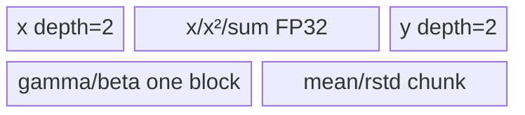

# GroupNorm A2/A3 ACLNN 算子知识

## 算子速览

| 项目 | 内容 |
|---|---|
| 实际入口 | `aclnnGroupNormGetWorkspaceSize` + `aclnnGroupNorm`，公开 ACLNN 两段式接口，无更高版本入口 |
| 计算语义 | 对每个 `(n,g)` 的 `R=(C/group)*HxW` 个元素求总体均值和方差，输出 `(x-mean)*rstd*gamma+beta`、`mean`、`rstd=1/sqrt(var+eps)` |
| 输入输出 | `self/out` 为 2–8 维 ND/公开接口允许 NCL、NCHW、NCDHW storage format；`gamma/beta` 为 `[C]`；`meanOut/rstdOut` 为 `[N,group]`；FP16/FP32/BF16（BF16 由 DAV_2201 路径支持） |
| 执行类型 | 非空核心节点为单 `AIV_VECTOR` Kernel `group_norm_silu`；Contiguous、缺省 gamma/beta 和 ViewCopy 是 ACLNN 框架节点 |
| Kernel 路线 | R-001 Small（1011/102）、R-002 HighPerf（1031/104）、R-003 General（1051/106）、R-004 HW=1（1071/108） |
| 核心资源 | GM、AIV UB、`TQue/TBuf`、FP32 归约临时区、16 MiB system workspace；Kernel 取得但不消费 user workspace |
| 来源闭包 | `source_closed`：公开 ACLNN→`l0op::GroupNormSilu(..., false)`→Tiling/POD→router→四个可达 Vector body→910B/910_93 config 均闭合 |
| 验证状态 | 已完成源码闭包检查；本次知识提取未执行编译、真机、数值或性能测试。 |

## 接口与语义

### 计算语义

令 `D=C/group`、`R=D*HxW`，逻辑组 `a=n*group+g` 覆盖连续区间 `x[a*R:(a+1)*R]`。Kernel 计算 `mean_a=sum(x)/R`、`var_a=sum(x^2)/R-mean_a^2`、`rstd_a=1/sqrt(var_a+eps)`，并按通道 `c=g*D+d` 写 `out=(x-mean_a)*rstd_a*gamma[c]+beta[c]`。ACLNN 调用 `GroupNormSilu` 时把 `activateSilu` 固定为 `false`，因此不属于 GroupNormSilu/Swish 的激活语义。

### 输入、输出与属性

| 参数 | shape/layout | dtype | 约束、默认值与语义 |
|---|---|---|---|
| `self` | 2–8 维；`shape[0]=N`、`shape[1]=C`、后续维乘积 `HxW` | FP16/FP32/BF16 | 必选；支持非连续与空 Tensor；私有、NHWC、HWCN、NDHWC storage format 被拒绝 |
| `gamma` | `[C]` | 同 `self` | 可为 `nullptr`；Host 生成全 1 Tensor，再送入核心 Kernel |
| `beta` | `[C]` | 同 `self` | 可为 `nullptr`；Host 生成全 0 Tensor，再送入核心 Kernel |
| `N,C,HxW` | scalar | `int64_t` | 必须与 `self` shape/numel 一致；`C % group == 0` |
| `group` | scalar | `int64_t` | `group>0` |
| `eps` | scalar | `double`，下转 `float` | `eps>0`；公开文档要求保精度时至少 `1e-5` |
| `out` | 同 `self` | 同 `self` | 必选，可非连续 |
| `meanOut` | `[N,group]` | 同 `self` | 空输入时填 0 |
| `rstdOut` | `[N,group]` | 同 `self` | 空输入时填 NaN |

### 入口与版本

固定仓只公开 `aclnnGroupNorm` 这一版本。文档产品表同时明确 A2 与 A3 支持；`GroupNormSilu` OpDef 分别注册 `ascend910b` 和 `ascend910_93`，二者使用同一非 RegBase Tiling 和 `group_norm_silu.cpp`。ACLNN 的平台分支把 DAV_2201 归入 `isNormSocLists`，实际调用 `l0op::GroupNormSilu(self,gamma,beta,group,float(eps),false)`；这只是 GroupNorm 的复用 body，不扩大为 Silu/Swish 逻辑算子。

## Host/Launcher 执行流程

### 参数校验与前处理

`CheckParams` 顺序为必选指针→dtype 与同 dtype→`group/C/eps`→shape/numel→format。空 `self` 不启动归一化 Kernel，而通过 `Fill`/`ViewCopy` 把 `meanOut=0`、`rstdOut=NaN`。非空时依次 Contiguous `self`，对 gamma/beta 做 Contiguous 或 OnesLike/ZerosLike，再进入平台分支；A2/A3 选择 `GroupNormSilu`，且三个核心输入必为非空、同 dtype。

### 参数、Workspace 与生命周期

`l0op::GroupNormSilu` 分配与 `x` 同 shape/dtype/format 的 `y` 和 `[N,group]` 的 `mean/rstd`，把节点加入 executor。Tiling 为该节点申请 16 MiB system workspace；entry 检查 `workspace` 与 `GetUserWorkspace(workspace)`，但四个可达 body 均未读写 `userWS`。ACLNN 返回的总 workspace 还包含 Contiguous/ViewCopy 等框架节点，精确总量由 `executor->GetWorkspaceSize()` 产生，用户持有到第二段 `CommonOpExecutorRun(...,stream)` 完成。

### 启动图与失败传播

```text
aclnnGroupNormGetWorkspaceSize
  -> [framework] Contiguous(self/gamma/beta) 或 OnesLike/ZerosLike
  -> l0op::GroupNormSilu -> ADD_TO_LAUNCHER_LIST_AICORE(GroupNormSilu, activateSilu=false)
     -> Tiling4GroupNormSilu -> group_norm_silu<<<realCoreNum, stream>>>
  -> [framework] ViewCopy(y,mean,rstd -> 用户输出)
aclnnGroupNorm -> CommonOpExecutorRun(同一 stream，按 executor 节点顺序执行)
```

核心节点无跨 Kernel 中间边：输入/输出均为 executor 分配的 GM Tensor；同一 stream 的 executor 顺序把前置 Contiguous、核心 Kernel、后置 ViewCopy 串联。任一分配、节点添加或 ViewCopy 返回空立即终止第一段，不生成可执行的后续链；第二段把执行错误原样返回。

## Route 与参数设计

### 分核与资源计算

`hwNum=prod(shape[2:])`、`shapeD=C/group`、`elemNum=shapeD*hwNum`。先令 `numPerCore=ceil(N*group/aivCoreNum)`、`realCoreNum=ceil(N*group/numPerCore)`、`numLastCore=N*group-numPerCore*(realCoreNum-1)`；当 `hwNum < 32/sizeof(x)` 且不是 `hwNum==1 && shapeD>=32/sizeof(x)` 时强制单核。`hwNum==1 && group==C` 时改按 N 分核，若 C 未按 32B 元素数对齐则仍强制单核。`processSize=8192` 元素，`loopNum=ceil(elemNum/processSize)`、`loopTail=elemNum-processSize*(loopNum-1)`；`innerLoop*` 对 HxW 同样计算。空 Tensor 在 ACLNN 层已截获。

### Route 选择

| 顺序 | Route | Key/模板 | 精确选择条件与优先级 | 不适用去向 |
|---:|---|---|---|---|
| 1 | R-004 HW=1 | 1071(B16/BF16), 108(FP32) | `hwNum < 32/sizeof(x)` 且 `hwNum==1` | `hwNum>1` 转 R-003；不属于 small-HW 转下一项 |
| 2 | R-001 Small | 1011(B16/BF16), 102(FP32) | FP32: `hwNum%8==0 && hwNum<=4096 && C+numPerCore<=4000`；B16: `hwNum%16==0 && hwNum<=4096 && C+numPerCore<=2700` | R-002 |
| 3 | R-002 HighPerf | 1031(B16/BF16), 104(FP32) | FP32: `C+numPerCore<=4000`；B16: `C+numPerCore<=2700` | R-003 |
| 4 | R-003 General | 1051(B16/BF16), 106(FP32) | 前述条件均不满足；small-HW 且 `hwNum>1` 也直接选择此族 | 无后续；Tiling 校验失败则失败 |

```text
if hwNum < 32/sizeof(x): hwNum==1 ? R-004 : R-003
else if dtype=FP32 and hwNum%8==0 and hwNum<=4096 and C+numPerCore<=4000: R-001/102
else if dtype=FP32 and C+numPerCore<=4000: R-002/104
else if dtype=B16 and hwNum%16==0 and hwNum<=4096 and C+numPerCore<=2700: R-001/1011
else if dtype=B16 and C+numPerCore<=2700: R-002/1031
else: R-003/1051-or-106
```

### 模板/实现执行矩阵

| Route | key/selector | dtype/shape/platform 完整命中条件 | 执行拓扑与 Kernel 节点 | 实际模板/body | 内存与同步特征 | tail/fallback |
|---|---|---|---|---|---|---|
| R-001 Small | 1011/102 | 上表 Small 谓词；gamma/beta 同 x dtype | 单 AIV Kernel | `GroupNormSiluSmallB16<DTYPE_X,DTYPE_X>` / `GroupNormSiluSmallB32<float>` | 全载 gamma/beta；每组一次或分 D 块；Queue 双缓冲 | `elemNum>8192` 时按 `groupD=floor(8192/hwNum)`；尾 D 块 `dTail` |
| R-002 HighPerf | 1031/104 | 上表 HighPerf 谓词 | 单 AIV Kernel | `GroupNormSiluB16<DTYPE_X,DTYPE_X>` / `GroupNormSiluB32<float>` | 全载 gamma/beta；按 8192 元素 tile 累加和复用 | 尾 tile 使用 `loopTail/innerLoopTail` 与 DataCopyPad |
| R-003 General | 1051/106 | fallback 或 small-HW 非 1 | 单 AIV Kernel | `GroupNormSiluG16<DTYPE_X,DTYPE_X>` / `GroupNormSiluG32<float>` | gamma/beta 每通道按 block 搬入；均值输出分批 32(B16)/2048(FP32) | 每组循环 `ceil(elemNum/processSize)`；尾搬运非对齐 helper |
| R-004 HW=1 | 1071/108 | `hwNum==1` 的 small-HW 分支 | 单 AIV Kernel | `GroupNormSiluHW1B16<DTYPE_X,DTYPE_X>` / `GroupNormSiluHW1B32<float>` | 省去空间维广播，按 C/N 批处理；Queue depth=1 | C/每核组尾块由 Pad 或分块 CopyOut 保护 |

### 隐藏性能 Guard

| Guard | Host/Tiling 条件 | Device/资源原因 | 影响 Route | 不满足时去向 | 源码符号 |
|---|---|---|---|---|---|
| 32B HxW guard | `hwNum < 32/sizeof(x)` | 普通 DataCopy 的最小块与尾写安全 | R-003/R-004、分核 | small-HW 专用路线或单核 | `SetBlockTiling`, `SetTilingWithSmallHW` |
| Small 对齐 guard | B32 `hwNum%8==0`；B16 `hwNum%16==0` | 每通道 HxW 恰为 32B 整倍数，允许直接连续块搬运 | R-001 | R-002 | `SetTiling` |
| 全载元数据 guard | `C+numPerCore<=4000/2700` | gamma/beta 与每核 mean/rstd 的 UB 上界 | R-001/R-002 | R-003 | `SetTiling` |
| 8192 tile | 默认 `processSize=8192` 元素 | 各 body 的 Queue/TBuf 固定或按 POD 以此容量分配 | 全部 | 以 loop/tail 切分，不失败 | `SetTilingParams`, `SetUbTiling` |
| workspace 非空 | entry `workspace!=nullptr && GetUserWorkspace()!=nullptr` | router 的统一 ABI 防护 | 全部 | Kernel 无输出返回 | `group_norm_silu` |

### POD/ABI

`BEGIN_TILING_DATA_DEF` 的宏展开位于仓外，固定仓不能证明 `sizeof/alignof/offsetof`；表中顺序即声明与 SaveToBuffer/GET_TILING_DATA 的字段顺序。

| 结构 | 字段 | 类型/位宽 | ABI 布局 | 单位 | Host/launcher producer | Device consumer | 边界 |
|---|---|---|---|---|---|---|---|
| `GroupNormSiluTilingData` | `numGroups` | int64/64 | offset 不可见 | 组 | `SetAttrParams=*numGroups` | 通道索引取模 | >0，且整除 C |
| 同上 | `hwNum` | int64/64 | 不可见 | 元素/通道 | `prod(shape[2:])` | 搬运跨度、HW route | 二维输入为 1 |
| 同上 | `elemNum` | int64/64 | 不可见 | 元素/组 | `shapeD*hwNum` | GM 组跨度、归约长度 | 非空时 >0 |
| 同上 | `shapeC` | int64/64 | 不可见 | 通道 | `shape[1]` | gamma/beta 容量 | C |
| 同上 | `shapeD` | int64/64 | 不可见 | 通道/组 | `shapeC/numGroups` | 通道循环 | 整除后值 |
| 同上 | `realCoreNum` | int64/64 | 不可见 | AIV core | `SetBlockTiling` | `Process` core guard | 同时写 blockDim |
| 同上 | `numPerCore` | int64/64 | 不可见 | 逻辑组 | ceil 分核 | GM base、普通核循环 | HW=1/group=C 时含义改为 N 批 |
| 同上 | `numLastCore` | int64/64 | 不可见 | 逻辑组 | 尾核余量 | 末核循环 | 仅末核读取 |
| 同上 | `processSize` | int64/64 | 不可见 | 元素 | 8192 | UB 分配/tile | 本平台固定 8192 |
| 同上 | `loopNum` | int64/64 | 不可见 | tile | `ceil(elemNum/processSize)` | 归约循环 | 至少 1 |
| 同上 | `loopTail` | int64/64 | 不可见 | 元素 | `elemNum-processSize*(loopNum-1)` | 尾归约/搬运 | `(0,processSize]` |
| 同上 | `innerLoopNum` | int64/64 | 不可见 | tile | `ceil(hwNum/processSize)` | HW 子循环 | route 相关 |
| 同上 | `innerLoopTail` | int64/64 | 不可见 | 元素 | HxW 尾量 | HW 尾搬运 | route 相关 |
| 同上 | `tilingKey` | int64/64 | 不可见 | enum | `SetTiling` | router | 仅 1011/102/1031/104/1051/106/1071/108 可达 |
| 同上 | `epsilon` | float/32 | 不可见 | 数值 | `float(eps)` | rstd 计算 | ACLNN 已验证 >0 |
| 同上 | `activateSilu` | int64/64 | 不可见 | bool 值 | ACLNN 固定 false | 所有 normalize helper | 本入口恒 0 |

### Route 源码闭包

| Route | Key/selector | Host/Tiling producer | POD/参数 | Kernel entry/router 节点 | Kernel body/直接依赖 | 构建接线 |
|---|---|---|---|---|---|---|
| R-001 | 1011/102 | `group_norm_silu_tiling.cpp::SetTiling` | `GroupNormSiluTilingData` | `group_norm_silu.cpp::group_norm_silu` | `GroupNormSiluSmallB16/SmallB32`, `GroupNormSiluBase` | OpDef + 910B/910_93 binary JSON |
| R-002 | 1031/104 | 同上 | 同上 | 同上 | `GroupNormSiluB16/B32`, `GroupNormSiluBase` | 同上 |
| R-003 | 1051/106 | `SetTilingWithSmallHW/SetTiling` | 同上 | 同上 | `GroupNormSiluG16/G32`, `GroupNormSiluBase` | 同上 |
| R-004 | 1071/108 | `SetTilingWithSmallHW` | 同上 | 同上 | `GroupNormSiluHW1B16/HW1B32`, `GroupNormSiluBase` | 同上 |

## Kernel 实现

### 公共执行流程

`group_norm_silu` 声明 `KERNEL_TYPE_AIV_ONLY/MIX_VECTOR_CORE`，不调用 Cube API。entry 验证 workspace，解析 POD，按 key 实例化唯一 body。所有 route 把逻辑组 `a=blockIdx*numPerCore+localGroup` 映射到连续 GM `a*elemNum`；B16/BF16 数据先 Cast 到 FP32，FP32 累加 `sum/sumSq`，标量求 `mean/rstd`，再按通道 gamma/beta 归一化并以 route 对应 round mode 降精度。由于 `activateSilu=0`，`Exp/Div` 激活支路不执行。

### Route R-001：Small 对齐族

#### 适用条件

##### 选择证据

| 层级 | 文件 | 符号 | 源码谓词/参数 | 结果/下一跳 |
|---|---|---|---|---|
| ACLNN | `norm/group_norm/op_host/op_api/aclnn_group_norm.cpp` | `aclnnGroupNormGetWorkspaceSize` | A2/A3 arch 且非空 | `GroupNormSilu(...,false)` |
| Tiling | `norm/group_norm_silu/op_host/group_norm_silu_tiling.cpp` | `SetTiling` | 对齐、`hwNum<=4096`、`C+numPerCore` 上界 | 1011 或 102 |
| Router | `norm/group_norm_silu/op_kernel/group_norm_silu.cpp` | `group_norm_silu` | `TILING_KEY_IS(1011/102)` | SmallB16/SmallB32 |

#### Device 数据流

##### 函数级调用链

```text
SetTiling(key=1011/102) -> launch group_norm_silu[realCoreNum] -> router -> Small::Init -> Small::Process -> ProcessPerCore
  -> CopyInGammaAndBeta -> [B16 CastGammaAndBeta]
  -> AccumulateXandX2{One,Multiple}Loop -> ReduceSum
  -> normalize by channel -> CopyOutY
  -> [B16 CastMeanAndRstd] -> CopyOutMeanAndRstd
```

##### 源码等价伪码

```text
for a in core_groups:
  sum,sumSq = reduce_tiles(x[a*R : (a+1)*R], tile=8192)
  mean=sum/R; rstd=rsqrt(sumSq/R-mean*mean+eps)
  if R<=8192: reuse resident x tile
  else: for D-block of floor(8192/HW) channels: reload x block
  for d: y[channel d] = x*rstd*gamma[g*D+d] + (beta-rstd*gamma*mean)
  write only R valid elements; write mean/rstd at a
```

#### 内存与数据搬运

##### 资源与搬运表

| 层级/缓冲区 | offset/地址公式 | extent/容量公式 | dtype/layout | producer | consumer | owner/lifetime | 对齐/复用 |
|---|---|---|---|---|---|---|---|
| GM x/y | `a*R+d*HW+inner*8192` | 有效 tile | x dtype/ND | framework / Kernel | Kernel / ViewCopy | executor | 尾块按有效元素 |
| x fp32 TBuf×3 | 0 | `3*8192*4` B | FP32 | Cast/平方/累加 | Reduce/normalize | Kernel | 多阶段覆盖 |
| x/y Queue | 各自区域 | `2*8192*s` B/Queue | x dtype | MTE2/Vector | Vector/MTE3 | Kernel | depth=2 |
| gamma/beta | 0 | 各 `align(C,32/s)*s`，B16 另各 `align(C,16)*4` | x dtype/FP32 | MTE2/Cast | normalize | Kernel 全程 | 每核全载 |
| mean/rstd | 0 | 各 `align(numPerCore,32/s)*s` + FP32 对应区 | x dtype/FP32 | scalar/Vector | MTE3 | Kernel | 尾核只写有效数 |

##### 分层内存布局


##### 字节账与复用顺序

```text
B16/BF16 UB_total = 20*8192 + 12*align(C,16) + 12*align(numPerCore,16) + 32 bytes
FP32 UB_total = (17 + 1/16)*8192 + 8*align(C,8) + 8*align(numPerCore,8) + 32 bytes
workspace_component = 16 MiB system workspace; userWS body use = 0
```

| 复用子区 | 写入者 | 读取者/消费点 | 下一次覆盖 | 同步或释放依据 | 安全条件 |
|---|---|---|---|---|---|
| `inQueueX` ping/pong | CopyInX | Cast/Reduce/normalize | 两 tile 后 | EnQue/DeQue/FreeTensor | depth=2 |
| x1/x2 FP32 | Cast/Mul | Reduce 或 output Cast | 下一组/tile | `PipeBarrier<PIPE_V>` 与同步 event | 前次 Reduce/Copy 完成 |

#### 同步、精度与尾块

##### 同步与数值边界表

| 阶段 | primitive/机制 | producer | consumer/等待点 | 保护对象 | 精度/尾块 |
|---|---|---|---|---|---|
| GM→UB | Queue | MTE2 | DeQue | x/gamma/beta | 对齐 route 直接 DataCopy；最终统计输出 DataCopyPad |
| 标量→Vector | `S_V` event | mean/rstd scalar | normalize | 标量可见性 | B16/BF16 FP32 累加；回写 CAST_ROUND |
| Vector pipeline | `PipeBarrier<PIPE_V>` | Cast/Mul/Add | 后续 Vector op | FP32 TBuf | `loopTail/dTail` 作为有效 mask 长度 |

#### 关键实现

##### 符号证据表

| 阶段 | 文件 | 符号/模板实例 | 实现事实 |
|---|---|---|---|
| Host/Tiling producer | `group_norm_silu_tiling.cpp` | `SetTiling`, `SetUbTiling` | 对齐谓词、8192 tile |
| Kernel entry/router | `group_norm_silu.cpp` | keys 1011/102 | dtype 到 Small body |
| Device body/helper | `group_norm_silu_small_b16.h`, `group_norm_silu_small_b32.h` | `ComputeWithCopyOnce/ComputeAlign` | 全载 affine、两遍统计与归一化 |

### Route R-002：HighPerf 非对齐族

#### 适用条件

##### 选择证据

| 层级 | 文件 | 符号 | 源码谓词/参数 | 结果/下一跳 |
|---|---|---|---|---|
| Tiling | `group_norm_silu_tiling.cpp` | `SetTiling` | 不命中 Small，但 `C+numPerCore<=4000/2700` | 1031/104 |
| Router | `group_norm_silu.cpp` | keys 1031/104 | B16/B32 | `GroupNormSiluB16/B32` |

#### Device 数据流

##### 函数级调用链

```text
SetTiling(key=1031/104) -> launch group_norm_silu[realCoreNum] -> router -> B16/B32::Init -> ProcessPerCore
  -> full-load gamma/beta -> Compute{One,Multiple}Loop
  -> AccumulateXandX2 -> CalcSilu(activate=false) -> CopyOutY[WithPad]
  -> CopyOutMeanAndRstd
```

##### 源码等价伪码

```text
for a in core_groups:
  for tile in ceil(R/8192): accumulate FP32 sum and sumSq
  mean=sum/R; rstd=rsqrt(sumSq/R-mean²+eps)
  for d in D:
    for HW tile: y=(x-mean)*rstd*gamma[c]+beta[c]
    non-32B tail uses DataCopyPad or overlap-safe final block branch
```

#### 内存与数据搬运

##### 资源与搬运表

| 层级/缓冲区 | offset/地址公式 | extent/容量公式 | dtype/layout | producer | consumer | owner/lifetime | 对齐/复用 |
|---|---|---|---|---|---|---|---|
| GM group | `(block*numPerCore+a)*R` | R | x dtype | MTE2 | Vector | executor | innerLoopTail |
| UB | 与 R-001 相同但容量使用 POD `processSize` | B16 `20p+12Ca+12Pa+32`; FP32 `(17+1/16)p+8Ca+8Pa+32` | mixed UB | Init | body | Kernel | Queue depth=2 |

##### 分层内存布局


##### 字节账与复用顺序

```text
p=processSize=8192; Ca=align(C,32/s); Pa=align(numPerCore,32/s)
UB_total same as R-001 formula; selector bounds Ca/Pa indirectly by C+numPerCore
workspace_component=16 MiB; no inter-kernel user workspace edge
```

| 复用子区 | 写入者 | 读取者/消费点 | 下一次覆盖 | 同步或释放依据 | 安全条件 |
|---|---|---|---|---|---|
| x Queue | `CopyInX` | `ComputeSumX/CalcSilu` | ping/pong | Queue lifecycle | consumer FreeTensor |
| `x1Buf32/x2Buf32` | Cast/Mul | Reduce/Div | next tile | Vector barriers | reduction done |

#### 同步、精度与尾块

##### 同步与数值边界表

| 阶段 | primitive/机制 | producer | consumer/等待点 | 保护对象 | 精度/尾块 |
|---|---|---|---|---|---|
| Reduce | Queue + Vector barrier | MTE2/Cast | ReduceSum | tile | B16/BF16→FP32 |
| Output | DataCopyPad/overlap branch | Vector | GM | final HW tile | only `innerLoopTail` valid |

#### 关键实现

##### 符号证据表

| 阶段 | 文件 | 符号/模板实例 | 实现事实 |
|---|---|---|---|
| Host/Tiling producer | `group_norm_silu_tiling.cpp` | `SetTiling` | 非对齐全载元数据路线 |
| Kernel entry/router | `group_norm_silu.cpp` | keys 1031/104 | B16/B32 分发 |
| Device body/helper | `group_norm_silu_b16.h`, `group_norm_silu_b32.h` | `ComputeMultipleLoop`, `CopyOutYWithPad` | tiled reduce 与安全尾写 |

### Route R-003：General 流式 affine 族

#### 适用条件

##### 选择证据

| 层级 | 文件 | 符号 | 源码谓词/参数 | 结果/下一跳 |
|---|---|---|---|---|
| Tiling | `group_norm_silu_tiling.cpp` | `SetTilingWithSmallHW/SetTiling` | small-HW 非 1，或元数据上界失败 | 1051/106 |
| Router | `group_norm_silu.cpp` | keys 1051/106 | B16/B32 | G16/G32 |

#### Device 数据流

##### 函数级调用链

```text
SetTiling(key=1051/106) -> launch group_norm_silu[realCoreNum] -> router -> G::Process -> ProcessPerCore(32-或2048-group chunks)
  -> per group AccumulateXAndX2/ReduceSumXAndX2
  -> per channel CopyInGammaBeta -> CalculateGroupNormSilu
  -> CopyOutYWithPad -> Cast/CopyOutMeanAndRstd
```

##### 源码等价伪码

```text
for group_chunk:
  for a:
    zero sum arrays; stream R by processSize and reduce
    mean,rstd = FP32 statistics
    for d: load one gamma/beta block; stream HW; write y
  flush chunk mean/rstd; tail chunk uses exact copy length
```

#### 内存与数据搬运

##### 资源与搬运表

| 层级/缓冲区 | offset/地址公式 | extent/容量公式 | dtype/layout | producer | consumer | owner/lifetime | 对齐/复用 |
|---|---|---|---|---|---|---|---|
| gamma/beta Queue | channel index | one 32B block each | x dtype | MTE2 | scalar/Vector | one channel | avoids full C load |
| B16 UB | per class | `20p+24736` B | x dtype+FP32 | Init | G16 | Kernel | mean chunk=32 |
| FP32 UB | per class | `(20+1/16)p+16480` B | FP32 | Init | G32 | Kernel | mean chunk=2048 |

##### 分层内存布局



##### 字节账与复用顺序

```text
B16/BF16: UB_total=20*p+24736 bytes
FP32: UB_total=(20+1/16)*p+16480 bytes
p=8192; workspace_component=16 MiB
```

| 复用子区 | 写入者 | 读取者/消费点 | 下一次覆盖 | 同步或释放依据 | 安全条件 |
|---|---|---|---|---|---|
| affine one-block Queue/TBuf | CopyInGammaBeta | scalar scale/bias | next channel | MTE2_S/V_S event | current channel complete |
| output Queue | CalculateGroupNorm | CopyOutY | next tile | DeQue/FreeTensor | GM copy complete |

#### 同步、精度与尾块

##### 同步与数值边界表

| 阶段 | primitive/机制 | producer | consumer/等待点 | 保护对象 | 精度/尾块 |
|---|---|---|---|---|---|
| affine scalar | `MTE2_S` 或 `V_S` | load/cast gamma,beta | scalar read | one-block buffer | B16 gamma/beta cast FP32 |
| group tail | Queue/DataCopyPad | Vector | MTE3 | y and stats | nonaligned copy helper |

#### 关键实现

##### 符号证据表

| 阶段 | 文件 | 符号/模板实例 | 实现事实 |
|---|---|---|---|
| Host/Tiling producer | `group_norm_silu_tiling.cpp` | `SetTiling` fallback | general key |
| Kernel entry/router | `group_norm_silu.cpp` | 1051/106 | G body |
| Device body/helper | `group_norm_silu_g16.h`, `group_norm_silu_g32.h` | `ProcessGroupNormSilu`, `CopyInGammaBeta*` | affine 流式加载 |

### Route R-004：HW=1 专用族

#### 适用条件

##### 选择证据

| 层级 | 文件 | 符号 | 源码谓词/参数 | 结果/下一跳 |
|---|---|---|---|---|
| Tiling | `group_norm_silu_tiling.cpp` | `SetTilingWithSmallHW` | `hwNum==1` | 1071/108 |
| Block tiling | 同文件 | `SetBlockTiling` | `group==C` 时按 N 分核；C 非 32B 对齐则单核 | blockDim |
| Router | `group_norm_silu.cpp` | 1071/108 | B16/B32 | HW1 body |

#### Device 数据流

##### 函数级调用链

```text
SetTilingWithSmallHW(key=1071/108) -> launch group_norm_silu[realCoreNum] -> router -> HW1::Process -> ProcessPerCore
  -> specialized C/N batch or generic group reduce
  -> CopyInGammaBeta -> CalculateGroupNormSilu(activate=false)
  -> CopyOutY -> CopyOutMeanAndRstd
```

##### 源码等价伪码

```text
HW=1:
for assigned N/group ranges:
  reduce D channel scalars for mean/rstd
  vector-load x/gamma/beta contiguous channel blocks
  y=(x-mean)*rstd*gamma+beta
  protect final C/group/stats tail according to 32B capability
```

#### 内存与数据搬运

##### 资源与搬运表

| 层级/缓冲区 | offset/地址公式 | extent/容量公式 | dtype/layout | producer | consumer | owner/lifetime | 对齐/复用 |
|---|---|---|---|---|---|---|---|
| x/gamma/beta/y Queue | N/C batch offset | 各 `p*s`, depth=1 | x dtype | MTE2/Vector | Vector/MTE3 | Kernel | HW dimension removed |
| B16 FP32 TBuf | 0 | `3*p*4` + stats/affine blocks | FP32 | Cast | reduce/normalize | Kernel | reused across batches |
| FP32 temp/work | 0 | `p*4 + p/16` | FP32 | compute | ReduceSum | Kernel | workLocal reduction |

##### 分层内存布局


##### 字节账与复用顺序

```text
B16/BF16 UB_total=20*p+24672 bytes
FP32 UB_total=(20+1/16)*p+16416 bytes
p=8192; workspace_component=16 MiB
```

| 复用子区 | 写入者 | 读取者/消费点 | 下一次覆盖 | 同步或释放依据 | 安全条件 |
|---|---|---|---|---|---|
| x/gamma/beta queues | DataCopy | vector normalize | next C block | Queue or PIPE_ALL | current output copied |

#### 同步、精度与尾块

##### 同步与数值边界表

| 阶段 | primitive/机制 | producer | consumer/等待点 | 保护对象 | 精度/尾块 |
|---|---|---|---|---|---|
| batch fast path | `PipeBarrier<PIPE_ALL>` | DMA/Vector | next phase | aliased local tensors | exact C-tail branch |
| generic path | Queue + Vector barriers | CopyIn | CopyOut | y/stats | B16/BF16 FP32 statistics |

#### 关键实现

##### 符号证据表

| 阶段 | 文件 | 符号/模板实例 | 实现事实 |
|---|---|---|---|
| Host/Tiling producer | `group_norm_silu_tiling.cpp` | `SetTilingWithSmallHW`, `SetBlockTiling` | HW=1 key/分核 |
| Kernel entry/router | `group_norm_silu.cpp` | 1071/108 | HW1 body |
| Device body/helper | `group_norm_silu_hw1_b16.h`, `group_norm_silu_hw1_b32.h` | `ProcessPerCore`, `CalculateGroupNormSilu` | C/N 专用向量化与尾写 |

## 算子特定优化

### Trick T-001：按 HxW 对齐与元数据容量分四族

#### 触发与源码依据

- 适用 Route：R-001～R-004
- 触发条件：`hwNum` 的 32B 对齐、小于等于 4096，以及 `shapeC+numPerCore` 的 dtype 上界
- Golden 来源：[`group_norm_silu_tiling.cpp:356-361`](../../../../../../../cann-ops-raw/ascendc/ops-nn/955f8b33985b6d72989ebff341bb9c2c564a51bc/norm/group_norm_silu/op_host/group_norm_silu_tiling.cpp#L356-L361)

**官方源码（固定 Commit 连续逐字摘录）**：

```cpp
if (tilingData.get_hwNum() < static_cast<int64_t>(BLOCK_SIZE / xDtypeSize)) {
    SetTilingWithSmallHW(context, tilingData);
} else if (
    xDtypeSize == FLOAT32_BYTES && tilingData.get_hwNum() % FLOAT_EIGHT == 0 && tilingData.get_hwNum() <= HW_CAP &&
    tilingData.get_shapeC() + tilingData.get_numPerCore() <= UPPER_LIMIT_TWO) {
    tilingData.set_tilingKey(static_cast<int64_t>(GroupNormSiluTilingKey::TILINGKEY_SMALL_SHAPE_B32));
```

#### 机制与设计原因

Host 在 launch 前把能按每通道 32B 对齐且能全载 affine/stat 元数据的 shape 送入 Small body；不对齐但元数据仍能全载时选 HighPerf；元数据太大时选逐通道搬 affine 的 General；小于一个 DMA block 的 HxW 单独处理。这样改变的是实际 DMA 形态与 UB 常驻集合，而非仅消除一个运行时分支。

#### 迁移边界

- 适用：按 `[N,C,*spatial]` 连续分组、每通道共享 affine 的 Vector 归一化。
- 前提：A2/A3、同 dtype gamma/beta、固定 32B block 与 8192 tile。
- 失效：谓词不成立时必须依次转 R-002/R-003/R-004，不能强用 Small body。
- 未验证：本次知识提取未执行编译、真机、数值或性能测试。

#### 错误做法

固定仓的真实 fallback 是 HighPerf/General/HW1；忽略 HxW 对齐或 `C+numPerCore` 上界会使 body 的 DataCopy 与 UB 布局前提失效。

### Trick T-002：GroupNorm 复用融合 Kernel 但编译期/运行时关闭 SiLU

#### 触发与源码依据

- 适用 Route：全部
- 触发条件：公开入口的 A2/A3 分支
- Golden 来源：[`aclnn_group_norm.cpp:358-361`](../../../../../../../cann-ops-raw/ascendc/ops-nn/955f8b33985b6d72989ebff341bb9c2c564a51bc/norm/group_norm/op_host/op_api/aclnn_group_norm.cpp#L358-L361)

**官方源码（固定 Commit 连续逐字摘录）**：

```cpp
if (isNormSocLists) {
    result = l0op::GroupNormSilu(
        selfContiguous, gammaContiguous, betaContiguous, group, static_cast<float>(eps), false,
        uniqueExecutor.get());
```

#### 机制与设计原因

同一个完整的 Host/Tiling/Kernel 链通过 `activateSilu=false` 进入 normalize-only 分支；body 直接写 affine 结果，跳过 `-x→Exp→+1→Div`。它避免在 ACLNN 图中再接激活 Kernel，也确保本卡语义仍是纯 GroupNorm。

#### 迁移边界

- 适用：需要纯 GroupNorm 且能复用带可关闭激活的 body。
- 前提：必须证明 selector、POD 与所有 body 都消费同一 false 标志。
- 失效：`activateSilu=true` 属于独立 GroupNormSilu 语义，不得套用本卡。
- 未验证：本次知识提取未执行编译、真机、数值或性能测试。

#### 错误做法

把复用 body 的名字当成公开语义会错误地给 `aclnnGroupNorm` 增加 SiLU；源码明确传 false。

## 模板与实现对比

| 对比维度 | R-001 Small | R-002 HighPerf | R-003 General | R-004 HW1 | 设计选择依据 |
|---|---|---|---|---|---|
| 命中条件/优先级 | 对齐+HW≤4096+元数据上界 | 非对齐+元数据上界 | fallback | HW=1 small-HW | Tiling 决策树顺序 |
| 模板与 dtype | SmallB16/SmallB32 | B16/B32 | G16/G32 | HW1B16/HW1B32 | B16 含 FP16/BF16 |
| 循环与分核 | 组×D-block | 组×R/HW tile | 组 chunk×通道×tile | N/C 专用 | 数据形状与 DMA 粒度 |
| Queue/TBuf/寄存器/dynamic UB/通信 window | depth2+全载 affine | depth2+全载 affine | depth2+单 block affine | depth1 | 无 dynamic UB/通信 |
| 内存总占用与复用 | 固定 8192 大 tile | 同公式 | 不随 C 全载增长 | HW 专用 | selector 避免 UB 越界 |
| 搬运/Vector/SIMT/NDDMA/通信 API | DataCopy, Cast, ReduceSum | 加 DataCopyPad tail | affine streaming | C batch | 均无 SIMT/NDDMA/通信 |
| 同步、精度与 tail | Queue/S_V/PIPE_V | 同左+Pad | MTE2_S/V_S | PIPE_ALL/Queue | FP32 statistics |
| fallback/失败边界 | R-002 | R-003 | Tiling 失败 | 无 | 未知 key 无输出 |

## 平台差异

| 项目 | A2 | A3 | 950 |
|---|---|---|---|
| 支持状态 | 支持 | 支持 | 支持，见独立 `_950` 卡 |
| Host/Launcher | `ascend910b`，共用非 RegBase Tiling | `ascend910_93`，共用非 RegBase Tiling | RegBase selector 与 body 不同 |
| Kernel/资源 | AIV Vector、1011–108 可达 key、16 MiB system workspace | 同 A2 | Welford/TwoPass MicroAPI，整 UB TBuf |

## 限制与失败边界

- API 只接受 2–8 维、shape/属性完全一致、`group>0`、`C%group==0`、`eps>0`；所有必选输出必须非空。
- ACLNN 强制核心 gamma/beta 非空同 dtype，因此 1012/1032/1052/1072 mixed keys 与 109 的 310P SD key不可达，不写为正式 Route。
- B16/BF16 的统计在 FP32 中进行，但输出按平台 `CAST_ROUND` 降到输入 dtype；FP32 直接输出。
- 宏生成 POD 的精确 `sizeof/alignof/offsetof` 在固定仓不可见；不得把字段表推断成手写 C struct ABI。
- 未知 tiling key、空 workspace/user workspace 使 Kernel 静默无输出；Host Tiling 参数错误返回 `GRAPH_FAILED`。
- 本次知识提取未执行编译、真机、数值或性能测试。

## 源码索引

### 链路索引

| 链路阶段 | 文件 | 关键符号 | 支撑内容 |
|---|---|---|---|
| 入口声明/约束 | `norm/group_norm/docs/aclnnGroupNorm.md` | 产品表、公式、API | 公开性、平台与接口约束 |
| 入口实现 | `norm/group_norm/op_host/op_api/aclnn_group_norm.cpp` | `aclnnGroupNormGetWorkspaceSize` | 校验、前后处理、平台分发 |
| Host launcher | `norm/group_norm_silu/op_host/op_api/group_norm_silu.cpp` | `l0op::GroupNormSilu` | 输出分配与 launcher 添加 |
| Host/Tiling/POD | `norm/group_norm_silu/op_host/group_norm_silu_tiling.h` | `GroupNormSiluTilingData` | POD 与 key enum |
| Host/Tiling | `norm/group_norm_silu/op_host/group_norm_silu_tiling.cpp` | `Tiling4GroupNormSilu` | 分核、route、workspace |
| Kernel entry | `norm/group_norm_silu/op_kernel/group_norm_silu.cpp` | `group_norm_silu` | key→body |
| Kernel helper | `norm/group_norm_silu/op_kernel/group_norm_silu_base.h` | `CopyInData/CopyOutData` | 32B tail helper |
| Kernel body | `norm/group_norm_silu/op_kernel/group_norm_silu_small_b16.h` | `GroupNormSiluSmallB16` | R-001 B16/BF16 |
| Kernel body | `norm/group_norm_silu/op_kernel/group_norm_silu_small_b32.h` | `GroupNormSiluSmallB32` | R-001 FP32 |
| Kernel body | `norm/group_norm_silu/op_kernel/group_norm_silu_b16.h` | `GroupNormSiluB16` | R-002 B16/BF16 |
| Kernel body | `norm/group_norm_silu/op_kernel/group_norm_silu_b32.h` | `GroupNormSiluB32` | R-002 FP32 |
| Kernel body | `norm/group_norm_silu/op_kernel/group_norm_silu_g16.h` | `GroupNormSiluG16` | R-003 B16/BF16 |
| Kernel body | `norm/group_norm_silu/op_kernel/group_norm_silu_g32.h` | `GroupNormSiluG32` | R-003 FP32 |
| Kernel body | `norm/group_norm_silu/op_kernel/group_norm_silu_hw1_b16.h` | `GroupNormSiluHW1B16` | R-004 B16/BF16 |
| Kernel body | `norm/group_norm_silu/op_kernel/group_norm_silu_hw1_b32.h` | `GroupNormSiluHW1B32` | R-004 FP32 |
| 构建接线 | `norm/group_norm_silu/op_host/group_norm_silu_def.cpp` | `AddConfig("ascend910b/ascend910_93")` | 平台注册 |
| 构建接线 | `norm/group_norm_silu/op_host/config/ascend910b/group_norm_silu_binary.json` | `GroupNormSilu` binaries | A2 dtype/attr binary |
| 构建接线 | `norm/group_norm_silu/op_host/config/ascend910_93/group_norm_silu_binary.json` | `GroupNormSilu` binaries | A3 dtype/attr binary |

### 实现复用检查

| 检查项 | 可复用事实 | 不得改变的约束 | 源码符号 |
|---|---|---|---|
| ABI/POD | shape、分核、tile、key、eps、activation 的生产链 | 字段顺序/类型；offset 不可推测 | `GroupNormSiluTilingData` |
| 调用顺序 | Contiguous→GroupNormSilu→ViewCopy | 同 stream executor 顺序 | `aclnnGroupNormGetWorkspaceSize` |
| workspace/内存 | 16 MiB system workspace 与各 route UB 公式 | Queue depth、对齐、全载 guard | `Tiling4GroupNormSilu`, route `Init` |
| 同步 | Queue、S_V、MTE2_S/V_S、PIPE_V/ALL | buffer 覆盖前必须保留等待/FreeTensor | route bodies |
| 精度与尾块 | FP32 statistics、B16 cast、Pad tail | `activateSilu=false`、有效长度 | `CalcSilu/CalculateGroupNormSilu` |
| 失败边界 | 参数/Tiling/launcher 失败阻断；unknown key 无输出 | 不新增 fallback | `CheckParams`, router |