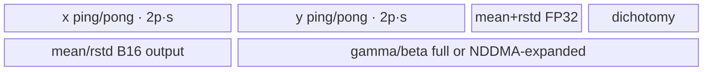
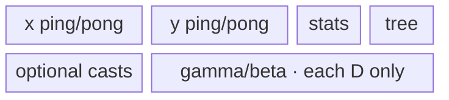

# GroupNorm 950 ACLNN 算子知识

## 算子速览

| 项目 | 内容 |
|---|---|
| 实际入口 | `aclnnGroupNormGetWorkspaceSize` + `aclnnGroupNorm`，公开 ACLNN 两段式接口 |
| 计算语义 | 每个 `(n,g)` 对 `R=(C/group)*HxW` 元素做总体方差 GroupNorm，输出 affine 结果、mean、rstd |
| 输入输出 | `self/out` 2–8 维，gamma/beta `[C]`，mean/rstd `[N,group]`；FP16、BF16、FP32，同 dtype |
| 执行类型 | 单 Kernel `AIV_VECTOR`，RegBase MicroAPI；entry 在 `g_coreType==AIC` 时立即返回，不存在可达 Cube 计算 |
| Kernel 路线 | R-001 TwoPassPerf(1110)、R-002 TwoPassGeneralized(1130)、R-003 WelfordPerf(1100)、R-004 WelfordGeneralized(1120) |
| 核心资源 | 整个平台 UB 作为一个 `TBuf`，内部切片/阶段别名；MicroAPI RegTensor；可选 NDDMA affine broadcast；16 MiB system workspace |
| 来源闭包 | `source_closed`：公开入口→RegBase selector/POD→APT router→TwoPass/Welford 四 body→MicroAPI/NDDMA helper→ascend950 config 闭合 |
| 验证状态 | 已完成源码闭包检查；本次知识提取未执行编译、真机、数值或性能测试。 |

## 接口与语义

### 计算语义

令 `D=C/group`、`R=D*HxW`。对 `a=n*group+g`，计算 `mean_a=sum(x_a)/R`、`var_a=sum((x_a-mean_a)^2)/R`、`rstd_a=1/sqrt(var_a+eps)`，每个通道 `c=g*D+d` 输出 `y=(x-mean_a)*rstd_a*gamma[c]+beta[c]`。950 复用 `GroupNormSilu` 实现但 ACLNN 固定 `activateSilu=false`，MicroAPI router 因而实例化 normalize-only 分支。

### 输入、输出与属性

| 参数 | shape/layout | dtype | 约束、默认值与语义 |
|---|---|---|---|
| `self` | 2–8 维；N、C 与属性一致，后续维乘积为 HxW | FP16/BF16/FP32 | 必选；非连续先 Contiguous；空 Tensor 在 ACLNN 层截获 |
| `gamma` | `[C]` | 同 self | 可传 null，但 ACLNN 为核心节点生成全 1，因此核心恒 `hasGamma=true` |
| `beta` | `[C]` | 同 self | 可传 null，但 ACLNN 为核心节点生成全 0，因此核心恒 `hasBeta=true` |
| `N,C,HxW,group` | scalar | int64 | `group>0`、`C%group==0`、shape/numel 一致 |
| `eps` | scalar | double→float | `eps>0` |
| `out` | 同 self | 同 self | affine 结果，可非连续 |
| `meanOut/rstdOut` | `[N,group]` | 同 self | 统计输出；空输入分别为 0/NaN |

### 入口与版本

固定仓只公开一个 `aclnnGroupNorm` 版本。公开文档明确 Ascend 950PR/950DT 支持；OpDef 的 `regbase_config` 绑定 `ascend950` 和 `opFile=group_norm_silu_apt`，binary JSON 同时包含 `activate_silu=false` 的 FP16/BF16/FP32 实例。`TilingPrepare4GroupNormSilu` 识别 RegBase 后由公共入口跳到 `Tiling4GroupNormSiluRegBase`。

## Host/Launcher 执行流程

### 参数校验与前处理

ACLNN 按必选指针→dtype→属性→shape→format 校验。空输入由 `FillScalar(meanOut,0)`、`FillScalar(rstdOut,NaN)` 完成，不进入 Device route。非空输入依次 Contiguous；gamma/beta 缺省时生成 OnesLike/ZerosLike；`IsRegbase(npuArch)` 选择 `l0op::GroupNormSilu(..., activateSilu=false)`。核心输入因此非空且同 dtype，混合精度 key 均不可达。

### 参数、Workspace 与生命周期

launcher 分配 `y`（同 x）与 `[N,group]` 的 mean/rstd，并添加一个 `GroupNormSilu` AICore 节点。Tiling 为此节点声明 16 MiB system workspace；entry 只用它取得并校验 `userWS` 指针，四个非空 body 都不读写该地址。每个 body `pipe.InitBuffer(innerBuf, ubSize)` 独占 Tiling 获取的平台 UB，并在其中构造阶段重叠的 local slices。ACLNN 总 workspace 由 executor 汇总，生命周期延续到第二段 stream 执行完成。

### 启动图与失败传播

```text
aclnnGroupNormGetWorkspaceSize
  -> framework Contiguous / OnesLike / ZerosLike
  -> l0op::GroupNormSilu -> ADD_TO_LAUNCHER_LIST_AICORE
     -> Tiling4GroupNormSilu -> Tiling4GroupNormSiluRegBase
     -> group_norm_silu_apt<<<realCoreNum, stream>>>
  -> framework ViewCopy(y,mean,rstd)
aclnnGroupNorm -> CommonOpExecutorRun(workspace, executor, stream)
```

核心为单 Device 节点，没有跨 Kernel workspace 边。executor 的同 stream 顺序保证前置连续化完成后核心读取、核心写 GM 后 ViewCopy 再读取。任一第一段空指针/校验/分配/launcher/Tiling 失败阻断后续；entry 的 AIC core、空 workspace 或空 user workspace 分支静默返回且不写输出。

## Route 与参数设计

### 分核与资源计算

`hwNum=prod(shape[2:])`、`shapeD=C/group`、`elemNum=shapeD*hwNum`、`totalA=N*group`。`numPerCore=ceil(totalA/aivCoreNum)`、`realCoreNum=ceil(totalA/numPerCore)`、`numLastCore=totalA-numPerCore*(realCoreNum-1)`，blockDim=`realCoreNum`。`reduceCount=elemNum`。Host 使用实际 `ubSize`、平台 `blockSize` 与 `vectorLength`，为 x/y 双缓冲、gamma/beta、FP32 mean/rstd、低精度输出 cast 区和二分归约区逐项扣减，决定 R 轴能否全载。

### Route 选择

| 顺序 | Route | Key/模板 | 精确选择条件与优先级 | 不适用去向 |
|---:|---|---|---|---|
| 1 | R-001 TwoPassPerf | 1110 | `maxReduceCount>reduceCount`，其中容量先含 gamma/beta（`hwNum<=32` 时按 NDDMA 展开估算）、mean/rstd、cast 与 dichotomy 区 | 尝试 split affine |
| 2 | R-002 TwoPassGeneralized | 1130 | 第一项失败，且 `C>4096 \|\| reduceCount<=vectorLength/4`；把 gamma/beta 各限制为 `shapeD` 后 `newMaxReduceCount>reduceCount` | Welford |
| 3 | R-004 WelfordGeneralized | 1120 | 无法全载且 `C>4096`，核心又恒有 gamma/beta | 无 |
| 4 | R-003 WelfordPerf | 1100 | 无法全载且不满足 large-channel generalized | 无 |

```text
if empty: ACLNN 已截获（1000 不可达）
else if full-affine UB leaves maxReduceCount > R: R-001
else if (C>4096 || R<=VL_fp32) and split-affine UB leaves newMaxReduceCount > R: R-002
else if C>4096: R-004
else: R-003
```

### 模板/实现执行矩阵

| Route | key/selector | dtype/shape/platform 完整命中条件 | 执行拓扑与 Kernel 节点 | 实际模板/body | 内存与同步特征 | tail/fallback |
|---|---|---|---|---|---|---|
| R-001 TwoPassPerf | 1110 | 950、非空、同 dtype、R 全载 | 单 AIV | `GroupNormSiluTwoPass<DTYPE_X,DTYPE_X>` | x/y 双缓冲；全载或 NDDMA 展开 affine；二分 sum/squared-deviation | R 非 64 倍由 mask；每核 A 尾 `numLastCore` |
| R-002 TwoPassGeneralized | 1130 | split `shapeD` affine 后 R 全载 | 单 AIV | `GroupNormSiluTwoPassGeneralized<DTYPE_X,DTYPE_X>` | 每个逻辑组搬当前 gamma/beta 切片；x/y 双缓冲 | 失败转 Welford；非对齐 MicroAPI |
| R-003 WelfordPerf | 1100 | R 不全载且 C≤4096 | 单 AIV | `GroupNormSiluWelford<DTYPE_X,DTYPE_X>` | phase1 Welford ping/pong；全载 affine；phase2 normalize ping/pong | Welford 尾三情形；D/HW tail |
| R-004 WelfordGeneralized | 1120 | R 不全载且 C>4096 | 单 AIV | `GroupNormSiluWelfordGeneralized<DTYPE_X,DTYPE_X>` | affine 随 normalize tile 搬入；Welford/normalize 共享整 UB | Welford 尾三情形；D/HW tail |

### 隐藏性能 Guard

| Guard | Host/Tiling 条件 | Device/资源原因 | 影响 Route | 不满足时去向 | 源码符号 |
|---|---|---|---|---|---|
| 严格全载比较 | `maxReduceCount > reduceCount` | 留出对齐/双缓冲边界，不接受等于 | R-001/R-002 | Welford | `SetTilingKey4Regbase` |
| affine NDDMA | `hasOptional && hwNum<=32`；Device `isFold=hwNum<=32` | 把 `[C]` 广播成 `[group,D,HW-aligned]`，供 fold VF 连续读取 | R-001 | 普通 affine load | `GetOptionalInputTensorSize`, `ProcessGammaAndBeta` |
| large channel | `C>4096` | 全载 gamma/beta 占用过大 | R-002/R-004 | perf route | `SetTilingKey4Regbase` |
| per-core cap | `min(2048,max(numPerCore,numLastCore))` | mean/rstd local 批次上限 | 全部 | Process 外循环分批 | `SetTilingKey4Regbase`, `innerNumPerCore` |
| Welford parallel | `parallelN` 以 block 元素数向下对齐，且迭代减到 UB 公式成立 | x ping/pong + FP32 tMean/tVar + dichotomy 区 | R-003/R-004 | 更小 parallelN | `SetWelfordParallelN` |
| AIC guard | `g_coreType==AIC` | 此 entry 只在 Vector core 执行 | 全部 | 立即返回 | `group_norm_silu_apt` |

### POD/ABI

宏展开位于固定仓外，故 `sizeof/alignof/offsetof` 不可见；声明顺序与 SaveToBuffer/GET_TILING_DATA_WITH_STRUCT 一致。

| 结构 | 字段 | 类型/位宽 | ABI 布局 | 单位 | Host/launcher producer | Device consumer | 边界 |
|---|---|---|---|---|---|---|---|
| `GroupNormSiluRegbaseTilingData` | `numGroups` | int64/64 | offset 不可见 | 组 | attr | modulo/channel base | >0 |
| 同上 | `hwNum` | int64/64 | 不可见 | 元素/通道 | shape[2:] product | tile/NDDMA/VF | >=1 for nonempty |
| 同上 | `elemNum` | int64/64 | 不可见 | 元素/组 | `shapeD*hwNum` | GM stride/reduce | R |
| 同上 | `shapeN` | int64/64 | 不可见 | batch | shape[0] | empty/helper context | N |
| 同上 | `shapeC` | int64/64 | 不可见 | channel | shape[1] | affine size/large guard | C |
| 同上 | `shapeD` | int64/64 | 不可见 | channel/group | `C/group` | normalize loop | D |
| 同上 | `realCoreNum` | int64/64 | 不可见 | AIV core | ceil split | blockDim/body | >0 nonempty |
| 同上 | `numPerCore` | int64/64 | 不可见 | A-axis | ceil totalA/cores | core GM base | regular core |
| 同上 | `numLastCore` | int64/64 | 不可见 | A-axis | remainder | last block | tail core |
| 同上 | `processSize` | int64/64 | 不可见 | elements | TwoPass/Welford UB tiling | phase buffer size | route dependent |
| 同上 | `loopNum` | int64/64 | 不可见 | D/HW tiles | Welford tiling | normalize loops | Welford routes |
| 同上 | `loopTail` | int64/64 | 不可见 | aligned elements | Welford tiling | last D chunk | Welford routes |
| 同上 | `innerLoopNum` | int64/64 | 不可见 | HW tiles | Welford tiling | HW subloop | 1 when HW fits |
| 同上 | `innerLoopTail` | int64/64 | 不可见 | elements | Welford tiling | last HW copy | conditional |
| 同上 | `tilingKey` | int64/64 | 不可见 | enum | selector | APT router | 1100/1110/1120/1130 reachable |
| 同上 | `epsilon` | float/32 | 不可见 | value | float ACLNN eps | high-precision rstd | >0 |
| 同上 | `activateSilu` | int64/64 | 不可见 | bool | ACLNN false | VF template selector | 恒 0 |
| 同上 | `parallelN` | int64/64 | 不可见 | elements | `SetWelfordParallelN` | Welford phase1 | Welford only |
| 同上 | `ubSize` | int64/64 | 不可见 | bytes | platform UB | `InitBuffer(innerBuf,ubSize)` | >0 |
| 同上 | `dichotomyAddPower` | int64/64 | 不可见 | FP32 elements | `GetDichotomyAddParams` | tree reduction | power of two partition |
| 同上 | `dichotomyAddK` | int64/64 | 不可见 | fold levels | same | `DichotomyAdd` | route dependent |
| 同上 | `dichotomyAddLastNum` | int64/64 | 不可见 | FP32 lanes | same | final ReduceSum mask | <=VL |
| 同上 | `powerOfTwoForReduce` | int64/64 | 不可见 | elements | next power of 2 for R | TwoPass correction factor | TwoPass only |

### Route 源码闭包

| Route | Key/selector | Host/Tiling producer | POD/参数 | Kernel entry/router 节点 | Kernel body/直接依赖 | 构建接线 |
|---|---|---|---|---|---|---|
| R-001 | 1110 | `SetTilingKey4Regbase/SetUbTiling4TwoPass` | Regbase POD | APT `group_norm_silu` | `GroupNormSiluTwoPass` + regbase base | ascend950 regbase config/JSON |
| R-002 | 1130 | 同上 | 同上 | 同上 | `GroupNormSiluTwoPassGeneralized` + base | 同上 |
| R-003 | 1100 | selector + `SetUbTiling4WelfordPerf` | 同上 | 同上 | `GroupNormSiluWelford` + base | 同上 |
| R-004 | 1120 | selector + `SetUbTiling4WelfordGeneralized` | 同上 | 同上 | `GroupNormSiluWelfordGeneralized` + base | 同上 |

## Kernel 实现

### 公共执行流程

APT entry 在 AIC 上返回，在 Vector core 校验 workspace、解析 RegBase POD 并路由。每个 body 都把 `blockIdx*numPerCore` 映射到连续 A 轴，按最多 2048 个 A 分批。FP16/BF16 通过 `DIST_UNPACK_B16` 转 FP32 RegTensor，统计与 affine 在 FP32；写回用 `CAST_RINT` 和 `DIST_PACK_B32`。`VFInnerNormalize` 的顺序固定为 `(x-mean)*rstd`、可选乘 gamma、可选加 beta；本入口选择 `activateSilu=false` 的模板实例。

### Route R-001：TwoPass 全载性能族

#### 适用条件

##### 选择证据

| 层级 | 文件 | 符号 | 源码谓词/参数 | 结果/下一跳 |
|---|---|---|---|---|
| ACLNN | `aclnn_group_norm.cpp` | `aclnnGroupNormGetWorkspaceSize` | RegBase、非空 | `GroupNormSilu(...,false)` |
| Tiling | `group_norm_silu_tiling_arch35.cpp` | `SetTilingKey4Regbase` | `maxReduceCount>reduceCount` | 1110 |
| Router | `group_norm_silu_apt.cpp` | 1110 | non-mix | `GroupNormSiluTwoPass<DTYPE_X,DTYPE_X>` |

#### Device 数据流

##### 函数级调用链

```text
SetTilingKey4Regbase(key=1110) -> launch group_norm_silu_apt[realCoreNum] -> router -> TwoPass::Process -> CalNormalize
  -> ProcessGammaAndBeta [DataCopyPad or NDDMA broadcast]
  -> CopyX2UB -> CalMeanAndRstd (special or dichotomy)
  -> NormalizeAndSwish{Common,Fold}(activate=false) -> CopySilu2Gm
  -> ProcessMeanAndRstd -> GM
```

##### 源码等价伪码

```text
for A-batch (<=2048):
  load gamma/beta once (HW<=32: broadcast by NDDMA for fold VF)
  for ping/pong chunk of A:
    load complete aligned R for each A
    mean = two-pass tree sum(x)/R
    rstd = high_precision_rsqrt(sum((x-mean)^2)/R + eps)
    y = (x-mean)*rstd*gamma+beta
    store y
  cast/store mean,rstd tail
```

#### 内存与数据搬运

##### 资源与搬运表

| 层级/缓冲区 | offset/地址公式 | extent/容量公式 | dtype/layout | producer | consumer | owner/lifetime | 对齐/复用 |
|---|---|---|---|---|---|---|---|
| x/y | `x:0`, `y:2*processSize` in T1 elements | each `2*processSize*s` B | x dtype | MTE2/Vector | Vector/MTE3 | innerBuf | ping/pong |
| mean/rstd | after y | each `align(realA*4,block)` B | FP32 | two-pass | output/cast | A batch | <=2048 |
| dichotomy | after stats | `align((power/VL)*4,block)` B | FP32 | ReduceSum | `DichotomyAdd` | group calculation | overwritten mean then variance |
| affine | tail of used region | full C, or `group*align(R)*dtype` under fold | x dtype | MTE2/NDDMA | normalize | first A batch onward | read-only |

##### 分层内存布局



##### 字节账与复用顺序

```text
UB_total = ubSize (single innerBuf)
required = 4*processSize*s + align(mean)+align(rstd)+dichotomy
         + optional low-precision mean/rstd output + gamma + beta <= ubSize
workspace_component = 16 MiB; body userWS bytes = 0
```

| 复用子区 | 写入者 | 读取者/消费点 | 下一次覆盖 | 同步或释放依据 | 安全条件 |
|---|---|---|---|---|---|
| x/y ping/pong | MTE2/Vector | statistics/normalize/MTE3 | two iterations later | paired MTE2_V, V_MTE2, V_MTE3, MTE3_V | index `%2` |
| dichotomy | mean reduction | final mean | variance reduction | `LocalMemBar` and completion of first `DichotomyAdd` | no overlap across two reductions |

#### 同步、精度与尾块

##### 同步与数值边界表

| 阶段 | primitive/机制 | producer | consumer/等待点 | 保护对象 | 精度/尾块 |
|---|---|---|---|---|---|
| pipeline | four paired hard events | MTE2/V/MTE3 | next reuse | x/y ping/pong | last A chunk `numPerCoreTail` |
| tree reduce | `LocalMemBar` + masks | Reg store | Reg load | dichotomy UB | R<64 special VF；否则 power-of-two fold |
| rstd | reciprocal-sqrt refinement | variance | normalize | FP32 scalar | Inf/zero select guards |

#### 关键实现

##### 符号证据表

| 阶段 | 文件 | 符号/模板实例 | 实现事实 |
|---|---|---|---|
| Host/Tiling producer | `group_norm_silu_tiling_arch35.cpp` | `SetTilingKey4Regbase` | full-load predicate |
| Kernel entry/router | `group_norm_silu_apt.cpp` | key 1110 | TwoPass body |
| Device body/helper | `group_norm_silu_regbase_two_pass.h`, `group_norm_silu_regbase_base.h` | `CalNormalize`, `CalMeanAndRstd`, `VFNormalizeAndSwishFold` | 两遍统计、NDDMA fold、sync/tail |

### Route R-002：TwoPass affine 切片泛化族

#### 适用条件

##### 选择证据

| 层级 | 文件 | 符号 | 源码谓词/参数 | 结果/下一跳 |
|---|---|---|---|---|
| Tiling | `group_norm_silu_tiling_arch35.cpp` | `SetTilingKey4Regbase` | 初次全载失败；large-C/小 R；每组 shapeD affine 切片后 R 可全载 | 1130 |
| Router | `group_norm_silu_apt.cpp` | 1130 | non-mix | TwoPassGeneralized |

#### Device 数据流

##### 函数级调用链

```text
SetTilingKey4Regbase(key=1130) -> launch group_norm_silu_apt[realCoreNum] -> router -> TwoPassGeneralized::Process -> CalNormalize
  -> CopyX2UB -> CalMeanAndRstd
  -> per A CopyGammaAndBeta2UB(shapeD) -> VFNormalizeAndSwishUnAlign(false)
  -> CopySilu2Gm -> ProcessMeanAndRstd
```

##### 源码等价伪码

```text
for A-batch:
  load full R and compute two-pass mean/rstd
  for each a: copy gamma/beta[g*D:g*D+D] only
              normalize unaligned R and write y
  write statistics
```

#### 内存与数据搬运

##### 资源与搬运表

| 层级/缓冲区 | offset/地址公式 | extent/容量公式 | dtype/layout | producer | consumer | owner/lifetime | 对齐/复用 |
|---|---|---|---|---|---|---|---|
| x/y/stats/tree | 与 R-001 相同 | 与 R-001 相同 | mixed | body | body | A batch | ping/pong |
| gamma/beta slice | current `g*D` | 各 `align(D*s,block)` | x dtype | MTE2 | current A normalize | one A | next A 覆盖 |

##### 分层内存布局



##### 字节账与复用顺序

```text
UB_total=ubSize
gamma_bytes=beta_bytes=align(D*s,block), replacing full-C residency
other slices follow R-001; required<=ubSize by newMaxReduceCount>R
```

| 复用子区 | 写入者 | 读取者/消费点 | 下一次覆盖 | 同步或释放依据 | 安全条件 |
|---|---|---|---|---|---|
| affine slice | CopyGammaAndBeta2UB | unaligned VF | next A | V_MTE2/MTE2_V | current VF done |

#### 同步、精度与尾块

##### 同步与数值边界表

| 阶段 | primitive/机制 | producer | consumer/等待点 | 保护对象 | 精度/尾块 |
|---|---|---|---|---|---|
| affine loop | MTE2_V/V_MTE2 | DMA | VF/next DMA | gamma/beta slice | exact D padded right with zero |
| normalize | unaligned MicroAPI | Reg load | packed store | R tail | FP16/BF16 CAST_RINT |

#### 关键实现

##### 符号证据表

| 阶段 | 文件 | 符号/模板实例 | 实现事实 |
|---|---|---|---|
| Host/Tiling producer | `group_norm_silu_tiling_arch35.cpp` | split affine branch | 1130 条件 |
| Kernel entry/router | `group_norm_silu_apt.cpp` | 1130 | generalized body |
| Device body/helper | `group_norm_silu_regbase_two_pass_generalized.h` | `NormalizeAndSwish` | 每 A affine 切片与同步 |

### Route R-003：Welford 全 affine 性能族

#### 适用条件

##### 选择证据

| 层级 | 文件 | 符号 | 源码谓词/参数 | 结果/下一跳 |
|---|---|---|---|---|
| Tiling | `group_norm_silu_tiling_arch35.cpp` | `SetTilingKey4Regbase` | R 不全载且 C≤4096 | 1100 |
| UB tiling | 同文件 | `SetUbTiling4WelfordPerf` | full gamma/beta 后计算 parallelN 与 phase2 tile | POD |
| Router | `group_norm_silu_apt.cpp` | 1100 | non-mix | Welford body |

#### Device 数据流

##### 函数级调用链

```text
SetTilingKey4Regbase(key=1100) -> launch group_norm_silu_apt[realCoreNum] -> router -> Welford::Process -> CalNormalize(per A)
  -> CalMeanAndRstdByWelford: CopyX2UB ping/pong -> VFWelfordParallelUpdate/Finalize
  -> ProcessGammaAndBeta(full C once)
  -> NormalizeAndSwishByChannel or ByHW(false) ping/pong
  -> CopySilu2Gm -> ProcessMeanAndRstd
```

##### 源码等价伪码

```text
for each a:
  for chunk of parallelN: online Welford update tmpMean/tmpVar
  finalize aligned or one of three nonaligned tree-fold cases
  if first a: load full gamma/beta after Welford MTE2 drains
  stream D or HW tiles, normalize, write y
write stats in A batches
```

#### 内存与数据搬运

##### 资源与搬运表

| 层级/缓冲区 | offset/地址公式 | extent/容量公式 | dtype/layout | producer | consumer | owner/lifetime | 对齐/复用 |
|---|---|---|---|---|---|---|---|
| phase1 x | 0 | `2*align(parallelN)*s` | x dtype | MTE2 | Welford | phase1 | ping/pong |
| tMean/tVar/tree | after phase1 x | each `align(parallelN*4)` + dichotomy | FP32 | Welford | finalize | phase1 | aliases phase2 region later |
| phase2 x/y | 0 / `2*processSize` | each `2*processSize*s` | x dtype | MTE2/Vector | Vector/MTE3 | phase2 | overlays phase1 storage |
| affine/stats | end of UB | full C + A batch | x dtype/FP32 | MTE2/compute | normalize/output | both phases | protected tail region |

##### 分层内存布局


##### 字节账与复用顺序

```text
UB_total=ubSize
phase1_required=2*parallelNAlign*s + 2*parallelNAlign*4 + dichotomy
phase2_required=4*processSize*s
tail_reserved=mean+rstd(+low dtype casts)+full gamma+beta
max(phase1_required,phase2_required)+tail_reserved<=ubSize
```

| 复用子区 | 写入者 | 读取者/消费点 | 下一次覆盖 | 同步或释放依据 | 安全条件 |
|---|---|---|---|---|---|
| UB head | Welford phase1 | finalize | normalize phase2 | phase1函数完成并 V_MTE2 event | no overlap in time |
| phase2 ping/pong | MTE2/Vector | Vector/MTE3 | two extents later | paired four event classes | extent `%2` |

#### 同步、精度与尾块

##### 同步与数值边界表

| 阶段 | primitive/机制 | producer | consumer/等待点 | 保护对象 | 精度/尾块 |
|---|---|---|---|---|---|
| Welford update | MTE2_V/V_MTE2 | DMA/Vector | ping/pong reuse | phase1 x | `welfordLoopTail` |
| affine start | `PipeBarrier<PIPE_MTE2>` | Welford loads | affine loads | MTE2 bandwidth/order | only first A loads full C |
| finalize | aligned/three nonalign VFs | temp stats | mean/rstd | weighted tail counts | all FP32 |

#### 关键实现

##### 符号证据表

| 阶段 | 文件 | 符号/模板实例 | 实现事实 |
|---|---|---|---|
| Host/Tiling producer | `group_norm_silu_tiling_arch35.cpp` | `SetWelfordParallelN`, `SetUbTiling4WelfordPerf` | parallelN/tiles |
| Kernel entry/router | `group_norm_silu_apt.cpp` | 1100 | Welford perf |
| Device body/helper | `group_norm_silu_regbase_welford.h`, `group_norm_silu_regbase_base.h` | `CalMeanAndRstdByWelford`, `VFWelfordParallelFinalize*` | 在线统计、尾部三分支、phase alias |

### Route R-004：Welford affine 流式泛化族

#### 适用条件

##### 选择证据

| 层级 | 文件 | 符号 | 源码谓词/参数 | 结果/下一跳 |
|---|---|---|---|---|
| Tiling | `group_norm_silu_tiling_arch35.cpp` | `SetTilingKey4Regbase` | R 不全载、C>4096、核心有 affine | 1120 |
| UB tiling | 同文件 | `SetUbTiling4WelfordGeneralized` | 递减 channel count 直到 x/y DB+affine slice≤UB | POD |
| Router | `group_norm_silu_apt.cpp` | 1120 | non-mix | WelfordGeneralized |

#### Device 数据流

##### 函数级调用链

```text
SetTilingKey4Regbase(key=1120) -> launch group_norm_silu_apt[realCoreNum] -> router -> WelfordGeneralized::Process -> Welford phase1/finalize
  -> NormalizeAndSwishByChannel: load x tile + matching gamma/beta rows
     or ByHW: load one gamma/beta then HW tiles
  -> normalize(false) -> write y -> write stats
```

##### 源码等价伪码

```text
for each a:
  Welford-stream R and finalize mean/rstd
  if HW tile fits: for D chunk load corresponding affine rows and x rows
  else: for d load one affine scalar pair, then stream HW chunks
  synchronize affine overwrite, x/y ping-pong, and write exact tails
```

#### 内存与数据搬运

##### 资源与搬运表

| 层级/缓冲区 | offset/地址公式 | extent/容量公式 | dtype/layout | producer | consumer | owner/lifetime | 对齐/复用 |
|---|---|---|---|---|---|---|---|
| Welford phase1 | same as R-003 | parallelN slices | mixed | MTE2/Vector | finalize | phase1 | head alias |
| normalize x/y | head | each `2*processSize*s` | x dtype | DMA/Vector | Vector/DMA | phase2 | ping/pong |
| affine slice | tail | rows=`processSize/align(HW)`，最少一 block | x dtype | MTE2 | current normalize tile | tile | next tile overwrite |

##### 分层内存布局


##### 字节账与复用顺序

```text
UB_total=ubSize
phase2=4*processSize*s; affine_slice=2*align(max(rows,1)*s,block)
SetUbTiling4WelfordGeneralized decrements rows/count until phase2+affine_slice fits remaining UB
```

| 复用子区 | 写入者 | 读取者/消费点 | 下一次覆盖 | 同步或释放依据 | 安全条件 |
|---|---|---|---|---|---|
| affine slice | MTE2 | VF normalize | next D tile | MTE2_V + V_MTE2 | current VF complete |
| x/y ping/pong | MTE2/V | V/MTE3 | two extents later | paired events | tail copy length exact |

#### 同步、精度与尾块

##### 同步与数值边界表

| 阶段 | primitive/机制 | producer | consumer/等待点 | 保护对象 | 精度/尾块 |
|---|---|---|---|---|---|
| affine+x issue | distinct MTE2 events | two DMA streams | VF | gamma/beta/x | D rows or one scalar |
| overwrite | V_MTE2 | VF | next affine/x load | shared slices | D/HW final `loopTail/innerLoopTail` |
| output | V_MTE3/MTE3_V | VF/MTE3 | ping/pong reuse | y | exact blockCount/blockLen |

#### 关键实现

##### 符号证据表

| 阶段 | 文件 | 符号/模板实例 | 实现事实 |
|---|---|---|---|
| Host/Tiling producer | `group_norm_silu_tiling_arch35.cpp` | `SetUbTiling4WelfordGeneralized` | affine slice与tile联合求解 |
| Kernel entry/router | `group_norm_silu_apt.cpp` | 1120 | generalized body |
| Device body/helper | `group_norm_silu_regbase_welford_generalized.h` | `NormalizeAndSwishByChannel/ByHW` | tiled affine、event graph |

## 算子特定优化

### Trick T-001：TwoPass 与 Welford 按真实 UB 容量切换

#### 触发与源码依据

- 适用 Route：全部
- 触发条件：扣除 affine、stats、cast 与 tree 区后，双缓冲可容纳的 R 数量是否严格大于实际 R
- Golden 来源：[`group_norm_silu_tiling_arch35.cpp:404-417`](../../../../../../../cann-ops-raw/ascendc/ops-nn/955f8b33985b6d72989ebff341bb9c2c564a51bc/norm/group_norm_silu/op_host/group_norm_silu_tiling_arch35.cpp#L404-L417)

**官方源码（固定 Commit 连续逐字摘录）**：

```cpp
ubRemain = ubSize <= otherUbSize ? 0 : ubSize - otherUbSize;
if (xDtypeSize == 0){
    OP_LOGE(context, "Division by zero!");
    return;
}
maxReduceCount = (ubRemain / (DOUBLE_BUFFER * BUFFER_NUM)) / xDtypeSize;

if (maxReduceCount > reduceCount) {
    isReduceFullLoad = true;
    int64_t tilingKey = mixType ? static_cast<int64_t>(GroupNormSiluTilingKey::TILINGKEY_TWOPASS_PERF_MIX_TYPE) :
                                  static_cast<int64_t>(GroupNormSiluTilingKey::TILINGKEY_TWOPASS_PERF);
    tilingData.set_tilingKey(tilingKey);
    return;
}
```

#### 机制与设计原因

R 轴可全载时 TwoPass 在同一 UB resident x 上完成均值与方差；否则 Welford 用 `parallelN` 流式在线统计。selector 把双缓冲的两个输入/输出集合和所有尾部常驻区都纳入字节账，避免仅按逻辑 R 大小选择错误 body。

#### 迁移边界

- 适用：统计归约存在全载两遍与流式在线两种算法的 AIV 算子。
- 前提：必须按 dtype、block、double buffer 和所有常驻区重新计算。
- 失效：全载条件失败必须转 Welford，不能减掉未证明可 alias 的空间。
- 未验证：本次知识提取未执行编译、真机、数值或性能测试。

#### 错误做法

固定仓的可验证错误边界是用 `R<=maxReduceCount` 代替源码的严格 `<`，或忽略 gamma/beta、mean/rstd、tree 空间；这些都会改变 route 前提。

### Trick T-002：小 HxW 用 NDDMA 预广播 affine 以折叠 VF

#### 触发与源码依据

- 适用 Route：R-001，`hwNum<=32`
- 触发条件：gamma/beta 存在（本 ACLNN 恒成立）且 TwoPassPerf 的 `isFold`
- Golden 来源：[`group_norm_silu_regbase_base.h:1597-1603`](../../../../../../../cann-ops-raw/ascendc/ops-nn/955f8b33985b6d72989ebff341bb9c2c564a51bc/norm/group_norm_silu/op_kernel/arch35/group_norm_silu_regbase_base.h#L1597-L1603)

**官方源码（固定 Commit 连续逐字摘录）**：

```cpp
loopInfo.loopSize[INDEX_1] = shapeD;
loopInfo.loopSrcStride[INDEX_1] = 1;
loopInfo.loopDstStride[INDEX_1] = hwNum;

loopInfo.loopSize[INDEX_2] = hwNum;
loopInfo.loopSrcStride[INDEX_2] = 0;
loopInfo.loopDstStride[INDEX_2] = 1;
```

#### 机制与设计原因

三维 MultiCopy 把每个 channel 标量以源 stride 0 广播到 HxW，UB 形成与 x 的 `[group,D,HW]` 对齐布局；随后 `VFNormalizeAndSwishFold` 可把跨多个 A 的区间合并成至多三个 VF 区段，减少逐通道广播装载与 VF 调度。代价是更大的 affine UB，Host 用同一 NDDMA 展开公式参与 route 选择。

#### 迁移边界

- 适用：小空间维、affine 标量需沿空间广播、可用 NDDMA MultiCopy 的 950 Vector Kernel。
- 前提：`hwNum<=32`、UB 容量包含展开后 gamma/beta、布局与 `elemNumAlign` 完全一致。
- 失效：HW 大或 UB 不足时使用普通 CopyGammaAndBeta 与非 fold VF/Welford route。
- 未验证：本次知识提取未执行编译、真机、数值或性能测试。

#### 错误做法

只在 Device 启用 NDDMA 而 Host 仍按 `[C]` 大小计 UB 会破坏字节账；固定仓 Host 使用 `GetOptionalInputTensorSize(...,useNddma=true)` 估算展开容量。

### Trick T-003：高精度 rstd 的修正与特殊值保护

#### 触发与源码依据

- 适用 Route：全部
- 触发条件：FP32 variance 已归约完成
- Golden 来源：[`group_norm_silu_regbase_base.h:200-217`](../../../../../../../cann-ops-raw/ascendc/ops-nn/955f8b33985b6d72989ebff341bb9c2c564a51bc/norm/group_norm_silu/op_kernel/arch35/group_norm_silu_regbase_base.h#L200-L217)

**官方源码（固定 Commit 连续逐字摘录）**：

```cpp
Adds(var, var, epsilon, pregMerge);
Div(r, one, var, pregMerge);
Sqrt(y, r, pregMerge);
Muls(t, var, SCALAR1, pregMerge);
Mul(t, t, y, pregMerge);                // -0.5 * x * y
Mula(t1, t, y, pregMerge);              // 1.5 + (-0.5 * x * y) * y
Mul(rstd, y, t1, pregMerge);            // y = y * (1.5 - 0.5 * x * y)
Muls(t3, var, float(-1.0), pregMerge);  // -1 * x
Mula(s, t3, r, pregMerge);              // 1 + (-1) * x * r
Muls(t4, rstd, float(-1.0), pregMerge); // (-1) * y
Mula(r, t4, rstd, pregMerge);           // r + (-1) * y * y
Mula(s, var, r, pregMerge);             // s + x * t
Mul(s, s, rstd, pregMerge);             // e * y
Mula(rstd, s, scalar1, pregMerge);      // y + y * e * 0.5
CompareScalar(cmpReg1, var, POS_INF, pregMerge);
Select(rstd, scalar3, rstd, cmpReg1);
CompareScalar(cmpReg2, var, ZERO, pregMerge);
Select(rstd, scalar2, rstd, cmpReg2);
```

#### 机制与设计原因

实现先算 `sqrt(1/(var+eps))`，再做 Newton 型修正并处理正无穷/零边界；相比直接单条 rsqrt，它改变数值精度路径。mean/rstd 全程 FP32，只有最终公开 dtype 为 FP16/BF16 时才 `CAST_RINT` 打包。

#### 迁移边界

- 适用：需要稳定 reciprocal standard deviation 的 FP32 Vector 统计。
- 前提：常量、运算顺序、VL1 mask 与特殊值 Select 必须整体保留。
- 失效：不能只复制前三条算子并宣称与本实现等价。
- 未验证：本次知识提取未执行编译、真机、数值或性能测试。

#### 错误做法

删除后续修正与 `CompareScalar/Select` 会改变固定源码的精度及特殊值语义。

## 模板与实现对比

| 对比维度 | R-001 TwoPassPerf | R-002 TwoPassGeneralized | R-003 WelfordPerf | R-004 WelfordGeneralized | 设计选择依据 |
|---|---|---|---|---|---|
| 命中条件/优先级 | 全 affine 下 R 全载 | affine 按 D 切片后 R 全载 | R 不全载且 C≤4096 | R 不全载且 C>4096 | UB selector 顺序 |
| 模板与 dtype | TwoPass<T,T> | TwoPassGeneralized<T,T> | Welford<T,T> | WelfordGeneralized<T,T> | API 同 dtype，mix key 不可达 |
| 循环与分核 | A batch×ping/pong | 同左+每 A affine | 每 A×Welford×D/HW | 同左+affine tile | A≤2048/batch |
| Queue/TBuf/寄存器/dynamic UB/通信 window | single TBuf + RegTensor | 同左 | phase alias + RegTensor | phase alias+slice | 无 TQue/dynamic UB/通信 |
| 内存总占用与复用 | full affine/NDDMA expanded | D affine slice | full affine | tile affine | 均 `UB_total=ubSize` |
| 搬运/Vector/SIMT/NDDMA/通信 API | Pad+可选 NDDMA+MicroAPI | Pad+MicroAPI unalign | Pad+MicroAPI Welford | Pad+stream affine | 无 SIMT/通信 |
| 同步、精度与 tail | four-event DB、two-pass | 加 affine overwrite events | Welford tail三分支 | 加 affine stream events | FP32 stats/rstd refinement |
| fallback/失败边界 | R-002/3/4 | R-3/4 | 最终 | 最终 | unknown key 无输出 |

## 平台差异

| 项目 | A2 | A3 | 950 |
|---|---|---|---|
| 支持状态 | 支持，见无后缀卡 | 支持，见无后缀卡 | 支持 |
| Host/Launcher | 非 RegBase 1011–108 selector | 同 A2 | RegBase 1100–1130 selector |
| Kernel/资源 | TQue/TBuf Vector API | 同 A2 | 整 UB TBuf、MicroAPI RegTensor、可选 NDDMA、AIC early-return |

## 限制与失败边界

- 仅发布公开 `aclnnGroupNorm` 的同 dtype、非空核心路径；1000/1001 empty Device key被 ACLNN 提前截获，1101/1111/1121/1131 mixed key因 API dtype 校验不可达。
- `gamma/beta` 对外可空，但在核心节点前已物化为 ones/zeros，因此不应把 body 的 `hasGamma/hasBeta=false` specialization 当作本 API Route。
- `SetTilingKey4Regbase` 的全载判定使用严格 `>`；所有对齐、乘法和从 64 位到 body 局部 32 位变量的窄化保持源码边界，固定仓未提供额外溢出保护。
- POD 宏的精确 ABI offset/size 在仓内不可见；框架 Contiguous/ViewCopy 与 executor 调度是允许的框架边界。
- APT entry 的 AIC core 分支、空 workspace/user workspace 与 unknown key 均无输出；Host 正常链必须保证这些条件不发生。
- 本次知识提取未执行编译、真机、数值或性能测试。

## 源码索引

### 链路索引

| 链路阶段 | 文件 | 关键符号 | 支撑内容 |
|---|---|---|---|
| 入口声明/约束 | `norm/group_norm/docs/aclnnGroupNorm.md` | 产品支持/公式/API | 950 公开性与约束 |
| 入口实现 | `norm/group_norm/op_host/op_api/aclnn_group_norm.cpp` | `aclnnGroupNormGetWorkspaceSize` | 校验、RegBase 分发、activation=false |
| Host launcher | `norm/group_norm_silu/op_host/op_api/group_norm_silu.cpp` | `l0op::GroupNormSilu` | 输出与 launcher |
| Host/POD | `norm/group_norm_silu/op_host/group_norm_silu_tiling.h` | Regbase POD/key | ABI 字段/route ids |
| Host dispatch | `norm/group_norm_silu/op_host/group_norm_silu_tiling.cpp` | `Tiling4GroupNormSilu` | RegBase 转发/平台 UB |
| Host/Tiling | `norm/group_norm_silu/op_host/group_norm_silu_tiling_arch35.cpp` | `Tiling4GroupNormSiluRegBase` | selector、UB、block/workspace |
| Kernel entry | `norm/group_norm_silu/op_kernel/group_norm_silu_apt.cpp` | `group_norm_silu` | AIC guard、key router |
| Kernel helper | `norm/group_norm_silu/op_kernel/arch35/group_norm_silu_regbase_base.h` | Welford/TwoPass/VF/NDDMA helpers | MicroAPI、精度、tail、DMA |
| Kernel body | `norm/group_norm_silu/op_kernel/arch35/group_norm_silu_regbase_two_pass.h` | `GroupNormSiluTwoPass` | R-001 |
| Kernel body | `norm/group_norm_silu/op_kernel/arch35/group_norm_silu_regbase_two_pass_generalized.h` | `GroupNormSiluTwoPassGeneralized` | R-002 |
| Kernel body | `norm/group_norm_silu/op_kernel/arch35/group_norm_silu_regbase_welford.h` | `GroupNormSiluWelford` | R-003 |
| Kernel body | `norm/group_norm_silu/op_kernel/arch35/group_norm_silu_regbase_welford_generalized.h` | `GroupNormSiluWelfordGeneralized` | R-004 |
| 构建接线 | `norm/group_norm_silu/op_host/group_norm_silu_def.cpp` | `regbase_config/AddConfig("ascend950")` | 950 opFile/dtype |
| 构建接线 | `norm/group_norm_silu/op_host/config/ascend950/group_norm_silu_binary.json` | `GroupNormSilu` binary list | false-activation binaries |

### 实现复用检查

| 检查项 | 可复用事实 | 不得改变的约束 | 源码符号 |
|---|---|---|---|
| ABI/POD | 23 字段 producer/consumer 链 | 声明顺序、位宽、inactive 字段；offset 不推测 | `GroupNormSiluRegbaseTilingData` |
| 调用顺序 | framework→单 RegBase Kernel→framework | executor stream ordering | `aclnnGroupNormGetWorkspaceSize` |
| workspace/内存 | 16 MiB system workspace；`UB_total=ubSize`，phase alias | selector扣减、offset与双缓冲 | `SetTilingKey4Regbase`, `InitInnerBuffer` |
| 同步 | MTE2/V/MTE3 成对 events、LocalMemBar、PIPE_MTE2 | ping/pong与affine覆盖顺序 | four route bodies/base |
| 精度与尾块 | FP32 Welford/TwoPass、refined rstd、CAST_RINT | Welford三 tail 分支、mask/unalign protocol | `VFWelfordParallelFinalize*`, `CalRstdByHighPrecision` |
| 失败边界 | 参数/Tiling/launcher 阻断；AIC/空 workspace/unknown key无输出 | 不新增不存在的 fallback | ACLNN checks, APT entry |