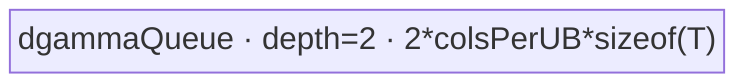

# GroupNormBackward 950 ACLNN 算子知识

## 算子速览

| 项目 | 内容 |
|---|---|
| 实际入口 | `aclnnGroupNormBackwardGetWorkspaceSize` + `aclnnGroupNormBackward`，公开 ACLNN 两段式接口；固定仓最新且唯一版本。 |
| 计算语义 | 与 GroupNorm 反向一致：`dbeta=sum(dy)`，`dgamma=sum(dy*(x-mean)*rstd)`，`dx=rstd*gamma*(dy-(dbeta+xhat*dgamma)/(C/G*HXW))`。 |
| 输入输出 | `dy/x/dx` 为 T；`mean/rstd/gamma/dgamma/dbeta` 为 U；支持 `(T,U)=FP32/FP32、FP16/FP16、BF16/BF16、FP16/FP32、BF16/FP32`。 |
| 执行类型 | 单 Kernel AIV_VECTOR/MicroAPI；entry 标记 `KERNEL_TYPE_MIX_AIV_1_0`，即 1 AIV、0 AIC，不含 Cube/AIC/MIX_CV。 |
| Kernel 路线 | R-000 gamma 空无 launch；R-001 key500 空 x；R-002 keys101–105 G full-load；R-003 keys201–205 C full-load；R-004 keys401–405 small-NG；R-005 keys301–305 recompute。 |
| 核心资源 | GM、AIV UB queue/TBuf/RegTensor、两片 FP32 workspace、AtomicAdd、`SyncAll`；stage2 有两种 N 轴归约 UB 方案。 |
| 来源闭包 | `source_closed`：公开 ACLNN→950 API 分支→`GroupNormGrad` launcher→arch35/empty Tiling/POD→APT router→四模板与 empty body/helper→ascend950 binary config。 |
| 验证状态 | 已完成源码闭包检查；本次知识提取未执行编译、真机、数值或性能测试。 |

## 接口与语义

### 计算语义

令 `D=C/G`、`M=D*HXW`。实现先按 `(n,g,c)` 求 `db=sum_h(dy)` 与 `ds=sum_h(dy*x)`，再用 `dgamma=(ds-mean*db)*rstd`。对 dx，先在组内求 `sum1=sum_c(ds*gamma)`、`sum2=sum_c(db*gamma)`，形成：

```text
C2 = (sum2*mean - sum1) * rstd^3 / M
C3 = -C2*mean - sum2*rstd/M
dx = rstd*gamma*dy + C2*x + C3
```

所有模板用 FP32 RegTensor 做中间计算；T/U 为 16 位时在 MicroAPI load 后升精度、store 前以 `CAST_RINT` 降精度。

### 输入、输出与属性

| 参数 | shape/layout | dtype | 约束、默认值与语义 |
|---|---|---|---|
| `gradOut/input/gradInput` | API reshape `[N,C,HxW]`，ND | T=FP32/FP16/BF16，同 dtype | numel=`N*C*HxW`；输出 mask[0] 控制 dx。 |
| `mean/rstd` | `[N,G]`，ND | U | numel=`N*G`，同 dtype；U 与 T 组合见速览。 |
| `gamma` | `[C]`，ND | U | nullptr 时 Fill 1；非空 numel=C。 |
| `gradGammaOut/gradBetaOut` | `[C]`，ND | U | mask[1]/[2] 控制语义；内部 output 仍总是分配。 |
| `N/C/HxW/group` | scalar | int64 | `group>0`、`C%group=0`、`C/group<=8000`、`C<=240000`。 |
| `outputMask` | size=3 | bool | 为 true 的输出非空且 shape/dtype 匹配。 |

### 入口与版本

公开产品表明确支持 Ascend 950PR/950DT；dtype 对应表公开五种 `(T,U)`。API 以 `IsRegbase(npuArch)` 进入 `l0op::GroupNormGrad`；OpDef 的 ascend950 config 指向 `group_norm_grad_apt`，binary config 接线五个 dtype binary。框架 Contiguous/Reshape/ViewCopy 与 executor 运行是允许的框架边界。

## Host/Launcher 执行流程

### 参数校验与前处理

`CheckParams` 依次校验必需指针、mask、950 混合 dtype、`C/G` 和 numel/shape。随后对 dy/x/mean/rstd/gamma 连续化并 reshape。950 若 gamma 连续 Tensor 为空，workspace=0 且无 launch；若 dy/x/mean/rstd 任一为空且 gamma 非空，调用 `ComputeGroupNormBackwardEmptyInput`，由 `GroupNormGrad` key500 将 dgamma/dbeta 清零。其他输入走常规 `GroupNormGrad`。返回结果按 mask reshape/ViewCopy；注意 empty helper 固定对 dgamma 与 dbeta 都做 ViewCopy，见限制。

### 参数、Workspace 与生命周期

executor owner 与 stream 生命周期同 A2/A3 卡。常规路线令 `W=ceil(N/2)*C`，small-NG 令 `W=N*C`，用户 workspace=`2*W*4` 字节，另加 `sysWorkspaceSize`；两片分别为 dgamma 与 dbeta FP32 partial。N=1 时常规模板直接写 GM，但 Host 仍按公式请求 workspace。key500 固定请求 16 MiB。所有 stage1→stage2 workspace 边都在同一 Kernel 内由 `SyncAll` 建立可见性。

### 启动图与失败传播

```text
ACLNN GetWorkspaceSize -> checks/Contiguous/Reshape
  -> l0op::GroupNormGrad -> one group_norm_grad AIV node
     -> route init / workspace-or-output clear -> SyncAll
     -> stage0 (small-NG only) -> SyncAll
     -> stage1 per (n,g), produces dx + FP32 parameter partials
     -> pipe.Reset + SyncAll -> stage2 N-reduce/cast (N>1)
  -> ViewCopy -> CommonOpExecutorRun(stream)
```

节点失败由 launcher/executor 返回并阻断后续；Kernel unknown key 无 body。节点输入输出为五入三出，POD 为 `GroupNormGradRegBaseTilingData` 或 key500 的 `GroupNormGradEmptyTilingData`，blockDim 为各阶段/清零所需 core 数最大值。

## Route 与参数设计

### 分核与资源计算

常规路径记 `Q=N*G`，`D=C/G`，平台 UB=`UBytes`，AIV core=`K`，UB block=`B`，vector FP32 lanes=`VL`：

```text
stage1 task/core = align_up(Q,K)/K; stage1CoreUsed=ceil(Q/task/core)
reserve = aligned(D)*4*(4+optional2) + optional U-TBuf + 2*B
canUse=(UBytes-reserve)/2
mode0Cap = canUse / (align(D*H,sizeof(T))*sizeof(T)*3 + 2*B)
mode1Cap = canUse / (align(H,sizeof(T))*sizeof(T)*3)
workspace W = mode400 ? N*C : ceil(N/2)*C
```

small-NG 另以 `N*C` tasks 做 stage0 分核。stage2 mode1 按 `cFactor` 把 `reduceNCnt` 行装入 UB；若 `cFactorAlign<1` 切 mode2，Host 联合搜索 `nTileNum∈{128,256,512,1024,2048,4096}` 与 C tile，并生成 cache tree 参数。

### Route 选择

| 顺序 | Route | Key/模板 | 精确选择条件与优先级 | 不适用去向 |
|---:|---|---|---|---|
| 0 | R-000 gamma 空 | 无 launch | 950 且 `gammaContiguous->IsEmpty()` | 否则检查 empty x。 |
| 1 | R-001 empty x | 500 | x storage numel=0 且 gamma storage numel!=0 | 否则常规 selector。 |
| 2 | R-002 G full-load | 101–105 | `mode0UbCapGNum>0` | 否则 R-003/R-004。 |
| 3 | R-004 small-NG | 401–405 | `mode1Cap>0 && Q<=16 && stage0Task/core>=2 && N*(D/mode1Cap)>=32 && N*C<=240000` | 条件任一 false→R-003。 |
| 4 | R-003 C full-load | 201–205 | `mode0Cap==0 && mode1Cap>0` 且非 small-NG | 否则 R-005。 |
| 5 | R-005 recompute | 301–305 | `mode1Cap<=0` 且 mode2 UB tiling 成功 | 否则 Tiling 失败。 |

```text
gamma empty -> no launch
else x empty && gamma nonempty -> key500
else if mode0Cap>0 -> 100+dtypeKey
else if mode1Cap>0 -> (smallNG ? 400 : 200)+dtypeKey
else -> 300+dtypeKey
dtypeKey: FF=1, HH=2, BB=3, HF=4, BF=5
```

### 模板/实现执行矩阵

| Route | key/selector | dtype/shape/platform 完整命中条件 | 执行拓扑与 Kernel 节点 | 实际模板/body | 内存与同步特征 | tail/fallback |
|---|---|---|---|---|---|---|
| R-000 | API | gamma empty | 无节点 | early return | workspace0 | 输出未写。 |
| R-001 | 500 | x empty, gamma nonempty | 单 AIV zero-fill | `EmptyDgamma<U,2>` | depth2 output queue | core/UB tail。 |
| R-002 | 101–105 | group full-load | 单 AIV，stage1→stage2 | `GroupNormGradGFullLoad<T,U>` | whole-group depth2 | H/VL tails。 |
| R-003 | 201–205 | channel tile available | 单 AIV，stage1→stage2 | `GroupNormGradCFullLoad<T,U>` | channel batches depth2 | C tile tail。 |
| R-004 | 401–405 | small-NG compound predicate | 单 AIV，stage0→stage1→stage2 | `GroupNormGradSmallNGCFullLoad<T,U>` | `N*C` workspace layout | stage0/stage1 core tails。 |
| R-005 | 301–305 | no full channel fits | 单 AIV，recompute stage1→stage2 | `GroupNormGradReCompute<T,U>` | H fold + 3-level cache | H tile/fold tail。 |

### 隐藏性能 Guard

| Guard | Host/Tiling 条件 | Device/资源原因 | 影响 Route | 不满足时去向 | 源码符号 |
|---|---|---|---|---|---|
| empty discrimination | x numel=0且gamma!=0 | 只需把两种参数梯度置零 | R-001 | 常规路径 | `TilingShapeEmptyJudge` |
| mixed dtype | 五种 T/U 组合 | router 只有五个模板实例 | 常规 routes | 参数/Tiling失败 | `ParamsCheck/GetTilingKey` |
| small-NG | 完整五项谓词 | 先按 N*C 求原始 db/ds，扩大并行度 | R-004 | R-003 | `UbTiling` |
| mode2 cache | `reserve+3*256*2*4<=UB` | db/ds 三层二进制折叠 cache | R-005 | Tiling失败 | `Mode2UbTiling` |
| stage2 selector | `cFactorAlign>=1` | mode1 row-major N reduce 能装入 UB | all N>1 | stage2 mode2 | `Stage2Tiling` |
| AIV-only task type | `KERNEL_TYPE_MIX_AIV_1_0` | entry 请求 1 AIV/0 AIC | all Device routes | N/A | `group_norm_grad_apt.cpp::group_norm_grad` |

### POD/ABI

宏生成结构的 `sizeof/alignof/offsetof` 固定仓不可见。下表逐字段列出 producer/consumer；“同上”仍表示独立字段。

| 结构 | 字段 | 类型/位宽 | ABI 布局 | 单位 | Host/launcher producer | Device consumer | 边界 |
|---|---|---|---|---|---|---|---|
| Base | `N` | int64/64 | 固定仓不可见 | batch | dy dim0 | Parse/stage2 | >0 regular。 |
| Base | `C` | int64/64 | 同上 | channel | dy dim1 | all addressing | <=240000。 |
| Base | `HXW` | int64/64 | 同上 | element | dim[2:] product | stage1 | >0 regular。 |
| Base | `G` | int64/64 | 同上 | group | attr | offsets | >0。 |
| Base | `clrBlockSize` | int64/64 | 同上 | FP32 element | workspace clear tiling | InitOutput | >=512 regular。 |
| Base | `clrTailBlockSize` | int64/64 | 同上 | element | clear tail | InitOutput | last clear core。 |
| Base | `clrBlockNum` | uint32/32 | 同上 | core | ceil(W/clrSize) | InitOutput | clear grid。 |
| Base | `taskNumPerCore` | uint32/32 | 同上 | (n,g) task | BlockTiling | InitCommon | former。 |
| Base | `taskNumPerTailCore` | uint32/32 | 同上 | task | BlockTiling | InitCommon | tail。 |
| Base | `tailCore` | uint32/32 | 同上 | core index | BlockTiling | InitCommon | boundary。 |
| Base | `stage1CoreUsed` | uint32/32 | 同上 | core | BlockTiling | Process | stage1 guard。 |
| Base | `mode0UbCapGNum` | uint32/32 | 同上 | group/UB | UbTiling | GFull loops | R-002 only。 |
| Base | `mode1UbCapCNum` | uint32/32 | 同上 | channel/UB | UbTiling | C/small loops | R-003/004。 |
| Base | `mode2UbCapEle` | uint32/32 | 同上 | element | Mode2UbTiling | recompute | R-005。 |
| Base | `mode2UbIterNum` | uint32/32 | 同上 | loop | Host | dx recompute | R-005。 |
| Base | `mode2UbTailNum` | uint32/32 | 同上 | element | Host | dx tail | R-005。 |
| Base | `mode2MainLoopCnt` | uint32/32 | 同上 | loop | Host | Mode2DbetaDs | R-005。 |
| Base | `mode2FoldLoopCnt` | uint32/32 | 同上 | loop | Host | fold branch | R-005。 |
| Base | `mode2OneLoopSize` | uint32/32 | 同上 | element | Host | main/fold DMA | R-005。 |
| Base | `mode2FoldTail` | uint32/32 | 同上 | element | Host | fold tail | R-005。 |
| Base | `workSpaceSize` | uint32/32 | 同上 | FP32 elem/slice | GetWorkspaceSize | GM binding | W may narrow。 |
| Base | `dxIsRequire` | int32/32 | 同上 | bool | attr2 | Compute | 0/1。 |
| Base | `dgammaIsRequire` | int32/32 | 同上 | bool | attr3 | store/stage2 | 0/1。 |
| Base | `dbetaIsRequire` | int32/32 | 同上 | bool | attr4 | store/stage2 | 0/1。 |
| Base | `stage0TaskNumPerCore` | uint32/32 | 同上 | N*C task | BlockTiling | small-NG | R-004。 |
| Base | `stage0TaskNumPerTailCore` | uint32/32 | 同上 | task | Host | small-NG | R-004。 |
| Base | `stage0TailCore` | uint32/32 | 同上 | core | Host | small-NG | R-004。 |
| Base | `stage0CoreUsed` | uint32/32 | 同上 | core | Host | small-NG | R-004。 |
| Reduce | `binaryAddQuotient` | int64/64 | 同上 | element | `CalBinaryParams(H)` | binary fold | regular。 |
| Reduce | `binaryAddK` | uint32/32 | 同上 | fold level | Host | fold loops | regular。 |
| Reduce | `binaryAddLastNum` | uint32/32 | 同上 | lane | Host | final ReduceSum mask | regular。 |
| Reduce | `binaryCGQuotient` | int64/64 | 同上 | channel | `CalBinaryParams(D)` | sum1/sum2 fold | regular。 |
| Reduce | `binaryCGK` | uint32/32 | 同上 | fold level | Host | sum1/sum2 | regular。 |
| Reduce | `binaryCGLastNum` | uint32/32 | 同上 | lane | Host | final mask | regular。 |
| K2 | `stage2Mode` | uint32/32 | 同上 | enum | Stage2Tiling | Stage2Process | 1/2。 |
| K2 | `cFactor` | uint32/32 | 同上 | channel/tile | Host | stage2 mode1 | aligned。 |
| K2 | `cBlockFactor` | uint32/32 | 同上 | channel/core | Host | stage2 mode1 | former。 |
| K2 | `cTailBlockFactor` | uint32/32 | 同上 | channel | Host | last core | tail。 |
| K2 | `stage2CoreUsed` | uint32/32 | 同上 | core | Host | stage2 guard | max blockDim input。 |
| K2 | `stage2BinaryAddK` | uint32/32 | 同上 | fold level | Host | mode1 >8 | inactive <=8。 |
| K2 | `cNumMode2PerCore` | uint32/32 | 同上 | channel | Host default0 | parsed, fixed body unused | 保留 ABI。 |
| K2 | `tailcNumMode2PerCore` | uint32/32 | 同上 | channel | Host default0 | parsed, fixed body unused | 保留 ABI。 |
| K2 | `stage2BinaryAddQuotient` | int64/64 | 同上 | N rows | Host | mode1 reduce | >8 only。 |
| K2 | `reduceNCnt` | int64/64 | 同上 | N rows | N or ceil(N/2) | stage2 | route-dependent。 |
| K2 | `stage2LoopCnt` | int64/64 | 同上 | loop | Host default0 | parsed, fixed body unused | 保留 ABI。 |
| K2 | `stage2FactorN` | int64/64 | 同上 | N rows | Host default0 | parsed, fixed body unused | 保留 ABI。 |
| K2 | `cFactorStage2Mode2` | int64/64 | 同上 | channel/tile | mode2 search | stage2 mode2 | >0。 |
| K2 | `cLoopMainBlock` | int64/64 | 同上 | loop | mode2 search | non-tail core | >=1。 |
| K2 | `cTailMainBlock` | int64/64 | 同上 | channel | mode2 search | main last tile | >0。 |
| K2 | `cLoopTailBlock` | int64/64 | 同上 | loop | mode2 search | tail core | >=1。 |
| K2 | `cTailTailBlock` | int64/64 | 同上 | channel | mode2 search | tail last tile | >0。 |
| K2 | `nFactorStage2Mode2` | int64/64 | 同上 | N rows/tile | candidate list | triple buffer DMA | 128..4096。 |
| K2 | `nLoop` | int64/64 | 同上 | basic blocks | nearest power2 | cache update | mode2。 |
| K2 | `nMainFlodCount` | int64/64 | 同上 | blocks | nLoop-basic | fold | mode2。 |
| K2 | `nTail` | int64/64 | 同上 | N rows | reduceNCnt%nTile | tail | mode2。 |
| K2 | `cacheBufferCount` | int64/64 | 同上 | buffers | log2(basic) | InitBuffer | mode2。 |
| K2 | `resultCacheId` | int32/32 | 同上 | cache id | Host GetCacheID | final output | mode2。 |
| Empty | `usedCoreNumDG` | uint32/32 | 同上 | core | CalcUsedCoreNumGamma | empty Process | <=AIV cores。 |
| Empty | `colsPerCoreDG` | uint64/64 | 同上 | U element | Host | GM offset | regular core。 |
| Empty | `cols` | uint64/64 | 同上 | U element | gamma numel | debug/body extent | C。 |
| Empty | `ubSize` | uint32/32 | 同上 | byte | platform | Host math; body unused | platform UB。 |
| Empty | `colsPerUBDG` | uint64/64 | 同上 | U element | power2 tiling | queue capacity | >0。 |
| Empty | `coreUbBlockCount` | uint64/64 | 同上 | loop | Host | non-tail core | full loops before tail。 |
| Empty | `tailUbCols` | uint64/64 | 同上 | U element | Host | non-tail tail | >0。 |
| Empty | `lastCoreBlockCount` | uint64/64 | 同上 | loop | Host | last core | tail core。 |
| Empty | `lastCoreTailUbCols` | uint64/64 | 同上 | U element | Host | last tail | >0。 |
| Empty | `colsLastCoreDG` | uint64/64 | 同上 | U element | Host | parsed only | 保留。 |
| Empty | `workspaceSize` | uint32/32 | 同上 | byte | 16MiB | fixed body unused | executor allocation。 |

### Route 源码闭包

| Route | Key/selector | Host/Tiling producer | POD/参数 | Kernel entry/router 节点 | Kernel body/直接依赖 | 构建接线 |
|---|---|---|---|---|---|---|
| R-000 | gamma empty | `op_host/op_api/aclnn_group_norm_backward.cpp::aclnnGroupNormBackwardGetWorkspaceSize` | N/A | N/A | N/A | API source |
| R-001 | 500 | `op_host/group_norm_grad_empty_tiling_arch35.cpp::GroupNormGradEmptyTiling` | Empty POD | `op_kernel/group_norm_grad_apt.cpp::group_norm_grad` | `op_kernel/arch35/group_norm_grad_empty_load.h::EmptyDgamma` | ascend950 config |
| R-002 | 101–105 | RegBase `UbTiling` | RegBase POD | APT router | GFull+Base+Common | 同上 |
| R-003 | 201–205 | 同上 | 同上 | 同上 | CFull+Base+Common | 同上 |
| R-004 | 401–405 | smallNG predicate | 同上 | 同上 | SmallNG+Base+Common | 同上 |
| R-005 | 301–305 | Mode2UbTiling | 同上 | 同上 | ReCompute+Base+Common | 同上 |

## Kernel 实现

### 公共执行流程

APT router 按 mode 百位与五种 dtype key 实例化 route class；entry 的 `KERNEL_TYPE_MIX_AIV_1_0` 不启动 AIC。四个常规模板继承 `GroupNormGradBase<T,U>`：解析 POD，绑定 `workspace[0:W]`/`workspace[W:2W]`，以 FP32 partial、RegTensor 与 MicroAPI 实现 reduce/dx。`InitOutPutOrWorkSpace` 后 `SyncAll`，stage1 完成后 `Stage2Process` 执行 `pipe.Reset()+SyncAll`。stage2 mode1 把 `reduceNCnt×Ctile` 跨行 DMA 到 UB，再按 N=2/4/8/>8 专用树归约；mode2 用 triple-buffer N×C tiles 与 cache tree。所有路线均是同一个 Device 节点内的阶段，不是多 Kernel。

### Route R-000：gamma 空无 launch

#### 适用条件

##### 选择证据

| 层级 | 文件 | 符号 | 源码谓词/参数 | 结果/下一跳 |
|---|---|---|---|---|
| API | `op_host/op_api/aclnn_group_norm_backward.cpp` | GetWorkspaceSize | Regbase 且 `gammaContiguous->IsEmpty()` | workspace0 return。 |

#### Device 数据流

##### 函数级调用链

```text
GetWorkspaceSize -> gamma empty -> ReleaseTo(executor) -> return
```

##### 源码等价伪码

```text
if gamma_contiguous.empty: workspace=0; no launcher
```

#### 内存与数据搬运

##### 资源与搬运表

| 层级/缓冲区 | offset/地址公式 | extent/容量公式 | dtype/layout | producer | consumer | owner/lifetime | 对齐/复用 |
|---|---|---|---|---|---|---|---|
| Device | N/A | 0 | N/A | N/A | N/A | 无节点 | N/A |

##### 分层内存布局

N/A：无 AIV UB。

##### 字节账与复用顺序

```text
UB_total=0; workspace_total=0; dynamic_ub=N/A
```

| 复用子区 | 写入者 | 读取者/消费点 | 下一次覆盖 | 同步或释放依据 | 安全条件 |
|---|---|---|---|---|---|
| N/A | N/A | N/A | N/A | API return | gamma empty。 |

#### 同步、精度与尾块

##### 同步与数值边界表

| 阶段 | primitive/机制 | producer | consumer/等待点 | 保护对象 | 精度/尾块 |
|---|---|---|---|---|---|
| API | early return | checks | caller | executor | 不写输出。 |

#### 关键实现

##### 符号证据表

| 阶段 | 文件 | 符号/模板实例 | 实现事实 |
|---|---|---|---|
| Host/Tiling producer | `op_host/op_api/aclnn_group_norm_backward.cpp` | `aclnnGroupNormBackwardGetWorkspaceSize` | gamma empty 无 launch。 |
| Kernel entry/router | N/A | N/A | 无节点。 |
| Device body/helper | N/A | N/A | 无节点。 |

### Route R-001：空 x 参数梯度清零

#### 适用条件

##### 选择证据

| 层级 | 文件 | 符号 | 源码谓词/参数 | 结果/下一跳 |
|---|---|---|---|---|
| outer selector | `group_norm_grad_tiling.cpp` | `TilingShapeEmptyJudge` | x numel=0且gamma numel!=0 | EmptyTiling/key500。 |
| router | `group_norm_grad_apt.cpp` | `group_norm_grad` | key500 | `EmptyDgamma<DTYPE_DY,2>`。 |

#### Device 数据流

##### 函数级调用链

```text
group_norm_grad -> EmptyDgamma::Init -> Process -> CalcDgamma
  -> Duplicate(0) -> CopyDgammaAndDbetaToGm
```

##### 源码等价伪码

```text
split C columns across cores and power-of-two UB chunks
for each chunk: duplicate U zero; copy same UB zero region to dgamma and dbeta
dx has zero elements and is not written
```

#### 内存与数据搬运

##### 资源与搬运表

| 层级/缓冲区 | offset/地址公式 | extent/容量公式 | dtype/layout | producer | consumer | owner/lifetime | 对齐/复用 |
|---|---|---|---|---|---|---|---|
| output GM | `core*colsPerCore+loop*colsPerUB` | C | U/[C] | zero UB | dgamma/dbeta | ACLNN output | valid tail only。 |
| dgammaQueue | 0 | `2*colsPerUB*sizeof(T)` | T | Duplicate | two CopyOut | Kernel | router 固定实例化 `DTYPE_DY`。 |

##### 分层内存布局



##### 字节账与复用顺序

```text
UB_total=2*colsPerUB*sizeof(T) <= platform UB
workspace_total=16MiB (body does not consume it)
```

| 复用子区 | 写入者 | 读取者/消费点 | 下一次覆盖 | 同步或释放依据 | 安全条件 |
|---|---|---|---|---|---|
| zero queue slot | Duplicate | dgamma then dbeta DMA | next loop | EnQue/DeQue/FreeTensor | both copies submitted。 |

#### 同步、精度与尾块

##### 同步与数值边界表

| 阶段 | primitive/机制 | producer | consumer/等待点 | 保护对象 | 精度/尾块 |
|---|---|---|---|---|---|
| zero | Queue | Duplicate | CopyOut | zero UB | 以 T 写零；last-core/tile counts explicit。 |

#### 关键实现

##### 符号证据表

| 阶段 | 文件 | 符号/模板实例 | 实现事实 |
|---|---|---|---|
| Host/Tiling producer | `op_host/group_norm_grad_empty_tiling_arch35.cpp` | `CalcUsedCoreNumGamma/CalcuTilingData` | core/UB/tail。 |
| Kernel entry/router | `op_kernel/group_norm_grad_apt.cpp` | key500 | EmptyDgamma 实例。 |
| Device body/helper | `op_kernel/arch35/group_norm_grad_empty_load.h` | `EmptyDgamma::Process` | zero fill/copy。 |

### Route R-002：G full-load

#### 适用条件

##### 选择证据

| 层级 | 文件 | 符号 | 源码谓词/参数 | 结果/下一跳 |
|---|---|---|---|---|
| Tiling | `op_host/group_norm_grad_tiling_arch35.cpp` | `GroupNormGradRegBaseTiling::UbTiling` | `mode0UbCapGNum>0` | key100+dtype。 |
| Router | `op_kernel/group_norm_grad_apt.cpp` | `group_norm_grad` | 101–105 | `GroupNormGradGFullLoad<T,U>`。 |

#### Device 数据流

##### 函数级调用链

```text
InitCommon -> InitOutPutOrWorkSpace -> InitBuffer -> SyncAll
Process -> Stage1Process -> Compute -> VFMode0DbetaDs -> StoreDgammaDbeta
  -> ComputeMode0Dx -> StoreDxToGm -> Stage2Process
```

##### 源码等价伪码

```text
load currGNum whole groups x/dy plus their mean/rstd
for each group: reduce per-channel db,ds; atomic partial; compute dx in resident group
after all cores: reduce workspace across N when N>1
```

#### 内存与数据搬运

##### 资源与搬运表

| 层级/缓冲区 | offset/地址公式 | extent/容量公式 | dtype/layout | producer | consumer | owner/lifetime | 对齐/复用 |
|---|---|---|---|---|---|---|---|
| whole-group queues | `task*D*H` | `mode0Cap*D*H` | T | DMA | reduce/dx | Kernel | x/dy/dx depth2。 |
| scalar/group queues | channel/group | `align(D)*4`, `align(mode0Cap)*4` | FP32 | cast/load | compute | Kernel | mean/rstd/gamma/db/ds。 |
| workspace slices | partial row offset | `2*ceil(N/2)*C*4` | FP32 | Atomic stage1 | stage2 | executor | SyncAll。 |

##### 分层内存布局


##### 字节账与复用顺序

```text
UB_stage1 = 6*align(Gcap*D*H)*s + mean/rstd TBuf+FP32 queues + 4*align(D)*4 + optional 2*align(D)*sizeof(U)
UB_stage2 = mode1 or mode2 formula below; pipe reset means max, not sum
workspace_total=S+2*ceil(N/2)*C*4
```

| 复用子区 | 写入者 | 读取者/消费点 | 下一次覆盖 | 同步或释放依据 | 安全条件 |
|---|---|---|---|---|---|
| resident x/dy | CopyIn | db/ds then dx | next G batch | Queue FreeTensor | dx finished before free。 |

#### 同步、精度与尾块

##### 同步与数值边界表

| 阶段 | primitive/机制 | producer | consumer/等待点 | 保护对象 | 精度/尾块 |
|---|---|---|---|---|---|
| partial | AtomicAdd<U/float> or workspace float | group compute | stage2 | dgamma/dbeta | `H==1` special，else H masks/binary fold。 |
| cast | MicroAPI | T/U load | RegTensor FP32 | arithmetic | `CAST_RINT` on store。 |

#### 关键实现

##### 符号证据表

| 阶段 | 文件 | 符号/模板实例 | 实现事实 |
|---|---|---|---|
| Host/Tiling producer | `op_host/group_norm_grad_tiling_arch35.cpp` | `BlockTiling/UbTiling` | Gcap/key/workspace。 |
| Kernel entry/router | `op_kernel/group_norm_grad_apt.cpp` | keys101–105 | five T/U instances。 |
| Device body/helper | `op_kernel/arch35/group_norm_grad_g_full_load.h`、`group_norm_grad_base.h`、`group_norm_grad_common.h` | `Stage1Process/Compute/Stage2Process` | full group pipeline。 |

### Route R-003：C full-load

#### 适用条件

##### 选择证据

| 层级 | 文件 | 符号 | 源码谓词/参数 | 结果/下一跳 |
|---|---|---|---|---|
| Tiling | `op_host/group_norm_grad_tiling_arch35.cpp` | `GroupNormGradRegBaseTiling::UbTiling` | mode0=0, mode1>0, smallNG false | key200+dtype。 |

#### Device 数据流

##### 函数级调用链

```text
CFull::Process -> LoadMeanRstd -> Compute
 -> channel-batch CopyIn -> VFMode1DbetaDs/binary fold -> StoreDgammaDbeta
 -> ComputeMode1Dx (second channel-batch pass) -> Stage2Process
```

##### 源码等价伪码

```text
for (n,g): for cTile: load H*x/dy; reduce db,ds
store partials; load gamma; derive C2/C3
for cTile again: reload x/dy and write dx
```

#### 内存与数据搬运

##### 资源与搬运表

| 层级/缓冲区 | offset/地址公式 | extent/容量公式 | dtype/layout | producer | consumer | owner/lifetime | 对齐/复用 |
|---|---|---|---|---|---|---|---|
| channel batch | `task*DH+loop*Ccap*H` | `Ccap*H` | T | DMA | reduce/dx | Kernel | tail C explicit。 |
| UB stage1 | 0 | `6*align(Ccap*H)*s + 4*align(D)*4 + 2B + optional2*align(D)*sizeof(U)` | mixed | InitBuffer | CFull | Kernel | x/dy/dx depth2。 |

##### 分层内存布局


##### 字节账与复用顺序

```text
UB_stage1 = exact InitBuffer sum above
UB_stage2_mode1 = 2*cAlign*sizeof(U)*2 + 2*(reduceN+1)*cAlign*4*2 + optional cast/temp buffers
workspace_total=S+2*ceil(N/2)*C*4
```

| 复用子区 | 写入者 | 读取者/消费点 | 下一次覆盖 | 同步或释放依据 | 安全条件 |
|---|---|---|---|---|---|
| x/dy depth slots | reduction pass then dx pass | vector | next cTile | FreeTensor | pass内消费完成。 |

#### 同步、精度与尾块

##### 同步与数值边界表

| 阶段 | primitive/机制 | producer | consumer/等待点 | 保护对象 | 精度/尾块 |
|---|---|---|---|---|---|
| cTile | Queue/MicroAPI mask | DMA | reduce/dx | UB | H and last C tile masked。 |

#### 关键实现

##### 符号证据表

| 阶段 | 文件 | 符号/模板实例 | 实现事实 |
|---|---|---|---|
| Host/Tiling producer | `op_host/group_norm_grad_tiling_arch35.cpp` | `UbTiling` | Ccap/smallNG fallthrough。 |
| Kernel entry/router | `op_kernel/group_norm_grad_apt.cpp` | keys201–205 | CFull instances。 |
| Device body/helper | `op_kernel/arch35/group_norm_grad_c_full_load.h`、`group_norm_grad_base.h`、`group_norm_grad_common.h` | `Compute/VFMode1DbetaDs/ComputeMode1Dx` | two-pass C tiling。 |

### Route R-004：small-NG 三阶段

#### 适用条件

##### 选择证据

| 层级 | 文件 | 符号 | 源码谓词/参数 | 结果/下一跳 |
|---|---|---|---|---|
| Tiling | `op_host/group_norm_grad_tiling_arch35.cpp` | `GroupNormGradRegBaseTiling::UbTiling` | 完整 smallNGCase 且 N*C<=240000 | key400+dtype。 |

#### Device 数据流

##### 函数级调用链

```text
SmallNG::Process
 -> ComputeStage0 (N*C parallel raw db=sumHdy, ds=sumHdy*x -> workspace)
 -> SyncAll
 -> ComputeStage1 (per N*G: workspace read, dgamma transform, dx)
 -> ComputeStage2 -> SyncAll/Reset -> N reduce
```

##### 源码等价伪码

```text
stage0: parallel over channels, write raw db/ds in [N,C]
stage1: for each (n,g), read D raw values; compute dgamma=(ds-mean*db)*rstd;
        compute dx by C tiles; overwrite dgamma workspace with transformed partial
stage2: reduce N rows to dgamma/dbeta
```

#### 内存与数据搬运

##### 资源与搬运表

| 层级/缓冲区 | offset/地址公式 | extent/容量公式 | dtype/layout | producer | consumer | owner/lifetime | 对齐/复用 |
|---|---|---|---|---|---|---|---|
| raw workspace | `n*C+c` | two `N*C` slices | FP32 | stage0 | stage1/stage2 | executor | stage1 overwrites ds slice with dgamma。 |
| UB stage0/1 | channel tile | `6*align(Ccap*H)*s + 6*align(D)*4 + 2B + optional gamma TBuf` | mixed | InitBuffer | all stages | Kernel | queues reused across barriers。 |

##### 分层内存布局


##### 字节账与复用顺序

```text
workspace_total=S+2*N*C*4
stage0 -> SyncAll -> stage1 overwrite transformed dgamma -> SyncAll -> stage2
```

| 复用子区 | 写入者 | 读取者/消费点 | 下一次覆盖 | 同步或释放依据 | 安全条件 |
|---|---|---|---|---|---|
| dgamma workspace | stage0 raw ds | stage1 | stage1 transformed dgamma | first SyncAll | raw ds slice read before overwrite。 |

#### 同步、精度与尾块

##### 同步与数值边界表

| 阶段 | primitive/机制 | producer | consumer/等待点 | 保护对象 | 精度/尾块 |
|---|---|---|---|---|---|
| stage0→1 | `SyncAll` | N*C producer | N*G consumer | raw workspace | exact task/core tails。 |
| stage1→2 | `SyncAll` | transformed partials | N reduce | workspace | FP32 until final U cast。 |

#### 关键实现

##### 符号证据表

| 阶段 | 文件 | 符号/模板实例 | 实现事实 |
|---|---|---|---|
| Host/Tiling producer | `op_host/group_norm_grad_tiling_arch35.cpp` | `BlockTiling/UbTiling/GetWorkspaceSize` | stage0 grid、predicate、N*C layout。 |
| Kernel entry/router | `op_kernel/group_norm_grad_apt.cpp` | keys401–405 | SmallNG instances。 |
| Device body/helper | `op_kernel/arch35/group_norm_grad_small_ng_c_full_load.h`、`group_norm_grad_base.h` | `ComputeStage0/1/2` | three-stage dataflow。 |

### Route R-005：HXW fold/recompute

#### 适用条件

##### 选择证据

| 层级 | 文件 | 符号 | 源码谓词/参数 | 结果/下一跳 |
|---|---|---|---|---|
| Tiling | `op_host/group_norm_grad_tiling_arch35.cpp` | `UbTiling/Mode2UbTiling` | mode1Cap<=0且 cache/tile checks pass | key300+dtype。 |

#### Device 数据流

##### 函数级调用链

```text
ReCompute::Process -> Compute
 -> for channel Mode2DbetaDs -> VFMode2DbetaDs -> UpdateCache/CustomReduceSum
 -> StoreDgammaDbeta -> ComputeMode2Dx tiled reload -> Stage2Process
```

##### 源码等价伪码

```text
for each channel:
  split H into main and folded regions; load paired tiles into one depth2 allocation
  reduce paired segments into 256-entry level0 cache
  every 256 blocks fold to level1; every 65536 to level2; final cache -> db/ds
store partials; reload H tiles to compute dx; stage2 reduce N
```

#### 内存与数据搬运

##### 资源与搬运表

| 层级/缓冲区 | offset/地址公式 | extent/容量公式 | dtype/layout | producer | consumer | owner/lifetime | 对齐/复用 |
|---|---|---|---|---|---|---|---|
| main/fold GM | channel base + loop*oneLoop | q/tail | T | DMA | VF fold | tensor | fold tail explicit。 |
| cache UB | levels 0/256/512 | `2*3*256*4` | FP32 | VF partials | CustomReduceSum | Kernel | db/ds separate。 |
| x/dy/dx queues | tile | each depth2 cap | T | DMA/vector | fold/dx | Kernel | outQueDx temporarily reused as fold scratch。 |

##### 分层内存布局


##### 字节账与复用顺序

```text
UB_stage1=6*align(q)*s + 2*3*256*4 + 4*align(D)*4 + 2B + optional2*align(D)*sizeof(U)
workspace_total=S+2*ceil(N/2)*C*4
```

| 复用子区 | 写入者 | 读取者/消费点 | 下一次覆盖 | 同步或释放依据 | 安全条件 |
|---|---|---|---|---|---|
| outQueDx | `VFMode2DbetaDs` fold scratch | cache result | later actual dx | `FreeTensor` | scratch freed before dx allocation。 |

#### 同步、精度与尾块

##### 同步与数值边界表

| 阶段 | primitive/机制 | producer | consumer/等待点 | 保护对象 | 精度/尾块 |
|---|---|---|---|---|---|
| fold | `LocalMemBar` + cache hierarchy | reg partial | next fold level | cache | main has no tail；fold tail from POD。 |
| dx | mask | DMA | MicroAPI | tile | last=`mode2UbTailNum`。 |

#### 关键实现

##### 符号证据表

| 阶段 | 文件 | 符号/模板实例 | 实现事实 |
|---|---|---|---|
| Host/Tiling producer | `op_host/group_norm_grad_tiling_arch35.cpp` | `Mode2UbTiling` | q/main/fold/cache params。 |
| Kernel entry/router | `op_kernel/group_norm_grad_apt.cpp` | keys301–305 | ReCompute instances。 |
| Device body/helper | `op_kernel/arch35/group_norm_grad_recompute.h`、`group_norm_grad_base.h`、`group_norm_grad_common.h` | `Mode2DbetaDs/UpdateCache/ComputeMode2Dx` | fold network and reuse。 |

## 算子特定优化

### Trick T-001：容量与 small-NG 联合 selector

#### 触发与源码依据

- 适用 Route：R-002–R-005
- 触发条件：mode0/mode1 capacity 与 smallNG 完整谓词。
- Golden 来源：[`group_norm_grad_tiling_arch35.cpp:376-402`](../../../../../../../cann-ops-raw/ascendc/ops-nn/955f8b33985b6d72989ebff341bb9c2c564a51bc/norm/group_norm_grad/op_host/group_norm_grad_tiling_arch35.cpp#L376-L402)

**官方源码（固定 Commit 连续逐字摘录）**：

```cpp
if (mode0UbCapGNum_ > 0) {
    modeKey_ = MODE_0;
} else if (mode1UbCapCNum_ > 0) {
    bool smallNGCase = (NxG_ <= SMALL_NG) && (stage0TaskNumPerCore_ >= STAGE0_C_PER_CORE) &&
                       ((N_ * (CPerG_ / mode1UbCapCNum_)) >= SMALL_NG_ND_CHAT);
    if (smallNGCase && (NxC_ <= MAX_C_SIZE)) {
        modeKey_ = MODE_3;
    } else {
        modeKey_ = MODE_1;
    }
} else if (mode1UbCapCNum_ <= 0) {
    modeKey_ = MODE_2;
```

#### 机制与设计原因

优先避免重载；当 `(N,G)` 并行度小但 channel 工作量足够大时，改按 `N*C` stage0 并行，再用 workspace 重组回 group，避免少核占用。该选择同时改变任务域、workspace layout 与同步图。

#### 迁移边界

- 适用：group-level task 数少、channel-level task 足够多的 reduce backward。
- 前提：stage0/stage1 workspace 地址变换完全一致。
- 失效：任一 smallNG guard 失败回 C full-load；channel 也放不下回 recompute。
- 未验证：本次知识提取未执行编译、真机、数值或性能测试。

#### 错误做法

固定仓未提供可验证反例。

### Trick T-002：16 位只在边界 cast，核心统一 FP32 RegTensor

#### 触发与源码依据

- 适用 Route：所有 T/U 为 FP16/BF16 的常规路线
- 触发条件：模板类型为 half/bfloat16。
- Golden 来源：[`group_norm_grad_common.h:71-92`](../../../../../../../cann-ops-raw/ascendc/ops-nn/955f8b33985b6d72989ebff341bb9c2c564a51bc/norm/group_norm_grad/op_kernel/arch35/group_norm_grad_common.h#L71-L92)

**官方源码（固定 Commit 连续逐字摘录）**：

```cpp
if constexpr (IsSameType<T, half>::value) {
    RegTensor<half> xFp16Q;
    RegTensor<half> xFp16R;
    DataCopy<half, LoadDist::DIST_UNPACK_B16>(xFp16Q, ((__local_mem__ half*)(src1) + (src1Offset)));
    DataCopy<half, LoadDist::DIST_UNPACK_B16>(xFp16R, ((__local_mem__ half*)(src2) + (src2Offset)));
    Cast<float, half, castTraitB162B32>(dst1, xFp16Q, dst1Preg);
    Cast<float, half, castTraitB162B32>(dst2, xFp16R, dst2Preg);
```

#### 机制与设计原因

GM/UB 保持紧凑 T/U，寄存器计算、归约和 workspace partial 统一 FP32；降精度 trait 使用 `NO_SAT + CAST_RINT`，避免在归约树中反复量化。

#### 迁移边界

- 适用：FP16/BF16 输入但梯度归约需要 FP32 中间量的 950 Vector Kernel。
- 前提：load/store pack/unpack、mask 与 vector length 匹配。
- 失效：FP32 路线直接 DataCopy，不创建 16 位 cast TBuf。
- 未验证：本次知识提取未执行编译、真机、数值或性能测试。

#### 错误做法

固定仓未提供可验证反例。

### Trick T-003：recompute 的三级 256-entry cache

#### 触发与源码依据

- 适用 Route：R-005
- 触发条件：完整 channel 不入 UB，mode2 tiling 成功。
- Golden 来源：[`group_norm_grad_base.h:464-487`](../../../../../../../cann-ops-raw/ascendc/ops-nn/955f8b33985b6d72989ebff341bb9c2c564a51bc/norm/group_norm_grad/op_kernel/arch35/group_norm_grad_base.h#L464-L487)

**官方源码（固定 Commit 连续逐字摘录）**：

```cpp
if (IsNeedUpdateLevel1Cache(basicBlockIdx)) {
    CustomReduceSum(cacheDbeta[CACHE_LEVEL1_IDX], cacheDbeta[CACHE_LEVEL0_IDX], (basicBlockIdx & 0Xff00) >> 8);
    CustomReduceSum(cacheDgamma[CACHE_LEVEL1_IDX], cacheDgamma[CACHE_LEVEL0_IDX], (basicBlockIdx & 0Xff00) >> 8);
}
if (IsNeedUpdateLevel2Cache(basicBlockIdx)) {
    CustomReduceSum(cacheDbeta[CACHE_LEVEL2_IDX], cacheDbeta[CACHE_LEVEL1_IDX], basicBlockIdx >> 16);
    CustomReduceSum(cacheDgamma[CACHE_LEVEL2_IDX], cacheDgamma[CACHE_LEVEL1_IDX], basicBlockIdx >> 16);
}
```

#### 机制与设计原因

长 H 不物化完整 FP32 x/dy；成对搬入 main/fold T tiles，局部 reduce 后每 256 块折叠一级，每 65536 块再折叠一级。固定三层 cache 限制 UB，同时保持分层归约顺序。

#### 迁移边界

- 适用：极长归约轴且输入可重载的 backward。
- 前提：Host 预留 `3*256*2*4` 字节并生成 main/fold 参数。
- 失效：完整 channel 可入 UB 时使用 C/G full-load。
- 未验证：本次知识提取未执行编译、真机、数值或性能测试。

#### 错误做法

固定仓未提供可验证反例。

## 模板与实现对比

| 对比维度 | R-001 empty | R-002 G full | R-003 C full | R-004 small-NG | R-005 recompute | 设计选择依据 |
|---|---|---|---|---|---|---|
| 命中条件/优先级 | x empty | group fit | channel fit | smallNG compound | channel not fit | selector order。 |
| 模板与 dtype | `EmptyDgamma<U>` | GFull<T,U> | CFull<T,U> | SmallNG<T,U> | ReCompute<T,U> | five dtype instances。 |
| 循环与分核 | C/core/tile | (n,g)/core | (n,g)→cTile | N*C→N*G→C | (n,g)→c→Hfold | task-domain specialization。 |
| Queue/TBuf/寄存器 | zero depth2 | whole group depth2 | channel depth2 | channel depth2+workspace | tile depth2+cache | UB fit。 |
| 内存总占用与复用 | 2*tile*U | resident x/dy/dx | two-pass reload | dgamma slice overwrite | outQueDx scratch reuse | lifetimes proven by barriers/free。 |
| 搬运/Vector API | Duplicate/Copy | MicroAPI reduce/dx | tiled DMA | three-stage DMA | fold/cache | all AIV。 |
| 同步、精度与 tail | queue tail | SyncAll/stage2 | same | two SyncAll boundaries | cache LocalMemBar | FP32 compute。 |
| fallback/失败边界 | N/A | →C/small | →recompute | predicate false→C | UB fail | no Device fallback。 |

## 平台差异

| 项目 | A2 | A3 | 950 |
|---|---|---|---|
| 支持状态 | 公开支持，见无后缀卡 | 同 | 公开支持 950PR/950DT |
| Host/Launcher | 非 arch35 Tiling | 同 | RegBase/empty Tiling，多模板 key |
| Kernel/资源 | 单 class 五 mode | 同 | 四 route classes、MicroAPI、mixed T/U、key500 |

## 限制与失败边界

- API 与 Tiling 的 shape/dtype/`C/G` 约束必须同时满足；常规 Tiling 要求所有 x/dy 维度>=1，空域必须由 key500 外层 selector 接管。
- empty helper 固定对 dgamma 与 dbeta 都做 ViewCopy，Kernel key500 也无条件写两者；若相应 mask=false 且输出指针为空，API 的公开 mask 语义与该固定空路径存在实现风险，固定仓无 fallback。
- key500 router 实例化 `EmptyDgamma<DTYPE_DY,2>`，body 将 dgamma/dbeta 地址 reinterpret 为 T；混合 dtype `(FP16/BF16, FP32)` 时公开输出为 U=FP32，但 body 仅按 T 宽度写零，固定仓存在输出覆盖不完整风险。
- key500 请求 16 MiB workspace 但 Device body不读取；不得擅自删减，因为 executor ABI 由 Tiling 返回值决定。
- `workSpaceSize` 在 POD 中为 uint32，而 Host 内部为 int64；超大 `N*C` 的窄化无独立 guard。多个 DMA blockLen/stride 有 uint32 位宽，固定仓未见更大维度拆分。
- POD 宏展开偏移固定仓不可见；`cNumMode2PerCore/tailcNumMode2PerCore/stage2LoopCnt/stage2FactorN` 在固定 body 中未形成消费闭包，只能按 inactive ABI 字段保留。
- runtime unknown key 无 body；Host 只产生列出的 21 个 key。`KERNEL_TYPE_MIX_AIV_1_0` 不可误解为 MIX_CV。
- 本次知识提取未执行编译、真机、数值或性能测试。

## 源码索引

### 链路索引

| 链路阶段 | 文件 | 关键符号 | 支撑内容 |
|---|---|---|---|
| 入口声明/约束 | `norm/group_norm_grad/docs/aclnnGroupNormBackward.md` | ACLNN docs | 950 产品/dtype/公式。 |
| 入口实现 | `norm/group_norm_grad/op_host/op_api/aclnn_group_norm_backward.cpp` | GetWorkspaceSize | 950 mixed dtype/empty分流。 |
| Host launcher | `norm/group_norm_grad/op_host/op_api/group_norm_grad.cpp` | `l0op::GroupNormGrad` | single launcher。 |
| Outer Tiling | `norm/group_norm_grad/op_host/group_norm_grad_tiling.cpp` | `TilingGroupNormGrad` | RegBase/empty selector。 |
| POD | `norm/group_norm_grad/op_host/group_norm_grad_tiling.h` | three PODs | fields/key registrations。 |
| Regular Tiling | `norm/group_norm_grad/op_host/group_norm_grad_tiling_arch35.cpp` | `GroupNormGradRegBaseTiling::*` | route/core/UB/workspace/stage2。 |
| Empty Tiling | `norm/group_norm_grad/op_host/group_norm_grad_empty_tiling_arch35.cpp` | `GroupNormGradEmptyTiling::*` | key500。 |
| Kernel router | `norm/group_norm_grad/op_kernel/group_norm_grad_apt.cpp` | `group_norm_grad` | keys→templates、AIV-only type。 |
| Common body | `norm/group_norm_grad/op_kernel/arch35/group_norm_grad_base.h` | `GroupNormGradBase` | partial/store/stage2/cache。 |
| Common helper | `norm/group_norm_grad/op_kernel/arch35/group_norm_grad_common.h` | cast/load/store helpers | MicroAPI precision。 |
| G full | `norm/group_norm_grad/op_kernel/arch35/group_norm_grad_g_full_load.h` | `GroupNormGradGFullLoad` | R-002。 |
| C full | `norm/group_norm_grad/op_kernel/arch35/group_norm_grad_c_full_load.h` | `GroupNormGradCFullLoad` | R-003。 |
| Recompute | `norm/group_norm_grad/op_kernel/arch35/group_norm_grad_recompute.h` | `GroupNormGradReCompute` | R-005。 |
| Small-NG | `norm/group_norm_grad/op_kernel/arch35/group_norm_grad_small_ng_c_full_load.h` | `GroupNormGradSmallNGCFullLoad` | R-004。 |
| Empty body | `norm/group_norm_grad/op_kernel/arch35/group_norm_grad_empty_load.h` | `EmptyDgamma` | R-001。 |
| 构建接线 | `norm/group_norm_grad/op_host/config/ascend950/group_norm_grad_binary.json` | five binaries | 950 T/U combos。 |

### 实现复用检查

| 检查项 | 可复用事实 | 不得改变的约束 | 源码符号 |
|---|---|---|---|
| ABI/POD | Base/Reduce/K2/Empty 字段顺序与类型 | offset不可猜，inactive字段保留 | tiling.h |
| 调用顺序 | clear→Sync→stage0/1→Sync→stage2 | small-NG 的两次 workspace 边不可省 | route Process |
| workspace/内存 | two FP32 slices，route-dependent W | small-NG=N*C；others=ceil(N/2)C | `GetWorkspaceSize` |
| 同步 | Atomic、queue、LocalMemBar、SyncAll | pipe reset只在跨阶段同步后 | Base/route bodies |
| 精度与尾块 | T/U边界cast、FP32 Reg/workspace、binary fold | `CAST_RINT`、mask、main/fold tail | Common/ReCompute |
| 失败边界 | UB、dtype、shape、mode2 search | 不得添加未证实 fallback | Tiling/router |