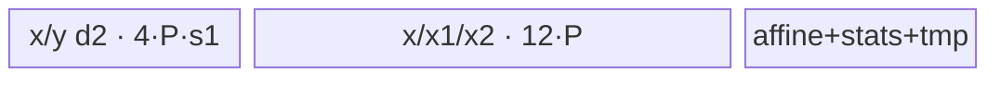

# GroupNormSilu A2/A3 ACLNN 算子知识

## 算子速览

| 项目 | 内容 |
|---|---|
| 实际入口 | 最新公开两段式 `aclnnGroupNormSiluV2GetWorkspaceSize` / `aclnnGroupNormSiluV2`；旧接口固定 `activateSilu=true` 并复用同一 `l0op::GroupNormSilu` |
| 计算语义 | 对每个 `(n,g)` 的 `R=(C/group)*prod(spatial)` 元素求 mean/variance，`z=(x-mean)/sqrt(var+eps)*gamma+beta`，按 `activateSilu` 输出 `z/(1+exp(-z))` 或 `z` |
| 输入输出 | `self/out` ND、FP16/BF16/FP32；`gamma/beta` 同输入或在 16 位输入时为 FP32；`mean/rstd` 在 A2/A3 与 `self` 同 dtype |
| 执行类型 | 单 Kernel、`AIV_VECTOR`；router 声明 AIV/MIX_VECTOR_CORE，但所有可达 body 仅使用 Vector/Scalar/MTE 管线，无 Cube/AIC/MIX_CV 节点 |
| Kernel 路线 | R-001～R-003 small-shape；R-004～R-006 high-perf；R-007～R-009 generalized；R-010～R-012 `HW=1` |
| 核心资源 | GM、AIV UB、`TQue/TBuf`、Scalar↔Vector event；系统 workspace 固定 16 MiB，body 只校验并解析 user workspace、不读写算子私有 slice |
| 来源闭包 | `source_closed`：公开 V2 ACLNN → API 校验/连续化 → `l0op::GroupNormSilu` → OpDef/Tiling/POD → router → 12 个可达 key 的 body/helper → A2/A3 binary config |
| 验证状态 | 已完成源码闭包检查；本次知识提取未执行编译、真机、数值或性能测试。 |

## 接口与语义

### 计算语义

令 `N=self.shape[0]`、`C=self.shape[1]`、`HW=prod(self.shape[2:])`、`D=C/group`、`R=D*HW`。每个 `(n,g)` 独立计算 `mean=sum(x)/R`、`var=sum(x^2)/R-mean^2`、`rstd=1/sqrt(var+eps)`；通道 `c=g*D+d` 的元素得到 `z=(x-mean)*rstd*gamma[c]+beta[c]`。V2 的 `activateSilu=true` 时输出 `z/(1+exp(-z))`，否则输出 `z`；`meanOut/rstdOut` 的逻辑 shape 为 `(N,group)`。

### 输入、输出与属性

| 参数 | shape/layout | dtype | 约束、默认值与语义 |
|---|---|---|---|
| `self` | rank 2～8，ND，可非连续 | FP16/BF16/FP32 | 必选；A2/A3 要求 `N>0,C>0`；定义 `N,C,HW` |
| `gamma`,`beta` | 可选，存在时均为一维且长度 `C`，可非连续 | 与 `self` 相同；16 位 `self` 也允许 FP32 | API 在 A2/A3 对空 gamma/beta 分别创建 OnesLike/ZerosLike，进入 Kernel 时均非空；二者同时存在时 dtype 相同 |
| `group` | Host scalar | int64 | `group>0` 且 `C%group==0` |
| `eps` | Host scalar | double→float | `eps>0`；API 在 level-0 调用处窄化为 float |
| `activateSilu` | Host scalar | bool | V2 显式传入；旧版恒为 `true` |
| `out` | 与 `self` 相同，ND | 与 `self` 相同 | 必选；API 使用 ViewCopy 写入，输出本身不支持非连续 |
| `meanOut`,`rstdOut` | `(N,group)`，ND | A2/A3 与 `self` 相同 | 必选；每组一值 |

### 入口与版本

公开文档同时列出旧版与 V2；V2 增加 `activateSilu`，且 A2、A3 产品表均为支持，因此两平台取实际最新的 V2。`aclnnGroupNormSiluV2GetWorkspaceSize` 与旧版共享 `CheckParams/GetGamma/GetBeta`，差异只在传给 `l0op::GroupNormSilu` 的 `activateSilu`。A2/A3 对可选 gamma/beta 先物化 OnesLike/ZerosLike；950 的空指针直通行为不属于本卡。`group_norm_silu_def.cpp` 将 `ascend910b` 与 `ascend910_93` 注册到同一 AICore 配置，两份 binary config 均列出 FP16、BF16、FP32、16 位输入配 FP32 gamma/beta，以及 `activate_silu=true/false`。

## Host/Launcher 执行流程

### 参数校验与前处理

第一段接口依次：检查 `self/out/meanOut/rstdOut` 非空；按 A2/A3 白名单检查 dtype；校验输出 dtype、rank 2～8、`out.shape==self.shape`、统计输出 shape、gamma/beta 长度与 dtype；校验 `group>0,N>0,C>0,eps>0,C%group==0`。空 `self` 在 A2/A3 走框架 `Fill/ViewCopy`：mean 写 0、rstd 写 NaN，并返回，不启动 GroupNormSilu Kernel。非空时对 `self/gamma/beta` 做 `Contiguous`；空 gamma/beta 分别生成 1/0 Tensor；level-0 分配三个中间输出并把单个 AICore 节点加入 executor；最后三个 `ViewCopy` 写用户输出。任一步返回空指针或 launcher 添加失败即终止。

### 参数、Workspace 与生命周期

`TilingPrepare4GroupNormSilu` 生产 AIV core 数与 UB 大小；`Tiling4GroupNormSilu` 在非 RegBase 平台构造 POD，设置 `blockDim=realCoreNum`、`tilingKey` 与 16 MiB 系统 workspace。entry 要求 `workspace!=nullptr` 且 `GetUserWorkspace(workspace)!=nullptr`，但各 body 的 `Init` 不消费 `userWS`；故无算子私有 workspace 边。executor 拥有连续化临时 Tensor、中间输出与系统 workspace，第二段 `CommonOpExecutorRun` 在调用方 stream 上按 executor 顺序执行，任一前置节点失败阻断后续 launch/ViewCopy。

### 启动图与失败传播

```text
aclnnGroupNormSiluV2GetWorkspaceSize
  -> Contiguous(self/gamma/beta)；空 gamma/beta -> OnesLike/ZerosLike
  -> l0op::GroupNormSilu -> ADD_TO_LAUNCHER_LIST_AICORE(GroupNormSilu)
  -> ViewCopy(y,mean,rstd -> 用户输出)
aclnnGroupNormSiluV2(workspace, executor, stream)
  -> CommonOpExecutorRun
     -> group_norm_silu<<<blockDim=realCoreNum, stream>>>(x,gamma,beta,y,mean,rstd,workspace,POD)
```

唯一 Device 节点为 `group_norm_silu`。输入输出均为 ND GM；`x/y` extent 为 `N*C*HW`，`mean/rstd` extent 为 `N*group`。节点无跨 Kernel workspace slice；entry 的空 workspace/user workspace 检查失败时直接返回、无输出。未知 key 没有 `else` fallback，也无输出。

## Route 与参数设计

### 分核与资源计算

`totalGroups=N*group`；初始 `numPerCore=ceil(totalGroups/aivCoreNum)`、`realCoreNum=ceil(totalGroups/numPerCore)`、`numLastCore=totalGroups-numPerCore*(realCoreNum-1)`。当 `HW<32/sizeof(x)` 且不满足 `HW==1 && D>=32/sizeof(x)` 时强制单核。`HW==1 && group==C` 时改按 N 分核；若 `C` 不按 32 B 元素数对齐则仍强制单核。`processSize=8192` 元素，`loopNum=ceil(R/processSize)`、`loopTail=R-processSize*(loopNum-1)`，`innerLoopNum=ceil(HW/processSize)`、`innerLoopTail=HW-processSize*(innerLoopNum-1)`。所有乘积进入 `int64_t` POD；Host 的 `hwNum` 乘法从 `uint64_t` 开始，固定源码没有额外溢出检查。

### Route 选择

| 顺序 | Route | Key/模板 | 精确选择条件与优先级 | 不适用去向 |
|---:|---|---|---|---|
| 1 | R-010～012 HW1 | 1071/1072/108 | `HW < 32/sizeof(x)` 且 `HW==1`；再按 x/gamma dtype | 同分支 `HW!=1` 去 generalized |
| 2 | R-007～009 small-HW generalized | 1051/1052/106 | `HW < 32/sizeof(x)` 且 `HW!=1`；再按 dtype | 完成 |
| 3 | R-003 small FP32 | 102 | FP32 且 `HW%8==0 && HW<=4096 && C+numPerCore<=4000` | R-006 |
| 4 | R-006 high FP32 | 104 | FP32 且 `C+numPerCore<=4000` | R-009 |
| 5 | R-001/002 small B16 | 1011/1012 | 16 位 x 且 `HW%16==0 && HW<=4096 && C+numPerCore<=2700`；gamma FP32 选 1012，否则 1011 | R-004/005 |
| 6 | R-004/005 high B16 | 1031/1032 | 16 位 x 且 `C+numPerCore<=2700`；gamma FP32 选 1032，否则 1031 | R-007/008 |
| 7 | R-009 generalized FP32 | 106 | 其余 FP32 | 完成 |
| 8 | R-007/008 generalized B16 | 1051/1052 | 其余 16 位；gamma FP32 选 1052，否则 1051 | 完成 |

```text
if HW < 32/sizeof(x):
  if HW == 1: key = 108(FP32) / 1072(mix) / 1071(B16)
  else:       key = 106(FP32) / 1052(mix) / 1051(B16)
else if FP32 and aligned-small predicate: key=102
else if FP32 and C+numPerCore<=4000: key=104
else if B16 and aligned-small predicate: key=1012(mix) or 1011
else if B16 and C+numPerCore<=2700: key=1032(mix) or 1031
else: key=106(FP32) / 1052(mix) / 1051(B16)
```

### 模板/实现执行矩阵

| Route | key/selector | dtype/shape/platform 完整命中条件 | 执行拓扑与 Kernel 节点 | 实际模板/body | 内存与同步特征 | tail/fallback |
|---|---|---|---|---|---|---|
| R-001 | 1011 | small 谓词；x/gamma/beta 同 FP16/BF16 | 单 AIV | `GroupNormSiluSmallB16<T1,T1>` | 固定 8192；B16→FP32 TBuf；S_V | 32 B 对齐条件由 key 保证 |
| R-002 | 1012 | small 谓词；16 位 x、FP32 gamma/beta | 单 AIV | `GroupNormSiluSmallB16<T1,float>` | gamma/beta 队列直接 FP32，无 cast TBuf | 同 R-001 |
| R-003 | 102 | small 谓词；FP32 | 单 AIV | `GroupNormSiluSmallB32<float>` | FP32 原位累积，out queue 临时复用作 x² | 同 R-001 |
| R-004 | 1031 | high 谓词；同 dtype B16 | 单 AIV | `GroupNormSiluB16<T1,T1>` | `processSize` tile、双缓冲、FP32 累积 | DataCopyPad 尾块 |
| R-005 | 1032 | high 谓词；B16+FP32 affine | 单 AIV | `GroupNormSiluB16<T1,float>` | affine 无 cast buffer | DataCopyPad 尾块 |
| R-006 | 104 | high 谓词；FP32 | 单 AIV | `GroupNormSiluB32<float>` | x1 累加、out queue 作 x² scratch | DataCopyPad 尾块 |
| R-007 | 1051 | generalized；同 dtype B16 | 单 AIV | `GroupNormSiluG16<T1,T1>` | gamma/beta 每通道搬 1 个 32 B block | tile/tail |
| R-008 | 1052 | generalized；B16+FP32 affine | 单 AIV | `GroupNormSiluG16<T1,float>` | FP32 affine 直接进 32 B TBuf | tile/tail |
| R-009 | 106 | generalized；FP32 | 单 AIV | `GroupNormSiluG32<float>` | 每组串行、mean/rstd 批 2048 | tile/tail |
| R-010 | 1071 | `HW==1`；同 dtype B16 | 单 AIV | `GroupNormSiluHW1B16<T1,T1>` | `group==C` 时消去归约：y 从 beta、mean 从 x、rstd 常量 | tile/tail |
| R-011 | 1072 | `HW==1`；B16+FP32 affine | 单 AIV | `GroupNormSiluHW1B16<T1,float>` | 同上，beta FP32 后 cast | tile/tail |
| R-012 | 108 | `HW==1`；FP32 | 单 AIV | `GroupNormSiluHW1B32<float>` | 同上，FP32 原位 | tile/tail |

### 隐藏性能 Guard

| Guard | Host/Tiling 条件 | Device/资源原因 | 影响 Route | 不满足时去向 | 源码符号 |
|---|---|---|---|---|---|
| small 对齐 | FP32 `HW%8==0`；B16 `HW%16==0`；且 `HW<=4096` | small body 用整块 `DataCopy`，固定 8192 tile | R-001～003 | high/generalized | `SetTiling` |
| affine+core 上界 | `C+numPerCore<=4000/2700` | Host 以 affine 与 per-core 输出常驻 UB 的经验上界选模板 | R-001～006 | generalized | `SetTiling` |
| tiny-HW 单核 | `HW<32/sizeof(x)` 且非对齐 HW1 特例 | 防止多核 32 B 搬运覆盖相邻组 | 所有 | `realCoreNum=1` | `SetBlockTiling` |
| dtype specialization | x FP32 / gamma FP32 / 其它 | 决定 FP32 body、mixed body 或同 dtype body | 全部 | 无通用 runtime fallback | `SetTilingWithSmallHW`,`SetTiling` |
| empty | A2/A3 API 在 `self->IsEmpty()` 返回 | 非 RegBase Kernel 不处理空域 | 全部 | Fill mean/rstd 后不 launch | `aclnnGroupNormSiluV2GetWorkspaceSize` |

### POD/ABI

`GroupNormSiluTilingData` 由 `BEGIN_TILING_DATA_DEF` 生成序列化布局；字段源码顺序可见，但宏展开后的 `sizeof/alignof/offsetof` 不在固定仓显式给出，因此 ABI 布局列记为“生成宏布局，精确 offset 固定仓不可见”。

| 结构 | 字段 | 类型/位宽 | ABI 布局 | 单位 | Host/launcher producer | Device consumer | 边界 |
|---|---|---|---|---|---|---|---|
| `GroupNormSiluTilingData` | `numGroups` | int64/64 | 生成宏布局 | group | attr；SD 路线才会覆盖，A2/A3不覆盖 | 分核、group index | >0 |
| 同上 | `hwNum` | int64/64 | 同上 | element/channel | `prod(shape[2:])` | 地址、inner loop | 乘法无溢出 guard |
| 同上 | `elemNum` | int64/64 | 同上 | element/group | `shapeD*hwNum` | 归约、GM offset | >0 |
| 同上 | `shapeC` | int64/64 | 同上 | channel | `shape[1]` | affine index | >0 |
| 同上 | `shapeD` | int64/64 | 同上 | channel/group | `C/group` | d loop | >0 |
| 同上 | `realCoreNum` | int64/64 | 同上 | AIV core | `ceil(totalGroups/numPerCore)` | core guard | 正数；空域不 launch |
| 同上 | `numPerCore` | int64/64 | 同上 | group/core | `ceil(totalGroups/coreNum)` | core GM base | HW1 特例按 N |
| 同上 | `numLastCore` | int64/64 | 同上 | group | remainder | last-core loop | 正数 |
| 同上 | `processSize` | int64/64 | 同上 | element | A2/A3=8192 | UB allocation/tile | body 分配上界 |
| 同上 | `loopNum` | int64/64 | 同上 | tile/group | `ceil(elemNum/processSize)` | reduction loop | >=1 |
| 同上 | `loopTail` | int64/64 | 同上 | element | remainder | last reduction tile | 1..processSize |
| 同上 | `innerLoopNum` | int64/64 | 同上 | tile/channel | `ceil(hwNum/processSize)` | normalize loop | >=1 |
| 同上 | `innerLoopTail` | int64/64 | 同上 | element | remainder | final HW tile | 1..processSize |
| 同上 | `tilingKey` | int64/64 | 同上 | enum | selector | 仅日志；router 用 compile key | 1011..108，109 不可达 |
| 同上 | `epsilon` | float/32 | 同上 | scalar | attr | rstd | API 已校验 >0 |
| 同上 | `activateSilu` | int64/64 | 同上 | bool-as-int | attr | SiLU branch | 0/1 |

### Route 源码闭包

| Route | Key/selector | Host/Tiling producer | POD/参数 | Kernel entry/router 节点 | Kernel body/直接依赖 | 构建接线 |
|---|---|---|---|---|---|---|
| R-001/002/003 | 1011/1012/102 | `group_norm_silu_tiling.cpp::SetTiling` | `GroupNormSiluTilingData` | `group_norm_silu.cpp::group_norm_silu` | `group_norm_silu_small_b16.h` / `small_b32.h` + base | ascend910b/ascend910_93 binary json |
| R-004/005/006 | 1031/1032/104 | 同上 | 同上 | 同上 | `group_norm_silu_b16.h` / `b32.h` + base | 同上 |
| R-007/008/009 | 1051/1052/106 | `SetTilingWithSmallHW` 或 `SetTiling` | 同上 | 同上 | `group_norm_silu_g16.h` / `g32.h` + base | 同上 |
| R-010/011/012 | 1071/1072/108 | `SetTilingWithSmallHW` | 同上 | 同上 | `group_norm_silu_hw1_b16.h` / `hw1_b32.h` + base | 同上 |

## Kernel 实现

### 公共执行流程

entry 检查 workspace，解析 POD，然后按 key 构造单个模板对象并执行 `Init/Process`。每个 core 覆盖连续 `(n,g)` 范围，GM x/y 基址为 `blockIdx*numPerCore*elemNum`，组内通道 index 为 `((blockIdx*numPerCore+localGroup)%numGroups)*shapeD+d`。所有非 FP32 x 在 UB 中 cast 到 FP32，统计使用 `sum(x)` 与 `sum(x²)`，Scalar 计算 mean/rstd，再经 `S_V` 或 pipe barrier 交给 Vector；归一化和 SiLU 在 FP32 完成后以 `CAST_RINT`（half）或 `CAST_ROUND`（BF16）降精度。队列的 `EnQue/DeQue/FreeTensor` 管理 MTE↔V 生命周期；尾搬运优先用 `DataCopyPad`。

### Route R-001：small B16 同精度

#### 适用条件

##### 选择证据

| 层级 | 文件 | 符号 | 源码谓词/参数 | 结果/下一跳 |
|---|---|---|---|---|
| Tiling | `group_norm_silu_tiling.cpp` | `SetTiling` | B16、`HW%16==0 && HW<=4096 && C+numPerCore<=2700`、gamma 非 FP32 | key 1011 |
| Router | `group_norm_silu.cpp` | `group_norm_silu` | `TILING_KEY_IS(1011)` | `SmallB16<DTYPE_X,DTYPE_X>` |

#### Device 数据流

##### 函数级调用链

```text
group_norm_silu -> SmallB16::Init -> ProcessPerCore
  -> CopyInGammaAndBeta -> CastGammaAndBeta
  -> AccumulateXandX2 -> ComputeWithCopyOnce/ComputeAlign -> CalcSiluAlign -> CopyOutY
  -> CastMeanAndRstd -> CopyOutMeanAndRstd
```

##### 源码等价伪码

```text
for localGroup: load/reduce R in FP32; mean=sum/R; rstd=rsqrt(sum2/R-mean^2+eps)
  if R<=8192: reload once, normalize each D segment in-place, one SiLU over R, store y
  else: groupD=clamp(floor(8192/HW),1,D); reload groupD channels per tile, normalize+SiLU, store
store per-core mean/rstd after FP32->T1 cast
```

#### 内存与数据搬运

##### 资源与搬运表

| 层级/缓冲区 | offset/地址公式 | extent/容量公式 | dtype/layout | producer | consumer | owner/lifetime | 对齐/复用 |
|---|---|---|---|---|---|---|---|
| x/y GM | `coreBase+group*R+d*HW` | `R`/group | T1 ND | API/Kernel | Kernel/API | caller | HW aligned by selector |
| x/x1/x2 TBuf | independent | each `8192*4` B | FP32 | Cast/Vector | reduce/norm/SiLU | core | x buffers reused across groups |
| x/y queues | independent | each `depth2*8192*sizeof(T1)` | T1 | MTE2/V | V/MTE3 | core | double buffer |
| affine/outputs | independent | queues `2*C_a*sizeof(T1)+2*A_a*sizeof(T1)`；cast TBuf `2*C_a*4+2*A_a*4` | T1/FP32 | MTE2/V/S | V/MTE3 | core | `C_a,A_a` 32 B align |

##### 分层内存布局


##### 字节账与复用顺序

```text
UB_total = 4*8192*s1 + 12*8192 + 2*Ca*s1 + 8*Ca + 2*Aa*s1 + 8*Aa + 32
workspace_total = 16 MiB system reserve；operator-private=0
```

| 复用子区 | 写入者 | 读取者/消费点 | 下一次覆盖 | 同步或释放依据 | 安全条件 |
|---|---|---|---|---|---|
| x1/x2 TBuf | reduce | Scalar/normalize/SiLU | 下一 group/tile | PipeBarrier、S_V | 统计值已读取 |
| x/y queue slot | MTE2/V | V/MTE3 | 两次迭代后 | queue lifecycle | depth=2 |

#### 同步、精度与尾块

##### 同步与数值边界表

| 阶段 | primitive/机制 | producer | consumer/等待点 | 保护对象 | 精度/尾块 |
|---|---|---|---|---|---|
| 统计→归一化 | `S_V` | Scalar mean/rstd | Vector | scalar 参数 | FP32 sum/x²，方差公式可能有消减误差 |
| V pipeline | `PipeBarrier<PIPE_V>` | Cast/Mul/Exp | 下一 Vector op | TBuf | selector 保证整块；无无效 lane |
| 输出 | queue + DataCopy | V | MTE3 | y/mean/rstd | FP32→T1 round |

#### 关键实现

##### 符号证据表

| 阶段 | 文件 | 符号/模板实例 | 实现事实 |
|---|---|---|---|
| Host/Tiling producer | `group_norm_silu_tiling.cpp` | `SetTiling` | key 1011 谓词 |
| Kernel entry/router | `group_norm_silu.cpp` | key 1011 | 模板映射 |
| Device body/helper | `group_norm_silu_small_b16.h` | `ComputeWithCopyOnce`,`ComputeAlign` | 固定 tile、通道合并、FP32 SiLU |

### Route R-002：small B16 混合精度

#### 适用条件

##### 选择证据

与 R-001 相同 small 谓词，但 gamma/beta 为 FP32；`SetTiling` 选 1012，router 实例化 `SmallB16<DTYPE_X,float>`。

#### Device 数据流

##### 函数级调用链

```text
group_norm_silu -> SmallB16<T1,float>::Init/Process -> CopyInGammaAndBeta(直接FP32) -> R-001 同一统计/归一化/SiLU管线
```

##### 源码等价伪码

```text
同 R-001；gamma/beta queue 直接作为 FP32 LocalTensor，不执行 CastGammaAndBeta。
```

#### 内存与数据搬运

##### 资源与搬运表

| 层级/缓冲区 | offset/地址公式 | extent/容量公式 | dtype/layout | producer | consumer | owner/lifetime | 对齐/复用 |
|---|---|---|---|---|---|---|---|
| affine queues | 0 | each `C_a*4` B | FP32 | MTE2 | Scalar load | core | 无 gamma/beta FP32 cast TBuf |
| 其余 | 同 R-001 | 同 R-001 | T1/FP32 | 同 R-001 | 同 R-001 | core | 同 R-001 |

##### 分层内存布局


##### 字节账与复用顺序

`UB_total=4*8192*s1+12*8192+8*C_a+2*A_a*s1+8*A_a+32`；复用顺序与 R-001 相同。

#### 同步、精度与尾块

##### 同步与数值边界表

gamma/beta 保持 FP32，x 仍先升 FP32；输出与 mean/rstd 降为 T1。其它同步与 R-001 相同。

#### 关键实现

##### 符号证据表

| 阶段 | 文件 | 符号/模板实例 | 实现事实 |
|---|---|---|---|
| Host/Tiling producer | `group_norm_silu_tiling.cpp` | `SetTiling` | mixed key 1012 |
| Kernel entry/router | `group_norm_silu.cpp` | key 1012 | `<DTYPE_X,float>` |
| Device body/helper | `group_norm_silu_small_b16.h` | `ComputeWithCopyOnce`,`ComputeAlign` | 直接使用 FP32 affine queue |

### Route R-003：small FP32

#### 适用条件

##### 选择证据

FP32 且 `HW%8==0 && HW<=4096 && C+numPerCore<=4000`，key 102，`SmallB32<float>`。

#### Device 数据流

##### 函数级调用链

```text
group_norm_silu -> SmallB32::ProcessPerCore -> AccumulateXandX2 -> ComputeWithCopyOnce/ComputeAlign -> CopyOutMeanAndRstd
```

##### 源码等价伪码

```text
x 保持 FP32；x1Buf 累加 sum，outQueueY 临时 slot 累加 sum2；归约后在 x queue 原位 normalize，out queue 生成 SiLU。
```

#### 内存与数据搬运

##### 资源与搬运表

| 层级/缓冲区 | offset/地址公式 | extent/容量公式 | dtype/layout | producer | consumer | owner/lifetime | 对齐/复用 |
|---|---|---|---|---|---|---|---|
| x1/work/tmp | independent | `4*8192 + 4*8192/64 + 32` B | FP32 | V | reduce | core | work scratch |
| queues | independent | x/y `4*8192*4`；affine `2*C_a*4`；stats `2*A_a*4` | FP32 | MTE/V | V/MTE | core | y queue 暂作 x² |

##### 分层内存布局


##### 字节账与复用顺序

`UB_total=20*8192+4*8192/64+8*C_a+8*A_a+32`；out queue 的 x² scratch 在 ReduceSum 完成并 Free 后才能再次分配为 y。

#### 同步、精度与尾块

##### 同步与数值边界表

全程 FP32；key 的 HW 对齐消除尾部非对齐搬运。queue 生命周期保护 out queue 的 scratch→output 复用。

#### 关键实现

##### 符号证据表

| 阶段 | 文件 | 符号/模板实例 | 实现事实 |
|---|---|---|---|
| Host/Tiling producer | `group_norm_silu_tiling.cpp` | `SetTiling` | key 102 |
| Kernel entry/router | `group_norm_silu.cpp` | key 102 | `SmallB32<float>` |
| Device body/helper | `group_norm_silu_small_b32.h` | `AccumulateXandX2MultipleLoop`,`ComputeAlign` | FP32 原位与 queue 复用 |

### Route R-004：high-perf B16 同精度

#### 适用条件

##### 选择证据

B16、未命中 small、`C+numPerCore<=2700`、gamma 非 FP32；key 1031，`B16<T1,T1>`。

#### Device 数据流

##### 函数级调用链

```text
B16::ProcessPerCore -> CopyIn/Cast affine -> AccumulateXandX2One/MultipleLoop -> per-channel CalcSilu -> Cast/Copy stats
```

##### 源码等价伪码

```text
每组按 P=8192 累积 sum/sum2；每通道再按 HW tile 重载 x，使用 scale=rstd*gamma、bias=-scale*mean+beta 融合 normalize；可选 SiLU；尾块 DataCopyPad。
```

#### 内存与数据搬运

##### 资源与搬运表

| 层级/缓冲区 | offset/地址公式 | extent/容量公式 | dtype/layout | producer | consumer | owner/lifetime | 对齐/复用 |
|---|---|---|---|---|---|---|---|
| tile queues/TBuf | independent | 与 R-001 相同但 `8192` 替换为 POD `P` | T1/FP32 | MTE/V | V/MTE | core | depth2 |
| affine/stats | independent | 与 R-001 相同 | T1/FP32 | MTE/V/S | V/MTE | core | 32 B align |

##### 分层内存布局


##### 字节账与复用顺序

`UB_total=4*P*s1+12*P+2*C_a*s1+8*C_a+2*A_a*s1+8*A_a+32`；队列/统计复用同 R-001。

#### 同步、精度与尾块

##### 同步与数值边界表

FP32 统计/SiLU，`S_V` 保护 Scalar mean/rstd；`DataCopyPad` 按有效 `innerLoopTail` 写回。

#### 关键实现

##### 符号证据表

| 阶段 | 文件 | 符号/模板实例 | 实现事实 |
|---|---|---|---|
| Host/Tiling producer | `group_norm_silu_tiling.cpp` | `SetTiling` | key 1031 |
| Kernel entry/router | `group_norm_silu.cpp` | key 1031 | `B16<T1,T1>` |
| Device body/helper | `group_norm_silu_b16.h` | `ComputeMultipleLoop`,`CalcSilu`,`CopyOutYWithPad` | tile/尾块实现 |

### Route R-005：high-perf B16 混合精度

#### 适用条件

##### 选择证据

R-004 谓词且 gamma/beta FP32；key 1032，`B16<T1,float>`。

#### Device 数据流

##### 函数级调用链

```text
B16<T1,float>::ProcessPerCore -> FP32 affine queue -> 与 R-004 相同的 FP32 reduce/normalize/SiLU
```

##### 源码等价伪码

同 R-004，跳过 affine cast。

#### 内存与数据搬运

##### 资源与搬运表

FP32 affine queues each `C_a*4`，其余同 R-004。

##### 分层内存布局


##### 字节账与复用顺序

`UB_total=4*P*s1+12*P+8*C_a+2*A_a*s1+8*A_a+32`；复用同 R-004。

#### 同步、精度与尾块

##### 同步与数值边界表

gamma/beta 保持 FP32；输出/stat 降 T1，其余同 R-004。

#### 关键实现

##### 符号证据表

| 阶段 | 文件 | 符号/模板实例 | 实现事实 |
|---|---|---|---|
| Host/Tiling producer | `group_norm_silu_tiling.cpp` | `SetTiling` | key 1032 |
| Kernel entry/router | `group_norm_silu.cpp` | key 1032 | `B16<T1,float>` |
| Device body/helper | `group_norm_silu_b16.h` | `CopyInGammaAndBeta`,`ComputeSilu` | mixed affine |

### Route R-006：high-perf FP32

#### 适用条件

##### 选择证据

FP32、未命中 small、`C+numPerCore<=4000`；key 104，`B32<float>`。

#### Device 数据流

##### 函数级调用链

```text
B32::ProcessPerCore -> CopyIn affine -> AccumulateXandX2 -> CalcSilu -> CopyOut stats
```

##### 源码等价伪码

同 R-004 的 tile/address 顺序，但无 cast；x1 TBuf 累加 sum，out queue 临时累加 sum²。

#### 内存与数据搬运

##### 资源与搬运表

资源与 R-003 相同，固定 8192 替换为 P。

##### 分层内存布局


##### 字节账与复用顺序

`UB_total=20*P+4*P/64+8*C_a+8*A_a+32`；out queue scratch→y 以 Free/Alloc 分界。

#### 同步、精度与尾块

##### 同步与数值边界表

FP32 全程；`MTE2_V` 保护 `CopyInXFirst`；DataCopyPad 写有效尾块。

#### 关键实现

##### 符号证据表

| 阶段 | 文件 | 符号/模板实例 | 实现事实 |
|---|---|---|---|
| Host/Tiling producer | `group_norm_silu_tiling.cpp` | `SetTiling` | key 104 |
| Kernel entry/router | `group_norm_silu.cpp` | key 104 | `B32<float>` |
| Device body/helper | `group_norm_silu_b32.h` | `AccumulateXandX2MultipleLoop`,`CalcSilu` | FP32 tile path |

### Route R-007：generalized B16 同精度

#### 适用条件

##### 选择证据

B16 未命中 small/high 或 tiny `HW!=1`；key 1051，`G16<T1,T1>`。

#### Device 数据流

##### 函数级调用链

```text
G16::ProcessPerCore(32-group batches) -> AccumulateXAndX2 -> ReduceSum -> per-channel CopyInGammaBeta16 -> CalculateGroupNormSilu -> CopyOut
```

##### 源码等价伪码

```text
for groups in batches of 32: for group: zero sum/sum2 tile; accumulate all R; reduce; for d: load one affine block; normalize HW tiles; SiLU; store; batch-store stats
```

#### 内存与数据搬运

##### 资源与搬运表

| 层级/缓冲区 | offset/地址公式 | extent/容量公式 | dtype/layout | producer | consumer | owner/lifetime | 对齐/复用 |
|---|---|---|---|---|---|---|---|
| x/y queues | GM address above | each `depth2*P*s1` | T1 | MTE/V | V/MTE | core | P tile |
| calc | independent | `3*P*4` | FP32 | V | V/Scalar | core | zero+accumulate |
| affine | current channel | queues 2×32 B；FP32 TBuf 2×32 B | T1/FP32 | MTE/Cast | Scalar/V | channel | each load 1 valid element |
| stats | batch of 32 | queues `2*32*s1`；TBuf `2*32*4` | T1/FP32 | Scalar/Cast | MTE3 | batch | tail DataCopyPad |

##### 分层内存布局



##### 字节账与复用顺序

`UB_total=4*P*s1+12*P+64+64+64*s1+256+32`；每通道 affine queue 在 `V_S/MTE2_S` 后释放，下一通道覆盖。

#### 同步、精度与尾块

##### 同步与数值边界表

`V_S`/`MTE2_S` 保护从 UB 取 gamma/beta scalar；FP32 sum/x² 与 SiLU；group tail 用 DataCopyPad。

#### 关键实现

##### 符号证据表

| 阶段 | 文件 | 符号/模板实例 | 实现事实 |
|---|---|---|---|
| Host/Tiling producer | `group_norm_silu_tiling.cpp` | `SetTiling`,`SetTilingWithSmallHW` | key 1051 |
| Kernel entry/router | `group_norm_silu.cpp` | key 1051 | `G16<T1,T1>` |
| Device body/helper | `group_norm_silu_g16.h` | `ProcessGroupNormSilu`,`CopyInGammaBeta16` | 泛化逐通道路线 |

### Route R-008：generalized B16 混合精度

#### 适用条件

##### 选择证据

R-007 shape 谓词且 gamma/beta FP32；key 1052，`G16<T1,float>`。

#### Device 数据流

##### 函数级调用链

```text
G16<T1,float> -> CopyInGammaBeta32(MTE2_S) -> R-007 同一 reduce/normalize/SiLU
```

##### 源码等价伪码

同 R-007；affine 直接搬 FP32 单元素 block。

#### 内存与数据搬运

##### 资源与搬运表

与 R-007 相同固定 32 B affine queue/TBuf 规模；队列类型为 FP32。

##### 分层内存布局


##### 字节账与复用顺序

`UB_total` 取 R-007 公式中 `s1=2` 且 affine queue 实际仍各 32 B；生命周期同 R-007。

#### 同步、精度与尾块

##### 同步与数值边界表

`MTE2_S` 保护 FP32 scalar；其它同 R-007。

#### 关键实现

##### 符号证据表

| 阶段 | 文件 | 符号/模板实例 | 实现事实 |
|---|---|---|---|
| Host/Tiling producer | `group_norm_silu_tiling.cpp` | selector | key 1052 |
| Kernel entry/router | `group_norm_silu.cpp` | key 1052 | `G16<T1,float>` |
| Device body/helper | `group_norm_silu_g16.h` | `CopyInGammaBeta32` | mixed affine load |

### Route R-009：generalized FP32

#### 适用条件

##### 选择证据

FP32 未命中 small/high，或 tiny `HW!=1`；key 106，`G32<float>`。

#### Device 数据流

##### 函数级调用链

```text
G32::ProcessPerCore(2048-group batches) -> ReduceSumXAndX2 -> CopyInGammaBeta -> CalculateGroupNormSilu -> CopyOut
```

##### 源码等价伪码

FP32 每组串行归约，out queue slot 作 x²，逐通道 affine/normalize/SiLU；统计按最多 2048 组批量写回。

#### 内存与数据搬运

##### 资源与搬运表

queues x/y=`4*P*4` B；temp=`P*4`、work=`P/64*4`、affine=64 B、stats=`2*2048*4`、tmp=32 B。

##### 分层内存布局


##### 字节账与复用顺序

`UB_total=20*P+4*P/64+64+16384+32`；out queue 在 x² ReduceSum 后 Free，后续重新分配为 y。

#### 同步、精度与尾块

##### 同步与数值边界表

FP32；MTE2_S 保护 affine；尾 x/y 与 stats 用 DataCopyPad。

#### 关键实现

##### 符号证据表

| 阶段 | 文件 | 符号/模板实例 | 实现事实 |
|---|---|---|---|
| Host/Tiling producer | `group_norm_silu_tiling.cpp` | selector | key 106 |
| Kernel entry/router | `group_norm_silu.cpp` | key 106 | `G32<float>` |
| Device body/helper | `group_norm_silu_g32.h` | `ReduceSumXAndX2`,`ComputeGroupNormSilu` | FP32 泛化路线 |

### Route R-010：HW1 B16 同精度

#### 适用条件

##### 选择证据

`HW<16 && HW==1`、B16 同 dtype；key 1071，`HW1B16<T1,T1>`。

#### Device 数据流

##### 函数级调用链

```text
HW1B16::ProcessPerCore
  -> if group==C: ProcessYWithSameType(beta->optional SiLU), ProcessMeanWithEqualC(x copy), ProcessRstdWithEqualC(const)
  -> else: 32-group batches -> regular reduce/affine/SiLU
```

##### 源码等价伪码

```text
if D==1: mean=x; var=0; rstd=1/sqrt(eps); normalized value=0, so y=SiLU(beta) or beta
else: use regular group reduce and vector normalization with HW=1
```

#### 内存与数据搬运

##### 资源与搬运表

six queues: x/gamma/beta/y each `P*s1`, mean/rstd each `32*s1`; FP32 x/x1/x2 each `4P`; mean/rstd each 128 B；gamma/beta/tmp each 32 B。

##### 分层内存布局


##### 字节账与复用顺序

`UB_total=4*P*s1+12*P+64*s1+256+64+32`；`group==C` 直接复用 y queue 搬 beta，省去 x/gamma 计算。

#### 同步、精度与尾块

##### 同步与数值边界表

shortcut 用 `PIPE_ALL` 串行保护同一 queue/TBuf；普通分支 FP32 计算并降 T1。C tail 用 base helper 的 pad copy。

#### 关键实现

##### 符号证据表

| 阶段 | 文件 | 符号/模板实例 | 实现事实 |
|---|---|---|---|
| Host/Tiling producer | `group_norm_silu_tiling.cpp` | `SetTilingWithSmallHW` | key 1071 |
| Kernel entry/router | `group_norm_silu.cpp` | key 1071 | `HW1B16<T1,T1>` |
| Device body/helper | `group_norm_silu_hw1_b16.h` | `ProcessPerCore`,`ProcessYWithEqualC` | D=1 恒等归约 shortcut |

### Route R-011：HW1 B16 混合精度

#### 适用条件

##### 选择证据

R-010 shape 谓词且 gamma/beta FP32；key 1072，`HW1B16<T1,float>`。

#### Device 数据流

##### 函数级调用链

```text
HW1B16<T1,float> -> D==1 时 ProcessYWithdiffType(beta FP32 -> SiLU -> cast T1)；否则 mixed affine regular path
```

##### 源码等价伪码

同 R-010；shortcut 的 y 从 FP32 beta 生成并降 T1。

#### 内存与数据搬运

##### 资源与搬运表

队列仍按 T1 `P*s1` 初始化；FP32 beta 直接进入 `xBuf32`，其余与 R-010。

##### 分层内存布局


##### 字节账与复用顺序

同 R-010 物理分配公式；mixed shortcut 以 `xBuf32` 承接 beta，cast 后 y queue 写回。

#### 同步、精度与尾块

##### 同步与数值边界表

`PIPE_ALL` 保护 beta GM→FP32 TBuf→SiLU→cast→T1 y；mean/rstd 仍 T1。

#### 关键实现

##### 符号证据表

| 阶段 | 文件 | 符号/模板实例 | 实现事实 |
|---|---|---|---|
| Host/Tiling producer | `group_norm_silu_tiling.cpp` | selector | key 1072 |
| Kernel entry/router | `group_norm_silu.cpp` | key 1072 | `HW1B16<T1,float>` |
| Device body/helper | `group_norm_silu_hw1_b16.h` | `ProcessYWithdiffType` | FP32 beta shortcut |

### Route R-012：HW1 FP32

#### 适用条件

##### 选择证据

`HW<8 && HW==1`、FP32；key 108，`HW1B32<float>`。

#### Device 数据流

##### 函数级调用链

```text
HW1B32::ProcessPerCore -> D==1 shortcut(beta/x/constant rstd) or regular ReduceSumXAndX2 -> CalculateGroupNormSilu
```

##### 源码等价伪码

与 R-010 相同数学 shortcut，全程 FP32；普通分支以 out queue slot 作 x² scratch。

#### 内存与数据搬运

##### 资源与搬运表

x/gamma/beta/y queues each `P*4`；mean/rstd each `2048*4`；temp `P*4`、work `P/64*4`、tmp 32 B。

##### 分层内存布局


##### 字节账与复用顺序

`UB_total=20*P+4*P/64+16384+32`；普通分支 out queue scratch→y 复用，shortcut y queue 直接搬 beta。

#### 同步、精度与尾块

##### 同步与数值边界表

FP32；shortcut 用 `PIPE_ALL`；tail 由 `CopyInData/CopyOutData<false>` 或 DataCopyPad 保护。

#### 关键实现

##### 符号证据表

| 阶段 | 文件 | 符号/模板实例 | 实现事实 |
|---|---|---|---|
| Host/Tiling producer | `group_norm_silu_tiling.cpp` | selector | key 108 |
| Kernel entry/router | `group_norm_silu.cpp` | key 108 | `HW1B32<float>` |
| Device body/helper | `group_norm_silu_hw1_b32.h` | `ProcessYWithEqualC`,`ReduceSumXAndX2` | FP32 shortcut/普通路线 |

## 算子特定优化

### Trick T-001：small 路线合并通道搬运与单次 SiLU

#### 触发与源码依据

- 适用 Route：R-001～R-003。
- 触发条件：Host small 谓词；Device 内 `elemNum<=8192` 时整组一次装入，否则 `groupD=clamp(8192/HW,1,D)`。
- Golden 来源：[`norm/group_norm_silu/op_kernel/group_norm_silu_small_b16.h:184-239`](../../../../../../../cann-ops-raw/ascendc/ops-nn/955f8b33985b6d72989ebff341bb9c2c564a51bc/norm/group_norm_silu/op_kernel/group_norm_silu_small_b16.h#L184-L239)

**官方源码（固定 Commit 连续逐字摘录）**：

```cpp
if (tiling->elemNum <= processSize) {
    ComputeWithCopyOnce(loopNum);
} else {
    groupD = processSize / tiling->hwNum;
    groupD = groupD < 1 ? 1 : groupD;
    groupD = groupD > tiling->shapeD ? tiling->shapeD : groupD;
    loopD = this->CeilDiv(tiling->shapeD, groupD);
    dTail = tiling->shapeD - (loopD - 1) * groupD;
    ComputeAlign(loopNum);
}
```

#### 机制与设计原因

普通 high/generalized 路线按通道重载并分别启动 SiLU；small 路线在 UB 容量允许时把一组或多个连续通道一次搬入，逐通道只做 affine，然后对连续区域一次执行 Exp/Div。源码可证明这减少 DMA/Vector 调用次数；未做性能量化。

#### 迁移边界

- 适用：HW 按 32 B 元素数对齐、`HW<=4096` 且 `C+numPerCore` 在 Host 上界内。
- 前提：8192 元素固定 tile 的完整 UB 字节账成立。
- 失效：转 R-004～009；tiny HW 转 R-010～012。
- 未验证：本次知识提取未执行编译、真机、数值或性能测试。

#### 错误做法

固定仓的真实 fallback 是 high/generalized 路线；在不满足 HW 对齐时仍直接使用 small 的普通 `DataCopy` 会失去源码保证。

### Trick T-002：`HW=1 && group=C` 的代数消除

#### 触发与源码依据

- 适用 Route：R-010～R-012。
- 触发条件：`numGroups==shapeC`，即每组只有一个元素。
- Golden 来源：[`norm/group_norm_silu/op_kernel/group_norm_silu_hw1_b16.h:168-202`](../../../../../../../cann-ops-raw/ascendc/ops-nn/955f8b33985b6d72989ebff341bb9c2c564a51bc/norm/group_norm_silu/op_kernel/group_norm_silu_hw1_b16.h#L168-L202)

**官方源码（固定 Commit 连续逐字摘录）**：

```cpp
if (tiling->numGroups == tiling->shapeC) {
    gmOffset = blockIdx * tiling->numPerCore * tiling->shapeC;
    ProcessYWithEqualC(groups);
    ProcessMeanWithEqualC(groups);
    ProcessRstdWithEqualC(groups);
} else {
    gmOffset = blockIdx * tiling->numPerCore * tiling->elemNum;
```

#### 机制与设计原因

此时 `D=HW=1`，所以 `mean=x`、`var=0`、normalized 值为 0；输出只取 beta（再可选 SiLU），mean 直接复制 x，rstd 直接填 `1/sqrt(eps)`。该分支消除 sum/sum²、gamma 乘法和逐元素 normalize。

#### 迁移边界

- 适用：严格 `HW=1 && group=C`。
- 前提：beta 在 A2/A3 已由 API 保证非空（缺省时物化 0）。
- 失效：`group!=C` 时回到同 HW1 body 的常规归约分支。
- 未验证：本次知识提取未执行编译、真机、数值或性能测试。

#### 错误做法

不能只由 `HW=1` 推导 normalized 值为 0；`D>1` 时每组仍含多个通道，源码明确走普通归约。

## 模板与实现对比

| 对比维度 | small R-001～003 | high R-004～006 | generalized R-007～009 | HW1 R-010～012 | 设计选择依据 |
|---|---|---|---|---|---|
| 命中条件/优先级 | 对齐、HW<=4096、资源上界 | 不对齐/较大 HW 但资源上界内 | 其余或 tiny non-HW1 | HW=1 | Host 决策树顺序 |
| 模板与 dtype | SmallB16/SmallB32 | B16/B32 | G16/G32 | HW1B16/HW1B32 | x/affine dtype |
| 循环与分核 | group 内合并 D | group→d→HW tile | group batch→d→HW tile | algebraic shortcut 或常规 | 搬运粒度 |
| Queue/TBuf | fixed 8192，depth2 | POD P，depth2 | 逐通道 affine block | P queues，HW1 shortcut 复用 | UB 上界/对齐 |
| 内存总占用与复用 | x/y + 3 FP32 TBuf | 同类动态 P | output queue 可作 x² | y queue 可直接搬 beta | body 分配 |
| 搬运/Vector API | 合并 DMA/SiLU | DataCopyPad tail | 逐通道 affine | shortcut copy/fill | shape 特征 |
| 同步、精度与 tail | S_V、FP32、整块 | S_V、FP32、pad tail | MTE2_S/V_S、pad | PIPE_ALL 或普通 | producer/consumer |
| fallback/失败边界 | high/generalized | generalized | 无 runtime fallback | 普通 HW1 分支 | unknown key 无输出 |

## 平台差异

| 项目 | A2 | A3 | 950 |
|---|---|---|---|
| 支持状态 | 公开支持；ascend910b config | 公开支持；ascend910_93 config | 公开支持，但使用独立 `_950` 卡 |
| Host/Launcher | 共用非 RegBase Tiling，V2 | 共用非 RegBase Tiling，V2 | RegBase selector，空 gamma/beta 直通 |
| Kernel/资源 | 经典 AIV，12 key | 同 A2 | arch35 MicroAPI、TwoPass/Welford、整 UB alias |

## 限制与失败边界

- A2/A3 API 强制 `N,C>0`；空 `self` 只会在其它维为 0 时走框架 Fill 路径，GroupNormSilu Kernel 不启动。
- Tiling `HW` 与 shape 乘积没有显式溢出检查；POD 宏的精确 `sizeof/offsetof` 固定仓不可见。
- entry 对空 workspace/user workspace 与未知 key 直接返回，无 Device 错误码和输出；Host 必须保证 key 与 binary 配套。
- 经典 body 使用 `sum(x²)/R-mean²`，固定源码没有 Welford 或负方差 clamp；数值边界必须保持源码顺序。
- 16 MiB workspace 是系统保留，body 未消费；不得虚构中间 workspace 数据。
- 本次知识提取未执行编译、真机、数值或性能测试。

## 源码索引

### 链路索引

| 链路阶段 | 文件 | 关键符号 | 支撑内容 |
|---|---|---|---|
| 入口声明/约束 | `docs/aclnnGroupNormSiluV2.md` | V2 原型/产品表 | 公开性、平台、接口约束 |
| 入口实现 | `op_host/op_api/aclnn_group_norm_silu.cpp` | `aclnnGroupNormSiluV2GetWorkspaceSize` | 校验、连续化、空输入、executor |
| 入口实现 | `op_host/op_api/group_norm_silu.cpp` | `l0op::GroupNormSilu` | 输出分配与 launch node |
| 平台注册 | `op_host/group_norm_silu_def.cpp` | `GroupNormSilu::GroupNormSilu` | A2/A3 注册/dtype |
| Host/Tiling | `op_host/group_norm_silu_tiling.h` | POD/key enum | ABI 字段与 key |
| Host/Tiling | `op_host/group_norm_silu_tiling.cpp` | `Tiling4GroupNormSilu`,`SetTiling` | 分核、选择、workspace |
| Kernel entry/body | `op_kernel/group_norm_silu.cpp` | `group_norm_silu` | router |
| Kernel helper | `op_kernel/group_norm_silu_base.h` | `CopyInData`,`CopyOutData` | pad 与 round |
| Kernel body | `op_kernel/group_norm_silu_small_b16.h` | `SmallB16` | small B16/mix |
| Kernel body | `op_kernel/group_norm_silu_small_b32.h` | `SmallB32` | small FP32 |
| Kernel body | `op_kernel/group_norm_silu_b16.h` | `B16` | high B16/mix |
| Kernel body | `op_kernel/group_norm_silu_b32.h` | `B32` | high FP32 |
| Kernel body | `op_kernel/group_norm_silu_g16.h` | `G16` | generalized B16/mix |
| Kernel body | `op_kernel/group_norm_silu_g32.h` | `G32` | generalized FP32 |
| Kernel body | `op_kernel/group_norm_silu_hw1_b16.h` | `HW1B16` | HW1 B16/mix |
| Kernel body | `op_kernel/group_norm_silu_hw1_b32.h` | `HW1B32` | HW1 FP32 |
| 构建接线 | `op_host/config/ascend910b/group_norm_silu_binary.json` | `op_list` | A2 dtype/attr variants |
| 构建接线 | `op_host/config/ascend910_93/group_norm_silu_binary.json` | `op_list` | A3 dtype/attr variants |

### 实现复用检查

| 检查项 | 可复用事实 | 不得改变的约束 | 源码符号 |
|---|---|---|---|
| ABI/POD | 16 字段 POD 与 key 枚举 | 顺序、位宽、元素单位 | `GroupNormSiluTilingData` |
| 调用顺序 | Contiguous→单 Kernel→三次 ViewCopy | 空 gamma/beta 的 A2/A3 物化语义 | V2 API、`l0op::GroupNormSilu` |
| workspace/内存 | 系统 16 MiB、无私有 slice；各 route UB 公式 | depth2 必须乘入；TBuf 不可越界 | `Tiling4GroupNormSilu`、各 `Init` |
| 同步 | Queue + S_V/MTE2_S/V_S/PipeBarrier | Scalar/Vector 与 DMA 可见性 | 各 body |
| 精度与尾块 | B16 升 FP32、round 降精度、DataCopyPad | sum/x² 顺序、有效 tail | base/B16/G16/HW1 |
| 失败边界 | Host 失败即不 launch；entry 空 workspace/unknown key 无输出 | 不得自行 fallback | API 与 router |