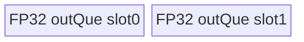

# GroupNormSilu 950 ACLNN 算子知识

## 算子速览

| 项目 | 内容 |
|---|---|
| 实际入口 | 最新公开 `aclnnGroupNormSiluV2GetWorkspaceSize` / `aclnnGroupNormSiluV2`；旧接口固定 `activateSilu=true` 并复用同一 level-0 节点 |
| 计算语义 | 每个 `(n,g)` 对 `R=(C/group)*prod(spatial)` 元素做 GroupNorm，可选 gamma/beta，再由 `activateSilu` 决定是否计算 SiLU |
| 输入输出 | `self/y` 为 FP16/BF16/FP32；可选 gamma/beta 为同 dtype 或 16 位输入配 FP32；950 的 mean/rstd dtype 依次取 gamma、beta、self 的首个可用 dtype |
| 执行类型 | 单 `AIV_VECTOR` Kernel；APT entry 在 AIC 上立即返回，所有可达 body 只使用 MTE/Vector/Scalar，TwoPass fold 路线额外使用 NDDMA |
| Kernel 路线 | 空张量、TwoPass performance/generalized、Welford performance/generalized；每族按同 dtype 与 mixed dtype 分成 10 个 key |
| 核心资源 | 全部非空 body 用一个 `TBuf innerBuf` 占满 Host 下发 `ubSize` 并在内部切片/复用；系统 workspace 固定 16 MiB，但 body 不访问 user slice |
| 来源闭包 | `source_closed`：公开 V2 ACLNN → API → level-0 → OpDef/RegBase Tiling/POD → APT router → 5 个 body 与公共 helper → ascend950 binary config |
| 验证状态 | 已完成固定 Commit 源码闭包检查；未执行编译、真机、数值或性能测试。 |

## 接口与语义

### 计算语义

令 `N=self.shape[0]`、`C=self.shape[1]`、`HW=prod(self.shape[2:])`、`D=C/group`、`R=D*HW`。每个 `(n,g)` 求 `mean=sum(x)/R`、`var=sum((x-mean)^2)/R`、`rstd=1/sqrt(var+eps)`；通道 `c=gD+d` 得到 `z=(x-mean)*rstd*gamma[c]+beta[c]`。gamma 缺失等价 1，beta 缺失等价 0；`activateSilu=true` 输出 `z/(1+exp(-z))`，否则输出 `z`。

### 输入、输出与属性

| 参数 | shape/layout | dtype | 约束、默认值与语义 |
|---|---|---|---|
| `self` | rank 2～8、ND，可非连续 | FP16/BF16/FP32 | 必选；定义 `N,C,HW` |
| `gamma`,`beta` | 可选；存在时一维、长度 `C`，可非连续 | 同 `self`；16 位 self 也允许 FP32 | 950 不把缺失项物化，null GM 指针由 body 的 `hasGamma/hasBeta` 分支处理 |
| `group` | Host scalar | int64 | `group>0` 且 `C%group==0` |
| `eps` | Host scalar | double→float | `eps>0`；进入 POD 时为 float |
| `activateSilu` | Host scalar | bool | V2 显式传入；旧 API 恒 true |
| `out` | 同 self | 同 self | API 最终 ViewCopy |
| `meanOut`,`rstdOut` | `(N,group)` | gamma 存在则跟 gamma；否则 beta 存在则跟 beta；否则跟 self | 空 self 且 `N>0` 时 Empty body 写 NaN；`N==0` 时逻辑输出为空且不写 GM |

### 入口与版本

公开文档将 V2 列为旧接口之后的新接口，新增 `activateSilu`，并明确支持 Ascend 950，故 950 取 V2。`group_norm_silu_def.cpp` 对 `ascend950` 使用 `group_norm_silu_apt`；binary config 覆盖 FP16/BF16/FP32、16 位 self 配 FP32 gamma/beta、可选 gamma/beta 以及激活开关。旧接口与 V2 的 level-0、Tiling 和 Kernel 完全复用，不构成另一个 Kernel 版本。

## Host/Launcher 执行流程

### 参数校验与前处理

第一段 ACLNN 接口检查必选指针、dtype、rank、输出 shape/dtype、可选 gamma/beta 的一维长度与 dtype、`group>0`、`eps>0` 和 `C%group==0`。950 分支允许 `N==0`，且可选 gamma/beta 保持 null；非空输入做 Contiguous 后调用 `l0op::GroupNormSilu`。若 `self` 为空且 `N==0`，API 直接返回 executor，不添加 GroupNormSilu；若 `N>0`，仍添加节点，由 Empty route 写统计输出。level-0 分配 y/mean/rstd，中间 dtype 按 gamma→beta→self 选择统计 dtype，并把单个 AICore launch 加入 executor，最后由三个 ViewCopy 写用户输出。

### 参数、Workspace 与生命周期

平台解析在 `Parse4GroupNormSilu` 中设置 `isRegbase=1`，通用 `Tiling4GroupNormSilu` 转交 `Tiling4GroupNormSiluRegBase`。Host 下发 `blockDim=realCoreNum`、对应 key、`GroupNormSiluRegbaseTilingData` 与 16 MiB reserved workspace。entry 要求 `workspace` 和 `GetUserWorkspace(workspace)` 均非空；五类 body 接收 `userWS` 但不解引用，因此没有算子私有 workspace edge。executor 持有连续化张量、中间输出和系统 workspace，第二段在调用方 stream 上运行节点与 ViewCopy。

### 启动图与失败传播

```text
aclnnGroupNormSiluV2GetWorkspaceSize
  -> CheckParams -> Contiguous(存在的 self/gamma/beta)
  -> l0op::GroupNormSilu -> ADD_TO_LAUNCHER_LIST_AICORE(GroupNormSilu)
  -> ViewCopy(y/mean/rstd -> 用户输出)
aclnnGroupNormSiluV2(workspace, executor, stream)
  -> CommonOpExecutorRun
     -> group_norm_silu<<<realCoreNum, stream>>>(x,gamma?,beta?,y,mean,rstd,workspace,POD)
```

唯一 Device 节点的 GM extent 为 `x/y: N*C*HW`、`mean/rstd: N*group`。Tiling 校验失败、launcher 添加失败、空 workspace/user workspace、AIC core 或未知 key 都不会进入对应 AIV body；不存在第二个 Kernel 或跨 Kernel 中间边。

## Route 与参数设计

### 分核与资源计算

`totalGroups=N*group`，`numPerCore=ceil(totalGroups/totalCoreNum)`，`realCoreNum=ceil(totalGroups/numPerCore)`，`numLastCore=totalGroups-numPerCore*(realCoreNum-1)`；空 shape 时若该值为 0，则把 `realCoreNum` 改为平台总核数。每核第 `blockIdx` 个区间从 `blockIdx*numPerCore` 开始，末核用 `numLastCore`。Host 以平台 UB 大小为 `ubSize`，先扣除可选仿射、FP32 mean/rstd、同 dtype 16 位统计输出临时区与二分归约区，再按 `maxReduceCount=(ubRemain/4)/sizeof(T1)` 判断 R 是否可全载。TwoPass 的 `processSize` 按 `maxReduceCount` 与 `R` 对齐计算；Welford 另生成 `parallelN`、`loopNum/tail`、`innerLoopNum/tail`。全部非空 body 的物理 UB 分配为 `InitBuffer(innerBuf,ubSize)`，内部 offset 不得跨越该范围。

### Route 选择

| 顺序 | Route | Key/模板 | 精确选择条件与优先级 | 不适用去向 |
|---:|---|---|---|---|
| 1 | R-001 Empty same | 1000 / `GroupNormSiluEmpty<T1>` | `xShapeSize==0 && !mixType` | 非空到 3；mixed 到 2 |
| 2 | R-002 Empty mixed | 1001 / `GroupNormSiluEmpty<float>` | `xShapeSize==0 && mixType` | 非空到 3 |
| 3 | R-003/R-004 TwoPass performance | 1110/1111 | 扣除完整/折叠仿射与统计、二分区后 `maxReduceCount>R`；按 mixType 分 key | 否则尝试 generalized |
| 4 | R-005/R-006 TwoPass generalized | 1130/1131 | 前项失败，且 `(C>4096 \|\| R<=vectorLength/4)`；仿射缩为 `D` 后 `newMaxReduceCount>R` | 否则 Welford |
| 5 | R-009/R-010 Welford generalized | 1120/1121 | R 不可全载，且 `C>4096 && (gamma 或 beta 存在)` | 其余到 performance |
| 6 | R-007/R-008 Welford performance | 1100/1101 | R 不可全载且不满足上一项 | 终点 |

```text
x empty? -> 1000 same / 1001 mixed
else full-R capacity after complete/fold affine? -> 1110 / 1111
else (C>4096 or R<=VL/4) and full-R capacity after per-group affine? -> 1130 / 1131
else C>4096 and hasOptional? -> 1120 / 1121
else -> 1100 / 1101
```

`mixType` 的源码定义是：存在的 gamma 或 beta 只要 dtype 与 self 不同即为 mixed；在公开 binary config 中即 16 位 self 配 FP32 仿射/统计。

### 模板/实现执行矩阵

| Route | key/selector | dtype/shape/platform 完整命中条件 | 执行拓扑与 Kernel 节点 | 实际模板/body | 内存与同步特征 | tail/fallback |
|---|---|---|---|---|---|---|
| R-001 | 1000 | 950、empty、T2=T1 | 单 AIV | `GroupNormSiluEmpty<T1>` | depth-2 output queue | N==0 直接返 |
| R-002 | 1001 | 950、empty、T2=float | 单 AIV | `GroupNormSiluEmpty<float>` | depth-2 output queue | 同上 |
| R-003 | 1110 | 950、full R、same | 单 AIV | `GroupNormSiluTwoPass<T1,T1>` | x/y 双缓冲；全 C 或 NDDMA fold 仿射 | group tail |
| R-004 | 1111 | 950、full R、mixed | 单 AIV | `GroupNormSiluTwoPass<T1,float>` | x/y 双缓冲、FP32 仿射和统计、可选 NDDMA fold | group tail |
| R-005 | 1130 | 950、full R、split affine、same | 单 AIV | `GroupNormSiluTwoPassGeneralized<T1,T1>` | 每组搬 D 仿射 | group tail |
| R-006 | 1131 | 950、full R、split affine、mixed | 单 AIV | `GroupNormSiluTwoPassGeneralized<T1,float>` | 每组搬 D 个 FP32 仿射 | group tail |
| R-007 | 1100 | 950、partial R、非大 C 可选项、same | 单 AIV | `GroupNormSiluWelford<T1,T1>` | Welford 双缓冲、全 C 仿射 | Welford/tile tail |
| R-008 | 1101 | 950、partial R、非 large-C optional、mixed | 单 AIV | `GroupNormSiluWelford<T1,float>` | Welford 双缓冲、全 C FP32 仿射 | Welford/tile tail |
| R-009 | 1120 | 950、partial R、`C>4096` 且有仿射、same | 单 AIV | `GroupNormSiluWelfordGeneralized<T1,T1>` | Welford；按 tile 搬同 dtype 仿射 | Welford/tile tail |
| R-010 | 1121 | 950、partial R、`C>4096` 且有仿射、mixed | 单 AIV | `GroupNormSiluWelfordGeneralized<T1,float>` | Welford；按 tile 搬 FP32 仿射 | Welford/tile tail |

### 隐藏性能 Guard

| Guard | Host/Tiling 条件 | Device/资源原因 | 影响 Route | 不满足时去向 | 源码符号 |
|---|---|---|---|---|---|
| strict full load | `maxReduceCount>R`，不是 `>=` | x/y 双缓冲各占两份 R | R-003～006 | Welford |
| fold/NDDMA | `HW<=32 && hasOptional`；body 的 `isFold=HW<=32 \|\| noOptional` | 把 D 个系数广播成按 R 对齐的 group 局部布局 | R-003/004 | 普通全 C CopyIn |
| large channel | `C>4096` | 全 C gamma/beta 不再常驻 UB | R-005/006/009/010 | performance 路线 |
| short reduce | `R<=vectorLength/4` | 即使 C 不大也尝试 per-group full-load | R-005/006 | Welford performance |
| mixed statistics | `T2!=T1` | mean/rstd GM dtype 为 FP32，省略 16 位输出转换区 | 偶数编号 mixed routes | same route |
| AIV only | `g_coreType==AIC` 立即 return | APT body 均为 Vector/MTE/Scalar | 全部 | 无 AIC fallback |

### POD/ABI

固定仓通过 Tiling 宏生成 ABI，未提供可直接确认的 `sizeof/alignof/offsetof` 常量；下表保留声明顺序和位宽，不推测 padding。

| 结构 | 字段 | 类型/位宽 | ABI 布局 | 单位 | Host/launcher producer | Device consumer | 边界 |
|---|---|---|---|---|---|---|---|
| `GroupNormSiluRegbaseTilingData` | `numGroups` | int64/64 | 第1字段，offset不可见 | 个 | `SetAttrParams` | 全部 body | >0 |
| 同上 | `hwNum` | int64/64 | 第2字段 | 元素 | `SetTilingParams` | normalize/仿射索引 | spatial 乘积 |
| 同上 | `elemNum` | int64/64 | 第3字段 | 元素 | `D*HW` | reduce 长度 | R |
| 同上 | `shapeN` | int64/64 | 第4字段 | 个 | `SetBlockTiling` | Empty | 可为0 |
| 同上 | `shapeC` | int64/64 | 第5字段 | 通道 | `SetTilingParams` | performance 仿射 | >0 |
| 同上 | `shapeD` | int64/64 | 第6字段 | 通道/组 | `C/group` | 全部非空 body | 整除 |
| 同上 | `realCoreNum` | int64/64 | 第7字段 | 核 | `SetBlockTiling` | launch blockDim | 空域可为总核数 |
| 同上 | `numPerCore` | int64/64 | 第8字段 | 组 | `SetBlockTiling` | core 区间 | ceil |
| 同上 | `numLastCore` | int64/64 | 第9字段 | 组 | `SetBlockTiling` | 末核 | tail |
| 同上 | `processSize` | int64/64 | 第10字段 | T1元素 | `SetUbTiling*` | tile/UB offset | route相关 |
| 同上 | `loopNum` | int64/64 | 第11字段 | 次 | `SetUbTiling*` | Welford/normalize loop | route相关 |
| 同上 | `loopTail` | int64/64 | 第12字段 | 元素 | `SetUbTiling*` | 末 loop | tail |
| 同上 | `innerLoopNum` | int64/64 | 第13字段 | 次 | `SetUbTiling*` | HW inner loop | route相关 |
| 同上 | `innerLoopTail` | int64/64 | 第14字段 | 元素 | `SetUbTiling*` | HW tail | tail |
| 同上 | `tilingKey` | int64/64 | 第15字段 | key | `SetTilingKey4Regbase` | router | 10值之一 |
| 同上 | `epsilon` | float/32 | 第16字段 | 数值 | `SetAttrParams` | rstd | >0 |
| 同上 | `activateSilu` | int64/64 | 第17字段 | bool语义 | `SetAttrParams` | normalize helper | 0/1 |
| 同上 | `parallelN` | int64/64 | 第18字段 | 元素 | `SetWelfordParallelN` | Welford phase1 | Welford有效 |
| 同上 | `ubSize` | int64/64 | 第19字段 | byte | 平台 UB | `InitInnerBuffer` | 物理分配上限 |
| 同上 | `dichotomyAddPower` | int64/64 | 第20字段 | FP32元素 | `SetDichotomyAddParams` | 二分归约 | TwoPass/Welford helper |
| 同上 | `dichotomyAddK` | int64/64 | 第21字段 | 次 | 同上 | 同上 | 同上 |
| 同上 | `dichotomyAddLastNum` | int64/64 | 第22字段 | 元素 | 同上 | 同上 | tail |
| 同上 | `powerOfTwoForReduce` | int64/64 | 第23字段 | 元素 | 同上 | TwoPass reducer | 2幂边界 |

### Route 源码闭包

| Route | Key/selector | Host/Tiling producer | POD/参数 | Kernel entry/router 节点 | Kernel body/直接依赖 | 构建接线 |
|---|---|---|---|---|---|---|
| R-001/002 | 1000/1001 | `SetTilingKey4Regbase` | RegBase POD | `group_norm_silu_apt.cpp::group_norm_silu` | `group_norm_silu_regbase_empty_tensor.h` + base | OpDef `group_norm_silu_apt` + ascend950 JSON |
| R-003/004 | 1110/1111 | `SetTilingKey4Regbase`,`SetUbTiling4TwoPass` | 同上 | 同上 | `group_norm_silu_regbase_two_pass.h` + base | 同上 |
| R-005/006 | 1130/1131 | 同上 | 同上 | 同上 | `group_norm_silu_regbase_two_pass_generalized.h` + base | 同上 |
| R-007/008 | 1100/1101 | `SetTilingKey4Regbase`,`SetUbTiling4WelfordPerf` | 同上 | 同上 | `group_norm_silu_regbase_welford.h` + base | 同上 |
| R-009/010 | 1120/1121 | 同上、`SetUbTiling4WelfordGeneralized` | 同上 | 同上 | `group_norm_silu_regbase_welford_generalized.h` + base | 同上 |

## Kernel 实现

### 公共执行流程

APT entry 先排除 AIC、空 workspace/userWS，再读 POD 并按 key 实例化模板。每核处理一段 `(n,g)`；非空路线均先把 x 由 GM 搬入 `innerBuf` 的当前 ping/pong 子区，在 FP32 RegTensor 中计算统计与归一化，按存在性加载 gamma/beta，按 `activateSilu` 做 SiLU，然后把 T1 y 搬回 GM，并把 T2 mean/rstd 搬回对应组位置。公共 helper 实现 DataCopyPad、cast、Welford 合并、二分归约、高精度 rstd、对齐/非对齐 normalize 以及 NDDMA 广播。无跨核通信、atomic、AIC/Cube 或跨 Kernel workspace。

### Route R-001：Empty same

#### 适用条件

##### 选择证据

| 层级 | 文件 | 符号 | 源码谓词/参数 | 结果/下一跳 |
|---|---|---|---|---|
| Tiling | `group_norm_silu_tiling_arch35.cpp` | `SetTilingKey4Regbase` | `xShapeSize==0 && !mixType` | key 1000 |
| Router | `group_norm_silu_apt.cpp` | `group_norm_silu` | `TILING_KEY_IS(1000)` | `GroupNormSiluEmpty<DTYPE_X>` |

#### Device 数据流

##### 函数级调用链

```text
group_norm_silu -> GroupNormSiluEmpty<T1>::Init -> Process
  -> 每个统计 tile: ProcessMeanAndRstd(mean, NaN) -> ProcessMeanAndRstd(rstd, NaN)
```

##### 源码等价伪码

```text
if shapeN==0 return
for tile in this core's group interval:
  fill local T1 with NaN; DataCopy mean GM
  fill local T1 with NaN; DataCopy rstd GM
```

#### 内存与数据搬运

##### 资源与搬运表

| 层级/缓冲区 | offset/地址公式 | extent/容量公式 | dtype/layout | producer | consumer | owner/lifetime | 对齐/复用 |
|---|---|---|---|---|---|---|---|
| mean/rstd GM | `blockIdx*numPerCore+i*innerNumPerCore` | tile 个 T1 | T1 contiguous | fill queue | GM | executor | 32 B DataCopy |
| `outQue_` | 0 | `2*CeilAlign(min(numPerCore,ubSize/(2*sizeof(T1))),32/sizeof(T1))*sizeof(T1)` | T1 | Duplicate NaN | DataCopy | Kernel | depth 2，mean/rstd 顺序复用 |

##### 分层内存布局


##### 字节账与复用顺序

```text
UB_total = 2 * aligned(min(numPerCore, ubSize/(2*sizeof(T1)))) * sizeof(T1) <= ubSize
workspace_private = 0
```

| 复用子区 | 写入者 | 读取者/消费点 | 下一次覆盖 | 同步或释放依据 | 安全条件 |
|---|---|---|---|---|---|
| outQue slot | `ProcessMeanAndRstd` fill | DataCopy mean/rstd | DeQue/Free 后 | TQue 协议 | GM copy 已提交 |

#### 同步、精度与尾块

##### 同步与数值边界表

| 阶段 | primitive/机制 | producer | consumer/等待点 | 保护对象 | 精度/尾块 |
|---|---|---|---|---|---|
| fill→GM | TQue EnQue/DeQue | Duplicate | DataCopy | outQue slot | NaN 以 T1 表示；末 tile 用 `numPerCoreTail` |

#### 关键实现

##### 符号证据表

| 阶段 | 文件 | 符号/模板实例 | 实现事实 |
|---|---|---|---|
| Host/Tiling producer | `op_host/group_norm_silu_tiling_arch35.cpp` | `SetBlockTiling`,`SetTilingKey4Regbase` | 空域分核与 key |
| Kernel entry/router | `op_kernel/group_norm_silu_apt.cpp` | key 1000 | T2=T1 |
| Device body/helper | `op_kernel/arch35/group_norm_silu_regbase_empty_tensor.h` | `GroupNormSiluEmpty<T1>` | 写两份 NaN 统计 |

### Route R-002：Empty mixed

#### 适用条件

##### 选择证据

| 层级 | 文件 | 符号 | 源码谓词/参数 | 结果/下一跳 |
|---|---|---|---|---|
| Tiling | `group_norm_silu_tiling_arch35.cpp` | `SetTilingKey4Regbase` | `xShapeSize==0 && mixType` | key 1001 |
| Router | `group_norm_silu_apt.cpp` | `group_norm_silu` | key 1001 | `GroupNormSiluEmpty<float>` |

#### Device 数据流

##### 函数级调用链

```text
group_norm_silu -> GroupNormSiluEmpty<float>::Init -> Process -> ProcessMeanAndRstd
```

##### 源码等价伪码

```text
if shapeN==0 return
for tile in this core's group interval:
  fill FP32 local tensor with NaN; DataCopy mean GM
  fill FP32 local tensor with NaN; DataCopy rstd GM
```

#### 内存与数据搬运

##### 资源与搬运表

| 层级/缓冲区 | offset/地址公式 | extent/容量公式 | dtype/layout | producer | consumer | owner/lifetime | 对齐/复用 |
|---|---|---|---|---|---|---|---|
| outQue/GM | `blockIdx*numPerCore+i*innerNumPerCore` | `2*align(tile)*4` | FP32 | fill NaN | mean/rstd GM | Kernel | depth 2 |

##### 分层内存布局



##### 字节账与复用顺序

```text
UB_total = 2*aligned(min(numPerCore,ubSize/8))*4 <= ubSize; workspace_private=0
```

| 复用子区 | 写入者 | 读取者/消费点 | 下一次覆盖 | 同步或释放依据 | 安全条件 |
|---|---|---|---|---|---|
| outQue | Duplicate | DataCopy | FreeTensor 后 | EnQue/DeQue/FreeTensor | GM copy 提交后才释放 |

#### 同步、精度与尾块

##### 同步与数值边界表

| 阶段 | primitive/机制 | producer | consumer/等待点 | 保护对象 | 精度/尾块 |
|---|---|---|---|---|---|
| fill→GM | TQue | FP32 fill | DataCopy | slot | FP32 NaN；末 tile 精确长度 |

#### 关键实现

##### 符号证据表

| 阶段 | 文件 | 符号/模板实例 | 实现事实 |
|---|---|---|---|
| Host/Tiling producer | `op_host/group_norm_silu_tiling_arch35.cpp` | `isMixType` | mixed 空域 key |
| Kernel entry/router | `op_kernel/group_norm_silu_apt.cpp` | key 1001 | 强制 T2=float |
| Device body/helper | `op_kernel/arch35/group_norm_silu_regbase_empty_tensor.h` | `GroupNormSiluEmpty<float>` | FP32 统计 |

### Route R-003：TwoPass performance same

#### 适用条件

##### 选择证据

| 层级 | 文件 | 符号 | 源码谓词/参数 | 结果/下一跳 |
|---|---|---|---|---|
| Tiling | `group_norm_silu_tiling_arch35.cpp` | `SetTilingKey4Regbase` | 非空、`maxReduceCount>R`、非 mixed | 1110 |
| Router | `group_norm_silu_apt.cpp` | key 1110 | T1/T1 | TwoPass performance |

#### Device 数据流

##### 函数级调用链

```text
GroupNormSiluTwoPass<T1,T1>::Process
  -> ProcessGammaAndBeta -> CopyGammaAndBeta2UB[ByNDDMA]
  -> CopyInX -> VFMeanAndRstd/CalRstdByHighPrecision
  -> VFNormalizeAndSwish[Fold] -> CopySilu2Gm -> CopyMeanAndRstd2Gm
```

##### 源码等价伪码

```text
load whole-C affine, or NDDMA-expand affine when fold
for group batch fitting processSize:
  ping/pong load full R; reduce sum and squared deviation in FP32; compute rstd
  normalize with optional affine; if activate apply SiLU; store y and statistics
```

#### 内存与数据搬运

##### 资源与搬运表

| 层级/缓冲区 | offset/地址公式 | extent/容量公式 | dtype/layout | producer | consumer | owner/lifetime | 对齐/复用 |
|---|---|---|---|---|---|---|---|
| x/y slices | `0`, `2*processSize` | each `2*processSize*sizeof(T1)` | T1 ping/pong | MTE2/Vector | Vector/MTE3 | innerBuf | full R aligned |
| mean/rstd | after y | each `align(realGroups*4)` | FP32 | reducer | normalize/output | innerBuf | group indexed |
| dichotomy | after rstd | `align(dichotomyAddPower/64*4)` | FP32 | reducer | reducer | innerBuf | scratch |
| mean/rstd output | after dichotomy | each `align(realGroups*sizeof(T1))` if T1 16-bit | T1 | cast | GM | innerBuf | FP32 route aliases none |
| gamma/beta | tail of innerBuf | full C or NDDMA-expanded groups | T1 | MTE2/NDDMA | normalize | innerBuf | optional |

##### 分层内存布局


##### 字节账与复用顺序

```text
UB_total = ubSize = x(2P)+y(2P)+FP32 stats+dichotomy+optional T1 stat outputs+affine tail
workspace_private = 0
```

| 复用子区 | 写入者 | 读取者/消费点 | 下一次覆盖 | 同步或释放依据 | 安全条件 |
|---|---|---|---|---|---|
| x/y ping-pong | MTE2/Vector | reducer/normalize/MTE3 | 同奇偶 tile | MTE2_V、V_MTE2、V_MTE3、MTE3_V events | 对应 event 已等待 |
| affine tail | MTE2/NDDMA | all normalize loops | Kernel 结束 | 初次 MTE2_V wait | 只初始化一次 |

#### 同步、精度与尾块

##### 同步与数值边界表

| 阶段 | primitive/机制 | producer | consumer/等待点 | 保护对象 | 精度/尾块 |
|---|---|---|---|---|---|
| copy/reduce/store | HardEvent + ping/pong | MTE2/Vector | Vector/MTE3 | x/y slices | T1 转 FP32；tail 用有效 R/group 数 |
| stats | FP32 二分归约 + high precision rstd | Vector | normalize | mean/rstd | 16位输出最后 cast T1 |

#### 关键实现

##### 符号证据表

| 阶段 | 文件 | 符号/模板实例 | 实现事实 |
|---|---|---|---|
| Host/Tiling producer | `op_host/group_norm_silu_tiling_arch35.cpp` | `SetTilingKey4Regbase`,`SetUbTiling4TwoPass` | full-load 资源与 P |
| Kernel entry/router | `op_kernel/group_norm_silu_apt.cpp` | `GroupNormSiluTwoPass<DTYPE_X,DTYPE_X>` | key 1110 |
| Device body/helper | `op_kernel/arch35/group_norm_silu_regbase_two_pass.h` | `Process`,`InitInnerBuffer` | full-R 两遍与 fold |

### Route R-004：TwoPass performance mixed

#### 适用条件

##### 选择证据

| 层级 | 文件 | 符号 | 源码谓词/参数 | 结果/下一跳 |
|---|---|---|---|---|
| Tiling | `group_norm_silu_tiling_arch35.cpp` | `SetTilingKey4Regbase` | R-003 条件且 mixed | 1111 |
| Router | `group_norm_silu_apt.cpp` | key 1111 | `<T1,float>` | mixed body |

#### Device 数据流

##### 函数级调用链

```text
GroupNormSiluTwoPass<T1,float>::Process
  -> ProcessGammaAndBeta -> CopyGammaAndBeta2UB<float>[ByNDDMA]
  -> CopyInX -> VFMeanAndRstd/CalRstdByHighPrecision
  -> VFNormalizeAndSwish[Fold] -> CopySilu2Gm -> CopyMeanAndRstd2Gm
```

##### 源码等价伪码

```text
load whole-C FP32 affine, or NDDMA-expand FP32 affine when fold
for group batch fitting processSize:
  ping/pong load full R of T1; cast and reduce statistics in FP32
  normalize with FP32 affine; optional SiLU; cast/store T1 y; store FP32 mean/rstd
```

#### 内存与数据搬运

##### 资源与搬运表

| 层级/缓冲区 | offset/地址公式 | extent/容量公式 | dtype/layout | producer | consumer | owner/lifetime | 对齐/复用 |
|---|---|---|---|---|---|---|---|
| x/y/stats/dichotomy | x=0、y=`2*processSize`、stats/reduce 随后 | x/y 各 `2*processSize*sizeof(T1)`；统计/归约 32 B 对齐；无 T1 stats output slice | T1+FP32 | MTE2/Vector reducer | Vector normalize/MTE3 | innerBuf | x/y ping-pong |
| affine tail | tail | full C 或 NDDMA expanded | FP32 | MTE2/NDDMA | normalize | innerBuf | optional |

##### 分层内存布局


##### 字节账与复用顺序

```text
UB_total=ubSize；T2=float 使 stats 直接出 GM；workspace_private=0
```

| 复用子区 | 写入者 | 读取者/消费点 | 下一次覆盖 | 同步或释放依据 | 安全条件 |
|---|---|---|---|---|---|
| x/y | MTE2/Vector | reducer/normalize/MTE3 | 同奇偶 tile | MTE2_V、V_MTE2、V_MTE3、MTE3_V | 对应 event 已等待 |

#### 同步、精度与尾块

##### 同步与数值边界表

| 阶段 | primitive/机制 | producer | consumer/等待点 | 保护对象 | 精度/尾块 |
|---|---|---|---|---|---|
| copy/reduce/store | ping/pong HardEvent | MTE2/Vector | Vector/MTE3 等待点 | x/y 子区 | 仿射和统计 FP32；有效 group/R tail；y cast T1 |

#### 关键实现

##### 符号证据表

| 阶段 | 文件 | 符号/模板实例 | 实现事实 |
|---|---|---|---|
| Host/Tiling producer | `op_host/group_norm_silu_tiling_arch35.cpp` | `isMixType` | mixed key |
| Kernel entry/router | `op_kernel/group_norm_silu_apt.cpp` | key 1111 | T2=float |
| Device body/helper | `op_kernel/arch35/group_norm_silu_regbase_two_pass.h` | `GroupNormSiluTwoPass<T1,float>` | mixed full-R |

### Route R-005：TwoPass generalized same

#### 适用条件

##### 选择证据

| 层级 | 文件 | 符号 | 源码谓词/参数 | 结果/下一跳 |
|---|---|---|---|---|
| Tiling | `group_norm_silu_tiling_arch35.cpp` | `SetTilingKey4Regbase` | performance full-load 失败；large-C/short-R；D 仿射后可全载；same | 1130 |
| Router | `group_norm_silu_apt.cpp` | key 1130 | `<T1,T1>` | generalized |

#### Device 数据流

##### 函数级调用链

```text
GroupNormSiluTwoPassGeneralized<T1,T1>::Process
  -> full-R statistics -> per group CopyGammaAndBeta2UB(D) -> VFNormalizeAndSwishUnAlign -> outputs
```

##### 源码等价伪码

```text
for group batch: load full R and compute FP32 stats
for each group: wait reusable affine area, load D gamma/beta, normalize+optional SiLU, store
```

#### 内存与数据搬运

##### 资源与搬运表

| 层级/缓冲区 | offset/地址公式 | extent/容量公式 | dtype/layout | producer | consumer | owner/lifetime | 对齐/复用 |
|---|---|---|---|---|---|---|---|
| x/y/stats/reduce | 与 R-003 同顺序 | x/y each 2P，其余按 group 对齐 | T1/FP32 | MTE2/Vector | Vector/MTE3 | innerBuf | ping/pong |
| gamma/beta | tail | each `align(D*sizeof(T1))` if present | T1 | per-group MTE2 | current group normalize | innerBuf | V_MTE2/MTE2_V 保护 |

##### 分层内存布局


##### 字节账与复用顺序

```text
UB_total=ubSize；affine footprint 从 C 缩为 D；workspace_private=0
```

| 复用子区 | 写入者 | 读取者/消费点 | 下一次覆盖 | 同步或释放依据 | 安全条件 |
|---|---|---|---|---|---|
| group affine | MTE2 | current normalize | next group | V_MTE2 then MTE2_V | 当前 Vector 消费完成 |

#### 同步、精度与尾块

##### 同步与数值边界表

| 阶段 | primitive/机制 | producer | consumer/等待点 | 保护对象 | 精度/尾块 |
|---|---|---|---|---|---|
| affine loop | MTE2_V/V_MTE2 | MTE2/Vector | Vector/next MTE2 | D coefficients | nonaligned helper 处理 HW/D tail |
| stats | 同 R-003 | Vector | normalize | FP32 stats | T1 stats output cast |

#### 关键实现

##### 符号证据表

| 阶段 | 文件 | 符号/模板实例 | 实现事实 |
|---|---|---|---|
| Host/Tiling producer | `op_host/group_norm_silu_tiling_arch35.cpp` | large-C/short-R split | D footprint 重算 |
| Kernel entry/router | `op_kernel/group_norm_silu_apt.cpp` | key 1130 | generalized same |
| Device body/helper | `op_kernel/arch35/group_norm_silu_regbase_two_pass_generalized.h` | `ProcessGammaAndBeta` | 每组仿射 |

### Route R-006：TwoPass generalized mixed

#### 适用条件

##### 选择证据

| 层级 | 文件 | 符号 | 源码谓词/参数 | 结果/下一跳 |
|---|---|---|---|---|
| Tiling | `group_norm_silu_tiling_arch35.cpp` | `SetTilingKey4Regbase` | R-005 且 mixed | 1131 |
| Router | `group_norm_silu_apt.cpp` | key 1131 | `<T1,float>` | generalized mixed |

#### Device 数据流

##### 函数级调用链

```text
GroupNormSiluTwoPassGeneralized<T1,float>::Process
  -> full-R CopyIn/statistics -> per-group CopyGammaAndBeta2UB<float>(D)
  -> VFNormalizeAndSwishUnAlign<T1,float> -> T1 y / FP32 statistics outputs
```

##### 源码等价伪码

```text
for group batch: ping/pong load full R and compute FP32 stats
for each group: wait V_MTE2, load D FP32 gamma/beta, wait MTE2_V
normalize with FP32 affine; optional SiLU; cast/store T1 y; store FP32 stats
```

#### 内存与数据搬运

##### 资源与搬运表

| 层级/缓冲区 | offset/地址公式 | extent/容量公式 | dtype/layout | producer | consumer | owner/lifetime | 对齐/复用 |
|---|---|---|---|---|---|---|---|
| innerBuf | x/y 从低地址，FP32 stats/reduce 居中，D 个 FP32 gamma/beta 位于尾区 | ubSize | x/y T1，stats/affine FP32 | MTE2/Vector | Vector/MTE3 | Kernel | x/y ping-pong、per-group affine 覆盖 |

##### 分层内存布局


##### 字节账与复用顺序

```text
UB_total=ubSize；workspace_private=0
```

| 复用子区 | 写入者 | 读取者/消费点 | 下一次覆盖 | 同步或释放依据 | 安全条件 |
|---|---|---|---|---|---|
| D affine | MTE2 | normalize | next group | events | current group done |

#### 同步、精度与尾块

##### 同步与数值边界表

| 阶段 | primitive/机制 | producer | consumer/等待点 | 保护对象 | 精度/尾块 |
|---|---|---|---|---|---|
| full-R/affine/output | x/y ping-pong events + MTE2_V/V_MTE2 | MTE2/Vector | reducer、normalize、next affine load、MTE3 | x/y 与 D affine 子区 | FP32 affine/stats，group/HW tail，T1 y |

#### 关键实现

##### 符号证据表

| 阶段 | 文件 | 符号/模板实例 | 实现事实 |
|---|---|---|---|
| Host/Tiling producer | `op_host/group_norm_silu_tiling_arch35.cpp` | split+mix | key1131 |
| Kernel entry/router | `op_kernel/group_norm_silu_apt.cpp` | key1131 | T2=float |
| Device body/helper | `op_kernel/arch35/group_norm_silu_regbase_two_pass_generalized.h` | generalized mixed | 每组 FP32 affine |

### Route R-007：Welford performance same

#### 适用条件

##### 选择证据

| 层级 | 文件 | 符号 | 源码谓词/参数 | 结果/下一跳 |
|---|---|---|---|---|
| Tiling | `group_norm_silu_tiling_arch35.cpp` | `SetTilingKey4Regbase` | R 不可全载，非 `(largeC&&hasOptional)`，same | 1100 |
| Router | `group_norm_silu_apt.cpp` | key1100 | `<T1,T1>` | Welford performance |

#### Device 数据流

##### 函数级调用链

```text
GroupNormSiluWelford<T1,T1>::Process
  -> ProcessGammaAndBeta(full C)
  -> Welford phase1 CopyIn/Update/Finalize -> mean/rstd
  -> phase2 tiled CopyIn -> VFNormalizeAndSwish -> CopyOut -> statistics
```

##### 源码等价伪码

```text
load optional full-C affine once
for each group: stream R in parallelN chunks; Welford-merge FP32 mean/M2; finalize rstd
stream R again by D/HW tiles; normalize, optional SiLU, store y; store group stats
```

#### 内存与数据搬运

##### 资源与搬运表

| 层级/缓冲区 | offset/地址公式 | extent/容量公式 | dtype/layout | producer | consumer | owner/lifetime | 对齐/复用 |
|---|---|---|---|---|---|---|---|
| phase1 x | 0 | `2*align(parallelN)*sizeof(T1)` | T1 ping/pong | MTE2 | Welford | innerBuf | phase2 alias |
| temp mean/var | after phase1 x | each `align(parallelN*4)` | FP32 | Welford update | finalize | innerBuf | scratch |
| dichotomy | after temp | Host参数对应区 | FP32 | reducer | reducer | innerBuf | scratch |
| permanent tail | from UB end backward | mean/rstd FP32 + optional T1 outputs + full C gamma/beta | T1/T2/FP32 | MTE/Vector | normalize/GM | innerBuf | phase1/2 不覆盖 |
| phase2 x/y | lower free region | ping/pong tile by `processSize` | T1 | MTE2/Vector | Vector/MTE3 | innerBuf | aliases phase1 region |

##### 分层内存布局


##### 字节账与复用顺序

```text
UB_total=ubSize
lower_region=max(phase1 layout, phase2 layout); tail_region=stats+optional outputs+full-C affine
workspace_private=0
```

| 复用子区 | 写入者 | 读取者/消费点 | 下一次覆盖 | 同步或释放依据 | 安全条件 |
|---|---|---|---|---|---|
| lower innerBuf | Welford phase1 | finalize | phase2 begins | phase1 events released | stats 已写入 tail |
| phase2 ping/pong | MTE2/Vector | Vector/MTE3 | next same parity tile | HardEvent | copy/store 完成 |

#### 同步、精度与尾块

##### 同步与数值边界表

| 阶段 | primitive/机制 | producer | consumer/等待点 | 保护对象 | 精度/尾块 |
|---|---|---|---|---|---|
| Welford | RegTensor FP32 combine | each chunk | finalize | mean/M2/count | `welfordLoopTail` 和非对齐三种分支 |
| phase2 | ping/pong HardEvent | MTE2/Vector | Vector/MTE3 | x/y | loopTail/innerLoopTail 精确控制 |

#### 关键实现

##### 符号证据表

| 阶段 | 文件 | 符号/模板实例 | 实现事实 |
|---|---|---|---|
| Host/Tiling producer | `op_host/group_norm_silu_tiling_arch35.cpp` | `SetWelfordParallelN`,`SetUbTiling4WelfordPerf` | partial-R 参数 |
| Kernel entry/router | `op_kernel/group_norm_silu_apt.cpp` | key1100 | Welford same |
| Device body/helper | `op_kernel/arch35/group_norm_silu_regbase_welford.h` | `ProcessWelford`,`ProcessNormalizeAndSwish` | 两阶段复用 |

### Route R-008：Welford performance mixed

#### 适用条件

##### 选择证据

| 层级 | 文件 | 符号 | 源码谓词/参数 | 结果/下一跳 |
|---|---|---|---|---|
| Tiling | `group_norm_silu_tiling_arch35.cpp` | selector | R-007 且 mixed | 1101 |
| Router | `group_norm_silu_apt.cpp` | key1101 | `<T1,float>` | mixed Welford |

#### Device 数据流

##### 函数级调用链

```text
GroupNormSiluWelford<T1,float>::Process
  -> ProcessGammaAndBeta(full-C FP32)
  -> Welford phase1 CopyIn/Update/Finalize -> FP32 mean/rstd
  -> phase2 tiled CopyIn -> VFNormalizeAndSwish -> T1 y / FP32 statistics outputs
```

##### 源码等价伪码

```text
load optional full-C FP32 affine once
for each group: stream T1 R in parallelN chunks and Welford-merge FP32 mean/M2
stream T1 R again by D/HW tiles; normalize with FP32 affine, optional SiLU, cast/store T1 y and store FP32 stats
```

#### 内存与数据搬运

##### 资源与搬运表

| 层级/缓冲区 | offset/地址公式 | extent/容量公式 | dtype/layout | producer | consumer | owner/lifetime | 对齐/复用 |
|---|---|---|---|---|---|---|---|
| innerBuf lower/tail | lower=phase1 x/temp/reduce then phase2 x/y；tail=FP32 stats/full-C affine | ubSize | T1 x/y + FP32 temp/stats/affine | MTE2/Welford/normalize | finalize/normalize/MTE3 | Kernel | phase alias，tail 常驻 |

##### 分层内存布局


##### 字节账与复用顺序

```text
UB_total=ubSize；无 T1 stats-output 临时区；workspace_private=0
```

| 复用子区 | 写入者 | 读取者/消费点 | 下一次覆盖 | 同步或释放依据 | 安全条件 |
|---|---|---|---|---|---|
| lower region | Welford phase1 或 phase2 MTE2/Vector | finalize 或 normalize/MTE3 | phase boundary/同奇偶 tile | phase 完成及 MTE2_V/V_MTE2/V_MTE3/MTE3_V | stats 已进入常驻尾区且当前 copy/store 完成 |

#### 同步、精度与尾块

##### 同步与数值边界表

| 阶段 | primitive/机制 | producer | consumer/等待点 | 保护对象 | 精度/尾块 |
|---|---|---|---|---|---|
| phase1/phase2 | Welford RegTensor + ping/pong HardEvent | chunk MTE2/Vector | finalize、normalize、MTE3 | lower region/FP32 stats | `welfordLoopTail`、loopTail/innerLoopTail；FP32 affine/stats |

#### 关键实现

##### 符号证据表

| 阶段 | 文件 | 符号/模板实例 | 实现事实 |
|---|---|---|---|
| Host/Tiling producer | `op_host/group_norm_silu_tiling_arch35.cpp` | mix selector | key1101 |
| Kernel entry/router | `op_kernel/group_norm_silu_apt.cpp` | key1101 | T2=float |
| Device body/helper | `op_kernel/arch35/group_norm_silu_regbase_welford.h` | `<T1,float>` | mixed Welford |

### Route R-009：Welford generalized same

#### 适用条件

##### 选择证据

| 层级 | 文件 | 符号 | 源码谓词/参数 | 结果/下一跳 |
|---|---|---|---|---|
| Tiling | `group_norm_silu_tiling_arch35.cpp` | selector | R 不可全载、`C>4096&&hasOptional`、same | 1120 |
| Router | `group_norm_silu_apt.cpp` | key1120 | `<T1,T1>` | generalized Welford |

#### Device 数据流

##### 函数级调用链

```text
GroupNormSiluWelfordGeneralized<T1,T1>::Process
  -> Welford phase1 -> phase2 per tile CopyGammaAndBeta -> normalize/SiLU -> outputs
```

##### 源码等价伪码

```text
stream R once for Welford stats
for each D/HW normalize tile: load only needed gamma/beta rows; synchronize; normalize+SiLU; store
```

#### 内存与数据搬运

##### 资源与搬运表

| 层级/缓冲区 | offset/地址公式 | extent/容量公式 | dtype/layout | producer | consumer | owner/lifetime | 对齐/复用 |
|---|---|---|---|---|---|---|---|
| phase1 lower | 0 | `2*parallelNAlign + FP32 temp/reduce` | T1/FP32 | MTE2/Vector | Welford | innerBuf | phase2 alias |
| persistent stats | tail | FP32 mean/rstd + optional T1 outputs | mixed | reducer | normalize/GM | innerBuf | fixed |
| phase2 x/y | lower | ping/pong processSize | T1 | MTE2/Vector | Vector/MTE3 | innerBuf | alias phase1 |
| gamma/beta tile | phase2 tail free area | `baseSize`/route-calculated rows | T1 | MTE2 | current normalize | innerBuf | per tile reload |

##### 分层内存布局


##### 字节账与复用顺序

```text
UB_total=ubSize；不保留 full-C affine；workspace_private=0
```

| 复用子区 | 写入者 | 读取者/消费点 | 下一次覆盖 | 同步或释放依据 | 安全条件 |
|---|---|---|---|---|---|
| affine tile | MTE2 | current Vector normalize | next tile | MTE2_V/V_MTE2 | current tile done |

#### 同步、精度与尾块

##### 同步与数值边界表

| 阶段 | primitive/机制 | producer | consumer/等待点 | 保护对象 | 精度/尾块 |
|---|---|---|---|---|---|
| Welford | RegTensor FP32 combine | chunk MTE2/Vector update | finalize | mean/M2/count | `welfordLoopTail` 与 nonaligned 分支 |
| affine/normalize | explicit events | MTE2/Vector | Vector/next MTE2 | tile affine | loopTail/innerLoopTail |

#### 关键实现

##### 符号证据表

| 阶段 | 文件 | 符号/模板实例 | 实现事实 |
|---|---|---|---|
| Host/Tiling producer | `op_host/group_norm_silu_tiling_arch35.cpp` | `SetUbTiling4WelfordGeneralized` | large-C tiling |
| Kernel entry/router | `op_kernel/group_norm_silu_apt.cpp` | key1120 | generalized same |
| Device body/helper | `op_kernel/arch35/group_norm_silu_regbase_welford_generalized.h` | `ProcessNormalizeAndSwish` | tile affine |

### Route R-010：Welford generalized mixed

#### 适用条件

##### 选择证据

| 层级 | 文件 | 符号 | 源码谓词/参数 | 结果/下一跳 |
|---|---|---|---|---|
| Tiling | `group_norm_silu_tiling_arch35.cpp` | selector | R-009 且 mixed | 1121 |
| Router | `group_norm_silu_apt.cpp` | key1121 | `<T1,float>` | generalized mixed |

#### Device 数据流

##### 函数级调用链

```text
GroupNormSiluWelfordGeneralized<T1,float>::Process
  -> Welford phase1 CopyIn/Update/Finalize
  -> phase2 per tile CopyGammaAndBeta<float> -> normalize/SiLU -> T1 y / FP32 statistics
```

##### 源码等价伪码

```text
stream T1 R in parallelN chunks and merge FP32 Welford state
for each normalize tile: load only its FP32 gamma/beta rows, wait MTE2_V, normalize and optional SiLU
wait V_MTE3, store T1 y; retain/store FP32 mean/rstd
```

#### 内存与数据搬运

##### 资源与搬运表

| 层级/缓冲区 | offset/地址公式 | extent/容量公式 | dtype/layout | producer | consumer | owner/lifetime | 对齐/复用 |
|---|---|---|---|---|---|---|---|
| innerBuf | lower=phase1 x/temp/reduce then phase2 x/y；尾部=FP32 stats 与当前 tile affine | ubSize | T1 x/y + FP32 stats/affine | MTE2/Welford/normalize | finalize/normalize/MTE3 | Kernel | phase alias 与 tile affine 覆盖 |

##### 分层内存布局


##### 字节账与复用顺序

```text
UB_total=ubSize；workspace_private=0
```

| 复用子区 | 写入者 | 读取者/消费点 | 下一次覆盖 | 同步或释放依据 | 安全条件 |
|---|---|---|---|---|---|
| tile affine/lower phase | MTE2/Welford/normalize | current normalize/finalize/MTE3 | next tile or phase | MTE2_V、V_MTE2、V_MTE3、MTE3_V | 当前 affine 已消费，stats 已进入常驻区，copy/store 已完成 |

#### 同步、精度与尾块

##### 同步与数值边界表

| 阶段 | primitive/机制 | producer | consumer/等待点 | 保护对象 | 精度/尾块 |
|---|---|---|---|---|---|
| phase1/affine/normalize | Welford RegTensor 与 HardEvent | MTE2/Vector | finalize/normalize/MTE3 | phase lower region、tile affine | nonaligned Welford、loopTail/innerLoopTail；FP32 affine/stats、T1 y |

#### 关键实现

##### 符号证据表

| 阶段 | 文件 | 符号/模板实例 | 实现事实 |
|---|---|---|---|
| Host/Tiling producer | `op_host/group_norm_silu_tiling_arch35.cpp` | generalized+mix | key1121 |
| Kernel entry/router | `op_kernel/group_norm_silu_apt.cpp` | key1121 | T2=float |
| Device body/helper | `op_kernel/arch35/group_norm_silu_regbase_welford_generalized.h` | `<T1,float>` | tile FP32 affine |

## 算子特定优化

### Trick T-001：按 UB 实际容量在 TwoPass 与 Welford 间切换

#### 触发与源码依据

- 适用 Route：R-003～R-010
- 触发条件：扣除统计、仿射和二分归约区后，以严格 `maxReduceCount>reduceCount` 判 full-load；否则再尝试 D 仿射，最后落到 Welford。
- Golden 来源：[`group_norm_silu_tiling_arch35.cpp:409-416`](../../../../../../../cann-ops-raw/ascendc/ops-nn/955f8b33985b6d72989ebff341bb9c2c564a51bc/norm/group_norm_silu/op_host/group_norm_silu_tiling_arch35.cpp#L409-L416)

**官方源码（固定 Commit 连续逐字摘录）**：

```cpp
maxReduceCount = (ubRemain / (DOUBLE_BUFFER * BUFFER_NUM)) / xDtypeSize;
if (maxReduceCount > reduceCount) {
    isReduceFullLoad = true;
    int64_t tilingKey = mixType ?
        static_cast<int64_t>(GroupNormSiluTilingKey::TILINGKEY_TWOPASS_PERF_MIX_TYPE) :
        static_cast<int64_t>(GroupNormSiluTilingKey::TILINGKEY_TWOPASS_PERF);
    tilingData.set_tilingKey(tilingKey);
    return;
}
```

#### 机制与设计原因

TwoPass 需要同时容纳 x/y 双缓冲和整条 R，避免统计阶段的流式状态；当空间不足，Host 先缩小仿射驻留范围，再选 Welford 分块合并。这个选择把 Device 内存布局、归约算法和 key 同时固定，不能只复制 key 而忽略 UB 扣账。

#### 迁移边界

- 适用：有同类 full-load 与 streaming reduce 双实现的 RegBase 向量算子。
- 前提：必须先扣除所有永久区、double buffer 与归约 scratch，保持源码的严格大于关系。
- 失效：R 不全载时必须进入 Welford；大 C 且存在仿射时还必须选 generalized。
- 未验证：本次知识提取未执行编译、真机、数值或性能测试。

#### 错误做法

把 `>` 放宽成 `>=` 会偏离源码的容量边界；跳过 gamma/beta、统计输出和 dichotomy scratch 的扣账会产生无法由固定仓证明安全的 UB 布局。

### Trick T-002：小 HW 的 NDDMA 仿射广播与 fold normalize

#### 触发与源码依据

- 适用 Route：R-003、R-004
- 触发条件：body 中 `isFold = hwNum <= NDDMA_SIZE || (!hasGamma && !hasBeta)`；有仿射且 fold 时用 NDDMA 把 `[D]` 广播为按 group/R 对齐的 UB 布局。
- Golden 来源：[`group_norm_silu_regbase_two_pass.h:242-258`](../../../../../../../cann-ops-raw/ascendc/ops-nn/955f8b33985b6d72989ebff341bb9c2c564a51bc/norm/group_norm_silu/op_kernel/arch35/group_norm_silu_regbase_two_pass.h#L242-L258)

**官方源码（固定 Commit 连续逐字摘录）**：

```cpp
if (isFold) {
    CopyGammaAndBeta2UBByNDDMA<T2>(
        gammaGm, betaGm, gammaTensor, betaTensor, numGroups, shapeD, hwNum, elemNumAlign, hasGamma, hasBeta);
} else {
    CopyGammaAndBeta2UB<T2>(gammaGm, betaGm, gammaTensor, betaTensor, 1, shapeC, hasGamma, hasBeta);
}
```

#### 机制与设计原因

公共 helper 用 `MultiCopy` 的三维描述把每通道标量扩展到空间维，fold normalize 因而按连续 R 消费 gamma/beta，避免在 Vector 计算中逐元素重新索引。无仿射时也可 fold，但不发起 NDDMA。

#### 迁移边界

- 适用：950 RegBase、HW 不超过 32、仿射可描述为 `[group,D,HW]` 广播的场景。
- 前提：Host 的可选输入 UB 估算必须与 expanded `elemNumAlign` 布局一致，并在 NDDMA 后等待 MTE2_V 可见性。
- 失效：HW>32 时走普通 full-C CopyIn；full-C 不可驻留则转 generalized/Welford。
- 未验证：本次知识提取未执行编译、真机、数值或性能测试。

#### 错误做法

仅替换为普通线性 DataCopy 不会生成 fold helper 需要的广播布局；省略 NDDMA 完成后的 event 会破坏仿射数据的可见性协议。

### Trick T-003：FP32 rstd 的高精度倒平方根修正

#### 触发与源码依据

- 适用 Route：R-003～R-010
- 触发条件：统计得到 variance 后由公共 `CalRstdByHighPrecision` 计算 `1/sqrt(var+eps)`。
- Golden 来源：[`group_norm_silu_regbase_base.h:200-206`](../../../../../../../cann-ops-raw/ascendc/ops-nn/955f8b33985b6d72989ebff341bb9c2c564a51bc/norm/group_norm_silu/op_kernel/arch35/group_norm_silu_regbase_base.h#L200-L206)

**官方源码（固定 Commit 连续逐字摘录）**：

```cpp
Adds(var, var, epsilon, pregMerge);
Div(r, one, var, pregMerge);
Sqrt(y, r, pregMerge);
Muls(t, var, SCALAR1, pregMerge);
Mul(t, t, y, pregMerge);
Mula(t1, t, y, pregMerge);
Mul(rstd, y, t1, pregMerge);
```

#### 机制与设计原因

helper 在 FP32 RegTensor 中先加 epsilon，再组合 sqrt/reciprocal 与修正步骤生成 rstd；各路线共享它，从而让 TwoPass 与 Welford 只在统计构造方式上不同，最终归一化的 rstd 处理保持一致。

#### 迁移边界

- 适用：同平台、同公共 helper 和 FP32 中间统计。
- 前提：variance、epsilon 和目标 RegTensor 必须保持 helper 预期的 FP32 与有效 count。
- 失效：换平台或替换数学 intrinsic 时需要重新审计，固定仓没有给出等价误差界。
- 未验证：本次知识提取未执行编译、真机、数值或性能测试。

#### 错误做法

固定仓未提供可验证的精度反例；不得据此声称某个自定义倒平方根近似与该 helper 数值等价。

## 模板与实现对比

| 对比维度 | Empty | TwoPass performance | TwoPass generalized | Welford performance | Welford generalized | 设计选择依据 |
|---|---|---|---|---|---|---|
| 命中条件/优先级 | x empty | R 全载且完整/折叠仿射可驻留 | D 仿射后 R 全载 | R 不全载、非 large-C optional | R 不全载、large-C optional | Host 逐级扣 UB |
| 模板与 dtype | `Empty<T2>` | `TwoPass<T1,T2>` | `TwoPassGeneralized<T1,T2>` | `Welford<T1,T2>` | `WelfordGeneralized<T1,T2>` | 每族 same/mix key |
| 循环与分核 | 统计 tile | group batch/full R | group batch + per-group affine | phase1 R chunks + phase2 tiles | 同前 + affine tile | 都按 `(n,g)` 分核 |
| Queue/TBuf/NDDMA | depth-2 queue | innerBuf + 可选 NDDMA | innerBuf | innerBuf phase alias | innerBuf phase/tile alias | 仅 TwoPass fold 发 NDDMA |
| 内存总占用与复用 | ≤ubSize | `ubSize` | `ubSize` | `ubSize` | `ubSize` | body 只分配 Host 下发 UB |
| 搬运/Vector API | fill/DataCopy | DataCopyPad/Vector/MultiCopy | DataCopyPad/Vector | DataCopyPad/Welford/Vector | 同前+tile affine | 无 Cube/AIC body |
| 同步、精度与 tail | TQue；T2 NaN | HardEvent；FP32 stats；group tail | 另有 affine events | phase/ping-pong events；Welford tail | 同前 | T2 控制统计 GM dtype |
| fallback/失败边界 | N==0 return | 容量不足退 generalized/Welford | 容量不足退 Welford | selector 终点 | selector 终点 | router 无未知 key fallback |

## 平台差异

| 项目 | A2 | A3 | 950 |
|---|---|---|---|
| 支持状态 | V2 支持，另见无后缀卡 | V2 支持，另见无后缀卡 | V2 支持，本卡 `source_closed` |
| Host/Launcher | 缺失仿射物化 1/0；N/C 必须正 | 同 A2 | 缺失仿射 null 直通；允许 `N==0`；统计 dtype 可跟 FP32 仿射 |
| Kernel/资源 | classic AIV，多 shape 模板，固定 P=8192 | 同 A2 | APT RegBase AIV；TwoPass/Welford；可用 NDDMA；APT AIC 分支 return |

## 限制与失败边界

- 仅覆盖公开 ACLNN `GroupNormSilu`/V2；未把 Quant、Swish 或其他语义变体并入本卡。
- 输入 rank 2～8、ND、公开 dtype 组合、gamma/beta shape/dtype、输出 shape/dtype、`group`、`eps` 均由 API/Tiling 校验；失败时不应启动 body。
- `hwNum`、`shapeD*hwNum` 和若干 UB 中间计算由固定源码的整数类型承担，仓内未给出额外溢出证明，不推测超大 shape 行为。
- Empty route 只在 950 可达：`N==0` 时 API/Kernel 均可能提前返回且输出逻辑为空；`N>0` 的空空间维由 body 写 NaN stats。
- entry 对 AIC、空 workspace、空 user workspace 和未知 key 直接返回；没有 Device fallback 或错误状态回写。
- 16 MiB workspace 由框架保留，但固定 body 未读写 `userWS`；不可推断它能被算子其他数据复用。
- 固定仓没有 ABI offset 常量，也没有本次编译、真机、数值和性能结果。

## 源码索引

### 链路索引

| 链路阶段 | 文件 | 关键符号 | 支撑内容 |
|---|---|---|---|
| 入口声明/约束 | `norm/group_norm_silu/docs/aclnnGroupNormSiluV2.md` | V2 文档 | API、参数、平台 |
| 入口实现 | `norm/group_norm_silu/op_host/op_api/aclnn_group_norm_silu.cpp` | `aclnnGroupNormSiluV2GetWorkspaceSize` | 校验、连续化、空域、ViewCopy |
| level-0 | `norm/group_norm_silu/op_host/op_api/group_norm_silu.cpp` | `l0op::GroupNormSilu` | 输出分配与 launcher |
| 构建接线 | `norm/group_norm_silu/op_host/group_norm_silu_def.cpp` | `GroupNormSilu` OpDef | ascend950→APT |
| Tiling 转接 | `norm/group_norm_silu/op_host/group_norm_silu_tiling.cpp` | `Parse4GroupNormSilu`,`Tiling4GroupNormSilu` | RegBase 分派 |
| POD | `norm/group_norm_silu/op_host/group_norm_silu_tiling.h` | `GroupNormSiluRegbaseTilingData` | 23字段与 key |
| Host/Tiling | `norm/group_norm_silu/op_host/group_norm_silu_tiling_arch35.cpp` | `Tiling4GroupNormSiluRegBase` | selector、分核、UB、POD |
| Kernel entry | `norm/group_norm_silu/op_kernel/group_norm_silu_apt.cpp` | `group_norm_silu` | AIV guard 与 10 key router |
| 公共 helper | `norm/group_norm_silu/op_kernel/arch35/group_norm_silu_regbase_base.h` | `WelfordUpdate`,`CalRstdByHighPrecision`,`CopyGammaAndBeta2UBByNDDMA` | 精度、tail、NDDMA |
| Empty body | `norm/group_norm_silu/op_kernel/arch35/group_norm_silu_regbase_empty_tensor.h` | `GroupNormSiluEmpty` | 空域统计 |
| TwoPass body | `norm/group_norm_silu/op_kernel/arch35/group_norm_silu_regbase_two_pass.h` | `GroupNormSiluTwoPass` | performance/fold |
| TwoPass generalized | `norm/group_norm_silu/op_kernel/arch35/group_norm_silu_regbase_two_pass_generalized.h` | `GroupNormSiluTwoPassGeneralized` | D 仿射 |
| Welford body | `norm/group_norm_silu/op_kernel/arch35/group_norm_silu_regbase_welford.h` | `GroupNormSiluWelford` | streaming/full-C affine |
| Welford generalized | `norm/group_norm_silu/op_kernel/arch35/group_norm_silu_regbase_welford_generalized.h` | `GroupNormSiluWelfordGeneralized` | streaming/tile affine |
| 构建配置 | `norm/group_norm_silu/op_host/config/ascend950/group_norm_silu_binary.json` | `op_list` | dtype/optional/attr 实例 |

### 实现复用检查

| 检查项 | 可复用事实 | 不得改变的约束 | 源码符号 |
|---|---|---|---|
| ABI/POD | 23 字段 RegBase POD | 声明顺序、int64/float 位宽、字节/元素单位 | `GroupNormSiluRegbaseTilingData` |
| 调用顺序 | ACLNN→level-0→单 AIV→ViewCopy | 950 null optional 与空域前置分支 | `aclnnGroupNormSiluV2GetWorkspaceSize` |
| workspace/内存 | 非空 body 单 `innerBuf(ubSize)`；私有 workspace 0 | Host 扣账、内部 offset、phase/pingpong 复用 | 各 `InitInnerBuffer` |
| 同步 | MTE2/Vector/MTE3 HardEvent，Empty 用 TQue | NDDMA/affine/phase 覆盖前必须等待 | 各 `Process*` |
| 精度与尾块 | FP32 stats/rstd，T2 决定统计 GM dtype | Welford nonalign、loop tail、T1 round/cast | RegBase base helper |
| 失败边界 | AIC/workspace/未知 key 直接 return | 无 fallback、无错误回写 | APT `group_norm_silu` |