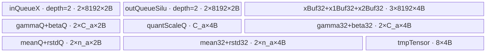
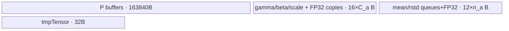
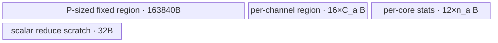

# GroupNormSiluQuant A2/A3 ACLNN 算子知识

## 算子速览

| 项目 | 内容 |
|---|---|
| 实际入口 | 公开两段式 `aclnnGroupNormSiluQuantGetWorkspaceSize` / `aclnnGroupNormSiluQuant`；固定仓未出现带版本号的新入口 |
| 计算语义 | 对 `[N,C,...]` 的每个 `(n, group)` 域做 GroupNorm，按通道应用 `gamma/beta`，执行 SiLU，再以标量或逐通道 `quantScale` 量化为 INT8；另输出 `mean/rstd` |
| 输入输出 | `self/gamma/beta` 为 FP16 或 BF16，`quantScale` 为 FP32；`out` 为 INT8 且 shape 同 `self`，`meanOut/rstdOut` 为输入 dtype、shape `[N,G]`；均为 ND |
| 执行类型 | 单 Kernel，节点为 `AIV_VECTOR`；entry 标记 `KERNEL_TYPE_MIX_VECTOR_CORE`，body 只含 GM↔UB 搬运、Vector/标量运算，不含 Cube/AIC/MIX_CV 节点 |
| Kernel 路线 | R-001/R-002：`elemNum<=8192` 的单归约块，分别使用标量/逐通道 scale；R-003/R-004：`elemNum>8192` 的分块归约，分别使用标量/逐通道 scale |
| 核心资源 | GM、AIV UB、`TPipe`、7 个 `TQue`、8 个 `TBuf`；仅申请运行时系统 workspace，body 不读写 user workspace |
| 来源闭包 | `source_closed`：公开 ACLNN→参数校验/连续化→L0 launcher→Tiling/POD→key 1031 entry→`GroupNormSiluQuantB16` body→A2/A3 binary/build 接线闭合 |
| 验证状态 | 已完成源码闭包检查；本次知识提取未执行编译、真机、数值或性能测试。 |

## 接口与语义

### 计算语义

令输入 shape 为 `[N,C,d2,...,dk]`，组数为 `G`，每组通道数 `D=C/G`，空间元素数 `S=Π(i=2..k) di`，每个归一化域元素数 `E=D*S`。对任务 `(n,g)`：

```text
mean[n,g] = Σ x[n,g,d,s] / E
rstd[n,g] = 1 / sqrt(Σ x[n,g,d,s]^2 / E - mean[n,g]^2 + eps)
z[n,c,s] = x[n,c,s] * (rstd[n,g] * gamma[c])
           + (-rstd[n,g] * gamma[c] * mean[n,g] + beta[c])
silu[n,c,s] = z[n,c,s] / (1 + exp(-z[n,c,s]))
out[n,c,s] = int8(clamp(round(silu[n,c,s] / quantScale[q]), -128, 127))
```

`q=0` 表示标量 scale；否则 `q=c`。Device 以 FP32 计算 `Σx`、`Σx²`、均值、rstd、仿射与 SiLU；量化前先将 FP32 值 cast 为 FP16，再 clamp 和 cast 为 INT8。该精确降精度顺序比公开文档中的抽象 `round(silu/quantScale)` 更具体。

### 输入、输出与属性

| 参数 | shape/layout | dtype | 约束、默认值与语义 |
|---|---|---|---|
| `self` | ND，rank 2～8，`[N,C,...]` | FP16/BF16 | 必选；`N>0`、`C>0`，`C%group==0`；API 支持非连续输入并先 `Contiguous` |
| `gammaOptional` | ND，`[C]` | 同 `self` | 可选；为空时实现用 `OnesLike` 生成全 1 |
| `betaOptional` | ND，`[C]` | 同 `self` | 可选；为空时实现用 `ZerosLike` 生成全 0；公开 API 文档表格写“默认值为1”，与实现冲突，复用时以固定源码行为为准 |
| `quantScale` | ND，`[1]` 或 `[C]` | FP32 | 必选；先 `Contiguous`；Kernel 未检查 0、NaN 或 Inf |
| `group` | Host scalar | INT64 | 必选，`group>0` 且整除 `C` |
| `eps` | Host scalar | DOUBLE | API 要求 `eps>0`，送入 L0 前窄化为 FP32 |
| `activateSilu` | Host scalar | BOOL | API 只允许 `true`；POD/body 仍保留条件分支 |
| `out` | ND，shape 同 `self` | INT8 | 必选；由内部连续结果经 `ViewCopy` 提交 |
| `meanOut` | ND，`[N,G]` | 同 `self` | 必选；输出每组均值 |
| `rstdOut` | ND，`[N,G]` | 同 `self` | 必选；输出每组 `rstd` |

### 入口与版本

固定仓公开 `aclnnGroupNormSiluQuant`，无 V2 或更高版本族；因此它是 A2/A3 实际支持的最新公开入口。README 与 API 文档均明确支持 Atlas A2/A3、明确不支持 Ascend 950；OpDef 只注册 `ascend910b/ascend910_93`，两个 binary config 及全局 `ascendc_config.json` 也只接线这两个 compute unit。无 950 发布冲突，950 是明确不支持。

## Host/Launcher 执行流程

### 参数校验与前处理

`aclnnGroupNormSiluQuantGetWorkspaceSize` 的顺序为：创建 executor；校验必选指针；校验 dtype；校验 rank/shape；校验属性。API dtype 检查仅在 `gamma` 与 `beta` 同时非空时核对它们和 `self` 的 dtype；单独只给一个可选张量时，后续 Tiling 的 `CheckInputParams` 仍会核对 `x/gamma/beta` 一致，不一致会以 `GRAPH_FAILED` 终止。

若 `self->IsEmpty()`（在 `N,C>0` 后只可能来自后续维为 0），executor 用框架 `Fill`/`ViewCopy` 将 `meanOut` 填 0、`rstdOut` 填 NaN，workspace 置 0并返回；该分支不启动 GroupNormSiluQuant Kernel，固定源码没有写 `out`。非空路径依次将 `self/quantScale` 连续化；`gamma/beta` 非空则连续化，为空则分配 `[C]` 张量并分别生成 1/0；随后添加一个 `GroupNormSiluQuant` AICore launcher，最后为三个内部输出各添加 `ViewCopy`。

### 参数、Workspace 与生命周期

L0 `GroupNormSiluQuant` 分配 INT8 `y`（shape 同 `x`）和输入 dtype 的 `[N,G]` `mean/rstd`，并把四个输入、三个输出与 `numGroups/float(eps)/activateSilu` 加入 launcher。Tiling 通过 `GetLibApiWorkSpaceSize()` 取得系统 workspace 并写 `workspaces[0]`；没有算子自定义 slice。Kernel 要求传入 `workspace` 及 `GetUserWorkspace(workspace)` 非空，但 `Init` 只接收该地址而不绑定/消费它。workspace 与 executor 由第一段接口返回，调用者保持到第二段 `CommonOpExecutorRun(..., stream)` 完成。

### 启动图与失败传播

```text
aclnnGroupNormSiluQuantGetWorkspaceSize
  -> framework Contiguous / optional OnesLike,ZerosLike
  -> l0op::GroupNormSiluQuant
       -> ADD_TO_LAUNCHER_LIST_AICORE(GroupNormSiluQuant)
          -> Tiling4GroupNormSiluQuant: blockDim=realCoreNum, key=1031
          -> group_norm_silu_quant(..., workspace, tiling)
             -> GroupNormSiluQuantB16<DTYPE_X,DTYPE_X>::Init/Process
  -> ViewCopy(y, out) -> ViewCopy(mean, meanOut) -> ViewCopy(rstd, rstdOut)
```

单个 Device 节点直接从四个输入 GM 写三个输出 GM；没有 Kernel 间 workspace 边。launcher 添加失败会返回空 tuple，ACLNN 随后返回 `ACLNN_ERR_INNER_NULLPTR`；Tiling 任一校验或 Route guard 失败则阻断 launch；entry 遇到空 workspace/user workspace 或未知 key 时直接返回且不写输出。executor 保证同一 stream 上算子节点与后续 `ViewCopy` 的顺序；固定仓把该 executor/stream 调度视为框架边界。

## Route 与参数设计

### 分核与资源计算

记 `T=N*G`、平台 AIV 核数 `K`、固定 tile `P=8192` 元素：

```text
numPerCore = ceil(T/K)
realCoreNum = ceil(T/numPerCore)
numLastCore = T - numPerCore*(realCoreNum-1)
S = Π shape[i], i>=2
D = C/G
E = D*S
loopNum = ceil(E/P);       loopTail = E-P*(loopNum-1)
innerLoopNum = ceil(S/P); innerLoopTail = S-P*(innerLoopNum-1)
```

成功 Route 还必须满足 `S>=32/sizeof(x)=16` 且 `C+numPerCore<=2700`。Tiling 曾在小 `S` 情况把 `realCoreNum` 改为 1，但随后 `SetTiling` 对所有 `S<16` 返回失败，因此该分支不是可达 Kernel fallback。第 `b` 核处理 `numPerCore` 个 `(n,g)` 任务，末核处理 `numLastCore` 个；其输入基址为 `b*numPerCore*E`，任务内地址为 `outIdx*E+dIdx*S+tile*P`。

### Route 选择

| 顺序 | Route | Key/模板 | 精确选择条件与优先级 | 不适用去向 |
|---:|---|---|---|---|
| 1 | R-001 单块归约×标量 scale | key 1031；`GroupNormSiluQuantB16<DTYPE_X,DTYPE_X>` | 公共 Host guard 成功，`E<=8192 && shapeQuantScale==1` | `E` 或 scale 长度的对应 Route |
| 2 | R-002 单块归约×逐通道 scale | 同上 | 公共 Host guard 成功，`E<=8192 && shapeQuantScale==C` | 多块 Route；其它 scale 长度在 API 失败 |
| 3 | R-003 多块归约×标量 scale | 同上 | 公共 Host guard 成功，`E>8192 && shapeQuantScale==1` | R-004 或失败 |
| 4 | R-004 多块归约×逐通道 scale | 同上 | 公共 Host guard 成功，`E>8192 && shapeQuantScale==C` | 其它 scale 长度在 API 失败 |

```text
if dtype not FP16/BF16 or rank/shape/attrs invalid: fail
compute S,D,E,numPerCore,realCoreNum
if S < 16 or C + numPerCore > 2700: GRAPH_FAILED
key = 1031
if E <= 8192:
    if Q == 1: R-001
    else if Q == C: R-002
else:
    if Q == 1: R-003
    else if Q == C: R-004
```

### 模板/实现执行矩阵

| Route | key/selector | dtype/shape/platform 完整命中条件 | 执行拓扑与 Kernel 节点 | 实际模板/body | 内存与同步特征 | tail/fallback |
|---|---|---|---|---|---|---|
| R-001 | 1031；`loopNum==1,Q=1` | A2/A3；x/gamma/beta 同为 FP16 或 BF16；公共 guard；`E<=P,Q=1` | 单 `AIV_VECTOR` Kernel | `ComputeOneLoop`，scale 取 `quantScaleLocal[0]` | 完整 E 一次归约；每通道 S 尾搬运；Queue + V barrier + S2V event | S 用 `DataCopyPad`；无 fallback |
| R-002 | 1031；`loopNum==1,Q=C` | 同 R-001，但 `Q=C` | 同上 | `ComputeOneLoop`，每通道取 `quantScaleLocal[cIdx]` | 同 R-001，多一项逐通道标量读取 | 同上 |
| R-003 | 1031；`loopNum>1,Q=1` | 公共 guard；`E>P,Q=1` | 单 `AIV_VECTOR` Kernel | `ComputeMultipleLoop` + `ComputeSumX` | P 元素位置累加后 ReduceSum；通道空间再按 P 切片 | 最后 E/S tile 用 pad；无 fallback |
| R-004 | 1031；`loopNum>1,Q=C` | 同 R-003，但 `Q=C` | 同上 | `ComputeMultipleLoop`，逐通道 scale | 同 R-003，多一项逐通道标量读取 | 同上 |

### 隐藏性能 Guard

| Guard | Host/Tiling 条件 | Device/资源原因 | 影响 Route | 不满足时去向 | 源码符号 |
|---|---|---|---|---|---|
| 空间轴最小长度 | `S >= 32/xDtypeSize = 16` | 成功实现的通道段至少覆盖一个 32B block；小空间分核分支没有配套 key | 全部 | `GRAPH_FAILED` | `group_norm_silu_quant_tiling.cpp::SetTiling` |
| UB 间接上界 | `C+numPerCore<=2700` | gamma/beta 与 `[N,G]` 统计量缓冲随两项增长 | 全部 | `GRAPH_FAILED` | `SetTiling` |
| 固定 tile | `P=8192` | 三个 FP32 P 缓冲与双缓冲输入/输出构成固定 UB 主体 | 全部 | `E` 决定单块/多块 body | `SetTilingParams`、`GroupNormSiluQuantB16::Init` |
| DMA tail | `copyNum` 非 32B 对齐时 `isAlign=false` | A2/A3 `__CCE_AICORE__==220` 路径用按字节 `DataCopyPad` 避免越界写 | 全部 | 尾块 pad 路径 | `GroupNormSiluQuantBase::CopyInData/CopyOutData` |
| 量化 scale 形状 | `Q==1 \|\| Q==C` | body 仅有标量和逐通道两种索引 | 全部 | API `ACLNN_ERR_PARAM_INVALID` | `CheckShape`、`ComputeOneLoop/ComputeMultipleLoop` |
| workspace 非空 | `workspace!=nullptr && GetUserWorkspace(workspace)!=nullptr` | entry 在解析 POD 前硬返回 | 全部 | 无输出直接返回 | `group_norm_silu_quant` |
| mean/rstd copy 长度窄化 | `copyNum` 隐式要求可安全转 `uint16_t` | `CopyOutMeanAndRstd` 将每核任务数转为 `uint16_t`；Host 的 2700 guard使成功 Route 小于上限 | 全部 | Host guard 失败 | `CopyOutMeanAndRstd` |
| UB 平台值未参与选择 | `TilingPrepare` 取得 `ubSizePlatForm>0`，后续不读取 | 固定仓无法从 selector 证明 `UB_total<=runtime UB`，只存在 2700 常量 guard | 全部 | 无动态 UB fallback | `TilingPrepare4GroupNormSiluQuant`、`SetTiling` |

### POD/ABI

`BEGIN_TILING_DATA_DEF` 的序列化宏定义来自外部运行时头；固定仓可见字段声明顺序、源码类型和 producer/consumer，但不可见展开后的 `sizeof/alignof/offsetof`，故 ABI 布局列不推测数值。

| 结构 | 字段 | 类型/位宽 | ABI 布局 | 单位 | Host/launcher producer | Device consumer | 边界 |
|---|---|---|---|---|---|---|---|
| `GroupNormSiluQuantTilingData` | `numGroups` | `int64_t`/64 | 宏展开不可见 | 组 | `SetAttrParams: numGroups` | group 索引、任务总数语义 | `>0,C%G==0` |
| 同上 | `hwNum` | `int64_t`/64 | 同上 | 元素 | `SetTilingParams: Πshape[2:]` | 通道 stride、inner loop | 成功 Route `>=16` |
| 同上 | `elemNum` | `int64_t`/64 | 同上 | 元素/组 | `shapeD*hwNum` | 归约长度、核 GM stride | 正值 |
| 同上 | `shapeC` | `int64_t`/64 | 同上 | 元素 | `shape[1]` | gamma/beta UB 和通道索引 | `>0` |
| 同上 | `shapeD` | `int64_t`/64 | 同上 | 通道/组 | `shapeC/numGroups` | `dIdx` 循环 | 整除后正值 |
| 同上 | `shapeQuantScale` | `int64_t`/64 | 同上 | 元素 | `quantScale.shape[0]` | 标量/逐通道选择 | 1 或 C |
| 同上 | `realCoreNum` | `int64_t`/64 | 同上 | core | `SetBlockTiling` | `Process` block guard/末核 | 写 `blockDim` |
| 同上 | `numPerCore` | `int64_t`/64 | 同上 | `(n,g)` 任务/core | `ceil(N*G/K)` | GM offset、普通核循环 | 与 C 和不大于2700 |
| 同上 | `numLastCore` | `int64_t`/64 | 同上 | 任务 | `T-numPerCore*(B-1)` | 末核循环 | `1..numPerCore` |
| 同上 | `processSize` | `int64_t`/64 | 同上 | 元素 | 常量 8192 | UB 容量、tile stride | 固定 |
| 同上 | `loopNum` | `int64_t`/64 | 同上 | tile | `ceil(elemNum/P)` | 单/多块分支、归约循环 | `>=1` |
| 同上 | `loopTail` | `int64_t`/64 | 同上 | 元素 | `E-P*(loopNum-1)` | 最后归约 CopyIn/Compute | `1..P` |
| 同上 | `innerLoopNum` | `int64_t`/64 | 同上 | tile/通道 | `ceil(hwNum/P)` | 输出通道内循环 | `>=1` |
| 同上 | `innerLoopTail` | `int64_t`/64 | 同上 | 元素 | `S-P*(innerLoopNum-1)` | 输出尾 tile | `1..P` |
| 同上 | `tilingKey` | `int64_t`/64 | 同上 | key | `SetTiling: 1031` | POD 内未读取；context key 驱动 router | 仅 1031 |
| 同上 | `epsilon` | `float`/32 | 同上 | 数值 | `SetAttrParams: float eps` | rstd 标量公式 | API `double` 先窄化 |
| 同上 | `activateSilu` | `int64_t`/64 | 同上 | bool 值 | `SetAttrParams: bool` | `CalcSilu` 条件 | API 只允许 true |

### Route 源码闭包

| Route | Key/selector | Host/Tiling producer | POD/参数 | Kernel entry/router 节点 | Kernel body/直接依赖 | 构建接线 |
|---|---|---|---|---|---|---|
| R-001/R-002 | 1031，`E<=P` | `Tiling4GroupNormSiluQuant`、`SetTiling/SetUbTiling` | `GroupNormSiluQuantTilingData` | `group_norm_silu_quant`→B16 实例 | `ComputeOneLoop`、`AccumulateXandX2OneLoop`、base copy/cast helpers | OpDef A2/A3 config、两平台 binary JSON、`ascendc_config.json` |
| R-003/R-004 | 1031，`E>P` | 同上 | 同上 | 同上 | `ComputeMultipleLoop`、`ComputeSumX`、`AccumulateXandX2MultipleLoop`、base helpers | 同上 |

## Kernel 实现

### 公共执行流程

entry 先声明 `KERNEL_TYPE_MIX_VECTOR_CORE`，拒绝空 workspace/user workspace，解析 POD，并只在 key 1031 实例化 `GroupNormSiluQuantB16<DTYPE_X,DTYPE_X>`。每核 `Init` 绑定七个 GM 张量，按固定 P、对齐 C 和每核任务数分配 UB；`Process` 选择普通核/末核任务数。每核只装一次完整 gamma、beta、quantScale，随后逐 `(n,g)` 归约，再逐组内通道读取 gamma/beta/scale，将归一化与仿射折叠为 `x*scale+bias`，计算 SiLU、量化并写 y；最后批量 cast/copy 本核 mean/rstd。没有跨核归约、Atomic、SIMT、NDDMA、通信或 Kernel 间边。

### Route R-001：单块归约×标量 scale

#### 适用条件

##### 选择证据

| 层级 | 文件 | 符号 | 源码谓词/参数 | 结果/下一跳 |
|---|---|---|---|---|
| API | `op_host/op_api/aclnn_group_norm_silu_quant.cpp` | `CheckShape` | `Q==1 \|\| Q==C` | Q=1 保留标量分支 |
| Tiling | `op_host/group_norm_silu_quant_tiling.cpp` | `SetTiling` | `S>=16 && C+numPerCore<=2700` | key 1031，否则失败 |
| Device | `op_kernel/group_norm_silu_quant_b16.h` | `ComputeSilu` | `loopNum==1`，等价 `E<=8192` | `ComputeOneLoop` |
| Device | 同上 | `ComputeOneLoop` | `shapeQuantScale==1` | 始终复用 `quantScaleLocal[0]` |

#### Device 数据流

##### 函数级调用链

```text
Tiling4GroupNormSiluQuant(blockDim=realCoreNum,key=1031)
  -> group_norm_silu_quant
    -> GroupNormSiluQuantB16::Init
    -> Process -> ProcessPerCore
      -> CopyInGammaAndBeta -> CastGammaAndBeta
      -> ComputeSilu -> ComputeOneLoop
        -> AccumulateXandX2OneLoop
        -> CopyInX<false> -> CalcSilu -> ComputeQuant -> CopyOutYWithPad
      -> CastMeanAndRstd -> CopyOutMeanAndRstd
```

##### 源码等价伪码

```text
# 伪码；b=blockIdx，L=末核?nLast:numPerCore
load gamma[0:C], beta[0:C], quantScale[0] to UB; cast gamma/beta to FP32
for j in 0..L-1:
  load x[b*numPerCore*E + j*E : +E] with pad
  x32=cast_fp32(x); sum=reduce(x32); sum2=reduce(x32*x32)
  mean=sum/E; rstd=1/sqrt(sum2/E-mean*mean+eps)
  store mean32[j],rstd32[j]; S2V event
  g=(b*numPerCore+j)%G
  for d in 0..D-1:
    c=g*D+d; scale=rstd*gamma32[c]; bias=-scale*mean+beta32[c]
    load x at base+j*E+d*S for S elements with pad
    z=fp32(x)*scale+bias; z=z/(1+exp(-z)); z*=1/quantScale[0]
    q16=cast_fp16(z); q8=cast_rint_int8(clamp(q16,-128,127)); copy S valid bytes to y
cast mean/rstd to T1; copy L valid values to GM
```

#### 内存与数据搬运

##### 资源与搬运表

| 层级/缓冲区 | offset/地址公式 | extent/容量公式 | dtype/layout | producer | consumer | owner/lifetime | 对齐/复用 |
|---|---|---|---|---|---|---|---|
| x GM | `b*numPerCore*E+j*E+d*S` | E 或 S 有效元素 | T1/ND | caller | reduction/CalcSilu | caller，全 launch | 尾部 pad copy |
| y GM | 同 x 逻辑 offset | S 有效 INT8 | INT8/ND | CopyOutYWithPad | caller/ViewCopy | executor 内部输出 | 按字节尾写 |
| gamma/beta GM | 0 | C | T1/[C] | ACLNN | CopyInGammaAndBeta | executor input | 每核各装一次 |
| quantScale GM | 0 | 1 有效 | FP32/[1] | ACLNN | scalar GetValue | executor input | UB 容量仍按 C 对齐 |
| inQueueX | 0 | depth 2 × P×2B | T1 | CopyInX | reduction/CalcSilu | 当前 tile | EnQue/DeQue/Free |
| outQueueSilu | 0 | depth 2 × P×2B 分配 | 以 INT8 view 使用 | ComputeQuant | CopyOutYWithPad | 当前 tile | 分配按 T1 字节数，实际有效 P×1B |
| FP32 work buffers | 各独立 TBuf | 3×P×4B | FP32 | cast/mul/add | reduce/SiLU/quant | kernel 全程 | x2Buf 亦作 FP16 quant view |
| param buffers | 独立 Queue/TBuf | `16*C_a` B 合计 | T1/FP32 | Copy/Cast | 通道循环 | 每核全程 | `C_a=ceil(C/16)*16` |
| stats buffers | 独立 Queue/TBuf | `12*n_a` B 合计 | T1/FP32 | mean/rstd | final copy | 每核全程 | `n_a=ceil(numPerCore/16)*16` |
| workspace | user offset 0 | 0 算子字节；系统区由 runtime API 决定 | opaque | runtime | entry 仅判空 | launch | body 未使用 |

##### 分层内存布局



##### 字节账与复用顺序

```text
C_a = ceil(C/16)*16; n_a = ceil(numPerCore/16)*16
UB_total = 3*8192*4 + 2*8192*2 + 2*8192*2
         + (2*C_a*2 + C_a*4 + 2*C_a*4)
         + (2*n_a*2 + 2*n_a*4) + 8*4
         = 163872 + 16*C_a + 12*n_a bytes
Host 未用 ubSizePlatForm 校验该式；成功条件仅有 C+numPerCore<=2700。
dynamic_ub = N/A
workspace_total = GetLibApiWorkSpaceSize()（具体字节由外部 runtime 决定）；user slice=0
```

| 复用子区 | 写入者 | 读取者/消费点 | 下一次覆盖 | 同步或释放依据 | 安全条件 |
|---|---|---|---|---|---|
| `x2Buf32` | `Mul(x,x)` | `ReduceSum` | `CalcSilu` 写 exp 分母/FP16 quant view | 顺序调用与 V barrier | 完成当前归约后才进入输出计算 |
| `inQueueX` 双缓冲 | `CopyInX` | reduction 或 `CalcSilu` | 下一 tile | EnQue→DeQue→FreeTensor | 每次消费后释放 |
| `outQueueSilu` 双缓冲 | `ComputeQuant` | `CopyOutYWithPad` | 下一通道/tile | EnQue→DeQue→FreeTensor | GM copy 后释放 |
| stats FP32 | 每任务 SetValue | `CastMeanAndRstd` | kernel 结束 | 所有任务循环结束 | `numPerCoreAlign` 容纳普通核上限 |

#### 同步、精度与尾块

##### 同步与数值边界表

| 阶段 | primitive/机制 | producer | consumer/等待点 | 保护对象 | 精度/尾块 |
|---|---|---|---|---|---|
| GM→UB | Queue | `CopyInX/CopyInGammaAndBeta` | DeQue | 输入 tile/参数 | A2/A3 tail 用 DataCopyPad |
| reduction | `PipeBarrier<PIPE_V>` | Cast/Mul | 后续 Mul/Reduce | FP32 TBuf | FP32 `E[x²]-E[x]²`，不是 Welford |
| scalar→vector | S2V event | mean/rstd SetValue 与标量计算 | Vector `CalcSilu` | scale/bias 标量 | 仅单块 body 显式该 event |
| SiLU | V barriers | Muls/Adds/Exp/Div | 下一 Vector op | x1/x2 buffers | 全 FP32 |
| quant | V barriers + `CAST_RINT` | reciprocal scale、FP16 cast、clamp | INT8 queue | 输出 tile | FP16 中间，范围 [-128,127] |
| stats output | Queue | FP32→T1 `CAST_ROUND` | DataCopyPad | mean/rstd | copyNum 有效值，其余不写 |

#### 关键实现

##### 符号证据表

| 阶段 | 文件 | 符号/模板实例 | 实现事实 |
|---|---|---|---|
| Host/Tiling producer | `op_host/group_norm_silu_quant_tiling.cpp` | `SetTilingParams/SetBlockTiling/SetUbTiling/SetTiling` | 生产 P、分核、key 与 loop 字段 |
| Kernel entry/router | `op_kernel/group_norm_silu_quant.cpp` | `group_norm_silu_quant`，key 1031 | 路由到 B16 模板，workspace 判空 |
| Device body/helper | `op_kernel/group_norm_silu_quant_b16.h` | `ComputeOneLoop/AccumulateXandX2OneLoop/CalcSilu/ComputeQuant` | 单块归约、标量 scale、FP32 SiLU 与量化 |

### Route R-002：单块归约×逐通道 scale

#### 适用条件

##### 选择证据

| 层级 | 文件 | 符号 | 源码谓词/参数 | 结果/下一跳 |
|---|---|---|---|---|
| API | `op_host/op_api/aclnn_group_norm_silu_quant.cpp` | `CheckShape` | `Q==C` | 允许逐通道 scale |
| Tiling | `op_host/group_norm_silu_quant_tiling.cpp` | `SetTiling/SetUbTiling` | 公共 guard 且 `loopNum==1` | key 1031、单块 body |
| Device | `op_kernel/group_norm_silu_quant_b16.h` | `ComputeOneLoop` | `shapeQuantScale!=1` | `quantScaleLocal.GetValue(cIdx)` |

#### Device 数据流

##### 函数级调用链

```text
group_norm_silu_quant(key=1031)
  -> B16::ProcessPerCore -> CopyInGammaAndBeta(Q=C)
  -> ComputeOneLoop -> AccumulateXandX2OneLoop
  -> for d: read quantScale[cIdx] -> CalcSilu -> ComputeQuant -> CopyOutYWithPad
  -> CastMeanAndRstd -> CopyOutMeanAndRstd
```

##### 源码等价伪码

```text
# 与 R-001 相同的单块 FP32 归约
for each local (n,g):
  mean,rstd = reduce E elements
  for d in 0..D-1:
    c=g*D+d; qs=quantScaleUB[c]
    z=x*(rstd*gamma[c])+(-rstd*gamma[c]*mean+beta[c])
    y=cast_int8(clamp(cast_fp16(z/(1+exp(-z))/qs),-128,127))
    copy S valid bytes
```

#### 内存与数据搬运

##### 资源与搬运表

| 层级/缓冲区 | offset/地址公式 | extent/容量公式 | dtype/layout | producer | consumer | owner/lifetime | 对齐/复用 |
|---|---|---|---|---|---|---|---|
| x/y GM | `b*numPerCore*E+j*E+d*S` | S 当前通道 | T1→INT8/ND | caller/Kernel | Kernel/caller | launch | tail pad |
| quantScale GM/UB | `cIdx` | C 有效，UB `C_a*4B` | FP32/[C] | CopyInGammaAndBeta | 通道循环 | 每核 | 全量一次装入 |
| gamma/beta | `cIdx` | C | T1→FP32 | Copy/Cast | affine | 每核 | 与 R-001 相同 |
| x/stat/output UB | 同 R-001 | 总式 `163872+16*C_a+12*n_a` 中相应项 | 混合 dtype | 各阶段 | 各阶段 | kernel | Queue/TBuf 生命周期同 R-001 |
| workspace | 0 | user 0 | opaque | runtime | entry 判空 | launch | 无 body 访问 |

##### 分层内存布局



##### 字节账与复用顺序

```text
UB_total = 163872 + 16*C_a + 12*n_a bytes
Q=C 只改变 quantScale 有效范围，不改变其 C_a×4B 分配。
dynamic_ub = N/A
workspace_total = runtime system workspace；user slice=0
```

| 复用子区 | 写入者 | 读取者/消费点 | 下一次覆盖 | 同步或释放依据 | 安全条件 |
|---|---|---|---|---|---|
| quantScale Queue | DataCopyPad | 每通道 GetValue(c) | kernel 结束 | 单次 DeQue 后保留 local view | C 个 FP32 已装入 |
| x2Buf32 | reduction/SiLU/quant | Reduce/Div/Cast | 下一通道 | V barrier | 与 R-001 同序 |
| input/output Queue | CopyIn/ComputeQuant | Compute/CopyOut | 下一 tile | Queue 生命周期 | FreeTensor 后覆盖 |

#### 同步、精度与尾块

##### 同步与数值边界表

| 阶段 | primitive/机制 | producer | consumer/等待点 | 保护对象 | 精度/尾块 |
|---|---|---|---|---|---|
| 参数装载 | DataCopyPad + Queue | GM scale[C] | scalar GetValue(c) | scale UB | FP32，无 scale 合法值校验 |
| 归约/SiLU | V barrier + S2V event | FP32 运算 | 后续运算 | x/stat buffer | 同 R-001 |
| 输出 | Queue + DataCopyPad | INT8 tile | GM | S 有效字节 | 每通道独立 scale；尾部不写越界 |
| stats | CAST_ROUND + DataCopyPad | FP32 stats | GM | L 值 | FP16/BF16 输出 |

#### 关键实现

##### 符号证据表

| 阶段 | 文件 | 符号/模板实例 | 实现事实 |
|---|---|---|---|
| Host/Tiling producer | `op_host/group_norm_silu_quant_tiling.cpp` | `SetTilingParams` | 写 `shapeQuantScale=C` 与单块 loop 字段 |
| Kernel entry/router | `op_kernel/group_norm_silu_quant.cpp` | key 1031 | 同一 B16 模板 |
| Device body/helper | `op_kernel/group_norm_silu_quant_b16.h` | `ComputeOneLoop` lines 226-237 | 以 `cIdx` 选择逐通道 scale |

### Route R-003：多块归约×标量 scale

#### 适用条件

##### 选择证据

| 层级 | 文件 | 符号 | 源码谓词/参数 | 结果/下一跳 |
|---|---|---|---|---|
| API | `op_host/op_api/aclnn_group_norm_silu_quant.cpp` | `CheckShape` | Q=1 | 标量 scale |
| Tiling | `op_host/group_norm_silu_quant_tiling.cpp` | `SetUbTiling` | `loopNum=ceil(E/8192)>1` | Device 多块 body |
| Device | `op_kernel/group_norm_silu_quant_b16.h` | `ComputeSilu` | `loopNum!=1` | `ComputeMultipleLoop` |
| Device | 同上 | `ComputeMultipleLoop` | `shapeQuantScale==1` | 复用 scale[0] |

#### Device 数据流

##### 函数级调用链

```text
group_norm_silu_quant(key=1031)
  -> B16::ProcessPerCore
  -> ComputeMultipleLoop
    -> AccumulateXandX2MultipleLoop
       -> first P Cast/Mul
       -> middle/tail CopyInX -> ComputeSumX (position-wise sum/sum2)
       -> ReduceSum over P positions
    -> per channel and inner tile: CalcSilu -> ComputeQuant -> CopyOutY/WithPad
  -> CastMeanAndRstd -> CopyOutMeanAndRstd
```

##### 源码等价伪码

```text
for each local task j:
  acc[0:P]=fp32(first P x); acc2=acc*acc
  for chunk in remaining full P chunks:
    t=fp32(load P); acc+=t; acc2+=t*t
  tail=fp32(load loopTail with pad); acc[0:tail]+=tail; acc2[0:tail]+=tail*tail
  sum=reduce(acc[0:P]); sum2=reduce(acc2[0:P]); mean/rstd as R-001
  for each channel d:
    for full spatial tile P: load, FP32 affine+SiLU, divide scale[0], quantize, DataCopy
    process innerLoopTail with DataCopyPad
```

#### 内存与数据搬运

##### 资源与搬运表

| 层级/缓冲区 | offset/地址公式 | extent/容量公式 | dtype/layout | producer | consumer | owner/lifetime | 对齐/复用 |
|---|---|---|---|---|---|---|---|
| reduction GM chunks | `base+j*E+k*P` | P 或 loopTail | T1/flat group | CopyInX | ComputeSumX | current task | full DataCopy/tail pad |
| spatial GM chunks | `base+j*E+d*S+k*P` | P 或 innerLoopTail | T1/ND | CopyInX | CalcSilu | current channel | full/尾路径 |
| x1Buf32/x2Buf32 | index 0..P-1 | 各 P×4B | FP32 | first chunk/ComputeSumX | final ReduceSum；后续 SiLU | kernel | position-wise chunk accumulation |
| xBuf32 | 0 | P×4B | FP32 scratch | cast/tail square | add/reduce scratch | current op | 多阶段覆盖 |
| param/stats/Queue | 同 R-001 | 相同字节公式 | 混合 | 各阶段 | 各阶段 | kernel | 相同 lifecycle |
| workspace | 0 | user 0 | opaque | runtime | entry 判空 | launch | 无 body 访问 |

##### 分层内存布局


##### 字节账与复用顺序

```text
UB_total = 163872 + 16*C_a + 12*n_a bytes
多块 Route 不增加 UB：循环覆盖固定 P 缓冲。
dynamic_ub = N/A
workspace_total = runtime system workspace；user slice=0
```

| 复用子区 | 写入者 | 读取者/消费点 | 下一次覆盖 | 同步或释放依据 | 安全条件 |
|---|---|---|---|---|---|
| x1Buf32 | first chunk Cast | middle/tail Add、final Reduce | `CalcSilu` | 顺序调用/V barriers | 完成 sum Reduce 后覆盖 |
| x2Buf32 | first square/Middle Add | sum2 Reduce | SiLU exp 与 quant FP16 | 顺序调用/V barriers | 完成 sum2 Reduce 后覆盖 |
| xBuf32 | middle chunk Cast/square | Add | next chunk | V pipeline 顺序 | `num` mask 只改有效前缀 |
| double queues | tile producer | tile consumer | 下一 tile | FreeTensor | 同 R-001 |

#### 同步、精度与尾块

##### 同步与数值边界表

| 阶段 | primitive/机制 | producer | consumer/等待点 | 保护对象 | 精度/尾块 |
|---|---|---|---|---|---|
| chunk accumulation | auto_sync build + 顺序 Vector API | Cast/Add/Mul | 下一 API/Reduce | 三个 FP32 P buffer | tail API 只处理 `loopTail` 前缀，旧后缀保留累加值 |
| reduction | ReduceSum | position accumulators | scalar mean/rstd | tmp/x2 first element | FP32，公式 `E[x²]-mean²` |
| spatial pipeline | Queue + V barriers | Copy/SiLU/quant | CopyOut | tile buffers | full P 用 DataCopy，尾用 DataCopyPad |
| stats | Queue | cast | GM copy | L values | A2/A3 `CAST_ROUND` |

#### 关键实现

##### 符号证据表

| 阶段 | 文件 | 符号/模板实例 | 实现事实 |
|---|---|---|---|
| Host/Tiling producer | `op_host/group_norm_silu_quant_tiling.cpp` | `SetUbTiling` | 生产 E/S 的 full/tail 循环 |
| Kernel entry/router | `op_kernel/group_norm_silu_quant.cpp` | key 1031 | 单 B16 实例 |
| Device body/helper | `op_kernel/group_norm_silu_quant_b16.h` | `AccumulateXandX2MultipleLoop/ComputeSumX/ComputeMultipleLoop` | 固定 P 分块累加与标量 scale 输出 |

### Route R-004：多块归约×逐通道 scale

#### 适用条件

##### 选择证据

| 层级 | 文件 | 符号 | 源码谓词/参数 | 结果/下一跳 |
|---|---|---|---|---|
| API | `op_host/op_api/aclnn_group_norm_silu_quant.cpp` | `CheckShape` | Q=C | 逐通道 scale |
| Tiling | `op_host/group_norm_silu_quant_tiling.cpp` | `SetUbTiling/SetTiling` | `E>8192` 且公共 guard | key 1031 |
| Device | `op_kernel/group_norm_silu_quant_b16.h` | `ComputeMultipleLoop` | `shapeQuantScale!=1` | 每通道 `GetValue(cIdx)` |

#### Device 数据流

##### 函数级调用链

```text
group_norm_silu_quant(key=1031)
  -> ProcessPerCore -> CopyInGammaAndBeta(Q=C)
  -> ComputeMultipleLoop -> AccumulateXandX2MultipleLoop/ComputeSumX
  -> per channel read quantScale[cIdx]
     -> per spatial tile CalcSilu/ComputeQuant -> CopyOutY/WithPad
  -> stats cast/copy
```

##### 源码等价伪码

```text
# 分块归约完全同 R-003
for each local (n,g):
  mean,rstd = position-wise chunk accumulation then ReduceSum
  for d in 0..D-1:
    c=g*D+d; qs=quantScaleUB[c]
    for tile over S:
      z=fp32(x)*(rstd*gamma[c])+(-rstd*gamma[c]*mean+beta[c])
      q=cast_int8(clamp(cast_fp16(z/(1+exp(-z))/qs),-128,127))
      copy valid tile to y
```

#### 内存与数据搬运

##### 资源与搬运表

| 层级/缓冲区 | offset/地址公式 | extent/容量公式 | dtype/layout | producer | consumer | owner/lifetime | 对齐/复用 |
|---|---|---|---|---|---|---|---|
| x/y GM tiles | `b*numPerCore*E+j*E+d*S+k*P` | P/tail | T1→INT8 | caller/Kernel | Kernel/caller | launch | full与pad两种搬运 |
| quantScale | `cIdx` | C，UB C_a | FP32 | GM copy | 通道外、tile内复用 | 每核 | 每通道 scale 对其所有空间 tile 复用 |
| reduction buffers | 0..P | 3×P×4B | FP32 | chunk pipeline | Reduce | task | 与 R-003 同 |
| Queue/params/stats | 各独立区 | `65536 + 16*C_a + 12*n_a + 32` 加其它 fixed TBuf | mixed | pipeline | pipeline | kernel | 见字节账 |
| workspace | 0 | user 0 | opaque | runtime | entry 判空 | launch | 未访问 |

##### 分层内存布局



##### 字节账与复用顺序

```text
UB_total = 163872 + 16*C_a + 12*n_a bytes
Q=C 与多 tile 均不增加容量：scale 对该通道所有空间 tile 复用。
dynamic_ub = N/A
workspace_total = runtime system workspace；user slice=0
```

| 复用子区 | 写入者 | 读取者/消费点 | 下一次覆盖 | 同步或释放依据 | 安全条件 |
|---|---|---|---|---|---|
| quantScale UB | DataCopyPad | 同通道所有 inner tiles | kernel 结束 | 参数 Queue 单次 DeQue | C 个值常驻 |
| FP32 accumulators | chunk reduction | ReduceSum | SiLU/quant | API 顺序/barrier | 两个 Reduce 完成 |
| in/out Queue | DMA/ComputeQuant | Vector/GM copy | 下一 tile | Queue FreeTensor | 当前 tile 已消费 |

#### 同步、精度与尾块

##### 同步与数值边界表

| 阶段 | primitive/机制 | producer | consumer/等待点 | 保护对象 | 精度/尾块 |
|---|---|---|---|---|---|
| reduction chunks | Queue/Vector 顺序 | Copy/Cast/Mul/Add | Reduce | P 缓冲 | FP32；loopTail 有效前缀 |
| channel scale | scalar GetValue | scale UB | Muls reciprocal | 当前通道 | FP32 scale，0/非有限值未校验 |
| SiLU/quant | V barriers + CastFromF16ToI8 | FP32 z | INT8 Queue | x1/x2/outQ | FP16 quant 中间、RINT、[-128,127] |
| copy tail | DataCopyPad | output Queue | y GM | innerLoopTail | 精确有效字节 |

#### 关键实现

##### 符号证据表

| 阶段 | 文件 | 符号/模板实例 | 实现事实 |
|---|---|---|---|
| Host/Tiling producer | `op_host/group_norm_silu_quant_tiling.cpp` | `SetTilingParams/SetUbTiling` | Q=C、E/S 分块字段 |
| Kernel entry/router | `op_kernel/group_norm_silu_quant.cpp` | key 1031 | 单 B16 实例 |
| Device body/helper | `op_kernel/group_norm_silu_quant_b16.h` | `ComputeMultipleLoop/ComputeSumX/CalcSilu` | 分块归约、逐通道 scale、多空间 tile |

## 算子特定优化

### Trick T-001：把归一化与逐通道仿射折叠为一次 Muls+Adds

#### 触发与源码依据

- 适用 Route：R-001～R-004
- 触发条件：完成当前 `(n,g)` 的 FP32 `mean/rstd`，进入组内通道循环
- Golden 来源：[`group_norm_silu_quant_b16.h:226-237`](../../../../../../../cann-ops-raw/ascendc/ops-nn/955f8b33985b6d72989ebff341bb9c2c564a51bc/norm/group_norm_silu_quant/op_kernel/group_norm_silu_quant_b16.h#L226-L237)

**官方源码（固定 Commit 连续逐字摘录）**：

```cpp
int64_t groupIdx = ((blockIdx * tiling->numPerCore + outIdx) % tiling->numGroups);
for (int64_t dIdx = 0; dIdx < tiling->shapeD; dIdx++) {
    int64_t cIdx = groupIdx * tiling->shapeD + dIdx;
    int64_t xOffset = outIdx * tiling->elemNum + dIdx * tiling->hwNum;
    float gamma = gammaUb32.GetValue(cIdx);
    float beta = betaUb32.GetValue(cIdx);
    quantScale = this->tiling->shapeQuantScale == 1 ? quantScale : quantScaleLocal.GetValue(cIdx);
    float scale = rstd * gamma;
    float bias = -scale * mean + beta;
    CopyInX<false>(xOffset, tiling->innerLoopTail);
    CalcSilu(scale, quantScale, bias, tiling->innerLoopTail);
    CopyOutYWithPad(scale, bias, xOffset, tiling->innerLoopTail);
}
```

#### 机制与设计原因

代数上 `(x-mean)*rstd*gamma+beta = x*(rstd*gamma)+(-rstd*gamma*mean+beta)`。源码每通道只计算一次标量 `scale/bias`，空间 tile 内只需 `Muls` 和 `Adds`，避免为每个元素分别执行减均值、乘 rstd、乘 gamma；标量/逐通道 quantScale 也在通道层选定并复用于该通道全部空间 tile。该机制减少 Vector 指令和重复标量装载，但固定仓未提供真机收益数据。

#### 迁移边界

- 适用：归一化统计量按组共享、gamma/beta/quantScale 按通道共享的融合算子。
- 前提：FP32 `mean/rstd/gamma/beta` 标量在当前通道所有空间元素上不变；保持原式运算精度/舍入顺序要求。
- 失效：参数按元素变化或必须逐步保持原始舍入点时，不能直接折叠；本实现也没有其它 Route fallback。
- 未验证：本次知识提取未执行编译、真机、数值或性能测试。

#### 错误做法

固定仓未提供可验证反例。

## 模板与实现对比

| 对比维度 | R-001 单块标量 | R-002 单块逐通道 | R-003 多块标量 | R-004 多块逐通道 | 设计选择依据 |
|---|---|---|---|---|---|
| 命中条件/优先级 | E≤P,Q=1 | E≤P,Q=C | E>P,Q=1 | E>P,Q=C | Device 先按 loopNum，再按 Q 选 scale 索引 |
| 模板与 dtype | B16<DTYPE_X,DTYPE_X> | 同 | 同 | 同 | FP16/BF16 binary 各自实例化 |
| 循环与分核 | 每任务一次归约 | 同 | E 分块位置累加 | 同 | 所有 Route 每核任务映射相同 |
| Queue/TBuf/寄存器/dynamic UB/通信 window | 7 Queue+8 TBuf；无 dynamic UB/通信 | 同 | 同 | 同 | 固定 P 容量 |
| 内存总占用与复用 | `163872+16C_a+12n_a` | 同 | 同，跨 chunk 覆盖 | 同 | Q 有效长度不改变分配 |
| 搬运/Vector/SIMT/NDDMA/通信 API | pad Copy、Reduce、Muls/Adds/Exp/Div/Cast | 多逐通道 GetValue | full+pad Copy、Add/Mul/Reduce | 再加逐通道 GetValue | 全部为 Vector，无其它执行族 |
| 同步、精度与 tail | V barrier、S2V、FP32→FP16→INT8 | 同 | auto_sync/顺序 Vector，尾 pad | 同 | A2/A3 DataCopyPad 与 CAST_RINT |
| fallback/失败边界 | 无 | 无 | 无 | 无 | 公共 guard 不满足直接 GRAPH_FAILED |

## 平台差异

| 项目 | A2 | A3 | 950 |
|---|---|---|---|
| 支持状态 | 支持；`ascend910b` | 支持；`ascend910_93` | 公开文档明确不支持；不生成卡 |
| Host/Launcher | 共用 Tiling、key 1031、FP16/BF16 config | 同 | 无 OpDef/config/全局 binary 接线 |
| Kernel/资源 | 共用 B16 Vector body；`__CCE_AICORE__==220` 使用 DataCopyPad、CAST_ROUND/RINT | 同 | 无公开可达实现 |

## 限制与失败边界

- 成功 Kernel Route 比公开参数表更窄：必须 `S>=16` 且 `C+ceil(N*G/K)<=2700`；没有 fallback key。
- `eps` 从 ACLNN DOUBLE 窄化到 FP32；方差按 `E[x²]-E[x]²` 计算，固定仓没有 Welford 路线。
- 量化先 FP32 乘 `1/quantScale`，再 cast FP16、clamp、RINT 到 INT8；`quantScale` 的 0、NaN、Inf 和符号均未校验。
- API 在只有 gamma 或只有 beta 非空时漏做其 dtype 与 self 的匹配，但 Tiling 会再次检查并失败；不可依赖 API 层漏检。
- 公开 API 文档称空 beta 默认 1，固定实现实际调用 `ZerosLike` 生成 0；这是明确文档/实现语义冲突。
- 后续维为 0 的空输入分支只显式写 mean=0、rstd=NaN，固定源码未写 out；不启动本 Kernel。
- entry 对空 workspace/user workspace 或未知 key 静默返回；body 未使用 user workspace。系统 workspace 的具体字节数与 executor/stream 内部同步属于固定仓外框架边界。
- POD 序列化宏的精确 `sizeof/alignof/offsetof` 在固定仓不可见；不得仅按 C++ 自然对齐推测。
- `loopTailAlign/innerLoopTailAlign` 在 `Init` 计算但 body 未读取；`CopyOutYWithPad` 的 `scale/bias` 形参未使用。
- Tiling 读取平台 UB 大小但不把它代入 Route guard；源码只给常量 2700 间接限制，未形成动态 UB 容量证明。
- `hwNum=Πshape[2:]`、`elemNum=shapeD*hwNum`、`N*G` 及若干对齐乘法没有显式溢出检查，并在 `uint64_t/int64_t` 间赋值；超大 shape 的安全范围不可从固定仓补齐。
- 本次知识提取未执行编译、真机、数值或性能测试。

## 源码索引

### 链路索引

| 链路阶段 | 文件 | 关键符号 | 支撑内容 |
|---|---|---|---|
| 入口声明/约束 | `norm/group_norm_silu_quant/docs/aclnnGroupNormSiluQuant.md` | 产品支持表、两段式原型 | A2/A3 支持、950 不支持、公开语义 |
| 入口实现 | `norm/group_norm_silu_quant/op_host/op_api/aclnn_group_norm_silu_quant.cpp` | `CheckParams`、`GetGamma/GetBeta`、两段式函数 | 校验、空输入、连续化、可选值、ViewCopy |
| Launcher | `norm/group_norm_silu_quant/op_host/op_api/group_norm_silu_quant.cpp` | `l0op::GroupNormSiluQuant` | 内部输出分配与单 AICore launcher |
| OpDef | `norm/group_norm_silu_quant/op_host/group_norm_silu_quant_def.cpp` | `ops::GroupNormSiluQuant` | dtype/layout/属性与 A2/A3 注册 |
| POD | `norm/group_norm_silu_quant/op_host/group_norm_silu_quant_tiling.h` | `GroupNormSiluQuantTilingData` | POD 字段与 key 1031 |
| Host/Tiling | `norm/group_norm_silu_quant/op_host/group_norm_silu_quant_tiling.cpp` | `Tiling4GroupNormSiluQuant` 及 helpers | 分核、guard、loop、workspace、blockDim/key |
| Kernel entry | `norm/group_norm_silu_quant/op_kernel/group_norm_silu_quant.cpp` | `group_norm_silu_quant` | workspace 判空、key router、执行类型 |
| Kernel helper | `norm/group_norm_silu_quant/op_kernel/group_norm_silu_quant_base.h` | copy/cast helpers | A2/A3 pad DMA 与 INT8 rounding/clamp |
| Kernel body | `norm/group_norm_silu_quant/op_kernel/group_norm_silu_quant_b16.h` | `GroupNormSiluQuantB16` | UB、循环、归约、SiLU、量化、输出 |
| A2 binary | `norm/group_norm_silu_quant/op_host/config/ascend910b/group_norm_silu_quant_binary.json` | 两个 `bin_filename` | FP16/BF16 A2 binary 实例 |
| A3 binary | `norm/group_norm_silu_quant/op_host/config/ascend910_93/group_norm_silu_quant_binary.json` | 两个 `bin_filename` | FP16/BF16 A3 binary 实例 |
| 构建接线 | `scripts/kernel/binary_config/ascendc_config.json` | `GroupNormSiluQuant` entry | compute units 仅 910b/910_93，auto_sync=true |

### 实现复用检查

| 检查项 | 可复用事实 | 不得改变的约束 | 源码符号 |
|---|---|---|---|
| ABI/POD | 单 key 1031 的 17 个字段 producer/consumer | 字段顺序、int64/float 位宽、元素单位与宏序列化 | `GroupNormSiluQuantTilingData` |
| 调用顺序 | 每核参数预载→逐任务归约/输出→统计量批量输出 | 普通核/末核循环和 GM offset 公式 | `ProcessPerCore` |
| workspace/内存 | 固定 P UB 加 C_a/n_a 可变区；无 user slice | Queue depth=2 必须计入；系统 workspace 必须使 entry userWS 非空 | `Init`、`Tiling4GroupNormSiluQuant` |
| 同步 | Queue 生命周期、V barrier、单块 S2V、构建 auto_sync | buffer 覆盖必须晚于消费/FreeTensor | `CalcSilu`、`ComputeQuant`、binary config |
| 精度与尾块 | FP32 归约/SiLU，FP16 量化中间，A2/A3 RINT；DataCopyPad tail | 不得改成直接 FP32→INT8 或越界对齐 copy | `CastFromF16ToI8`、copy helpers |
| 失败边界 | S/C+core guard、workspace 判空、未知 key无输出 | 无 Host/Device fallback，不得虚构 950 路线 | `SetTiling`、entry router |