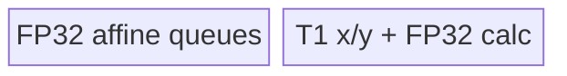
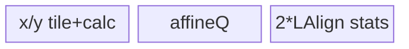

# GroupNormSwish 950 ACLNN 算子知识

## 算子速览

| 项目 | 内容 |
|---|---|
| 实际入口 | 公开两段式 `aclnnGroupNormSwishGetWorkspaceSize` / `aclnnGroupNormSwish`；OpDef 的 `ascend950` config 把 `opFile.value` 指向 `group_norm_swish_apt`。 |
| 计算语义 | 每 `(n,g)` 求 group mean/variance，做逐通道 affine；可选融合 Swish `z/(1+exp(-swishScale·z))`。 |
| 输入输出 | `x/y`: FP16/BF16/FP32 ND；`gamma/beta`: 同 dtype 或 16-bit x+FP32 affine；`mean/rstd`: `[N,G]`、gamma dtype。 |
| 执行类型 | 单 Kernel、单节点 `AIV_VECTOR`；Host 用 `GetCoreNumAiv()`，arch35 body 无 Cube/AIC/MIX_CV。 |
| Kernel 路线 | R-001…R-012；key 与 A2/A3 相同，router 为 `_apt`，body 全在 `arch35/`。 |
| 核心资源 | GM、VECIN/VECOUT Queue、FP32 TBuf；16 MiB system workspace 参数未被 body 读取。 |
| 来源闭包 | `source_closed`：公开 API→ascend950 OpDef/ACLNN 接线→Host/Tiling/POD→`group_norm_swish_apt.cpp`→arch35 逐 key body/helper→ascend950 binary config。 |
| 验证状态 | 已完成源码闭包检查；本次知识提取未执行编译、真机、数值或性能测试。 |

## 接口与语义

### 计算语义

令 `H=∏shape[2:]`、`D=C/G`、`M=D·H`。每组 `μ=Σx/M`、`v=Σ(x-μ)^2/M`、`r=1/sqrt(v+eps)`、`z=(x-μ)·r·gamma+beta`；`activateSwish` 决定 `y=z` 或 `y=z/(1+exp(-swishScale·z))`。mean/rstd 输出 `[N,G]`。本卡不包含 Grad、Silu、Quant 或原地变体。

### 输入、输出与属性

| 参数 | shape/layout | dtype | 约束、默认值与语义 |
|---|---|---|---|
| x/y | ND，2–8D，NCHW | FP16/BF16/FP32 | x 非空，N/C>0，y 与 x 同 shape/dtype。 |
| gamma/beta | `[C]` ND | 同 x；x 16-bit 时可 FP32 | 二者 dtype 相同且长度 C。 |
| numGroups | scalar | INT64 | >0 且整除 C。 |
| dataFormatOptional | Host string | char* | 默认/建议 NCHW；Tiling 不读取。 |
| eps | scalar | API double→POD float | OpDef 默认 1e-5。 |
| activateSwish | scalar | bool→POD int64 | 默认 true。 |
| swishScale | scalar | API double→POD float | 默认 1.0。 |
| mean/rstd | `[N,G]` | gamma dtype | FP32 内部统计后按 T2 输出。 |

### 入口与版本

固定 Commit 只有无版本后缀公开入口，为当前 950 实际支持的最新版本。公开文档明确支持 Ascend 950PR/950DT；OpDef `config_950` 注册 `ascend950` 并指定 `_apt` 文件，ascend950 binary config 包含五组公开 dtype 组合，没有支持冲突。手写 ACLNN inner bridge 不在仓内，按 `ACLNNTYPE aclnn` 生成框架边界处理。

## Host/Launcher 执行流程

### 参数校验与前处理

生成 ACLNN 层做必需 tensor、公开 dtype/shape 校验，并通过 OpDef `AutoContiguous()` 连续化三输入。`CheckInputParams` 再检查 x dtype、rank≥2、gamma/beta 1D 长度 C、gamma=beta dtype，且 x=FP32 时 affine 必须 FP32；`CheckAttrParams` 检查 `G>0 && C%G==0`。失败返回 `GRAPH_FAILED`。

### 参数、Workspace 与生命周期

属性写入 POD 后，Host 生成 `H`、`D`、`M`、分核字段、8192 tile 字段和 key。950 不是 ASCEND310P，因此 workspace[0]=16 MiB system reservation；`group_norm_swish` 签名接收它但 arch35 body 不读，owner 是 ACLNN executor，stream 任务完成前有效。

### 启动图与失败传播

```text
GetWorkspaceSize -> generated executor -> GroupNormSwish OpDef/config_950
  -> Tiling4GroupNormSwish -> POD/key/blockDim/workspace
aclnnGroupNormSwish -> group_norm_swish_apt.cpp::group_norm_swish<<<usedCoreNum,stream>>>
  -> one arch35 AIV_VECTOR template -> y/mean/rstd GM
```

无多 Kernel 边和算子 workspace slice。Tiling/launch 失败阻断节点；unknown key 没有 router fallback，不写输出。

## Route 与参数设计

### 分核与资源计算

`totalGroup=N·G`；`groupPerCore=ceil(totalGroup/AIVCoreNum)`；`groupPerCoreAlign=align_up(groupPerCore,8)`；`usedCoreNum=ceil(totalGroup/groupPerCore)`；末核 group 为余数。`shapeCAlign=align_up(C,32/gammaBytes)`；`numPerLoop=8192`；`loopTimes=ceil(M/8192)`；`loopTimesAlign=align_up(loopTimes,8)`；tail 余数 0 映射为 8192。

### Route 选择

| 顺序 | Route | Key/模板 | 精确选择条件与优先级 | 不适用去向 |
|---:|---|---|---|---|
| 1 | R-001 HW1 B16 same | 111 / `GroupNormSwishHW1B16<T1,T1>`（arch35 body） | xBytes=2，gammaBytes=2，H=1 | 下一 dtype/shape |
| 2 | R-002 HW1 B16 mixed | 121 / `GroupNormSwishHW1B16<T1,float>` | xBytes=2，gammaBytes=4，H=1 | 下一项 |
| 3 | R-003 HW1 B32 | 211 / `GroupNormSwishHW1B32<float,float>` | xBytes=4，gammaBytes=4，H=1 | 下一 shape |
| 4 | R-004 Small B16 same | 112 | 16-bit same；H≠1、M≤8192、`CAlign+GAlign<=16384/2-8` | R-010 |
| 5 | R-005 Small B16 mixed | 122 | 16-bit mixed；同 Small guard | R-011 |
| 6 | R-006 Small B32 | 212 | FP32；`CAlign+GAlign<=16384/4-8` | R-012 |
| 7 | R-007 Norm B16 same | 113 | 16-bit same；M>8192、`CAlign+GAlign<=16384/2-2LAlign` | R-010 |
| 8 | R-008 Norm B16 mixed | 123 | 16-bit mixed；同 Norm guard | R-011 |
| 9 | R-009 Norm B32 | 213 | FP32；`CAlign+GAlign<=16384/4-2LAlign` | R-012 |
| 10 | R-010 Large B16 same | 114 | 16-bit same；Small/Norm guard 失败 | 终点 |
| 11 | R-011 Large B16 mixed | 124 | 16-bit mixed；fallback | 终点 |
| 12 | R-012 Large B32 | 214 | FP32；fallback | 终点 |

```text
dtypeDigit = 100/120/210; shapeDigit = H==1 ? 1 : (M<=8192 ? guarded(2,4) : guarded(3,4)); key=sum
```

### 模板/实现执行矩阵

| Route | key/selector | dtype/shape/platform 完整命中条件 | 执行拓扑与 Kernel 节点 | 实际模板/body | 内存与同步特征 | tail/fallback |
|---|---|---|---|---|---|---|
| R-001/R-002 | 111/121 | 950，16-bit，H=1 | 单 AIV | arch35 GroupNormSwishHW1B16 same/mixed | equal/one/multi branch；FP32 stats | 8192 tail |
| R-003 | 211 | 950，FP32，H=1 | 单 AIV | arch35 GroupNormSwishHW1B32 | xUB in-place | 同上 |
| R-004/R-005 | 112/122 | 950，16-bit Small | 单 AIV | arch35 GroupNormSwishSmallB16 | H%8 whole/per-channel | Large |
| R-006 | 212 | 950，FP32 Small | 单 AIV | arch35 GroupNormSwishSmallB32 | activation-dependent alias | Large |
| R-007/R-008 | 113/123 | 950，16-bit Norm | 单 AIV | arch35 GroupNormSwishNormB16 | tiled two-pass + weighted merge | Large |
| R-009 | 213 | 950，FP32 Norm | 单 AIV | arch35 GroupNormSwishNormB32 | direct FP32 tile | Large |
| R-010/R-011 | 114/124 | 950，16-bit fallback | 单 AIV | arch35 GroupNormSwishLargeB16 | 256/1792 fixed chunks | no fallback |
| R-012 | 214 | 950，FP32 fallback | 单 AIV | arch35 GroupNormSwishLargeB32 | fixed 196608 B UB | no fallback |

### 隐藏性能 Guard

| Guard | Host/Tiling 条件 | Device/资源原因 | 影响 Route | 不满足时去向 | 源码符号 |
|---|---|---|---|---|---|
| AIV availability | `GetCoreNumAiv()>0` | 唯一执行节点是 Vector core | all | GRAPH_FAILED | `Tiling4GroupNormSwish` |
| Small/Norm limit | 上表资源式 | 匹配 `InitLocal*` 可变 buffer | Small/Norm | Large | `SetTilingKey` |
| H alignment | `H%8==0` | 32B FP32 Vector segment | Small | Device per-channel subpath | `Small*::Compute` |
| Norm packing | `H<=8192 && H%8==0` | tile 内可容纳完整通道 | Norm | per-channel spatial tile | `Norm*::Compute` |
| arch35 copy guard | `#if __CCE_AICORE__==220 or ==310` | 决定 Pad API 或 aligned/atomic helper | all tails | compile-time alternative | arch35 base/HW1 headers |

### POD/ABI

序列化宏实现不在固定仓，故精确 `sizeof/alignof/offsetof` 不可见；顺序和字段位宽如下。

| 结构 | 字段 | 类型/位宽 | ABI 布局 | 单位 | Host/launcher producer | Device consumer | 边界 |
|---|---|---|---|---|---|---|---|
| GroupNormSwishTilingData | numGroups | int64/64 | offset 不可见 | group | attr0 | group map | >0 |
| 同上 | epsilon | float/32 | 不可见 | scalar | attr2 float | sqrt | API double 窄化 |
| 同上 | activateSwish | int64/64 | 不可见 | bool | attr3 bool | branch | 0/1 |
| 同上 | swishScale | float/32 | 不可见 | scalar | attr4 float | Muls | inactive if false |
| 同上 | hwNum | int64/64 | 不可见 | elem/channel | product shape[2:] | key/loop | overflow unchecked |
| 同上 | shapeC | int64/64 | 不可见 | channel | shape[1] | equal/affine | >0 |
| 同上 | shapeCAlign | int64/64 | 不可见 | affine elem | 32B align | buffer | ≥C |
| 同上 | shapeD | int64/64 | 不可见 | channel/group | C/G | loops | ≥1 |
| 同上 | numPerGroup | int64/64 | 不可见 | x elem/group | D·H | address/reduce | ≥1 |
| 同上 | groupPerCore | int64/64 | 不可见 | group/core | ceil(total/core) | core base | ≥1 |
| 同上 | groupLastCore | int64/64 | 不可见 | group | remainder | last core | valid |
| 同上 | groupPerCoreAlign | int64/64 | 不可见 | group slot | align8 | output Q | padded |
| 同上 | numPerLoop | int64/64 | 不可见 | elem | 8192 | tile/Q | fixed |
| 同上 | loopTimes | int64/64 | 不可见 | loop | ceil(M/8192) | tiled bodies | ≥1 |
| 同上 | loopTimesAlign | int64/64 | 不可见 | stat slot | align8 | TBuf | ≥loops |
| 同上 | numTailLoop | int64/64 | 不可见 | elem | remainder/8192 | tail | 1..8192 |
| 同上 | totalCoreNum | int32/32 | 不可见 | AIV core | GetCoreNumAiv | Host block tiling | >0 |

### Route 源码闭包

| Route | Key/selector | Host/Tiling producer | POD/参数 | Kernel entry/router 节点 | Kernel body/直接依赖 | 构建接线 |
|---|---|---|---|---|---|---|
| R-001/R-002 | 111/121 | tiling cpp | common POD | `_apt.cpp::group_norm_swish` | arch35 hw1_b16 + base | ascend950 JSON/CMake |
| R-003 | 211 | 同上 | 同上 | 同上 | arch35 hw1_b32 + base | 同上 |
| R-004/R-005 | 112/122 | 同上 | 同上 | 同上 | arch35 small_b16 + base | 同上 |
| R-006 | 212 | 同上 | 同上 | 同上 | arch35 small_b32 + base | 同上 |
| R-007/R-008 | 113/123 | 同上 | 同上 | 同上 | arch35 norm_b16 + base | 同上 |
| R-009 | 213 | 同上 | 同上 | 同上 | arch35 norm_b32 + base | 同上 |
| R-010/R-011 | 114/124 | 同上 | 同上 | 同上 | arch35 large_b16 + base | 同上 |
| R-012 | 214 | 同上 | 同上 | 同上 | arch35 large_b32 + base | 同上 |

## Kernel 实现

### 公共执行流程

`group_norm_swish_apt.cpp` 解析同一 POD、创建 TPipe，并按 key 实例化 arch35 类。普通路线的每核 x/y base=`blockIdx·groupPerCore·M`；gamma/beta 全局共享，mean/rstd 按 group 写回。队列提供 DMA/Vector 生命周期，`HardEvent::V_S` 保护 reduce 后标量读取，`PIPE_V/PIPE_ALL` 保护同一 LocalTensor 的阶段复用。arch35 body 与非 arch35 的数学/循环/UB 分配相同；可观察差异集中在 Pad/round 的编译条件写成 `__CCE_AICORE__==220 or ==310`。

### Route R-001：HW1 B16 同型

#### 适用条件
##### 选择证据
| 层级 | 文件 | 符号 | 源码谓词/参数 | 结果/下一跳 |
|---|---|---|---|---|
| Tiling/Router | tiling cpp / `_apt.cpp` | key111 | 2B same、H=1 | arch35 GroupNormSwishHW1B16<T1,T1> |
#### Device 数据流
##### 函数级调用链
```text
Init -> ProcessPerCore -> D==1 ComputeEqual / one-loop / multiple-loop -> y,mean,rstd
```
##### 源码等价伪码
```text
if D==1: mean=x; rstd=1/sqrt(eps); y=optional_swish(beta)
else: FP32 two-pass stats; tiled affine; optional Swish; cast y
```
#### 内存与数据搬运
##### 资源与搬运表
| 层级/缓冲区 | offset/地址公式 | extent/容量公式 | dtype/layout | producer | consumer | owner/lifetime | 对齐/复用 |
|---|---|---|---|---|---|---|---|
| equal/regular UB | local | 131072 / 188416 B | T1/FP32 | Init | route | TPipe | phase reuse |
##### 分层内存布局

##### 字节账与复用顺序
```text
UB_equal=131072 B; UB_regular=188416 B; workspace body=0 B
```
| 复用子区 | 写入者 | 读取者/消费点 | 下一次覆盖 | 同步或释放依据 | 安全条件 |
|---|---|---|---|---|---|
| inQueueX | x/beta/rstd phases | compute/GM | next phase | PIPE_ALL+FreeTensor | phase ordered |
#### 同步、精度与尾块
##### 同步与数值边界表
| 阶段 | primitive/机制 | producer | consumer/等待点 | 保护对象 | 精度/尾块 |
|---|---|---|---|---|---|
| reduce/output | V_S, PIPE_V, Queue | Vector/DMA | scalar/GM | UB | FP32 stats，actual tail |
#### 关键实现
##### 符号证据表
| 阶段 | 文件 | 符号/模板实例 | 实现事实 |
|---|---|---|---|
| Host/Tiling producer | tiling cpp | key111 | HW1 same |
| Kernel entry/router | `_apt.cpp` | key111 branch | arch35 instance |
| Device body/helper | arch35 hw1_b16/base | `ComputeEqual/ComputeMultipleLoop` | full pipeline |

### Route R-002：HW1 B16 + FP32 affine

#### 适用条件
##### 选择证据
| 层级 | 文件 | 符号 | 源码谓词/参数 | 结果/下一跳 |
|---|---|---|---|---|
| Tiling/Router | tiling/_apt | key121 | 2B x、4B affine、H=1 | GroupNormSwishHW1B16<T1,float> |
#### Device 数据流
##### 函数级调用链
```text
GroupNormSwishHW1B16<T1,float>::Process -> equal/one/multi -> FP32 affine/stat -> y cast
```
##### 源码等价伪码
```text
R-001 with FP32 gamma/beta/mean/rstd and no affine up-cast
```
#### 内存与数据搬运
##### 资源与搬运表
| 层级/缓冲区 | offset/地址公式 | extent/容量公式 | dtype/layout | producer | consumer | owner/lifetime | 对齐/复用 |
|---|---|---|---|---|---|---|---|
| UB | local | 131072/188416 B | T1+FP32 | Init | route | pipe | same layout |
##### 分层内存布局

##### 字节账与复用顺序
```text
same as R-001
```
| 复用子区 | 写入者 | 读取者/消费点 | 下一次覆盖 | 同步或释放依据 | 安全条件 |
|---|---|---|---|---|---|
| x1/x2 | stats/Swish | y | next tile | barriers | y EnQue |
#### 同步、精度与尾块
##### 同步与数值边界表
| 阶段 | primitive/机制 | producer | consumer/等待点 | 保护对象 | 精度/尾块 |
|---|---|---|---|---|---|
| dtype | FP32 Vector | affine | Cast y | precision | tail actual |
#### 关键实现
##### 符号证据表
| 阶段 | 文件 | 符号/模板实例 | 实现事实 |
|---|---|---|---|
| Host/Tiling producer | tiling | key121 | mixed HW1 |
| Kernel entry/router | apt | key121 | mixed instance |
| Device body/helper | arch35 hw1_b16 | DiffType/equal helpers | FP32 affine |

### Route R-003：HW1 FP32

#### 适用条件
##### 选择证据
| 层级 | 文件 | 符号 | 源码谓词/参数 | 结果/下一跳 |
|---|---|---|---|---|
| Tiling/Router | tiling/apt | key211 | 4B same、H=1 | GroupNormSwishHW1B32 |
#### Device 数据流
##### 函数级调用链
```text
GroupNormSwishHW1B32::Process -> equal/one/multi; xUB direct reduce and affine
```
##### 源码等价伪码
```text
FP32 pipeline; activation on reuses xUB for z and yUB for denominator/result
```
#### 内存与数据搬运
##### 资源与搬运表
| 层级/缓冲区 | offset/地址公式 | extent/容量公式 | dtype/layout | producer | consumer | owner/lifetime | 对齐/复用 |
|---|---|---|---|---|---|---|---|
| UB | local | 98304/188416 B | FP32 | Init | route | pipe | no x1 buffer |
##### 分层内存布局

##### 字节账与复用顺序
```text
UB_equal=98304 B; UB_regular=188416 B
```
| 复用子区 | 写入者 | 读取者/消费点 | 下一次覆盖 | 同步或释放依据 | 安全条件 |
|---|---|---|---|---|---|
| xUB | DMA | reduce/affine | next tile | FreeTensor | y committed |
#### 同步、精度与尾块
##### 同步与数值边界表
| 阶段 | primitive/机制 | producer | consumer/等待点 | 保护对象 | 精度/尾块 |
|---|---|---|---|---|---|
| FP32 chain | PIPE_V/V_S | prior op | next | shared UB | no cast |
#### 关键实现
##### 符号证据表
| 阶段 | 文件 | 符号/模板实例 | 实现事实 |
|---|---|---|---|
| Host/Tiling producer | tiling | key211 | FP32 HW1 |
| Kernel entry/router | apt | key211 | B32 |
| Device body/helper | arch35 hw1_b32 | `ComputeOneLoopInner` | xUB alias |

### Route R-004：Small B16 同型

#### 适用条件
##### 选择证据
| 层级 | 文件 | 符号 | 源码谓词/参数 | 结果/下一跳 |
|---|---|---|---|---|
| Tiling/Router | tiling/apt | key112 | 16-bit same + Small guard | GroupNormSwishSmallB16<T1,T1> |
#### Device 数据流
##### 函数级调用链
```text
GroupNormSwishSmallB16::Compute -> H%8==0 whole-group / else per-channel -> reduce -> affine/Swish
```
##### 源码等价伪码
```text
load affine once; compute group stats; retain whole group only when channel segments are 32B aligned
```
#### 内存与数据搬运
##### 资源与搬运表
| 层级/缓冲区 | offset/地址公式 | extent/容量公式 | dtype/layout | producer | consumer | owner/lifetime | 对齐/复用 |
|---|---|---|---|---|---|---|---|
| UB | core local | `131072+8*(CAlign+GAlign+8)` B | T1/FP32 | InitLocal | Process | pipe | x/y depth2 |
##### 分层内存布局

##### 字节账与复用顺序
```text
UB_total=131072+8*(CAlign+GAlign+8) B; workspace body=0 B
```
| 复用子区 | 写入者 | 读取者/消费点 | 下一次覆盖 | 同步或释放依据 | 安全条件 |
|---|---|---|---|---|---|
| x2 | reduce/centered square | variance | next group | V_S/PIPE_V | scalar read done |
#### 同步、精度与尾块
##### 同步与数值边界表
| 阶段 | primitive/机制 | producer | consumer/等待点 | 保护对象 | 精度/尾块 |
|---|---|---|---|---|---|
| H tail | per-channel DMA + arch35 copy branch | xUB/yUB | GM | invalid lanes | FP32 stats |
#### 关键实现
##### 符号证据表
| 阶段 | 文件 | 符号/模板实例 | 实现事实 |
|---|---|---|---|
| Host/Tiling producer | tiling | key112 | Small guard |
| Kernel entry/router | apt | key112 | arch35 B16 |
| Device body/helper | arch35 small_b16/base | `ComputeOneLoop/ComputeMulLoop` | H 分支 |

### Route R-005：Small B16 + FP32 affine

#### 适用条件
##### 选择证据
| 层级 | 文件 | 符号 | 源码谓词/参数 | 结果/下一跳 |
|---|---|---|---|---|
| Tiling/Router | tiling/apt | key122 | 16-bit x、FP32 affine + Small guard | GroupNormSwishSmallB16<T1,float> |
#### Device 数据流
##### 函数级调用链
```text
GroupNormSwishSmallB16<T1,float>::Process -> H-aligned/per-channel branch -> FP32 affine -> Cast y
```
##### 源码等价伪码
```text
R-004 without affine CastGammaAndBeta; mean/rstd remain FP32
```
#### 内存与数据搬运
##### 资源与搬运表
| 层级/缓冲区 | offset/地址公式 | extent/容量公式 | dtype/layout | producer | consumer | owner/lifetime | 对齐/复用 |
|---|---|---|---|---|---|---|---|
| UB | local | same R-004 formula | T1/FP32 | Init | Process | pipe | affine Q native FP32 |
##### 分层内存布局

##### 字节账与复用顺序
```text
UB_total=131072+8*(CAlign+GAlign+8) B
```
| 复用子区 | 写入者 | 读取者/消费点 | 下一次覆盖 | 同步或释放依据 | 安全条件 |
|---|---|---|---|---|---|
| affineQ | DMA | all core groups | end | FreeTensor | no early free |
#### 同步、精度与尾块
##### 同步与数值边界表
| 阶段 | primitive/机制 | producer | consumer/等待点 | 保护对象 | 精度/尾块 |
|---|---|---|---|---|---|
| y cast | RoundMode + copy tail | FP32 | GM | final tile | output T1 |
#### 关键实现
##### 符号证据表
| 阶段 | 文件 | 符号/模板实例 | 实现事实 |
|---|---|---|---|
| Host/Tiling producer | tiling | key122 | mixed dtype |
| Kernel entry/router | apt | key122 | mixed instance |
| Device body/helper | arch35 small_b16 | constexpr T2 branch | FP32 affine |

### Route R-006：Small FP32

#### 适用条件
##### 选择证据
| 层级 | 文件 | 符号 | 源码谓词/参数 | 结果/下一跳 |
|---|---|---|---|---|
| Tiling/Router | tiling/apt | key212 | FP32 + Small guard | GroupNormSwishSmallB32 |
#### Device 数据流
##### 函数级调用链
```text
GroupNormSwishSmallB32::Compute -> whole-group/per-channel -> direct FP32 reduce/affine/Swish
```
##### 源码等价伪码
```text
activation on: xUB stores z and yUB stores exp denominator/result; off: yUB receives affine directly
```
#### 内存与数据搬运
##### 资源与搬运表
| 层级/缓冲区 | offset/地址公式 | extent/容量公式 | dtype/layout | producer | consumer | owner/lifetime | 对齐/复用 |
|---|---|---|---|---|---|---|---|
| UB | local | `163840+8*(CAlign+GAlign+8)` B | FP32 | InitLocalB32 | Process | pipe | x1 eliminated |
##### 分层内存布局

##### 字节账与复用顺序
```text
UB_total=163840+8*(CAlign+GAlign+8) B
```
| 复用子区 | 写入者 | 读取者/消费点 | 下一次覆盖 | 同步或释放依据 | 安全条件 |
|---|---|---|---|---|---|
| xUB | DMA/affine | Swish | next tile | FreeTensor after y EnQue | branch-consistent alias |
#### 同步、精度与尾块
##### 同步与数值边界表
| 阶段 | primitive/机制 | producer | consumer/等待点 | 保护对象 | 精度/尾块 |
|---|---|---|---|---|---|
| vector | PIPE_V | x/y ops | next op | aliases | FP32 all stages |
#### 关键实现
##### 符号证据表
| 阶段 | 文件 | 符号/模板实例 | 实现事实 |
|---|---|---|---|
| Host/Tiling producer | tiling | key212 | FP32 Small |
| Kernel entry/router | apt | key212 | B32 |
| Device body/helper | arch35 small_b32 | `ComputeOneLoopInner` | activation alias |

### Route R-007：Norm B16 同型

#### 适用条件
##### 选择证据
| 层级 | 文件 | 符号 | 源码谓词/参数 | 结果/下一跳 |
|---|---|---|---|---|
| Tiling/Router | tiling/apt | key113 | 16-bit same、M>8192、Norm guard | GroupNormSwishNormB16<T1,T1> |
#### Device 数据流
##### 函数级调用链
```text
GroupNormSwishNormB16::ComputeMeanAndRstd -> 8192 tiles -> TwoPassSumOneLoop -> packed/per-channel output
```
##### 源码等价伪码
```text
store two reduce lanes per tile; merge means/variances with actual tail weight; stream affine output
```
#### 内存与数据搬运
##### 资源与搬运表
| 层级/缓冲区 | offset/地址公式 | extent/容量公式 | dtype/layout | producer | consumer | owner/lifetime | 对齐/复用 |
|---|---|---|---|---|---|---|---|
| UB | local | `131072+8*(CAlign+GAlign+2LAlign)` B | T1/FP32 | InitLocal | Process | pipe | variable stat slots |
##### 分层内存布局

##### 字节账与复用顺序
```text
UB_total=131072+8*(CAlign+GAlign+2*LAlign) B
```
| 复用子区 | 写入者 | 读取者/消费点 | 下一次覆盖 | 同步或释放依据 | 安全条件 |
|---|---|---|---|---|---|
| stats slots | tile reduce | weighted merge | next group | V_S | all slices present |
#### 同步、精度与尾块
##### 同步与数值边界表
| 阶段 | primitive/机制 | producer | consumer/等待点 | 保护对象 | 精度/尾块 |
|---|---|---|---|---|---|
| merge | compensated/weighted FP32 | tiles | group result | numerical stability | numTailLoop weight |
#### 关键实现
##### 符号证据表
| 阶段 | 文件 | 符号/模板实例 | 实现事实 |
|---|---|---|---|
| Host/Tiling producer | tiling | key113 | Norm guard |
| Kernel entry/router | apt | key113 | arch35 GroupNormSwishNormB16 |
| Device body/helper | arch35 norm_b16/base | `ComputeSumTwoPass/TwoPassSumOneLoop` | tile merge |

### Route R-008：Norm B16 + FP32 affine

#### 适用条件
##### 选择证据
| 层级 | 文件 | 符号 | 源码谓词/参数 | 结果/下一跳 |
|---|---|---|---|---|
| Tiling/Router | tiling/apt | key123 | 16-bit x、FP32 affine、Norm guard | GroupNormSwishNormB16<T1,float> |
#### Device 数据流
##### 函数级调用链
```text
GroupNormSwishNormB16<T1,float> -> tiled FP32 stats -> FP32 affine -> optional Swish -> y cast
```
##### 源码等价伪码
```text
R-007, with native FP32 affine and stat outputs
```
#### 内存与数据搬运
##### 资源与搬运表
| 层级/缓冲区 | offset/地址公式 | extent/容量公式 | dtype/layout | producer | consumer | owner/lifetime | 对齐/复用 |
|---|---|---|---|---|---|---|---|
| UB | local | R-007 formula | mixed | Init | route | pipe | no affine cast |
##### 分层内存布局

##### 字节账与复用顺序
```text
UB_total=131072+8*(CAlign+GAlign+2*LAlign) B
```
| 复用子区 | 写入者 | 读取者/消费点 | 下一次覆盖 | 同步或释放依据 | 安全条件 |
|---|---|---|---|---|---|
| x1/x2 | tile stats/output | y | next tile | Queue/barriers | stats merged |
#### 同步、精度与尾块
##### 同步与数值边界表
| 阶段 | primitive/机制 | producer | consumer/等待点 | 保护对象 | 精度/尾块 |
|---|---|---|---|---|---|
| output | Cast/copy branch | FP32 | GM | y tail | T1 rounding |
#### 关键实现
##### 符号证据表
| 阶段 | 文件 | 符号/模板实例 | 实现事实 |
|---|---|---|---|
| Host/Tiling producer | tiling | key123 | mixed Norm |
| Kernel entry/router | apt | key123 | mixed B16 |
| Device body/helper | arch35 norm_b16 | packed/per-channel helpers | output pipeline |

### Route R-009：Norm FP32

#### 适用条件
##### 选择证据
| 层级 | 文件 | 符号 | 源码谓词/参数 | 结果/下一跳 |
|---|---|---|---|---|
| Tiling/Router | tiling/apt | key213 | FP32、M>8192、Norm guard | GroupNormSwishNormB32 |
#### Device 数据流
##### 函数级调用链
```text
GroupNormSwishNormB32::Compute -> direct FP32 tile reduce -> merge -> affine/Swish
```
##### 源码等价伪码
```text
R-007 without x cast/x1 buffer; xUB participates directly
```
#### 内存与数据搬运
##### 资源与搬运表
| 层级/缓冲区 | offset/地址公式 | extent/容量公式 | dtype/layout | producer | consumer | owner/lifetime | 对齐/复用 |
|---|---|---|---|---|---|---|---|
| UB | local | `163840+8*(CAlign+GAlign+2LAlign)` B | FP32 | InitLocalB32 | Process | pipe | xUB reused |
##### 分层内存布局

##### 字节账与复用顺序
```text
UB_total=163840+8*(CAlign+GAlign+2*LAlign) B
```
| 复用子区 | 写入者 | 读取者/消费点 | 下一次覆盖 | 同步或释放依据 | 安全条件 |
|---|---|---|---|---|---|
| xUB | DMA | reduce then affine | next output tile | FreeTensor | y committed |
#### 同步、精度与尾块
##### 同步与数值边界表
| 阶段 | primitive/机制 | producer | consumer/等待点 | 保护对象 | 精度/尾块 |
|---|---|---|---|---|---|
| merge | V_S + weighted formula | Vector | scalar | stats | FP32/tail actual |
#### 关键实现
##### 符号证据表
| 阶段 | 文件 | 符号/模板实例 | 实现事实 |
|---|---|---|---|
| Host/Tiling producer | tiling | key213 | FP32 Norm |
| Kernel entry/router | apt | key213 | B32 |
| Device body/helper | arch35 norm_b32/base | `ComputeSumTwoPass` | direct FP32 stats |

### Route R-010：Large B16 同型

#### 适用条件
##### 选择证据
| 层级 | 文件 | 符号 | 源码谓词/参数 | 结果/下一跳 |
|---|---|---|---|---|
| Tiling/Router | tiling/apt | key114 | 16-bit same，Small/Norm guard fail | GroupNormSwishLargeB16<T1,T1> |
#### Device 数据流
##### 函数级调用链
```text
GroupNormSwishLargeB16 -> group chunks256 -> stat chunks1792 -> affine chunks256 -> H tiles8192
```
##### 源码等价伪码
```text
merge corrected two-pass stats; precompute scale/bias per 256 channels; stream all spatial tiles
```
#### 内存与数据搬运
##### 资源与搬运表
| 层级/缓冲区 | offset/地址公式 | extent/容量公式 | dtype/layout | producer | consumer | owner/lifetime | 对齐/复用 |
|---|---|---|---|---|---|---|---|
| fixed UB | local | 163840 B | T1/FP32 | InitLocal | Process | pipe | C/G-independent |
##### 分层内存布局

##### 字节账与复用顺序
```text
UB_total=131072+8*(256+256+3584)=163840 B
```
| 复用子区 | 写入者 | 读取者/消费点 | 下一次覆盖 | 同步或释放依据 | 安全条件 |
|---|---|---|---|---|---|
| meanBuf | stats / `-mean*scale` | merge / bias | next phase | V_S/phase order | stats consumed |
#### 同步、精度与尾块
##### 同步与数值边界表
| 阶段 | primitive/机制 | producer | consumer/等待点 | 保护对象 | 精度/尾块 |
|---|---|---|---|---|---|
| chunks | Queue+V_S+PIPE_V | each stage | next | fixed buffers | actual last chunk/tile |
#### 关键实现
##### 符号证据表
| 阶段 | 文件 | 符号/模板实例 | 实现事实 |
|---|---|---|---|
| Host/Tiling producer | tiling | key114 | fallback |
| Kernel entry/router | apt | key114 | GroupNormSwishLargeB16 |
| Device body/helper | arch35 large_b16 | `CalcMeanAndRstd/CalcGroupNormSwish` | chunk network |

### Route R-011：Large B16 + FP32 affine

#### 适用条件
##### 选择证据
| 层级 | 文件 | 符号 | 源码谓词/参数 | 结果/下一跳 |
|---|---|---|---|---|
| Tiling/Router | tiling/apt | key124 | mixed 16-bit fallback | GroupNormSwishLargeB16<T1,float> |
#### Device 数据流
##### 函数级调用链
```text
GroupNormSwishLargeB16<T1,float> -> same 256/1792/256 chunk graph -> y cast
```
##### 源码等价伪码
```text
R-010 with native FP32 affine and stat outputs
```
#### 内存与数据搬运
##### 资源与搬运表
| 层级/缓冲区 | offset/地址公式 | extent/容量公式 | dtype/layout | producer | consumer | owner/lifetime | 对齐/复用 |
|---|---|---|---|---|---|---|---|
| UB | local | 163840 B | mixed | Init | route | pipe | fixed chunks |
##### 分层内存布局

##### 字节账与复用顺序
```text
UB_total=163840 B
```
| 复用子区 | 写入者 | 读取者/消费点 | 下一次覆盖 | 同步或释放依据 | 安全条件 |
|---|---|---|---|---|---|
| affineQ | DMA | channel H tiles | next chunk | FreeTensor | current chunk done |
#### 同步、精度与尾块
##### 同步与数值边界表
| 阶段 | primitive/机制 | producer | consumer/等待点 | 保护对象 | 精度/尾块 |
|---|---|---|---|---|---|
| affine/y | FP32 Vector then cast | coeffs | GM | tile | T1 output |
#### 关键实现
##### 符号证据表
| 阶段 | 文件 | 符号/模板实例 | 实现事实 |
|---|---|---|---|
| Host/Tiling producer | tiling | key124 | mixed fallback |
| Kernel entry/router | apt | key124 | mixed Large |
| Device body/helper | arch35 large_b16 | constexpr branch | FP32 affine |

### Route R-012：Large FP32

#### 适用条件
##### 选择证据
| 层级 | 文件 | 符号 | 源码谓词/参数 | 结果/下一跳 |
|---|---|---|---|---|
| Tiling/Router | tiling/apt | key214 | FP32 fallback | GroupNormSwishLargeB32 |
#### Device 数据流
##### 函数级调用链
```text
GroupNormSwishLargeB32 -> group/stat/affine chunks -> direct FP32 y
```
##### 源码等价伪码
```text
same chunk graph; x queue is directly reduced/modified and y queue stores result
```
#### 内存与数据搬运
##### 资源与搬运表
| 层级/缓冲区 | offset/地址公式 | extent/容量公式 | dtype/layout | producer | consumer | owner/lifetime | 对齐/复用 |
|---|---|---|---|---|---|---|---|
| fixed UB | local | 196608 B | FP32 | InitLocalB32 | Process | pipe | fixed fallback |
##### 分层内存布局

##### 字节账与复用顺序
```text
UB_total=163840+8*(256+256+3584)=196608 B
```
| 复用子区 | 写入者 | 读取者/消费点 | 下一次覆盖 | 同步或释放依据 | 安全条件 |
|---|---|---|---|---|---|
| xUB | DMA/reduce/affine | y | next tile | Queue | y EnQue |
#### 同步、精度与尾块
##### 同步与数值边界表
| 阶段 | primitive/机制 | producer | consumer/等待点 | 保护对象 | 精度/尾块 |
|---|---|---|---|---|---|
| all | FP32 PIPE_V/V_S | prior stage | next | scratch | actual tail |
#### 关键实现
##### 符号证据表
| 阶段 | 文件 | 符号/模板实例 | 实现事实 |
|---|---|---|---|
| Host/Tiling producer | tiling | key214 | FP32 fallback |
| Kernel entry/router | apt | key214 | GroupNormSwishLargeB32 |
| Device body/helper | arch35 large_b32/base | `ComputeSum/CalcGroupNormSwishInner` | full FP32 chunks |

## 算子特定优化

### Trick T-001：Host 用 UB 方程选择 Small/Norm/Large

#### 触发与源码依据

- 适用 Route：R-004…R-012
- 触发条件：H≠1，按 M 和 `CAlign+GAlign` 与统计 slot 资源式选择。
- Golden 来源：[`norm/group_norm_swish/op_host/group_norm_swish_tiling.cpp:238-255`](../../../../../../../cann-ops-raw/ascendc/ops-nn/955f8b33985b6d72989ebff341bb9c2c564a51bc/norm/group_norm_swish/op_host/group_norm_swish_tiling.cpp#L238-L255)

**官方源码（固定 Commit 连续逐字摘录）**：

```cpp
if (tilingData.get_numPerGroup() <= ProcessSize) {
    int64_t limit = ProcessSize * 2 / xDtypeSize - 8;
    if (tilingData.get_shapeCAlign() + tilingData.get_groupPerCoreAlign() <= limit) {
        tilingKey += SHAPE_SMALL_TILING_KEY;
    } else {
        tilingKey += SHAPE_LARGE_TILING_KEY;
    }
} else {
    int64_t limit = ProcessSize * 2 / xDtypeSize - tilingData.get_loopTimesAlign() * 2;
```

#### 机制与设计原因

Small 整组物化，Norm 只物化 8192 tile 但保留 `2*loopTimesAlign` 统计 slot；Host 把真实可变分配映射为 guard，失败进入固定 chunk Large，避免 Device 动态越界。

#### 迁移边界

- 适用：950 纯 Vector、同样的 Queue depth/tile/stat layout。
- 前提：8192 tile 与 `InitLocal*` 分配式不变。
- 失效：调整 dtype/Queue/slot 后必须重推；否则使用 Large。
- 未验证：本次知识提取未执行编译、真机、数值或性能测试。

#### 错误做法

源码已有 Large fallback；绕过 guard 强制 Small/Norm 会失去 UB 上界证明。

### Trick T-002：Large 的通道系数预计算与统计缓冲复用

#### 触发与源码依据

- 适用 Route：R-010…R-012
- 触发条件：Large；每次加载 256 通道 affine。
- Golden 来源：[`norm/group_norm_swish/op_kernel/arch35/group_norm_swish_large_b32.h:183-209`](../../../../../../../cann-ops-raw/ascendc/ops-nn/955f8b33985b6d72989ebff341bb9c2c564a51bc/norm/group_norm_swish/op_kernel/arch35/group_norm_swish_large_b32.h#L183-L209)

**官方源码（固定 Commit 连续逐字摘录）**：

```cpp
this->CopyInGammaAndBeta(channelIdGlobal, inQueSize, inQueSize);
LocalTensor<float> gammaLocal = this->inQueueGamma.template DeQue<float>();
LocalTensor<float> betaLocal = this->inQueueBeta.template DeQue<float>();
Muls(gammaLocal, gammaLocal, rstd, inQueSize);
PipeBarrier<PIPE_V>();
Muls(this->meanUb, gammaLocal, -mean, inQueSize);
PipeBarrier<PIPE_V>();
Add(betaLocal, this->meanUb, betaLocal, inQueSize);
```

#### 机制与设计原因

gamma/beta 原地变为 scale/bias，同一通道的多个 H tile 不重复组合系数；统计已消费的 meanBuf 复用为 `-mean*scale` scratch，避免新缓冲。

#### 迁移边界

- 适用：统计固定且 affine 逐通道不随空间位置变化。
- 前提：当前 256 通道全部 tile 消费后才能释放/覆盖 affine queue。
- 失效：逐元素 affine 或映射变化。
- 未验证：本次知识提取未执行编译、真机、数值或性能测试。

#### 错误做法

固定仓在跨越 256 通道时显式 Free/重载；复用旧 chunk 会读取失效系数。

### Trick T-003：arch35 编译期搬运尾块双路径

#### 触发与源码依据

- 适用 Route：全部
- 触发条件：`#if __CCE_AICORE__ == 220 or __CCE_AICORE__ == 310`；其余编译值进入 aligned DataCopy/Atomic tail helper。
- Golden 来源：[`norm/group_norm_swish/op_kernel/arch35/group_norm_swish_base.h:195-215`](../../../../../../../cann-ops-raw/ascendc/ops-nn/955f8b33985b6d72989ebff341bb9c2c564a51bc/norm/group_norm_swish/op_kernel/arch35/group_norm_swish_base.h#L195-L215)

**官方源码（固定 Commit 连续逐字摘录）**：

```cpp
#if __CCE_AICORE__ == 220 or __CCE_AICORE__ == 310
    DataCopyPad(xUb, xGm[xOffset], {1, static_cast<uint16_t>(copyNum * sizeof(T1)), 0, 0}, {false, 0, 0, 0});
#else
    int64_t copyNumAlign = CeilDiv(copyNum, elementsPerBlockT1) * elementsPerBlockT1;
    DataCopy(xUb, xGm[xOffset], copyNumAlign);
#endif
```

#### 机制与设计原因

同一算法用编译期条件选择 byte-length Pad 搬运或 32B 对齐搬运；输出的非 Pad 分支进一步用零 padding+Atomic 最后一块保护有效域。该差异是 950 arch35 body 的明确源码边界，不能按目录名推测具体宏值，只能保留条件。

#### 迁移边界

- 适用：目标编译宏和 API 支持与源码条件一致。
- 前提：输入可安全读取对齐尾域；输出无效 lane 清零并恢复 `SetAtomicNone()`。
- 失效：不满足尾块可读/原子协议时必须使用 Pad API 或重写 tail。
- 未验证：本次知识提取未执行编译、真机、数值或性能测试。

#### 错误做法

固定仓未提供可验证的跨平台错误实现；唯一可证明边界是必须保持该编译条件和 tail helper 成对迁移。

## 模板与实现对比

| 对比维度 | HW1 | Small | Norm | Large | 设计选择依据 |
|---|---|---|---|---|---|
| 命中条件/优先级 | H=1 | M≤8192+guard | M>8192+guard | guard fail | Host 顺序 |
| 模板与 dtype | B16 same/mixed/B32 | 同三族 | 同三族 | 同三族 | key dtype digits |
| 循环与分核 | equal/one/multi | whole/per-channel | tile merge+output subpath | fixed chunks | shape/resource |
| Queue/TBuf | equal specialized | variable C/G | variable C/G/L | fixed | UB bound |
| 内存总占用与复用 | 98–188 KiB | formula | formula | 160/192 KiB | allocations |
| 搬运/Vector API | direct/tiled | group/channel DMA | 8192 tile | 256/1792 chunks | granularity |
| 同步、精度与 tail | V_S/PIPE_ALL | V_S/PIPE_V | weighted merge | phase reuse | FP32 stats |
| fallback/失败边界 | none | Large | Large | unknown key no-op | router |

## 平台差异

| 项目 | A2 | A3 | 950 |
|---|---|---|---|
| 支持状态 | 公开支持 | 公开支持 | 公开支持，ascend950 config |
| Host/Launcher | common Tiling | common Tiling | common Tiling；OpDef `opFile.value=group_norm_swish_apt` |
| Kernel/资源 | non-arch35 | non-arch35 | `_apt` + arch35；算法/UB 相同，copy/round guard 为 arch35 写法 |

## 限制与失败边界

- 公开入口限制 rank 2–8、非空、N/C>0；Tiling 自身未重复全部上层检查，不能绕过 ACLNN。
- 公开 ACLNN 文档 beta 行的 shape 维数写为 2，而 `CheckInputParams` 明确要求 beta 1D；固定实现按 1D，不能据文档表格推导 2D 支持。
- shape 乘法无显式 overflow 检查；不得外推到整型溢出域。
- `ubSizePlatForm` 被查询但未进入公式，资源安全依赖 950 实际 UB 与固定 selector 常量。
- Tiling 不读取 `data_format`；只能按公开 NCHW 解释。
- workspace 16 MiB 是系统保留区，body 未读取，不是中间结果。
- unknown key 无 fallback；POD 精确 offset/sizeof 与生成 inner bridge 固定仓不可见。
- arch35 的 `__CCE_AICORE__` 条件必须原样保留，固定仓不提供 950 编译宏实值，不能推测分支。
- 本次知识提取未执行编译、真机、数值或性能测试。

## 源码索引

### 链路索引

| 链路阶段 | 文件 | 关键符号 | 支撑内容 |
|---|---|---|---|
| 入口声明/约束 | `norm/group_norm_swish/docs/aclnnGroupNormSwish.md` | public prototypes/product table | 950 API/support |
| 入口实现 | `norm/group_norm_swish/op_host/group_norm_swish_def.cpp` | `config_950` | ascend950 `_apt` mapping |
| Host/Tiling | `norm/group_norm_swish/op_host/group_norm_swish_tiling.cpp` | `Tiling4GroupNormSwish` | validation/key/resources |
| POD | `norm/group_norm_swish/op_host/group_norm_swish_tiling.h` | tiling struct | ABI fields |
| Kernel entry | `norm/group_norm_swish/op_kernel/group_norm_swish_apt.cpp` | `group_norm_swish` | 12 key router |
| common body | `norm/group_norm_swish/op_kernel/arch35/group_norm_swish_base.h` | base helpers | queues/reduce/copy/Swish |
| HW1 B16 | `norm/group_norm_swish/op_kernel/arch35/group_norm_swish_hw1_b16.h` | GroupNormSwishHW1B16 | 111/121 |
| HW1 B32 | `norm/group_norm_swish/op_kernel/arch35/group_norm_swish_hw1_b32.h` | GroupNormSwishHW1B32 | 211 |
| Small B16 | `norm/group_norm_swish/op_kernel/arch35/group_norm_swish_small_b16.h` | GroupNormSwishSmallB16 | 112/122 |
| Small B32 | `norm/group_norm_swish/op_kernel/arch35/group_norm_swish_small_b32.h` | GroupNormSwishSmallB32 | 212 |
| Norm B16 | `norm/group_norm_swish/op_kernel/arch35/group_norm_swish_norm_b16.h` | GroupNormSwishNormB16 | 113/123 |
| Norm B32 | `norm/group_norm_swish/op_kernel/arch35/group_norm_swish_norm_b32.h` | GroupNormSwishNormB32 | 213 |
| Large B16 | `norm/group_norm_swish/op_kernel/arch35/group_norm_swish_large_b16.h` | GroupNormSwishLargeB16 | 114/124 |
| Large B32 | `norm/group_norm_swish/op_kernel/arch35/group_norm_swish_large_b32.h` | GroupNormSwishLargeB32 | 214 |
| binary config | `norm/group_norm_swish/op_host/config/ascend950/group_norm_swish_binary.json` | five `op_list` binaries | dtype coverage |
| 构建接线 | `norm/group_norm_swish/op_host/CMakeLists.txt` | `ACLNNTYPE aclnn` | generated ACLNN module |

### 实现复用检查

| 检查项 | 可复用事实 | 不得改变的约束 | 源码符号 |
|---|---|---|---|
| ABI/POD | 17 fields | order/types/units | GroupNormSwishTilingData |
| 调用顺序 | validate→tiling→one apt launch | key→arch35 instance | Tiling/router |
| workspace/内存 | body workspace 0; UB formulas | 16 MiB system reservation、depth/chunks | InitLocal/Tiling |
| 同步 | Queue/PIPE/V_S | wait/free before overwrite | arch35 bodies |
| 精度与尾块 | FP32 stats, conditional cast/copy | arch35 compile guard | GetRoundMode/CopyOut helpers |
| 失败边界 | invalid GRAPH_FAILED, Large fallback | unknown key no output | Check*/SetTilingKey/router |