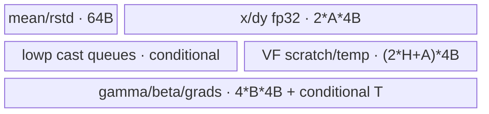

# GroupNormSwishGrad 950 ACLNN 算子知识

## 算子速览

| 项目 | 内容 |
|---|---|
| 实际入口 | `aclnnGroupNormSwishGradGetWorkspaceSize` + `aclnnGroupNormSwishGrad`，公开 ACLNN 两段式接口 |
| 计算语义 | GroupNorm+Swish 反向，输出 `dx/dgamma/dbeta` |
| 输入输出 | ND；FP32/FP16/BF16；`dy/x:[N,C,...]`，`mean/rstd:[N,G]`，`gamma/beta:[C]` |
| 执行类型 | 单 Kernel `AIV_VECTOR`（arch35 `__simd_vf__`/MicroAPI）；无 Cube/AIC/MIX_CV、SIMT、NDDMA 或通信 |
| Kernel 路线 | R-001 GroupFitUb；R-002 ChannelFitUb；R-003 ChannelSplitUb |
| 核心资源 | GM、AIV UB `TQue/TBuf`、RegTensor、FP32 workspace、AtomicAdd、`SyncAll`、Kahan sum/compensation |
| 来源闭包 | `source_closed`：ACLNN 约束→生成桥边界→Host/POD→apt router→arch35 三 body+VF helper→ascend950 config 已闭合 |
| 验证状态 | 已完成源码闭包检查；本次知识提取未执行编译、真机、数值或性能测试。 |

## 接口与语义

### 计算语义

令 `xhat=(x-mean[n,g])*rstd[n,g]`、`y=xhat*gamma+beta`、`den=exp(-swishScale*y)+1`，则 `dyNew=dy*(swishScale*y-swishScale*y/den+1)/den`。`dbeta=sum(dyNew)`、`dgamma=sum(xhat*dyNew)`；组内校正项为对 `gamma*dbeta` 和 `gamma*dgamma` 的归约除以 `C/G*HxW`，`dx=rstd*(dyNew*gamma-c1-xhat*c2)`。950 在 `N>2` 时 Host 默认选择 deterministic 模板；`N<=2` 注释明确无 N 轴确定性问题，使用 non-deterministic compile key 但不改变公开的确定性语义。

### 输入、输出与属性

| 参数 | shape/layout | dtype | 约束、默认值与语义 |
|---|---|---|---|
| `dy`, `x` | ND 2–8D，相同 `[N,C,...]` | FP32/FP16/BF16 | 必选非空，AutoContiguous |
| `mean`, `rstd` | `[N,G]` ND | 同 `dy` | 必选非空，shape 相同 |
| `gamma`, `beta` | `[C]` ND | 同 `dy` | 必选非空 |
| `numGroups` | 标量 | int64→int32 attr | `>0`，`C%G=0`，`C/G<=4000` |
| `dataFormatOptional` | 字符串 | char* | 默认/建议 `NCHW` |
| `swishScale` | 标量 | double→float | 默认 1.0 |
| require flags | 标量 | bool | 默认 true；950 binary config 对四种 flag 组合分别接线 |
| `dxOut/dgammaOut/dbetaOut` | 分别同 x/gamma/beta | 同输入 | 指针必选，flag 剪枝 grad 写回 |

### 入口与版本

固定仓只有无版本后缀的公开 API，文档明确 Ascend 950PR/950DT 支持且默认确定性。OpDef 的 `ascend950` config 将 `opFile.value` 指向 `group_norm_swish_grad_apt`；950 binary JSON 对 3 dtype×4 个 require flag 组合生成 12 个 binary；全局 config 为 950 添加 `--cce-no-dcache-flush`。ACLNN inner bridge 为固定仓不可见的生成边界，算子拥有链路已闭合。

## Host/Launcher 执行流程

### 参数校验与前处理

ACLNN 第一段检查空指针、dtype/shape/group，非连续输入经 Contiguous。Tiling `CheckInputDtype/CheckInputShape` 重新验证六输入 dtype 一致、`dy==x`、`mean==rstd==[N,G]`、`gamma==beta==[C]`、`N*G/HxW>0`、`C%G==0`。`TilingGroupNormSwishGrad` 没有向上传播 `Init()` 返回值，而直接执行/返回 `SetKernelTiling()`，这是固定源码失败边界。

### 参数、Workspace 与生命周期

`blockDim=coreNumUsed`，task 映射 `[N,G]`；大核处理 `taskNumPerCore`，小核处理少 1 个 task。950 `N>2` 令 `isDeterministicKey=1`并设 `BATCH_MODE`；workspace user slice 每路 `workSpaceSize=ceil(N/2)*C` 个 FP32，总用户字节 `2*ceil(N/2)*C*4`，前缀系统 workspace 由 lib API 决定。`dgammaWorkspace` 从 user base 开始，`dbetaWorkspace` 偏移 `workSpaceSize*4` B；owner 是 executor/调用者，保留到 stream 完成。`N<=2` 且 FP32 用户 workspace 为 0；lowp N=1 直接 cast 写 GM，lowp N=2 用 `2*C*4` B 做 partial+cast。

### 启动图与失败传播

```text
ACLNN GetWorkspaceSize -> generated executor/Contiguous -> GroupNormSwishGrad Tiling/POD
ACLNN run(stream) -> group_norm_swish_grad_apt.cpp::group_norm_swish_grad<<<coreNumUsed>>>
  -> GroupNormSwishGrad<T,det>::constructor -> zero target -> SyncAll
  -> one of GroupFitUb / ChannelFitUb / ChannelSplitUb stage-1
  -> pipe.Reset -> SyncAll -> optional Cast / Kahan Reduce / Kahan Reduce+Cast stage-2
```

只有一个 Device launch。stage-1 和 stage-2 之间通过同 Kernel 内 `SyncAll` 交接 FP32 workspace；producer 失败没有独立 consumer launch可继续。unknown compile key 没有 fallback。

## Route 与参数设计

### 分核与资源计算

Host 与 A2/A3 共用 selector：`reserve=1024+8*align(C/G,elePerBlock)*dtypeBytes`，整组容量还扣除非对齐 HxW extra；依次计算 group-fit、channel-fit 和 `floor((UB-reserve)/(8*dtypeBytes),64*elePerBlock)` channel tile。950 确定性 stage-2 使 `stage2ReduceBufferCount=3`（sum+compensation+guard），Host 据此限制 `castEleNum`；FP32 额外预留一份 row input，lowp 再预留 T 输出 cast buffer。

### Route 选择

| 顺序 | Route | Key/模板 | 精确选择条件与优先级 | 不适用去向 |
|---:|---|---|---|---|
| 1 | R-001 GroupFitUb | POD 0 | `mode0UbCapGNum>0` | R-002 |
| 2 | R-002 ChannelFitUb | POD 1 | `mode0Cap<=0 && mode1UbCapCNum==1` | R-003 |
| 3 | R-003 ChannelSplitUb | POD 3 | 前两项未命中且 `mode2UbCapacityEle>0` | Tiling 失败 |

```text
stage key: group fits -> 0; else exactly one channel fits -> 1; else HxW tile -> 3
compile key: N<=2 ? dtypeBase(0/1/2) : dtypeBase+10
```

### 模板/实现执行矩阵

| Route | key/selector | dtype/shape/platform 完整命中条件 | 执行拓扑与 Kernel 节点 | 实际模板/body | 内存与同步特征 | tail/fallback |
|---|---|---|---|---|---|---|
| R-001 | POD0 + compile 0/1/2/10/11/12 | 整组容量成立，950 | 单 AIV stage1+stage2 | `CopyInGroupFitUb/ComputeGroupFitUb`，align/unalign VF | 整组 x/dy 驻 UB，RegTensor 两 VL 并行 | MicroAPI mask；末 C tile |
| R-002 | POD1 + 同 compile keys | 一通道可载 | 单 AIV | `ComputeChannelFitUb` | HxW 两遍 load，VF fused reduce | count mask |
| R-003 | POD3 + 同 compile keys | 通道不可载 | 单 AIV | `CopyInChannelSplitUb/Compute*ChannelSplitUb` | tile 两遍，partial 跨 tile 累加 | `channelTileTailNum` |

stage-2 按 compile template 分支：non-det lowp N>1 仅 cast；det FP32 将 `ceil(N/2)` workspace rows分两半并由两组 core 归约后 AtomicAdd 合并；det lowp 归约 `ceil(N/2)` rows 后 cast。950 两种 det 归约都以树形 Add 先压缩 DMA 载入的 rows，再 Kahan 累加每个 chunk。

### 隐藏性能 Guard

| Guard | Host/Tiling 条件 | Device/资源原因 | 影响 Route | 不满足时去向 | 源码符号 |
|---|---|---|---|---|---|
| 950 默认 det | `IsArch3510 && N>2` | 固定 N 轴 partial 拓扑 | 全部 Route 的 stage-2 | N<=2 用 key0/1/2 | `Init` |
| Kahan UB | `3*castEleNum*4`/grad + row input | sum/comp/guard 不得别名 | det stage-2 | Host 缩小 castEleNum | `CalDeterministic*Stage2` |
| blockCount | `coreBatchParts<=65535` | DataCopy `blockCount` 上限 | det stage-2 | 缩小 batch parts | `ComputeAllocUBStage2` |
| VF pair loop | `pairRepeatTimes=ceil(ceil(count/VL)/2)` | 每轮发射两 VL，tail 靠两个 mask | 三 stage-1 Route | mask 使第二 VL 空操作 | `MulsAddsVf/Swish*Vf` |
| unaligned group channel | `(cGIdx*HxW)%8!=0` | aligned load 不适用 | R-001 | UnAlign VF | `ComputeGroupFitUb` |
| require flags | bool | 避免无效 grad DMA/Atomic/cast | 全部 | 跳过该 grad | `ModeSelection`/stage2 helpers |

### POD/ABI

Host 与 arch35 Device 共用 `GroupNormSwishGradTilingData`。宏实现不在固定仓，因此不推测 `sizeof/alignof/offsetof`；下表的顺序号来自定义和 producer 注释。

| 结构 | 字段 | 类型/位宽 | ABI 布局 | 单位 | Host/launcher producer | Device consumer | 边界 |
|---|---|---|---|---|---|---|---|
| `GroupNormSwishGradTilingData` | `Tiling_key` | uint64/64 | 顺序0，offset不可见 | enum | stage1 selector | `Process` | 0/1/3 |
| 同上 | `N` | uint64/64 | 顺序1 | dim | dy[0] | n/stage2 | >0 |
| 同上 | `C` | uint64/64 | 顺序2 | dim | dy[1] | GM/stride | >0 |
| 同上 | `HXW` | uint64/64 | 顺序3 | element | product(dy[2:]) | channel extent | >0 |
| 同上 | `G` | uint64/64 | 顺序4 | group | attr | task mapping | >0 |
| 同上 | `NXG` | uint64/64 | 顺序5 | task | N*G | GM extent | >0 |
| 同上 | `C_G` | uint64/64 | 顺序6 | channel | C/G | group loop | <=4000 |
| 同上 | `task_num_per_core` | uint64/64 | 顺序7 | task/core | `PlanStepCoreUsage` | constructor | 大核 |
| 同上 | `task_num_per_tail_core` | uint64/64 | 顺序8 | task/core | 同上 | constructor | 小核 |
| 同上 | `tail_core` | uint64/64 | 顺序9 | core | 同上 | constructor | 分界 |
| 同上 | `mode1_ub_cap_C_num` | uint64/64 | 顺序10 | channel | stage1 selector | arch35 不读 | inactive |
| 同上 | `mode1_ub_iter_C_num` | uint64/64 | 顺序11 | iteration | stage1 selector | 不读 | inactive |
| 同上 | `mode1_ub_tail_C_num` | uint64/64 | 顺序12 | channel | stage1 selector | 不读 | inactive |
| 同上 | `mode2_ub_capacity_ele` | uint64/64 | 顺序13 | element/tile | stage1 selector | ChannelSplit init | R-003 |
| 同上 | `mode2_ub_iteration_num` | uint64/64 | 顺序14 | tile/channel | 同上 | ChannelSplit loop | R-003 |
| 同上 | `mode2_ub_tail_num` | uint64/64 | 顺序15 | element | 同上 | tail | R-003 |
| 同上 | `workSpaceSize` | uint64/64 | 顺序16 | FP32 element/slice | stage2 tiling | workspace binding | 0/C/ceil(N/2)C |
| 同上 | `stage2CoreUsed` | uint64/64 | 顺序17 | core | `SetStage2CastInfo` | stage2 | active stage2 |
| 同上 | `castEleNum` | uint64/64 | 顺序18 | channel/core | 同上 | UB/DMA | 64-aligned preference |
| 同上 | `tailCastNum` | uint64/64 | 顺序19 | channel | 同上 | last core | <=castEleNum |
| 同上 | `coreBatchParts` | uint64/64 | 顺序20 | row/chunk | `ComputeAllocUBStage2` | row DMA/reduce | <=65535 |
| 同上 | `coreBatchPartsTailRepeat` | uint64/64 | 顺序21 | row | 同上 | arch35 不读 | inactive |
| 同上 | `repeatTime4Stage2` | uint64/64 | 顺序22 | loop | 同上 | arch35 重算 | inactive |
| 同上 | `dgamma_is_require` | uint64/64 | 顺序23 | bool | attr | grad branch | 0/1 |
| 同上 | `dbeta_is_require` | uint64/64 | 顺序24 | bool | attr | grad branch | 0/1 |
| 同上 | `swish_scale` | float/32 | 顺序25 | scalar | attr double→float | VF | 窄化 |

### Route 源码闭包

| Route | Key/selector | Host/Tiling producer | POD/参数 | Kernel entry/router 节点 | Kernel body/直接依赖 | 构建接线 |
|---|---|---|---|---|---|---|
| R-001 | POD0 + compile six keys | `CalStage1TilingInfo/SetTilingKeyMode` | shared POD | apt `group_norm_swish_grad` | arch35 `group_norm_swish_grad.h` + `group_fit_ub.h` + `utils.h` | ascend950 OpDef/binary/global config |
| R-002 | POD1 + 同 | 同 | 同 | 同 | `channel_fit_ub.h` + `utils.h` | 同 |
| R-003 | POD3 + 同 | 同 | 同 | 同 | `channel_split_ub.h` + `utils.h` | 同 |

## Kernel 实现

### 公共执行流程

apt router 以 compile key 0/1/2/10/11/12 实例化 `GroupNormSwishGrad<float|half|bfloat16_t,false|true>`。constructor 绑定 GM 和两个 workspace slice，block0 清零目标，`SyncAll` 后进入 stage-1。三 Route 都将 lowp 升为 FP32，用 VF/MicroAPI 融合 normalize、Swish derivative、通道归约与 dx；`UpdateMask` 保护最后 VL。stage-1 partial 由 `ModeSelection` 写 GM/workspace，`pipe.Reset+SyncAll` 后 stage-2 重新分配 UB。

### Route R-001：GroupFitUb

#### 适用条件

##### 选择证据

| 层级 | 文件 | 符号 | 源码谓词/参数 | 结果/下一跳 |
|---|---|---|---|---|
| Tiling | `op_host/group_norm_swish_grad_tiling.cpp` | `CalStage1TilingInfo` | `mode0UbCapGNum>0` | POD0 |
| Device | `arch35/group_norm_swish_grad.h` | `Process` | `tilingKey==groupFitUbTilingKey` | group-fit body |

#### Device 数据流

##### 函数级调用链

```text
Process -> CopyInGroupFitUb -> CopyMeanRstdToUb/MulsAddsTemplate
  -> ComputeGroupFitUb -> SwishGradMulXReduce[Vf|UnAlignVf]
  -> ModeSelection -> MulReduceSumTemplate -> SwishDx[Vf|UnAlignVf] -> CopyOut
  -> SyncAll -> Kahan stage-2
```

##### 源码等价伪码

```text
for task: load whole x/dy group; cast to fp32; normalize x in place
  for channel: choose aligned/unaligned VF; two-VL masked Swish+two reductions
  publish grad partial; fused dual gamma multiply/reduce forms correction
  for channel: aligned/unaligned VF recomputes dx; masked copy out
barrier; deterministic template tree-reduces workspace rows and Kahan-accumulates chunks
```

#### 内存与数据搬运

##### 资源与搬运表

| 层级/缓冲区 | offset/地址公式 | extent/容量公式 | dtype/layout | producer | consumer | owner/lifetime | 对齐/复用 |
|---|---|---|---|---|---|---|---|
| mean/rstd UB | offsets 0,8 float | 16 float | FP32 | CopyMeanRstd | BRC load | task | two 32B slots |
| x/dy FP32 queues | group base | `A=align(groupEle,tPerBlock)` | FP32 | CopyIn/cast | VF two passes | task | depth1 |
| lowp cast queues | same | A*T | T | GM MTE2 | Cast | one CopyIn | lowp only |
| gamma/beta/grad | group channel | `B=align(C/G,tPerBlock)` | FP32(+T queues) | CopyIn/VF | VF/GM | task | depth1 |
| VF scratch | 0 | dyNew+dswish H or A，temp A | FP32 | VF | reduction/dx | task | in-place scratch |

##### 分层内存布局



##### 字节账与复用顺序

```text
FP32 stage1 UB_total=64 + (3*A+2*H+4*B)*4
lowp stage1 UB_total=64 + (5*A+4*B)*4 + (2*A+H+4*B+32)*sizeof(T)
det FP32 stage2 UB_total=2*(3*castEleNum*4)+2*(coreBatchParts*castEleNum*4)
det lowp stage2 adds 2*castEleNum*sizeof(T)
workspace_total=2*ceil(N/2)*C*4 B (N>2 A5)
```

| 复用子区 | 写入者 | 读取者/消费点 | 下一次覆盖 | 同步或释放依据 | 安全条件 |
|---|---|---|---|---|---|
| x FP32 queue | CopyIn+normalize | both VF passes | task end | FreeTensor | dx pass finished |
| dyNew/dswish scratch | Swish VF/reduction | current channel | next channel | PIPE_V/LocalMemBar | reduction scratch read finished |
| stage2 reduce queue | Duplicate/tree/Kahan | GM out | FreeTensor | V_MTE3 event | Atomic copy done |

#### 同步、精度与尾块

##### 同步与数值边界表

| 阶段 | primitive/机制 | producer | consumer/等待点 | 保护对象 | 精度/尾块 |
|---|---|---|---|---|---|
| GM→UB | MTE2_V | DataCopyPad | Cast/VF | input | lowp CAST_NONE |
| VF scratch | `LocalMemBar<VEC_STORE,VEC_LOAD>` | StoreUnAlign | recursive reduce | scalar partials | masks consume exact count |
| stage boundary | SyncAll | all partials | stage2 | workspace | fixed grouping |
| stage2 | tree Add + Kahan | row chunks | sum/comp | FP32 sum | C tail=`tailCastNum` |
| output | V_MTE3 | VF/cast | GM | dx/grad | lowp CAST_ROUND |

#### 关键实现

##### 符号证据表

| 阶段 | 文件 | 符号/模板实例 | 实现事实 |
|---|---|---|---|
| Host/Tiling producer | `op_host/group_norm_swish_grad_tiling.cpp` | `CalStage1TilingInfo/CalStage2TilingInfo` | UB mode、Kahan 容量 |
| Kernel entry/router | `op_kernel/group_norm_swish_grad_apt.cpp` | `group_norm_swish_grad` | six compile keys |
| Device body/helper | `arch35/group_norm_swish_grad_group_fit_ub.h` + `utils.h` | `ComputeGroupFitUb/Swish*Vf/KahanAccumulateVf` | align/unalign VF、两遍、Kahan |

### Route R-002：ChannelFitUb

#### 适用条件

##### 选择证据

| 层级 | 文件 | 符号 | 源码谓词/参数 | 结果/下一跳 |
|---|---|---|---|---|
| Tiling | `op_host/group_norm_swish_grad_tiling.cpp` | `CalStage1TilingInfo` | `mode0Cap<=0 && mode1Cap==1` | POD1 |
| Device | `arch35/group_norm_swish_grad.h` | `Process` | `channelFitUbTilingKey` | ChannelFit body |

#### Device 数据流

##### 函数级调用链

```text
ComputeChannelFitUb -> CopyMeanRstdToUb -> per-channel CustomDataCopyIn/MulsAddsTemplate
 -> SwishGradMulXReduceTemplate -> ModeSelection -> MulReduceSumTemplate
 -> per-channel reload -> SwishDxTemplate -> CustomDataCopyOut -> common Kahan stage2
```

##### 源码等价伪码

```text
load scalars and group gamma/beta
for c: load one channel, normalize, fused masked Swish+grad reductions
publish partial; fused dual correction reduction
for c: reload channel, normalize, fused masked dx, copy exact HxW
```

#### 内存与数据搬运

##### 资源与搬运表

| 层级/缓冲区 | offset/地址公式 | extent/容量公式 | dtype/layout | producer | consumer | owner/lifetime | 对齐/复用 |
|---|---|---|---|---|---|---|---|
| x/dy channel | `task*groupEle+c*HxW` | H aligned | FP32(+T) | CopyIn | VF | channel | depth1/reload |
| mean/rstd | 0/8 | 64 B | FP32 | Copy | BRC | task | 32 B slots |
| params/grads | group channel | B aligned | FP32(+T) | Copy/VF | VF/GM | task | depth1 |

##### 分层内存布局


##### 字节账与复用顺序

```text
FP32 stage1 UB_total=64+(5*H+4*B)*4
lowp stage1 UB_total=64+(5*H+4*B)*4+(3*H+4*B+32)*sizeof(T)
stage2/workspace same as R-001; dynamic_ub=N/A
```

| 复用子区 | 写入者 | 读取者/消费点 | 下一次覆盖 | 同步或释放依据 | 安全条件 |
|---|---|---|---|---|---|
| H queues | each CopyIn | current VF | next channel | FreeTensor | current pass consumed |
| C/G partial queues | first pass | ModeSelection/correction | task end | FreeTensor | second pass correction ready |

#### 同步、精度与尾块

##### 同步与数值边界表

| 阶段 | primitive/机制 | producer | consumer/等待点 | 保护对象 | 精度/尾块 |
|---|---|---|---|---|---|
| load | MTE2_V/PIPE_V | GM/cast | VF | H channel | UpdateMask tail |
| output | V_MTE3 | dx VF | GM | dx | CAST_ROUND lowp |
| stage2 | SyncAll/tree/Kahan | workspace | GM | grads | same R-001 |

#### 关键实现

##### 符号证据表

| 阶段 | 文件 | 符号/模板实例 | 实现事实 |
|---|---|---|---|
| Host/Tiling producer | `op_host/group_norm_swish_grad_tiling.cpp` | `CalStage1TilingInfo` | channel-fit guard |
| Kernel entry/router | `op_kernel/group_norm_swish_grad_apt.cpp` | entry | compile routing |
| Device body/helper | `arch35/group_norm_swish_grad_channel_fit_ub.h` | `InitChannelFitUbBuffer/ComputeChannelFitUb` | HxW 两遍 VF |

### Route R-003：ChannelSplitUb

#### 适用条件

##### 选择证据

| 层级 | 文件 | 符号 | 源码谓词/参数 | 结果/下一跳 |
|---|---|---|---|---|
| Tiling | `op_host/group_norm_swish_grad_tiling.cpp` | `CalStage1TilingInfo` | previous miss + capacity>0 | POD3 |
| Device | `arch35/group_norm_swish_grad.h` | `Process` | `channelSplitUbTilingKey` | ChannelSplit body |

#### Device 数据流

##### 函数级调用链

```text
ComputeChannelSplitUb -> CopyMeanRstdToUb
 -> [CopyInChannelSplitUb -> ComputeDgammaDbetaChannelSplitUb]*tiles
 -> ModeSelection -> MulReduceSumTemplate
 -> [CopyInChannelSplitUb -> SwishDxTemplate -> CopyOut]*tiles -> common Kahan stage2
```

##### 源码等价伪码

```text
for c,tile: offset=task*groupEle+c*HxW+tile*capacity; count=capacity or tail
  load/cast/normalize; VF accumulates into temp[c]
publish and form correction
repeat same address network; VF writes dx[count]
```

#### 内存与数据搬运

##### 资源与搬运表

| 层级/缓冲区 | offset/地址公式 | extent/容量公式 | dtype/layout | producer | consumer | owner/lifetime | 对齐/复用 |
|---|---|---|---|---|---|---|---|
| x/dy tile | task/group/channel/tile formula | `K=align(capacity,tPerBlock)` | FP32(+T) | CopyIn | VF | tile | exact tail count |
| partial C/G | channel slot | B | FP32 | every tile | ModeSelection/correction | task | cross-tile accumulate |
| dx | same GM offset | count | T ND | VF/cast | caller | output | V_MTE3 |

##### 分层内存布局


##### 字节账与复用顺序

```text
FP32 stage1 UB_total=64+(5*K+4*B)*4
lowp stage1 UB_total=64+(5*K+4*B)*4+(3*K+4*B+32)*sizeof(T); Host uses conservative 8-copy cap
stage2/workspace same R-001; dynamic_ub=N/A
```

| 复用子区 | 写入者 | 读取者/消费点 | 下一次覆盖 | 同步或释放依据 | 安全条件 |
|---|---|---|---|---|---|
| K queues | tile CopyIn | current VF | next tile | EnQue/DeQue/FreeTensor | VF consumed |
| temp[c] | tile reduction | final ModeSelection | next task | LocalMemBar/PIPE_V | all tiles accumulated |

#### 同步、精度与尾块

##### 同步与数值边界表

| 阶段 | primitive/机制 | producer | consumer/等待点 | 保护对象 | 精度/尾块 |
|---|---|---|---|---|---|
| tile | queue+MTE2_V | GM | VF | K UB | last=`channelTileTailNum` |
| partial | LocalMemBar/PIPE_V | VF store | next reduction | scratch scalar | FP32 accumulate |
| dx/stage2 | V_MTE3/SyncAll/Kahan | VF/workspace | GM | outputs | masks+tailCastNum |

#### 关键实现

##### 符号证据表

| 阶段 | 文件 | 符号/模板实例 | 实现事实 |
|---|---|---|---|
| Host/Tiling producer | `op_host/group_norm_swish_grad_tiling.cpp` | `CalStage1TilingInfo` | K/iterations/tail |
| Kernel entry/router | `op_kernel/group_norm_swish_grad_apt.cpp` | entry | compile routing |
| Device body/helper | `arch35/group_norm_swish_grad_channel_split_ub.h` | `ComputeChannelSplitUb` | address/tile/tail/two passes |

## 算子特定优化

### Trick T-001：树形 workspace 归约加 Kahan chunk 累加

#### 触发与源码依据

- 适用 Route：R-001/R-002/R-003 的 950 deterministic stage-2。
- 触发条件：`IsArch3510 && N>2`，compile key 10/11/12。
- Golden 来源：[`group_norm_swish_grad_utils.h:445-455`](../../../../../../../cann-ops-raw/ascendc/ops-nn/955f8b33985b6d72989ebff341bb9c2c564a51bc/norm/group_norm_swish_grad/op_kernel/arch35/group_norm_swish_grad_utils.h#L445-L455)

**官方源码（固定 Commit 连续逐字摘录）**：

```cpp
uint32_t activeRowCount = repeatTime;
while (activeRowCount > 1) {
    uint32_t leftRowCount = (activeRowCount + 1) >> 1;
    uint32_t rightRowCount = activeRowCount - leftRowCount;
    Add(vecInLocal, vecInLocal, vecInLocal[leftRowCount * castEleNum], rightRowCount * castEleNum);
    PipeBarrier<PIPE_V>();
    activeRowCount = leftRowCount;
}
KahanAccumulateVf(
    (__ubuf__ float*)sumLocal.GetPhyAddr(), (__ubuf__ float*)compensationLocal.GetPhyAddr(),
    (__ubuf__ float*)vecInLocal.GetPhyAddr(), count);
```

#### 机制与设计原因

一次 `DataCopyPad` 用 `blockCount=repeatTime`将多个 workspace row 放入 UB；while 循环每层将右半加到左半，将串行逐行 Add 变为树形压缩。每个压缩 chunk 不直接普通累加，而以 `sum+compensation` 执行 `y=chunk-c; t=sum+y; c=(t-sum)-y; sum=t`，限制多 chunk FP32 加法丢失。Host 为每个 grad 预留 `3*castEleNum*4` B：sum、compensation 和第二发射 lane 的 guard。

#### 迁移边界

- 适用：确定顺序下对多行 FP32 partial 做通道归约。
- 前提：固定 row 布局，`coreBatchParts<=65535`，UB 容纳 3 份 reduce buffer 及 row input，保留 store→load barrier。
- 失效：非确定性路径不运行该归约；UB 不足时 Host 缩小 `castEleNum/coreBatchParts`，无其它 Device fallback。
- 未验证：本次知识提取未执行编译、真机、数值或性能测试。

#### 错误做法

不能把 `compensation` 别名为 `sum` 或在 Kahan 更新完成前覆盖；源码独立分配 sum/compensation 并使用 guard，Host 同步以 buffer-count=3 约束 UB。

### Trick T-002：两 VL 无分支 VF 与 mask tail

#### 触发与源码依据

- 适用 Route：全部 stage-1，R-001 另有 UnAlign VF。
- 触发条件：arch35 apt body，`calCount>0`。
- Golden 来源：[`group_norm_swish_grad_utils.h:692-706`](../../../../../../../cann-ops-raw/ascendc/ops-nn/955f8b33985b6d72989ebff341bb9c2c564a51bc/norm/group_norm_swish_grad/op_kernel/arch35/group_norm_swish_grad_utils.h#L692-L706)

**官方源码（固定 Commit 连续逐字摘录）**：

```cpp
uint32_t fullRepeatTimes = (calCount + oneRepeatSizeB32 - 1) / oneRepeatSizeB32;
uint16_t pairRepeatTimes = static_cast<uint16_t>((fullRepeatTimes + 1) / 2);
__ubuf__ float* dyNewSumStorePtr = dyNewSumPtr;
__ubuf__ float* xMulDySumStorePtr = xMulDySumPtr;
// First pass: compute two VLs per iteration and store one scalar sum per VL.
// The loop stays branch-free for the VF compiler; masks carry the tail.
for (uint16_t i = 0; i < pairRepeatTimes; i++) {
    maskFull0 = AscendC::MicroAPI::UpdateMask<float>(calCount);
    maskFull1 = AscendC::MicroAPI::UpdateMask<float>(calCount);
    uint32_t offset0 = i * 2 * oneRepeatSizeB32;
    uint32_t offset1 = offset0 + oneRepeatSizeB32;
    AscendC::MicroAPI::LoadAlign(vX0, xPtr + offset0);
    AscendC::MicroAPI::LoadAlign(vDy0, dyPtr + offset0);
    AscendC::MicroAPI::LoadAlign(vX1, xPtr + offset1);
    AscendC::MicroAPI::LoadAlign(vDy1, dyPtr + offset1);
```

#### 机制与设计原因

每次 VF 循环处理两个 vector length，将 Swish 梯度与 `dyNew/xhat*dyNew` 两路归约融合在 RegTensor 管线中。末循环不增加 if，两次 `UpdateMask(calCount)` 使第二 VL 可部分或全空；紧随的 StoreUnAlign 只物化每 VL 一个 partial，再通过 LocalMemBar 进行二次压缩。

#### 迁移边界

- 适用：可融合逐元素管线与少量归约 partial 的 arch35 Vector 算子。
- 前提：UB 按 VL 可安全访问 guard 区，tail 必须使用递减语义的 `UpdateMask`，Store→Load 必须 fence。
- 失效：R-001 通道起点不对齐时换 `LoadUnAlign` VF；非arch35 平台不可直接复制。
- 未验证：本次知识提取未执行编译、真机、数值或性能测试。

#### 错误做法

不能删除 `LocalMemBar<VEC_STORE,VEC_LOAD>` 后立即从 StoreUnAlign scratch 做下一轮 Load；源码在每层压缩前都显式加 fence。

## 模板与实现对比

| 对比维度 | R-001 GroupFitUb | R-002 ChannelFitUb | R-003 ChannelSplitUb | 设计选择依据 |
|---|---|---|---|---|
| 命中条件/优先级 | group fits | one channel fits | fallback capacity>0 | Host UB formula |
| 模板与 dtype | T/det six keys | same | same | 950 N>2 det |
| 循环与分核 | task→channel | task→channel, reload | task→channel→tile | `[N,G]` tasks |
| Queue/TBuf/寄存器/dynamic UB/通信 window | full group + RegTensor | HxW + RegTensor | K tile + RegTensor | dynamic UB/window N/A |
| 内存总占用与复用 | largest, x/dy resident | bounded H | bounded K | 8-copy Host cap |
| 搬运/Vector/SIMT/NDDMA/通信 API | DataCopyPad+MicroAPI align/unalign | align VF | tile align VF | no SIMT/NDDMA/comm |
| 同步、精度与 tail | masks/events/Kahan | same | explicit tile tail | all FP32 compute |
| fallback/失败边界 | R-002 | R-003 | capacity=0 fail | unknown key no output |

## 平台差异

| 项目 | A2 | A3 | 950 |
|---|---|---|---|
| 支持状态 | 支持，见无后缀卡 | 支持，见无后缀卡 | 支持 |
| Host/Launcher | N>2 从 context 取 deterministic | 同 A2 | N>2 强制 det+BATCH_MODE |
| Kernel/资源 | legacy Vector，det reduce buffer count 1 | 同 A2 | apt arch35 VF，det count 3，tree+Kahan |

## 限制与失败边界

- 公开约束：非空 2–8D ND，`N,C,HxW,G>0`，`C%G=0`，`C/G<=4000`，dtype 六输入相同。
- Tiling 形状乘法未见额外 uint64 溢出 guard；Device 将多个 POD uint64 窄化到 uint32，固定源码未提供额外上界验证。
- `TilingGroupNormSwishGrad` 忽略 `Init()` 失败返回；router unknown key 和 POD unknown mode 无 fallback。
- `swishScale` double→float；lowp 数据 FP32 计算后 `CAST_ROUND`；Kahan 仅 stage-2 chunk 累加，不代表所有 stage-1 归约无舍入。
- 生成 ACLNN bridge 与 tiling 宏 ABI 实现在固定仓不可见，未推测 offset。

## 源码索引

### 链路索引

| 链路阶段 | 文件 | 关键符号 | 支撑内容 |
|---|---|---|---|
| 入口声明/约束 | `norm/group_norm_swish_grad/docs/aclnnGroupNormSwishGrad.md` | ACLNN 两段原型 | API/平台/确定性/约束 |
| 入口实现 | `norm/group_norm_swish_grad/op_host/group_norm_swish_grad_def.cpp` | OpDef | AutoContiguous、950 apt 映射 |
| Host/Tiling/Launcher | `norm/group_norm_swish_grad/op_host/group_norm_swish_grad_tiling.cpp` | `GroupNormSwishGradTiling` | Route、block、workspace、950 Kahan cap |
| POD | `norm/group_norm_swish_grad/op_host/group_norm_swish_grad_tiling.h` | `GroupNormSwishGradTilingData` | 26 fields |
| Kernel entry | `norm/group_norm_swish_grad/op_kernel/group_norm_swish_grad_apt.cpp` | `group_norm_swish_grad` | compile router |
| Kernel router/body | `norm/group_norm_swish_grad/op_kernel/arch35/group_norm_swish_grad.h` | class/`Process` | launch body/stage2 dispatch |
| Device helper | `norm/group_norm_swish_grad/op_kernel/arch35/group_norm_swish_grad_utils.h` | VF/Kahan/copy helpers | MicroAPI、tree/Kahan、precision |
| Route body | `norm/group_norm_swish_grad/op_kernel/arch35/group_norm_swish_grad_group_fit_ub.h` | GroupFit methods | R-001 |
| Route body | `norm/group_norm_swish_grad/op_kernel/arch35/group_norm_swish_grad_channel_fit_ub.h` | ChannelFit methods | R-002 |
| Route body | `norm/group_norm_swish_grad/op_kernel/arch35/group_norm_swish_grad_channel_split_ub.h` | ChannelSplit methods | R-003 |
| 构建接线 | `scripts/kernel/binary_config/ascendc_config.json` | `GroupNormSwishGrad` | ascend950 + compile option |

### 实现复用检查

| 检查项 | 可复用事实 | 不得改变的约束 | 源码符号 |
|---|---|---|---|
| ABI/POD | shared 26-field producer/consumer | order/type/unit/inactive fields | `GroupNormSwishGradTilingData` |
| 调用顺序 | init→stage1→reset/barrier→stage2 | zero-init and SyncAll | constructor/`Process` |
| workspace/内存 | two contiguous FP32 slices | offset/workSpaceSize/owner；Kahan 3 buffers | constructor/`InitBufferForStage2*` |
| 同步 | MTE events, pipe barriers, LocalMemBar, SyncAll | producer-consumer direction | VF/copy/stage2 helpers |
| 精度与尾块 | FP32 math, Kahan stage2, masks | CAST modes, mask decrement, tail counts | `Swish*Vf/KahanAccumulateVf` |
| 失败边界 | ordered UB fallback | capacity 0/unknown key/Init return bug | Host selector/router |