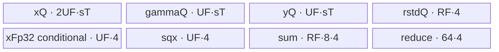
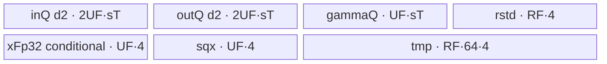
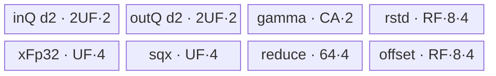
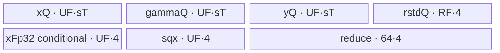

# InplaceAddRmsNorm A2/A3 ACLNN 算子知识

## 算子速览

| 项目 | 内容 |
|---|---|
| 实际入口 | `aclnnInplaceAddRmsNormGetWorkspaceSize` + `aclnnInplaceAddRmsNorm`，公开 ACLNN 两段式接口，无更新版本 |
| 计算语义 | `x=x1+x2`，`rstd=1/sqrt(mean(x^2)+epsilon)`，`y=x*rstd*gamma` |
| 输入输出 | ND；FP16/FP32/BF16 输入、y、x，FP32 rstd；gamma 对应归一化尾维 |
| 执行类型 | 所有可达节点均为单 Kernel `AIV_VECTOR`；无 Cube/AIC/MIX_CV、SIMT、NDDMA 或通信节点 |
| Kernel 路线 | R-001 Split-D；R-002 Single-N；R-003 Merge-N；R-004 Multi-N；R-005 Normal |
| 核心资源 | GM、TQue/TBuf、Vector API；固定 workspace `16 MiB+256 B`，Kernel 参数含 workspace 但 body 不读 |
| 来源闭包 | `source_closed`：公开 ACLNN 声明（生成 bridge 为框架边界）→InplaceAddRmsNorm OpDef/Tiling/POD→单 AIV router→五条 Host 可达 Route/body→A2/A3 config 已闭合 |
| 验证状态 | 已完成源码闭包检查；本次知识提取未执行编译、真机、数值或性能测试。 |

## 接口与语义

### 计算语义

令 `x=x1Ref+x2Ref`，`D=product(gamma.shape)`，`N=product(x1Ref.shape[0:xRank-gammaRank])`。每行计算 `rstd=1/sqrt(sum(x_i^2)/D+epsilon)`，随后原地写回 `x1Ref_i=x_i*rstd*gamma_i`，并把加法结果原地写回 `x2Ref_i=x_i`；`rstdOut` 保存 FP32 倒均方根。Device body 使用共享 `KernelAddRmsNorm<..., ADD_RMS_NORM_MODE>` 家族，但本卡只覆盖原地公开入口。

### 输入、输出与属性

| 参数 | shape/layout | dtype | 约束、默认值与语义 |
|---|---|---|---|
| `x1Ref` | ND，1–8 维 | FP16/FP32/BF16 | 必选输入/输出；不支持空 tensor 或非连续 tensor；输入加法项，返回归一化结果 |
| `x2Ref` | 与 `x1Ref` 相同 | 与 `x1Ref` 相同 | 必选输入/输出；shape 与 x1Ref 一致；返回 `x1Ref_old+x2Ref_old` |
| `gamma` | ND，1–8 维；等于 x1Ref 的尾部若干维 | 与 `x1Ref` 相同 | 必选、非空、连续；缩放权重 |
| `epsilon` | 标量 | Host `double`→Tiling `float` | 建议 `1e-6`；Tiling 要求 `>=0` |
| `rstdOut` | 前导维同 x1Ref，归一化尾维均为 1 | FP32 | 必选、非空、连续；输出倒均方根 |
| `workspaceSize/executor` | 标量/句柄 | uint64/opaque | 第一段输出；第二段必须沿用 executor |
| `workspace/stream` | Device 地址/stream | opaque | 第二段输入；workspace 大小由第一段返回 |

### 入口与版本

固定仓公开的最新且唯一版本为 `aclnnInplaceAddRmsNormGetWorkspaceSize` + `aclnnInplaceAddRmsNorm`。文档明确支持 Atlas A2/A3 训练与推理产品；`InplaceAddRmsNorm` OpDef 注册 `ascend910b`、`ascend910_93`，对应 binary config 均覆盖 FP16/FP32/BF16。公开 ACLNN bridge 由构建系统生成，固定仓没有手写实现；本卡把该 bridge 作为框架边界，Host/Tiling、POD、router/body 与构建接线均继续闭合。

## Host/Launcher 执行流程

### 参数校验与前处理

公开文档规定第一段完成必选指针与 dtype 校验：空指针返回 `ACLNN_ERR_PARAM_NULLPTR`，不支持 dtype 返回 `ACLNN_ERR_PARAM_INVALID`；x1Ref/x2Ref/gamma/rstdOut 均不支持空 tensor，三路 tensor 均不支持非连续。共享 `Tiling4AddRmsNorm` 继续检查 rank 1–8、x1/x2 shape 一致、gamma 等于 x1 的尾部维、rstd 的前导维匹配且归一化维为 1、epsilon 非负。OpDef 的输入/输出次序是 `x1,x2,gamma -> x1,rstd,x2`，从而保持原地别名语义；生成 ACLNN bridge 的逐语句实现固定仓不可见，不补写不存在的 `Contiguous/ViewCopy` 流程。

### 参数、Workspace 与生命周期

Tiling 从平台读取 AIV 核数与 UB，先保留 1024 B；所有通用 Route 使用 `AddRMSNormTilingData`。它写 `workspace[0]=16*1024*1024+256` B，第一段 executor 将所需大小返回给调用者，调用者持有 workspace 与 executor 到第二段 stream 执行结束。通用 entry 接收 workspace，但 `GENERAL_OP_IMPL` 只把它传给共享类 `Init`，各 body 均未绑定/读取，故不存在 Kernel 间 workspace slice。

### 启动图与失败传播

启动图只有一个 Device 节点：生成 ACLNN executor → `InplaceAddRmsNorm` Host/Tiling → `inplace_add_rms_norm(x1,x2,gamma,y,rstd,x,workspace,tiling)`。这里 `y` 对应 x1Ref 的归一化写回，`x` 对应 x2Ref 的加法结果写回；`blockDim=ceil(numRow/blockFactor)`，尾核处理剩余行。同一 stream 上执行该单节点；Host/Tiling/launch 失败直接传播，router 对未知 key 无 fallback，因而不写输出。

## Route 与参数设计

### 分核与资源计算

dtype key 为 FP16=1、FP32=2、BF16=3；`dataPerBlock` 分别 16、8、16。`numColAlign=ceil(numCol/dataPerBlock)*dataPerBlock`。初始 `rowFactor=64`，`ubFactor=10240(FP32)` 或 `12288(FP16/BF16)`。mode key 按源码优先级选择，本入口三路输出都存在，`CheckNullptr` 保持 `norm_key=0`，最终 key 固定为 `dtypeKey*10+modeKey`。Device 模板第二参数固定为 `1`（`ADD_RMS_NORM_MODE`），不是另一个公开版本。

### Route 选择

| 顺序 | Route | Key/模板 | 精确选择条件与优先级 | 不适用去向 |
|---:|---|---|---|---|
| 1 | R-001 Split-D | modeKey=1 | `numCol>初始ubFactor`；重算 UF 为按列 tile 均分且 block 对齐 | R-002 |
| 2 | R-002 Single-N | modeKey=3 | `numCol<=UF && blockFactor==1 && soc!=ASCEND310P` | R-003 |
| 3 | R-003 Merge-N | modeKey=2 | 前两项未命中，`numColAlign<=2000 && soc!=ASCEND310P` | R-004 |
| 4 | R-004 Multi-N | modeKey=4 | 前述未命中，`dtype==FP16 && numCol==numColAlign`，且 UB 公式所得 `rowFactor>0` | R-005 |
| 5 | R-005 Normal | modeKey=0 | 其它情况；或 Multi-N 算得 `rowFactor==0` | 无 |

```text
numCol > initialUF -> Split-D
else blockFactor==1 -> Single-N
else numColAlign<=2000 -> Merge-N
else FP16 && naturally aligned && rowFactor>0 -> Multi-N
else -> Normal
```

### 模板/实现执行矩阵

| Route | key/selector | dtype/shape/platform 完整命中条件 | 执行拓扑与 Kernel 节点 | 实际模板/body | 内存与同步特征 | tail/fallback |
|---|---|---|---|---|---|---|
| R-001 | 11/21/31 | 轴长超初始 UF | 单 AIV | `KernelAddRmsNormSplitD<T,1>` | 两遍列 tile，分块 FP32 sum | row/col tail |
| R-002 | 13/23/33 | 每核一行，轴可载 | 单 AIV | `KernelAddRmsNormSingleN<T,1>` | 单 195584 B TBuf，event 手工复用 | mask/尾 DMA |
| R-003 | 12/22/32 | 小归约，且前两项未命中 | 单 AIV | `KernelAddRmsNormMergeN<T,1>` | 双缓冲、多行 reduce 与 Host 预计算 repeat | row/col tail |
| R-004 | 14 | 仅 FP16、自然 32 B 对齐、rowFactor>0 | 单 AIV | `KernelAddRmsNormMultiN<half,1>` | 多行 batch、offset TBuf | row tail |
| R-005 | 10/20/30 | 所有前项失败 | 单 AIV | `KernelAddRmsNorm<T,1>` | 逐行、gamma 常驻 | row tail |

### 隐藏性能 Guard

| Guard | Host/Tiling 条件 | Device/资源原因 | 影响 Route | 不满足时去向 | 源码符号 |
|---|---|---|---|---|---|
| Split-D 阈值 | FP32 10240；B16 12288 元素 | 单行常规 UB 容量 | R-001 | R-002 | `DetermineModeParameters` |
| Merge repeat | `numColAlign<=2000` | multi-row Vector repeat/stride 与 UB 权重模型 | R-003 | R-004 | 同上 |
| Multi-N 对齐 | FP16 且 `numCol==numColAlign` | 连续多行 DataCopy/Vector 不能引入行 padding | R-004 | R-005 | 同上 |
| Multi-N UB | 公式所得 `rowFactor>0` | 至少容纳一行 batch | R-004 | R-005 | 同上 |
| reduce helper repeat | `ReduceSumFP32ToBlock` 注释要求 count 小于 255 repeats | Vector repeat 上限 | R-001 partial reduce | 固定仓无额外 fallback | `ReduceSumFP32ToBlock` |
| BF16 guard | 部分架构宏排除 3003/3113 | 编译期 dtype 能力 | BF16 keys | 对应实例不执行 | router branches |
| inactive performance flag | 910B 特定 rank/shape/dtype 时置 1 | body 的 `InitParams` 仅保存该值，固定仓无后续读取 | 不改变 Route | 仍是 R-003 | `getPerformanceFlag`, `KernelAddRmsNormMergeN::InitParams` |

### POD/ABI

`AddRMSNormTilingData` 由 tiling 宏生成；固定仓未展开宏实现，因此 `sizeof/alignof/offsetof` 不可见。下表保留声明顺序、类型、producer 和 consumer，不能重排。

| 结构 | 字段 | 类型/位宽 | ABI 布局 | 单位 | Host/launcher producer | Device consumer | 边界 |
|---|---|---|---|---|---|---|---|
| `AddRMSNormTilingData` | `num_row` | uint32/32 | 宏生成，offset 不可见 | 行 | `SetTilingParameters` | 各 Init/分核 | shape 乘积窄化无显式检查 |
| 同上 | `num_col` | uint32/32 | 同上 | 元素/行 | gamma size | 循环/地址 | `>0`；公开接口不支持空 tensor |
| 同上 | `block_factor` | uint32/32 | 同上 | 行/核 | `CalculateBlockParameters` | GM base | 尾核另字段 |
| 同上 | `row_factor` | uint32/32 | 同上 | 行/tile | selector/UB 公式 | row loop/queue | route-specific |
| 同上 | `ub_factor` | uint32/32 | 同上 | 元素或 batch 元素 | selector | queue/tile | route-specific |
| 同上 | `epsilon` | float/32 | 同上 | 标量 | double→float | rstd | `>=0` |
| 同上 | `avg_factor` | float/32 | 同上 | 1/元素 | `1/num_col` | reduce | num_col=0 时 0 |
| 同上 | `num_col_align` | uint32/32 | 同上 | 元素/行 | block align | Merge/Multi stride | `>=num_col` |
| 同上 | `last_block_factor` | uint32/32 | 同上 | 行 | tail core calculation | Merge/Multi | 尾核 |
| 同上 | `row_loop` | uint32/32 | 同上 | 次 | ceil(blockFactor/rowFactor) | Merge/Multi | 前核 |
| 同上 | `last_block_row_loop` | uint32/32 | 同上 | 次 | ceil(last/rowFactor) | Merge/Multi | 尾核 |
| 同上 | `row_tail` | uint32/32 | 同上 | 行 | Host | Merge/Multi | 最后循环 |
| 同上 | `last_block_row_tail` | uint32/32 | 同上 | 行 | Host | Merge/Multi | 尾核最后循环 |
| 同上 | `mul_loop_fp32` | uint32/32 | 同上 | repeats | `numColAlign/64` | Merge repeat | R-003 |
| 同上 | `mul_tail_fp32` | uint32/32 | 同上 | elements | remainder 64 | Merge repeat | R-003 |
| 同上 | `dst_rep_stride_fp32` | uint32/32 | 同上 | 32 B blocks | `numColAlign/8`（producer局部先为 uint8） | Merge-N `mulRepeat` | 窄化风险 |
| 同上 | `mul_loop_fp16` | uint32/32 | 同上 | repeats | `numColAlign/128` | Merge repeat | R-003 |
| 同上 | `mul_tail_fp16` | uint32/32 | 同上 | elements | remainder 128 | Merge repeat | R-003 |
| 同上 | `dst_rep_stride_fp16` | uint32/32 | 同上 | 32 B blocks | `numColAlign/16`（先窄化 uint8） | Merge-N `mulRepeat` | 窄化风险 |
| 同上 | `is_performance` | uint32/32 | 同上 | bool | `getPerformanceFlag` | `InitParams` 保存后未读取 | inactive，不分 Route |

### Route 源码闭包

| Route | Key/selector | Host/Tiling producer | POD/参数 | Kernel entry/router 节点 | Kernel body/直接依赖 | 构建接线 |
|---|---|---|---|---|---|---|
| R-001 | modeKey=1 | `DetermineModeParameters` | `AddRMSNormTilingData` | `inplace_add_rms_norm.cpp::inplace_add_rms_norm` | `KernelAddRmsNormSplitD`, base reduce/DMA helpers | InplaceAddRmsNorm 910b/910_93 configs |
| R-002 | modeKey=3 | 同上 | 同上 | 同上 | `KernelAddRmsNormSingleN`, base helpers | 同上 |
| R-003 | modeKey=2 | 同上 | 同上 | 同上 | `KernelAddRmsNormMergeN` | 同上 |
| R-004 | modeKey=4 | 同上 | 同上 | 同上 | `KernelAddRmsNormMultiN` | 同上 |
| R-005 | modeKey=0 | 同上 | 同上 | 同上 | `KernelAddRmsNorm` | 同上 |

## Kernel 实现

### 公共执行流程

router 以 key 映射 `T` 与实现类，全部实例的模板 MODE 固定为 `1`（完整 Add-RmsNorm body）。所有路线按 AIV core 连续行分核，GM 地址为 `core*blockFactor*numCol`；rstd 与加法结果 x 均必写，ACLNN bridge 将 y/x 回写到 x1Ref/x2Ref。FP16/BF16 归约升到 FP32；BF16 加法也先升精度，写 x 时 `CAST_RINT`，Y 路径在乘 gamma 前后按 body 规定 cast。`DataCopyCustom` 在支持平台使用 `DataCopyPad`；非整 32 B 输出通过重叠最后一块并用 MTE3↔scalar event 保留有效尾部。

### Route R-001：Split-D

#### 适用条件

##### 选择证据

| 层级 | 文件 | 符号 | 源码谓词/参数 | 结果/下一跳 |
|---|---|---|---|---|
| Tiling | `op_host/add_rms_norm_tiling.cpp` | `DetermineModeParameters` | `numCol>ubFactor` | mode 1 |
| Router | `op_kernel/inplace_add_rms_norm.cpp` | key 11/21/31 family | key branch | `KernelAddRmsNormSplitD<T,MODE>` |

#### Device 数据流

##### 函数级调用链

```text
inplace_add_rms_norm -> SplitD::Process -> SubProcess
  -> ComputeFormer -> CopyInAndAdd -> ComputeSum -> BlockReduceSum
  -> ComputeRstd
  -> ComputeLatter -> CopyInGamma/X -> ComputeY -> CopyOutY
  -> CopyOutRstd/X
```

##### 源码等价伪码

```text
for rowBatch: rstd=0
  for colTile: add x1+x2; write x to x2Ref; fp32 square*avg; reduce partial into row rstd
  rstd=1/sqrt(rstd+epsilon)
  for colTile: reload gamma and x; y=x*rstd*gamma; write valid tail
  write rstd; template MODE is fixed to ADD_RMS_NORM_MODE(1)
```

#### 内存与数据搬运

##### 资源与搬运表

| 层级/缓冲区 | offset/地址公式 | extent/容量公式 | dtype/layout | producer | consumer | owner/lifetime | 对齐/复用 |
|---|---|---|---|---|---|---|---|
| inQueueX | row*numCol+tile*UF | `2*UF*sizeof(T)` d1 | T | DMA x1/x2 | add | tile | halves alias x1/x2 |
| gamma/y queues | tile*UF | each `UF*sizeof(T)` d1 | T | DMA/vector | Y/DMA | tile | tail num |
| rstd/sum | row batch | `RF*4 + RF*8*4` | FP32 | partial sums | rstd/Y | batch | rstd retained |
| xFp32/sqx/reduce | 0 | conditional `UF*4` + `UF*4` + `64*4` | FP32 | cast/square | reduce/Y | tile | sqx reused |

##### 分层内存布局



##### 字节账与复用顺序

```text
UB_total=4*UF*sizeof(T)+RF*4+(T!=float?UF*4:0)+UF*4+RF*8*4+64*4
workspace_total=16MiB+256B; dynamic_ub=N/A
```

| 复用子区 | 写入者 | 读取者/消费点 | 下一次覆盖 | 同步或释放依据 | 安全条件 |
|---|---|---|---|---|---|
| inQueueX two halves | DMA | add/cast | next tile | queue FreeTensor | both inputs consumed |
| rstdLocal | former/reduce | all latter tiles | next row batch | final CopyOut/Free | latter pass complete |

#### 同步、精度与尾块

##### 同步与数值边界表

| 阶段 | primitive/机制 | producer | consumer/等待点 | 保护对象 | 精度/尾块 |
|---|---|---|---|---|---|
| partial sum | PipeBarrier + block reduce | square | row accumulator | FP32 UB | col_tail passed as num |
| scalar rstd | V_S/S_V events | vector Div | scalar broadcast | one FP32 value/row | epsilon before sqrt |
| DMA tail | DataCopyCustom | y/x/rstd UB | GM | valid tail | 32 B overlap safe path |

#### 关键实现

##### 符号证据表

| 阶段 | 文件 | 符号/模板实例 | 实现事实 |
|---|---|---|---|
| Host/Tiling producer | `op_host/add_rms_norm_tiling.cpp` | `DetermineModeParameters` | split condition/UF |
| Kernel entry/router | `op_kernel/inplace_add_rms_norm.cpp` | key 11/21/31 branches，模板 MODE=1 | dtype/MODE mapping |
| Device body/helper | `op_kernel/add_rms_norm_split_d.h` | `SubProcess`, `ComputeFormer/Latter` | 两遍列切分 |
| Device body/helper | `op_kernel/add_rms_norm_base.h` | reduce/DataCopy helpers | repeat、tail、event |

### Route R-002：Single-N

#### 适用条件

##### 选择证据

| 层级 | 文件 | 符号 | 源码谓词/参数 | 结果/下一跳 |
|---|---|---|---|---|
| Tiling | `op_host/add_rms_norm_tiling.cpp` | `DetermineModeParameters` | `blockFactor==1 && soc!=310P` after non-split | mode 3 |
| Router | `op_kernel/inplace_add_rms_norm.cpp` | key 13/23/33，模板 MODE=1 | 13/23/33 family | SingleN |

#### Device 数据流

##### 函数级调用链

```text
SingleN::Process -> ProcessFp16/ProcessFp32/ProcessBf16
  -> DMA x1/x2 -> add -> x2Ref DMA -> square/reduce/rstd
  -> DMA gamma into released x2 region -> scale -> x1Ref DMA -> rstd DMA
```

##### 源码等价伪码

```text
one core handles one row; partition one unitBuf by dtype
load x1,x2; add (BF16 in FP32); overwrite x2 region with gamma after V_MTE2 event
compute FP32 square*avg+epsilon, reduce, sqrt/div
scale x by rstd and gamma; cast and store outputs with MTE events
```

#### 内存与数据搬运

##### 资源与搬运表

| 层级/缓冲区 | offset/地址公式 | extent/容量公式 | dtype/layout | producer | consumer | owner/lifetime | 对齐/复用 |
|---|---|---|---|---|---|---|---|
| unitBuf | fixed offsets based on UF | 195584 B | mixed T/FP32 | DMA/vector | vector/DMA | whole Process | x2 region becomes gamma; tmp reuses tail |
| GM row | `blockIdx*numCol` | numCol T | | caller | one core | caller | one-row mapping |

##### 分层内存布局


##### 字节账与复用顺序

```text
UB_total=MAXBUFFER=195584 B
workspace_total=16MiB+256B; dynamic_ub=N/A
=> Host only selects after numCol<=initialUF, so manual partitions fit the fixed buffer.
```

| 复用子区 | 写入者 | 读取者/消费点 | 下一次覆盖 | 同步或释放依据 | 安全条件 |
|---|---|---|---|---|---|
| x2Local | x2 DMA | add | gamma DMA | V_MTE2/MTE2_V events | add completed before overwrite |
| x1Local | add | x output/reduce | y result | MTE3_V event + barriers | x GM copy consumed first |

#### 同步、精度与尾块

##### 同步与数值边界表

| 阶段 | primitive/机制 | producer | consumer/等待点 | 保护对象 | 精度/尾块 |
|---|---|---|---|---|---|
| DMA reuse | MTE2_V/V_MTE2/MTE3_V | DMA/add/output | next writer | unitBuf aliases | valid numCol |
| BF16 path | CAST_NONE/RINT | inputs | add/Y | FP32 regs/UB | round before T output |
| reduce | barriers + V_S/S_V | vector | scalar | rstd | one-row tail only |

#### 关键实现

##### 符号证据表

| 阶段 | 文件 | 符号/模板实例 | 实现事实 |
|---|---|---|---|
| Host/Tiling producer | `op_host/add_rms_norm_tiling.cpp` | selector Single-N branch | one row/core |
| Kernel entry/router | `op_kernel/inplace_add_rms_norm.cpp` | key 13/23/33，模板 MODE=1 | class mapping |
| Device body/helper | `op_kernel/add_rms_norm_single_n.h` | three `Process*` | fixed-buffer aliases/events |

### Route R-003：Merge-N

#### 适用条件

##### 选择证据

| 层级 | 文件 | 符号 | 源码谓词/参数 | 结果/下一跳 |
|---|---|---|---|---|
| Tiling | `op_host/add_rms_norm_tiling.cpp` | `DetermineModeParameters` | 前两项未命中且 `numColAlign<=2000 && soc!=310P` | modeKey=2 |
| Router | `op_kernel/inplace_add_rms_norm.cpp` | key 12/22/32，模板 MODE=1 | key unchanged | MergeN branch |

#### Device 数据流

##### 函数级调用链

```text
MergeN::Process -> MainCompute -> CopyInX -> ComputeX/CopyOutX
  -> ComputeRstd(ReduceSumMultiN) -> ComputeY(repeatByRow/mulRepeat) -> CopyOutY/Rstd
```

##### 源码等价伪码

```text
batch RF rows; load contiguous x1/x2; form x; reduce each aligned row
use Host-produced mulLoop/mulTail/dstRepStride to apply broadcast rstd and gamma across rows
write valid numCol per row
```

#### 内存与数据搬运

##### 资源与搬运表

| 层级/缓冲区 | offset/地址公式 | extent/容量公式 | dtype/layout | producer | consumer | owner/lifetime | 对齐/复用 |
|---|---|---|---|---|---|---|---|
| x/y queues | rowBatch*numCol | each depth2 × `UF*sizeof(T)` | T multi-row | DMA/vector | compute/DMA | batch | UF=RF*alignedCol |
| gamma/rstd | 0 | `UF*sizeof(T)` + `RF*4` | T/FP32 | DMA/reduce | mulRepeat | Process/batch | broadcast strides |
| fp32/sqx/tmp | 0 | conditional `UF*4` + `UF*4` + `RF*64*4` | FP32 | compute | reduce/Y | batch | tmp reduction |

##### 分层内存布局



##### 字节账与复用顺序

```text
UB_total=5*UF*sizeof(T)+RF*4+(T!=float?UF*4:0)+UF*4+RF*64*4
workspace_total=16MiB+256B; dynamic_ub=N/A
```

| 复用子区 | 写入者 | 读取者/消费点 | 下一次覆盖 | 同步或释放依据 | 安全条件 |
|---|---|---|---|---|---|
| outQueueY xLocal | ComputeX | CopyOutX + ComputeRstd/Y | Y allocation/next batch | queue/event protocol | x consumer retained |

#### 同步、精度与尾块

##### 同步与数值边界表

| 阶段 | primitive/机制 | producer | consumer/等待点 | 保护对象 | 精度/尾块 |
|---|---|---|---|---|---|
| repeat mul | Host stride POD + PipeBarrier | x/rstd/gamma | Y | multi-row UB | loop/tail fields exact |
| DMA rows | DataCopyCustom overload | GM | queues | row-major | calc_row_num/numCol |

#### 关键实现

##### 符号证据表

| 阶段 | 文件 | 符号/模板实例 | 实现事实 |
|---|---|---|---|
| Host/Tiling producer | `op_host/add_rms_norm_tiling.cpp` | `DetermineModeParameters` | Merge 条件与 repeat POD；performance flag 对 body inactive |
| Kernel entry/router | `op_kernel/inplace_add_rms_norm.cpp` | key 12/22/32，模板 MODE=1 | MergeN mapping |
| Device body/helper | `op_kernel/add_rms_norm_merge_n.h` | `mulRepeat`, `repeatByRow` | specialized repeat/stride |


### Route R-004：Multi-N

#### 适用条件

##### 选择证据

| 层级 | 文件 | 符号 | 源码谓词/参数 | 结果/下一跳 |
|---|---|---|---|---|
| Tiling | `op_host/add_rms_norm_tiling.cpp` | Multi-N branch | FP16, naturally aligned, RF>0 | mode4 |
| Router | `op_kernel/inplace_add_rms_norm.cpp` | key14 | Host reachable | MultiN half |

#### Device 数据流

##### 函数级调用链

```text
MultiN::Process -> CopyInGamma -> SubProcessHalf
  -> CopyInX -> ComputeX/CopyOutX -> ComputeRstd(per-row ReduceSumCustom)
  -> ComputeY -> CopyOutY/Rstd
```

##### 源码等价伪码

```text
load RF naturally aligned FP16 rows contiguously; add x1/x2;
cast batch to FP32, per-row square/reduce using offset table;
broadcast each rstd over its row, multiply gamma, cast/store.
```

#### 内存与数据搬运

##### 资源与搬运表

| 层级/缓冲区 | offset/地址公式 | extent/容量公式 | dtype/layout | producer | consumer | owner/lifetime | 对齐/复用 |
|---|---|---|---|---|---|---|---|
| x/y queues | batch bias | each d2 × UF×2 B | FP16 | DMA/vector | compute/DMA | batch | natural row alignment |
| gamma | 0 | alignedCol×2 B | FP16 | DMA once | all rows | Process | d1 |
| rstd/offset | row slot×8 | each RF×8×4 B | FP32/u32 | reduce/init | Div/Y | batch/Process | one 32 B block/row |
| fp32/sqx/reduce | 0 | 2×UF×4 +64×4 | FP32 | casts | reduce/Y | batch | reused |

##### 分层内存布局



##### 字节账与复用顺序

```text
UB_total=4*UF*2+CA*2+2*RF*8*4+2*UF*4+64*4
workspace_total=16MiB+256B; dynamic_ub=N/A
```

| 复用子区 | 写入者 | 读取者/消费点 | 下一次覆盖 | 同步或释放依据 | 安全条件 |
|---|---|---|---|---|---|
| offsetBuf | Process initialization | vector Div addressing | never in Process | immutable | RF entries initialized |
| xLocal | ComputeX | CopyOut/reduce/Y | next batch | queue barriers | natural aligned rows only |

#### 同步、精度与尾块

##### 同步与数值边界表

| 阶段 | primitive/机制 | producer | consumer/等待点 | 保护对象 | 精度/尾块 |
|---|---|---|---|---|---|
| batch reduce | offset table + barriers | sqx | rstd | per-row blocks | RF tail via calc_row_num |
| cast | CAST_NONE then FP32; output CAST_NONE for half | x | y | xFp32 | no padded columns by guard |

#### 关键实现

##### 符号证据表

| 阶段 | 文件 | 符号/模板实例 | 实现事实 |
|---|---|---|---|
| Host/Tiling producer | `op_host/add_rms_norm_tiling.cpp` | Multi-N branch | alignment/RF/UF |
| Kernel entry/router | `op_kernel/inplace_add_rms_norm.cpp` | key14 family | reachable FP16 template |
| Device body/helper | `op_kernel/add_rms_norm_multi_n.h` | `SubProcessHalf`, `ComputeRstd/Y` | batch/offset layout |

### Route R-005：Normal

#### 适用条件

##### 选择证据

| 层级 | 文件 | 符号 | 源码谓词/参数 | 结果/下一跳 |
|---|---|---|---|---|
| Tiling | `op_host/add_rms_norm_tiling.cpp` | default/multi fallback | earlier guards false or RF=0 | mode0 |
| Router | `op_kernel/inplace_add_rms_norm.cpp` | modeKey=0 family | 10/20/30；模板 MODE=1 | KernelAddRmsNorm |

#### Device 数据流

##### 函数级调用链

```text
Normal::Process -> CopyInGamma -> per row CopyIn(add/x output)
  -> Compute(square,avg,reduce,epsilon,sqrt,div,scale,gamma) -> CopyOutY
  -> batch CopyOutRstd
```

##### 源码等价伪码

```text
gamma stays in UB
for each row assigned to core:
  load x1,x2; add; store x to x2Ref
  fp32 square*avg; reduce; +epsilon; sqrt; reciprocal
  multiply x by rstd then gamma; cast as required; store y
batch-copy rstd; template MODE is fixed to ADD_RMS_NORM_MODE(1)
```

#### 内存与数据搬运

##### 资源与搬运表

| 层级/缓冲区 | offset/地址公式 | extent/容量公式 | dtype/layout | producer | consumer | owner/lifetime | 对齐/复用 |
|---|---|---|---|---|---|---|---|
| x/gamma/y queues | row bias | each UF×sT d1 | T | DMA/vector | compute/DMA | row/Process | gamma retained |
| rstd queue | row batch | RF×4 d1 | FP32 | compute | DMA | batch | required output |
| xFp32/sqx/reduce | 0 | conditional UF×4 + UF×4 +64×4 | FP32 | add/cast | reduce/Y | row | sqx also holds x2/gamma cast |

##### 分层内存布局



##### 字节账与复用顺序

```text
UB_total=3*UF*sizeof(T)+RF*4+(T!=float?UF*4:0)+UF*4+64*4
workspace_total=16MiB+256B; dynamic_ub=N/A
```

| 复用子区 | 写入者 | 读取者/消费点 | 下一次覆盖 | 同步或释放依据 | 安全条件 |
|---|---|---|---|---|---|
| sqxBuf | x2 staging / square / gamma FP32 | add/reduce/Y | sequential phase | PipeBarrier/events | phase consumer complete |
| rstdLocal slots | each row Compute | final batch DMA | next row batch | queue ownership | slot indexed inner_progress |

#### 同步、精度与尾块

##### 同步与数值边界表

| 阶段 | primitive/机制 | producer | consumer/等待点 | 保护对象 | 精度/尾块 |
|---|---|---|---|---|---|
| vector chain | PipeBarrier | add/square/reduce | next op | FP32 scratch | numCol exact mask |
| scalar bridge | V_S/S_V | reciprocal | scale | rstd scalar | one per row |
| BF16 | CAST_RINT around x and y | FP32 | GM T | rounding | tail DataCopyCustom |

#### 关键实现

##### 符号证据表

| 阶段 | 文件 | 符号/模板实例 | 实现事实 |
|---|---|---|---|
| Host/Tiling producer | `op_host/add_rms_norm_tiling.cpp` | default mode | fallback parameters |
| Kernel entry/router | `op_kernel/inplace_add_rms_norm.cpp` | key 10/20/30，模板 MODE=1 | dtype/MODE mapping |
| Device body/helper | `op_kernel/add_rms_norm.h` | `Process`, overloads `Compute` | common per-row pipeline |
| Device body/helper | `op_kernel/add_rms_norm_base.h` | helpers | DMA/reduce tail |

## 算子特定优化

### Trick T-001：Single-N 以 event 证明 x2 区可覆盖为 gamma

#### 触发与源码依据

- 适用 Route：R-002
- 触发条件：每核单行，x1/x2 已完成 Add。
- Golden 来源：[`op_kernel/add_rms_norm_single_n.h:90-109`](../../../../../../../cann-ops-raw/ascendc/ops-nn/955f8b33985b6d72989ebff341bb9c2c564a51bc/norm/add_rms_norm/op_kernel/add_rms_norm_single_n.h#L90-L109)

**官方源码（固定 Commit 连续逐字摘录）**：

```cpp
Add(x1Local, x1Local, x2Local, numCol);
PipeBarrier<PIPE_V>();
event_t eventVMTE2 = static_cast<event_t>(GetTPipePtr()->FetchEventID(HardEvent::V_MTE2));
SetFlag<HardEvent::V_MTE2>(eventVMTE2);
WaitFlag<HardEvent::V_MTE2>(eventVMTE2);
DataCopyCustom<T>(x2Local, gammaGm, numCol); // gammaLocal use x2Local
SetFlag<HardEvent::MTE2_V>(eventMTE2V2);
event_t eventVMTE3 = static_cast<event_t>(GetTPipePtr()->FetchEventID(HardEvent::V_MTE3));
SetFlag<HardEvent::V_MTE3>(eventVMTE3);
WaitFlag<HardEvent::V_MTE3>(eventVMTE3);
```

#### 机制与设计原因

Add 消费 x2 后，通过 V→MTE2 事件允许 gamma DMA 覆盖同一 UB 子区，避免为 gamma 再分一块 `UF*sizeof(T)`。后续 MTE2→V 事件确保 gamma 到达后才参与 Y 乘法。

#### 迁移边界

- 适用：阶段串行且旧输入消费点明确的融合逐元素算子。
- 前提：有等价 event/queue 可证明读后覆盖，且不再需要原 x2。
- 失效：需要重用 x2 或 DMA/Vector 并行依赖不明确时必须独立 buffer。
- 未验证：本次知识提取未执行编译、真机、数值或性能测试。

#### 错误做法

固定仓未提供可验证反例。

### Trick T-002：Host 预计算 Merge-N repeat/stride

#### 触发与源码依据

- 适用 Route：R-003
- 触发条件：R-003 命中；该分支无条件生产 repeat 主体、尾长与 stride 字段。
- Golden 来源：[`op_host/add_rms_norm_tiling.cpp:386-400`](../../../../../../../cann-ops-raw/ascendc/ops-nn/955f8b33985b6d72989ebff341bb9c2c564a51bc/norm/add_rms_norm/op_host/add_rms_norm_tiling.cpp#L386-L400)

**官方源码（固定 Commit 连续逐字摘录）**：

```cpp
uint32_t mulLoopFp32 = numColAlign / 64;
uint32_t mulTailFp32 = numColAlign - mulLoopFp32 * 64;
uint8_t dstRepStrideFp32 = numColAlign / 8;
uint32_t mulLoopFp16 = numColAlign / 128;
uint32_t mulTailFp16 = numColAlign - mulLoopFp16 * 128;
uint8_t dstRepStrideFp16 = numColAlign / 16;
tiling->set_is_performance(isPerformance);
tiling->set_mul_loop_fp32(mulLoopFp32);
tiling->set_mul_tail_fp32(mulTailFp32);
tiling->set_dst_rep_stride_fp32(dstRepStrideFp32);
tiling->set_mul_loop_fp16(mulLoopFp16);
tiling->set_mul_tail_fp16(mulTailFp16);
tiling->set_dst_rep_stride_fp16(dstRepStrideFp16);
```

#### 机制与设计原因

Host 将按 dtype 的 repeat 主体、尾长和跨行 stride 固化进 POD，Device `mulRepeat` 直接按多行 repeat 参数发射 Vector Mul，减少运行时重算和逐行分支。`is_performance` 同时被写入但 body 只保存、不读取，不能据此拆成不同 Route；uint8 stride 中间变量构成迁移边界。

#### 迁移边界

- 适用：规则二维行布局、相同列广播权重。
- 前提：Merge-N 的 `numColAlign<=2000` 与 repeat stride 位宽满足。
- 失效：轴更大时转 R-004/R-005，不应复用这些窄化 stride。
- 未验证：本次知识提取未执行编译、真机、数值或性能测试。

#### 错误做法

固定仓未提供可验证反例。

## 模板与实现对比

| 对比维度 | R-001 Split-D | R-002 Single-N | R-003 Merge-N | R-004 Multi-N | R-005 Normal | 设计选择依据 |
|---|---|---|---|---|---|---|
| 命中条件/优先级 | 轴超 UF，最高 | 每核一行 | 小 alignedCol | FP16 自然对齐 | fallback | Host 顺序不可交换 |
| 模板与 dtype | 三 dtype | 三 dtype | 三 dtype | FP16 | 三 dtype | 全部固定输出 MODE=1 |
| 循环与分核 | 行批×两遍列 tile | 一核一行 | 多行 batch | 多行 batch+offset | 逐行 | UB/并行权衡 |
| Queue/TBuf/寄存器/dynamic UB/通信 window | tile queues/sum | 单 TBuf | double queues | double queues/offset | single queues | 均无 dynamic UB/通信 |
| 内存总占用与复用 | UF/RF 公式 | 固定195584 B | UB 权重推 RF | 对齐 batch | 固定 UF | Host 保守选择 |
| 搬运/Vector/SIMT/NDDMA/通信 API | DataCopyPad+Vector | event+Vector | strided repeat | contiguous batch | DataCopyPad+Vector | 仅 AIV_VECTOR |
| 同步、精度与 tail | barrier/FP32/列尾 | events/FP32 | queues/FP32/行尾 | offset/FP32 | queues/events | BF16 RINT |
| fallback/失败边界 | 无更大轴 fallback | 不适用→Merge | →Multi | RF0→Normal | unknown key | Tiling 失败终止 |

## 平台差异

| 项目 | A2 | A3 | 950 |
|---|---|---|---|
| 支持状态 | 公开支持 | 公开支持 | 公开支持，见 `_950` 卡 |
| Host/Launcher | 通用 selector，910b config | 同实现，910_93 config | regbase 两路线 |
| Kernel/资源 | 5 mode 类、五条 Route | 同 A2 | arch35 AIV-only MicroAPI |

## 限制与失败边界

- x1Ref/x2Ref/gamma/rstdOut 必须非空、连续，rank 为 1–8；x1Ref 与 x2Ref shape 相同，gamma 必须对应 x1Ref 尾维，rstdOut 必须是前导维加尾部 1。
- 三路数据 tensor 必须同 dtype，且仅支持 FP16/FP32/BF16；epsilon 在 Tiling 中必须非负。
- `numRow/numCol` 与 POD 字段为 uint32；shape 乘积窄化没有显式溢出检查，超范围行为不得推测。
- router 未知 key、被架构宏排除的 BF16 实例或 Tiling 失败均没有 Device fallback。
- 公开 bridge 的生成代码、executor 内部 alias 绑定细节固定仓不可见；OpDef 次序、文档原地语义与 Device 的 y/x/rstd 三输出闭合，但不推测框架内部对象布局。
- 本次知识提取未执行编译、真机、数值或性能测试。

## 源码索引

### 链路索引

| 链路阶段 | 文件 | 关键符号 | 支撑内容 |
|---|---|---|---|
| 入口声明/约束 | `norm/inplace_add_rms_norm/docs/aclnnInplaceAddRmsNorm.md` | 两段接口原型 | 平台/API/shape/dtype/原地语义 |
| 入口实现 | `norm/inplace_add_rms_norm/op_host/inplace_add_rms_norm_def.cpp` | `ops::InplaceAddRmsNorm` | 输入输出次序、dtype、平台与 AutoContiguous 图配置 |
| 入口实现 | `norm/inplace_add_rms_norm/op_host/CMakeLists.txt` | `add_modules_sources(... ACLNNTYPE aclnn ...)` | ACLNN 生成 bridge 与共享依赖接线 |
| Host/Tiling/Launcher | `norm/add_rms_norm/op_host/add_rms_norm_tiling.cpp` | `Tiling4AddRmsNorm`, selector helpers | Inplace 注册、路线/POD/workspace |
| Host/Tiling/Launcher | `norm/add_rms_norm/op_host/add_rms_norm_tiling.h` | `AddRMSNormTilingData` 与 Inplace 注册 | ABI 字段 |
| Kernel entry/body | `norm/inplace_add_rms_norm/op_kernel/inplace_add_rms_norm.cpp` | `inplace_add_rms_norm` | key router，模板 MODE=1 |
| Kernel entry/body | `norm/add_rms_norm/op_kernel/add_rms_norm_base.h` | reduce/DataCopy helpers | 公共 tail/同步 |
| Kernel entry/body | `norm/add_rms_norm/op_kernel/add_rms_norm.h` | `KernelAddRmsNorm` | Normal |
| Kernel entry/body | `norm/add_rms_norm/op_kernel/add_rms_norm_split_d.h` | `KernelAddRmsNormSplitD` | Split-D |
| Kernel entry/body | `norm/add_rms_norm/op_kernel/add_rms_norm_single_n.h` | `KernelAddRmsNormSingleN` | Single-N |
| Kernel entry/body | `norm/add_rms_norm/op_kernel/add_rms_norm_merge_n.h` | `KernelAddRmsNormMergeN` | Merge-N |
| Kernel entry/body | `norm/add_rms_norm/op_kernel/add_rms_norm_multi_n.h` | `KernelAddRmsNormMultiN` | Multi-N |
| 构建接线 | `norm/inplace_add_rms_norm/op_host/config/ascend910b/inplace_add_rms_norm_binary.json` | `InplaceAddRmsNorm_1/2/3` | A2 dtype config |
| 构建接线 | `norm/inplace_add_rms_norm/op_host/config/ascend910_93/inplace_add_rms_norm_binary.json` | `InplaceAddRmsNorm_1/2/3` | A3 dtype config |

### 实现复用检查

| 检查项 | 可复用事实 | 不得改变的约束 | 源码符号 |
|---|---|---|---|
| ABI/POD | 单 POD 服务各 Route | 字段顺序、uint8→uint32 stride 窄化、inactive 条件 | tiling header/producer |
| 调用顺序 | 单 Kernel add→reduce→scale | Split-D 必须两遍；output MODE 控制绑定/写回 | router/body |
| workspace/内存 | 固定系统 workspace，UB 逐 Route 公式 | depth2 必须乘 2；alias 需 event/queue | InitBuffer |
| 同步 | queue、PipeBarrier、hard event | Single-N 覆盖 x2 前必须 V_MTE2 | body |
| 精度与尾块 | FP32 reduce，BF16 RINT，DataCopyCustom tail | 不得让 padding lane 写 GM/参与有效 sum | helpers/body |
| 失败边界 | selector fallback 到 Normal | dead key、unknown key、溢出不可补推 | selector/router |