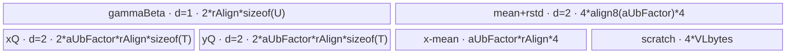

# LayerNorm 950 ACLNN 算子知识

## 算子速览

| 项目 | 内容 |
|---|---|
| 实际入口 | `aclnnLayerNormGetWorkspaceSize` / `aclnnLayerNorm`；公开 ACLNN，第一段固定以 `HIGH_PRECISION(0)` 复用公共实现。 |
| 计算语义 | 对末尾 `normalizedShape` 轴计算 `mean`、`rstd=1/sqrt(var+eps)` 与 `y=(x-mean)*rstd*gamma+beta`；gamma/beta 可缺省。 |
| 输入输出 | input/out 为 FP32/FP16/BF16、ND、1～8维；gamma/beta 为 input dtype 或 FP32且彼此同 dtype；内部 mean/rstd 为 FP32，再 Cast/ViewCopy 到公开输出。 |
| 执行类型 | 单 `AIV_VECTOR` Kernel；router 对 AIC core 直接返回并声明 `KERNEL_TYPE_AIV_ONLY`，无 Cube/AIC/MIX_CV body。 |
| Kernel 路线 | R-001 two-pass-perf（priority 150）；R-002 high-level two-pass（priority 200）；R-003 Welford fallback（priority 4000）。 |
| 核心资源 | GM、AIV UB Queue/TBuf；R-001/R-002 workspace 32 B，R-003 16 MiB；body 仅检查 workspace/userWS 非空，不读用户区。 |
| 来源闭包 | `source_closed`：公开 ACLNN→950 `LayerNormV4`→L0→Tiling/POD→AIV router→三套 body/helper→Ascend 950 binary/CMake 闭合。 |
| 验证状态 | 已完成源码闭包检查；本次知识提取未执行编译、真机、数值或性能测试。 |

## 接口与语义

### 计算语义

输入 shape 为 `[A1,...,Ai,R1,...,Rj]`，令 `A=prod(A1...Ai)`、`R=prod(R1...Rj)`。逐行计算 `mean_a=sum(x[a,:])/R`、`var_a=sum((x[a,:]-mean_a)^2)/R`、`rstd_a=1/sqrt(var_a+eps)`，再得 `y[a,r]=(x[a,r]-mean_a)*rstd_a*gamma[r]+beta[r]`。gamma/beta 缺省分别等价于 1/0，但 950 不物化默认 Tensor，而由 POD 标志跳过对应运算。统计输出 shape 为 `[A1,...,Ai,1,...,1]`。

### 输入、输出与属性

| 参数 | shape/layout | dtype | 约束、默认值与语义 |
|---|---|---|---|
| `input` | `[A...,R...]` / ND | FP32/FP16/BF16 | 必选；A=0 直接成功，R=0 仅处理统计输出。 |
| `normalizedShape` | `[R1,...,Rj]`，j≥1 | ACLNN INT64 array；L0 转 INT32 Tensor | 长度≤input rank且≤8；值与 input 右对齐维相等。 |
| `weightOptional` | `[R1,...,Rj]` / ND | input dtype 或 FP32 | 可选；存在时与 bias dtype相同；缺省由 `nullptrGamma` 控制。 |
| `biasOptional` | 同上 | input dtype 或 FP32 | 可选；缺省由 `nullptrBeta` 控制。 |
| `eps` | scalar | double→float | 方差稳定项。 |
| `out` | 同 input / ND | 与 input 相同 | 内部结果 Cast/ViewCopy。 |
| `meanOutOptional` | `[A...,1...]` / ND | FP32/FP16/BF16 | 950检查完整shape；内部FP32再Cast。 |
| `rstdOutOptional` | 同 mean | FP32/FP16/BF16 | 与mean同时存在时shape必须相同。 |

### 入口与版本

本卡只覆盖 `aclnnLayerNorm`，不覆盖同页的 `LayerNormWithImplMode` 或 `FastLayerNorm`。950 上 `AclnnUtil::IsRegbase()` 令 `forwardV4Compute` 恒真，因此不走 `LayerNormV3WithImplMode`，缺省参数也不经 `Fill`。公开产品表支持 Ascend 950PR/950DT；OpDef 的 `ascend950` config 指向 `layer_norm_v4_apt`，binary JSON覆盖五组 input/parameter dtype组合。

## Host/Launcher 执行流程

### 参数校验与前处理

第一段创建 executor，检查 input/normalizedShape/out 非空，校验 dtype、最大8维、normalizedShape非空及右对齐shape、weight/bias shape和dtype，并在 DAV_3510 检查 mean/rstd 完整shape。随后求 A/R：A=0 时 workspace=0且不加入Kernel；R=0时框架把mean置0、rstd置NaN。正常域对input和存在的weight/bias做`Contiguous`；`LayerNormV4`把normalizedShape转INT32 Tensor，分配y与FP32 mean/rstd，并加入一个AICore launcher节点；之后按用户输出做Cast/ViewCopy。

### 参数、Workspace 与生命周期

Tiling parse取得AIV core数、UB、UB block size、vector-register size并置`isRegBase=true`。base Tiling融合shape为A/R，计算`rAlign=ceil_align(R,32/sizeof(T))`、dtype key和optional标志。R-001/R-002声明32 B节点workspace，R-003声明16 MiB。executor拥有连续化临时Tensor、内部输出和后处理节点直到`CommonOpExecutorRun`完成。Kernel要求workspace和`GetUserWorkspace`非空，但三条body均不读用户区。

### 启动图与失败传播

```text
aclnnLayerNormGetWorkspaceSize
  -> common GetWorkspace(..., HIGH_PRECISION)
  -> Contiguous(input[, gamma, beta])
  -> LayerNormV4 launcher: layer_norm_v4 -> layer_norm_impl -> R-001/R-002/R-003
  -> Cast/ViewCopy(y[, mean, rstd])
aclnnLayerNorm -> CommonOpExecutorRun(workspace, executor, stream)
```

单Device节点无跨Kernel边。同一stream保证Kernel先于后处理；任一校验、临时Tensor、launcher、Cast/ViewCopy失败都提前返回。entry遇空workspace/userWS、AIC core或未知key直接无输出返回。

## Route 与参数设计

### 分核与资源计算

公共量为A、R和`rAlign`。R-001计算`aBlockFactor=ceil(A/coreNum)`、`blockNum=ceil(A/aBlockFactor)`，再从UB公式求`aUbFactor`并向下调整到fit；`rowWeight=2*sizeof(U)+4*sizeof(T)+sizeof(float)`。R-002二分搜索最大`aFactor`，计入双缓冲x/y、mean/rstd、可选gamma/beta和`GetLayerNormMaxMinTmpSize`最大临时区。R-003按每核`ceil(A/coreNum)`行，以64元素步进寻找最大tile；总UB包含双缓冲x/y、256项双缓冲统计、Welford状态、可选参数和三种API临时区。

### Route 选择

| 顺序 | Route | Key/模板 | 精确选择条件与优先级 | 不适用去向 |
|---:|---|---|---|---|
| 1 | R-001 two-pass-perf | 500/510/511/520/522；150 | `isRegBase && rAlign<=4*vlFp32^2 && !(A>=4096 && rAlign>=8192) && CanFitInBuffer(1)` | R-002 |
| 2 | R-002 high-level two-pass | 300/310/311/320/322；200 | `isRegBase`且至少`aFactor=1`能容纳整行、参数、双缓冲和API tmp | R-003 |
| 3 | R-003 Welford | 400/410/411/420/422；4000 | `isRegBase`；前两模板失败后的fallback | 无正tile则Tiling失败 |

```text
A5 -> R-001 if perf guards and UB fit
   -> R-002 if one complete row fits
   -> R-003 tiled Welford fallback
```

### 模板/实现执行矩阵

| Route | key/selector | dtype/shape/platform 完整命中条件 | 执行拓扑与 Kernel 节点 | 实际模板/body | 内存与同步特征 | tail/fallback |
|---|---|---|---|---|---|---|
| R-001 | 500 float/float；510 half/float；511 half/half；520 bf16/float；522 bf16/bf16 | 950+perf guards | 单AIV | `LayerNormV4RegbaseTwoPassPerf<T,U,float>` | 参数常驻；x/y/stats双缓冲；FP32 MicroAPI | 尾核/批/R mask/奇数行；→R-002 |
| R-002 | 300/310/311/320/322，同映射 | 950+整行fit | 单AIV | `LayerNormV4RegbaseTwoPass<T,U,float>` | optional条件分配；`AscendC::LayerNorm` tmp | 尾核/批，R补零；→R-003 |
| R-003 | 400/410/411/420/422，同映射 | 950 fallback | 单AIV | `LayerNormV4RegbaseWelford<T,U,float>` | 每行两次GM扫描；Welford/API TBuf；统计256行cache | tile/行tail；失败终点 |

### 隐藏性能 Guard

| Guard | Host/Tiling 条件 | Device/资源原因 | 影响 Route | 不满足时去向 | 源码符号 |
|---|---|---|---|---|---|
| perf reduction | `rAlign<=4*vlFp32^2` | 手写归约scratch/VL上界 | R-001 | R-002 | `RegBaseTwoPassPerfTiling::IsCapable` |
| 大矩阵避让 | 非`A>=4096 && rAlign>=8192` | 避免perf tile过小 | R-001 | R-002 | 同上 |
| perf UB | `curA*rAlign*(2*sizeof(U)+4*sizeof(T)+4) <= UB-4*VLbytes-4*align8(curA)`，且`aUbFactor`向下至成立 | Host近似计入参数、双缓冲、FP32中间/scratch；与Device stats Queue精确账存在下述差异 | R-001 | R-002 | `GetUBCanUseSize/GetRowWeight/CanFitInBuffer` |
| high-level UB | 二分结果`lastACanUse!=-1` | 完整行加primitive最大tmp | R-002 | R-003 | `RegBaseTwoPassTiling::CanFitInBuffer` |
| Welford tile | 64步进，探测候选+128 | 为双tile/API tmp留余量 | R-003 | 失败 | `IsValidTileLength/DoLibApiTiling` |
| workspace/core | workspace/userWS非空且`g_coreType!=AIC` | AIV-only entry guard | 全部 | 无输出返回 | `layer_norm_impl` |

### POD/ABI

固定仓的宏未展开精确`sizeof/alignof/offsetof`；下表按声明顺序，Host `set_*`与Device同名读取闭合。

| 结构 | 字段 | 类型/位宽 | ABI 布局 | 单位 | Host/launcher producer | Device consumer | 边界 |
|---|---|---|---|---|---|---|---|
| Perf POD | `a` | int64/64 | 第1字段 | row | A | block/tail地址 | >0 |
| Perf POD | `aBlockFactor` | int64/64 | 第2字段 | row/core | `ceil(A/coreNum)` | block offset | >0 |
| Perf POD | `aUbFactor` | int32/32 | 第3字段 | row/UB批 | UB fit | UB循环 | ≥1且需可窄化 |
| Perf POD | `aUbFactorAlignB32` | int32/32 | 第4字段 | FP32 elem | align8(aUbFactor) | stats Queue | 需可窄化 |
| Perf POD | `r` | int32/32 | 第5字段 | elem/row | R | DMA/mask | >0且需可窄化 |
| Perf POD | `rAlign` | int32/32 | 第6字段 | elem/row | block对齐R | UB stride | 需可窄化 |
| Perf POD | `formerBlockUbLoops` | int32/32 | 第7字段 | loop | ceil(aBlockFactor/aUbFactor) | 非尾核循环 | ≥1 |
| Perf POD | `tailBlockUbLoops` | int32/32 | 第8字段 | loop | ceil(tailRows/aUbFactor) | 尾核循环 | ≥1 |
| Perf POD | `powerOfTwoForR` | int32/32 | 第9字段 | elem | 最小2次幂≥R | 归约 | 需可窄化 |
| Perf POD | `epsilon` | float/32 | 第10字段 | scalar | eps | rstd | double→float |
| Perf POD | `nullptrGamma` | int8/8 | 第11字段 | flag | gamma desc | affine模板 | 0/1 |
| Perf POD | `nullptrBeta` | int8/8 | 第12字段 | flag | beta desc | affine模板 | 0/1 |
| TwoPass POD | `r` | int64/64 | 第1字段 | elem/row | R | DMA/API | >0 |
| TwoPass POD | `rAlign` | int64/64 | 第2字段 | elem/row | block对齐R | UB stride | ≥R |
| TwoPass POD | `a` | int64/64 | 第3字段 | row | A | 尾核 | >0 |
| TwoPass POD | `aFactor` | int64/64 | 第4字段 | row/UB批 | 二分最大fit | Queue/循环 | ≥1 |
| TwoPass POD | `aBlockFactor` | int64/64 | 第5字段 | row/core | ceil(A/core) | block offset | >0 |
| TwoPass POD | `blockNum` | int64/64 | 第6字段 | core | ceil(A/aBlockFactor) | 尾核判断 | ≥1 |
| TwoPass POD | `binaryAddQuotient` | int64/64 | 第7字段 | elem | 最大2次幂<R | primitive tiling | R相关 |
| TwoPass POD | `binaryAddK` | int64/64 | 第8字段 | stage | VL推导 | primitive tiling | ≥0 |
| TwoPass POD | `binaryAddLastNum` | int64/64 | 第9字段 | FP32 elem | vcaddNum或VL | primitive tiling | ≤VL |
| TwoPass POD | `powerOfTwoForR` | int64/64 | 第10字段 | elem | 最小2次幂≥R | primitive tiling | R相关 |
| TwoPass POD | `tmpBufferSize` | int64/64 | 第11字段 | byte | API max tmp | `tmpBuf` | >0时分配 |
| TwoPass POD | `nullptrGamma` | int64/64 | 第12字段 | flag | gamma desc | 条件Queue/config | 0/1 |
| TwoPass POD | `nullptrBeta` | int64/64 | 第13字段 | flag | beta desc | 条件Queue/config | 0/1 |
| TwoPass POD | `epsilon` | float/32 | 第14字段 | scalar | eps | LayerNorm | double→float |
| TwoPass POD | `layerNormTiling` | `LayerNormSeparateTiling` | 第15字段 | API POD | `GetLayerNormNDTilingInfo` | primitive | 外部ABI边界 |
| Welford POD | `M` | int64/64 | 第1字段 | row | A | 分核 | >0 |
| Welford POD | `N` | int64/64 | 第2字段 | elem/row | R | 地址/tile | >0 |
| Welford POD | `rAlign` | int64/64 | 第3字段 | elem | align(R) | body不读 | inactive consumer |
| Welford POD | `numBlocks` | int64/64 | 第4字段 | core | 分核 | block guard | ≥1 |
| Welford POD | `mainBlockCount` | int64/64 | 第5字段 | core | M/blockFactor | 尾核判定 | ≥0 |
| Welford POD | `mainBlockFactor` | int64/64 | 第6字段 | row/core | ceil(M/core) | block offset | ≥1 |
| Welford POD | `tailBlockFactor` | int64/64 | 第7字段 | row | M-mainCount*factor | 尾核行数 | 无尾核时0且inactive |
| Welford POD | `tileLength` | int64/64 | 第8字段 | elem | 64步进最大fit | Queue/循环 | 64倍数 |
| Welford POD | `welfordTempSize` | int64/64 | 第9字段 | byte | 2*tile*4+256*4 | Welford TBuf | tile相关 |
| Welford POD | `welfordUpdateTimes` | int64/64 | 第10字段 | tile | N/tile | 两遍完整tile循环 | ≥0 |
| Welford POD | `welfordUpdateTail` | int64/64 | 第11字段 | elem | N%tile | 两遍tail | 可0 |
| Welford POD | `nullptrGamma` | int64/64 | 第12字段 | flag | gamma desc | Queue/Normalize | 0/1 |
| Welford POD | `nullptrBeta` | int64/64 | 第13字段 | flag | beta desc | Queue/Normalize | 0/1 |
| Welford POD | `apiTempBufferSize` | int64/64 | 第14字段 | byte | 三API tmp之和 | shared TBuf | tile相关 |
| Welford POD | `epsilon` | float/32 | 第15字段 | scalar | eps | Normalize | double→float |

### Route 源码闭包

| Route | Key/selector | Host/Tiling producer | POD/参数 | Kernel entry/router 节点 | Kernel body/直接依赖 | 构建接线 |
|---|---|---|---|---|---|---|
| R-001 | 5xx | perf tiling `IsCapable/DoOpTiling` | Perf POD | `layer_norm_v4`→`RegbaseTwoPassPerfImpl` | `layer_norm_v4_two_pass_perf.h`+reduce helper | ascend950 OpDef/JSON/CMake |
| R-002 | 3xx | two-pass tiling `IsCapable/Do*` | TwoPass POD | 同entry→`RegbaseTwoPassImpl` | `layer_norm_v4_two_pass.h`+LayerNorm primitive | 同上 |
| R-003 | 4xx | Welford tiling `IsCapable/Do*` | Welford POD | 同entry→`RegbaseWelfordImpl` | `layer_norm_v4_welford.h`+Welford/Normalize | 同上 |

## Kernel 实现

### 公共执行流程

三条Route共用单节点entry。`normalized_shape` GM参数不进入`layer_norm_impl`，shape事实已固化到POD。router验证workspace/userWS，屏蔽AIC core，再按key实例化T、U、M；950 L0内部统计输出使M=float。各body以`blockIdx*aBlockFactor`定位连续行，FP16/BF16计算升到FP32。Queue的EnQue/DeQue建立搬运与Vector依赖；MicroAPI局部写后读使用`LocalMemBar`或primitive内部协议。

### Route R-001：two-pass-perf

#### 适用条件

##### 选择证据

| 层级 | 文件 | 符号 | 源码谓词/参数 | 结果/下一跳 |
|---|---|---|---|---|
| API | `op_host/op_api/aclnn_layer_norm.cpp` | common GetWorkspace | 950 `IsRegbase()==true` | LayerNormV4 |
| Tiling | `op_host/layer_norm_v4_regbase_two_pass_perf_tiling.cpp` | `IsCapable` | regbase、R/VL阈值、大矩阵避让、1行fit | key5xx；否则R-002 |
| Router | `op_kernel/layer_norm_v4_apt.h` | `layer_norm_impl` | 500/510/511/520/522 | `RegbaseTwoPassPerfImpl<T,U,float>` |

#### Device 数据流

##### 函数级调用链

```text
layer_norm_v4 -> layer_norm_impl -> RegbaseTwoPassPerfImpl -> Init
  -> Process -> CopyInGammaBeta (once/core)
  -> for UB batch: CopyInX -> Caculate
       -> CalculateMeanVarRLessThanVL / LessThanTwoVL / Common<1|2>
       -> ComputeRstdNewtonRaphson
       -> CalculateNormalizeVF<hasGamma,hasBeta>
     -> CopyOutMean/Rstd/Y
```

##### 源码等价伪码

```text
baseRow=blockIdx*aBlockFactor; bind x/y at baseRow*R, stats at baseRow
copy optional gamma to paramUB[0:R], beta to paramUB[rAlign:rAlign+R]
for batch in blockRows step aUbFactor:
  DMA curA rows and pad to rAlign
  masked FP32 reduce mean; materialize x-mean in tmp
  masked FP32 variance; rstd=NewtonRaphson(var+eps)
  y=(x-mean)*rstd; optional FMA gamma+beta; cast/store T
  DMA only curA*R y and curA stats
```

#### 内存与数据搬运

##### 资源与搬运表

| 层级/缓冲区 | offset/地址公式 | extent/容量公式 | dtype/layout | producer | consumer | owner/lifetime | 对齐/复用 |
|---|---|---|---|---|---|---|---|
| GM x/y | `(baseRow+aOffset)*R` | `curA*R` | T/row-major | caller/body | body/user | executor | 每行仅有效R |
| GM mean/rstd | `baseRow+aOffset` | `curA` | FP32 | body | post Cast/ViewCopy | executor | 精确有效行 |
| `gammaBetaQueue_` | beta=`rAlign` | `2*rAlign*sizeof(U)` | U | CopyIn | Normalize | core | depth1；缺省片不读 |
| `xQueue_`,`yQueue_` | batch local | 各`2*aUbFactor*rAlign*sizeof(T)` | T | MTE2/vector | vector/MTE3 | pipe | depth2 |
| `meanQueue_`,`rstdQueue_` | row scalar | 各`2*align8(aUbFactor)*4` | FP32 | reduce | MTE3/normalize | pipe | depth2 |
| `tmpBuf` | scratch起于`elemNum` | `aUbFactor*rAlign*4+4*VLbytes` | FP32/bytes | reduce | variance/normalize | pipe | x-mean常驻，尾部scratch复用 |
| workspace | user区 | 32 B | opaque | executor | non-null guard | executor | body不读 |

##### 分层内存布局



##### 字节账与复用顺序

```text
UB_total = 2*rAlign*sizeof(U) + 4*align8(aUbFactor)*4
         + 4*aUbFactor*rAlign*sizeof(T) + aUbFactor*rAlign*4 + 4*VLbytes
Host_fit = aUbFactor*rAlign*(2*sizeof(U)+4*sizeof(T)+4) + 4*VLbytes + 4*align8(aUbFactor)
Device_UB_total = formula above; fixed source does not prove Device_UB_total <= UB from Host_fit alone
dynamic_ub = N/A
workspace_total = 32 B
```

| 复用子区 | 写入者 | 读取者/消费点 | 下一次覆盖 | 同步或释放依据 | 安全条件 |
|---|---|---|---|---|---|
| tmp前段 | mean阶段 | variance、Normalize | 下一UB批 | Vector顺序/LocalMemBar | 当前批完成 |
| x/y Queue槽 | MTE2/vector | vector/MTE3 | 下一批 | EnQue/DeQue/FreeTensor | Free后复用 |
| rstd Queue槽 | rstd计算 | CopyOut与Normalize | 下一批 | 两个consumer后Free | 不得提前覆盖 |

#### 同步、精度与尾块

##### 同步与数值边界表

| 阶段 | primitive/机制 | producer | consumer/等待点 | 保护对象 | 精度/尾块 |
|---|---|---|---|---|---|
| GM→UB→Vector | Queue | CopyIn | Caculate | x/params | pad到rAlign，mask只处理R |
| 归约scratch | LocalMemBar | 分段和 | 二分合并 | tmp | FP32、R mask |
| rstd | Newton-Raphson helper | variance | Normalize/CopyOut | stats | `var+eps`后倒平方根 |
| affine | MicroAPI mask | centered/rstd/params | y | 有效lane | 两行并行，奇数尾行单独处理 |

#### 关键实现

##### 符号证据表

| 阶段 | 文件 | 符号/模板实例 | 实现事实 |
|---|---|---|---|
| Host/Tiling producer | `op_host/layer_norm_v4_regbase_two_pass_perf_tiling.cpp` | `CanFitInBuffer/DoOpTiling` | perf guard、分核、UB批 |
| Kernel entry/router | `op_kernel/layer_norm_v4_apt.h` | `RegbaseTwoPassPerfImpl` | 5xx映射、AIV-only |
| Device body/helper | `op_kernel/arch35/layer_norm_v4_two_pass_perf.h` | `Caculate/CalculateNormalizeVF` | 手写FP32归约、pair-row affine、tail |

### Route R-002：high-level two-pass

#### 适用条件

##### 选择证据

| 层级 | 文件 | 符号 | 源码谓词/参数 | 结果/下一跳 |
|---|---|---|---|---|
| Tiling | `op_host/layer_norm_v4_regbase_two_pass_tiling.cpp` | `IsCapable` | R-001失败；至少1行可装入 | key3xx；否则R-003 |
| Tiling API | 同文件 | `DoLibApiTiling` | `{aFactor,R}`+max tmp | `LayerNormSeparateTiling` |
| Router | `op_kernel/layer_norm_v4_apt.h` | `RegbaseTwoPassImpl` | 300/310/311/320/322 | high-level body |

#### Device 数据流

##### 函数级调用链

```text
layer_norm_v4 -> RegbaseTwoPassImpl -> Init -> Process -> CopyInGammaBeta
  -> for UB batch: CopyInX -> CaculateWithHighLevelApi
       -> AscendC::LayerNorm<optional config>
     -> CopyOutY -> CopyOutBatchMeanRstd
```

##### 源码等价伪码

```text
conditionally DMA gamma/beta once
for curA<=aFactor: DMA and pad x; LayerNorm(y,mean,rstd,x,gamma,beta,eps,tmp,{curA,R,rAlign});
                   DMA only valid curA*R y and curA stats
```

#### 内存与数据搬运

##### 资源与搬运表

| 层级/缓冲区 | offset/地址公式 | extent/容量公式 | dtype/layout | producer | consumer | owner/lifetime | 对齐/复用 |
|---|---|---|---|---|---|---|---|
| gamma/beta Queue | 0 | 各存在时`rAlign*sizeof(U)` | U | DMA | primitive | core | depth1/条件分配 |
| x/y Queue | UB批 | 各`2*aFactor*rAlign*sizeof(T)` | T | DMA/primitive | primitive/DMA | pipe | depth2 |
| mean/rstd Queue | row | 各`2*ceil_align(aFactor*4,blockSize)` | FP32 | primitive | DMA | pipe | depth2 |
| `tmpBuf` | 0 | `tmpBufferSize` | bytes | primitive | primitive | pipe | API私有临时区 |
| workspace | user区 | 32 B | opaque | executor | guard | executor | body不读 |

##### 分层内存布局


##### 字节账与复用顺序

```text
UB_total = presentParams*rAlign*sizeof(U) + 4*aFactor*rAlign*sizeof(T)
         + 4*ceil_align(aFactor*4,blockSize) + tmpBufferSize
UB_total <= platform UB by binary-searched CanFitInBuffer
dynamic_ub = N/A
workspace_total = 32 B
```

| 复用子区 | 写入者 | 读取者/消费点 | 下一次覆盖 | 同步或释放依据 | 安全条件 |
|---|---|---|---|---|---|
| x/y Queue槽 | MTE2/primitive | primitive/MTE3 | 下一批 | FreeTensor | 只写有效R |
| stats Queue | primitive | CopyOut | 下一批 | Queue协议 | 精确curA |
| tmpBuf | LayerNorm primitive | 同primitive | 下一批 | primitive返回 | 不跨调用持有 |

#### 同步、精度与尾块

##### 同步与数值边界表

| 阶段 | primitive/机制 | producer | consumer/等待点 | 保护对象 | 精度/尾块 |
|---|---|---|---|---|---|
| DMA/compute | Queue | CopyIn | LayerNorm | x/params | padding为0，primitive获知真实R |
| 计算 | AscendC primitive | x | y/stats | tmpBuf | 内部指令为固定仓外边界；stats FP32 |
| CopyOut | Queue | primitive | MTE3 | y/stats | 仅curA与R有效域 |

#### 关键实现

##### 符号证据表

| 阶段 | 文件 | 符号/模板实例 | 实现事实 |
|---|---|---|---|
| Host/Tiling producer | `op_host/layer_norm_v4_regbase_two_pass_tiling.cpp` | `CanFitInBuffer/DoLibApiTiling` | UB模型与primitive tiling |
| Kernel entry/router | `op_kernel/layer_norm_v4_apt.h` | `RegbaseTwoPassImpl` | key3xx映射 |
| Device body/helper | `op_kernel/arch35/layer_norm_v4_two_pass.h` | `CaculateWithHighLevelApi` | optional config、DMA、Queue生命周期 |

### Route R-003：Welford 分片 fallback

#### 适用条件

##### 选择证据

| 层级 | 文件 | 符号 | 源码谓词/参数 | 结果/下一跳 |
|---|---|---|---|---|
| Tiling | `op_host/layer_norm_v4_welford_tiling.cpp` | `IsCapable` | `isRegBase`，前两优先模板失败 | key4xx |
| Tiling | 同文件 | `IsValidTileLength/DoLibApiTiling` | 64元素步进且完整UB公式fit | tile/tail；无fit失败 |
| Router | `op_kernel/layer_norm_v4_apt.h` | `RegbaseWelfordImpl` | 400/410/411/420/422 | Welford body |

#### Device 数据流

##### 函数级调用链

```text
layer_norm_v4 -> RegbaseWelfordImpl -> Init -> Process per row
  -> WelfordInitialize
  -> ProcessWelfordUpdate(full/tail tiles) -> WelfordUpdate
  -> WelfordFinalize
  -> ProcessNormalize(the same tiles) -> Normalize -> CopyOut y
  -> cache mean/rstd; RefreshCache each 256 rows or at block end
```

##### 源码等价伪码

```text
for each assigned row:
  zero FP32 mean/variance states
  for each R tile: DMA x; WelfordUpdate(state,x,tileValid)
  WelfordFinalize(mean,var,N)
  for each R tile again: DMA x and optional params; Normalize; DMA y
  cache FP32 mean/rstd; flush at 256 rows or block end
```

#### 内存与数据搬运

##### 资源与搬运表

| 层级/缓冲区 | offset/地址公式 | extent/容量公式 | dtype/layout | producer | consumer | owner/lifetime | 对齐/复用 |
|---|---|---|---|---|---|---|---|
| x/y Queue | `row*R+tile*L` | 各`2*L*sizeof(T)` | T | DMA/Normalize | Welford/GM | pipe | depth2；x每行读两次 |
| gamma/beta Queue | `tile*L` | 各存在时`2*L*sizeof(U)` | U | DMA | Normalize | pipe | depth2/条件分配 |
| mean/rstd Queue | cache row | 各`2*256*4` | FP32 | Finalize | RefreshCache | pipe | depth2；256行flush |
| Welford TBuf | mean[0:L]、variance[L:2L]、tail | `2*L*4+256*4` | FP32 | init/update | finalize | pipe | 状态跨第一遍 |
| API TBuf | 0 | updateTmp+finalizeTmp+normalizeTmp | bytes | primitives | primitives | pipe | 三段顺序复用 |
| workspace | user区 | 16 MiB | opaque | executor | guard | executor | body不读 |

##### 分层内存布局


##### 字节账与复用顺序

```text
UB_total = 4*L*sizeof(T) + presentParams*2*L*sizeof(U)
         + 4*256*4 + (2*L*4+256*4) + apiTempBufferSize
UB_total <= platform UB by IsValidTileLength
dynamic_ub = N/A
workspace_total = 16 MiB (Device body does not read it)
```

| 复用子区 | 写入者 | 读取者/消费点 | 下一次覆盖 | 同步或释放依据 | 安全条件 |
|---|---|---|---|---|---|
| xQueue槽 | two-pass DMA | WelfordUpdate/Normalize | 下一tile | FreeTensor | consumer完成 |
| Welford state | Initialize/Update | Finalize | 下一行Initialize | primitive顺序 | Normalize用已缓存scalar |
| API shared | Update/Finalize/Normalize | 当前primitive | 下一primitive | 调用顺序 | 不并发 |
| stats cache | Finalize | Normalize与RefreshCache | flush后ResetCache | cacheCount guard | ≤256行 |

#### 同步、精度与尾块

##### 同步与数值边界表

| 阶段 | primitive/机制 | producer | consumer/等待点 | 保护对象 | 精度/尾块 |
|---|---|---|---|---|---|
| 初始化 | MicroAPI zero | prior row | update | mean/variance | mask覆盖L |
| online统计 | `WelfordUpdate` | x tile | next/finalize | FP32 state | `abComputeLength=tail` |
| finalize | `WelfordFinalize<true>` | all updates | Normalize | scalar stats | `rRec=1/N` |
| second pass | Normalize+Queue | reloaded x/params | y DMA | y tile | full/tail分别配置elemCnt |
| stats flush | Queue+DataCopyPad | cached stats | GM | mean/rstd | 尾cache精确count |

#### 关键实现

##### 符号证据表

| 阶段 | 文件 | 符号/模板实例 | 实现事实 |
|---|---|---|---|
| Host/Tiling producer | `op_host/layer_norm_v4_welford_tiling.cpp` | `IsValidTileLength/DoLibApiTiling` | tile与字节账 |
| Kernel entry/router | `op_kernel/layer_norm_v4_apt.h` | `RegbaseWelfordImpl` | key4xx映射 |
| Device body/helper | `op_kernel/arch35/layer_norm_v4_welford.h` | `Process/ProcessWelfordUpdate/ProcessNormalize` | 两遍tile、cache、tail |

## 算子特定优化

### Trick T-001：Host 以精确 UB 模型分层降级

#### 触发与源码依据

- 适用 Route：R-001→R-002→R-003。
- 触发条件：950 regbase；先尝试手写perf，再尝试高阶API整行，最后Welford分片。
- Golden 来源：[`layer_norm_v4_regbase_two_pass_perf_tiling.cpp:57-76`](https://gitcode.com/cann/ops-nn/-/blob/955f8b33985b6d72989ebff341bb9c2c564a51bc/norm/layer_norm_v4/op_host/layer_norm_v4_regbase_two_pass_perf_tiling.cpp#L57-76)

**官方源码（固定 Commit 连续逐字摘录）**：

```cpp
if (!commonParams.isRegBase) {
    return false;
}
if (static_cast<int64_t>(commonParams.rowAlign) > LN_NUM_TWO * commonParams.vlFp32 * commonParams.vlFp32 * LN_NUM_TWO) {
    return false;
}
if (commonParams.colSize >= LN_ROW_THRESHOLD && commonParams.rowAlign >= LN_COL_THRESHOLD) {
    return false;
}
if (!CanFitInBuffer(1)) {
    return false;
}
return true;
```

#### 机制与设计原因

selector在Host端把VL、A/R、dtype字节和实际UB纳入选择：短/中R用R-001手写归约；完整行仍能驻留时R-002交给高阶LayerNorm；长R用R-003在线Welford。Device热循环不需动态选择，同时每条路线的Queue/TBuf有Host上界。

#### 迁移边界

- 适用：具有完整行快路与分片保底的归约归一化。
- 前提：selector与Device分配公式一致并保留priority。
- 失效：任一字节项、double-buffer depth或API tmp漏算时不可复用阈值。
- 未验证：本次知识提取未执行编译、真机、数值或性能测试。

#### 错误做法

固定仓真实fallback为R-001失败转R-002、R-002一行不fit转R-003；跳过fallback会令长归约无实现。

### Trick T-002：Welford 在线统计后按同一 tile 图二次读入

#### 触发与源码依据

- 适用 Route：R-003。
- 触发条件：前两条整行路线均不适用。
- Golden 来源：[`layer_norm_v4_welford.h:124-159`](https://gitcode.com/cann/ops-nn/-/blob/955f8b33985b6d72989ebff341bb9c2c564a51bc/norm/layer_norm_v4/op_kernel/arch35/layer_norm_v4_welford.h#L124-159)

**官方源码（固定 Commit 连续逐字摘录）**：

```cpp
for (int64_t welfordUpdateCount = 0; welfordUpdateCount < td_->welfordUpdateTimes; welfordUpdateCount++) {
    int64_t offset = i * td_->N + welfordUpdateCount * td_->tileLength;
    ProcessWelfordUpdate(offset, td_->tileLength);
}
WelfordFinalize<true>(meanTensor[cacheCount], varianceTensor[cacheCount], mean_, variance_, shared_, para);
for (int64_t welfordUpdateCount = 0; welfordUpdateCount < td_->welfordUpdateTimes; welfordUpdateCount++) {
    int64_t fmOffset = i * td_->N + welfordUpdateCount * td_->tileLength;
    ProcessNormalize(fmOffset, welfordUpdateCount * td_->tileLength, td_->tileLength);
}
```

#### 机制与设计原因

第一遍只保留FP32 Welford状态，不在workspace物化整行x；统计完成后按同样tile边界重读x/参数并归一化。x读取两次，但UB由整行规模降为O(tileLength)，形成长归约fallback。

#### 迁移边界

- 适用：输出依赖整行统计且整行无法驻UB的归一化。
- 前提：两遍间输入不可变，同stream顺序成立，tail长度一致。
- 失效：输入会被第一遍覆盖或不允许二次GM读取时，需有明确owner的workspace物化。
- 未验证：本次知识提取未执行编译、真机、数值或性能测试。

#### 错误做法

固定仓反例边界是整行不fit仍强行使用R-001/R-002；对应`IsCapable`会返回false。

## 模板与实现对比

| 对比维度 | R-001 two-pass-perf | R-002 high-level two-pass | R-003 Welford | 设计选择依据 |
|---|---|---|---|---|
| 命中条件/优先级 | 150，VL/阈值/UB成立 | 200，整行fit | 4000，regbase fallback | 专用路线先试 |
| 模板与 dtype | 手写MicroAPI，5组T/U | LayerNorm primitive，5组 | Welford/Normalize，5组 | key映射一致，body不同 |
| 循环与分核 | core→UB批→row pair→R | core→UB批→primitive | core→row→two tile passes | R增大逐级分片 |
| Queue/TBuf/寄存器/dynamic UB/通信 window | 参数合并Q、x/y/stats、centered/scratch；无dynamic UB | 条件参数Q、x/y/stats、API tmp | tile Q、256 stats、Welford/API tmp | 均无通信/window |
| 内存总占用与复用 | O(aUbFactor*rAlign) | O(aFactor*rAlign) | O(tileLength+256) | Welford不存整行 |
| 搬运/Vector/SIMT/NDDMA/通信 API | DataCopyPad+手写reduce/FMA | DataCopyPad+LayerNorm | DataCopyPad+Welford/Normalize | 均为AIV Vector |
| 同步、精度与 tail | Queue+barrier；FP32；mask/奇数行 | Queue+primitive；FP32 stats；pad | Queue+primitive；FP32在线状态；tile/cache tail | 仅写有效域 |
| fallback/失败边界 | →R-002 | →R-003 | 无正tile则失败 | 源码priority |

## 平台差异

| 项目 | A2 | A3 | 950 |
|---|---|---|---|
| 支持状态 | 公开支持，但平台全域源码不闭合 | 同A2 | 公开支持且V4全域源码闭合 |
| Host/Launcher | 仅特定BF16 1024/4096或不对齐短R走V4，其余V3 | DAV_2201路径同左 | `IsRegbase`强制V4，缺省参数不Fill |
| Kernel/资源 | V3 A2/A3实现未在固定仓公开 | 同左 | AIV-only，三Route/POD/UB闭合 |

## 限制与失败边界

- A/R乘积与normalizedShape INT64→INT32 Tensor转换无额外溢出检查，不能假定超大shape安全。
- R-001 POD把A/R/loop/power-of-two写入int32，Host未显式检查窄化；复用需增加可表示性前提。
- R-001 `CanFitInBuffer` 对统计区只扣除 `4*align8(curA)` 字节，而Device为mean/rstd各分配depth=2、合计`16*align8(curA)`字节；同时Host把gamma/beta按每行重复计入、Device只存一份。两者并非恒等字节账，固定源码不能单凭Host谓词证明极限UB安全，迁移时必须用Device精确式复核。
- router对空workspace/userWS、AIC core、未知key静默返回；launcher必须提供相应workspace和合法key。
- R-003从tileLength=0开始按候选+128探测，固定源码未处理最终tile仍为0后的除法；要求UB容纳最小候选。
- `LayerNorm/WelfordUpdate/Finalize/Normalize` primitive内部微码为固定仓外边界；本卡闭合参数、临时区、数据流和生命周期。
- A2/A3未生成`layer_norm.md`：公开ACLNN多数输入会调用`LayerNormV3`，固定仓仅有launcher壳，无A2/A3 Host/Tiling/POD/Kernel body和构建闭包，平台不满足`source_closed`。
- 本次知识提取未执行编译、真机、数值或性能测试。

## 源码索引

### 链路索引

| 链路阶段 | 文件 | 关键符号 | 支撑内容 |
|---|---|---|---|
| 入口声明/约束 | `norm/layer_norm_v4/docs/aclnnLayerNorm&aclnnLayerNormWithImplMode.md` | 产品支持/函数原型 | 950公开性、语义、参数 |
| 入口实现 | `norm/layer_norm_v4/op_host/op_api/aclnn_layer_norm.cpp` | `aclnnLayerNorm*`,`IsV4SocCheck` | 校验、A/R、950分流、前后处理 |
| 入口实现 | `norm/layer_norm_v4/op_host/op_api/layer_norm_v4.cpp` | `l0op::LayerNormV4` | L0与单节点launcher |
| OpDef | `norm/layer_norm_v4/op_host/layer_norm_v4_def.cpp` | `LayerNormV4` | dtype、ascend950 opFile |
| POD | `norm/layer_norm_v4/op_host/layer_norm_v4_tiling.h` | RegBase TilingData | 字段、key、模板 |
| Host/Tiling | `norm/layer_norm_v4/op_host/layer_norm_v4_tiling.cpp` | `TilingPrepare4CompileInfo` | core/UB/VL/regbase |
| Host/Tiling | `norm/layer_norm_v4/op_host/layer_norm_v4_tiling_base.cpp` | `GetShapeAttrsInfo` | A/R/dtype/optional/workspace |
| Host/Tiling | `norm/layer_norm_v4/op_host/layer_norm_v4_regbase_two_pass_perf_tiling.cpp` | perf Tiling | R-001 selector/POD/UB |
| Host/Tiling | `norm/layer_norm_v4/op_host/layer_norm_v4_regbase_two_pass_tiling.cpp` | two-pass Tiling | R-002 selector/tmp/POD |
| Host/Tiling | `norm/layer_norm_v4/op_host/layer_norm_v4_welford_tiling.cpp` | Welford Tiling | R-003 tile/POD/workspace |
| Kernel entry/body | `norm/layer_norm_v4/op_kernel/layer_norm_v4_apt.cpp` | `layer_norm_v4` | 950 entry |
| Kernel entry/body | `norm/layer_norm_v4/op_kernel/layer_norm_v4_apt.h` | `layer_norm_impl` | AIV router/key/失败终点 |
| Kernel entry/body | `norm/layer_norm_v4/op_kernel/arch35/layer_norm_v4_two_pass_perf.h` | perf body | R-001 UB/归约/affine/tail |
| Kernel entry/body | `norm/layer_norm_v4/op_kernel/arch35/layer_norm_v4_two_pass.h` | two-pass body | R-002 Queue/primitive |
| Kernel entry/body | `norm/layer_norm_v4/op_kernel/arch35/layer_norm_v4_welford.h` | Welford body | R-003 two-pass/cache |
| Kernel entry/body | `norm/layer_norm_v4/op_kernel/arch35/layer_norm_v4_common.h` | `CastBatchMeanRstdToDtype`/constants | 公共cast、VL、Queue常量 |
| Kernel entry/body | `norm/norm_common/op_kernel/reduce_common_regbase.h` | `LoadRegForDtype/StoreRegForDtype/ComputeRstdNewtonRaphson` | R-001直接helper |
| 构建接线 | `norm/layer_norm_v4/op_host/config/ascend950/layer_norm_v4_binary.json` | `LayerNormV4_*` | 五组dtype binary |
| 构建接线 | `norm/layer_norm_v4/op_host/CMakeLists.txt` | `add_modules_sources` | Host与norm_common依赖 |

### 实现复用检查

| 检查项 | 可复用事实 | 不得改变的约束 | 源码符号 |
|---|---|---|---|
| ABI/POD | 三Route独立POD、5组dtype key | 字段顺序/位宽、int32窄化、optional flag、primitive POD | `layer_norm_v4_tiling.h` |
| 调用顺序 | 单entry→router→Init→Process | Welford统计先于Normalize二次扫描 | `layer_norm_impl`,`Process` |
| workspace/内存 | 32B/16MiB；UB由Host fit | non-null guard、Queue depth、条件分配、tile公式 | Tiling类与`InitBuffer` |
| 同步 | Queue+barrier/primitive顺序 | consumer/CopyOut前不得覆盖或Free | 各body |
| 精度与尾块 | FP32统计、B16受控cast、显式row/tile/R tail | eps顺序、mask、只写有效R、stats cache尾提交 | Normalize/reduce/Welford methods |
| 失败边界 | perf→two-pass→Welford；未知key无输出 | priority/fallthrough不可重排 | template registry、router |

- [LayerNorm](../../../../apis/simd_api/adv_api/normalization/layer_norm.md)
