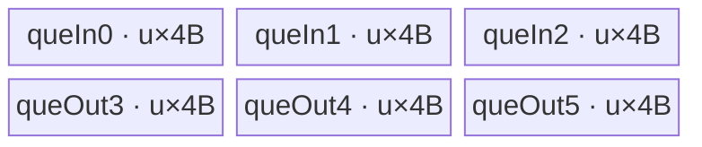

# LayerNormBackward A2/A3 ACLNN 算子知识

## 算子速览

| 项目 | 内容 |
|---|---|
| 实际入口 | `aclnnLayerNormBackwardGetWorkspaceSize` / `aclnnLayerNormBackward`，公开 ACLNN；A2/A3 经 `DAV_2201` 选择合一 `LayerNormGradV3`。 |
| 计算语义 | 将输入折叠为 `(M,N)`；输出 `dx`、沿 M 归约的 `dgamma` 和 `dbeta`。 |
| 输入输出 | `dy,x:T`，`mean,rstd:float`（ACLNN 必要时 Cast），`gamma:U`；`T∈{float,half,bfloat16}`，`U=T 或 float`；ND，API 维数 1–8。 |
| 执行类型 | 单 Kernel、AIV_VECTOR；entry 遇 `g_coreType == AIC` 立即返回，所有可达 body 均为 Vector。 |
| Kernel 路线 | R-001 SingleRead；R-002 Transpose；R-003 Common；R-004 Workspace。 |
| 核心资源 | GM、AIV UB `TQue/TBuf`、按核 FP32 workspace、`SyncAll`；无 Cube/AIC body、SIMT、NDDMA、通信节点。 |
| 来源闭包 | `source_closed`：ACLNN→L0 `LayerNormGradV3`→模板 selector/POD→`layer_norm_grad_v3` router→四个实际 body→910B/910_93 构建接线闭合。 |
| 验证状态 | 已完成源码闭包检查；本次知识提取未执行编译、真机、数值或性能测试。 |

## 接口与语义

### 计算语义

令输入尾部 `normalizedShape` 的乘积为 `N`，其余前缀乘积为 `M`，`z=(x-mean)*rstd`，`g=dy*gamma`。逐行计算 `s1=sum_N(g)`、`s2=sum_N(g*z)`，则 `dx=(g-(s1+z*s2)/N)*rstd`；逐列计算 `dgamma=sum_M(dy*z)`、`dbeta=sum_M(dy)`。`outputMask[0..2]` 仅决定 ACLNN 对应结果是否提交；A2/A3 融合 Kernel 仍物化三个内部输出。

### 输入、输出与属性

| 参数 | shape/layout | dtype | 约束、默认值与语义 |
|---|---|---|---|
| `gradOut`, `input` | 相同 ND `[A...,R...]` | 相同 `FLOAT/FLOAT16/BFLOAT16` | API 非空，1–8 维；元素数 `M*N`。 |
| `normalizedShape` | `[R...]` | INT64 array | 长度 1–8，定义 `N`；文档要求等于 input 尾维。 |
| `mean`, `rstd` | 元素数 M、shape 相同 | API 支持三种浮点；L0 融合前 Cast 到 FP32 | Kernel 只接收 FP32。 |
| `weightOptional` | `[R...]` | `T` 或 FP32 | 空时由 `Fill` 构造全 1 Tensor；`biasOptional` 只参与接口一致性检查，不进入公式。 |
| `outputMask` | 长度 3 | bool array | 全 false 时不挂融合 Kernel；否则内部算子总是有三输出。 |
| `gradInputOut` | 与 input 相同 | T | mask[0] 为真时必需。 |
| `gradWeightOut`, `gradBiasOut` | `[R...]` | 与公开输出约束一致 | A2/A3 内部固定 FP32，再由 `Cast+ViewCopy` 提交。 |

### 入口与版本

固定仓只公开 `aclnnLayerNormBackward` 两段式接口；没有同语义更高 ACLNN 版本。公开文档明确支持 Atlas A2/A3。`GetCurrentPlatformInfo().GetCurNpuArch()==DAV_2201` 时直接调用本目录最新融合实现 `LayerNormGradV3`；950 另见 `_950` 卡，旧 Atlas 产品的拆分 `LayerNormXBackpropV3 + LayerNormBetaGammaBackpropV2` 不属于本卡平台路线。

## Host/Launcher 执行流程

### 参数校验与前处理

`GetWorkspaceSize` 依次创建 executor，检查必需指针、`outputMask.size()==3`、被请求输出非空、dtype/shape/维数；计算 `M=prod(input[0:beginAxis])`、`N=prod(input[beginAxis:])`。全 mask false 直接返回；`M<=0 || N<=0` 时仅按需把 dgamma/dbeta 塴 0。非空场景把 `dy/x/mean/rstd/weight` 连续化；weight 缺省时 `Fill(1)`。A2/A3 把 mean/rstd Cast 为 FP32，调用 `l0op::LayerNormGradV3`，再逐 mask 做 `Cast` 与 `ViewCopy`。任一中间返回空指针即返回 ACLNN 内部错误。

### 参数、Workspace 与生命周期

L0 分配三个临时输出并通过 `ADD_TO_LAUNCHER_LIST_AICORE` 把单个 `LayerNormGradV3` 节点加入 executor。Tiling 从平台取得 AIV core 数、UB 字节、32B block 和向量寄存器宽度；A2/A3 `isRegBase=false`。算子 workspace 均附加 16 MiB 框架保留区；有效用户区如下：SingleRead/Common 为 `blockNum*colAlignV*2*4`，Transpose 为 `2*deterministicComputeWspSize`，Workspace 为 `blockNum*colAlignV*4*4`。workspace 由调用者按第一段返回值分配，在第二段 `CommonOpExecutorRun(...,stream)` 完成前有效。

### 启动图与失败传播

```text
aclnnLayerNormBackwardGetWorkspaceSize
  -> Contiguous/Fill/Cast framework nodes
  -> l0op::LayerNormGradV3
     -> Tiling4LayerNormGradV3 (按 priority 首个 IsCapable)
     -> layer_norm_grad_v3<<<blockDim, stream>>>(dy,x,rstd,mean,gamma,pdx,pdgamma,pdbeta,workspace,tiling)
        -> 一个 AIV route body
        -> 同一 Kernel 内写按核 workspace、SyncAll、固定顺序归并 dgamma/dbeta
  -> Cast/ViewCopy framework nodes
aclnnLayerNormBackward(workspace,size,executor,stream)
```

唯一 Device 节点的输入/输出均为 GM ND Tensor；workspace owner 是 ACLNN 调用者，Tiling/launcher 只切片。节点内 `SyncAll` 形成按核 partial→最终输出的可见性；launch 或后处理挂接失败会使第一段返回错误，第二段由 `CommonOpExecutorRun` 传播执行错误。

## Route 与参数设计

### 分核与资源计算

所有路线先折叠 `row=M,col=N`。SingleRead/Common/Workspace 用 `blockFormer=ceil(M/coreNum)`、`blockNum=ceil(M/blockFormer)`、`blockTail=M-(blockNum-1)*blockFormer`；Transpose 等价按 M 分核。`colAlignV=ceil(N/8)*8`（Workspace 源码保守取 `ceil(N/16)*16`），非 FP32 的 MTE 行宽 `colAlignM=ceil(N/16)*16`。UB former 由各路线真实缓冲公式反推；不足时 Tiling 失败。A2/A3 固定 `isDeterministicKey=1`，所以 Host 可达 key 均为 `template*100+10+dtypeKey`。

### Route 选择

| 顺序 | Route | Key/模板 | 精确选择条件与优先级 | 不适用去向 |
|---:|---|---|---|---|
| 1 | R-001 SingleRead | 111–115，priority 1000 | `!isRegBase && 768<=N<=12176` | R-002 |
| 2 | R-002 Transpose | 311–315，priority 2000 | `!isRegBase && N<=64 && N!=colAlign` | R-003 |
| 3 | R-003 Common | 411–415，priority 3000 | `!isRegBase && N<=768`，且前两项未命中 | R-004 |
| 4 | R-004 Workspace | 211–215，priority 4000 | `!isRegBase`，前项均未命中 | Tiling 资源失败 |

```text
if !regbase && 768 <= N <= 12176: SingleRead
else if !regbase && N <= 64 && N != align32B(N): Transpose
else if !regbase && N <= 768: Common
else if !regbase: Workspace
else: A2/A3 路线不可用
```

### 模板/实现执行矩阵

| Route | key/selector | dtype/shape/platform 完整命中条件 | 执行拓扑与 Kernel 节点 | 实际模板/body | 内存与同步特征 | tail/fallback |
|---|---|---|---|---|---|---|
| R-001 | 111 FP32/FP32；112 FP16/FP16；113 FP16/FP32；114 BF16/BF16；115 BF16/FP32 | A2/A3，768≤N≤12176 | 单 AIV Kernel | `LayerNormGradV3SingleRead<T,U,true>::Process` | 一次行 tile 主流水；2-slice partial workspace；`SyncAll` 后固定顺序归并 | former/tail core 与 row tile tail |
| R-002 | 311–315 同 dtype 映射 | A2/A3，N≤64 且非 32B 对齐 | 单 AIV Kernel | `LayerNormGradV3Transpose<T,U,true>::Process` | 16×借轴转置、列连续计算；两个 512B 对齐 partial 区 | 16 行组、借轴尾组、N tail |
| R-003 | 411–415 同 dtype 映射 | A2/A3，N≤768，前项不命中 | 单 AIV Kernel | `LayerNormGradV3Common<T,U,true>::Process` | N-last 归约与行广播；2-slice partial workspace | 255 repeat 切分、M/N tail |
| R-004 | 211–215 同 dtype 映射 | A2/A3 fallback | 单 AIV Kernel | `LayerNormGradV3Workspace<T,U,true>::Process` | 每行分 N tile；4-slice workspace 保存 partial 与重算中间量 | `ubLoop/ubTail`；UB 计算失败终止 |

### 隐藏性能 Guard

| Guard | Host/Tiling 条件 | Device/资源原因 | 影响 Route | 不满足时去向 | 源码符号 |
|---|---|---|---|---|---|
| SingleRead N 窗口 | 768≤N≤12176 | 四个整 tile FP32 队列必须容纳至少一行 | R-001 | R-002 | `LayerNormGradV3SingleReadTiling::IsCapable` |
| Transpose | N≤64 且 `N!=colAlign` | 16×借轴转置专门消除小 N 非对齐浪费 | R-002 | R-003 | `LayerNormGradV3TransposeTiling::IsCapable` |
| Common UB | `4W+3L+B <= UB-3Nbuf` 且 `B<=W` | 真实 8 queue+3 TBuf 布局 | R-003 | Tiling 失败或后续模板 | `CalculateUbFormer` |
| Workspace UB | `ubFormer=floor16((UB-192)/24)>0` | 六个 FP32 单深度 queue | R-004 | GRAPH_FAILED | `LayerNormGradV3WorkspaceTiling::DoOpTiling` |
| deterministic | `isDeterministicKey=1` | 禁止跨核 Atomic 的非固定累加顺序 | 全部 | 无公开非确定路线 | `GetShapeAttrsInfo` |
| dtype | dtypeKey 1–5 | router 只实例化五组 T/U | 全部 | unknown key 直接 return | `layer_norm_grad_v3` |

### POD/ABI

Tiling 宏给出字段声明顺序与源码类型，但固定仓没有展开后的 `sizeof/alignof/offsetof`；因此不推测 padding 或数值 offset。每行对应一个字段。

| 结构 | 字段 | 类型/位宽 | ABI 布局 | 单位 | Host/launcher producer | Device consumer | 边界 |
|---|---|---|---|---|---|---|---|
| `LayerNormGradV3TilingDataSingleRead` | `row` | int64/64 | 宏序列化顺序；offset 不可见 | element | `DoOpTiling`: `td_.set_row` | SingleRead Init/Process | tiling 成功后有效 |
| 同上 | `col` | int64/64 | 宏序列化顺序；offset 不可见 | element | `DoOpTiling`: `td_.set_col` | SingleRead Init/Process | tiling 成功后有效 |
| 同上 | `colAlignM` | int64/64 | 宏序列化顺序；offset 不可见 | element | `DoOpTiling`: `td_.set_colAlignM` | SingleRead Init/Process | M/VEC 对齐 |
| 同上 | `colAlignV` | int64/64 | 宏序列化顺序；offset 不可见 | element | `DoOpTiling`: `td_.set_colAlignV` | SingleRead Init/Process | M/VEC 对齐 |
| 同上 | `blockNum` | int64/64 | 宏序列化顺序；offset 不可见 | core | `DoOpTiling`: `td_.set_blockNum` | SingleRead Init/Process | `<=AIV coreNum` |
| 同上 | `blockFormer` | int64/64 | 宏序列化顺序；offset 不可见 | element | `DoOpTiling`: `td_.set_blockFormer` | SingleRead Init/Process | tiling 成功后有效 |
| 同上 | `blockTail` | int64/64 | 宏序列化顺序；offset 不可见 | element | `DoOpTiling`: `td_.set_blockTail` | SingleRead Init/Process | 尾块有效 extent |
| 同上 | `ubFormer` | int64/64 | 宏序列化顺序；offset 不可见 | element | `DoOpTiling`: `td_.set_ubFormer` | SingleRead Init/Process | tiling 成功后有效 |
| 同上 | `ubLoopOfFormerBlock` | int64/64 | 宏序列化顺序；offset 不可见 | loop | `DoOpTiling`: `td_.set_ubLoopOfFormerBlock` | SingleRead Init/Process | tiling 成功后有效 |
| 同上 | `ubLoopOfTailBlock` | int64/64 | 宏序列化顺序；offset 不可见 | loop | `DoOpTiling`: `td_.set_ubLoopOfTailBlock` | SingleRead Init/Process | 尾块有效 extent |
| 同上 | `ubTailOfFormerBlock` | int64/64 | 宏序列化顺序；offset 不可见 | element | `DoOpTiling`: `td_.set_ubTailOfFormerBlock` | SingleRead Init/Process | 尾块有效 extent |
| 同上 | `ubTailOfTailBlock` | int64/64 | 宏序列化顺序；offset 不可见 | element | `DoOpTiling`: `td_.set_ubTailOfTailBlock` | SingleRead Init/Process | 尾块有效 extent |
| 同上 | `bufferElemNums` | int64/64 | 宏序列化顺序；offset 不可见 | element | `DoOpTiling`: `td_.set_bufferElemNums` | SingleRead Init/Process | tiling 成功后有效 |
| `LayerNormGradV3TilingDataTranspose` | `row` | uint64/64 | 宏序列化顺序；offset 不可见 | element | `DoOpTiling`: `td_.set_row` | Transpose Init/Process | tiling 成功后有效 |
| 同上 | `col` | uint64/64 | 宏序列化顺序；offset 不可见 | element | `DoOpTiling`: `td_.set_col` | Transpose Init/Process | tiling 成功后有效 |
| 同上 | `numBlocks` | uint64/64 | 宏序列化顺序；offset 不可见 | core | `DoOpTiling`: `td_.set_numBlocks` | Transpose Init/Process | `<=AIV coreNum` |
| 同上 | `blockFormer` | uint64/64 | 宏序列化顺序；offset 不可见 | element | `DoOpTiling`: `td_.set_blockFormer` | Transpose Init/Process | tiling 成功后有效 |
| 同上 | `blockTail` | uint64/64 | 宏序列化顺序；offset 不可见 | element | `DoOpTiling`: `td_.set_blockTail` | Transpose Init/Process | 尾块有效 extent |
| 同上 | `ubFormer` | uint64/64 | 宏序列化顺序；offset 不可见 | element | `DoOpTiling`: `td_.set_ubFormer` | Transpose Init/Process | tiling 成功后有效 |
| 同上 | `ubLoopOfFormerBlock` | uint64/64 | 宏序列化顺序；offset 不可见 | loop | `DoOpTiling`: `td_.set_ubLoopOfFormerBlock` | Transpose Init/Process | tiling 成功后有效 |
| 同上 | `ubLoopOfTailBlock` | uint64/64 | 宏序列化顺序；offset 不可见 | loop | `DoOpTiling`: `td_.set_ubLoopOfTailBlock` | Transpose Init/Process | 尾块有效 extent |
| 同上 | `ubTailOfFormerBlock` | uint64/64 | 宏序列化顺序；offset 不可见 | element | `DoOpTiling`: `td_.set_ubTailOfFormerBlock` | Transpose Init/Process | 尾块有效 extent |
| 同上 | `ubTailOfTailBlock` | uint64/64 | 宏序列化顺序；offset 不可见 | element | `DoOpTiling`: `td_.set_ubTailOfTailBlock` | Transpose Init/Process | 尾块有效 extent |
| 同上 | `bFormer` | uint64/64 | 宏序列化顺序；offset 不可见 | element | `DoOpTiling`: `td_.set_bFormer` | Transpose Init/Process | tiling 成功后有效 |
| 同上 | `dichotomizeAddDiffSize` | uint64/64 | 宏序列化顺序；offset 不可见 | element | `DoOpTiling`: `td_.set_dichotomizeAddDiffSize` | Transpose Init/Process | tiling 成功后有效 |
| 同上 | `deterministicComputeWspSize` | uint64/64 | 宏序列化顺序；offset 不可见 | byte | `DoOpTiling`: `td_.set_deterministicComputeWspSize` | Transpose Init/Process | tiling 成功后有效 |
| 同上 | `coefficient` | float/32 | 宏序列化顺序；offset 不可见 | scalar | `DoOpTiling`: `td_.set_coefficient` | Transpose Init/Process | `1/N` |
| 同上 | `placeHolder` | float/32 | 宏序列化顺序；offset 不可见 | scalar | N/A（固定仓未赋值） | Transpose Init/Process | body 不读取 |
| `LayerNormGradV3TilingDataCommon` | `row` | int64/64 | 宏序列化顺序；offset 不可见 | element | `DoOpTiling`: `td_.set_row` | Common Init/Process | tiling 成功后有效 |
| 同上 | `col` | int64/64 | 宏序列化顺序；offset 不可见 | element | `DoOpTiling`: `td_.set_col` | Common Init/Process | tiling 成功后有效 |
| 同上 | `colAlignM` | int64/64 | 宏序列化顺序；offset 不可见 | element | `DoOpTiling`: `td_.set_colAlignM` | Common Init/Process | M/VEC 对齐 |
| 同上 | `colAlignV` | int64/64 | 宏序列化顺序；offset 不可见 | element | `DoOpTiling`: `td_.set_colAlignV` | Common Init/Process | M/VEC 对齐 |
| 同上 | `blockNum` | int64/64 | 宏序列化顺序；offset 不可见 | core | `DoOpTiling`: `td_.set_blockNum` | Common Init/Process | `<=AIV coreNum` |
| 同上 | `blockFormer` | int64/64 | 宏序列化顺序；offset 不可见 | element | `DoOpTiling`: `td_.set_blockFormer` | Common Init/Process | tiling 成功后有效 |
| 同上 | `blockTail` | int64/64 | 宏序列化顺序；offset 不可见 | element | `DoOpTiling`: `td_.set_blockTail` | Common Init/Process | 尾块有效 extent |
| 同上 | `ubFormer` | int64/64 | 宏序列化顺序；offset 不可见 | element | `DoOpTiling`: `td_.set_ubFormer` | Common Init/Process | tiling 成功后有效 |
| 同上 | `ubLoopOfFormerBlock` | int64/64 | 宏序列化顺序；offset 不可见 | loop | `DoOpTiling`: `td_.set_ubLoopOfFormerBlock` | Common Init/Process | tiling 成功后有效 |
| 同上 | `ubLoopOfTailBlock` | int64/64 | 宏序列化顺序；offset 不可见 | loop | `DoOpTiling`: `td_.set_ubLoopOfTailBlock` | Common Init/Process | 尾块有效 extent |
| 同上 | `ubTailOfFormerBlock` | int64/64 | 宏序列化顺序；offset 不可见 | element | `DoOpTiling`: `td_.set_ubTailOfFormerBlock` | Common Init/Process | 尾块有效 extent |
| 同上 | `ubTailOfTailBlock` | int64/64 | 宏序列化顺序；offset 不可见 | element | `DoOpTiling`: `td_.set_ubTailOfTailBlock` | Common Init/Process | 尾块有效 extent |
| 同上 | `wholeBufferBytes` | int64/64 | 宏序列化顺序；offset 不可见 | byte | `DoOpTiling`: `td_.set_wholeBufferBytes` | Common Init/Process | tiling 成功后有效 |
| 同上 | `lastRBufferBytes` | int64/64 | 宏序列化顺序；offset 不可见 | byte | `DoOpTiling`: `td_.set_lastRBufferBytes` | Common Init/Process | tiling 成功后有效 |
| 同上 | `nlastRBufferBytes` | int64/64 | 宏序列化顺序；offset 不可见 | byte | `DoOpTiling`: `td_.set_nlastRBufferBytes` | Common Init/Process | tiling 成功后有效 |
| 同上 | `lastBrcbBufferBytes` | int64/64 | 宏序列化顺序；offset 不可见 | byte | `DoOpTiling`: `td_.set_lastBrcbBufferBytes` | Common Init/Process | tiling 成功后有效 |
| 同上 | `wholeBufferElemNums` | int64/64 | 宏序列化顺序；offset 不可见 | element | `DoOpTiling`: `td_.set_wholeBufferElemNums` | Common Init/Process | tiling 成功后有效 |
| `LayerNormGradV3TilingDataWorkspace` | `row` | int64/64 | 宏序列化顺序；offset 不可见 | element | `DoOpTiling`: `td_.set_row` | Workspace Init/Process | tiling 成功后有效 |
| 同上 | `col` | int64/64 | 宏序列化顺序；offset 不可见 | element | `DoOpTiling`: `td_.set_col` | Workspace Init/Process | tiling 成功后有效 |
| 同上 | `blockNum` | int64/64 | 宏序列化顺序；offset 不可见 | core | `DoOpTiling`: `td_.set_blockNum` | Workspace Init/Process | `<=AIV coreNum` |
| 同上 | `blockFormer` | int64/64 | 宏序列化顺序；offset 不可见 | element | `DoOpTiling`: `td_.set_blockFormer` | Workspace Init/Process | tiling 成功后有效 |
| 同上 | `blockTail` | int64/64 | 宏序列化顺序；offset 不可见 | element | `DoOpTiling`: `td_.set_blockTail` | Workspace Init/Process | 尾块有效 extent |
| 同上 | `ubLoop` | int64/64 | 宏序列化顺序；offset 不可见 | loop | `DoOpTiling`: `td_.set_ubLoop` | Workspace Init/Process | tiling 成功后有效 |
| 同上 | `ubFormer` | int64/64 | 宏序列化顺序；offset 不可见 | element | `DoOpTiling`: `td_.set_ubFormer` | Workspace Init/Process | tiling 成功后有效 |
| 同上 | `ubTail` | int64/64 | 宏序列化顺序；offset 不可见 | element | `DoOpTiling`: `td_.set_ubTail` | Workspace Init/Process | 尾块有效 extent |
| 同上 | `colAlignM` | int64/64 | 宏序列化顺序；offset 不可见 | element | `DoOpTiling`: `td_.set_colAlignM` | Workspace Init/Process | M/VEC 对齐 |
| 同上 | `colAlignV` | int64/64 | 宏序列化顺序；offset 不可见 | element | `DoOpTiling`: `td_.set_colAlignV` | Workspace Init/Process | M/VEC 对齐 |

### Route 源码闭包

| Route | Key/selector | Host/Tiling producer | POD/参数 | Kernel entry/router 节点 | Kernel body/直接依赖 | 构建接线 |
|---|---|---|---|---|---|---|
| R-001 | 111–115 | `layer_norm_grad_v3_single_read_tiling.cpp::IsCapable/DoOpTiling` | `LayerNormGradV3TilingDataSingleRead` | `layer_norm_grad_v3.cpp::layer_norm_grad_v3` | `LayerNormGradV3SingleRead` + deterministic helper | `layer_norm_grad_v3_def.cpp` 910B/910_93 config |
| R-002 | 311–315 | `layer_norm_grad_v3_transpose_tiling.cpp` | `LayerNormGradV3TilingDataTranspose` | 同上 | `LayerNormGradV3Transpose` | 同上 |
| R-003 | 411–415 | `layer_norm_grad_v3_common_tiling.cpp` | `LayerNormGradV3TilingDataCommon` | 同上 | `LayerNormGradV3Common` + deterministic helper | 同上 |
| R-004 | 211–215 | `layer_norm_grad_v3_workspace_tiling.cpp` | `LayerNormGradV3TilingDataWorkspace` | 同上 | `LayerNormGradV3Workspace` + deterministic helper | 同上 |

## Kernel 实现

### 公共执行流程

entry 参数顺序固定为 `dy,x,rstd,mean,gamma,pd_x,pd_gamma,pd_beta,workspace,tiling`，先拒绝 AIC core，再取 user workspace，按 key 实例化 `T,U,true`。各路线均以 FP32 做归约和 dx 中间计算；half 降精度 `CAST_NONE`，BF16 使用 `CAST_ROUND`。每核先产出 dgamma/dbeta partial 到专属 GM workspace，再在同一 Kernel 的 `SyncAll` 后以固定 core 顺序或固定 `(180,64)` tile 次序求和，保证默认确定性。

### Route R-001：SingleRead

#### 适用条件

##### 选择证据

| 层级 | 文件 | 符号 | 源码谓词/参数 | 结果/下一跳 |
|---|---|---|---|---|
| Host | `op_host/layer_norm_grad_v3_single_read_tiling.cpp` | `IsCapable` | `!isRegBase && 768<=col<=12176` | key 111–115 |
| Router | `op_kernel/layer_norm_grad_v3.cpp` | `INVOKE...SINGLE_READ` | `TILING_KEY_IS(111..115)` | `LayerNormGradV3SingleRead<T,U,true>` |

#### Device 数据流

##### 函数级调用链

```text
layer_norm_grad_v3 -> SingleRead::Init -> SingleRead::Process
  -> CopyInPhase[0..4] -> ComputePhase[0..4] -> CopyOutPhase[0..2]
  -> FinalProcess -> FinalProcessDeterministic
  -> LayerNormGradV3DeterminsticCompute::{copyIn,compute,copyOut}
```

##### 源码等价伪码

```text
for each core row tile:
  preload mean/rstd; copy dy once and retain FP32 dy
  z=(x-mean)*rstd; dgamma_partial += dy*z; dbeta_partial += dy
  g=dy*gamma; s1=mean(g); s2=mean(g*z); dx=(g-s1-z*s2)*rstd
  write dx valid N elements; accumulate two FP32 partial vectors in this core's workspace
SyncAll
for assigned 64-column chunks: sum workspace rows in fixed block order, write dgamma/dbeta
```

#### 内存与数据搬运

##### 资源与搬运表

| 层级/缓冲区 | offset/地址公式 | extent/容量公式 | dtype/layout | producer | consumer | owner/lifetime | 对齐/复用 |
|---|---|---|---|---|---|---|---|
| GM input/output | `core*blockFormer*N + tile*ubFormer*N` | valid rows×N | T/ND | API | phase methods | caller | tail only writes N |
| queue0..3 | UB subregions | each `B=bufferElemNums` FP32 elements | FP32 / cast alias T | CopyIn/Compute | vector phases | TPipe, one tile | single depth; queue1/3 intentionally reused |
| queue4/5 | UB | each depth2×16 FP32 | FP32 | mean/rstd preload | broadcast | TPipe | double buffer |
| tmpTensor | UB | `(2*128+16)*4` bytes | FP32 | helper | broadcast/reduce | TPipe | subviews buffer6 |
| workspace | `core*2*colAlignV + {0,colAlignV}` | 2×colAlignV FP32/core | FP32 | partial CopyOut | deterministic reducer | caller | no inter-core alias |

##### 分层内存布局


##### 字节账与复用顺序

```text
UB_total = 4*B*4 + 2*2*16*4 + 272*4 = 16*B + 1344 bytes
B = colAlignM*ubFormer <= floor((UB-1344)/16)
dynamic_ub = N/A
workspace_total = blockNum*2*colAlignV*4 + 16 MiB
```

| 复用子区 | 写入者 | 读取者/消费点 | 下一次覆盖 | 同步或释放依据 | 安全条件 |
|---|---|---|---|---|---|
| queue3 | dy FP32 | dgamma/dbeta/dx | dx 结果 | EnQue/DeQue/FreeTensor + PIPE_V | CopyOut partial 完成后才覆盖 |
| per-core workspace | CopyOutPhase0/1 | deterministic reducer | Kernel 完成后 | `SyncAll` | 每核独占两 slice |

#### 同步、精度与尾块

##### 同步与数值边界表

| 阶段 | primitive/机制 | producer | consumer/等待点 | 保护对象 | 精度/尾块 |
|---|---|---|---|---|---|
| tile pipeline | queue + `PipeBarrier<PIPE_V>` | CopyIn/Vector | next phase | UB tensor | tailRows + N valid extent |
| cross core | `SyncAll` | all partial writes | deterministic helper | workspace | FP32 fixed order |
| cast out | `CastToB16` | FP32 dx | CopyOut | dx UB | BF16 round；FP16 no explicit round |

#### 关键实现

##### 符号证据表

| 阶段 | 文件 | 符号/模板实例 | 实现事实 |
|---|---|---|---|
| Host/Tiling producer | `op_host/layer_norm_grad_v3_single_read_tiling.cpp` | `DoOpTiling/GetWorkspaceSize` | row/core/UB/workspace 公式 |
| Kernel entry/router | `op_kernel/layer_norm_grad_v3.cpp` | keys 111–115 | dtype→`<T,U,true>` |
| Device body/helper | `op_kernel/layer_norm_grad_v3_single_read.h` | `Process/FinalProcessDeterministic` | 一次读 dy、行归约、固定归并 |

### Route R-002：Transpose

#### 适用条件

##### 选择证据

| 层级 | 文件 | 符号 | 源码谓词/参数 | 结果/下一跳 |
|---|---|---|---|---|
| Host | `op_host/layer_norm_grad_v3_transpose_tiling.cpp` | `IsCapable` | `!regbase && N<=64 && N!=colAlign` | 311–315 |
| Router | `op_kernel/layer_norm_grad_v3.cpp` | transpose macro | key 311–315 | `Transpose<T,U,true>` |

#### Device 数据流

##### 函数级调用链

```text
Transpose::Init -> Process -> CopyInGamma -> for ub loop ProcessBasicBlock
  -> CopyInPad -> DoTranspose -> DoReshape -> Normalize/reductions
  -> DoPostReshape -> DoPostTranspose -> CopyOutPdX
  -> DeterministicComputeGammaBeta
```

##### 源码等价伪码

```text
group up to ubFormer rows into 16-lane borrowed-axis layout
transpose dy/x so N is vector-contiguous; cast to FP32
accumulate dbeta and dgamma; compute g,s1,s2,dx in transformed layout
cast dx, inverse reshape+transpose, write only original rows×N
write per-core dgamma/dbeta to two aligned workspace regions; SyncAll; core0 sums cores in order
```

#### 内存与数据搬运

##### 资源与搬运表

| 层级/缓冲区 | offset/地址公式 | extent/容量公式 | dtype/layout | producer | consumer | owner/lifetime | 对齐/复用 |
|---|---|---|---|---|---|---|---|
| dy/x/pdx queues + tmp0 | UB | each `D=align16(bFormer*N)*16*4` bytes | transformed FP32-compatible | CopyIn/transpose | compute/inverse | TPipe | four D regions |
| mean/rstd + tmp2 | UB | each `P=align16(bFormer)*16*4` | FP32 | CopyIn | broadcast | TPipe | three P regions |
| gamma and two reduce queues | UB | each 64×4 bytes | FP32 | gamma/reduce | compute/output | TPipe | fixed N≤64 |
| tmp1 | UB | `ceil(N/8)*8*32` bytes | transpose scratch | reshape | reshape | TPipe | 32B block |
| workspace | offsets 0 and `detWsp/4` | each `align512(colAlign*4)*blockNum` bytes | FP32 | per-core reduce | core0 | caller | 512B aligned |

##### 分层内存布局


##### 字节账与复用顺序

```text
UB_total = 4D + 3P + 3*64*4 + ceil(N/8)*8*32
workspace_total = 2*align512(colAlign*4)*blockNum + 16 MiB
dynamic_ub = N/A
```

| 复用子区 | 写入者 | 读取者/消费点 | 下一次覆盖 | 同步或释放依据 | 安全条件 |
|---|---|---|---|---|---|
| tmp0 | forward transpose | reshape/vector temporary | inverse layout | PIPE_V barriers | each stage completes before overwrite |
| two workspace planes | each core | core0 reducer | Kernel end | `SyncAll` | `blockIdx*colAlign` disjoint |

#### 同步、精度与尾块

##### 同步与数值边界表

| 阶段 | primitive/机制 | producer | consumer/等待点 | 保护对象 | 精度/尾块 |
|---|---|---|---|---|---|
| transform | PIPE_V | transpose/reshape | arithmetic | UB layout | bFormer/tail factor pads zero |
| reduction | `SyncAll` | per-core workspace | core0 sum | two planes | fixed core order FP32 |
| output | inverse transpose | dx FP32 | GM | original ND | BF16 round; exact N copy |

#### 关键实现

##### 符号证据表

| 阶段 | 文件 | 符号/模板实例 | 实现事实 |
|---|---|---|---|
| Host/Tiling producer | `op_host/layer_norm_grad_v3_transpose_tiling.cpp` | `DoOpTiling` | 借轴、UB、512B workspace |
| Kernel entry/router | `op_kernel/layer_norm_grad_v3.cpp` | keys 311–315 | route mapping |
| Device body/helper | `op_kernel/layer_norm_grad_v3_transpose.h` | `ProcessBasicBlock` | 转置计算与逆转置 tail |

### Route R-003：Common

#### 适用条件

##### 选择证据

| 层级 | 文件 | 符号 | 源码谓词/参数 | 结果/下一跳 |
|---|---|---|---|---|
| Host | `op_host/layer_norm_grad_v3_common_tiling.cpp` | `IsCapable` | `!regbase && N<=768` after prior routes | 411–415 |
| Router | `op_kernel/layer_norm_grad_v3.cpp` | common macro | keys 411–415 | `Common<T,U,true>` |

#### Device 数据流

##### 函数级调用链

```text
Common::Init -> Process -> CopyIn/ComputePhase0..4 -> CopyOutPhase0
 -> CopyOutPhase1Deterministic -> DeterminsticCompute::FinalProcessDeterministic
```

##### 源码等价伪码

```text
load gamma once; initialize column accumulators
for row tiles: load dy,x,mean,rstd; cast FP32; z=(x-mean)*rstd
  accumulate dbeta+=dy, dgamma+=dy*z
  g=dy*gamma; row-reduce g and g*z; compute dx; write valid extent
store two per-core column accumulators; SyncAll; deterministic tiled reduction
```

#### 内存与数据搬运

##### 资源与搬运表

| 层级/缓冲区 | offset/地址公式 | extent/容量公式 | dtype/layout | producer | consumer | owner/lifetime | 对齐/复用 |
|---|---|---|---|---|---|---|---|
| whole buffers | UB | `W=wholeBufferBytes`, 4 physical regions | FP32/cast alias | phases | arithmetic | TPipe | q0,q1,q5,tmp0 |
| row reductions | UB | `L=lastRBufferBytes`, 3 regions | FP32 | LastReduce | broadcast | TPipe | q2,q3,tmp2 |
| column accumulators | UB | `C=nlastRBufferBytes`, 3 regions | FP32 | NlastReduce | workspace | TPipe | q4,q6,q7 |
| broadcast scratch | UB | `B=lastBrcbBufferBytes` | FP32 | Brcb | inline ops | TPipe | B≤W |
| workspace | per core two colAlign slices | `2*colAlignV*4` | FP32 | accumulators | deterministic reducer | caller | disjoint |

##### 分层内存布局


##### 字节账与复用顺序

```text
UB_total = 4W + 3L + 3C + B <= UB
workspace_total = blockNum*2*colAlignV*4 + 16 MiB
dynamic_ub = N/A
```

| 复用子区 | 写入者 | 读取者/消费点 | 下一次覆盖 | 同步或释放依据 | 安全条件 |
|---|---|---|---|---|---|
| tmp0 whole | cast/layout helper | row compute | next phase | PIPE_V | q source remains live |
| q6/q7 accumulators | NlastReduce | workspace copy | deterministic reset | queue lifecycle | all row tiles complete |

#### 同步、精度与尾块

##### 同步与数值边界表

| 阶段 | primitive/机制 | producer | consumer/等待点 | 保护对象 | 精度/尾块 |
|---|---|---|---|---|---|
| repeat split | max 255 / VC 248 | vector helpers | next loop | UB rows | explicit remainder repeat and column mask |
| final reduce | `SyncAll` | partial planes | tiled reducer | GM workspace | FP32 fixed order |
| cast | FP32→T | dx compute | CopyOut | dx | BF16 round |

#### 关键实现

##### 符号证据表

| 阶段 | 文件 | 符号/模板实例 | 实现事实 |
|---|---|---|---|
| Host/Tiling producer | `op_host/layer_norm_grad_v3_common_tiling.cpp` | `CalculateUbFormer` | exact UB inequality |
| Kernel entry/router | `op_kernel/layer_norm_grad_v3.cpp` | 411–415 | route mapping |
| Device body/helper | `op_kernel/layer_norm_grad_v3_common.h` | `ComputePhase4` | fused FP32 formula/reduction |

### Route R-004：Workspace

#### 适用条件

##### 选择证据

| 层级 | 文件 | 符号 | 源码谓词/参数 | 结果/下一跳 |
|---|---|---|---|---|
| Host | `op_host/layer_norm_grad_v3_workspace_tiling.cpp` | `IsCapable` | `!isRegBase` fallback | 211–215 |
| Router | `op_kernel/layer_norm_grad_v3.cpp` | workspace macro | 211–215 | `Workspace<T,U,true>` |

#### Device 数据流

##### 函数级调用链

```text
Workspace::Init -> Process
 for row: CopyInPhase0/ComputePhase0/ReducePhase0
          CopyInPhase1/ComputePhase1
 -> doLastStep -> FinalProcessDeterministicNew -> deterministic helper
```

##### 源码等价伪码

```text
for each row and N tile:
  load dy,x,gamma; FP32 z, dy*z, dy*gamma, g*z
  atomic-add dgamma/dbeta partial within this core slice; save z and g in workspace
reduce row scalars s1,s2; reread saved z/g; compute and write dx
SyncAll; deterministically reduce the per-core dgamma/dbeta planes
```

#### 内存与数据搬运

##### 资源与搬运表

| 层级/缓冲区 | offset/地址公式 | extent/容量公式 | dtype/layout | producer | consumer | owner/lifetime | 对齐/复用 |
|---|---|---|---|---|---|---|---|
| six queues | UB | each `ubFormer*4` bytes | FP32/T alias | CopyIn/Compute | phases | TPipe | single depth |
| workspace slice0/1 | `core*4A + {0,A}` | A FP32 each | dbeta/dgamma partial | phase0 | reducer | caller | initialized zero |
| workspace slice2/3 | `core*4A + {2A,3A}` | A FP32 each | z/g intermediate | phase0 | phase1 | caller | overwritten per row after consume |
| dx | `row*N+tile` | valid ubTail | T/ND | phase1 | caller | caller | exact tail bytes |

##### 分层内存布局



##### 字节账与复用顺序

```text
UB_total = 6*ubFormer*4 = 24*ubFormer bytes
Host uses ubFormer=floor16((UB-192)/24)
workspace_total = blockNum*4*colAlignV*4 + 16 MiB
dynamic_ub = N/A
```

| 复用子区 | 写入者 | 读取者/消费点 | 下一次覆盖 | 同步或释放依据 | 安全条件 |
|---|---|---|---|---|---|
| slice2/3 | phase0 current row | phase1 current row | next row | PIPE_ALL before phase1 | no next-row write before reread |
| slice0/1 | atomic partial | deterministic helper | Kernel end | SyncAll | per-core slice only |

#### 同步、精度与尾块

##### 同步与数值边界表

| 阶段 | primitive/机制 | producer | consumer/等待点 | 保护对象 | 精度/尾块 |
|---|---|---|---|---|---|
| scalar reduce | V→S event | ReduceSum | `GetValue(0)` | UB scalar | only calcNum valid |
| row replay | PIPE_ALL | phase0 workspace | phase1 read | slice2/3 | ubTail exact |
| final | SyncAll | partial slices | helper | slice0/1 | FP32 deterministic |

#### 关键实现

##### 符号证据表

| 阶段 | 文件 | 符号/模板实例 | 实现事实 |
|---|---|---|---|
| Host/Tiling producer | `op_host/layer_norm_grad_v3_workspace_tiling.cpp` | `DoOpTiling/GetWorkspaceSize` | N tiling、4-slice workspace |
| Kernel entry/router | `op_kernel/layer_norm_grad_v3.cpp` | 211–215 | route mapping |
| Device body/helper | `op_kernel/layer_norm_grad_v3_workspace.h` | `ComputePhase0/1` | workspace replay dx |

## 算子特定优化

### Trick T-001：SingleRead 保留 dy 并流水化 mean/rstd

#### 触发与源码依据

- 适用 Route：R-001
- 触发条件：A2/A3 且 `768<=N<=12176`。
- Golden 来源：[`op_kernel/layer_norm_grad_v3_single_read.h:100-119`](../../../../../../../cann-ops-raw/ascendc/ops-nn/955f8b33985b6d72989ebff341bb9c2c564a51bc/norm/layer_norm_grad_v3/op_kernel/layer_norm_grad_v3_single_read.h#L100-L119)

**官方源码（固定 Commit 连续逐字摘录）**：

```cpp
            // preload
            int64_t preloadRowsNum = (0 == ubLoopCount - 1) ? tailRowsNum : tilingData->ubFormer;
            CopyInPhase1(0, preloadRowsNum, tilingData);
            CopyInPhase3(0, preloadRowsNum, tilingData);
            for (int64_t i = 0; i < ubLoopCount - 1; i++) {
                int64_t nextRowsNum = (i == ubLoopCount - 1 - 1) ? tailRowsNum : tilingData->ubFormer;
                CopyInPhase0(i, tilingData->ubFormer, tilingData);
                ComputePhase0(i, tilingData->ubFormer, tilingData);
                CopyOutPhase0(i, tilingData->ubFormer, tilingData);
                CopyInPhase1(i + 1, nextRowsNum, tilingData);
```

#### 机制与设计原因

mean/rstd 为下一个 tile 预取；dy Cast 后留在 queue3，同时用于 dbeta、dgamma 与 dx，避免同一行重复从 GM 读取 dy。双深度小参数队列与大数据队列分离，使参数预取不扩张四个整 tile buffer。

#### 迁移边界

- 适用：同一输入参与多个归约和逐元素结果的行归一化反向算子。
- 前提：UB 能容纳 `16*B+1344` 字节且 N 在 selector 窗口内。
- 失效：小 N 转 R-002/R-003，超大 N 转 R-004。
- 未验证：本次知识提取未执行编译、真机、数值或性能测试。

#### 错误做法

固定仓未提供可验证反例。

### Trick T-002：固定顺序跨核归并代替输出 Atomic

#### 触发与源码依据

- 适用 Route：R-001、R-003、R-004（R-002 使用等价 core0 顺序归并）。
- 触发条件：Host 固定 `isDeterministicKey=1`。
- Golden 来源：[`op_kernel/layer_norm_grad_v3_determinstic_compute.h:57-76`](../../../../../../../cann-ops-raw/ascendc/ops-nn/955f8b33985b6d72989ebff341bb9c2c564a51bc/norm/layer_norm_grad_v3/op_kernel/layer_norm_grad_v3_determinstic_compute.h#L57-L76)

**官方源码（固定 Commit 连续逐字摘录）**：

```cpp
        int64_t colcycleCount = (colAlignV_ + COL_TEMPLATE - 1) / COL_TEMPLATE;
        int64_t colcyclePerBlockCount = (colcycleCount + GetBlockNum() - 1) / GetBlockNum();
        int64_t rowcycleCount = (row_ + ROW_TEMPLATE - 1) / ROW_TEMPLATE;
        int64_t colSize = COL_TEMPLATE;
        int64_t rowSize = ROW_TEMPLATE;
        int64_t taskId = 0;
        for (int64_t blocktaskId = 0; blocktaskId < colcyclePerBlockCount; blocktaskId++) {
            taskId = blocktaskId * GetBlockNum() + GetBlockIdx();
```

#### 机制与设计原因

先按 core 写两个不相交 FP32 workspace 平面，再把列切成 64、core 行切成 180，以确定的行序累加。它把输出地址上的跨核 Atomic 顺序不确定性替换为固定遍历，同时让多个 AIV 核按列块分工。

#### 迁移边界

- 适用：要求默认确定性的跨核逐列归约。
- 前提：保留每核 partial workspace，并在读取前 `SyncAll`。
- 失效：删去 workspace 或同步只能改为另一种有序归约协议，不能直接共享输出 Atomic。
- 未验证：本次知识提取未执行编译、真机、数值或性能测试。

#### 错误做法

固定仓中的非确定模板会使用输出 Atomic；公开 Host 不选择这些 key，因此不能把它当作本接口的等价确定实现。

## 模板与实现对比

| 对比维度 | R-001 SingleRead | R-002 Transpose | R-003 Common | R-004 Workspace | 设计选择依据 |
|---|---|---|---|---|---|
| 命中条件/优先级 | 768–12176 / 1000 | ≤64 非对齐 / 2000 | ≤768 / 3000 | fallback / 4000 | 首个 IsCapable |
| 模板与 dtype | 111–115 | 311–315 | 411–415 | 211–215 | 五组 T/U |
| 循环与分核 | M 分核，row tile | 16 行借轴 | M 分核，row tile | M 分核，每行 N tile | N 大小与对齐 |
| Queue/TBuf | 4 大+2 DB 参数+tmp | 转置专用 8Q+3TBuf | 8Q+3TBuf | 6Q | UB 形态 |
| 内存总占用与复用 | `16B+1344` | `4D+3P+...` | `4W+3L+3C+B` | `24u` | Host 真实公式 |
| 搬运/Vector API | dy 单读、Brcb、ReduceSum | DataCopyPad+Transpose | inline broadcast+分段 repeat | workspace replay | shape 特化 |
| 同步、精度与 tail | helper 固定归并 | core0 固定归并 | helper 固定归并 | helper 固定归并 | 全 FP32 累加 |
| fallback/失败边界 | R-002 | R-003 | R-004 | Tiling fail | 资源不足终止 |

## 平台差异

| 项目 | A2 | A3 | 950 |
|---|---|---|---|
| 支持状态 | 公开支持 | 公开支持 | 公开支持，见 `_950` 卡 |
| Host/Launcher | `DAV_2201` 融合路径；910B config | 同一 `DAV_2201` 路径；910_93 config | RegBase selector，500/600/700 |
| Kernel/资源 | 四个 Membase Vector route | 与 A2 共用源码 body | RegBase MicroAPI 三 route |

## 限制与失败边界

- API 文档要求非空 Tensor、1–8 维和 normalizedShape 对齐；固定实现中的 `CheckShapeEqual` 循环边界必须原样保留审视，不能由本卡推测补强校验。
- shape 乘积在 API/Tiling 中使用 `int64_t/uint64_t` 连乘，固定仓没有额外溢出保护证据。
- A2/A3 内部 dgamma/dbeta 固定 FP32，再做 ACLNN 输出 Cast；outputMask 不裁剪融合 Kernel 内的 A2/A3 三输出计算。
- unknown key、AIC core 或不满足模板资源条件时无 Device 输出或 Tiling 失败；不得把 dormant 非确定 key 当公开路线。
- 本次知识提取未执行编译、真机、数值或性能测试。

## 源码索引

### 链路索引

| 链路阶段 | 文件 | 关键符号 | 支撑内容 |
|---|---|---|---|
| 入口声明/约束 | `norm/layer_norm_grad_v3/docs/aclnnLayerNormBackward.md` | 产品表/公式/原型 | A2/A3 公开支持与语义 |
| 入口实现 | `norm/layer_norm_grad_v3/op_host/op_api/aclnn_layer_norm_backward.cpp` | `aclnnLayerNormBackwardGetWorkspaceSize` | DAV_2201 融合分发与前后处理 |
| Host/Tiling/Launcher | `norm/layer_norm_grad_v3/op_host/op_api/layer_norm_grad_v3.cpp` | `LayerNormGradV3` | 单 L0 节点与三输出 launcher |
| Host/Tiling/Launcher | `norm/layer_norm_grad_v3/op_host/layer_norm_grad_v3_tiling.cpp` | `LayerNormGradV3TilingBase` | 公共 shape/platform/dtype/flag 参数 |
| Host/Tiling/Launcher | `norm/layer_norm_grad_v3/op_host/layer_norm_grad_v3_tiling.h` | POD/classes | ABI、route classes |
| Host/Tiling/Launcher | `norm/layer_norm_grad_v3/op_host/layer_norm_grad_v3_single_read_tiling.cpp` | SingleRead tiling | R-001 |
| Host/Tiling/Launcher | `norm/layer_norm_grad_v3/op_host/layer_norm_grad_v3_transpose_tiling.cpp` | Transpose tiling | R-002 |
| Host/Tiling/Launcher | `norm/layer_norm_grad_v3/op_host/layer_norm_grad_v3_common_tiling.cpp` | Common tiling | R-003 |
| Host/Tiling/Launcher | `norm/layer_norm_grad_v3/op_host/layer_norm_grad_v3_workspace_tiling.cpp` | Workspace tiling | R-004 |
| Kernel entry/body | `norm/layer_norm_grad_v3/op_kernel/layer_norm_grad_v3.cpp` | `layer_norm_grad_v3` | key router/AIV guard |
| Kernel entry/body | `norm/layer_norm_grad_v3/op_kernel/layer_norm_grad_v3_single_read.h` | `LayerNormGradV3SingleRead` | R-001 body |
| Kernel entry/body | `norm/layer_norm_grad_v3/op_kernel/layer_norm_grad_v3_transpose.h` | `LayerNormGradV3Transpose` | R-002 body |
| Kernel entry/body | `norm/layer_norm_grad_v3/op_kernel/layer_norm_grad_v3_common.h` | `LayerNormGradV3Common` | R-003 body |
| Kernel entry/body | `norm/layer_norm_grad_v3/op_kernel/layer_norm_grad_v3_workspace.h` | `LayerNormGradV3Workspace` | R-004 body |
| Kernel entry/body | `norm/layer_norm_grad_v3/op_kernel/layer_norm_grad_v3_determinstic_compute.h` | `LayerNormGradV3DeterminsticCompute` | 固定顺序跨核归并 helper |
| 构建接线 | `norm/layer_norm_grad_v3/op_host/layer_norm_grad_v3_def.cpp` | `AddConfig(ascend910b/ascend910_93)` | 平台与 kernel 文件 |
| 构建接线 | `norm/layer_norm_grad_v3/op_host/config/ascend910b/layer_norm_grad_v3_binary.json` | `LayerNormGradV3` | A2 二进制实现登记 |
| 构建接线 | `norm/layer_norm_grad_v3/op_host/config/ascend910_93/layer_norm_grad_v3_binary.json` | `LayerNormGradV3` | A3 二进制实现登记 |

### 实现复用检查

| 检查项 | 可复用事实 | 不得改变的约束 | 源码符号 |
|---|---|---|---|
| ABI/POD | 四 route 独立 POD | 字段顺序、int64/uint64 差异、字节单位 | tiling.h |
| 调用顺序 | 单 Kernel 内 partial→SyncAll→final | 不得把同步拆到无序节点 | each `Process` |
| workspace/内存 | per-core 两/四 slice | offset、colAlign、16MiB reserve | `GetWorkspaceSize` |
| 同步 | queue/pipe + `SyncAll` | partial 写入先于归并 | deterministic helper |
| 精度与尾块 | FP32 中间，BF16 round | valid N、row/core tail | Cast/tail methods |
| 失败边界 | priority fallback | unknown key 与 UB fail 不得静默替换 | selector/router |