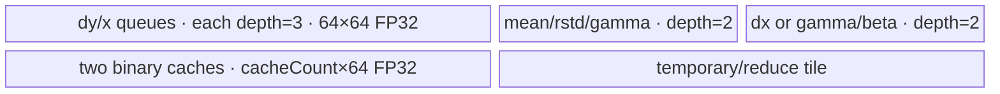

# LayerNormBackward 950 ACLNN 算子知识

## 算子速览

| 项目 | 内容 |
|---|---|
| 实际入口 | `aclnnLayerNormBackwardGetWorkspaceSize` / `aclnnLayerNormBackward`，950 由 `IsRegbase(curArch)` 进入融合 `LayerNormGradV3`。 |
| 计算语义 | 输入折叠为 `(M,N)`；输出逐元素 `dx`，以及沿 M 归约的 `dgamma`、`dbeta`。 |
| 输入输出 | `dy,x:T`，`mean,rstd:FP32`，`gamma:U`；`T∈{FP32,FP16,BF16}`，`U=T 或 FP32`；ND。 |
| 执行类型 | 单 Kernel、AIV_VECTOR；entry 虽声明 `KERNEL_TYPE_MIX_AIV_1_0`，可达实现只有 RegBase Vector，没有 Cube/AIC/MIX_CV body。 |
| Kernel 路线 | R-001 GroupedReduceBigM；R-002 GroupedReduceBigN；R-003 Recompute。 |
| 核心资源 | GM、AIV UB 队列/临时区、FP32 寄存器归约缓存、可选跨核 FP32 workspace、`SyncAll`。 |
| 来源闭包 | `source_closed`：ACLNN→L0 `LayerNormGradV3`→950 tiling/POD→APT router→三个实际 body→ascend950 构建接线闭合。 |
| 验证状态 | 已完成源码闭包检查；本次知识提取未执行编译、真机、数值或性能测试。 |

## 接口与语义

### 计算语义

令尾部 `normalizedShape` 的乘积为 `N`，其余前缀乘积为 `M`，`z=(x-mean)*rstd`，`g=dy*gamma`。逐行有 `s1=sum_N(g)`、`s2=sum_N(g*z)`，`dx=(g-(s1+z*s2)/N)*rstd`；逐列有 `dgamma=sum_M(dy*z)`、`dbeta=sum_M(dy)`。三个 POD 标志分别剪枝 `dx`、`dgamma`、`dbeta` 阶段。

### 输入、输出与属性

| 参数 | shape/layout | dtype | 约束、默认值与语义 |
|---|---|---|---|
| `gradOut`, `input` | 相同 ND `[A...,R...]` | 相同 FP32/FP16/BF16 | API 非空，1–8 维；元素数为 `M*N`。 |
| `normalizedShape` | `[R...]` | INT64 array | 长度 1–8，定义 `N`，并匹配 input 尾维。 |
| `mean`, `rstd` | 元素数 M、shape 相同 | API 接受浮点；融合前 Cast 到 FP32 | Kernel 侧固定 FP32。 |
| `weightOptional` | `[R...]` | T 或 FP32 | 空时 `Fill` 为全 1；`biasOptional` 仅校验，不进入梯度公式。 |
| `outputMask` | 长度 3 | bool array | 全 false 时不挂 Kernel；其余情况由 POD 标志剪枝阶段。 |
| `gradInputOut` | 与 input 相同 | T | mask[0] 为真时必需。 |
| `gradWeightOut`, `gradBiasOut` | `[R...]` | T 或 FP32 | 950 内部输出类型跟随 gamma/output 选择；最终 `ViewCopy`。 |

### 入口与版本

固定 Commit 只公开这一个 `aclnnLayerNormBackward` 版本。文档列出 Ascend 950PR/DT；API 的 `IsRegbase(curArch)` 分支选择本目录最新 950 合一实现。BF16/FP16 各覆盖同型 gamma+同型输出、同型 gamma+FP32 输出、FP32 gamma+FP32 输出，FP32 覆盖全 FP32。

## Host/Launcher 执行流程

### 参数校验与前处理

API 先校验 shape、dtype、`normalizedShape`、可选 weight/bias、三个输出与 `outputMask`，将输入转连续；空 weight 用 `Fill` 构造全 1。计算 `M=inputNumel/N`，mean/rstd 转 FP32。950 依据实际 gamma/output 选择 `gradWeightType`，随后创建一个 `LayerNormGradV3` L0 节点。

### 参数、Workspace 与生命周期

L0 的 `LayerNormGradV3` 产出一份 tiling POD、一个 blockDim 和一个用户 workspace。BigM 为 `coreNum*N*2*4+16 MiB`，BigN 为 `coreNum*M*3*4+16 MiB`，Recompute 为 `16 MiB` 保留区。executor 持有连续化、Cast/Fill、融合节点与最终 Cast/ViewCopy，均在传入 stream 上顺序执行；workspace 从启动至节点完成有效。

### 启动图与失败传播

单节点图为 `aclnnLayerNormBackward` → `l0op::LayerNormGradV3` → `layer_norm_grad_v3<<<blockDim>>>`。参数依次为 `dy,x,rstd,mean,gamma,pd_x,pd_gamma,pd_beta,workspace,tiling`。BigM/BigN 设 batch schedule mode 1；Recompute 的 `blockDim=max(gammaBetaBlockDim,backwardBlockDim)`。API 校验、Cast/Fill、tiling、launch 或 ViewCopy 任一步失败均沿 executor 返回；没有第二个 device Kernel 或隐藏跨 stream 边。

## Route 与参数设计

### 分核与资源计算

平台参数来自 AIV core 数、UB 字节数、block 字节数与 FP32 VL。BigM 的 gamma/beta 固定 `mFactor=nFactor=64`，最多用 64 核切 M；BigN 按 N 分核，gamma/beta 的 `mFactor=min(64,M)`，backward 的 `nFactor=(M>16?64:128)`；Recompute 的 gamma/beta 取 `mFactor=min(128,M)`、64 元素 N 基粒度，backward 以 6144 为 N 基块（小 N 时向 FP32 VL 对齐）。所有二分归约参数都由 `FindNearestPower2/GetCacheID` 生成。

### Route 选择

| 顺序 | Route | Key/模板 | 精确选择条件与优先级 | 不适用去向 |
|---:|---|---|---|---|
| 1 | R-001 GroupedReduceBigM | key 600，优先级 5000 | `M>4096 && N<512`，且该模板 UB/缓存 guard 成功 | R-002 |
| 2 | R-002 GroupedReduceBigN | key 700，优先级 6000 | `M<512 && N>8192`，且 gamma/beta 与 backward UB guard 成功 | R-003 |
| 3 | R-003 Recompute | key 500，优先级 7000 | `IsCapable()==true`，且两个阶段的 UB guard 成功 | tiling 失败 |

```text
if M > 4096 and N < 512 and BigM tiling succeeds: key=600
else if M < 512 and N > 8192 and BigN tiling succeeds: key=700
else if Recompute tiling succeeds: key=500
else: GRAPH_PARAM_INVALID
```

### 模板/实现执行矩阵

| Route | key/selector | dtype/shape/platform 完整命中条件 | 执行拓扑与 Kernel 节点 | 实际模板/body | 内存与同步特征 | tail/fallback |
|---|---|---|---|---|---|---|
| R-001 GroupedReduceBigM | 600 | 950 支持 dtype；`M>4096,N<512`；UB/cache guard | 单 AIV Kernel；可选 dx 后，可选 gamma/beta 两阶段 | `InvokeLayerNormGradV3GroupedReduceBigMImpl<DY_TYPE,GAMMA_TYPE,PD_GAMMA_TYPE>` | dx 仅 UB；gamma/beta 每核写两平面 workspace，`SyncAll` 后核 0 归约 | M 余数分给前 `remainder` 核；失败转 R-002 |
| R-002 GroupedReduceBigN | 700 | 950 支持 dtype；`M<512,N>8192`；UB guard | 单 AIV Kernel；可选 gamma/beta 后，可选 dx | `InvokeLayerNormGradV3GroupedReduceBigNImpl<DY_TYPE,GAMMA_TYPE,PD_GAMMA_TYPE>` | gamma/beta N 独占；dx 两个 partial-sum 平面、`SyncAll` 后汇总 | N 主/尾核与 M 尾 tile；失败转 R-003 |
| R-003 Recompute | 500 | 950 支持 dtype；前两路未闭合；UB guard | 单 AIV Kernel；可选 gamma/beta 后，可选 dx | `InvokeLayerNormGradV3RecomputeImpl<DY_TYPE,GAMMA_TYPE,PD_GAMMA_TYPE>` | 不用用户 workspace 中间量；阶段间按需 `SyncAll`/pipe reset | N/M 尾 tile；失败终止 tiling |

### 隐藏性能 Guard

| Guard | Host/Tiling 条件 | Device/资源原因 | 影响 Route | 不满足时去向 | 源码符号 |
|---|---|---|---|---|---|
| BigM UB | `(64*64*6+64*2+64*3+64*cache*2)*4<=UB` | 容纳 dy/x 双三深度、参数/输出、二分 cache | R-001 | R-002 | `GammaBetaKernelTiling` |
| BigM stage2 cache | `cacheBufferCountMainBlock>=mBasicBlockLoopStg2` | 核 0 复用核内二分存活缓存归约核间结果 | R-001 | R-002 | `GammaBetaKernelTiling` |
| BigN gamma/beta UB | `nFactorMax>=blockSize/2` | N tile 至少满足半精度 block 粒度并容纳缓存 | R-002 | R-003 | `GammaBetaKernelTiling` |
| BigN backward UB | `mFactorAlignedMax>0` | 9 份 tile、参数/输出和二分 cache 必须进 UB | R-002 | R-003 | `BackwardKernelTiling` |
| Recompute gamma/beta UB | `nFactorMax>=64` | 保证 64 元素 N 基块 | R-003 | 失败 | `GammaBetaKernelTiling` |
| Recompute backward UB | `backwardMFactorMax>0` | 7 份数据 tile、参数/cache/fold 区闭合 | R-003 | 失败 | `BackwardKernelTiling` |

### POD/ABI

POD 由 `BEGIN_TILING_DATA_DEF/REGISTER_TILING_DATA_CLASS` 宏定义；字段声明顺序与源码类型可见，但固定仓没有展开宏后的 `sizeof/alignof/offsetof`，因此不推测 padding 或数值 offset。

| 结构 | 字段 | 类型/位宽 | ABI 布局 | 单位 | Host/launcher producer | Device consumer | 边界 |
|---|---|---|---|---|---|---|---|
| `LayerNormGradV3TilingDataGroupedReduceBigM` | `row` | int64/64 | 宏序列化顺序；offset 不可见 | element | `DoOpTiling`: `td_.set_row` | BigM entry/body | 正 shape |
| 同上 | `col` | int64/64 | 宏序列化顺序；offset 不可见 | element | `DoOpTiling`: `td_.set_col` | BigM entry/body | 正 shape |
| 同上 | `gammaBetaUsableBlocks` | int64/64 | 宏序列化顺序；offset 不可见 | core | `GammaBetaKernelTiling`: `td_.set_gammaBetaUsableBlocks` | BigM entry/body | `<=coreNum` |
| 同上 | `gammaBetaMPerBlock` | int64/64 | 宏序列化顺序；offset 不可见 | element | `GammaBetaKernelTiling`: `td_.set_gammaBetaMPerBlock` | BigM entry/body | 资源 guard 后有效 |
| 同上 | `gammaBetaMReminder` | int64/64 | 宏序列化顺序；offset 不可见 | element | `GammaBetaKernelTiling`: `td_.set_gammaBetaMReminder` | BigM entry/body | 资源 guard 后有效 |
| 同上 | `gammaBetaNloop` | int64/64 | 宏序列化顺序；offset 不可见 | loop/count | `GammaBetaKernelTiling`: `td_.set_gammaBetaNloop` | BigM entry/body | 资源 guard 后有效 |
| 同上 | `gammaBetaNtail` | int64/64 | 宏序列化顺序；offset 不可见 | element | `GammaBetaKernelTiling`: `td_.set_gammaBetaNtail` | BigM entry/body | 资源 guard 后有效 |
| 同上 | `gammaBetaMfactorBlockAligned` | int64/64 | 宏序列化顺序；offset 不可见 | element | `GammaBetaKernelTiling`: `td_.set_gammaBetaMfactorBlockAligned` | BigM entry/body | 资源 guard 后有效 |
| 同上 | `gammaBetaNfactorBlockAligned` | int64/64 | 宏序列化顺序；offset 不可见 | element | `GammaBetaKernelTiling`: `td_.set_gammaBetaNfactorBlockAligned` | BigM entry/body | 资源 guard 后有效 |
| 同上 | `gammabetaMToProcessMainBlock` | int64/64 | 宏序列化顺序；offset 不可见 | element | `GammaBetaKernelTiling`: `td_.set_gammabetaMToProcessMainBlock` | BigM entry/body | 资源 guard 后有效 |
| 同上 | `gammabetaMLoopMainBlock` | int64/64 | 宏序列化顺序；offset 不可见 | loop/count | `GammaBetaKernelTiling`: `td_.set_gammabetaMLoopMainBlock` | BigM entry/body | 资源 guard 后有效 |
| 同上 | `gammabetaMTotalLoopMainBlock` | int64/64 | 宏序列化顺序；offset 不可见 | loop/count | `GammaBetaKernelTiling`: `td_.set_gammabetaMTotalLoopMainBlock` | BigM entry/body | 资源 guard 后有效 |
| 同上 | `gammabetaMTailMainBlock` | int64/64 | 宏序列化顺序；offset 不可见 | loop/count | `GammaBetaKernelTiling`: `td_.set_gammabetaMTailMainBlock` | BigM entry/body | 资源 guard 后有效 |
| 同上 | `gammabetaBasicBlockLoopMainBlock` | int64/64 | 宏序列化顺序；offset 不可见 | loop/count | `GammaBetaKernelTiling`: `td_.set_gammabetaBasicBlockLoopMainBlock` | BigM entry/body | 资源 guard 后有效 |
| 同上 | `gammabetaMainFoldCountMainBlock` | int64/64 | 宏序列化顺序；offset 不可见 | loop/count | `GammaBetaKernelTiling`: `td_.set_gammabetaMainFoldCountMainBlock` | BigM entry/body | 资源 guard 后有效 |
| 同上 | `gammabetaCacheBufferCountMainBlock` | int64/64 | 宏序列化顺序；offset 不可见 | loop/count | `GammaBetaKernelTiling`: `td_.set_gammabetaCacheBufferCountMainBlock` | BigM entry/body | 资源 guard 后有效 |
| 同上 | `gammabetaResultCacheIDMainBlock` | int64/64 | 宏序列化顺序；offset 不可见 | cache id | `GammaBetaKernelTiling`: `td_.set_gammabetaResultCacheIDMainBlock` | BigM entry/body | 二分树导出 |
| 同上 | `gammabetaMToProcessTailBlock` | int64/64 | 宏序列化顺序；offset 不可见 | element | `GammaBetaKernelTiling`: `td_.set_gammabetaMToProcessTailBlock` | BigM entry/body | 资源 guard 后有效 |
| 同上 | `gammabetaMLoopTailBlock` | int64/64 | 宏序列化顺序；offset 不可见 | loop/count | `GammaBetaKernelTiling`: `td_.set_gammabetaMLoopTailBlock` | BigM entry/body | 资源 guard 后有效 |
| 同上 | `gammabetaMTotalLoopTailBlock` | int64/64 | 宏序列化顺序；offset 不可见 | loop/count | `GammaBetaKernelTiling`: `td_.set_gammabetaMTotalLoopTailBlock` | BigM entry/body | 资源 guard 后有效 |
| 同上 | `gammabetaMTailTailBlock` | int64/64 | 宏序列化顺序；offset 不可见 | loop/count | `GammaBetaKernelTiling`: `td_.set_gammabetaMTailTailBlock` | BigM entry/body | 资源 guard 后有效 |
| 同上 | `gammabetaBasicBlockLoopTailBlock` | int64/64 | 宏序列化顺序；offset 不可见 | loop/count | `GammaBetaKernelTiling`: `td_.set_gammabetaBasicBlockLoopTailBlock` | BigM entry/body | 资源 guard 后有效 |
| 同上 | `gammabetaMainFoldCountTailBlock` | int64/64 | 宏序列化顺序；offset 不可见 | loop/count | `GammaBetaKernelTiling`: `td_.set_gammabetaMainFoldCountTailBlock` | BigM entry/body | 资源 guard 后有效 |
| 同上 | `gammabetaCacheBufferCountTailBlock` | int64/64 | 宏序列化顺序；offset 不可见 | loop/count | `GammaBetaKernelTiling`: `td_.set_gammabetaCacheBufferCountTailBlock` | BigM entry/body | 资源 guard 后有效 |
| 同上 | `gammabetaResultCacheIDTailBlock` | int64/64 | 宏序列化顺序；offset 不可见 | cache id | `GammaBetaKernelTiling`: `td_.set_gammabetaResultCacheIDTailBlock` | BigM entry/body | 二分树导出 |
| 同上 | `gammaBetaMTailStg2` | int64/64 | 宏序列化顺序；offset 不可见 | loop/count | `GammaBetaKernelTiling`: `td_.set_gammaBetaMTailStg2` | BigM entry/body | 资源 guard 后有效 |
| 同上 | `gammaBetaMBasicBlockLoopStg2` | int64/64 | 宏序列化顺序；offset 不可见 | loop/count | `GammaBetaKernelTiling`: `td_.set_gammaBetaMBasicBlockLoopStg2` | BigM entry/body | 资源 guard 后有效 |
| 同上 | `gammaBetaMMainFoldCountStg2` | int64/64 | 宏序列化顺序；offset 不可见 | loop/count | `GammaBetaKernelTiling`: `td_.set_gammaBetaMMainFoldCountStg2` | BigM entry/body | 资源 guard 后有效 |
| 同上 | `gammaBetaMResultCacheIDStg2` | int64/64 | 宏序列化顺序；offset 不可见 | cache id | `GammaBetaKernelTiling`: `td_.set_gammaBetaMResultCacheIDStg2` | BigM entry/body | 二分树导出 |
| 同上 | `pdxIsRequire` | int32/32 | 宏序列化顺序；offset 不可见 | boolean | `DoOpTiling`: `td_.set_pdxIsRequire` | BigM entry/body | 0/1 |
| 同上 | `pdgammaIsRequire` | int32/32 | 宏序列化顺序；offset 不可见 | boolean | `DoOpTiling`: `td_.set_pdgammaIsRequire` | BigM entry/body | 0/1 |
| 同上 | `pdbetaIsRequire` | int32/32 | 宏序列化顺序；offset 不可见 | boolean | `DoOpTiling`: `td_.set_pdbetaIsRequire` | BigM entry/body | 0/1 |
| `LayerNormGradV3TilingDataGroupedReduceBigN` | `row` | int64/64 | 宏序列化顺序；offset 不可见 | element | `DoOpTiling`: `td_.set_row` | BigN entry/body | 正 shape |
| 同上 | `col` | int64/64 | 宏序列化顺序；offset 不可见 | element | `DoOpTiling`: `td_.set_col` | BigN entry/body | 正 shape |
| 同上 | `gammaBetaMainBlockFactor` | int64/64 | 宏序列化顺序；offset 不可见 | element | `GammaBetaKernelTiling`: `td_.set_gammaBetaMainBlockFactor` | BigN entry/body | 资源 guard 后有效 |
| 同上 | `gammaBetaBlockDim` | int64/64 | 宏序列化顺序；offset 不可见 | core | `GammaBetaKernelTiling`: `td_.set_gammaBetaBlockDim` | BigN entry/body | `<=coreNum` |
| 同上 | `gammaBetaNloopMainBlock` | int64/64 | 宏序列化顺序；offset 不可见 | loop/count | `GammaBetaKernelTiling`: `td_.set_gammaBetaNloopMainBlock` | BigN entry/body | 资源 guard 后有效 |
| 同上 | `gammaBetaNtailMainBlock` | int64/64 | 宏序列化顺序；offset 不可见 | loop/count | `GammaBetaKernelTiling`: `td_.set_gammaBetaNtailMainBlock` | BigN entry/body | 资源 guard 后有效 |
| 同上 | `gammaBetaNloopTailBlock` | int64/64 | 宏序列化顺序；offset 不可见 | loop/count | `GammaBetaKernelTiling`: `td_.set_gammaBetaNloopTailBlock` | BigN entry/body | 资源 guard 后有效 |
| 同上 | `gammaBetaNtailTailBlock` | int64/64 | 宏序列化顺序；offset 不可见 | loop/count | `GammaBetaKernelTiling`: `td_.set_gammaBetaNtailTailBlock` | BigN entry/body | 资源 guard 后有效 |
| 同上 | `gammaBetaMtail` | int64/64 | 宏序列化顺序；offset 不可见 | element | `GammaBetaKernelTiling`: `td_.set_gammaBetaMtail` | BigN entry/body | 资源 guard 后有效 |
| 同上 | `gammaBetaBasicBlockLoop` | int64/64 | 宏序列化顺序；offset 不可见 | loop/count | `GammaBetaKernelTiling`: `td_.set_gammaBetaBasicBlockLoop` | BigN entry/body | 资源 guard 后有效 |
| 同上 | `gammaBetaMainFoldCount` | int64/64 | 宏序列化顺序；offset 不可见 | loop/count | `GammaBetaKernelTiling`: `td_.set_gammaBetaMainFoldCount` | BigN entry/body | 资源 guard 后有效 |
| 同上 | `gammaBetaCacheBufferCount` | int64/64 | 宏序列化顺序；offset 不可见 | loop/count | `GammaBetaKernelTiling`: `td_.set_gammaBetaCacheBufferCount` | BigN entry/body | 资源 guard 后有效 |
| 同上 | `gammaBetaResultCacheID` | int64/64 | 宏序列化顺序；offset 不可见 | cache id | `GammaBetaKernelTiling`: `td_.set_gammaBetaResultCacheID` | BigN entry/body | 二分树导出 |
| 同上 | `gammaBetaNfactor` | int64/64 | 宏序列化顺序；offset 不可见 | element | `GammaBetaKernelTiling`: `td_.set_gammaBetaNfactor` | BigN entry/body | 资源 guard 后有效 |
| 同上 | `gammaBetaMfactor` | int64/64 | 宏序列化顺序；offset 不可见 | element | `GammaBetaKernelTiling`: `td_.set_gammaBetaMfactor` | BigN entry/body | 资源 guard 后有效 |
| 同上 | `backwardBlockDim` | int64/64 | 宏序列化顺序；offset 不可见 | core | `BackwardKernelTiling`: `td_.set_backwardBlockDim` | BigN entry/body | `<=coreNum` |
| 同上 | `backwardNPerBlock` | int64/64 | 宏序列化顺序；offset 不可见 | element | `BackwardKernelTiling`: `td_.set_backwardNPerBlock` | BigN entry/body | 资源 guard 后有效 |
| 同上 | `backwardNRem` | int64/64 | 宏序列化顺序；offset 不可见 | element | `BackwardKernelTiling`: `td_.set_backwardNRem` | BigN entry/body | 资源 guard 后有效 |
| 同上 | `nToProcessMain` | int64/64 | 宏序列化顺序；offset 不可见 | element | `BackwardKernelTiling`: `td_.set_nToProcessMain` | BigN entry/body | 资源 guard 后有效 |
| 同上 | `nToProcessTail` | int64/64 | 宏序列化顺序；offset 不可见 | element | `BackwardKernelTiling`: `td_.set_nToProcessTail` | BigN entry/body | 资源 guard 后有效 |
| 同上 | `backwardMTotalLoop` | int64/64 | 宏序列化顺序；offset 不可见 | loop/count | `BackwardKernelTiling`: `td_.set_backwardMTotalLoop` | BigN entry/body | 资源 guard 后有效 |
| 同上 | `backwardMtail` | int64/64 | 宏序列化顺序；offset 不可见 | element | `BackwardKernelTiling`: `td_.set_backwardMtail` | BigN entry/body | 资源 guard 后有效 |
| 同上 | `backwardNloopMain` | int64/64 | 宏序列化顺序；offset 不可见 | loop/count | `BackwardKernelTiling`: `td_.set_backwardNloopMain` | BigN entry/body | 资源 guard 后有效 |
| 同上 | `backwardNtailMain` | int64/64 | 宏序列化顺序；offset 不可见 | loop/count | `BackwardKernelTiling`: `td_.set_backwardNtailMain` | BigN entry/body | 资源 guard 后有效 |
| 同上 | `backwardBasicBlockLoopMain` | int64/64 | 宏序列化顺序；offset 不可见 | loop/count | `BackwardKernelTiling`: `td_.set_backwardBasicBlockLoopMain` | BigN entry/body | 资源 guard 后有效 |
| 同上 | `backwardMainFoldCountMain` | int64/64 | 宏序列化顺序；offset 不可见 | loop/count | `BackwardKernelTiling`: `td_.set_backwardMainFoldCountMain` | BigN entry/body | 资源 guard 后有效 |
| 同上 | `backwardNfactorBlockAligned` | int64/64 | 宏序列化顺序；offset 不可见 | element | `BackwardKernelTiling`: `td_.set_backwardNfactorBlockAligned` | BigN entry/body | 资源 guard 后有效 |
| 同上 | `backwardMfactor` | int64/64 | 宏序列化顺序；offset 不可见 | element | `BackwardKernelTiling`: `td_.set_backwardMfactor` | BigN entry/body | 资源 guard 后有效 |
| 同上 | `backwardMfactorBlockAligned` | int64/64 | 宏序列化顺序；offset 不可见 | element | `BackwardKernelTiling`: `td_.set_backwardMfactorBlockAligned` | BigN entry/body | 资源 guard 后有效 |
| 同上 | `backwardCacheBufferCountMain` | int64/64 | 宏序列化顺序；offset 不可见 | loop/count | `BackwardKernelTiling`: `td_.set_backwardCacheBufferCountMain` | BigN entry/body | 资源 guard 后有效 |
| 同上 | `backwardResultCacheIDMain` | int64/64 | 宏序列化顺序；offset 不可见 | cache id | `BackwardKernelTiling`: `td_.set_backwardResultCacheIDMain` | BigN entry/body | 二分树导出 |
| 同上 | `backwardNloopTail` | int64/64 | 宏序列化顺序；offset 不可见 | element | `BackwardKernelTiling`: `td_.set_backwardNloopTail` | BigN entry/body | 资源 guard 后有效 |
| 同上 | `backwardNtailTail` | int64/64 | 宏序列化顺序；offset 不可见 | element | `BackwardKernelTiling`: `td_.set_backwardNtailTail` | BigN entry/body | 资源 guard 后有效 |
| 同上 | `backwardBasicBlockLoopTail` | int64/64 | 宏序列化顺序；offset 不可见 | element | `BackwardKernelTiling`: `td_.set_backwardBasicBlockLoopTail` | BigN entry/body | 资源 guard 后有效 |
| 同上 | `backwardMainFoldCountTail` | int64/64 | 宏序列化顺序；offset 不可见 | element | `BackwardKernelTiling`: `td_.set_backwardMainFoldCountTail` | BigN entry/body | 资源 guard 后有效 |
| 同上 | `backwardCacheBufferCountTail` | int64/64 | 宏序列化顺序；offset 不可见 | element | `BackwardKernelTiling`: `td_.set_backwardCacheBufferCountTail` | BigN entry/body | 资源 guard 后有效 |
| 同上 | `backwardResultCacheIDTail` | int64/64 | 宏序列化顺序；offset 不可见 | element | `BackwardKernelTiling`: `td_.set_backwardResultCacheIDTail` | BigN entry/body | 二分树导出 |
| 同上 | `pdxIsRequire` | int32/32 | 宏序列化顺序；offset 不可见 | boolean | `DoOpTiling`: `td_.set_pdxIsRequire` | BigN entry/body | 0/1 |
| 同上 | `pdgammaIsRequire` | int32/32 | 宏序列化顺序；offset 不可见 | boolean | `DoOpTiling`: `td_.set_pdgammaIsRequire` | BigN entry/body | 0/1 |
| 同上 | `pdbetaIsRequire` | int32/32 | 宏序列化顺序；offset 不可见 | boolean | `DoOpTiling`: `td_.set_pdbetaIsRequire` | BigN entry/body | 0/1 |
| `LayerNormGradV3TilingDataRecompute` | `row` | int64/64 | 宏序列化顺序；offset 不可见 | element | `DoOpTiling`: `td_.set_row` | Recompute entry/body | 正 shape |
| 同上 | `col` | int64/64 | 宏序列化顺序；offset 不可见 | element | `DoOpTiling`: `td_.set_col` | Recompute entry/body | 正 shape |
| 同上 | `gammaBetaMainBlockFactor` | int64/64 | 宏序列化顺序；offset 不可见 | element | `GammaBetaKernelTiling`: `td_.set_gammaBetaMainBlockFactor` | Recompute entry/body | 资源 guard 后有效 |
| 同上 | `gammaBetaNloopMainBlock` | int64/64 | 宏序列化顺序；offset 不可见 | loop/count | `GammaBetaKernelTiling`: `td_.set_gammaBetaNloopMainBlock` | Recompute entry/body | 资源 guard 后有效 |
| 同上 | `gammaBetaNtailMainBlock` | int64/64 | 宏序列化顺序；offset 不可见 | loop/count | `GammaBetaKernelTiling`: `td_.set_gammaBetaNtailMainBlock` | Recompute entry/body | 资源 guard 后有效 |
| 同上 | `gammaBetaNloopTailBlock` | int64/64 | 宏序列化顺序；offset 不可见 | loop/count | `GammaBetaKernelTiling`: `td_.set_gammaBetaNloopTailBlock` | Recompute entry/body | 资源 guard 后有效 |
| 同上 | `gammaBetaNtailTailBlock` | int64/64 | 宏序列化顺序；offset 不可见 | loop/count | `GammaBetaKernelTiling`: `td_.set_gammaBetaNtailTailBlock` | Recompute entry/body | 资源 guard 后有效 |
| 同上 | `gammaBetaMtail` | int64/64 | 宏序列化顺序；offset 不可见 | element | `GammaBetaKernelTiling`: `td_.set_gammaBetaMtail` | Recompute entry/body | 资源 guard 后有效 |
| 同上 | `gammaBetaBasicBlockLoop` | int64/64 | 宏序列化顺序；offset 不可见 | loop/count | `GammaBetaKernelTiling`: `td_.set_gammaBetaBasicBlockLoop` | Recompute entry/body | 资源 guard 后有效 |
| 同上 | `gammaBetaMainFoldCount` | int64/64 | 宏序列化顺序；offset 不可见 | loop/count | `GammaBetaKernelTiling`: `td_.set_gammaBetaMainFoldCount` | Recompute entry/body | 资源 guard 后有效 |
| 同上 | `backwardMainBlockFactor` | int64/64 | 宏序列化顺序；offset 不可见 | element | `BackwardKernelTiling`: `td_.set_backwardMainBlockFactor` | Recompute entry/body | 资源 guard 后有效 |
| 同上 | `backwardMainBlockCount` | int64/64 | 宏序列化顺序；offset 不可见 | loop/count | `BackwardKernelTiling`: `td_.set_backwardMainBlockCount` | Recompute entry/body | 资源 guard 后有效 |
| 同上 | `backwardTailBlockCount` | int64/64 | 宏序列化顺序；offset 不可见 | loop/count | `BackwardKernelTiling`: `td_.set_backwardTailBlockCount` | Recompute entry/body | 资源 guard 后有效 |
| 同上 | `backwardTailBlockFactor` | int64/64 | 宏序列化顺序；offset 不可见 | element | `BackwardKernelTiling`: `td_.set_backwardTailBlockFactor` | Recompute entry/body | 资源 guard 后有效 |
| 同上 | `backwardMLoopMain` | int64/64 | 宏序列化顺序；offset 不可见 | loop/count | `BackwardKernelTiling`: `td_.set_backwardMLoopMain` | Recompute entry/body | 资源 guard 后有效 |
| 同上 | `backwardMLoopTail` | int64/64 | 宏序列化顺序；offset 不可见 | element | `BackwardKernelTiling`: `td_.set_backwardMLoopTail` | Recompute entry/body | 资源 guard 后有效 |
| 同上 | `backwardMLoopTailTail` | int64/64 | 宏序列化顺序；offset 不可见 | element | `BackwardKernelTiling`: `td_.set_backwardMLoopTailTail` | Recompute entry/body | 资源 guard 后有效 |
| 同上 | `backwardMTailTail` | int64/64 | 宏序列化顺序；offset 不可见 | element | `BackwardKernelTiling`: `td_.set_backwardMTailTail` | Recompute entry/body | 资源 guard 后有效 |
| 同上 | `backwardNLoopMain` | int64/64 | 宏序列化顺序；offset 不可见 | loop/count | `BackwardKernelTiling`: `td_.set_backwardNLoopMain` | Recompute entry/body | 资源 guard 后有效 |
| 同上 | `backwardNTotalLoopMain` | int64/64 | 宏序列化顺序；offset 不可见 | loop/count | `BackwardKernelTiling`: `td_.set_backwardNTotalLoopMain` | Recompute entry/body | 资源 guard 后有效 |
| 同上 | `backwardNLoopTail` | int64/64 | 宏序列化顺序；offset 不可见 | element | `BackwardKernelTiling`: `td_.set_backwardNLoopTail` | Recompute entry/body | 资源 guard 后有效 |
| 同上 | `backwardBasicBlockLoop` | int64/64 | 宏序列化顺序；offset 不可见 | loop/count | `BackwardKernelTiling`: `td_.set_backwardBasicBlockLoop` | Recompute entry/body | 资源 guard 后有效 |
| 同上 | `backwardMainFoldCount` | int64/64 | 宏序列化顺序；offset 不可见 | loop/count | `BackwardKernelTiling`: `td_.set_backwardMainFoldCount` | Recompute entry/body | 资源 guard 后有效 |
| 同上 | `backwardNfactorBlockAligned` | int64/64 | 宏序列化顺序；offset 不可见 | element | `BackwardKernelTiling`: `td_.set_backwardNfactorBlockAligned` | Recompute entry/body | 资源 guard 后有效 |
| 同上 | `backwardMfactorBlockAligned` | int64/64 | 宏序列化顺序；offset 不可见 | element | `BackwardKernelTiling`: `td_.set_backwardMfactorBlockAligned` | Recompute entry/body | 资源 guard 后有效 |
| 同上 | `backwardCeilVLCount` | int64/64 | 宏序列化顺序；offset 不可见 | loop/count | `BackwardKernelTiling`: `td_.set_backwardCeilVLCount` | Recompute entry/body | 资源 guard 后有效 |
| 同上 | `backwardFoldPoint` | int64/64 | 宏序列化顺序；offset 不可见 | loop/count | `BackwardKernelTiling`: `td_.set_backwardFoldPoint` | Recompute entry/body | 资源 guard 后有效 |
| 同上 | `backwardFoldSize` | int64/64 | 宏序列化顺序；offset 不可见 | loop/count | `BackwardKernelTiling`: `td_.set_backwardFoldSize` | Recompute entry/body | 资源 guard 后有效 |
| 同上 | `gammaBetaBlockDim` | int32/32 | 宏序列化顺序；offset 不可见 | core | `GammaBetaKernelTiling`: `td_.set_gammaBetaBlockDim` | Recompute entry/body | `<=coreNum` |
| 同上 | `gammaBetaCacheBufferCount` | int32/32 | 宏序列化顺序；offset 不可见 | loop/count | `GammaBetaKernelTiling`: `td_.set_gammaBetaCacheBufferCount` | Recompute entry/body | 资源 guard 后有效 |
| 同上 | `gammaBetaResultCacheID` | int32/32 | 宏序列化顺序；offset 不可见 | cache id | `GammaBetaKernelTiling`: `td_.set_gammaBetaResultCacheID` | Recompute entry/body | 二分树导出 |
| 同上 | `gammaBetaNfactor` | int32/32 | 宏序列化顺序；offset 不可见 | element | `GammaBetaKernelTiling`: `td_.set_gammaBetaNfactor` | Recompute entry/body | 资源 guard 后有效 |
| 同上 | `gammaBetaMfactor` | int32/32 | 宏序列化顺序；offset 不可见 | element | `GammaBetaKernelTiling`: `td_.set_gammaBetaMfactor` | Recompute entry/body | 资源 guard 后有效 |
| 同上 | `backwardBlockDim` | int32/32 | 宏序列化顺序；offset 不可见 | core | `BackwardKernelTiling`: `td_.set_backwardBlockDim` | Recompute entry/body | `<=coreNum` |
| 同上 | `backwardMfactor` | int32/32 | 宏序列化顺序；offset 不可见 | element | `BackwardKernelTiling`: `td_.set_backwardMfactor` | Recompute entry/body | 资源 guard 后有效 |
| 同上 | `backwardNfactor` | int32/32 | 宏序列化顺序；offset 不可见 | element | `BackwardKernelTiling`: `td_.set_backwardNfactor` | Recompute entry/body | 资源 guard 后有效 |
| 同上 | `backwardCacheBufferCountMain` | int32/32 | 宏序列化顺序；offset 不可见 | loop/count | `BackwardKernelTiling`: `td_.set_backwardCacheBufferCountMain` | Recompute entry/body | 资源 guard 后有效 |
| 同上 | `backwardResultCacheIDMain` | int32/32 | 宏序列化顺序；offset 不可见 | cache id | `BackwardKernelTiling`: `td_.set_backwardResultCacheIDMain` | Recompute entry/body | 二分树导出 |
| 同上 | `pdxIsRequire` | int32/32 | 宏序列化顺序；offset 不可见 | boolean | `DoOpTiling`: `td_.set_pdxIsRequire` | Recompute entry/body | 0/1 |
| 同上 | `pdgammaIsRequire` | int32/32 | 宏序列化顺序；offset 不可见 | boolean | `DoOpTiling`: `td_.set_pdgammaIsRequire` | Recompute entry/body | 0/1 |
| 同上 | `pdbetaIsRequire` | int32/32 | 宏序列化顺序；offset 不可见 | boolean | `DoOpTiling`: `td_.set_pdbetaIsRequire` | Recompute entry/body | 0/1 |

### Route 源码闭包

| Route | Key/selector | Host/Tiling producer | POD/参数 | Kernel entry/router 节点 | Kernel body/直接依赖 | 构建接线 |
|---|---|---|---|---|---|---|
| R-001 BigM | 600 | `layer_norm_grad_v3_grouped_reduce_big_m_tiling.cpp` / `LayerNormGradV3GroupedReduceBigMTiling` | `LayerNormGradV3TilingDataGroupedReduceBigM` | `layer_norm_grad_v3_apt.cpp` / `InvokeLayerNormGradV3GroupedReduceBigMImpl` | `arch35/layer_norm_grad_v3_grouped_reduce_big_m_impl.h` | `layer_norm_grad_v3_def.cpp` / ascend950→`layer_norm_grad_v3_apt` |
| R-002 BigN | 700 | `layer_norm_grad_v3_grouped_reduce_big_n_tiling.cpp` / `LayerNormGradV3GroupedReduceBigNTiling` | `LayerNormGradV3TilingDataGroupedReduceBigN` | `layer_norm_grad_v3_apt.cpp` / `InvokeLayerNormGradV3GroupedReduceBigNImpl` | `arch35/layer_norm_grad_v3_grouped_reduce_big_n_impl.h` | 同上 |
| R-003 Recompute | 500 | `layer_norm_grad_v3_recompute_tiling.cpp` / `LayerNormGradV3RecomputeTiling` | `LayerNormGradV3TilingDataRecompute` | `layer_norm_grad_v3_apt.cpp` / `InvokeLayerNormGradV3RecomputeImpl` | `arch35/layer_norm_grad_v3_recompute_{gamma_beta,backward}_impl.h` | 同上 |

## Kernel 实现

### 公共执行流程

`layer_norm_grad_v3` 读取用户 workspace，按 key 实例化 `T`/`U` 模板。所有输入在 UB/寄存器中转为 FP32，归约与公式计算保持 FP32；BF16/FP16 输出通过 RegBase cast trait 转回，B16→B32 使用 ZEROING，B32→B16 使用 RINT。输出标志可剪枝阶段；同一 entry 内的阶段切换在需要时 `SyncAll`、析构并重建 `TPipe`。没有 AIC/Cube、SIMT、NDDMA 或通信 Kernel。

### Route R-001：GroupedReduceBigM

#### 适用条件

##### 选择证据

| 层级 | 文件 | 符号 | 源码谓词/参数 | 结果/下一跳 |
|---|---|---|---|---|
| API | `op_host/op_api/aclnn_layer_norm_backward.cpp` | `aclnnLayerNormBackwardGetWorkspaceSize` | `IsRegbase(curArch)` | 创建 `LayerNormGradV3` |
| Tiling | `op_host/layer_norm_grad_v3_grouped_reduce_big_m_tiling.cpp` | `IsCapable` | `rowSize>4096 && colSize<512` | 尝试 key 600 |
| Tiling | 同上 | `GammaBetaKernelTiling` | UB 与 stage2 cache guard 成功 | 保存 POD；否则下一模板 |
| Router | `op_kernel/layer_norm_grad_v3_apt.cpp` | `layer_norm_grad_v3` | `TILING_KEY_IS(600)` | `InvokeLayerNormGradV3GroupedReduceBigMImpl` |

#### Device 数据流

##### 函数级调用链

```text
layer_norm_grad_v3(..., key=600)
  -> if pdx: GroupedReduceBigMBackward::Init/Process
  -> if pdgamma||pdbeta: GroupedReduceBigMGammaBeta::Init/Process
       -> per-core stage1 -> workspace planes -> SyncAll -> core0 stage2 -> outputs
```

##### 源码等价伪码

```text
if pdx: each core processes its M rows; reduce N chunks, compute dx, cast/store
if pdgamma or pdbeta:
  each usable core reduces its assigned M rows for every N64 tile
  write partial dgamma at ws[core*N], partial dbeta at ws[(usableBlocks+core)*N]
  SyncAll
  if core==0: binary-reduce usableBlocks partials and store requested outputs
```

#### 内存与数据搬运

##### 资源与搬运表

| 层级/缓冲区 | offset/地址公式 | extent/容量公式 | dtype/layout | producer | consumer | owner/lifetime | 对齐/复用 |
|---|---|---|---|---|---|---|---|
| GM inputs | row/N tile offsets | `M*N`, `M`, `N` | T/U/FP32 ND | API | CopyIn | executor | block 搬运、tail mask |
| UB dy/x queues | local tile | 各 `3*64*64*4` B | FP32 | CopyIn/cast | reduce/formula | core/process | depth 3 |
| UB params/results | local tile | `2*64*4 + 2*64*4` B | FP32 | mean/rstd/gamma、compute | compute/CopyOut | core/process | depth 2 |
| UB binary caches | cache id | `2*cacheCount*64*4` B | FP32 | grouped reduce | grouped reduce | core/process | 两输出独立 |
| workspace gamma | `core*N+n` | `usableBlocks*N*4` B 已用 | FP32 | stage1 | core0 stage2 | launch | 按核平面 |
| workspace beta | `(usableBlocks+core)*N+n` | `usableBlocks*N*4` B 已用 | FP32 | stage1 | core0 stage2 | launch | Host 按 `2*coreNum*N*4` 总容量分配 |

##### 分层内存布局



##### 字节账与复用顺序

```text
gamma_beta_UB = (6*64*64 + 2*64 + 3*64 + 2*cacheCount*64)*4
backward_UB = (9*64*64 + 5*64 + 2*64 + 2*cacheCount*64)*4
workspace_total = coreNum*N*2*4 + 16 MiB
dynamic_ub = N/A
```

| 复用子区 | 写入者 | 读取者/消费点 | 下一次覆盖 | 同步或释放依据 | 安全条件 |
|---|---|---|---|---|---|
| dy/x queue slot | CopyIn | grouped reduce/formula | 下一 tile | queue DeQue/FreeTensor | 消费完再复用 |
| binary cache slot | tile reduce | higher-level fold | 对应 cache id 再写 | fold 依赖顺序 | `GetCacheID` 拓扑一致 |
| workspace partial | stage1 core | core0 stage2 | Kernel 结束 | `SyncAll` | batch mode 同时启动 |

#### 同步、精度与尾块

##### 同步与数值边界表

| 阶段 | primitive/机制 | producer | consumer/等待点 | 保护对象 | 精度/尾块 |
|---|---|---|---|---|---|
| 队列流水 | TQue event | CopyIn/compute | compute/CopyOut | UB slot | FP32 累加；N tail mask |
| 跨核 stage2 | `SyncAll` | 所有 usable core | core0 | 两 workspace 平面 | 固定 core 顺序二分归约 |
| 输出转换 | RegBase cast | FP32 result | GM output | 输出 tile | BF16/FP16 RINT；有效 tail |

#### 关键实现

##### 符号证据表

| 阶段 | 文件 | 符号/模板实例 | 实现事实 |
|---|---|---|---|
| Host/Tiling producer | `op_host/layer_norm_grad_v3_grouped_reduce_big_m_tiling.cpp` | `GammaBetaKernelTiling/GetWorkspaceSize` | 固定 64×64、最多 64 核、两 workspace 平面 |
| Kernel entry/router | `op_kernel/layer_norm_grad_v3_apt.cpp` | `InvokeLayerNormGradV3GroupedReduceBigMImpl<DY_TYPE,GAMMA_TYPE,PD_GAMMA_TYPE>` | 依输出标志启动 dx 与 gamma/beta body |
| Device body/helper | `op_kernel/arch35/layer_norm_grad_v3_grouped_reduce_big_m_impl.h` | `GroupedReduceBigMGammaBeta::Process` | stage1→barrier→core0 stage2 |

### Route R-002：GroupedReduceBigN

#### 适用条件

##### 选择证据

| 层级 | 文件 | 符号 | 源码谓词/参数 | 结果/下一跳 |
|---|---|---|---|---|
| API | `op_host/op_api/aclnn_layer_norm_backward.cpp` | `aclnnLayerNormBackwardGetWorkspaceSize` | RegBase | `LayerNormGradV3` |
| Tiling | `op_host/layer_norm_grad_v3_grouped_reduce_big_n_tiling.cpp` | `IsCapable` | `rowSize<512 && colSize>8192` | 尝试 key 700 |
| Tiling | 同上 | `GammaBetaKernelTiling/BackwardKernelTiling` | 两个 UB guard 均成功 | 保存 POD；否则 R-003 |
| Router | `op_kernel/layer_norm_grad_v3_apt.cpp` | `layer_norm_grad_v3` | `TILING_KEY_IS(700)` | BigN impl |

#### Device 数据流

##### 函数级调用链

```text
layer_norm_grad_v3(..., key=700)
  -> if pdgamma||pdbeta: GroupedReduceBigNGammaBeta::Init/Process
  -> if pdx: pipe reset; GroupedReduceBigNBackward::Init/Process
       -> local N partials -> workspace -> SyncAll -> all-core sum -> dx
```

##### 源码等价伪码

```text
gamma/beta: each core exclusively owns an N range; reduce all M and store outputs
if dx:
  each core owns an N range and reduces local g and g*z per row
  write sum1 to ws[core*M+row], sum2 to ws[(blockDim+core)*M+row]
  SyncAll
  reload every core's two partials for the current M tile, sum them
  compute/store dx for this core's N range
```

#### 内存与数据搬运

##### 资源与搬运表

| 层级/缓冲区 | offset/地址公式 | extent/容量公式 | dtype/layout | producer | consumer | owner/lifetime | 对齐/复用 |
|---|---|---|---|---|---|---|---|
| UB gamma/beta data | N/M tile | `(6mn+2m+3n+2cache*n)*4` B | FP32 | CopyIn/cast | M reduce | core/phase | tile factors from POD |
| UB backward data | N/M tile | `(9mn+9m+2n+2cache*m)*4` B | FP32 | CopyIn/partial reload | sums/dx | core/phase | main/tail cache configs |
| workspace sum1 | `core*M+row` | `backwardBlockDim*M*4` B 已用 | FP32 | local N reduce | final reduce | launch | plane 0 |
| workspace sum2 | `(backwardBlockDim+core)*M+row` | `backwardBlockDim*M*4` B 已用 | FP32 | local N reduce | final reduce | launch | plane 1 |
| workspace reserve | `2*backwardBlockDim*M` 后及 16 MiB | Host 总容量 `coreNum*M*3*4+16 MiB` | `finalSumGM` 仅绑定，固定 body 未读写 | Host | N/A | launch | 不推测用途 |

##### 分层内存布局


##### 字节账与复用顺序

```text
gamma_beta_UB = (6*m*n + 2*m + 3*n + 2*cacheCount*n)*4
backward_UB = (9*m*n + 9*m + 2*n + 2*cacheCount*m)*4
workspace_total = coreNum*M*3*4 + 16 MiB
dynamic_ub = N/A
```

| 复用子区 | 写入者 | 读取者/消费点 | 下一次覆盖 | 同步或释放依据 | 安全条件 |
|---|---|---|---|---|---|
| queue slots | CopyIn | reduce/formula | 下一 tile | queue events | 有效元素完成 |
| cache slots | N-loop partial | binary fold | cache id 再写 | fold 顺序 | main/tail POD 匹配 |
| partial planes | local N reduce | all-core aggregation | Kernel 结束 | `SyncAll` | `backwardBlockDim` 一致 |

#### 同步、精度与尾块

##### 同步与数值边界表

| 阶段 | primitive/机制 | producer | consumer/等待点 | 保护对象 | 精度/尾块 |
|---|---|---|---|---|---|
| phase reset | `SyncAll` + `TPipe` 重建 | gamma/beta phase | dx phase | UB/pipe 生命周期 | 仅两阶段均存在时需要 |
| dx partial | `SyncAll` | 全部 N-range 核 | final sum | 两 FP32 workspace 平面 | core 余数由 `nRem` 分配 |
| tail | mask/block copy | CopyIn/CopyOut | Vector op/GM | M/N 尾 tile | FP32 accumulate、RINT 输出 |

#### 关键实现

##### 符号证据表

| 阶段 | 文件 | 符号/模板实例 | 实现事实 |
|---|---|---|---|
| Host/Tiling producer | `op_host/layer_norm_grad_v3_grouped_reduce_big_n_tiling.cpp` | `GammaBetaKernelTiling/BackwardKernelTiling` | N 分核、64/128 N factor、M factor 受 UB 限制 |
| Kernel entry/router | `op_kernel/layer_norm_grad_v3_apt.cpp` | `InvokeLayerNormGradV3GroupedReduceBigNImpl<DY_TYPE,GAMMA_TYPE,PD_GAMMA_TYPE>` | gamma/beta 先于 dx；按需 reset pipe |
| Device body/helper | `op_kernel/arch35/layer_norm_grad_v3_grouped_reduce_big_n_impl.h` | `GroupedReduceBigNBackward::Process` | 两 partial 平面、barrier、跨核汇总后算 dx |

### Route R-003：Recompute

#### 适用条件

##### 选择证据

| 层级 | 文件 | 符号 | 源码谓词/参数 | 结果/下一跳 |
|---|---|---|---|---|
| API | `op_host/op_api/aclnn_layer_norm_backward.cpp` | `aclnnLayerNormBackwardGetWorkspaceSize` | RegBase | `LayerNormGradV3` |
| Tiling | `op_host/layer_norm_grad_v3_recompute_tiling.cpp` | `IsCapable` | `return true` | 尝试 key 500 |
| Tiling | 同上 | `GammaBetaKernelTiling/BackwardKernelTiling` | gamma/beta `nFactorMax>=64`；backward `mFactorMax>0` | key 500；否则失败 |
| Router | `op_kernel/layer_norm_grad_v3_apt.cpp` | `layer_norm_grad_v3` | `TILING_KEY_IS(500)` | Recompute impl |

#### Device 数据流

##### 函数级调用链

```text
layer_norm_grad_v3(..., key=500)
  -> if pdgamma||pdbeta: RecomputeGammaBeta::Init/Process
  -> if pdx: optional SyncAll + pipe reset; RecomputeBackward::Init/Process
```

##### 源码等价伪码

```text
gamma/beta: split N among cores; for each N tile reread dy/x over M tiles,
            binary-reduce M and directly store the owned output columns
if dx: split M rows among cores; for each row tile reread dy/x over N chunks,
       reduce s1/s2, then reread/reuse chunks to compute and store dx
```

#### 内存与数据搬运

##### 资源与搬运表

| 层级/缓冲区 | offset/地址公式 | extent/容量公式 | dtype/layout | producer | consumer | owner/lifetime | 对齐/复用 |
|---|---|---|---|---|---|---|---|
| gamma/beta dy/x | M×N tile | each `3*m*n*4` B | FP32 | CopyIn/cast | M reduce | core/phase | depth 3 |
| gamma/beta param/out/temp | tile local | `(2m+3n)*4` B | FP32 | load/compute | reduce/store | core/phase | queues/TBuf |
| gamma/beta cache | cache id | `2*cacheCount*n*4` B | FP32 | fold | fold/output | core/phase | two outputs |
| backward dy/x/dx | M×N tile | `7*m*n*4` B | FP32 | CopyIn/compute | sums/formula/CopyOut | core/phase | dy/x depth3, dx depth1 |
| backward param/cache/fold/gamma | tile local | `(5*m+2*cacheCount*m+m*foldSize+2*n)*4` B | FP32 | load/reduce | dx formula | core/phase | block aligned |
| workspace | user base | 16 MiB | N/A | Host reserve | 固定仓 body 不存中间量 | launch | 保留区 |

##### 分层内存布局


##### 字节账与复用顺序

```text
gamma_beta_UB = (6*m*n + 2*m + 3*n + 2*cacheCount*n)*4
backward_UB = (7*m*n + 5*m + 2*cacheCount*m + m*foldSize + 2*n)*4
workspace_total = 16 MiB
dynamic_ub = N/A
```

| 复用子区 | 写入者 | 读取者/消费点 | 下一次覆盖 | 同步或释放依据 | 安全条件 |
|---|---|---|---|---|---|
| dy/x queue | CopyIn | reduce/formula | 下一 N/M tile | DeQue/FreeTensor | 当前 tile 消费完成 |
| cache | chunk partial | binary fold | cache id 再写 | fold 拓扑 | POD cache count |
| 整体 UB pipe | gamma/beta phase | phase 完成 | backward Init | `SyncAll` 后 pipe 析构/重建 | 两阶段都请求时 |

#### 同步、精度与尾块

##### 同步与数值边界表

| 阶段 | primitive/机制 | producer | consumer/等待点 | 保护对象 | 精度/尾块 |
|---|---|---|---|---|---|
| 阶段切换 | `SyncAll` + pipe reset | gamma/beta | backward | 所有核 phase 与 UB | 按输出标志条件执行 |
| 核内归约 | queue event + binary fold | N/M chunks | dx/output | UB/register cache | FP32；fold/tail 参数来自 POD |
| 输出 | cast trait + mask | FP32 result | GM | 有效 tile | B16 输出 RINT |

#### 关键实现

##### 符号证据表

| 阶段 | 文件 | 符号/模板实例 | 实现事实 |
|---|---|---|---|
| Host/Tiling producer | `op_host/layer_norm_grad_v3_recompute_tiling.cpp` | `GammaBetaKernelTiling/BackwardKernelTiling` | 通用 fallback 的 N/M factors 与 UB guard |
| Kernel entry/router | `op_kernel/layer_norm_grad_v3_apt.cpp` | `InvokeLayerNormGradV3RecomputeImpl<DY_TYPE,GAMMA_TYPE,PD_GAMMA_TYPE>` | 输出阶段剪枝与必要的 barrier/reset |
| Device body/helper | `op_kernel/arch35/layer_norm_grad_v3_recompute_backward_impl.h` | `LayerNormGradV3RecomputeBackward::Process` | 重读 N chunks 完成行归约和 dx |

## 算子特定优化

### Trick T-001：BigM 两级二分归约复用同一缓存规模

#### 触发与源码依据

- 适用 Route：R-001。
- 触发条件：`M>4096 && N<512`，gamma 或 beta 输出被请求，且 Host 的 stage2 cache guard 成功。
- Golden 来源：[`layer_norm_grad_v3_grouped_reduce_big_m_impl.h:125-166`](../../../../../../../cann-ops-raw/ascendc/ops-nn/955f8b33985b6d72989ebff341bb9c2c564a51bc/norm/layer_norm_grad_v3/op_kernel/arch35/layer_norm_grad_v3_grouped_reduce_big_m_impl.h#L125-L166)

**官方源码（固定 Commit 连续逐字摘录）**：

```cpp
    SyncAll();

    if (GetBlockIdx() != 0) {
        return;
    }

    // stage 2: 计算核间累加
    PRELOAD(4);
    postXInTensorGM.SetGlobalBuffer((__gm__ float*)savedWorkspaceAddr + GetBlockIdx() * td_->col);
    postDyInTensorGM.SetGlobalBuffer((__gm__ float*)savedWorkspaceAddr + td_->gammaBetaUsableBlocks * td_->col +
                                     GetBlockIdx() * td_->col);
    pdGammaOutTensorGMStag2.SetGlobalBuffer((__gm__ PD_GAMMA_TYPE*)savedPdGammaAddr);
    pdBetaOutTensorGMStag2.SetGlobalBuffer((__gm__ PD_GAMMA_TYPE*)savedPdBetaAddr);
```

#### 机制与设计原因

每核先把长 M 的局部 dgamma/dbeta 写入独立 workspace 平面，barrier 后仅核 0 做第二级归约。Host 校验第二级二分树不超过第一级已分配的 cache 存活空间，避免另配一套 UB 缓存。

#### 迁移边界

- 适用：长 M、短 N，且全核同步和两平面 workspace 可用的列归约。
- 前提：950 AIV、batch schedule mode、核 0 可读取全部局部平面。
- 失效：stage2 缓存 guard 不满足时交给后续模板。
- 未验证：本次知识提取未执行编译、真机、数值或性能测试。

#### 错误做法

跳过 `SyncAll` 会让核 0 读取未完成的局部平面；源码明确以 barrier 保护该边。

### Trick T-002：BigN 以 N 分核并用两平面合成行归约

#### 触发与源码依据

- 适用 Route：R-002。
- 触发条件：`M<512 && N>8192` 且请求 dx。
- Golden 来源：[`layer_norm_grad_v3_grouped_reduce_big_n_impl.h:207-240`](../../../../../../../cann-ops-raw/ascendc/ops-nn/955f8b33985b6d72989ebff341bb9c2c564a51bc/norm/layer_norm_grad_v3/op_kernel/arch35/layer_norm_grad_v3_grouped_reduce_big_n_impl.h#L207-L240)

**官方源码（固定 Commit 连续逐字摘录）**：

```cpp
            int64_t offset = GetBlockIdx() * td_->row + mi * td_->backwardMfactor;

            LocalTensor<float> outTensor0 = outTmpQueue0.template AllocTensor<float>();
            CopyUB2UB(outTensor0, sum1Tensor, mFactor);
            outTmpQueue0.EnQue(outTensor0);
            outTensor0 = outTmpQueue0.template DeQue<float>();
            CopyOut(partialSum1GM[offset], outTensor0, mFactor);
            outTmpQueue0.FreeTensor(outTensor0);

            LocalTensor<float> outTensor1 = outTmpQueue1.template AllocTensor<float>();
            CopyUB2UB(outTensor1, sum2Tensor, mFactor);
            outTmpQueue1.EnQue(outTensor1);
            outTensor1 = outTmpQueue1.template DeQue<float>();
            CopyOut(partialSum2GM[offset], outTensor1, mFactor);
            outTmpQueue1.FreeTensor(outTensor1);
        }
    }

    SyncAll();
```

#### 机制与设计原因

超长 N 先按列区间分核，核内只生成每行的 `sum(g)` 与 `sum(g*z)` 局部量；两平面 workspace 将它们交换给所有核，汇总后各核仍只写自己的 N 区间，从而没有 dx 写冲突。

#### 迁移边界

- 适用：N 足够长、M 较小且输出 dx。
- 前提：两平面 FP32 workspace、相同 `backwardBlockDim`、全核 barrier。
- 失效：UB 无法容纳最小 M factor 时转 Recompute。
- 未验证：本次知识提取未执行编译、真机、数值或性能测试。

#### 错误做法

只使用本核局部和会遗漏其他 N 区间；在 barrier 前读取 workspace 会产生跨核数据竞争。

## 模板与实现对比

| 对比维度 | R-001 BigM | R-002 BigN | R-003 Recompute | 设计选择依据 |
|---|---|---|---|---|
| 命中条件/优先级 | M>4096,N<512；5000 | M<512,N>8192；6000 | 通用；7000 | 先处理极端轴长，再通用兜底 |
| 模板与 dtype | key600，T/U 七组合 | key700，同左 | key500，同左 | 都使用 FP32 内部计算 |
| 循环与分核 | M 分核，N64 tile | N 分核，M tile | gamma/beta 分 N，dx 分 M | 避免主输出写冲突 |
| Queue/TBuf/寄存器/dynamic UB/通信 window | 固定 64×64、二分 cache；dynamic UB N/A | 动态 M factor、64/128 N factor；dynamic UB N/A | 动态 factor、重算；dynamic UB N/A | 均为 AIV UB/寄存器路径 |
| 内存总占用与复用 | 两平面 N workspace | 三平面 M workspace（body 用前两平面） | 16 MiB 保留区，不存中间量 | 跨核归约才物化 partial |
| 搬运/Vector/SIMT/NDDMA/通信 API | DataCopy、Vector、SyncAll | DataCopy、Vector、SyncAll | DataCopy、Vector、条件 SyncAll | 无 SIMT/NDDMA/Cube |
| 同步、精度与 tail | stage1/2 barrier；FP32；M/N tail | partial barrier；FP32；M/N tail | phase barrier；FP32；M/N tail | B16 输出 RINT |
| fallback/失败边界 | guard 失败→BigN | guard 失败→Recompute | guard 失败→tiling 错误 | selector 优先级固定 |

## 平台差异

| 项目 | A2 | A3 | 950 |
|---|---|---|---|
| 支持状态 | 支持，见无后缀卡 | 支持，见无后缀卡 | 支持，本卡 |
| Host/Launcher | `DAV_2201`，四个非 RegBase 模板 | 同 A2 | `IsRegbase`，三个 950 模板 |
| Kernel/资源 | AIV，确定性 workspace/transpose/common 路径 | 同 A2 | RegBase AIV；按极端 M/N 选择跨核 workspace 或重算 |

## 限制与失败边界

- API 限制为 1–8 维、文档支持的浮点 dtype、匹配的 shape/normalizedShape；不覆盖其他 LayerNorm、Grad、原地或量化语义。
- BigM/BigN 形状谓词命中但资源 guard 失败时 selector 继续后续模板；Recompute 的 UB guard 失败是公开链路的 tiling 终点。
- `M`、`N` 在公共参数中来自元素乘积；固定仓未给出超大 shape 的额外溢出承诺。POD 宏展开后的精确 offset/sizeof 不可见。
- 第三 BigN workspace 平面与默认 16 MiB 保留区的进一步用途在固定 body 中不可见，不推测补齐。
- 本次仅源码静态闭包；未执行编译、真机、数值或性能测试。

## 源码索引

### 链路索引

| 链路阶段 | 文件 | 关键符号 | 支撑内容 |
|---|---|---|---|
| 入口声明/约束 | `norm/layer_norm_grad_v3/docs/aclnnLayerNormBackward.md` | `aclnnLayerNormBackward` | API 语义、dtype、平台 |
| 入口实现 | `norm/layer_norm_grad_v3/op_host/op_api/aclnn_layer_norm_backward.cpp` | `aclnnLayerNormBackwardGetWorkspaceSize` | 校验、连续化、Cast/Fill、RegBase 分流 |
| Host/Tiling | `norm/layer_norm_grad_v3/op_host/op_api/layer_norm_grad_v3.cpp` | `LayerNormGradV3` | 单 L0 节点、三输出 launcher |
| Host/Tiling | `norm/layer_norm_grad_v3/op_host/layer_norm_grad_v3_tiling.cpp` | `LayerNormGradV3TilingBase` | 公共 shape/platform/dtype/输出 flag |
| Host/Tiling | `norm/layer_norm_grad_v3/op_host/layer_norm_grad_v3_tiling.h` | 三个 950 TilingData | POD 定义与模板声明 |
| Host/Tiling | `norm/layer_norm_grad_v3/op_host/layer_norm_grad_v3_grouped_reduce_big_m_tiling.cpp` | `LayerNormGradV3GroupedReduceBigMTiling` | key600、参数、workspace |
| Host/Tiling | `norm/layer_norm_grad_v3/op_host/layer_norm_grad_v3_grouped_reduce_big_n_tiling.cpp` | `LayerNormGradV3GroupedReduceBigNTiling` | key700、参数、workspace |
| Host/Tiling | `norm/layer_norm_grad_v3/op_host/layer_norm_grad_v3_recompute_tiling.cpp` | `LayerNormGradV3RecomputeTiling` | key500、参数、workspace |
| Kernel entry/body | `norm/layer_norm_grad_v3/op_kernel/layer_norm_grad_v3_apt.cpp` | `layer_norm_grad_v3` | 950 key router、输出阶段剪枝 |
| Kernel entry/body | `norm/layer_norm_grad_v3/op_kernel/arch35/layer_norm_grad_v3_base.h` | `LayerNormGradV3Base` | RegBase 搬运、cast 与公共计算 |
| Kernel entry/body | `norm/layer_norm_grad_v3/op_kernel/arch35/layer_norm_grad_v3_grouped_reduce.h` | 四个 GroupedReduce class | BigM/BigN UB queue/TBuf 声明 |
| Kernel entry/body | `norm/layer_norm_grad_v3/op_kernel/arch35/layer_norm_grad_v3_recompute.h` | 两个 Recompute class | Recompute UB queue/TBuf 声明 |
| Kernel entry/body | `norm/layer_norm_grad_v3/op_kernel/arch35/layer_norm_grad_v3_grouped_reduce_big_m_impl.h` | `GroupedReduceBigM*::Process` | BigM 两阶段实现 |
| Kernel entry/body | `norm/layer_norm_grad_v3/op_kernel/arch35/layer_norm_grad_v3_grouped_reduce_big_n_impl.h` | `GroupedReduceBigN*::Process` | BigN 两平面实现 |
| Kernel entry/body | `norm/layer_norm_grad_v3/op_kernel/arch35/layer_norm_grad_v3_recompute_gamma_beta_impl.h` | `RecomputeGammaBeta::Process` | 通用 gamma/beta 重算 |
| Kernel entry/body | `norm/layer_norm_grad_v3/op_kernel/arch35/layer_norm_grad_v3_recompute_backward_impl.h` | `RecomputeBackward::Process` | 通用 backward 重算 |
| 构建接线 | `norm/layer_norm_grad_v3/op_host/layer_norm_grad_v3_def.cpp` | ascend950→`layer_norm_grad_v3_apt` | 950 实现接线 |
| 构建接线 | `norm/layer_norm_grad_v3/op_host/config/ascend950/layer_norm_grad_v3_binary.json` | `LayerNormGradV3` | ascend950 二进制实现登记 |

每行只写一个文件，并确保该文件存在于 Frontmatter `sources`。

### 实现复用检查

| 检查项 | 可复用事实 | 不得改变的约束 | 源码符号 |
|---|---|---|---|
| ABI/POD | 三条 Route 各自 POD 直接供同 key body 使用 | 字段位宽、flag 语义、factor/cache 配对不得重排 | `layer_norm_grad_v3_tiling.h` |
| 调用顺序 | 单 entry 内按 flag 执行阶段 | BigN/Recompute 的 gamma/beta→dx 次序与 pipe reset 不得颠倒 | `layer_norm_grad_v3_apt.cpp` |
| workspace/内存 | BigM 两 N 平面、BigN 两个已用 M 平面、Recompute 无中间平面 | offset、FP32、launch lifetime 与 Host 容量必须一致 | 三个 `GetWorkspaceSize` |
| 同步 | 跨核 partial 由 `SyncAll` 保护 | 不能提前读 workspace 或复用 pipe | BigM/BigN impl |
| 精度与尾块 | FP32 accumulate，B16 输出 RINT，POD 描述主/尾 tile | mask、对齐、有效 extent 不得省略 | `layer_norm_grad_v3_base.h` |
| 失败边界 | 模板按 5000→6000→7000 选择 | shape 谓词与 UB guard 必须一起保留 | 三个 `IsCapable/*KernelTiling` |