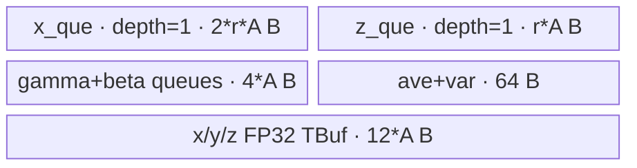

# LayerNormQuant A2/A3 ACLNN 算子知识

## 算子速览

| 项目 | 内容 |
|---|---|
| 实际入口 | `aclnnLayerNormQuantGetWorkspaceSize` + `aclnnLayerNormQuant`，公开 ACLNN、固定仓内唯一版本 |
| 计算语义 | 对尾轴做 LayerNorm，再做静态 int8 量化：`res = clamp(round_or_cast(y / scale + zeroPoint), -128, 127)`；API 实现只接受 `quantMode=0` |
| 输入输出 | `x/gamma/beta/scale` 为 ND、FP16 或 BF16；`zeroPointsOptional/res` 为 INT8；`res.shape=x.shape`；`scaleOut` 在静态模式无有效结果 |
| 执行类型 | 单 Kernel `AIV_VECTOR`；FP16/BF16 × 尾轴整载/分片共四条 Route |
| Kernel 路线 | R-001 FP16 整载；R-002 BF16 整载；R-003 FP16 分片；R-004 BF16 分片 |
| 核心资源 | GM、depth=1 的 `x/z/gamma/beta` TQue、三个 FP32 TBuf、mean/variance TBuf；算子 Kernel 不读写 workspace |
| 来源闭包 | `source_closed`：ACLNN 校验/连续化→L0 launcher→Tiling/POD/key→AIV entry→实际 fast/split body→binary config 均闭合 |
| 验证状态 | 已完成源码闭包检查；本次知识提取未执行编译、真机、数值或性能测试。 |

## 接口与语义

### 计算语义

把 `x` 的最后一维记为 `D`，其余维度展平为 `R` 行。每行先计算 `mean=sum(x)/D`、`variance=sum((x-mean)^2)/D`，再计算 `y=(x-mean)/sqrt(variance+epsilon)*gamma+beta`。公开 ACLNN 在固定实现中强制 `quantMode==0`；Device 读取 `inputScale=scale[0]==0 ? 1 : 1/scale[0]` 与 `inputOffset=float(zeroPointsOptional[0])`，计算 `q=y*inputScale+inputOffset`，以 `CAST_NONE` 从 FP32 降到 FP16，做 `[-128,127]` 饱和，并在 A2/A3 的 CCE220 分支以 `CAST_RINT` 转 INT8。`scaleOut` 虽进入 entry 参数表，但静态 Route 不绑定也不写它。

### 输入、输出与属性

| 参数 | shape/layout | dtype | 约束、默认值与语义 |
|---|---|---|---|
| `x` | ND，1–8 维；允许空 Tensor | FP16/BF16 | A2/A3 公开说明不支持 FP32；空 Tensor 直接返回 workspace 0，不加入算子 launch |
| `gamma` | ND，API 检查最多 2 维，尾维等于 `x` 尾维 | 与 `x` 相同 | 文档要求静态模式 shape 为 `[1,D]`，源码只检查最多 2 维及尾维 |
| `beta` | 与 `gamma` 相同 | 与 `x` 相同 | 源码检查完整 shape 等于 `gamma` |
| `scale` | ND，严格 `[1]` | 与 `x` 相同 | Device 只读第 0 个值；0 被替换为除数 1 |
| `zeroPointsOptional` | ND；静态模式必非空 | INT8 | 文档称 shape 与 scale 相同；源码只检查二者维数相同，Device 只读第 0 个值 |
| `quantMode` | 标量属性 | int | 仅接受 0；头文件曾宣称 0/1，但公开说明与实际 `CheckShape` 均限定 0 |
| `epsilon` | 标量属性 | double→Host float | 默认 `1e-5`；L0 以 `static_cast<float>` 传给算子 |
| `res` | ND，shape 等于 `x` | INT8 | 唯一有效 Device 输出 |
| `scaleOut` | 静态模式分配 shape `[1]` | FP32 | `quantMode=0` 时无实际意义，Kernel 不写 |

### 入口与版本

公开文档列 A2/A3 支持；OpDef 为 `ascend910b`、`ascend910_93` 注册 FP16/BF16，两个平台 binary config 也各含这两种 dtype。固定 Commit 内没有 `aclnnLayerNormQuantV2` 或更高版本，因此提取 `aclnnLayerNormQuant`。`IsRegbaseSocVersion` 只把 `DAV_3510/DAV_5102` 归为 RegBase；A2/A3 使用本卡的 `LayerNormQuantTilingData` 和非 `_apt` entry。API 文件中的 `CheckPlatform()` 未被第一段入口调用，不把它误写成实际校验步骤。

## Host/Launcher 执行流程

### 参数校验与前处理

第一段先创建 executor，再检查 `x/gamma/beta/scale/res` 非空；静态模式还要求 `zeroPointsOptional` 非空。随后检查 dtype、`x` 最多 8 维、`gamma` 最多 2 维、尾维相等、`gamma.shape==beta.shape`、`scale.shape==[1]`、`scale` 与 zero point 的维数相同、`x.shape==res.shape`，并拒绝非 0 `quantMode`。空 `x` 在这些检查后直接释放 executor 给调用方并返回 0 workspace。非空输入依次对五个输入调用框架 `Contiguous`，再调用 L0 `LayerNormQuant`，最后对临时 `res` 做 `ViewCopy`；静态模式不会对临时 `scaleOut` 做 `ViewCopy`。

### 参数、Workspace 与生命周期

L0 分配 INT8 `res[x.shape]` 与 FP32 `scaleOut[1]`，以 `ADD_TO_LAUNCHER_LIST_AICORE` 添加一个 `LayerNormQuant` 节点，输入顺序为 `x,gamma,beta,scale,zeroPoint`，输出顺序为 `res,scaleOut`，属性顺序为 `float(epsilon),quantMode`。Tiling 把唯一算子 workspace slice 设为 `PlatformAscendC::GetLibApiWorkSpaceSize()`；Kernel 的 `workspace` 参数未消费。ACLNN 返回的总 workspace 来自 executor，可能还包含框架 `Contiguous/ViewCopy` 节点，固定算子源码不展开这些框架节点的切片公式。第二段 `CommonOpExecutorRun` 在调用方 stream 上按 executor 顺序执行；workspace 与 executor 必须活到第二段返回。

### 启动图与失败传播

```text
aclnnLayerNormQuantGetWorkspaceSize
  -> Contiguous(x,gamma,beta,scale,zeroPoint)        # 框架边界，可为复制或别名
  -> LayerNormQuant launcher
       -> layer_norm_quant<<<blockDim=numCore>>>(x,gamma,beta,scale,offset,res,scaleOut,workspace,tiling)
  -> ViewCopy(tempRes -> caller res)                 # 框架边界
aclnnLayerNormQuant(workspace, executor, stream)
  -> CommonOpExecutorRun
```

算子节点是单 Kernel，无算子拥有的跨 Kernel GM/workspace 边。launcher、Tiling 或前序框架节点失败会阻断后续节点；具体框架内部 stream/event 与临时 Tensor owner 由 executor 管理，是允许的框架边界。

## Route 与参数设计

### 分核与资源计算

`R=product(x.shape[0:-1])`、`D=x.shape[-1]`，两者均需为正且不超过 uint32 生成边界；`R` 乘法逐维检查溢出。`C=ceil(D/32)*32`。`numCore=ceil(R/ceil(R/maxCore))`，普通核处理 `rowWork=ceil(R/numCore)` 行，末核处理 `R-rowWork*(numCore-1)` 行。Tiling 先按 `(UB-64)` 是否容纳 `21*C` 字节选择整载或分片：不够时 `sliceSize=floor((UB-64)/21, 128)`，并继续每次减 32，直到尾片至少 32 元素；`sliceNum=ceil(D/sliceSize)`。整载时 `sliceSize=C`，再由 `CheckSplit` 产生批行 `firstDimPerTimes`；分片时强制为 1。算子 workspace 为平台 LibApi workspace。

### Route 选择

| 顺序 | Route | Key/模板 | 精确选择条件与优先级 | 不适用去向 |
|---:|---|---|---|---|
| 1 | R-001 FP16 整载 | `2010000000` / `KernelLayerNormQuant<half>` | `x.dtype!=BF16`（公开 A2/A3 即 FP16）且 `sliceNum==1` | dtype/容量决定 R-002/R-003 |
| 2 | R-002 BF16 整载 | `2110000000` / `KernelLayerNormQuant<bfloat16_t>` | `x.dtype==BF16 && sliceNum==1`；body 受 `__CCE_AICORE__==220` guard | 容量不足到 R-004 |
| 3 | R-003 FP16 分片 | `2000000000` / `LayerNormQuantSplitD<half>` | `x.dtype!=BF16 && sliceNum>1` | 非 FP16 到 R-004 |
| 4 | R-004 BF16 分片 | `2100000000` / `LayerNormQuantSplitD<bfloat16_t>` | `x.dtype==BF16 && sliceNum>1`；body 受 `__CCE_AICORE__==220` guard | 不支持则无匹配 body |

```text
if x.dtype == BF16: dtypeOffset=100000000 else: dtypeOffset=0
if sliceNum == 1: fastOffset=10000000 else: fastOffset=0
key = 2000000000 + dtypeOffset + fastOffset
```

### 模板/实现执行矩阵

| Route | key/selector | dtype/shape/platform 完整命中条件 | 执行拓扑与 Kernel 节点 | 实际模板/body | 内存与同步特征 | tail/fallback |
|---|---|---|---|---|---|---|
| R-001 | 2010000000 | FP16，A2/A3，`sliceNum=1` | 单 AIV | `KernelLayerNormQuant<half>::Process` | 多行整载；MTE2↔V、V↔S flags | 最后核/最后批由 `row_tail_` |
| R-002 | 2110000000 | BF16，A2/A3，`sliceNum=1` | 单 AIV | `KernelLayerNormQuant<bfloat16_t>::Process` | 同上；输入升 FP32，量化临时量仍显式为 half | 同上 |
| R-003 | 2000000000 | FP16，A2/A3，`sliceNum>1` | 单 AIV | `LayerNormQuantSplitD<half>::Process` | 每行三遍分片：mean、SSD、输出 | `tailSliceSize` |
| R-004 | 2100000000 | BF16，A2/A3，`sliceNum>1` | 单 AIV | `LayerNormQuantSplitD<bfloat16_t>::Process` | 同上；量化临时量显式为 half | `tailSliceSize` |

### 隐藏性能 Guard

| Guard | Host/Tiling 条件 | Device/资源原因 | 影响 Route | 不满足时去向 | 源码符号 |
|---|---|---|---|---|---|
| 整载容量 | `UB-64 >= 21*C` | 容纳单行三 FP32、两 FP16、批行 x/z 与标量区 | R-001/R-002 | 分片 Route | `LayerNormQuantTiling::GetTilingSliceInfo` |
| slice repeat | `sliceSize=floor((UB-64)/21,128)` | FP16 Vector repeat 粒度 256 B/2 B | R-003/R-004 | `elementSize` 为 0 会使后续除法不可用；源码无显式单独 guard |
| tail DMA | 分片循环将 `tailSize` 调到至少 32 元素 | 非 220 `DataCopyEx` 的 GM tail 回写需要最后一个 32-byte block | 分片 | 继续 `elementSize-=32` | `GetTilingSliceInfo`; `DataCopyEx` |
| BF16 body guard | `__CCE_KT_TEST__ \|\| __CCE_AICORE__==220` | entry 只在该 guard 内实例化 BF16 | R-002/R-004 | 无 BF16 body | `layer_norm_quant` |
| shape 窄化 | `R,D<=UINT_MAX` 且行乘法不溢出 | POD 字段为 uint32 | 全部 | `GRAPH_FAILED` | `PostLayerNormPtrFunc` |

### POD/ABI

`BEGIN_TILING_DATA_DEF` 的宏展开定义不在固定仓内；下表给出源码可见字段顺序与标量宽度，`sizeof/alignof/offsetof` 不能在不编译的前提下从该仓精确确认。

| 结构 | 字段 | 类型/位宽 | ABI 布局 | 单位 | Host/launcher producer | Device consumer | 边界 |
|---|---|---|---|---|---|---|---|
| `LayerNormQuantTilingData` | `numCore` | uint32/32 | 第 1 字段；精确 offset 不可见 | core | `PostLayerNormPtrFunc` | `Init` 末核判断 | `1..maxCore` |
| 同上 | `numLastDim` | uint32/32 | 第 2 字段 | element | 同上 | 地址、Vector count | `1..UINT_MAX` |
| 同上 | `numFirstDim` | uint32/32 | 第 3 字段 | row | 同上 | body 不读取 | inactive |
| 同上 | `colsAligned` | uint32/32 | 第 4 字段 | element | `GetTilingBasicInfo` | fast 输出行距 | `ceil(D/32)*32` |
| 同上 | `nlFirstdimPerCore` | uint32/32 | 第 5 字段 | row/core | `PostLayerNormPtrFunc` | GM base、普通核行数 | 非末核 |
| 同上 | `lFirstdimPerCore` | uint32/32 | 第 6 字段 | row | 同上 | 末核行数 | 末核 |
| 同上 | `firstDimPerTimes` | uint32/32 | 第 7 字段 | row/batch | `CheckSplit` 或置 1 | fast `row_step`；split 置 1 | 至少 1 |
| 同上 | `epsStr` | float/32 | 第 8 字段 | scalar | `attrs[0]` | variance | double 已窄化 |
| 同上 | `aveStr` | float/32 | 第 9 字段 | 1/element | `1.0/D` | mean/variance | FP32 |
| 同上 | `sliceNum` | uint32/32 | 第 10 字段 | slice | `GetTilingSliceInfo` | split 循环 | fast=1 |
| 同上 | `sliceSize` | uint32/32 | 第 11 字段 | element | 同上 | UB/DMA | 非尾片 |
| 同上 | `tailSliceSize` | uint32/32 | 第 12 字段 | element | 同上 | 尾片 | `1..sliceSize`，Tiling 尽量保证≥32 |

### Route 源码闭包

| Route | Key/selector | Host/Tiling producer | POD/参数 | Kernel entry/router 节点 | Kernel body/直接依赖 | 构建接线 |
|---|---|---|---|---|---|---|
| R-001 | 2010000000 | `layer_norm_quant_tiling.cpp::startTiling` | `LayerNormQuantTilingData` | `layer_norm_quant.cpp::layer_norm_quant` | `layer_norm_quant_normal.h::KernelLayerNormQuant<half>` + helper | `ascend910b/layer_norm_quant_binary.json`; `ascendc_config.json` |
| R-002 | 2110000000 | 同上 | 同上 | 同上 | `KernelLayerNormQuant<bfloat16_t>` + helper | 同上 |
| R-003 | 2000000000 | 同上 | 同上 | 同上 | `layer_norm_quant_split_d.h::LayerNormQuantSplitD<half>` + helper | 同上 |
| R-004 | 2100000000 | 同上 | 同上 | 同上 | `LayerNormQuantSplitD<bfloat16_t>` + helper | 同上 |

## Kernel 实现

### 公共执行流程

四条 Route 都由一个 AIV Kernel 完成。`blockIdx` 映射连续行段，GM 基址为 `blockIdx*nlFirstdimPerCore*D`。每核在 Init 中从 GM 各搬 32 B 的 scale/offset，只消费第 0 元素；随后用 FP32 计算 mean、variance、归一化、仿射与静态量化。所有 Route 的 `scale_out` 与 `workspace` entry 参数均未消费。

### Route R-001：FP16 整载

#### 适用条件

##### 选择证据

| 层级 | 文件 | 符号 | 源码谓词/参数 | 结果/下一跳 |
|---|---|---|---|---|
| Tiling | `norm/layer_norm_quant/op_host/layer_norm_quant_tiling.cpp` | `startTiling` | `XType!=BF16 && sliceNum==1` | key 2010000000 |
| Router | `norm/layer_norm_quant/op_kernel/layer_norm_quant.cpp` | `layer_norm_quant` | `TILING_KEY_IS(2010000000)` | `KernelLayerNormQuant<half>` |

#### Device 数据流

##### 函数级调用链

```text
layer_norm_quant -> KernelLayerNormQuant<half>::Init
                 -> Process -> FastCopyIn + FastCopyInGammaBeta
                            -> FastPrecisionCompute -> ComputeMeanValue -> ComputeVarValue
                            -> FastCopyOut
```

##### 源码等价伪码

```text
for batch i in ceil(row_work/row_step):
  DMA rows x and one gamma/beta row into depth-1 queues
  for rid in valid_rows:
    x32=cast_fp32(x[rid]); mean=reduce_sum(x32/D)
    centered=x32-mean; std=sqrt(reduce_sum(centered^2/D)+eps)
    y=centered/std*fp32(gamma)+fp32(beta)
    q16=cast_fp16(y*inputScale+inputOffset)
    z=cast_i8(clamp(q16,-128,127))
  DMA valid D bytes per row to GM
```

#### 内存与数据搬运

##### 资源与搬运表

| 层级/缓冲区 | offset/地址公式 | extent/容量公式 | dtype/layout | producer | consumer | owner/lifetime | 对齐/复用 |
|---|---|---|---|---|---|---|---|
| GM x/z | `core*nl*D + batch*row_step*D` | valid rows×D | FP16/INT8 ND | caller/Kernel | Kernel/caller | executor call | x 用 padded DMA，z 只写 D |
| `x_que/z_que` | UB private | `2*r*A` / `r*A` B | FP16/INT8 | CopyIn/Compute | Compute/CopyOut | one batch | depth=1 |
| `gamma_que/beta_que` | UB private | 各 `2*A` B | FP16 | CopyIn | Compute | one batch | 每批重载 |
| FP32 TBuf×3 | UB private | 各 `4*A` B | FP32 | Vector | Vector | one row | `x_buf` 后期别名为 FP16 quant temp |
| mean/var TBuf | UB private | 各 32 B | FP32 scalar result | ReduceSum | scalar read | one row | V↔S flag |

##### 分层内存布局



##### 字节账与复用顺序

```text
A = round_up(sliceSize,16), r=row_step
UB_total = 3*r*A + 16*A + 64 bytes
UB_total <= platform UB；Host 另以 (UB-64-12*C-50)/2 生成保守 firstDimPerTimes
dynamic_ub = N/A
workspace_total = LibApi workspace（Kernel 自身用量 0）
```

| 复用子区 | 写入者 | 读取者/消费点 | 下一次覆盖 | 同步或释放依据 | 安全条件 |
|---|---|---|---|---|---|
| `x_buf_fp32` | x cast/variance | Normalize/quant cast | 下一行 | `PipeBarrier<PIPE_V>` | FP32 消费结束后才按 half 视图覆盖 |
| depth-1 queues | CopyIn/Compute | Compute/CopyOut | 下一 batch | `DeQue/FreeTensor` | 必须先释放 |

#### 同步、精度与尾块

##### 同步与数值边界表

| 阶段 | primitive/机制 | producer | consumer/等待点 | 保护对象 | 精度/尾块 |
|---|---|---|---|---|---|
| DMA→Vector | `MTE2_V` flag | CopyIn | Compute | x/gamma/beta queues | 右侧 pad 0，不参与 count D |
| Vector→Scalar | `V_S/S_V` flags | ReduceSum | `GetValue`/后续 Vector | mean/std scalar | 全部 FP32 reduce |
| Quant | V pipe barriers | FP32 affine | FP16 clamp/cast | shared TBuf | FP32→FP16 `CAST_NONE`，CCE220 的 FP16→INT8 为 `CAST_RINT` |
| Output | Queue + valid row count | Compute | CopyOut | z queue | `row_tail_` 与 D-byte blockLen |

#### 关键实现

##### 符号证据表

| 阶段 | 文件 | 符号/模板实例 | 实现事实 |
|---|---|---|---|
| Host/Tiling producer | `norm/layer_norm_quant/op_host/layer_norm_quant_tiling.cpp` | `startTiling`; `CheckSplit` | fast key、批行与 UB guard |
| Kernel entry/router | `norm/layer_norm_quant/op_kernel/layer_norm_quant.cpp` | key 2010000000 | 映射 half fast body |
| Device body/helper | `norm/layer_norm_quant/op_kernel/layer_norm_quant_normal.h` | `KernelLayerNormQuant<half>` | 多行整载、FP32 LayerNorm、静态量化 |

### Route R-002：BF16 整载

#### 适用条件

##### 选择证据

| 层级 | 文件 | 符号 | 源码谓词/参数 | 结果/下一跳 |
|---|---|---|---|---|
| Tiling | `norm/layer_norm_quant/op_host/layer_norm_quant_tiling.cpp` | `startTiling` | `XType==BF16 && sliceNum==1` | key 2110000000 |
| Router | `norm/layer_norm_quant/op_kernel/layer_norm_quant.cpp` | `layer_norm_quant` | key 2110000000 且 CCE220 guard | `KernelLayerNormQuant<bfloat16_t>` |

#### Device 数据流

##### 函数级调用链

```text
layer_norm_quant -> KernelLayerNormQuant<bfloat16_t>::Init -> Process
  -> FastCopyIn/FastCopyInGammaBeta -> FastPrecisionCompute -> FastCopyOut
```

##### 源码等价伪码

```text
同 R-001 的行批循环；x/gamma/beta 从 BF16 升为 FP32计算；
仿射量化 FP32 结果写入显式 `LocalTensor<half>`，因此实际实例化 `CastFrom32To16<half>` 的 `CAST_NONE` 分支，再饱和并转 INT8。
```

#### 内存与数据搬运

##### 资源与搬运表

| 层级/缓冲区 | offset/地址公式 | extent/容量公式 | dtype/layout | producer | consumer | owner/lifetime | 对齐/复用 |
|---|---|---|---|---|---|---|---|
| GM/queues | 同 R-001 | `x=2*r*A,z=r*A,gamma+beta=4*A` B | BF16/INT8 | DMA/Vector | Vector/DMA | batch | depth=1 |
| FP32 TBuf×3 + scalar | UB private | `12*A+64` B | FP32 | Vector | Vector/scalar | row | x buffer 后期 half alias |

##### 分层内存布局


##### 字节账与复用顺序

```text
UB_total = 3*r*A + 16*A + 64 bytes
dynamic_ub = N/A
workspace_total = LibApi workspace；Kernel 自身 0
```

| 复用子区 | 写入者 | 读取者/消费点 | 下一次覆盖 | 同步或释放依据 | 安全条件 |
|---|---|---|---|---|---|
| `x_buf_fp32` | FP32 x/variance | normalization | FP16 quant temp | V barriers | FP32 最后读取完成 |

#### 同步、精度与尾块

##### 同步与数值边界表

| 阶段 | primitive/机制 | producer | consumer/等待点 | 保护对象 | 精度/尾块 |
|---|---|---|---|---|---|
| DMA/Vector/Scalar | queues + MTE2_V + V_S/S_V | 同 R-001 | 同 R-001 | queue/TBuf | BF16→FP32 `CAST_NONE` |
| Quant | `CastFrom32To16` | FP32 q | int8 cast | x TBuf alias | 实际调用 `CastFrom32To16<half>`，FP32→FP16 `CAST_NONE`；尾行由 `row_tail_` |

#### 关键实现

##### 符号证据表

| 阶段 | 文件 | 符号/模板实例 | 实现事实 |
|---|---|---|---|
| Host/Tiling producer | `norm/layer_norm_quant/op_host/layer_norm_quant_tiling.cpp` | `startTiling` | BF16 fast key |
| Kernel entry/router | `norm/layer_norm_quant/op_kernel/layer_norm_quant.cpp` | key 2110000000 | guarded BF16 fast body |
| Device body/helper | `layer_norm_quant_normal.h`; `layer_norm_quant_helper.h` | BF16实例；`CastFrom32To16<half>` | CAST_NONE 降到 FP16 与饱和量化 |

### Route R-003：FP16 分片

#### 适用条件

##### 选择证据

| 层级 | 文件 | 符号 | 源码谓词/参数 | 结果/下一跳 |
|---|---|---|---|---|
| Tiling | `norm/layer_norm_quant/op_host/layer_norm_quant_tiling.cpp` | `GetTilingSliceInfo` | FP16 且 `UB-64 < 21*C` | key 2000000000 |
| Router | `norm/layer_norm_quant/op_kernel/layer_norm_quant.cpp` | `layer_norm_quant` | key 2000000000 | `LayerNormQuantSplitD<half>` |

#### Device 数据流

##### 函数级调用链

```text
layer_norm_quant -> LayerNormQuantSplitD<half>::Process
  -> ComputeMean -> ComputeSliceMean(each slice)
  -> ComputeVariance -> ComputeSliceSSD(each slice)
  -> SliceCopyIn -> SlicePrecisionCompute -> SliceCopyOut(each slice)
```

##### 源码等价伪码

```text
for row:
  mean = sum_s reduce_sum(x[s]) / D
  variance = sum_s reduce_sum((x[s]-mean)^2) / D + eps
  for slice s:
    load x,gamma,beta; y=(x-mean)/sqrt(variance)*gamma+beta
    q16=cast_fp16(y/scale+offset); z=cast_i8(clamp(q16))
    store exactly eleNum bytes
```

#### 内存与数据搬运

##### 资源与搬运表

| 层级/缓冲区 | offset/地址公式 | extent/容量公式 | dtype/layout | producer | consumer | owner/lifetime | 对齐/复用 |
|---|---|---|---|---|---|---|---|
| GM slice | `coreBase+row*D+s*sliceSize` | `eleNum` | FP16/INT8 | caller/Kernel | Kernel/caller | row/slice | 尾片独立长度 |
| queues | UB | `x=2*A,z=A,gamma=2*A,beta=2*A` B | FP16/INT8 | DMA/Vector | Vector/DMA | slice | depth=1 |
| FP32/scalar TBuf | UB | `12*A+64` B | FP32 | Vector | Vector/scalar | slice/row | mean/SSD scalar跨 slice 累加在寄存器变量 |

##### 分层内存布局


##### 字节账与复用顺序

```text
UB_total = 19*A + 64 bytes, A=round_up(sliceSize,16)
UB_total <= platform UB；Host 用 21*A+64 作分片容量模型
dynamic_ub = N/A
workspace_total = LibApi workspace；Kernel 自身 0
```

| 复用子区 | 写入者 | 读取者/消费点 | 下一次覆盖 | 同步或释放依据 | 安全条件 |
|---|---|---|---|---|---|
| x queue | mean pass | ReduceSum | SSD/output pass | `FreeTensor` | 每次 DeQue 后释放 |
| FP32 TBuf | mean/SSD | scalar read | next pass | V_S/S_V flags | scalar已读取 |

#### 同步、精度与尾块

##### 同步与数值边界表

| 阶段 | primitive/机制 | producer | consumer/等待点 | 保护对象 | 精度/尾块 |
|---|---|---|---|---|---|
| 三遍分片 | 顺序循环 + queue | mean | SSD→output | row statistics | scalar FP32 跨 slice 累加 |
| Tail DMA | `DataCopyPad`/`DataCopyEx` | GM/UB | Vector/GM | tail slice | `eleNum=tailSliceSize`，只写有效字节 |
| Quant | V barriers | FP32 q | INT8 | FP32/half alias | CAST_NONE 到 FP16，饱和 [-128,127] |

#### 关键实现

##### 符号证据表

| 阶段 | 文件 | 符号/模板实例 | 实现事实 |
|---|---|---|---|
| Host/Tiling producer | `norm/layer_norm_quant/op_host/layer_norm_quant_tiling.cpp` | `GetTilingSliceInfo` | sliceSize/tail/key |
| Kernel entry/router | `norm/layer_norm_quant/op_kernel/layer_norm_quant.cpp` | key 2000000000 | FP16 split body |
| Device body/helper | `norm/layer_norm_quant/op_kernel/layer_norm_quant_split_d.h` | `LayerNormQuantSplitD<half>` | 三遍分片、地址与 tail |

### Route R-004：BF16 分片

#### 适用条件

##### 选择证据

| 层级 | 文件 | 符号 | 源码谓词/参数 | 结果/下一跳 |
|---|---|---|---|---|
| Tiling | `norm/layer_norm_quant/op_host/layer_norm_quant_tiling.cpp` | `startTiling` | BF16 且 `sliceNum>1` | key 2100000000 |
| Router | `norm/layer_norm_quant/op_kernel/layer_norm_quant.cpp` | `layer_norm_quant` | key 2100000000 且 CCE220 guard | BF16 split body |

#### Device 数据流

##### 函数级调用链

```text
layer_norm_quant -> LayerNormQuantSplitD<bfloat16_t>::Process
  -> ComputeMean/ComputeSliceMean -> ComputeVariance/ComputeSliceSSD
  -> SliceCopyIn -> SlicePrecisionCompute -> SliceCopyOut
```

##### 源码等价伪码

```text
同 R-003 三遍分片；每片 BF16 输入、gamma、beta 升 FP32；
量化前 FP32 写入显式 half 临时量，以 `CAST_NONE` 转 FP16，再饱和并转 INT8。
```

#### 内存与数据搬运

##### 资源与搬运表

| 层级/缓冲区 | offset/地址公式 | extent/容量公式 | dtype/layout | producer | consumer | owner/lifetime | 对齐/复用 |
|---|---|---|---|---|---|---|---|
| GM/queues | 同 R-003 | queues `7*A` B | BF16/INT8 | DMA/Vector | Vector/DMA | slice | depth=1 |
| FP32/scalar TBuf | UB | `12*A+64` B | FP32 | Vector | Vector/scalar | slice | x TBuf 后期 half alias |

##### 分层内存布局


##### 字节账与复用顺序

```text
UB_total = 19*A + 64 bytes
dynamic_ub = N/A
workspace_total = LibApi workspace；Kernel 自身 0
```

| 复用子区 | 写入者 | 读取者/消费点 | 下一次覆盖 | 同步或释放依据 | 安全条件 |
|---|---|---|---|---|---|
| `x_buf_fp32` | BF16 cast/SSD | normalize | half quant temp | PipeBarrier | FP32消费完成 |

#### 同步、精度与尾块

##### 同步与数值边界表

| 阶段 | primitive/机制 | producer | consumer/等待点 | 保护对象 | 精度/尾块 |
|---|---|---|---|---|---|
| Reduce | V_S/S_V | per-slice ReduceSum | scalar accumulation | statistics | BF16→FP32 |
| Quant/tail | V barrier + tail `eleNum` | affine | CopyOut | FP32/half/z | `CAST_NONE` 到 FP16；只提交尾片有效元素 |

#### 关键实现

##### 符号证据表

| 阶段 | 文件 | 符号/模板实例 | 实现事实 |
|---|---|---|---|
| Host/Tiling producer | `norm/layer_norm_quant/op_host/layer_norm_quant_tiling.cpp` | `startTiling` | BF16 split key |
| Kernel entry/router | `norm/layer_norm_quant/op_kernel/layer_norm_quant.cpp` | key 2100000000 | guarded BF16 split body |
| Device body/helper | `layer_norm_quant_split_d.h`; `layer_norm_quant_helper.h` | BF16实例 | 三遍分片与 half/CAST_NONE 量化桥接 |

## 算子特定优化

### Trick T-001：整载 Route 按 UB 自动批多行

#### 触发与源码依据

- 适用 Route：R-001、R-002
- 触发条件：`sliceNum==1`，`totalMemNeed=5*nlFirstdimPerCore*C`，`CheckSplit` 依据剩余 UB 生成 `firstDimPerTimes`
- Golden 来源：[`norm/layer_norm_quant/op_host/layer_norm_quant_tiling.cpp:135-152`](../../../../../../../cann-ops-raw/ascendc/ops-nn/955f8b33985b6d72989ebff341bb9c2c564a51bc/norm/layer_norm_quant/op_host/layer_norm_quant_tiling.cpp#L135-L152)

**官方源码（固定 Commit 连续逐字摘录）**：

```cpp
    if (tilingData.get_sliceNum() == 1) {
        uint64_t totalMemNeed =
            static_cast<uint64_t>(FP16_DATA_USED) * layerNormPtrCon.nlFirstdimPerCoreNum * colsAligned;
        OP_CHECK_IF(colsAligned > (UINT_MAX / FP16_OTHER_USED),
                        OP_LOGE(context->GetNodeName(), "sumData is invalid!"),
                        return ge::GRAPH_FAILED);
        uint32_t sumData = (layerNormPtrCon.maxUbSize - NUM_TEMP_BUF -
                           static_cast<uint32_t>(FP16_OTHER_USED) * colsAligned - SCALAR_USED) / LAYER_NORM_HALF_SIZE;
        OP_CHECK_IF(CeilDiv(totalMemNeed, static_cast<uint64_t>(sumData)) > UINT_MAX,
                        OP_LOGE(context->GetNodeName(), "totalMemNeed is invalid!"),
                        return ge::GRAPH_FAILED);
        ret = CheckSplit(&tilingData, totalMemNeed, static_cast<uint64_t>(sumData), layerNormPtrCon, context);
        if (ret == ge::GRAPH_FAILED) {
            return ret;
        }
    } else {
        tilingData.set_firstDimPerTimes(1);
    }
```

#### 机制与设计原因

整载时不固定一行一轮，而是在扣除三组 FP32临时区、gamma/beta 与 scalar 余量后，把可用 UB 转成批行上限；Kernel 用同一个 x/z queue 承载 `row_step` 行，并在一次 gamma/beta 搬入后逐行计算，减少对 gamma/beta 的重复 GM 搬运。容量不足以容纳全部本核行时 `CheckSplit` 缩小批行数；尾批由 `row_tail_` 提交。

#### 迁移边界

- 适用：尾轴整行可驻 UB、多个连续行共享 gamma/beta 的 LayerNorm+逐元素后处理。
- 前提：A2/A3、FP16/BF16、ND、`sliceNum==1`，UB 公式与队列实际分配保持一致。
- 失效：尾轴单行都超 UB 时必须使用 R-003/R-004 三遍分片。
- 未验证：本次知识提取未执行编译、真机、数值或性能测试。

#### 错误做法

固定仓未提供可验证反例；迁移时若忽略 depth、FP32 TBuf 和末核较少行数，会得到不可用的批行上界。

### Trick T-002：分片 Route 用三遍扫描避免整行物化

#### 触发与源码依据

- 适用 Route：R-003、R-004
- 触发条件：`UB-64 < 21*C`，Host 产生 `sliceNum>1`
- Golden 来源：[`norm/layer_norm_quant/op_kernel/layer_norm_quant_split_d.h:76-98`](../../../../../../../cann-ops-raw/ascendc/ops-nn/955f8b33985b6d72989ebff341bb9c2c564a51bc/norm/layer_norm_quant/op_kernel/layer_norm_quant_split_d.h#L76-L98)

**官方源码（固定 Commit 连续逐字摘录）**：

```cpp
        for (uint32_t pid = 0; pid < row_work; pid++) {
            uint32_t row_offset = pid * num_last_dim;

            float mean = ComputeMean(row_offset);
            float variance = ComputeVariance(row_offset, mean);

            for (uint32_t sid = 0; sid < num_slice; sid++) {
                uint32_t eleNum = 0;
                uint64_t col_offset = 0;
                uint32_t slice_offset = 0;
                GetSliceOffsetAndSize(row_offset, sid, slice_offset, col_offset, eleNum);

                SliceCopyIn(slice_offset, col_offset, eleNum);

                AscendC::SetFlag<HardEvent::MTE2_V>(EVENT_ID0);
                AscendC::WaitFlag<HardEvent::MTE2_V>(EVENT_ID0);
                SlicePrecisionCompute(eleNum, mean, variance);
                AscendC::SetFlag<HardEvent::V_MTE2>(EVENT_ID0);
                AscendC::WaitFlag<HardEvent::V_MTE2>(EVENT_ID0);

                SliceCopyOut(col_offset, eleNum);
            }
        }
```

#### 机制与设计原因

第一遍每片归约求全行 mean，第二遍每片归约求全行 SSD，第三遍才载入 x/gamma/beta 并立即产出 INT8。它以增加两次 x 的 GM 读取换取 UB 只随 `sliceSize` 而不是 D 增长，且输出片无需全行中间物化。

#### 迁移边界

- 适用：归一化轴超过单核 UB、统计量只有少量 FP32 scalar 的行归约。
- 前提：片间 scalar 累加顺序可接受；尾片 DMA 与 Vector count 严格使用 `tailSliceSize`。
- 失效：单行可驻 UB 时整载 R-001/R-002 可复用 gamma/beta 并减少 x 重读。
- 未验证：本次知识提取未执行编译、真机、数值或性能测试。

#### 错误做法

固定仓未提供可验证反例；不可在第一片统计后直接输出，因为后续片尚未贡献全行 mean/variance。

## 模板与实现对比

| 对比维度 | R-001 FP16 fast | R-002 BF16 fast | R-003 FP16 split | R-004 BF16 split | 设计选择依据 |
|---|---|---|---|---|---|
| 命中条件/优先级 | FP16、1片 | BF16、1片 | FP16、多片 | BF16、多片 | dtype 与 UB 容量 |
| 模板与 dtype | `Kernel...<half>` | `Kernel...<bf16>` | `SplitD<half>` | `SplitD<bf16>` | entry key |
| 循环与分核 | core→batch→row | 同左 | core→row→三遍 slice | 同左 | 是否整行驻留 |
| Queue/TBuf | 批行 queue | 同左 | 单片 queue | 同左 | fast 批行复用 gamma/beta |
| 内存总占用与复用 | `3rA+16A+64` | 同左 | `19A+64` | 同左 | dtype 均 2 B |
| 搬运/Vector API | padded multi-row DMA | 同左 | per-slice DMA/ReduceSum | 同左 | tail slice |
| 同步、精度与 tail | FP32，CAST_NONE→FP16 | BF16输入升FP32，q仍CAST_NONE→FP16 | 同 fast FP16，片尾 | 同 fast BF16，片尾 | 输入 cast 分支；输出统一 half |
| fallback/失败边界 | 容量不足→split | 同左 | 无下一 Route | 无下一 Route | key 无 unknown fallback |

## 平台差异

| 项目 | A2 | A3 | 950 |
|---|---|---|---|
| 支持状态 | 支持 FP16/BF16 | 支持 FP16/BF16 | 支持，另见 `_950` 卡 |
| Host/Launcher | 非 RegBase Tiling | 与 A2 共用非 RegBase路径 | RegBase Tiling，另含 FP32 |
| Kernel/资源 | `layer_norm_quant.cpp`，AIV | 同左 | `layer_norm_quant_apt.cpp` AIV-only；dtype-aware buffer |

## 限制与失败边界

- 只支持静态 `quantMode=0`；动态公式虽出现在 README/头文件，但实际 API 会拒绝，`scaleOut` 不写。
- API 可见检查没有落实文档所称 `gamma` 第一维为 1，也只比较 `scale` 与 zero point 的维数而非完整 shape；实现最终只消费 scale/zero point 的第 0 元素。
- `epsilon` 从 double 窄化为 float；所有统计与仿射在 FP32，最终量化前显式降到 FP16。
- 未知 TilingKey 在 entry 中没有显式错误返回，只会不执行任何 body；BF16 body 还受 CCE220 编译 guard。
- `startTiling` 调用 `GetTilingSliceInfo()` 后没有检查其返回值；该 helper 内的溢出/资源错误可能不会在这一层立即传播，复用时不能照搬这一遗漏。
- `BEGIN_TILING_DATA_DEF` 宏实现、框架 Contiguous/ViewCopy 的内部 workspace/event、LibApi workspace 公式在固定仓不可见；这些仅作为框架边界，不据此推测。
- 本次知识提取未执行编译、真机、数值或性能测试。

## 源码索引

### 链路索引

| 链路阶段 | 文件 | 关键符号 | 支撑内容 |
|---|---|---|---|
| 入口声明/约束 | `norm/layer_norm_quant/docs/aclnnLayerNormQuant.md` | `aclnnLayerNormQuant` | 平台、接口、静态模式约束 |
| 入口实现 | `norm/layer_norm_quant/op_host/op_api/aclnn_layer_norm_quant.cpp` | `GetWorkspaceSize`; `CheckParams` | 校验、连续化、空 Tensor、ViewCopy |
| L0 launcher | `norm/layer_norm_quant/op_host/op_api/layer_norm_quant.cpp` | `l0op::LayerNormQuant` | 输出分配与单节点 launch |
| 平台注册 | `norm/layer_norm_quant/op_host/layer_norm_quant_def.cpp` | `ops::LayerNormQuant` | A2/A3 dtype/config |
| RegBase判定 | `common/inc/op_host/tiling_util.h` | `IsRegbaseSocVersion` | A2/A3不走DAV_3510/DAV_5102路线 |
| POD | `norm/layer_norm_quant/op_host/layer_norm_quant_tiling.h` | `LayerNormQuantTilingData` | 字段顺序与注册 |
| Tiling 公共 | `norm/layer_norm_quant/op_host/layer_norm_quant_tiling_base.h` | `PostLayerNormPtrFunc`; `CheckSplit` | 分核、shape、批行 |
| Tiling/Route | `norm/layer_norm_quant/op_host/layer_norm_quant_tiling.cpp` | `Tiling4LayerNormQuant`; `startTiling` | key、slice、workspace |
| Kernel entry | `norm/layer_norm_quant/op_kernel/layer_norm_quant.cpp` | `layer_norm_quant` | 四 key router |
| Fast body | `norm/layer_norm_quant/op_kernel/layer_norm_quant_normal.h` | `KernelLayerNormQuant` | 整载实现 |
| Split body | `norm/layer_norm_quant/op_kernel/layer_norm_quant_split_d.h` | `LayerNormQuantSplitD` | 分片实现 |
| Helper | `norm/layer_norm_quant/op_kernel/layer_norm_quant_helper.h` | `DataCopyEx`; cast helpers | tail DMA、round/clamp |
| 构建接线 | `norm/layer_norm_quant/op_host/config/ascend910b/layer_norm_quant_binary.json` | `op_list` | FP16/BF16 binary dtype |
| 构建总表 | `scripts/kernel/binary_config/ascendc_config.json` | `LayerNormQuant` | 910b/910_93 compute units |

### 实现复用检查

| 检查项 | 可复用事实 | 不得改变的约束 | 源码符号 |
|---|---|---|---|
| ABI/POD | 12 个标量字段驱动四 Route | 字段顺序、uint32/float 位宽、normal/regbase 顺序不同 | `LayerNormQuantTilingData` |
| 调用顺序 | 连续化→单 AIV→ViewCopy | 静态模式不复制 scaleOut | ACLNN/L0 implementation |
| workspace/内存 | Kernel workspace 0；UB 按 Route 公式 | executor/LibApi workspace owner 不可省略 | `Tiling4LayerNormQuant`; InitBuffer |
| 同步 | Queue、MTE2_V、V_S/S_V、V barriers | scalar read 与 TBuf alias 前必须等待 | body/helper |
| 精度与尾块 | FP32统计/仿射、FP16饱和桥接 | 当前 body 实际统一调用 half/CAST_NONE 分支、有效 D/尾片长度 | cast helpers；CopyOut |
| 失败边界 | shape/溢出/quantMode 失败 | unknown key 无 fallback，不能当成功计算 | `CheckShape`; router |