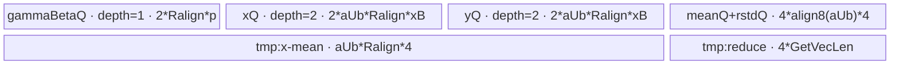
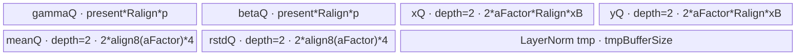
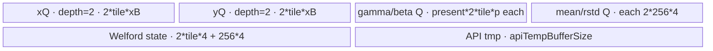

# LayerNormWithImplMode 950 ACLNN 算子知识

## 算子速览

| 项目 | 内容 |
|---|---|
| 实际入口 | `aclnnLayerNormWithImplModeGetWorkspaceSize` + `aclnnLayerNormWithImplMode`，公开 ACLNN 两段式接口 |
| 计算语义 | 对尾部 `normalizedShape` 轴逐行计算 `mean`、`rstd=1/sqrt(var+eps)` 与 `y=(x-mean)*rstd*gamma+beta` |
| 输入输出 | `x/y`: FP32/FP16/BF16 ND；可选 `gamma/beta`: 与 `x` 同 dtype 或 FP32；可选 `mean/rstd` 按 ACLNN 输出 dtype，核心 V4 节点内部为 FP32 |
| 执行类型 | 非空主路径为单个 `AIV_VECTOR` LayerNormV4 Kernel；`Contiguous/Cast/ViewCopy` 与空 Tensor 处理是 ACLNN 框架边界 |
| Kernel 路线 | R-001 手写 TwoPassPerf；R-002 AscendC `LayerNorm` TwoPass；R-003 Welford fallback |
| 核心资源 | GM、AIV UB、TQue/TBuf、Vector 寄存器；核心 Kernel workspace 为 32 B（R-001/R-002）或 16 MiB（R-003） |
| 来源闭包 | `source_closed`：公开 ACLNN→950 强制 `LayerNormV4`→三种 RegBase Tiling→AIV router→全部实际 body/直接 helper→950 OpDef/config 闭合 |
| 验证状态 | 已完成源码闭包检查；本次知识提取未执行编译、真机、数值或性能测试。 |

## 接口与语义

### 计算语义

令输入融合为二维 `[A, R]`：`A=prod(x.shape[0:beginAxis])`，`R=prod(x.shape[beginAxis:])`，其中 `beginAxis=x.rank-normalizedShape.size`。对每行 `a`：

```text
mean[a] = sum_r x[a,r] / R
var[a]  = sum_r (x[a,r] - mean[a])^2 / R
rstd[a] = 1 / sqrt(var[a] + eps)
y[a,r]  = (x[a,r] - mean[a]) * rstd[a] * gamma[r] + beta[r]
```

缺省 `gamma` 等价于 1，缺省 `beta` 等价于 0。950 直接把空 optional 指针传给 V4，并由 POD 的 `nullptrGamma/nullptrBeta` 选择模板，不在 ACLNN Host 物化全 1/0 Tensor。

### 输入、输出与属性

| 参数 | shape/layout | dtype | 约束、默认值与语义 |
|---|---|---|---|
| `input` | `[A1,...,Ai,R1,...,Rj]`, ND, rank 1..8 | FP32/FP16/BF16 | 非空指针；支持空 Tensor |
| `normalizedShape` | `[R1,...,Rj]`，长度 `j>=1` | INT64 ACLNN array；V4 内部转 INT32 Tensor | 与 `input` 尾维逐维相等 |
| `weightOptional` | `[R1,...,Rj]`, ND | 与 input 相同或 FP32 | 可空；与 bias 同时存在时 dtype 相同 |
| `biasOptional` | `[R1,...,Rj]`, ND | 与 input 相同或 FP32 | 可空；与 weight 同时存在时 dtype 相同 |
| `eps` | scalar | double→V4 attr float | 加到方差后再求倒平方根 |
| `implMode` | scalar | INT32 | 仅允许 0/1/2；2 要求所有已提供输入均 FP16 |
| `out` | 与 input 相同 | 与 input 相同 | 必选输出 |
| `meanOutOptional` | `[A1,...,Ai,1,...,1]` | 与 input 相同 | 可空；950 ACLNN 额外校验完整 shape |
| `rstdOutOptional` | 同 mean | 与 input 相同 | 可空；950 ACLNN 额外校验完整 shape |

### 入口与版本

公开文档在同一页面声明 `aclnnLayerNormWithImplMode`，产品表明确支持 Ascend 950PR/950DT。固定 Commit 中未出现该 ACLNN 的更高版本入口；本卡提取该平台实际公开的当前版本。

`CheckImplMode` 始终校验 0/1/2，但 `IsV4SocCheck` 对 RegBase 立即返回 `true`，随后 950 分支只构造 `LayerNormV4Params`，不把 `implMode` 传入 V4。因此 950 上三个合法 `implMode` 的核心 Route 完全相同；模式 2 的 FP16 限制仍在 API 层生效。这不是普通 `aclnnLayerNorm` 卡：这里保留了 WithImplMode 独有的校验与“在 950 不参与核心 selector”的事实。

## Host/Launcher 执行流程

### 参数校验与前处理

1. 创建 `aclOpExecutor`，检查 `input/normalizedShape/out` 非空。
2. `CheckParamsWithImplMode` 依次检查输入 dtype、输出 dtype、shape 关系、950 的 mean/rstd shape 与相等性、`implMode`。
3. 计算 `A=M` 与 `R=N`。`A==0` 时 workspace 为 0 并直接成功；`R==0` 时按需令 mean 为 0、rstd 为 NaN 后返回。
4. 非空时对 `input` 和已提供的 `weight/bias` 建立 `Contiguous` 节点。950 不为缺省 weight/bias 建 `Fill`。
5. 950 的 `IsRegbase()` 令 `forwardV4Compute=true`，调用 `l0op::LayerNormV4`；它把 normalizedShape 转成 INT32 Tensor，分配 y 与 FP32 mean/rstd，并添加一个 `LayerNormV4` AICore launcher。
6. 核心输出依次经过 `Cast` 与 `ViewCopy` 写入用户输出；可选 mean/rstd 仅在用户提供时添加后处理节点。任一步返回空指针即阻断后续节点。

### 参数、Workspace 与生命周期

第一段接口返回 executor 聚合后的 workspace，包含框架前后处理与核心节点；固定仓只给出核心 LayerNormV4 Tiling 的精确 slice：R-001/R-002 为 32 B，R-003 为 `16*1024*1024` B。Kernel entry 必须看到非空 workspace，并通过 `GetUserWorkspace` 得到非空用户区，否则无输出；三个 body 均不再读写该用户区。

executor 拥有中间连续 Tensor、V4 内部输出和框架 workspace，第二段 `CommonOpExecutorRun(workspace, workspaceSize, executor, stream)` 在调用者给定 stream 上执行整个有序图。

### 启动图与失败传播

```text
ACLNN phase 1
  -> [framework] Contiguous(input[, gamma, beta])
  -> [host] l0op::LayerNormV4 -> ADD_TO_LAUNCHER_LIST_AICORE
  -> [device] layer_norm_v4(..., workspace, tiling)  # 单个 AIV 核心节点
  -> [framework] Cast -> ViewCopy(out)
  -> [framework, optional] Cast -> ViewCopy(mean/rstd)
ACLNN phase 2
  -> CommonOpExecutorRun(..., stream)
```

| 节点/边 | entry/介质 | 范围与布局 | ordering、owner/lifetime 与失败 |
|---|---|---|---|
| F0→K0 | executor Tensor | 连续 x、可选 gamma/beta，ND | executor 持有至整图完成；框架按 launcher list/同一 stream 排序；空返回立即失败 |
| K0 | `layer_norm_v4` | `[A,R]` x/y；`[R]` gamma/beta；`[A]` FP32 mean/rstd | `blockDim` 由 Route POD producer 设置；unknown key/AIC/workspace 空时 entry 返回且不写输出 |
| K0→F1 | executor Tensor | V4 y 保持 x dtype，mean/rstd 为 FP32 | K0 完成后 Cast/ViewCopy 消费；用户输出由 executor 外部持有 |
| workspace | executor workspace | 核心 slice 32 B 或 16 MiB；无跨 Kernel payload | executor 分配/调用者传入；仅 entry 非空检查，单核心节点不存在 Kernel 间边 |

## Route 与参数设计

### 分核与资源计算

共同量：`A=colSize`、`R=rowSize`、`Ralign=ceilAlign(R, 32/sizeof(x))`、`VLfp32=vectorLength/4`、`p=sizeof(gamma/beta dtype)`、`xB=sizeof(x dtype)`。

- R-001：`aBlockFactor=ceilDiv(A, coreNum)`，`blockNum=ceilDiv(A,aBlockFactor)`；`aUbFactor` 取 UB 公式允许的最大行数，尾核/整核分别产生循环数。
- R-002：同样分核；Host 二分搜索最大 `aFactor`，每次用 AscendC `GetLayerNormMaxMinTmpSize` 计入 primitive 临时区。
- R-003：同样分核；`tileLength` 从 0 开始，以 64 元素递增，但每次用候选 `tileLength+128` 验证 UB，以保留双缓冲/下次增长余量；每行切成 full tile 与 tail。

所有 core 的 GM 起点均为 `blockIdx*aBlockFactor*R`，最后一核用剩余行数。POD 中大量 `int64_t` 最终在 Device 的 MicroAPI 循环处窄化为 `uint16_t/uint32_t`；合法上界依赖 Host Route guard 与平台资源，固定源码没有额外溢出报错。

### Route 选择

| 顺序 | Route | Key/模板 | 精确选择条件与优先级 | 不适用去向 |
|---:|---|---|---|---|
| 1 | — 950 硬拒绝 | Transpose；priority 100 | `isRegBase` 时第一条判断返回 false | R-001 |
| 2 | R-001 TwoPassPerf | 500/510/511/520/522；priority 150 | RegBase；`Ralign<=4*VLfp32^2`；非 `(A>=4096 && Ralign>=8192)`；且 `CanFitInBuffer(1)` | R-002 |
| 3 | R-002 TwoPass API | 300/310/311/320/322；priority 200 | RegBase；二分搜索至少找到 `aFactor=1` 使 `bufferUse+primitiveTmp<=UB` | SingleRead reject |
| 4 | — 950 硬拒绝 | SingleRead；priority 1000 | dtype/shape guard之后，`isRegBase` 明确返回 false；无论前置 guard 结果都不可在 950 成功 | MergeN reject |
| 5 | — 950 硬拒绝 | MergeN；priority 1220 | `isRegBase` 时第一条判断返回 false | Common reject |
| 6 | — 950 硬拒绝 | Common；priority 2000 | `isRegBase \|\| isAscend310P \|\| isV3`，950 命中首项 | R-003 |
| 7 | R-003 Welford | 400/410/411/420/422；priority 4000 | RegBase；此前有效模板不命中，四个非 RegBase 模板均硬拒绝。`IsCapable` 本身恒为 `isRegBase` | 无安全资源 fallback |

数值越小优先级越高，注册框架按该顺序尝试：

```text
isRegBase
  -> priority 100 Transpose.IsCapable     = false
  -> priority 150 TwoPassPerf.IsCapable ? R-001
  -> priority 200 TwoPass.IsCapable     ? R-002
  -> priority 1000 SingleRead.IsCapable   = false
  -> priority 1220 MergeN.IsCapable       = false
  -> priority 2000 Common.IsCapable       = false
  -> priority 4000 Welford.IsCapable    ? R-003
  -> GRAPH_FAILED
```

### 模板/实现执行矩阵

| Route | key/selector | dtype/shape/platform 完整命中条件 | 执行拓扑与 Kernel 节点 | 实际模板/body | 内存与同步特征 | tail/fallback |
|---|---|---|---|---|---|---|
| R-001 | 500 FP32/FP32；510 FP16/FP32；511 FP16/FP16；520 BF16/FP32；522 BF16/BF16 | 950 + 第一优先级完整 guard | 单 AIV `layer_norm_v4` | `LayerNormV4RegbaseTwoPassPerf<T,U,float>` | gamma/beta 合并 Queue；手写 FP32 MicroAPI 两遍归约；Queue + `LocalMemBar` | 行尾用 mask；核/UB 尾行单独计算；失败到 R-002 |
| R-002 | 300/310/311/320/322，同 dtype 编码 | 950 + R-001 失败 + 至少一行连同 AscendC LayerNorm tmp 可装 UB | 单 AIV `layer_norm_v4` | `LayerNormV4RegbaseTwoPass<T,U,float>` + `AscendC::LayerNorm` | x/y、mean/rstd 双缓冲；gamma/beta 条件分配 | `DataCopyPad` 补到 Ralign；失败到 R-003 |
| R-003 | 400/410/411/420/422，同 dtype 编码 | 950 + 前两 Route 失败 | 单 AIV `layer_norm_v4` | `LayerNormV4RegbaseWelford<T,U,float>` | tile 双缓冲；Welford state + API tmp；mean/rstd 每 256 行聚合写回 | update/normalize tail 用实际 `elemCnt`；固定源码没有资源失败后的安全 Route |

dtype key 的十位编码 x、个位编码 parameter；`gamma` 存在时 parameter dtype 取 gamma，否则取 beta，再否则默认 FP32。因此两个 optional 都缺省时，FP16/BF16 x 分别选择 `x/FP32` 的 510/520、310/320、410/420，而不是 x/x key。

### 隐藏性能 Guard

| Guard | Host/Tiling 条件 | Device/资源原因 | 影响 Route | 不满足时去向 | 源码符号 |
|---|---|---|---|---|---|
| 模板优先级 | 100 < 150 < 200 < 1000 < 1220 < 2000 < 4000 | 小数值先尝试；其中四个候选在 950 固定拒绝 | 全部 | 下一 priority | 各 `REGISTER_*TILING_TEMPLATE` 与 registry 宏 |
| 非 RegBase 候选 | 950 上 Transpose/SingleRead/MergeN/Common 的 `IsCapable` 均由 `isRegBase` 拒绝 | 防止 membase/310P body 进入 950 router | 全部 | 继续下一 priority | 四个模板的 `IsCapable` |
| Perf R 上界 | `Ralign <= 4*VLfp32*VLfp32` | 手写 common reduction 最多进入 `LAST_LOOP_NUMS=2` 的临时归约布局 | R-001 | R-002 | `LayerNormV4RegBaseTwoPassPerfTiling::IsCapable` |
| Perf 大面拒绝 | `!(A>=4096 && Ralign>=8192)` | 源码标记 tile size 不够 | R-001 | R-002 | 同上 |
| Perf UB | `Acur*Ralign*(2p+4xB+4) <= UB-16*VLfp32-4*align8(Acur)`，至少 `Acur=1` | 覆盖 gamma/beta、x/y DB、FP32 x-mean、mean/rstd 与归约 tmp | R-001 | R-002 | `CanFitInBuffer/GetRowWeight/GetUBCanUseSize` |
| TwoPass UB | `4*Acur*Ralign*xB + presentParams*Ralign*p + 4*alignBytes(Acur*4) + tmp <= UB` | 对应全部 `InitBuffer` 与 AscendC LayerNorm max tmp | R-002 | R-003 | `CanFitInBuffer` |
| Welford tile | `IsValidTileLength(tile+128)` | 探测时计入所有 DB Queue、2*probe FP32 state、256 行 cache 和三种 API tmp；函数同时改写 tmp POD | R-003 | tile 停止增长；首候选也失败则后续除零边界；终止探测的 tmp 值保留 | `DoLibApiTiling/IsValidTileLength` |
| workspace | `workspace!=nullptr && GetUserWorkspace(workspace)!=nullptr` | entry 的显式启动前置条件 | 全部 | 直接返回，无输出 | `layer_norm_impl` |
| core type | `g_coreType != AIC` | router 标记 `KERNEL_TYPE_AIV_ONLY` | 全部 | AIC 直接返回 | `layer_norm_impl` |

### POD/ABI

宏生成结构的字段顺序、类型和 Host/Device 结构名在固定仓可见；`sizeof/alignof/offsetof` 依赖外部 `TILING_DATA_FIELD_DEF` 展开，固定仓内不可见。下表 ABI 布局列保持声明顺序编号。

| 结构 | 字段 | 类型/位宽 | ABI 布局 | 单位 | Host/launcher producer | Device consumer | 边界 |
|---|---|---|---|---|---|---|---|
| `LayerNormV4TilingDataRegBaseTwoPassPerf` | `a` | int64/64 | #0；offset 不可见 | 行 | `set_a(A)` | block/tail 行数 | `A>0` 主路径 |
| 同上 | `aBlockFactor` | int64/64 | #1 | 行/core | `ceilDiv(A,coreNum)` | GM block offset | 最后一核取余 |
| 同上 | `aUbFactor` | int32/32 | #2 | 行/UB loop | UB 最大可用行数 | UB 循环/offset | 从 int64 窄化 |
| 同上 | `aUbFactorAlignB32` | int32/32 | #3 | FP32 元素 | `ceilAlign(aUbFactor,8)` | mean/rstd Queue 容量 | 32 B 对齐 |
| 同上 | `r` | int32/32 | #4 | 元素/行 | `set_r(R)` | DMA blockLen、reduce mask | 从 uint64 窄化 |
| 同上 | `rAlign` | int32/32 | #5 | 元素/行 | `set_rAlign(Ralign)` | UB stride | block 对齐 |
| 同上 | `formerBlockUbLoops` | int32/32 | #6 | 次 | `ceilDiv(aBlockFactor,aUbFactor)` | 非尾核循环 | >=1 |
| 同上 | `tailBlockUbLoops` | int32/32 | #7 | 次 | 尾核行数的 ceilDiv | 尾核循环 | >=1 |
| 同上 | `powerOfTwoForR` | int32/32 | #8 | 元素 | 最小 `2^k>=R` | mean/var 缩放与 fold | 正数 |
| 同上 | `epsilon` | float/32 | #9 | 数值 | ACLNN eps→float | rstd Newton | double 窄化 |
| 同上 | `nullptrGamma` | int8/8 | #10 | flag | optional desc 空→1 | 编译期 bool 分支选择 | 0/1 |
| 同上 | `nullptrBeta` | int8/8 | #11 | flag | optional desc 空→1 | 编译期 bool 分支选择 | 0/1 |
| `LayerNormV4TilingDataRegBaseTwoPass` | `r` | int64/64 | #0 | 元素/行 | `R` | DMA/API para | >0 |
| 同上 | `rAlign` | int64/64 | #1 | 元素/行 | block 对齐 R | Queue stride | >=R |
| 同上 | `a` | int64/64 | #2 | 行 | `A` | 尾核/循环 | >0 |
| 同上 | `aFactor` | int64/64 | #3 | 行/UB loop | UB 二分最大值 | loop tile | >=1 |
| 同上 | `aBlockFactor` | int64/64 | #4 | 行/core | `ceilDiv(A,coreNum)` | block offset | >=1 |
| 同上 | `blockNum` | int64/64 | #5 | core | `ceilDiv(A,aBlockFactor)` | last-core 判断 | <=coreNum |
| 同上 | `binaryAddQuotient` | int64/64 | #6 | 元素 | 最大 `<R` 的 VL 倍二次幂 | body 保存；primitive tiling 亦使用相关信息 | 正数 |
| 同上 | `binaryAddK` | int64/64 | #7 | 层数 | Host 二分层数 | body 保存；直接计算封装在 primitive | inactive 可不读 |
| 同上 | `binaryAddLastNum` | int64/64 | #8 | FP32 lane | Host 尾归约数 | body 保存 | inactive 可不读 |
| 同上 | `powerOfTwoForR` | int64/64 | #9 | 元素 | 最小 `2^k>=R` | body 保存 | 正数 |
| 同上 | `tmpBufferSize` | int64/64 | #10 | byte | primitive max tmp | `InitBuffer(tmpBuf,...)` | >0 时分配 |
| 同上 | `nullptrGamma` | int64/64 | #11 | flag | optional desc | 条件 Queue/API config | 0/1 |
| 同上 | `nullptrBeta` | int64/64 | #12 | flag | optional desc | 条件 Queue/API config | 0/1 |
| 同上 | `epsilon` | float/32 | #13 | 数值 | eps→float | `AscendC::LayerNorm` | double 窄化 |
| 同上 | `layerNormTiling` | `LayerNormSeparateTiling` | #14；嵌套布局不可见 | primitive 参数 | `GetLayerNormNDTilingInfo` | `AscendC::LayerNorm` | 外部 primitive ABI |
| `LayerNormV4TilingDataWelford` | `M` | int64/64 | #0 | 行 | `A` | block 分配 | >0 |
| 同上 | `N` | int64/64 | #1 | 元素/行 | `R` | GM offset、rRec | >0 |
| 同上 | `rAlign` | int64/64 | #2 | 元素 | 对齐 R | 仅 tiling/资源记录 | body 不直接读 |
| 同上 | `numBlocks` | int64/64 | #3 | core | `ceilDiv(M,blockFactor)` | Init/Process guard | >=1 |
| 同上 | `mainBlockCount` | int64/64 | #4 | core | `M/blockFactor` | 尾核识别 | floor |
| 同上 | `mainBlockFactor` | int64/64 | #5 | 行/core | `ceilDiv(M,coreNum)` | GM offset | >=1 |
| 同上 | `tailBlockFactor` | int64/64 | #6 | 行 | `M-mainCount*factor` | 尾核行数 | 可为 0，未命中尾核时不消费 |
| 同上 | `tileLength` | int64/64 | #7 | 元素 | UB 搜索 | Queue/state/循环 | 必须 >0 |
| 同上 | `welfordTempSize` | int64/64 | #8 | byte | `2*tile*4+256*4` | TBuf 分配 | UB 内 |
| 同上 | `welfordUpdateTimes` | int64/64 | #9 | 次/行 | `N/tile` | full update/normalize loop | floor |
| 同上 | `welfordUpdateTail` | int64/64 | #10 | 元素 | `N%tile` | tail update/normalize | 0 时 inactive |
| 同上 | `nullptrGamma` | int64/64 | #11 | flag | optional desc | 条件 Queue/Normalize config | 0/1 |
| 同上 | `nullptrBeta` | int64/64 | #12 | flag | optional desc | 条件 Queue/Normalize config | 0/1 |
| 同上 | `apiTempBufferSize` | int64/64 | #13 | byte | 三个 API min tmp 之和 | shared TBuf | UB 内 |
| 同上 | `epsilon` | float/32 | #14 | 数值 | eps→float | `Normalize` | double 窄化 |

### Route 源码闭包

| Route | Key/selector | Host/Tiling producer | POD/参数 | Kernel entry/router 节点 | Kernel body/直接依赖 | 构建接线 |
|---|---|---|---|---|---|---|
| R-001 | 500/510/511/520/522 | `layer_norm_v4_regbase_two_pass_perf_tiling.cpp` / `IsCapable,DoOpTiling` | `LayerNormV4TilingDataRegBaseTwoPassPerf` | `layer_norm_v4_apt.cpp::layer_norm_v4`→`layer_norm_impl` | `LayerNormV4RegbaseTwoPassPerf`；`reduce_common_regbase.h` load/store/rstd helper | `layer_norm_v4_def.cpp` + ascend950 binary config |
| R-002 | 300/310/311/320/322 | `layer_norm_v4_regbase_two_pass_tiling.cpp` / `IsCapable,DoLibApiTiling` | `LayerNormV4TilingDataRegBaseTwoPass` | 同上→`RegbaseTwoPassImpl` | `LayerNormV4RegbaseTwoPass` + AscendC LayerNorm primitive 边界 | 同上 |
| R-003 | 400/410/411/420/422 | `layer_norm_v4_welford_tiling.cpp` / `IsCapable,DoLibApiTiling` | `LayerNormV4TilingDataWelford` | 同上→`RegbaseWelfordImpl` | `LayerNormV4RegbaseWelford` + Welford/Normalize primitive 边界 | 同上 |

## Kernel 实现

### 公共执行流程

`layer_norm_v4` 忽略 Device 侧 `normalized_shape` 指针（Host 已把 shape 融合进 POD），把其余地址交给 `layer_norm_impl`。router 先验证 workspace/user workspace，再拒绝 AIC core 并声明 `KERNEL_TYPE_AIV_ONLY`，随后按 15 个 key 实例化 `T=x/y dtype`、`U=gamma/beta dtype`、`M=DTYPE_MEAN`。950 V4 launcher 的 mean/rstd 是 FP32，所以公开路径的 `M=float`。

三条 Route 都是单 Kernel，无跨 Kernel workspace 边。共同精度策略是 FP16/BF16 输入在 Vector 寄存器或 AscendC primitive 内升到 FP32 做均值、方差与 rstd，最后 y 按 T 存回；mean/rstd 核心输出保持 FP32，再由 ACLNN Cast 到用户 dtype。

### Route R-001：手写 TwoPassPerf

#### 适用条件

##### 选择证据

| 层级 | 文件 | 符号 | 源码谓词/参数 | 结果/下一跳 |
|---|---|---|---|---|
| API | `op_host/op_api/aclnn_layer_norm.cpp` | `IsV4SocCheck` | `IsRegbase()==true` | `LayerNormV4` |
| Tiling | `op_host/layer_norm_v4_regbase_two_pass_perf_tiling.cpp` | `IsCapable` | 完整 priority-150 guard | key 500/510/511/520/522；否则 R-002 |
| Router | `op_kernel/layer_norm_v4_apt.h` | `layer_norm_impl` | key + `g_coreType!=AIC` + workspace 非空 | `RegbaseTwoPassPerfImpl<T,U,float>` |

#### Device 数据流

##### 函数级调用链

```text
LayerNormV4RegBaseTwoPassPerfTiling::DoOpTiling/PostTiling
  -> layer_norm_v4 -> layer_norm_impl -> RegbaseTwoPassPerfImpl<T,U,float>
    -> LayerNormV4RegbaseTwoPassPerf::Init
    -> Process
      -> CopyInGammaBeta
      -> for ubLoop: CopyInX -> Caculate
           -> CalculateMeanVarRLessThanVL / LessThanTwoVL / Common<1|2>
           -> ComputeRstdNewtonRaphson<false>
           -> CalculateNormalizeVF<gamma,beta>
         -> CopyOutY
```

##### 源码等价伪码

```text
blockBaseA = blockIdx * aBlockFactor
load gamma to gammaBeta[0:R] if present
load beta  to gammaBeta[Ralign:Ralign+R] if present
for u in [0, ubLoopNum):
  currentA = last ? tailA : aUbFactor
  gmOff = u*aUbFactor*R
  DMA currentA rows x[gmOff:] -> xQ, pad each row to Ralign
  for each row:
    FP32 mean = reduce(x)/R
    xSubMean = FP32(x)-mean              # 写 tmpBuf 前段
    FP32 var = reduce(xSubMean^2)/R
  rstd = NewtonRaphson(var+epsilon)
  y = xSubMean*rstd; optional gamma/beta; cast/store as T
  write mean/rstd FP32 and y valid R elements
```

#### 内存与数据搬运

##### 资源与搬运表

| 层级/缓冲区 | offset/地址公式 | extent/容量公式 | dtype/layout | producer | consumer | owner/lifetime | 对齐/复用 |
|---|---|---|---|---|---|---|---|
| GM x/y | `(blockBaseA+u*aUbFactor)*R` | `currentA*R` | T, row-major | ACLNN / Kernel | CopyIn / CopyOut | caller / call | UB stride Ralign，GM 有效 R |
| gammaBetaQueue | gamma 0；beta `Ralign` | `2*Ralign*p` | U | CopyInGammaBeta | Normalize | Kernel 全 Process | 单 Queue，optional 缺失区不读 |
| xQueue/yQueue | 0 | 每个 `2*elemNum*xB`，`elemNum=aUbFactor*Ralign` | T | DMA/compute | compute/DMA | 每 UB loop | InitBuffer depth=2 |
| meanQueue/rstdQueue | 0 | 每个 `2*align8(aUbFactor)*4` | FP32 | reduction/rstd | GM CopyOut/normalize | 每 UB loop | depth=2 |
| tmpBuf 前段 | 0 | `elemNum*4` | FP32 x-mean | mean/var | normalize | 当前 loop | 原地作为 xSubMean |
| tmpBuf 后段 | `elemNum*4` | `4*GetVecLen()` | FP32 partial sums | common reduce | final reduce | 当前 row batch | `LocalMemBar` 后复读 |

##### 分层内存布局



##### 字节账与复用顺序

```text
UB_total = 2*Ralign*p
         + 4*aUbFactor*Ralign*xB
         + 16*align8(aUbFactor)
         + aUbFactor*Ralign*4
         + 4*GetVecLen()
         <= platform UB
dynamic_ub = N/A（AIV TPipe 静态 UB）
workspace_total(core node) = 32 B
```

| 复用子区 | 写入者 | 读取者/消费点 | 下一次覆盖 | 同步或释放依据 | 安全条件 |
|---|---|---|---|---|---|
| tmp 前段 | mean/var helper 写 x-mean | `CalculateNormalizeVF` | 下一 UB loop | 函数顺序；x/y Queue 本 loop 完成 | normalize 后才进入下次 loop |
| tmp 后段 | partial reduction | second-level ReduceSum | 下一 mean/var 阶段 | `LocalMemBar<VEC_STORE,VEC_LOAD>` | barrier 后复读 |
| rstdQueue | var→rstd 原地 | normalize + GM write | `FreeTensor` 后 | EnQue/DeQue/FreeTensor | 两个 consumer 均完成 |

#### 同步、精度与尾块

##### 同步与数值边界表

| 阶段 | primitive/机制 | producer | consumer/等待点 | 保护对象 | 精度/尾块 |
|---|---|---|---|---|---|
| GM→UB | TQue + DataCopyPad | DMA | DeQue | x/gamma/beta | `blockLen=R*sizeof(dtype)`；x 补到 Ralign |
| partial reduce | `LocalMemBar` | partial sum stores | final vector loads | tmp 后段 | UpdateMask 屏蔽 R 尾 lane |
| rstd | Newton-Raphson helper | FP32 var | normalize | rstd Queue | `NEED_MAX=false`，先加 eps，特殊 0/inf select |
| normalize | FP32 register pipeline | x-mean/rstd | y Queue | tmp/rstd | 成对处理行，奇数尾行单独循环；B16 用 RINT cast |

#### 关键实现

##### 符号证据表

| 阶段 | 文件 | 符号/模板实例 | 实现事实 |
|---|---|---|---|
| Host/Tiling producer | `op_host/layer_norm_v4_regbase_two_pass_perf_tiling.cpp` | `IsCapable/DoOpTiling` | priority guard、最大 aUb、分核与 POD |
| Kernel entry/router | `op_kernel/layer_norm_v4_apt.h` | `layer_norm_impl/RegbaseTwoPassPerfImpl` | 五 dtype key→AIV body |
| Device body/helper | `op_kernel/arch35/layer_norm_v4_two_pass_perf.h` | `Caculate/CalculateMeanVar*/CalculateNormalizeVF` | 两遍 FP32 归约、rstd、optional affine 与 tail |

### Route R-002：AscendC LayerNorm TwoPass

#### 适用条件

##### 选择证据

| 层级 | 文件 | 符号 | 源码谓词/参数 | 结果/下一跳 |
|---|---|---|---|---|
| API | `op_host/op_api/aclnn_layer_norm.cpp` | `IsV4SocCheck` | RegBase | V4 |
| Tiling | `op_host/layer_norm_v4_regbase_two_pass_tiling.cpp` | `IsCapable` | R-001 未命中；二分 `CanFitInBuffer` 找到 `aFactor>=1` | key 300/310/311/320/322；否则 R-003 |
| Router | `op_kernel/layer_norm_v4_apt.h` | `RegbaseTwoPassImpl` | dtype key | `LayerNormV4RegbaseTwoPass<T,U,float>` |

#### Device 数据流

##### 函数级调用链

```text
TwoPassTiling::IsCapable -> DoOpTiling -> DoLibApiTiling(GetLayerNormNDTilingInfo)
  -> layer_norm_v4 -> RegbaseTwoPassImpl
    -> Init -> Process
      -> CopyInGammaBeta
      -> for ubLoop: CopyInX
         -> CaculateWithHighLevelApi -> AscendC::LayerNorm<config>
         -> CopyOutY -> CopyOutBatchMeanRstd
```

##### 源码等价伪码

```text
load present gamma/beta once
for each aFactor-sized row tile of this core:
  copy currentA*R x; pad each row to Ralign with zero
  para = {aLength=currentA, rLength=layerNormTiling.rLength, rLengthWithPadding=Ralign}
  call AscendC::LayerNorm with one of four optional-input configs
  write currentA*R y and currentA FP32 mean/rstd
```

#### 内存与数据搬运

##### 资源与搬运表

| 层级/缓冲区 | offset/地址公式 | extent/容量公式 | dtype/layout | producer | consumer | owner/lifetime | 对齐/复用 |
|---|---|---|---|---|---|---|---|
| gammaQueue/betaQueue | 0 | present 时各 `Ralign*p` | U | CopyInGammaBeta | LayerNorm primitive | 全 Process | depth=1，条件分配 |
| xQueue/yQueue | tile local | 各 `2*aFactor*Ralign*xB` | T | DMA/primitive | primitive/DMA | loop | depth=2 |
| mean/rstd Queue | aOffset | 各 `2*align8(aFactor)*4` | FP32 | primitive | GM DMA | loop | depth=2 |
| tmpBuf | 0 | `tmpBufferSize` | uint8 primitive scratch | Host primitive tiling | AscendC::LayerNorm | loop | 不与 Queue alias |

##### 分层内存布局



##### 字节账与复用顺序

```text
UB_total = presentGamma*Ralign*p + presentBeta*Ralign*p
         + 4*aFactor*Ralign*xB
         + 16*align8(aFactor)
         + tmpBufferSize
         <= platform UB
dynamic_ub = N/A
workspace_total(core node) = 32 B
```

| 复用子区 | 写入者 | 读取者/消费点 | 下一次覆盖 | 同步或释放依据 | 安全条件 |
|---|---|---|---|---|---|
| xQ/yQ slot | DMA/primitive | primitive/DMA | 下一 loop | Queue EnQue/DeQue/FreeTensor | Free 后才覆盖 |
| mean/rstd Queue slot | primitive | CopyOutBatchMeanRstd | 下一 loop | EnQue/DeQue/FreeTensor | GM copy 完成 |
| tmpBuf | AscendC LayerNorm | primitive 内部 | 下一 primitive call | 同一函数调用返回 | 外部 primitive ABI 不得改写 tiling |

#### 同步、精度与尾块

##### 同步与数值边界表

| 阶段 | primitive/机制 | producer | consumer/等待点 | 保护对象 | 精度/尾块 |
|---|---|---|---|---|---|
| x copy | DataCopyPad + Queue | GM DMA | LayerNorm call | xQ | rightPadding=`Ralign-R`，padding=0 |
| compute | AscendC `LayerNorm<U,T,true,config>` | xQ/params | y/mean/rstd Queue | tmp/queues | primitive 内部实现固定仓不可见；Host 已提供 NDTilingInfo |
| output | Queue + DataCopyPad | primitive | GM | outputs | 仅写有效 R 和 currentA；last tile 取余 |

#### 关键实现

##### 符号证据表

| 阶段 | 文件 | 符号/模板实例 | 实现事实 |
|---|---|---|---|
| Host/Tiling producer | `op_host/layer_norm_v4_regbase_two_pass_tiling.cpp` | `CanFitInBuffer/DoLibApiTiling` | UB 二分、primitive tmp 与 NDTilingInfo |
| Kernel entry/router | `op_kernel/layer_norm_v4_apt.h` | `RegbaseTwoPassImpl` | 300 系 key 映射 |
| Device body/helper | `op_kernel/arch35/layer_norm_v4_two_pass.h` | `CaculateWithHighLevelApi` | optional config、Queue/DMA、有效 tail；primitive 内部是明确外部边界 |

### Route R-003：Welford fallback

#### 适用条件

##### 选择证据

| 层级 | 文件 | 符号 | 源码谓词/参数 | 结果/下一跳 |
|---|---|---|---|---|
| API | `op_host/op_api/aclnn_layer_norm.cpp` | `IsV4SocCheck` | RegBase | V4 |
| Tiling | `op_host/layer_norm_v4_welford_tiling.cpp` | `IsCapable/DoLibApiTiling` | R-001/R-002 均失败；`isRegBase` | 400/410/411/420/422 |
| Router | `op_kernel/layer_norm_v4_apt.h` | `RegbaseWelfordImpl` | dtype key | `LayerNormV4RegbaseWelford<T,U,float>` |

#### Device 数据流

##### 函数级调用链

```text
WelfordTiling::DoOpTiling/DoLibApiTiling
  -> layer_norm_v4 -> RegbaseWelfordImpl
    -> Init -> Process
      -> per row: WelfordInitialize
         -> repeated ProcessWelfordUpdate(CopyIn -> WelfordUpdate)
         -> WelfordFinalize
         -> repeated ProcessNormalize(CopyIn x/gamma/beta -> Normalize -> CopyOut y)
      -> every 256 rows: RefreshCache(mean/rstd -> GM)
```

##### 源码等价伪码

```text
for row in this core:
  zero mean[0:tile], variance[0:tile]
  count = 0
  for each full tile and optional tail:
    load x tile
    WelfordUpdate(mean, variance, x, nRec=1/(++count), abComputeLength=valid)
  WelfordFinalize(abRec=1/tile, rRec=1/R, head/tail lengths)
  for each full tile and tail:
    reload x and present gamma/beta
    Normalize(valid length, mean, variance, eps) -> y
    DMA valid y
  cache mean/rstd; flush to GM at 256 rows or core end
```

#### 内存与数据搬运

##### 资源与搬运表

| 层级/缓冲区 | offset/地址公式 | extent/容量公式 | dtype/layout | producer | consumer | owner/lifetime | 对齐/复用 |
|---|---|---|---|---|---|---|---|
| xQ/yQ | row*R + tile offset | 各 `2*tile*xB` | T | DMA/Normalize | Welford/GM | tile | depth=2；x 为 update 与 normalize 各读一次 |
| gammaQ/betaQ | tile offset | present 时各 `2*tile*p` | U | DMA | Normalize | normalize tile | 条件分配 |
| meanQ/rstdQ | cache index | 各 `2*256*4` | FP32 | Finalize/Normalize | RefreshCache/Normalize | 至多 256 行 | depth=2 |
| welfordTemp | mean 0；variance `tile`; varianceTensor `2*tile` | POD `welfordTempSize`；producer 表达式为 `2*probeLength*4+256*4` | FP32 | initialize/update/finalize | finalize/normalize | row/cache | `probeLength` 是最后一次 `IsValidTileLength` 入参，不必等于最终 tile |
| apiTemp | 0 | POD `apiTempBufferSize` | uint8 | API primitives | API primitives | row/tile | 来自最后 probe 的三 API min tmp 之和 |

##### 分层内存布局



##### 字节账与复用顺序

```text
UB_alloc = 4*tile*xB
         + presentGamma*2*tile*p + presentBeta*2*tile*p
         + 4*256*4
         + welfordTempSize(lastProbe)
         + apiTempBufferSize(lastProbe)
Host probe check = 同一公式把 queue 的 tile 也替换为 probeLength，并判断 <= platform UB
源码边界：循环以首个失败 probe 退出，但该次调用已写 tmp POD；固定源码未重新证明 UB_alloc <= UB
dynamic_ub = N/A
workspace_total(core node) = 16*1024*1024 B
```

| 复用子区 | 写入者 | 读取者/消费点 | 下一次覆盖 | 同步或释放依据 | 安全条件 |
|---|---|---|---|---|---|
| xQ slot | update CopyIn | WelfordUpdate | normalize 再次 CopyIn/下个 tile | FreeTensor | 每次 primitive 返回后释放 |
| mean/variance state | Initialize/Update | Finalize | 下一行 Initialize | 函数顺序 | 本行 normalize 使用已写入 cache 的 mean/variance/rstd |
| 256-row cache | Finalize/Normalize | RefreshCache | ResetCache 后 | Queue flush/free | `cacheCount>=256` 或 core 尾才覆盖 |

#### 同步、精度与尾块

##### 同步与数值边界表

| 阶段 | primitive/机制 | producer | consumer/等待点 | 保护对象 | 精度/尾块 |
|---|---|---|---|---|---|
| initialize | MicroAPI zero stores | Device | WelfordUpdate | mean/variance state | `UpdateMask` 保护 tile 尾 |
| update/finalize | AscendC Welford API | x tile | finalized cache | state/apiTemp | FP32 state；tail 用 `abComputeLength=elemCnt` |
| normalize | AscendC Normalize | finalized stats + reloaded x | y DMA | queues/apiTemp | `rLength=rLengthWithPadding=elemCnt`，无虚假 padding lane |
| cache flush | Queue + DataCopyPad | stats cache | GM | mean/rstd | 每 256 行或尾批；公开 950 M=float |

#### 关键实现

##### 符号证据表

| 阶段 | 文件 | 符号/模板实例 | 实现事实 |
|---|---|---|---|
| Host/Tiling producer | `op_host/layer_norm_v4_welford_tiling.cpp` | `IsValidTileLength/DoLibApiTiling` | UB 完整账、tile/full/tail |
| Kernel entry/router | `op_kernel/layer_norm_v4_apt.h` | `RegbaseWelfordImpl` | 400 系 key 映射 |
| Device body/helper | `op_kernel/arch35/layer_norm_v4_welford.h` | `Process/ProcessWelfordUpdate/ProcessNormalize/RefreshCache` | 双读 x、Welford state、256 行 cache 与 tail |

## 算子特定优化

### Trick T-001：优先用手写 FP32 两遍归约并按 Ralign 分四级展开

#### 触发与源码依据

- 适用 Route：R-001
- 触发条件：priority-150 完整 guard，进入 body 后按 `Ralign` 与 `VL_B32` 的关系选择 1 VL、2 VL、common<1> 或 common<2>。
- Golden 来源：[`op_kernel/arch35/layer_norm_v4_two_pass_perf.h:143-152`](../../../../../../../cann-ops-raw/ascendc/ops-nn/955f8b33985b6d72989ebff341bb9c2c564a51bc/norm/layer_norm_v4/op_kernel/arch35/layer_norm_v4_two_pass_perf.h#L143-L152)

**官方源码（固定 Commit 连续逐字摘录）**：

```cpp
        if (tl_->rAlign <= VL_B32) {
            CalculateMeanVarRLessThanVL(xInUbAddr, meanOutUbAddr, rstdOutUbAddr, xSubMeanUbAddr, currentANum);
        } else if (tl_->rAlign <= VL_B32 + VL_B32) {
            CalculateMeanVarRLessThanTwoVL(xInUbAddr, meanOutUbAddr, rstdOutUbAddr, xSubMeanUbAddr, currentANum);
        } else if (tl_->rAlign <= VL_B32 * VL_B32 * NUM_TWO){
            CalculateMeanVarRCommon<1>(xInUbAddr, meanOutUbAddr, rstdOutUbAddr, xSubMeanUbAddr, tmpUbAddr, currentANum);
        } else {
            CalculateMeanVarRCommon<NUM_TWO>(xInUbAddr, meanOutUbAddr, rstdOutUbAddr,
                                             xSubMeanUbAddr, tmpUbAddr, currentANum);
        }
```

#### 机制与设计原因

短 R 直接在一到两个寄存器宽内完成 ReduceSum，较长 R 才把 partial sum 写入 tmp 并二级归约；同一遍方差计算同时物化 FP32 `x-mean`，normalize 直接复用，避免第三次从 GM 读取 x。Host 的 `Ralign<=4*VLfp32^2` 与 UB guard 保证最多使用源码实现的两级末归约形态。

#### 迁移边界

- 适用：逐行 norm、R 可被相同 mask/fold 规则覆盖的 AIV RegBase Kernel。
- 前提：FP32 中间区、MicroAPI mask、LocalMemBar 与 Host UB 公式必须整体迁移。
- 失效：R/UB/大面 guard 不满足时必须进入 R-002 或 R-003。
- 未验证：本次知识提取未执行编译、真机、数值或性能测试。

#### 错误做法

不能删除 partial-sum 写后到复读前的 `LocalMemBar`，也不能用逻辑 R 替代 UB stride Ralign；源码 fallback 是改用 R-002/R-003。固定仓未提供真机性能反例。

### Trick T-002：Welford 路线把统计输出按 256 行聚合写回

#### 触发与源码依据

- 适用 Route：R-003
- 触发条件：前两 Route 失败；每个 core 的 `cacheCount` 达 256 或处理完尾行。
- Golden 来源：[`op_kernel/arch35/layer_norm_v4_welford.h:161-172`](../../../../../../../cann-ops-raw/ascendc/ops-nn/955f8b33985b6d72989ebff341bb9c2c564a51bc/norm/layer_norm_v4/op_kernel/arch35/layer_norm_v4_welford.h#L161-L172)

**官方源码（固定 Commit 连续逐字摘录）**：

```cpp
            cacheCount++;
            // check cache buffer
            if (cacheCount >= AGGREGATION_COUNT) {
                RefreshCache();
                ResetCache();
            }
        }

        // refresh cache
        if (cacheCount > 0) {
            RefreshCache();
        }
```

#### 机制与设计原因

mean/rstd 不逐行立即 DMA，而是在 UB 的两个 256-FP32 Queue 中累积，达到 256 行时合并写回，core 尾再刷新剩余项；这改变了输出搬运粒度并复用固定大小 cache。y 仍逐 tile 写回，统计 cache 不延长 x/y Queue 生命周期。

#### 迁移边界

- 适用：每行只产生少量统计标量、可以在同一 core 内聚合的归约算子。
- 前提：GM 行顺序必须与 `paramAddr += cacheCount` 一致，cache 容量和 UB 账必须保留。
- 失效：跨 core 聚合或输出非连续时不能直接复用该地址公式。
- 未验证：本次知识提取未执行编译、真机、数值或性能测试。

#### 错误做法

若遗漏 core 尾的 `RefreshCache`，不足 256 行的统计输出不会落 GM；这是源码中可验证的控制流后果。

## 模板与实现对比

| 对比维度 | R-001 TwoPassPerf | R-002 TwoPass API | R-003 Welford | 设计选择依据 |
|---|---|---|---|---|
| 命中条件/优先级 | 150，手写路线资源可装 | 200，primitive 至少一行可装 | 4000，RegBase 最终 fallback | 小 priority 优先 |
| 模板与 dtype | 手写 MicroAPI，5 dtype key | AscendC LayerNorm，5 key | Welford/Normalize，5 key | dtype key 十位是 x、个位是 param |
| 循环与分核 | core→UB 行批→Vector fold | core→aFactor 行批→primitive | core→row→update tile→normalize tile | R 与 UB 决定 |
| Queue/TBuf/寄存器 | 合并 gamma/beta；FP32 x-mean | 条件 gamma/beta；primitive tmp | tile DB；Welford state/API tmp/256 cache | 在 UB 内最大化行或 tile |
| 内存总占用与复用 | x-mean 直接供 normalize | primitive 管理内部 scratch | state 跨 update，x 为统计/normalize 双读 | 选择不同 GM/UB 交换 |
| 搬运/Vector API | DataCopyPad + MicroAPI Reduce/Mul/FMA | DataCopyPad + LayerNorm API | DataCopyPad + Welford/Normalize API | 都是 AIV_VECTOR |
| 同步、精度与 tail | LocalMemBar；FP32；mask/尾行 | Queue；primitive FP32；padding/尾行 | Queue；FP32 Welford；实际 elemCnt | 不把 padding lane 写回 |
| fallback/失败边界 | 不满足→R-002 | UB 不足→R-003 | 首 tile 资源失败是 Tiling 边界 | 无 SIMT/AIC fallback |

## 平台差异

| 项目 | A2 | A3 | 950 |
|---|---|---|---|
| 支持状态 | 公开 API 支持，但固定仓全链路不闭合，本卡不覆盖 | 公开 API 支持，但固定仓全链路不闭合，本卡不覆盖 | 公开支持且 `source_closed` |
| Host/Launcher | 多数规格进入缺失源码的 LayerNormV3；少数规格可进 V4 | 同左 | RegBase 强制 LayerNormV4；implMode 不进入核心 selector |
| Kernel/资源 | V3 的对应公开实现缺失 | V3 的对应公开实现缺失 | 三个 AIV Route；32 B/16 MiB 核心 workspace |

## 限制与失败边界

- `implMode=2` 只允许所有已提供输入均 FP16；950 核心 V4 对 0/1/2 不作不同分发，不能据此假定 KEEP_FP16 内部累加。
- `A==0` 不启动核心 Kernel；`R==0` 仅按需生成 mean=0、rstd=NaN 的空 Tensor 处理。
- workspace 或 user workspace 为空、AIC core、unknown key 时 router 直接返回且不写输出。
- R-003 的 `IsValidTileLength` 在返回 true/false 前都会写 `welfordTempSize/apiTempBufferSize`。循环以首个失败 probe 退出，却只把 `tileLength` 保留为较小的上次成功值，固定源码没有用最终分配公式重新校验 UB；若首个 128 元素 probe 失败，`tileLength` 还会保持 0 并在后续参与除法。两者均是源码可见但未由错误返回封闭的资源边界。
- POD 宏的精确 `sizeof/alignof/offsetof` 与 AscendC `LayerNorm/Welford/Normalize` primitive 内部实现不在固定仓；已作为明确 ABI/primitive 边界，未推测补齐。
- A2/A3 正式卡未生成：合法公开域存在通向 `LayerNormV3WithImplMode` 的 Host Route，而固定仓仅提供 LayerNormV3 的 950 arch35 Host/Tiling/Kernel/config，无法达到 `source_closed`。

## 源码索引

### 链路索引

| 链路阶段 | 文件 | 关键符号 | 支撑内容 |
|---|---|---|---|
| 入口声明/约束 | `norm/layer_norm_v4/docs/aclnnLayerNorm&aclnnLayerNormWithImplMode.md` | 产品支持表、函数原型、参数表 | 950 公开支持、语义、dtype/shape/implMode |
| 入口声明/约束 | `norm/layer_norm_v4/op_host/op_api/aclnn_layer_norm.h` | `aclnnLayerNormWithImplMode*` | 两段式公开 C 声明 |
| 入口实现 | `norm/layer_norm_v4/op_host/op_api/aclnn_layer_norm.cpp` | `CheckImplMode/IsV4SocCheck/aclnnLayerNormWithImplModeGetWorkspaceSize` | 校验、空域、950 V4 分发、框架前后处理 |
| 入口实现 | `norm/layer_norm_v4/op_host/op_api/layer_norm_v4.cpp` | `l0op::LayerNormV4` | 内部输出 dtype/shape、launcher 节点 |
| Host/Tiling/Launcher | `norm/layer_norm_v4/op_host/layer_norm_v4_tiling.h` | 三个 POD 与 key enum | ABI 字段、dtype key |
| Host/Tiling/Launcher | `norm/layer_norm_v4/op_host/layer_norm_v4_tiling_base.cpp` | `GetCommonShapeAttrsInfo/GetShapeAttrsInfo` | A/R/Ralign/dtype/optional flags |
| Host/Tiling/Launcher | `norm/layer_norm_v4/op_host/layer_norm_v4_tiling.cpp` | `TilingPrepare4CompileInfo/Tiling4LayerNormV4` | AIV core 数、UB、block size、VL 与 RegBase 标志 |
| Host/Tiling/Launcher | `norm/layer_norm_v4/op_host/layer_norm_v4_transpose_tiling.cpp` | `LayerNormV4TransposeTiling::IsCapable` | priority 100 在 950 硬拒绝 |
| Host/Tiling/Launcher | `norm/layer_norm_v4/op_host/layer_norm_v4_regbase_two_pass_perf_tiling.cpp` | `IsCapable/DoOpTiling` | R-001 guard、UB、POD |
| Host/Tiling/Launcher | `norm/layer_norm_v4/op_host/layer_norm_v4_regbase_two_pass_tiling.cpp` | `CanFitInBuffer/DoLibApiTiling` | R-002 UB 与 primitive tiling |
| Host/Tiling/Launcher | `norm/layer_norm_v4/op_host/layer_norm_v4_single_read_tiling.cpp` | `LayerNormV4SingleReadTiling::IsCapable` | priority 1000 在 950 硬拒绝 |
| Host/Tiling/Launcher | `norm/layer_norm_v4/op_host/layer_norm_v4_merge_n_tiling.cpp` | `LayerNormV4MergeNTiling::IsCapable` | priority 1220 在 950 硬拒绝 |
| Host/Tiling/Launcher | `norm/layer_norm_v4/op_host/layer_norm_v4_common_tiling.cpp` | `LayerNormV4CommonTiling::IsCapable` | priority 2000 在 950 硬拒绝 |
| Host/Tiling/Launcher | `norm/layer_norm_v4/op_host/layer_norm_v4_welford_tiling.cpp` | `IsValidTileLength/DoLibApiTiling` | R-003 tile 与 workspace |
| Host/Tiling/Launcher | `common/inc/op_host/tiling_templates_registry.h` | `REGISTER_OPS_TILING_TEMPLATE` | priority 数值越小越优先 |
| Kernel entry/body | `norm/layer_norm_v4/op_kernel/layer_norm_v4_apt.cpp` | `layer_norm_v4` | Device entry 参数顺序 |
| Kernel entry/body | `norm/layer_norm_v4/op_kernel/layer_norm_v4_apt.h` | `layer_norm_impl` | AIV-only router、15 key |
| Kernel entry/body | `norm/layer_norm_v4/op_kernel/arch35/layer_norm_v4_two_pass_perf.h` | `LayerNormV4RegbaseTwoPassPerf` | R-001 完整实现 |
| Kernel entry/body | `norm/layer_norm_v4/op_kernel/arch35/layer_norm_v4_two_pass.h` | `LayerNormV4RegbaseTwoPass` | R-002 完整实现 |
| Kernel entry/body | `norm/layer_norm_v4/op_kernel/arch35/layer_norm_v4_welford.h` | `LayerNormV4RegbaseWelford` | R-003 完整实现 |
| Kernel entry/body | `norm/norm_common/op_kernel/reduce_common_regbase.h` | `LoadRegForDtype/StoreRegForDtype/ComputeRstdNewtonRaphson` | R-001 B16/FP32 转换与 rstd helper |
| 构建接线 | `norm/layer_norm_v4/op_host/layer_norm_v4_def.cpp` | `LayerNormV4::LayerNormV4` | ascend950 RegBase config 与 `layer_norm_v4_apt` |
| 构建接线 | `norm/layer_norm_v4/op_host/config/ascend950/layer_norm_v4_binary.json` | `LayerNormV4 op_list` | 950 dtype/layout/optional input binary 元数据 |
| 构建接线 | `scripts/kernel/binary_config/ascendc_config.json` | `LayerNormV4` | ascend950 compute unit 与编译选项 |

### 实现复用检查

| 检查项 | 可复用事实 | 不得改变的约束 | 源码符号 |
|---|---|---|---|
| ABI/POD | A/R、分核、tile、optional flag 与 primitive tiling 可复用 | 字段顺序/位宽、R 与 Ralign 单位、float eps 不得改变 | 三个 `LayerNormV4TilingData*` |
| 调用顺序 | 950 ACLNN→V4→单 AIV→Cast/ViewCopy | implMode 只校验；不得错误传入 V4 selector | `aclnnLayerNormWithImplModeGetWorkspaceSize` |
| workspace/内存 | 三 Route 的 UB 字节账与核心 workspace | depth=2 必须计入；R-003 16 MiB 不能按“未使用 payload”擅减 | 三个 Tiling + `Init` |
| 同步 | Queue 生命周期与 R-001 LocalMemBar | partial store 未完成不得复读/覆盖 | `CalculateMeanVarRCommon` |
| 精度与尾块 | FP32 statistics、B16 cast、mask/padding/tail | 不能把 `implMode=2` 推成 FP16 统计；只写有效 R | `CalculateMeanVar* / ProcessNormalize` |
| 失败边界 | priority fallback、workspace/AIC/unknown-key early return | 不能把 entry silent return 当成功写出 | `IsCapable/layer_norm_impl` |