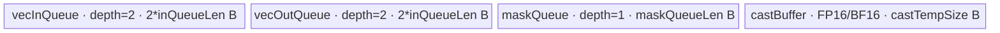

# MaskedSoftmaxWithRelPosBias A2/A3 ACLNN 算子知识

## 算子速览

| 项目 | 内容 |
|---|---|
| 实际入口 | `aclnnMaskedSoftmaxWithRelPosBiasGetWorkspaceSize` + `aclnnMaskedSoftmaxWithRelPosBias`，CANN 9.1.0 未版本化公开 ACLNN |
| 计算语义 | 对最后一维执行 `softmax(scaleValue * x + attenMaskOptional + relativePosBias)` |
| 输入输出 | `x/out`: 4D `(B*W,N,S1,S2)` 或 5D `(B,W,N,S1,S2)`；mask 按 `W` 广播，bias 按 `B,W` 广播；ND；FP32/FP16/BF16 |
| 执行类型 | 四条公开 Route 均为单 Kernel `AIV_VECTOR`；无 SIMT、NDDMA、AIC/Cube 或 MIX_CV 节点 |
| Kernel 路线 | R-001 B、R-002 BW、R-003 BWN、R-004 BWNS1，按优先级 100→101→102→104 尝试 |
| 核心资源 | GM + `TQue` 双缓冲 + 条件 `TBuf<float>` + AscendC SoftMax 临时区；算子 workspace 不承载 Kernel 间数据 |
| 来源闭包 | `source_closed`：公开两段式 ACLNN 文档→ACLNN 生成接线/OpDef→Tiling 注册与 POD→单 AIV entry/router→四个实际 body→binary config/CMake 闭合；自动生成 ACLNN inner bridge 是框架边界 |
| 验证状态 | 已完成源码闭包检查；本次知识提取未执行编译、真机、数值或性能测试。 |

## 接口与语义

### 计算语义

令 `x` 规范为五维 `(B,W,N,S1,S2)`。`attenMaskOptional` 的有效逻辑形状为 `(1,W,1,S1,S2)`，`relativePosBias` 为 `(1,1,N,S1,S2)`。对每个 `(b,w,n,s1)`：

```text
z[b,w,n,s1,s2] = scaleValue * x[b,w,n,s1,s2]
                  + attenMaskOptional[w,s1,s2]
                  + relativePosBias[n,s1,s2]
out[b,w,n,s1,s2] = exp(z[b,w,n,s1,s2] - max(z[b,w,n,s1,:]))
                    / sum(exp(z[b,w,n,s1,:] - max(z[b,w,n,s1,:])))
```

公开 ACLNN 文档把 `attenMaskOptional == nullptr` 列为 `ACLNN_ERR_PARAM_NULLPTR`，因此本卡只把 `existAtten=true` 路径计入公开可达 Route。原始 OpDef 内部仍将 `atten_mask` 标为 OPTIONAL；其无 mask 路线属于图模式/内部可达实现，不扩展进本 ACLNN 卡。

### 输入、输出与属性

| 参数 | shape/layout | dtype | 约束、默认值与语义 |
|---|---|---|---|
| `x` | 4D `(B*W,N,S1,S2)` 或 5D `(B,W,N,S1,S2)`，ND | FP32/FP16/BF16 | 必选、连续化由 OpDef `AutoContiguous` 框架完成；所有维必须非零 |
| `attenMaskOptional` | 3D `(W,S1,S2)`、4D `(W,1,S1,S2)` 或 5D `(1,W,1,S1,S2)`，ND | 与 `x` 同族 | ACLNN 文档要求非空；Host 校验 `att_b=1,att_n=1` 且 `W/S1/S2` 与 `x` 一致 |
| `relativePosBias` | 3D `(N,S1,S2)`、4D `(1,N,S1,S2)` 或 5D `(1,1,N,S1,S2)`，ND | 与 `x` 同族 | 必选；Host 校验 `bias_b=1,bias_w=1` 且 `N/S1/S2` 与 `x` 一致 |
| `scaleValue` | scalar | ACLNN `double`，Op 属性与 POD 为 `float` | OpDef 默认 1.0；Host 以 `fabs(scale-1)>FLT_EPSILON` 生成 `existMuls` 模板位 |
| `innerPrecisionMode` | scalar | ACLNN `int64`，Op 属性 `int` | 默认 0；固定实现未读取该属性，属于保留字段 |
| `out` | 与 `x` 完全相同，ND | 与 `x` 相同 | 必选；InferShape/InferDataType 复制 `x` |

### 入口与版本

固定 Commit 只公开未版本化的 `aclnnMaskedSoftmaxWithRelPosBias`，未发现同语义 V2/V3 入口，因此它是 A2/A3 的最新公开版本。第一段接口校验参数并创建 executor、返回 workspace 大小；第二段接收该 executor、workspace 与 stream 执行。仓内 ACLNN inner bridge 为 `ACLNNTYPE aclnn` 自动生成边界；`MaskedSoftmaxWithRelPosBias` OpDef 的 `support_aclnn` 接线、Tiling/Kernel 与 binary config 均可见。

## Host/Launcher 执行流程

### 参数校验与前处理

1. 公开第一段接口检查 `x/attenMaskOptional/relativePosBias/out` 非空；非法 dtype、ND 格式或 shape 最终报 `ACLNN_ERR_INNER_TILING_ERROR`。
2. OpDef 对四个 Tensor 声明 `AutoContiguous()`；具体生成 bridge 与 contiguous 临时对象实现不在固定仓，属于框架边界。
3. InferShape 把 `x` shape 复制到 `out`，InferDataType 把 `x` dtype 复制到 `out`。
4. `GetShapeAttrsInfo()` 将 4D `x` 暂映射成 `b=dim0,w=1`，随后用 mask 的 `att_w` 恢复 `b=dim0/att_w,w=att_w`；源码只检查商非零，未显式检查整除余数。
5. Host 检查 mask/bias 广播维、输出 shape、非零维，计算 `dtypeSize`、`alignNum=32/dtypeSize`、`s2Aligned=ceil(S2/alignNum)*alignNum`，并读取 `scale_value`。
6. `GetPlatformInfo()` 获取 AIV 核数和 UB；纯 Vector 注释与后续 body 一致。仅 `socVersion==ASCEND310P && S2` 未对齐时失败，该约束不作用于本卡的 A2/A3。

### 参数、Workspace 与生命周期

`MaskedSoftmaxWithRelPosBiasTilingData` 由选中的 Tiling 模板写入 executor 所持 tiling buffer，Kernel entry 用 `GET_TILING_DATA` 解析。每条 Route 都只启动一次 `masked_softmax_with_rel_pos_bias(x, atten_mask, bias, y, work_space, tiling)`；entry 未读取 `work_space`。

`GetWorkspaceSize()` 的源码规则是：运行时 SoC 枚举严格等于 `ASCEND910B` 时返回 16 MiB 系统最小 workspace，否则返回 0。该 workspace 由 ACLNN 调用者在第一、二段之间持有，第二段提交后至少存活到 stream 上任务完成；它不是 Route 间中间结果。固定源码未把产品名到该运行时枚举的映射展开，因此不把 A3 workspace 数值外推。

### 启动图与失败传播

```text
aclnnMaskedSoftmaxWithRelPosBiasGetWorkspaceSize
  -> 生成 ACLNN bridge（框架边界）：校验/AutoContiguous/executor
  -> MaskedSoftmaxWithRelPosBias TilingRegistry::DoTilingImpl
       priority 100 B -> 101 BW -> 102 BWN -> 103 S1Bias(ACLNN 恒不适用) -> 104 BWNS1
  -> 生成 POD、tilingKey、blockDim、workspaceSize
aclnnMaskedSoftmaxWithRelPosBias(workspace, executor, stream)
  -> 单节点 K0: masked_softmax_with_rel_pos_bias<<<blockDim, stream>>>
       -> key router -> Route body::Init -> Process
  -> y（同一 stream 上提交完成后可见）
```

| 节点/边 | producer | consumer | 介质与范围 | ordering / owner / 失败传播 |
|---|---|---|---|---|
| executor/POD | 第一段 ACLNN + Tiling | 第二段 ACLNN/K0 | executor、tiling buffer、key、blockDim | 调用者持有 executor；Tiling 非 SUCCESS 阻断 launch |
| K0 inputs | 调用者/AutoContiguous 框架 | K0 `Init/CopyIn` | `x/mask/bias` GM，逻辑范围由 shape 决定 | 同一 stream；输入须存活到 K0 消费完成 |
| K0 output | K0 `CopyOut` | 后续 stream 工作 | `y` GM，恰写 `B*W*N*S1*S2` 个有效元素 | 单 Kernel 无跨节点 event/workspace 边；launch 失败由 ACLNN status 返回 |

## Route 与参数设计

### 分核与资源计算

共同定义：`D=dtypeSize`，`S2a=ceil(S2/(32/D))*(32/D)`，`AIV=GetCoreNumAiv()`。优先模板逐渐把一个并行单元从 `B` 细化到 `B*W`、`B*W*N`、`B*W*N*S1`。对域大小 `P`，Host 使用：

```text
single=floor(P/AIV); rem=P-single*AIV
if rem!=0: tailStartCoreIdx=rem; singleCoreSize=single+1
else:      tailStartCoreIdx=AIV; singleCoreSize=single
blockIdx < tailStartCoreIdx: count=singleCoreSize, start=blockIdx*singleCoreSize
otherwise: count=singleCoreSize-1, start=blockIdx*(singleCoreSize-1)+tailStartCoreIdx
```

R-001/R-002 固定 `blockDim=AIV`，前置谓词保证 `P>=AIV`；R-003 使用 `min(BWN,AIV)`；R-004 使用 `min(BWNS1,AIV)`。所有 shape 乘积先进入若干 `uint32_t` POD，超大 shape 的窄化/乘法溢出未被源码显式保护。

### Route 选择

| 顺序 | Route | Key/模板 | 精确选择条件与优先级 | 不适用去向 |
|---:|---|---|---|---|
| 1 | R-001 B | aligned 5001/2、5011/2、5021/2；pad 5101/2、5111/2、5121/2；`B<T,true,existMuls,isAligned>` | priority 100；`B>=AIV` 且 B-route UB 公式 `<=UB`；key 再按 dtype、`existMuls`、alignment 选择 | 101 BW |
| 2 | R-002 BW | 401/402, 411/412, 421/422；`BW<T,true,existMuls>` | priority 101；`B*W>=AIV` 且 BW-route UB 公式 `<=UB` | 102 BWN |
| 3 | R-003 BWN | 301/302, 311/312, 321/322；`BWN<T,true,existMuls>` | priority 102；`B*W*N>=AIV` 且 BWN-route最小 UB `<=UB` | 103 S1Bias；ACLNN 因 `existAtten=true` 恒跳过，再到 104 |
| 4 | R-004 BWNS1 | 201/202, 211/212, 221/222；`BWNS1<T,true,existMuls>` | priority 104；前序均不适用，且每行最小 UB `<=UB` | 无下一模板，返回失败 |

```text
priority 按数值升序（越小越先）
if B>=AIV && UB_B_ok: R-001
else if B*W>=AIV && UB_BW_ok: R-002
else if B*W*N>=AIV && UB_BWN_ok: R-003
else if !existAtten && UB_S1Bias_ok: 内部路线（公开 ACLNN 不可达）
else if UB_BWNS1_ok: R-004
else GRAPH_FAILED
```

### 模板/实现执行矩阵

| Route | key/selector | dtype/shape/platform 完整命中条件 | 执行拓扑与 Kernel 节点 | 实际模板/body | 内存与同步特征 | tail/fallback |
|---|---|---|---|---|---|---|
| R-001 B | aligned：FP32 5001/5002、FP16 5011/5012、BF16 5021/5022；pad：FP32 5101/5102、FP16 5111/5112、BF16 5121/5122 | `existAtten=true`；末位 1 表示 `existMuls`；`B>=AIV`；整批 `(W,N,S1,S2a)` 可驻 UB；51xx key 表示 `S2a!=S2` | 单 K0/AIV_VECTOR | FP32 `MaskedSoftmaxWithRelPosBiasB`; FP16/BF16 `MaskedSoftmaxWithRelPosBiasBBf16AndHalf`；模板 `isAligned` 区分 DMA | mask+bias 一次搬入/广播并跨 batch tile 复用；x/y 双缓冲；Vector barrier | 核间 former/tail + 核内 `stackNum` 主循环/尾批；pad 逐行去补齐；失败→R-002 |
| R-002 BW | FP32 401/402；FP16 411/412；BF16 421/422 | 前序失败；`B*W>=AIV`；整 `(N,S1,S2a)` 可驻 UB | 单 K0/AIV_VECTOR | `MaskedSoftmaxWithRelPosBiasBW<T,true,existMuls>` | 每个 BW 单元复用 bias；mask 按 N 广播；4 个 Queue 均双缓冲，非 FP32 有 3 个 float 子区 | 每核多个 BW 单元；失败→R-003 |
| R-003 BWN | FP32 301/302；FP16 311/312；BF16 321/322 | 前序失败；`B*W*N>=AIV`；`stackNum=floor(UB/minUsed)` 后裁到 `N` | 单 K0/AIV_VECTOR | `MaskedSoftmaxWithRelPosBiasBWN<T,true,existMuls>` | 一次处理 `stack*S1` 行；mask 只搬边界片再 Vector 广播；bias 处理 N 回绕 | 主 `stack` 批与尾批；失败→R-004 |
| R-004 BWNS1 | FP32 201/202；FP16 211/212；BF16 221/222 | 前序与无-mask模板失败；每行 `minUsed<=UB` | 单 K0/AIV_VECTOR | `MaskedSoftmaxWithRelPosBiasBWNS1<T,true,existMuls>` | 最细粒度；x/mask+bias/y 双缓冲，非 FP32 四段 float TBuf | 按 S1 边界拆两次 DMA；不闭合 UB 则整体失败 |

### 隐藏性能 Guard

| Guard | Host/Tiling 条件 | Device/资源原因 | 影响 Route | 不满足时去向 | 源码符号 |
|---|---|---|---|---|---|
| 32B 行对齐 | `S2a==S2` | 对齐 route 使用 `DataCopy`；否则需 `DataCopyPad` 且 router 模板位不同 | R-001；R-003/R-004 body 内分支 | A2/A3 进入 pad 路径 | `GetTensorDims`, `GetTilingKey`, `ProcessNotAlignedSize` |
| B 粒度并行 | `B>=AIV` | 保证固定 `blockDim=AIV` 每核至少一批 | R-001 | R-002 | `BTiling::IsCapable` |
| BW 粒度并行 | `B*W>=AIV` | 同上，以 BW 为独立域 | R-002 | R-003 | `BWTiling::IsCapable` |
| BWN 粒度并行 | `B*W*N>=AIV` | 同上，以 BWN 为独立域 | R-003 | R-004 | `BWNTiling::IsCapable` |
| UB 上界 | 各 Route 的 `totalSize/minUsedSize<=ubSize` | Queue depth、cast TBuf 与 SoftMax 最小临时区均需同时容纳 | 全部 | 下一模板或失败 | 各 `IsCapable` |
| DataCopyPad `blockCount` | BWNS1 `stackNum` 受 UB/每核数量约束；多个字段窄化为 `uint16_t` | `DataCopyParams.blockCount` 为 16 bit | pad 路径 | 固定源码无额外 fallback | 各 `CopyInPad/CopyOutPad` |
| BF16 编译 guard | `__CCE_AICORE__>200` 且排除 NPU_ARCH 3003/3113 | BF16 body 只在 guard 内实例化 | 所有 BF16 key | 不满足时 router 分支为空，不写输出 | Kernel entry BF16 branches |
| scale specialization | `fabs(scale-1)>FLT_EPSILON` | 省去 `Muls` 及其 barrier | 全部 | 选择 `existMuls=false` key | `GetShapeAttrsInfo/GetTilingKey` |

### POD/ABI

所有标量字段按声明顺序序列化。`TILING_DATA_FIELD_DEF*` 与 `SoftMaxTiling` 的宏/结构实现在固定仓外部依赖中，故 `sizeof/alignof/offsetof` 不可从固定仓独立闭合；不得假定宿主 C++ 自然布局。下表每字段独立列出 producer/consumer。

| 结构 | 字段 | 类型/位宽 | ABI 布局 | 单位 | Host/launcher producer | Device consumer | 边界 |
|---|---|---|---|---|---|---|---|
| `MaskedSoftmaxWithRelPosBiasTilingData` | `tailStartCoreIdx` | uint32/32 | 宏布局不可见 | core index | 各 `DoOpTiling` | 四 body `Init` | `[0,blockDim]` |
| 同上 | `singleCoreSize` | uint32/32 | 同上 | 路线并行单元/core | 各 `DoOpTiling` | 四 body `Init/Process` | former 值；tail core 减 1 |
| 同上 | `w` | uint32/32 | 同上 | element axis | `GetShapeAttrsInfo` | 四 body 地址映射 | 非零 |
| 同上 | `n` | uint32/32 | 同上 | element axis | 同上 | 四 body 地址映射 | 非零 |
| 同上 | `s1` | uint32/32 | 同上 | rows | 同上 | BW/BWN/BWNS1 | 非零 |
| 同上 | `s2` | uint32/32 | 同上 | elements/row | 同上 | 全部 SoftMax `oriSrcK`/GM stride | 非零 |
| 同上 | `wns1s2` | uint32/32 | 同上 | elements | `w*n*s1*s2` | B GM stride | 乘法无溢出检查 |
| 同上 | `wns1` | uint32/32 | 同上 | rows | `w*n*s1` | B SoftMax M | 同上 |
| 同上 | `ws1s2` | uint32/32 | 同上 | elements | `w*s1*s2` | B/BW mask GM extent | 同上 |
| 同上 | `ns1s2` | uint32/32 | 同上 | elements | `n*s1*s2` | B/BW/S1Bias bias extent | 同上 |
| 同上 | `ws1` | uint32/32 | 同上 | rows | `w*s1` | B pad `blockCount` | Device 窄化 uint16 |
| 同上 | `ns1` | uint32/32 | 同上 | rows | `n*s1` | B/BW pad/SoftMax | BW 成员窄化 uint16 |
| 同上 | `s1s2` | uint32/32 | 同上 | elements | `s1*s2` | B/BW offsets | 乘法无溢出检查 |
| 同上 | `wns1s2Aligned` | uint32/32 | 同上 | aligned elements | `w*n*s1*S2a` | B UB stride | 32B 行对齐 |
| 同上 | `s1s2Aligned` | uint32/32 | 同上 | aligned elements | `s1*S2a` | B/BW broadcast | 同上 |
| 同上 | `ns1s2Aligned` | uint32/32 | 同上 | aligned elements | `n*s1*S2a` | B/BW buffer size | 同上 |
| 同上 | `s2Aligned` | uint32/32 | 同上 | elements/row | `S2a` | 全 body | `>=S2`，32B 对齐 |
| 同上 | `s2DtypeSize` | uint32/32 | 同上 | bytes/row | `S2*D` | `DataCopyParams.blockLen` | Device 多处窄化 uint16 |
| 同上 | `inQueueLen` | uint32/32 | 同上 | bytes/buffer | B/S1Bias `DoOpTiling` | B/S1Bias `InitBuffer` | 仅对应路线有效 |
| 同上 | `maskQueueLen` | uint32/32 | 同上 | bytes/buffer | B/S1Bias `DoOpTiling` | B/S1Bias `InitBuffer` | 仅对应路线有效 |
| 同上 | `attenBiasNum` | uint32/32 | 同上 | elements offset | B `DoOpTiling` | B mask/TBuf 分区 | 仅 `existAtten` B 有效 |
| 同上 | `stackNum` | uint32/32 | 同上 | route units/iteration | 各 `DoOpTiling` | 四 body loop/InitBuffer | 公开四 Route 均须非零 |
| 同上 | `loopNum` | uint32/32 | 同上 | iterations | B/S1Bias `DoOpTiling` | B/S1Bias `Process` | B body重算实际 loop |
| 同上 | `loopTailNum` | uint32/32 | 同上 | route units | B/S1Bias `DoOpTiling` | 主要供 Tiling 生成 tail SoftMax | Device B 从 batch 重算 |
| 同上 | `xCopyEleNum` | uint32/32 | 同上 | aligned elements | B/S1Bias `DoOpTiling` | B/S1Bias CopyIn/Out | 主迭代 |
| 同上 | `tailXCopyEleNum` | uint32/32 | 同上 | aligned elements | B/S1Bias `DoOpTiling` | 固定 B body 未读取该字段 | inactive |
| 同上 | `scaleValue` | float/32 | 同上 | scalar | `GetShapeAttrsInfo` | 各 Compute | double→float 已窄化 |
| 同上 | `castTempSize` | uint32/32 | 同上 | bytes | B/S1Bias `DoOpTiling` | B/S1Bias TBuf | FP32 为 0/不分配 |
| 同上 | `tmpXubSize` | uint32/32 | 同上 | bytes | S1Bias/BWNS1 `DoOpTiling` | S1Bias softmax TBuf；公开 BWNS1 未读取 | 路线相关 |
| 同上 | `tmpMaskUbSize` | uint32/32 | 同上 | bytes | S1Bias/BWNS1 `DoOpTiling` | 固定公开 body 未读取 | inactive |
| 同上 | `softmaxTilingData` | `SoftMaxTiling` | 外部结构不可见 | library POD | 以 `mainShape` 调用 `SoftMaxFlashV2TilingFunc` | 主循环 `AscendC::SoftMax` | main shape |
| 同上 | `tailSoftmaxTilingData` | `SoftMaxTiling` | 外部结构不可见 | library POD | 以 `tailShape` 调用 `SoftMaxFlashV2TilingFunc` | 尾循环 `AscendC::SoftMax` | 无尾时 inactive |

### Route 源码闭包

| Route | Key/selector | Host/Tiling producer | POD/参数 | Kernel entry/router 节点 | Kernel body/直接依赖 | 构建接线 |
|---|---|---|---|---|---|---|
| R-001 B | 5001/2,5011/2,5021/2 | tiling.cpp `BTiling::*` | 公共 POD + B queue/cast/loop 字段 | kernel cpp entry lines 28–77 | `B.h` 两个类；AscendC SoftMax primitive | op_host CMake + 910b/910_93 binary JSON |
| R-002 BW | 401/2,411/2,421/2 | tiling.cpp `BWTiling::*` | 公共 POD + `softmaxTilingData` | entry lines 128–177 | `BW.h::Init/Process/CopyIn/Compute/CopyOut` | 同上 |
| R-003 BWN | 301/2,311/2,321/2 | tiling.cpp `BWNTiling::*` | 公共 POD + stack/main/tail SoftMax | entry lines 254–303 | `BWN.h` aligned/pad + FP32/cast bodies | 同上 |
| R-004 BWNS1 | 201/2,211/2,221/2 | tiling.cpp `BWNS1Tiling::*` | 公共 POD + stack/main/tail SoftMax | entry lines 178–227 | `BWNS1.h` aligned/pad + Compute | 同上 |

## Kernel 实现

### 公共执行流程

四条 Route 共享一个 entry 与一个 POD，router 以编译期 `TILING_KEY_IS` 构造 `T/existAtten/existMuls/(isAligned)` 完整模板实例。每核由 `tailStartCoreIdx/singleCoreSize` 映射到连续逻辑域；每个 body 都执行 GM→VECIN Queue→Vector `Muls/Add/SoftMax`→VECOUT Queue→GM。FP16/BF16 路线先 cast FP32、以 FP32 做缩放/加法/SoftMax，再将 FP16 用 `CAST_NONE`、BF16 用 `CAST_RINT` 降精度。Queue 的 EnQue/DeQue/FreeTensor 管理 DMA/Vector 阶段，连续 Vector 依赖用 `PipeBarrier<PIPE_V>()`。

### Route R-001：B 粒度整块复用

#### 适用条件

##### 选择证据

| 层级 | 文件 | 符号 | 源码谓词/参数 | 结果/下一跳 |
|---|---|---|---|---|
| Tiling | norm/masked_softmax_with_rel_pos_bias/op_host/masked_softmax_with_rel_pos_bias_tiling.cpp | `BTiling::IsCapable` | `b>=aivNum && totalSize<=ubSize` | priority 100，否则 BW |
| Router | norm/masked_softmax_with_rel_pos_bias/op_kernel/masked_softmax_with_rel_pos_bias.cpp | keys 5001/2、5011/2、5021/2、5101/2、5111/2、5121/2 | dtype × `existAtten=true` × `existMuls` × aligned | `B` 或 `BBf16AndHalf` |
| Device | norm/masked_softmax_with_rel_pos_bias/op_kernel/masked_softmax_with_rel_pos_bias_B.h | `Init/Process` | 每核 B 范围，mask/bias 先广播一次 | 输出本核所有 B |

#### Device 数据流

##### 函数级调用链

```text
K0 masked_softmax_with_rel_pos_bias
  -> B/BBf16AndHalf::Init
  -> Process
     -> CopyInAttenMaskAndBias -> DeQue -> BroadCastAttenMaskAndBias
     -> for batch tile: CopyInX -> ComputeAttenMaskAndBias -> CopyOut
     -> tail tile 同序 -> FreeTensor(mask)
```

##### 源码等价伪码

```text
# 伪码
coreBStart/coreBCount = former_tail_map(blockIdx)
load mask[W,S1,S2] and bias[N,S1,S2] once; pad each row if needed
broadcast mask -> [W,N,S1,S2a], bias -> [W,N,S1,S2a]
for tileB in chunks(stackNum):
  load x[tileB,W,N,S1,S2] -> padded UB
  if non-FP32: cast x/mask/bias -> FP32
  if scale!=1: x *= scale
  x += broadcast(mask); x += broadcast(bias)
  x = SoftMax(last_dim, logical_S2)
  if non-FP32: cast back
  copy only logical S2 to y (pad route strips UB padding)
```

#### 内存与数据搬运

##### 资源与搬运表

| 层级/缓冲区 | offset/地址公式 | extent/容量公式 | dtype/layout | producer | consumer | owner/lifetime | 对齐/复用 |
|---|---|---|---|---|---|---|---|
| x/y GM | `coreBStart*WNS1S2 + tileB*WNS1S2` | `coreBCount*WNS1S2` | T, logical 5D | caller/CopyOut | CopyIn/caller | caller；K0 全程 | pad route逐行搬运 |
| mask/bias GM | 0 | `WS1S2` / `NS1S2` | T | caller | initial CopyIn | caller | 每核只搬一次 |
| vecInQueue | tile-local | `depth=2 * inQueueLen` | T, padded | CopyInX | Compute | TPipe | 双缓冲 |
| vecOutQueue | tile-local | `depth=2 * inQueueLen` | T, padded | Compute | CopyOut | TPipe | 双缓冲 |
| maskQueue | mask base 0；bias at `WNS1S2a` | `depth=1 * maskQueueLen` | T, padded | Copy/broadcast | every tile Compute | TPipe；Process末释放 | 跨 tile 只读复用 |
| castBuffer | mask/bias/x 分区由 `attenBiasNum` | `castTempSize` bytes | FP32 | Cast/broadcast | Compute/SoftMax | TPipe | 仅 FP16/BF16 |
| SoftMax temp | primitive 管理 | Host `softMaskMinTmpSize*activeB` 上界 | opaque UB | SoftMax | SoftMax | primitive call | 固定仓不见物理 offset |

##### 分层内存布局



##### 字节账与复用顺序

```text
UB_explicit = 2*inQueueLen + 2*inQueueLen + maskQueueLen + (nonFP32?castTempSize:0)
UB_required = Host BTiling::IsCapable 的 totalSize（另含 SoftMax 最小临时区） <= UB
dynamic_ub = N/A（AIV TPipe/Queue 路径）
workspace_total = runtime SoC==ASCEND910B ? 16MiB : 0；Kernel 不读取
```

| 复用子区 | 写入者 | 读取者/消费点 | 下一次覆盖 | 同步或释放依据 | 安全条件 |
|---|---|---|---|---|---|
| maskQueue 广播区 | 初始 Copy/Broadcast | 每个 tile Compute | Process 结束后释放 | 一次 DeQue，末尾 FreeTensor | tile 间只读 |
| vecIn/vecOut 双缓冲 | CopyIn/Compute | Compute/CopyOut | 下个 tile AllocTensor | Queue EnQue/DeQue/FreeTensor | depth=2 容纳流水 |
| FP32 xCast | 每 tile Cast | Muls/Add/SoftMax | 下一 tile | Vector barriers + Queue 生命周期 | 不与仍在用的 mask/bias分区重叠 |

#### 同步、精度与尾块

##### 同步与数值边界表

| 阶段 | primitive/机制 | producer | consumer/等待点 | 保护对象 | 精度/尾块 |
|---|---|---|---|---|---|
| GM→UB | Queue EnQue/DeQue | DataCopy/Pad | Compute | x/mask/bias | 非对齐行补到 S2a |
| scale/add | `PIPE_V` barrier | Muls/Add | 下个 Add/SoftMax | 同一 UB tensor | FP16/BF16 全部 FP32计算 |
| SoftMax→cast | `PIPE_V` barrier | SoftMax | Cast | FP32 result | BF16 RINT、FP16 CAST_NONE |
| UB→GM | VECOUT Queue | Compute | CopyOut | y tile | tail 使用 tail SoftMax POD；只写 S2 |

#### 关键实现

##### 符号证据表

| 阶段 | 文件 | 符号/模板实例 | 实现事实 |
|---|---|---|---|
| Host/Tiling producer | norm/masked_softmax_with_rel_pos_bias/op_host/masked_softmax_with_rel_pos_bias_tiling.cpp | `BTiling::IsCapable/DoOpTiling/GetTilingKey` | B 分核、UB/stack/SoftMax POD |
| Kernel entry/router | norm/masked_softmax_with_rel_pos_bias/op_kernel/masked_softmax_with_rel_pos_bias.cpp | key 5001–5124 中公开子集 | dtype/scale/alignment 到模板位 |
| Device body/helper | norm/masked_softmax_with_rel_pos_bias/op_kernel/masked_softmax_with_rel_pos_bias_B.h | `B`, `BBf16AndHalf` | 广播复用、pad、cast、SoftMax、tail |

### Route R-002：BW 粒度

#### 适用条件

##### 选择证据

| 层级 | 文件 | 符号 | 源码谓词/参数 | 结果/下一跳 |
|---|---|---|---|---|
| Tiling | norm/masked_softmax_with_rel_pos_bias/op_host/masked_softmax_with_rel_pos_bias_tiling.cpp | `BWTiling::IsCapable` | R-001失败；`B*W>=AIV && totalSize<=UB` | priority 101，否则 BWN |
| Router | norm/masked_softmax_with_rel_pos_bias/op_kernel/masked_softmax_with_rel_pos_bias.cpp | 401/2,411/2,421/2 | dtype × atten × scale | `BW<T,true,existMuls>` |
| Device | norm/masked_softmax_with_rel_pos_bias/op_kernel/masked_softmax_with_rel_pos_bias_BW.h | `Process` | 每核连续 BW 单元；body 运行时区分 aligned/pad | 逐 BW 输出 |

#### Device 数据流

##### 函数级调用链

```text
K0 -> BW::Init
   -> Process: load bias once
      -> for each local BW: CopyIn(x, mask广播N次) -> Compute -> CopyOut
```

##### 源码等价伪码

```text
# 伪码
load bias[N,S1,S2] -> padded bias UB once
for local bw:
  load x[N,S1,S2]; copy mask[(global_bw)%W,S1,S2] into each N slice
  cast x/mask/bias to FP32 when T!=float
  optional Muls; Add mask; Add bias; SoftMax over S2
  cast back; copy logical y
```

#### 内存与数据搬运

##### 资源与搬运表

| 层级/缓冲区 | offset/地址公式 | extent/容量公式 | dtype/layout | producer | consumer | owner/lifetime | 对齐/复用 |
|---|---|---|---|---|---|---|---|
| x/y GM | `(coreBWStart+b)*NS1S2` | `batchSize*NS1S2` | T | caller/body | body/caller | K0 | contiguous BW slices |
| vecIn/vecOut | local BW | each `depth=2 * NS1S2a*D` | T | CopyIn/Compute | Compute/CopyOut | TPipe | double buffer |
| biasMaskQueue | 0 | `depth=2 * NS1S2a*D` | T | initial CopyIn | all local BW | TPipe | held DeQue across loop |
| attenMaskQueue | N slices | `depth=2 * NS1S2a*D` | T | each CopyIn | Compute | TPipe | each mask row repeated N times |
| CastBuff | x/mask/bias three equal subregions | `3*NS1S2a*4` | FP32 | Cast | Compute | TPipe | non-FP32 only |
| SoftMax temp | primitive | Host `softMaxMinTmpSize` | opaque UB | SoftMax | SoftMax | primitive | no explicit TBuf |

##### 分层内存布局


##### 字节账与复用顺序

```text
A=NS1S2a*D
UB_explicit = 6*A + (existAtten?2*A:0) + (nonFP32?3*NS1S2a*4:0)
UB_required = UB_explicit + SoftMax_min_tmp <= UB
dynamic_ub=N/A; workspace 同公共规则且不被 entry 读取
```

| 复用子区 | 写入者 | 读取者/消费点 | 下一次覆盖 | 同步或释放依据 | 安全条件 |
|---|---|---|---|---|---|
| biasMaskLocal | Process 初始 DataCopy | 每次 Compute | Process 结束 | held DeQue + final FreeTensor | bias 只读 |
| attenMaskQueue | 每 BW CopyIn | 同 BW Compute | FreeTensor 后下个 BW | Queue | 不跨 BW 复用错误 window |
| CastBuff 三分区 | Cast | Add/SoftMax | 下个 BW | PIPE_V barriers | 分区 extent均 NS1S2a |

#### 同步、精度与尾块

##### 同步与数值边界表

| 阶段 | primitive/机制 | producer | consumer/等待点 | 保护对象 | 精度/尾块 |
|---|---|---|---|---|---|
| Copy | Queue | DataCopy/Pad | Compute | x/mask | pad到 S2a |
| Compute | PIPE_V | Cast/Muls/Add | SoftMax | CastBuff/yLocal | FP32升精度 |
| Tail core | former/tail mapping | Host POD | Init | BW domain | 后段核少一个 BW 单元 |

#### 关键实现

##### 符号证据表

| 阶段 | 文件 | 符号/模板实例 | 实现事实 |
|---|---|---|---|
| Host/Tiling producer | norm/masked_softmax_with_rel_pos_bias/op_host/masked_softmax_with_rel_pos_bias_tiling.cpp | `BWTiling::*` | BW UB、SoftMax、分核 |
| Kernel entry/router | norm/masked_softmax_with_rel_pos_bias/op_kernel/masked_softmax_with_rel_pos_bias.cpp | keys 401–424 | 模板映射 |
| Device body/helper | norm/masked_softmax_with_rel_pos_bias/op_kernel/masked_softmax_with_rel_pos_bias_BW.h | `BW::Init/Process/CopyIn/Compute/CopyOut` | per-BW mask广播与bias复用 |

### Route R-003：BWN 粒度

#### 适用条件

##### 选择证据

| 层级 | 文件 | 符号 | 源码谓词/参数 | 结果/下一跳 |
|---|---|---|---|---|
| Tiling | norm/masked_softmax_with_rel_pos_bias/op_host/masked_softmax_with_rel_pos_bias_tiling.cpp | `BWNTiling::IsCapable` | 前序失败；`BWN>=AIV && minUsed<=UB` | priority 102，否则 fallback |
| Router | norm/masked_softmax_with_rel_pos_bias/op_kernel/masked_softmax_with_rel_pos_bias.cpp | 301/2,311/2,321/2 | dtype × atten × scale | `BWN<T,true,existMuls>` |
| Device | norm/masked_softmax_with_rel_pos_bias/op_kernel/masked_softmax_with_rel_pos_bias_BWN.h | aligned/pad Process | `stackNum` 个 N 单元，每个含 S1 行 | y |

#### Device 数据流

##### 函数级调用链

```text
K0 -> BWN::Init -> Process
  -> main: CopyInAligned/NonAligned -> Compute(FP32 or cast path) -> CopyOut
  -> tail: 同序，tailSoftmaxTilingData
```

##### 源码等价伪码

```text
# 伪码
for chunk of stack BWN units:
  load x[stack,S1,S2]
  compute tmpn = N - (globalNStart % N)
  load one/two W-mask S1 blocks around N wrap; Vector-broadcast to stack
  load bias contiguous before N wrap and from bias[0] after wrap
  cast if needed; optional Muls; Add mask; Add bias; SoftMax each of stack*S1 rows
  copy logical rows to y
```

#### 内存与数据搬运

##### 资源与搬运表

| 层级/缓冲区 | offset/地址公式 | extent/容量公式 | dtype/layout | producer | consumer | owner/lifetime | 对齐/复用 |
|---|---|---|---|---|---|---|---|
| x/y GM | `coreBWNStart*S1S2 + process*stack*S1S2` | `batchSize*S1S2` | T | caller/body | body/caller | K0 | aligned或逐行 pad |
| vecIn/vecOut | chunk | each `depth=2 * stack*S1*S2a*D` | T | Copy/Compute | Compute/Copy | TPipe | double buffer |
| maskQueue | mask at 0，bias at `stack*S1*S2a` | `depth=2 * (2*stack*S1*S2a*D)` | T | CopyIn | Compute | TPipe | 一次 tensor 内两区 |
| CastBuff | x/mask/bias/y 四区 | `4*stack*S1*S2a*4` | FP32 | Cast/ops | ops/cast | TPipe | non-FP32 |
| SoftMax temp | primitive | `stack*softMaskMinTmpSize` | opaque UB | SoftMax | SoftMax | primitive | Host纳入 minUsed |

##### 分层内存布局


##### 字节账与复用顺序

```text
E=stack*S1*S2a
UB_explicit = 2*E*D + 2*E*D + 4*E*D + (nonFP32?16*E:0)
UB_required includes stack*SoftMax_min_tmp and is bounded by BWNTiling::minUsedSize*stack <= UB
dynamic_ub=N/A; workspace 无 Kernel 数据边
```

| 复用子区 | 写入者 | 读取者/消费点 | 下一次覆盖 | 同步或释放依据 | 安全条件 |
|---|---|---|---|---|---|
| maskQueue first/second halves | CopyIn | Compute | chunk FreeTensor后 | Queue | offset `totalSizeAligned` 与 capacity 对应 |
| sparse mask loads | CopyIn | Adds/CastAtten broadcast | 同 chunk内扩展 | PIPE_V | 仅在 N wrap 处加载第二源块 |
| CastBuff four regions | Cast/Vector | SoftMax/cast back | next chunk | barriers | `SetSize`使 SoftMax看到正确范围 |

#### 同步、精度与尾块

##### 同步与数值边界表

| 阶段 | primitive/机制 | producer | consumer/等待点 | 保护对象 | 精度/尾块 |
|---|---|---|---|---|---|
| mask broadcast | Adds/Cast + PIPE_V | sparse mask copy | Add | mask UB | N 回绕由 `tmpn` 分段 |
| math | PIPE_V | Cast/Muls/Add | SoftMax | x/y float subregions | FP32 compute |
| tail | separate POD | Host tail tiling | final chunk SoftMax | tail rows | body传入 tail count；源码的 tail `SoftMaxShapeInfo` 初值仍用 stack*S1，依赖 tail POD/有效长度，固定仓未见进一步修正 |

#### 关键实现

##### 符号证据表

| 阶段 | 文件 | 符号/模板实例 | 实现事实 |
|---|---|---|---|
| Host/Tiling producer | norm/masked_softmax_with_rel_pos_bias/op_host/masked_softmax_with_rel_pos_bias_tiling.cpp | `BWNTiling::*` | stack/UB/main-tail SoftMax |
| Kernel entry/router | norm/masked_softmax_with_rel_pos_bias/op_kernel/masked_softmax_with_rel_pos_bias.cpp | keys 301–324 | dtype/scale映射 |
| Device body/helper | norm/masked_softmax_with_rel_pos_bias/op_kernel/masked_softmax_with_rel_pos_bias_BWN.h | `CopyIn*`, `ComputeFp32`, `ComputeBf16AndFp16` | N回绕、mask广播、cast |

### Route R-004：BWNS1 每行 fallback

#### 适用条件

##### 选择证据

| 层级 | 文件 | 符号 | 源码谓词/参数 | 结果/下一跳 |
|---|---|---|---|---|
| Tiling | norm/masked_softmax_with_rel_pos_bias/op_host/masked_softmax_with_rel_pos_bias_tiling.cpp | `BWNS1Tiling::IsCapable` | 前序均失败；每行 `minUsed<=UB` | priority 104，否则整体失败 |
| Router | norm/masked_softmax_with_rel_pos_bias/op_kernel/masked_softmax_with_rel_pos_bias.cpp | 201/2,211/2,221/2 | dtype × atten=true × scale | `BWNS1<T,true,existMuls>` |
| Device | norm/masked_softmax_with_rel_pos_bias/op_kernel/masked_softmax_with_rel_pos_bias_BWNS1.h | aligned/pad body | BWNS1 行域 | y |

#### Device 数据流

##### 函数级调用链

```text
K0 -> BWNS1::Init -> Process
  -> ProcessAlignedSize / ProcessNotAlignedSize
     -> CopyIn/CopyInPad -> Compute -> CopyOut/CopyOutPad
     -> tail 同序
```

##### 源码等价伪码

```text
# 伪码
core owns consecutive flattened BWNS1 rows
for stack rows:
  load x rows
  map row -> mask index ((row/(N*S1))%W)*S1 + row%S1
             bias index row%(N*S1)
  if chunk crosses S1 boundary, issue two copies for mask and bias
  cast x/mask/bias to FP32; optional scale; add; SoftMax logical S2; cast back
  copy S2 bytes/row, stripping padding
```

#### 内存与数据搬运

##### 资源与搬运表

| 层级/缓冲区 | offset/地址公式 | extent/容量公式 | dtype/layout | producer | consumer | owner/lifetime | 对齐/复用 |
|---|---|---|---|---|---|---|---|
| x/y GM | `(coreRowStart+loopOffset)*S2` | `batchSize*S2` | T rows | caller/body | body/caller | K0 | row pad only in UB |
| mask/bias GM | mapped formulas above | up to stack rows | T | caller | CopyIn | caller | S1 boundary two-segment copy |
| vecIn/vecOut | chunk | each `depth=2*stack*S2a*D` | T | Copy/Compute | Compute/Copy | TPipe | double buffer |
| maskQueue | mask at 0，bias at `stack*S2a` | `depth=2*(2*stack*S2a*D)` | T | CopyIn | Compute | TPipe | two logical halves |
| CastBuff | x/mask/bias/y | `4*stack*S2a*4` | FP32 | Cast/ops | SoftMax/cast | TPipe | non-FP32 |
| SoftMax temp | primitive | remaining `UB-stack*minComputeSize` | opaque UB | SoftMax | SoftMax | primitive | main/tail POD |

##### 分层内存布局


##### 字节账与复用顺序

```text
E=stack*S2a
UB_explicit = 2*E*D + 2*E*D + 4*E*D + (nonFP32?16*E:0)
minComputeSize=(2*xSize+biasSize+maskSize)*2 + cast subregions
SoftMax_workspace=UB-stack*minComputeSize
UB_total <= platform UB; dynamic_ub=N/A; external workspace不参与
```

| 复用子区 | 写入者 | 读取者/消费点 | 下一次覆盖 | 同步或释放依据 | 安全条件 |
|---|---|---|---|---|---|
| maskQueue two halves | CopyIn | Compute | Queue FreeTensor 后 | Queue | bias offset使用 aligned `stack*S2a` |
| xLocal/yLocal | Copy/Vector | SoftMax/CopyOut | next AllocTensor | Queue + barriers | FP32 route会原地复用 xLocal |
| CastBuff four regions | Cast/Add | SoftMax/cast | next chunk | PIPE_V | 四区不重叠 |

#### 同步、精度与尾块

##### 同步与数值边界表

| 阶段 | primitive/机制 | producer | consumer/等待点 | 保护对象 | 精度/尾块 |
|---|---|---|---|---|---|
| S1 boundary copy | sequential DataCopy calls | first segment | second/Queue EnQue | mask/bias UB | `tmpS1` 与 `tailNum` 精确拆分 |
| compute | PIPE_V | Cast/Muls/Add | SoftMax/cast | float regions | BF16 RINT、FP16 CAST_NONE |
| tail | tail POD + logical count | Host | tail Compute | final rows | pad route `blockCount=num`,`blockLen=S2*D` |

#### 关键实现

##### 符号证据表

| 阶段 | 文件 | 符号/模板实例 | 实现事实 |
|---|---|---|---|
| Host/Tiling producer | norm/masked_softmax_with_rel_pos_bias/op_host/masked_softmax_with_rel_pos_bias_tiling.cpp | `BWNS1Tiling::*` | 最细分核、stack、SoftMax剩余UB |
| Kernel entry/router | norm/masked_softmax_with_rel_pos_bias/op_kernel/masked_softmax_with_rel_pos_bias.cpp | keys 201/2,211/2,221/2 | 公开模板映射 |
| Device body/helper | norm/masked_softmax_with_rel_pos_bias/op_kernel/masked_softmax_with_rel_pos_bias_BWNS1.h | `Process*`, `CopyIn*`, `Compute`, `CopyOut*` | 行地址、S1跨界、pad、精度 |

## 算子特定优化

### Trick T-001：Host 按 UB 与并行度逐级细化处理粒度

#### 触发与源码依据

- 适用 Route：R-001→R-004
- 触发条件：前一模板 `IsCapable()` 返回 false；注册 priority 100、101、102、103、104 按升序尝试。
- Golden 来源：[`masked_softmax_with_rel_pos_bias_tiling.cpp:1487-1491`](../../../../../../../cann-ops-raw/ascendc/ops-nn/955f8b33985b6d72989ebff341bb9c2c564a51bc/norm/masked_softmax_with_rel_pos_bias/op_host/masked_softmax_with_rel_pos_bias_tiling.cpp#L1487-L1491)

**官方源码（固定 Commit 连续逐字摘录）**：

```cpp
REGISTER_TILING_TEMPLATE("MaskedSoftmaxWithRelPosBias", MaskedSoftmaxWithRelPosBiasBTiling, 100);
REGISTER_TILING_TEMPLATE("MaskedSoftmaxWithRelPosBias", MaskedSoftmaxWithRelPosBiasBWTiling, 101);
REGISTER_TILING_TEMPLATE("MaskedSoftmaxWithRelPosBias", MaskedSoftmaxWithRelPosBiasS1BiasTiling, 103);
REGISTER_TILING_TEMPLATE("MaskedSoftmaxWithRelPosBias", MaskedSoftmaxWithRelPosBiasBWNTiling, 102);
REGISTER_TILING_TEMPLATE("MaskedSoftmaxWithRelPosBias", MaskedSoftmaxWithRelPosBiasBWNS1Tiling, 104);
```

#### 机制与设计原因

`std::map` 以数值 priority 升序迭代，所以实现优先选择能把更大连续域留在同一核的 B/BW/BWN 路线；这允许 mask/bias 更长时间驻留 UB、减少重复 GM 搬运。若大域的并行度或 UB 不满足，再细化到每行 BWNS1，避免仅因整块无法驻 UB 而拒绝合法 shape。

#### 迁移边界

- 适用：存在广播输入、处理粒度改变会显著影响复用的单 Kernel Vector 算子。
- 前提：每级都必须有完整的 `IsCapable` 内存账与等价数值语义。
- 失效：最细 Route 的每行 UB 仍超界时必须失败，不能越过 UB guard。
- 未验证：本次知识提取未执行编译、真机、数值或性能测试。

#### 错误做法

不能按源码书写顺序解释 priority：`S1Bias(103)` 写在 `BWN(102)` 前，但 registry 按数值排序。固定仓未提供可验证性能反例。

### Trick T-002：B Route 将广播后的 mask/bias 留在 UB 跨 batch tile 复用

#### 触发与源码依据

- 适用 Route：R-001
- 触发条件：`B>=AIV` 且整个 `W*N*S1*S2a` 广播域与 tile/SoftMax temp 同时满足 UB。
- Golden 来源：[`masked_softmax_with_rel_pos_bias_B.h:75-87`](../../../../../../../cann-ops-raw/ascendc/ops-nn/955f8b33985b6d72989ebff341bb9c2c564a51bc/norm/masked_softmax_with_rel_pos_bias/op_kernel/masked_softmax_with_rel_pos_bias_B.h#L75-L87)

**官方源码（固定 Commit 连续逐字摘录）**：

```cpp
if constexpr (existAtten) {
  CopyInAttenMaskAndBias();
} else {
  CopyInBias();
}
LocalTensor<T> attenMaskLocal = maskQueue.DeQue<T>();
if constexpr (existAtten) {
  BroadCastAttenMaskAndBias(attenMaskLocal);
} else {
  BroadCastBias(attenMaskLocal);
}
```

#### 机制与设计原因

mask/bias 在 batch loop 外各搬一次并广播到 `[W,N,S1,S2a]`，随后所有 `stackNum` tile 只读同一 `maskQueue` tensor；这把重复 GM 读取换成 UB 复用。代价是较高驻留内存，因此 Host 先做完整 `BTiling::IsCapable` 字节账，不满足就细化 Route。

#### 迁移边界

- 适用：广播张量不随 batch 变化且完整广播域能驻 UB。
- 前提：持有的 Queue tensor在全部 tile 完成前不得 Free/覆盖。
- 失效：B Route UB guard失败时使用 BW/BWN/BWNS1，按更小域重复搬运。
- 未验证：本次知识提取未执行编译、真机、数值或性能测试。

#### 错误做法

在 batch loop 内重复 `CopyInAttenMaskAndBias` 会增加 GM 搬运；源码的真实 fallback 是改用更细 Route，而不是让超界广播区驻留 UB。

### Trick T-003：FP16/BF16 显式升到 FP32 并以独立子区交替写回

#### 触发与源码依据

- 适用 Route：R-001～R-004 的 FP16/BF16 key
- 触发条件：`T` 非 float；Host 为 cast TBuf 计入 UB。
- Golden 来源：[`masked_softmax_with_rel_pos_bias_BWN.h:226-239`](../../../../../../../cann-ops-raw/ascendc/ops-nn/955f8b33985b6d72989ebff341bb9c2c564a51bc/norm/masked_softmax_with_rel_pos_bias/op_kernel/masked_softmax_with_rel_pos_bias_BWN.h#L226-L239)

**官方源码（固定 Commit 连续逐字摘录）**：

```cpp
// 这里保证了源地址和目的地址不是同一个，解决ub bank冲突
if constexpr (existMuls && existAtten) {
  Muls(yFloatLocal, xFloatLocal, tilingData->scaleValue, calNum);
  PipeBarrier<PIPE_V>();
  Add(xFloatLocal, yFloatLocal, attenMaskFloatLocal, calNum);
  PipeBarrier<PIPE_V>();
  Add(yFloatLocal, xFloatLocal, biasMaskFloatLocal, calNum);
  PipeBarrier<PIPE_V>();
  AscendC::SoftMax<float, true, false>(xFloatLocal, yFloatLocal, softMaxTilingData, softmaxShapeInfo);
```

#### 机制与设计原因

x、mask、bias 先 cast 到独立 FP32 子区，缩放与两次加法交替写 `xFloatLocal/yFloatLocal`，SoftMax 也在 FP32 中执行；源码注释明确该非同址交替用于规避 UB bank conflict。最后 FP16 用 `CAST_NONE`，BF16 用 `CAST_RINT`。关键参数 `calNum=activeStack*S1*S2a` 来自本轮 active count，SoftMax shape 的逻辑末维仍为 `S2`，避免 padding lane进入有效输出。

#### 迁移边界

- 适用：低精度输入、对 SoftMax 稳定性和 UB bank 访问敏感的 Vector 管线。
- 前提：Host 必须把 3/4 个 FP32 子区和 SoftMax temp 同时纳入 UB guard。
- 失效：cast TBuf 使粗粒度 Route 超 UB 时转入更细 Route；BF16 还受 entry 编译 guard限制。
- 未验证：本次知识提取未执行编译、真机、数值或性能测试。

#### 错误做法

把交替写回改成未经验证的同址链会破坏源码明确规避 bank conflict 的地址关系；固定仓未提供真机性能量化反例。

## 模板与实现对比

| 对比维度 | R-001 B | R-002 BW | R-003 BWN | R-004 BWNS1 | 设计选择依据 |
|---|---|---|---|---|---|
| 命中条件/优先级 | B并行且整广播域驻UB/100 | BW并行且NS1S2驻UB/101 | BWN并行且stack*S1驻UB/102 | 每行驻UB/104 | 大粒度优先 |
| 模板与 dtype | FP32基类；低精度派生类 | 单类按 dtype constexpr | 单类按 dtype constexpr | 单类按 dtype constexpr | key固定 atten/scale/dtype |
| 循环与分核 | core→B stack | core→BW逐个 | core→BWN stack | core→BWNS1 row stack | 逐级增加并行域 |
| Queue/TBuf | x/y double，mask depth1，cast | 4 Queue double，cast3区 | x/y/mask double，cast4区 | x/y/mask double，cast4区 | 驻留复用与容量折中 |
| 内存总占用与复用 | 最大，mask/bias跨B复用 | bias跨BW loop复用 | mask稀疏加载+chunk广播 | 最小单元，无跨大域驻留 | UB guard决定 |
| 搬运/Vector API | DataCopy/Pad, Adds广播 | mask按N重复DataCopy | N wrap两段搬运 | S1 wrap两段搬运 | 地址域不同 |
| 同步、精度与 tail | Queue+PIPE_V；main/tail POD | Queue+PIPE_V；core tail | Queue+PIPE_V；chunk tail | Queue+PIPE_V；row tail | 都保持FP32升精度策略 |
| fallback/失败边界 | →BW | →BWN | →BWNS1 | →GRAPH_FAILED | registry fallthrough |

## 平台差异

| 项目 | A2 | A3 | 950 |
|---|---|---|---|
| 支持状态 | 公开 ACLNN 文档支持；OpDef `ascend910b`、binary config闭合 | 公开 ACLNN 文档支持；OpDef `ascend910_93`、binary config闭合 | 公开 README/API 明确不支持；不生成卡 |
| Host/Launcher | 与 A3 共用 Tiling；运行时 SoC 枚举为 `ASCEND910B` 时 workspace=16MiB | 与 A2 共用；若枚举非 `ASCEND910B` 则 workspace=0，固定仓不外推产品映射 | 虽有 `ascend950` OpDef 实现信号，但与公开“不支持”冲突，不能发布 |
| Kernel/资源 | 同一 AIV entry/body；BF16 guard允许 `__CCE_AICORE__>200` 且排除两个 NPU arch | 同左 | 不审计为正式 Route |

## 限制与失败边界

- 公开 ACLNN 文档要求 mask 非空；内部 no-mask key/S1Bias body不属于本卡的公开 Route。
- `MaskedSoftmaxWithRelPosBiasONES2Tiling` 与 100/110/120 router body虽存在，但固定 Host 未注册该模板，属于 dormant Device 路线，不纳入公开 Route。
- `x` 4D 时 Host 通过 `dim0/att_w` 恢复 B，但只检查商非零，未检查整除余数；调用者必须遵守文档 `(B*W,N,S1,S2)` 语义。
- shape 乘积大量写入 `uint32_t`，DMA `blockCount/blockLen` 又多处窄化到 `uint16_t`；固定源码未提供统一溢出 guard或 fallback。
- BF16 router 受编译宏保护；guard不满足时对应 key分支无 body，固定 entry没有显式 unknown-key错误写回。
- R-003 尾批 `SoftMaxShapeInfo` 源码以 `stackSize*S1` 初始化，tail路径未按 `tail*S1` 改写；本文只记录该源码边界，不推测库如何处理额外行。
- 950公开产品表与实现接线冲突，按公开文档优先，不生成 `_950` 卡。
- ACLNN生成 bridge、TilingData序列化宏、`SoftMaxTiling` 布局与 AscendC SoftMax primitive内部临时区属于固定仓外框架边界。
- 本次知识提取未执行编译、真机、数值或性能测试。

## 源码索引

### 链路索引

| 链路阶段 | 文件 | 关键符号 | 支撑内容 |
|---|---|---|---|
| 入口声明/约束 | norm/masked_softmax_with_rel_pos_bias/docs/aclnnMaskedSoftmaxWithRelPosBias.md | 两段式原型、产品表、错误表 | ACLNN公开性、A2/A3/950、shape/dtype |
| 入口实现 | norm/masked_softmax_with_rel_pos_bias/op_host/masked_softmax_with_rel_pos_bias_def.cpp | `MaskedSoftmaxWithRelPosBias` OpDef | AutoContiguous、support_aclnn、平台配置 |
| 入口实现 | norm/masked_softmax_with_rel_pos_bias/op_host/masked_softmax_with_rel_pos_bias_infershape.cpp | `InferShapeMaskedSoftmaxWithRelPosBias`, `InferDataTypeMaskedSoftmaxWithRelPosBias` | out复制x的shape/dtype |
| Host/Tiling/POD | norm/masked_softmax_with_rel_pos_bias/op_host/masked_softmax_with_rel_pos_bias_tiling.h | `MaskedSoftmaxWithRelPosBiasTilingData` | POD字段顺序 |
| Host/Tiling | norm/masked_softmax_with_rel_pos_bias/op_host/masked_softmax_with_rel_pos_bias_tiling.cpp | Base/B/BW/BWN/S1Bias/BWNS1模板 | 校验、优先级、UB、key、POD、workspace |
| Tiling框架 | common/inc/op_host/tiling_templates_registry.h | `TilingRegistry::DoTilingImpl`, macros | priority升序与 fallthrough |
| Tiling框架 | common/inc/op_host/tiling_base.h | `TilingBaseClass::DoTiling` | 阶段顺序与错误传播 |
| Kernel entry/body | norm/masked_softmax_with_rel_pos_bias/op_kernel/masked_softmax_with_rel_pos_bias.cpp | `masked_softmax_with_rel_pos_bias` | key router与编译guard |
| Kernel entry/body | norm/masked_softmax_with_rel_pos_bias/op_kernel/masked_softmax_with_rel_pos_bias_B.h | B/BBf16AndHalf | R-001完整body |
| Kernel entry/body | norm/masked_softmax_with_rel_pos_bias/op_kernel/masked_softmax_with_rel_pos_bias_BW.h | BW | R-002完整body |
| Kernel entry/body | norm/masked_softmax_with_rel_pos_bias/op_kernel/masked_softmax_with_rel_pos_bias_BWN.h | BWN | R-003完整body |
| Kernel entry/body | norm/masked_softmax_with_rel_pos_bias/op_kernel/masked_softmax_with_rel_pos_bias_BWNS1.h | BWNS1 | R-004完整body |
| 构建接线 | norm/masked_softmax_with_rel_pos_bias/op_host/CMakeLists.txt | `add_modules_sources` 的 `ACLNNTYPE aclnn` 参数 | ACLNN Host生成接线 |
| 构建接线 | norm/masked_softmax_with_rel_pos_bias/op_host/config/ascend910b/masked_softmax_with_rel_pos_bias_binary.json | FP32/FP16/BF16 op_list | A2 binary配置 |
| 构建接线 | norm/masked_softmax_with_rel_pos_bias/op_host/config/ascend910_93/masked_softmax_with_rel_pos_bias_binary.json | FP32/FP16/BF16 op_list | A3 binary配置 |

### 实现复用检查

| 检查项 | 可复用事实 | 不得改变的约束 | 源码符号 |
|---|---|---|---|
| ABI/POD | 四 Route 共用一个 POD | 字段顺序/位宽、SoftMax主尾两份结构、字节单位 | tiling.h POD macros |
| 调用顺序 | CopyIn→Compute→CopyOut；低精度 Cast→scale→mask→bias→SoftMax→cast back | Queue与PIPE_V顺序 | 四 body `Process/Compute` |
| workspace/内存 | workspace不进入Kernel算法；UB由Route guard控制 | Queue depth必须计入，mask/bias/cast分区offset不能改 | 各 `IsCapable/InitBuffer` |
| 同步 | Queue同步DMA/Vector，PIPE_V同步连续Vector写读 | tensor释放前消费完成 | `EnQue/DeQue/FreeTensor/PipeBarrier` |
| 精度与尾块 | FP16/BF16升FP32；BF16 RINT；S2a只为UB布局 | SoftMax逻辑末维必须保持S2，CopyOut只写S2 | 各 `Compute/CopyOut*` |
| 失败边界 | priority fallthrough直到BWNS1，最后失败 | 950文档冲突不可用实现配置覆盖；unknown/BF16 guard不可猜测 | registry + docs产品表 + entry |
